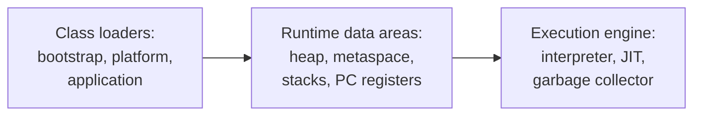
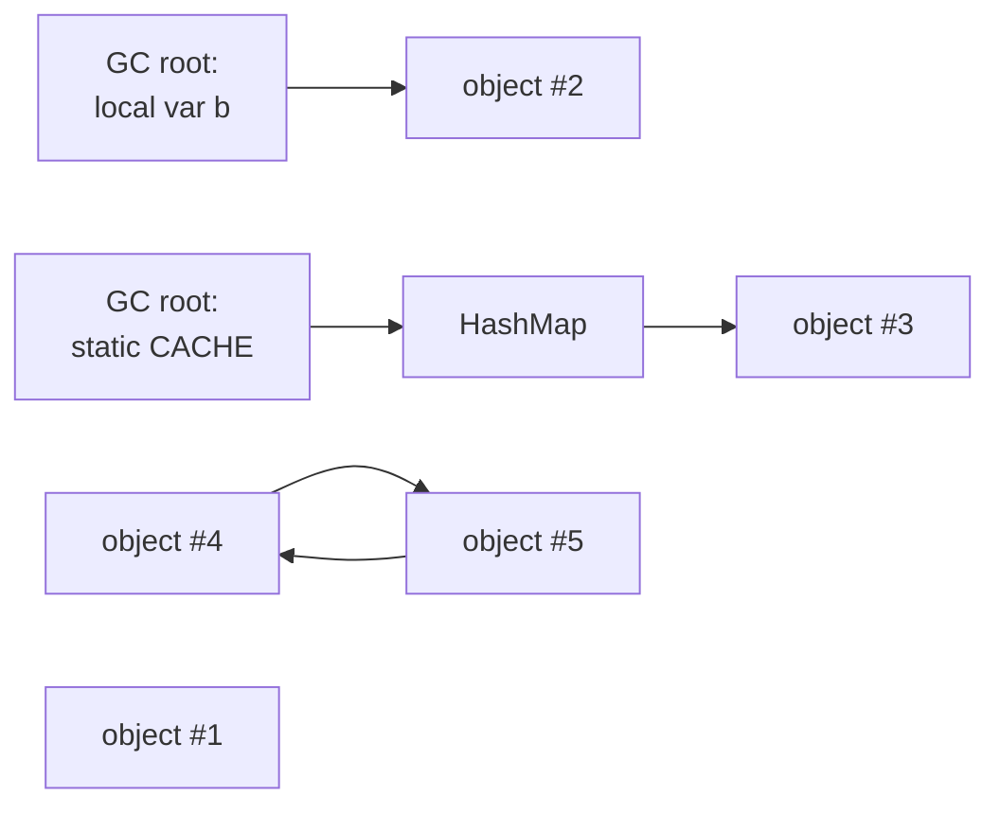
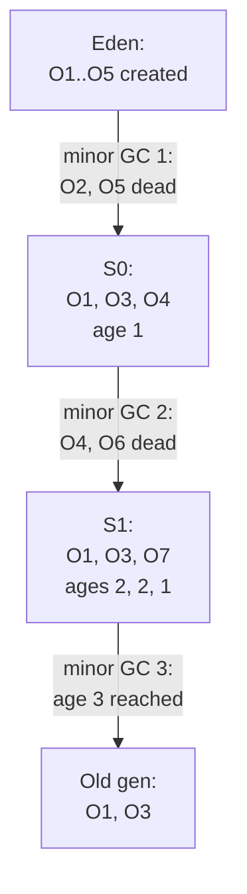

# Java Part 4: JVM Memory Model and Garbage Collection

## 1. JDK, JRE and the parts of the JVM [P1]

You run `java -jar app.jar`. Before your `main` runs, three pieces have done their jobs.

- The **JVM** (Java Virtual Machine) runs bytecode: the `.class` files the compiler produced. It loads classes, manages memory and turns bytecode into machine code.
- The **JRE** (Java Runtime Environment) is the JVM plus the standard class library. Enough to run a program.
- The **JDK** (Java Development Kit) is the JRE plus developer tools: `javac`, `jcmd`, `jmap`, `jstack`. Enough to build one. Since Java 11 there is no separate JRE download; you ship a JDK or build a trimmed runtime with `jlink`.

Inside the JVM:



- **Class loaders** load a class the first time it is used. A loader first asks its parent, and loads the class itself only if the parent cannot. This is **parent delegation**, and it stops your code from replacing `java.lang.String`. Bootstrap loads the core classes, platform loads the rest of the JDK, application loads your classpath.
- **Runtime data areas** are where data lives while the program runs: the heap and metaspace are shared by all threads; each thread has its own stack and program counter.
- The **execution engine** starts by interpreting bytecode. Methods that run often are compiled to machine code by the **JIT** (just-in-time) compiler: C1 compiles quickly, C2 optimises harder. This is why Java gets faster after warming up.

Say it like this: "The JDK builds, the JRE runs, and inside the JVM class loaders load classes by parent delegation, runtime areas hold the data, and the execution engine interprets, JIT-compiles hot code, and collects garbage."

## 2. Stack and heap [P0]

Here is a small program. Follow where each value lives.

```java
public static void main(String[] args) {
    MemoryDemo demo = new MemoryDemo();
    demo.run();
}

void run() {
    int count = 10;                        // a primitive
    Person p1 = new Person();              // an object
    Person p2 = p1;                        // a second reference to the same object
    String s1 = "24";                      // a string literal
    String s2 = "24";                      // the same literal
    String s3 = new String("24");          // a new String object
}
```

Two terms first:
- The **stack** is per thread. Every method call pushes a **frame** that holds the method's local variables: primitive values, and references (addresses) to objects. When the method returns, its frame is popped: last in, first out.
- The **heap** is shared by all threads. Every object created with `new` lives here, whoever created it.


What happens, step by step:
1. `main` starts. The main thread's stack gets a frame for `main`, holding `demo`, a reference to a `MemoryDemo` object on the heap.
2. `demo.run()` pushes a second frame on top.
3. `int count = 10` stores the value 10 directly in the frame.
4. `new Person()` creates the object on the heap. `p1` in the frame holds its address. `p2 = p1` copies the address, so both point to one object.
5. `"24"` is a literal, so it lives in the **String pool**, a table of unique strings inside the heap. `s1` and `s2` point to the same pooled string, so `s1 == s2` is true.
6. `new String("24")` always creates a new object outside the pool, so `s1 == s3` is false and `s1.equals(s3)` is true.
7. `run()` returns. Its frame is popped: `count`, `p1`, `p2`, `s1`, `s2`, `s3` are gone. The `Person` object is still on the heap, now with nothing pointing to it.
8. `main` returns and its frame is popped too. The heap still holds the objects; reclaiming them is the garbage collector's job (section 3).

What breaks:
- Each thread's stack has a fixed size, set by `-Xss` (about 1 MB by default on 64-bit Linux). Recursion with no base case keeps pushing frames until `java.lang.StackOverflowError`.
- The heap has a maximum size, `-Xmx`. When live objects no longer fit, the JVM throws `java.lang.OutOfMemoryError: Java heap space` (section 9).

Correction: "primitives live on the stack, objects on the heap" is only partly true. A primitive local variable lives in the frame, but a primitive field (`int age` inside `Person`) lives inside the object, on the heap. And the JIT can avoid heap allocation for an object that never escapes its method (**escape analysis**).

Also asked: why is the stack thread-safe? Each thread has its own stack, so local variables are never shared. Objects on the heap can be shared, and that is where races happen.

Say it like this: "Each thread's stack holds frames of local variables and references, popped when a method returns; every object lives on the shared heap until the garbage collector reclaims it."

## 3. When an object becomes garbage [P0]

```java
Person a = new Person();     // object #1
Person b = new Person();     // object #2
a = b;                        // a and b both point to #2
```

After the last line, nothing points to object #1. It is garbage. But "nothing points to it" is not exactly how the JVM decides.

The JVM starts from **GC roots** and follows references:
- local variables in every live stack frame,
- static fields of loaded classes,
- active threads,
- references held by native code (JNI).

Every object reachable from a root, directly or through other objects, is **live**. Everything else is garbage, whatever points to it.



- Object #2 is live: a local variable points to it.
- Object #3 is live through the static map. This is how most memory leaks happen (section 9).
- Objects #4 and #5 point to each other, but no root reaches them, so both are garbage. Reachability handles cycles, which reference counting cannot.
- Object #1 is garbage.

Correction: "an object is garbage when its reference count is zero." Java does not count references; it traces from roots, so unreachable cycles are collected.

**When the GC runs** is the JVM's decision, mostly when a memory area fills up. `System.gc()` only asks; the JVM may ignore it, and `-XX:+DisableExplicitGC` makes it ignore it always. Never rely on it in production code.

Also asked: `finalize()` was the old cleanup hook. It runs at an unknown time or never, and it is deprecated for removal (Java 18). Use try-with-resources, or `java.lang.ref.Cleaner` (Java 9).

Say it like this: "An object is garbage when no chain of references reaches it from a GC root, such as a stack variable, a static field or a live thread; cycles do not keep each other alive."

## 4. Strong, soft, weak and phantom references [P1]

An image service caches decoded images. It wants the cache to give memory back when the heap is tight, without anyone writing eviction code. That is what the reference types are for.

- **Strong reference**: the normal kind, `Person p = new Person()`. While it is reachable, the GC never collects the object.
- **Soft reference**: `new SoftReference<>(image)`. The GC may clear it, but only when memory is low. Before an `OutOfMemoryError`, all softly reachable objects are cleared. Good for memory-sensitive caches.
- **Weak reference**: `new WeakReference<>(obj)`. If only weak references reach the object, the next GC clears it, whether memory is low or not. `get()` then returns null. `WeakHashMap` holds its keys weakly, so an entry disappears once its key is no longer used elsewhere.
- **Phantom reference**: `get()` always returns null. It only tells you, through a `ReferenceQueue`, that the object has been collected, so you can clean up native resources. `Cleaner` is built on it.

```java
WeakReference<Person> ref = new WeakReference<>(new Person());
System.gc();          // a hint; if a GC runs, the Person is collected
ref.get();            // likely null
```

Correction: "a weak reference is deleted even if a variable references the object." If any strong reference reaches the object, it stays. A weak reference only stops being enough on its own.

Say it like this: "Strong keeps the object, soft lets the GC take it when memory is low, weak lets the GC take it at the next collection, and phantom only tells me it is gone."

## 5. Generations: Eden, survivors, old and promotion [P0]

A web service creates thousands of objects per request: DTOs, strings, iterators. Almost all are garbage a few milliseconds later. A few, such as caches and connection pools, live for hours. Checking the long-lived ones on every collection would waste time. So the heap is split by age.

This rests on the **weak generational hypothesis**: most objects die young.


- The **young generation** has three parts: **Eden**, where every new object is created, and two **survivor spaces**, S0 and S1. One survivor space is always empty.
- The **old generation** (tenured) holds objects that have survived many collections.
- **Metaspace** holds class metadata. It is outside the heap (section 7).

Terms for the walk-through:
- A **minor GC** collects the young generation only. It is frequent and fast, because most objects there are dead.
- An object's **age** is how many minor GCs it has survived.
- **Promotion** moves an object to the old generation once its age reaches the **tenuring threshold**, `-XX:MaxTenuringThreshold` (default 15, also the maximum, because the age is stored in 4 bits of the object header).

### A minor GC, step by step

The example uses a threshold of 3 so it stays short.



1. The app creates O1 to O5. All go to Eden.
2. Eden fills, so a minor GC starts. It pauses the app threads (a **stop-the-world** pause), finds O1, O3 and O4 still reachable, and **copies** them to S0 with age 1. Eden is then wiped in one go. O2 and O5 were never touched: dead objects cost nothing.
3. The app creates O6 and O7 in Eden.
4. Next minor GC: O4 and O6 are dead. Live objects from Eden and S0 (O1, O3, O7) are copied to S1. O1 and O3 become age 2, O7 is age 1. Eden and S0 are now empty. The two survivor spaces swap roles every time.
5. Next minor GC: O1 and O3 reach age 3, the threshold. They are **promoted** to the old generation. O7 moves back to S0 with age 2.

Correction: the young generation is not collected with mark-sweep. It uses **copying**: live objects are copied out and the source space is cleared at once. That is why survivor spaces exist.

What goes wrong:
- If the survivor space is too small for the live objects, they are promoted early (**premature promotion**). Short-lived objects pile up in the old generation.
- When the old generation fills, a **major GC** (or full GC) collects it, usually with a much longer pause.

Also asked: very large objects (a big array) may be allocated straight in the old generation, or in G1's humongous regions, because copying them between survivor spaces is expensive.

Say it like this: "New objects go to Eden; each minor GC copies the survivors between S0 and S1 and ages them; at the tenuring threshold, 15 by default, they are promoted to the old generation, which is collected less often by a major GC."

## 6. How a collector reclaims memory: mark, sweep, compact, copy [P0]

Every collector does some combination of four moves.

- **Mark**: start at the GC roots and mark every reachable object. Only live objects are visited.
- **Sweep**: walk the memory and free everything that was not marked.
- **Compact**: slide the live objects together so the free space is one block.
- **Copy**: copy live objects to an empty area and clear the old area wholesale (the young generation, section 5).


Why compact: after a plain sweep, free memory is scattered in small holes (**fragmentation**). A large array may not fit in any hole even though the total free space is enough. Compaction fixes that, at the cost of moving objects and updating every reference to them.

Correction: "mark-and-sweep marks the unreferenced objects for deletion." The mark phase marks the reachable, live objects. Everything left unmarked is what the sweep frees.

Say it like this: "The collector marks everything reachable from the roots, sweeps the rest, and compacts or copies the survivors so free space is not fragmented."

## 7. Metaspace and PermGen [P1]

A service that generates classes at runtime (proxies, a scripting engine) keeps loading new classes. Where does their metadata go?

- **Metaspace** (Java 8+) stores class metadata: class structures, method bytecode and the constant pool. It lives in native memory, outside the heap, and grows as needed. Cap it with `-XX:MaxMetaspaceSize`; by default it has no limit.
- **PermGen** (up to Java 7) held the same data inside a fixed-size area. It filled up with `OutOfMemoryError: PermGen space`, which was common in app servers that redeployed many times. Java 8 removed it.

Correction: static variables and the String pool are not in metaspace. Since Java 7 they live in the heap.

A class's metadata is freed only when its class loader becomes unreachable. A leaked class loader keeps every class it loaded, and metaspace grows until `OutOfMemoryError: Metaspace`.

Say it like this: "Since Java 8, class metadata lives in metaspace, in native memory, which grows as needed instead of PermGen's fixed size; static fields and the String pool are on the heap."

## 8. The collectors: Serial, Parallel, CMS, G1, ZGC [P0]

Two services pick a collector. A nightly batch job wants maximum work per second and does not care about a 2-second pause. A checkout API must answer within 200 ms, so a 2-second pause breaks it. These are the two goals every collector trades off:
- **Throughput**: the share of time spent running the app instead of collecting.
- **Latency**: how long the app pauses during a collection.

A **stop-the-world (STW) pause** freezes every application thread while the collector works. Collectors differ in how much work they do inside the pause.

**Serial GC** (`-XX:+UseSerialGC`): one GC thread, all work stop-the-world. Small heaps and single-CPU containers. The JVM picks it automatically on machines with one CPU or under about 1792 MB of memory.

**Parallel GC** (`-XX:+UseParallelGC`): many GC threads, still stop-the-world. Best throughput, longer pauses. The default up to Java 8. Good for batch jobs.

**CMS** (Concurrent Mark Sweep): marked the old generation concurrently with the app to shorten pauses, but did not compact, so it fragmented and sometimes fell back to a long full GC. Deprecated in Java 9 and **removed in Java 14**.

Correction: "the latest Java versions use CMS." CMS no longer exists. Modern Java uses G1 by default, with ZGC for very low pauses.

**G1** (Garbage First, `-XX:+UseG1GC`), the default since Java 9:


- The heap is split into equal **regions** (1 to 32 MB). Each region is Eden, survivor, old or **humongous** (an object at least half a region) at any moment, so generations are sets of regions, not fixed blocks.
- Marking runs concurrently with the app.
- It collects the regions with the most garbage first (hence the name), copying their live objects into free regions. Copying compacts as it goes.
- It aims for a pause target, `-XX:MaxGCPauseMillis` (default 200 ms), by choosing how many regions to collect in each pause.

**ZGC** (`-XX:+UseZGC`): does almost everything concurrently, including moving objects, so pauses stay under about a millisecond whatever the heap size, up to terabytes. It costs some throughput and CPU. Generational since Java 21; generational is the default from Java 23. **Shenandoah** is a similar low-pause collector, built by Red Hat.

Which to pick:
- Default to G1. It balances throughput and pauses for most services.
- Pure throughput, pauses do not matter (batch): Parallel.
- Very strict latency or very large heaps: ZGC.
- Tiny heap or one CPU: Serial.
- Measure with GC logs (`-Xlog:gc*`) before tuning anything.

Say it like this: "Serial and Parallel stop the world, Parallel with many threads for throughput; G1, the default since Java 9, collects the garbage-heaviest regions within a pause target; ZGC does nearly all its work concurrently for sub-millisecond pauses; CMS was removed in Java 14."

## 9. OutOfMemoryError and memory leaks [P0]

A service runs fine for three days, then dies with `java.lang.OutOfMemoryError: Java heap space`. Restarting fixes it for three more days. That pattern is a **memory leak**: objects the program no longer needs but still references, so the GC can never free them.

The broken version:

```java
class SessionStore {
    static final Map<String, Session> SESSIONS = new HashMap<>();
    void login(String id, Session s) { SESSIONS.put(id, s); }
    // logout never removes the entry
}
```

The static map is a GC root, so every session ever created stays reachable. Memory climbs after every GC until the heap is full.

The fixed version:

```java
void logout(String id) { SESSIONS.remove(id); }      // remove on logout
// and bound it: an LRU with removeEldestEntry, or Caffeine with expireAfterAccess
```

Common leaks:
- static collections that only grow (caches with no size limit or expiry);
- listeners and callbacks registered and never removed;
- `ThreadLocal` values in thread pools: pool threads never die, so values never go away unless `remove()` is called;
- unclosed connections and streams (use try-with-resources);
- inner classes holding a hidden reference to their outer object.

The `OutOfMemoryError` messages and what each means:
- `Java heap space`: live objects do not fit in `-Xmx`. A leak, or a heap that is too small.
- `GC overhead limit exceeded`: the JVM spends over 98% of its time in GC and frees under 2% of the heap. Almost always a leak. (Parallel GC.)
- `Metaspace`: too many classes loaded, often a class loader leak.
- `unable to create native thread`: the OS will not give another thread, from too many threads or a process limit.
- `Direct buffer memory`: off-heap NIO buffers exceed `-XX:MaxDirectMemorySize`.

How to diagnose:
- Turn on `-XX:+HeapDumpOnOutOfMemoryError` (with `-XX:HeapDumpPath`), so the JVM writes a heap dump when it dies.
- Take a dump on a live process: `jcmd <pid> GC.heap_dump file.hprof`.
- Open it in Eclipse MAT. Its leak suspects report shows what holds the most memory and the reference chain from a GC root to it.
- GC logs (`-Xlog:gc*:file=gc.log`): if the heap after each full GC keeps rising, it is a leak; if it stays flat but near the limit, the heap is too small.

Say it like this: "A Java memory leak is an object still reachable from a root, such as a static map, that the program no longer needs; I confirm it with GC logs and a heap dump in Eclipse MAT, then remove or bound whatever holds the references."

## 10. The JVM inside a container [P1]

A Spring Boot service runs in a Kubernetes pod with a 1 GiB memory limit. Two things can go wrong.

- With no heap flags, the JVM sets the maximum heap to **25%** of the container's memory (`-XX:MaxRAMPercentage` defaults to 25). Only 256 MB of heap: `OutOfMemoryError` while most of the pod's memory sits unused.
- With `-Xmx1g`, the heap alone fills the limit. The JVM also needs memory outside the heap: metaspace, thread stacks, the JIT's code cache, GC structures and direct buffers. The pod goes over 1 GiB, and Kubernetes kills it with **OOMKilled** (exit code 137). There is no Java exception and no heap dump: the kernel killed the process.

The fix: size the heap as a share of the container and leave room for the rest.

```text
-XX:MaxRAMPercentage=75      # heap = 75% of the pod's limit, about 768 MB here
```

The JVM reads the container's limits since Java 10 (and 8u191), through `-XX:+UseContainerSupport`, which is on by default.

Also asked: "OOMKilled vs OutOfMemoryError?" `OutOfMemoryError` is the JVM refusing an allocation inside its heap or another area it manages; the process can log it and write a heap dump. OOMKilled is the operating system ending the whole process for exceeding the container's limit.

Say it like this: "In a container I set MaxRAMPercentage around 75 so the heap scales with the pod's limit and leaves room for metaspace, thread stacks and direct memory; otherwise the kernel OOMKills the pod with exit code 137."

## 11. Complete example: watch a leak, then fix it [P0]

```java
// Run with: -Xmx64m -Xlog:gc -XX:+HeapDumpOnOutOfMemoryError
public class LeakDemo {
    static final List<byte[]> CACHE = new ArrayList<>();

    public static void main(String[] args) throws InterruptedException {
        while (true) {
            CACHE.add(new byte[1024 * 1024]);   // 1 MB that is never removed
            Thread.sleep(10);
        }
    }
}
```

Expected behaviour:
- The GC log shows young collections at first, then full GCs whose "heap after" figure rises every time, because everything in `CACHE` is reachable from a static field.
- After about 60 additions the JVM throws `OutOfMemoryError: Java heap space` and writes `java_pid<pid>.hprof`.
- In Eclipse MAT, the leak suspect is `LeakDemo.CACHE`, an `ArrayList` holding almost the whole heap.

The fix bounds the cache, so old entries become unreachable and the GC can free them:

```java
static final Map<Integer, byte[]> CACHE = new LinkedHashMap<>(16, 0.75f, true) {
    protected boolean removeEldestEntry(Map.Entry<Integer, byte[]> e) { return size() > 20; }
};
// in the loop: CACHE.put(i++, new byte[1024 * 1024]);
```

With the fix, the heap after each GC stays flat at about 20 MB, and the program runs forever.

**Before the next part:** from memory, draw the heap as Eden, S0, S1 and old, then walk five objects through three minor GCs with a threshold of 3, writing each object's age after every collection.
