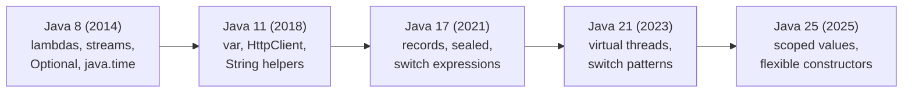
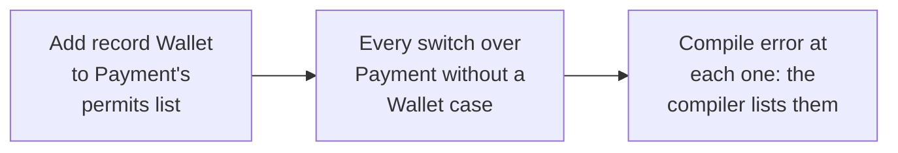

# Java Part 5: Java 17 to 25: Records, Sealed Types and Pattern Matching

## 1. What changed from Java 8 to 25 [P0]

A team moves a payments service from Java 8 to Java 21. Code review starts flagging old habits: a 60-line DTO class with getters, `equals` and `hashCode`; `if (x instanceof Card) { Card c = (Card) x; ... }`; a `switch` with a forgotten `break`. Each has a modern replacement, and interviewers ask about them to check you write today's Java.

Java releases a new version every six months. Every two years one of them is a **long-term support (LTS)** release, which vendors patch for years; teams usually upgrade from one LTS to the next.



What each LTS brought that you actually use:
- **Java 8**: lambdas and method references, the Stream API, `Optional`, `java.time` (`LocalDate`, `Instant`), default methods on interfaces.
- **Java 11**: `var` for local variables (from Java 10), the built-in `HttpClient`, String methods `isBlank()`, `strip()`, `lines()`, `repeat()`, and running a single `.java` file with `java App.java`. The separate JRE download was dropped.
- **Java 17**: records, sealed classes, pattern matching for `instanceof`, switch expressions, text blocks, and "helpful" NullPointerException messages that name the null variable. Spring Boot 3 requires at least Java 17.
- **Java 21**: virtual threads, pattern matching for `switch`, record patterns, and sequenced collections (`getFirst()`, `getLast()`, `reversed()` on lists, deques and ordered sets).
- **Java 25** (September 2025, the current LTS): scoped values (a safer `ThreadLocal` for virtual threads), flexible constructor bodies (statements, such as validation, before `super(...)`), compact source files with a plain `void main()`, module import declarations, and compact object headers (smaller object headers, enabled with `-XX:+UseCompactObjectHeaders`).

Correction: "Java 9 to 16 don't matter because they weren't LTS." Most features you use from 17 arrived in those releases as previews or finals (switch expressions in 14, text blocks in 15, records and `instanceof` patterns in 16). The LTS bundles them.

Say it like this: "From 8 I use lambdas, streams and java.time; from 11, var and the HTTP client; from 17, records, sealed types, switch expressions and text blocks; from 21, virtual threads and pattern matching for switch; and 25 is the current LTS with scoped values and flexible constructors."

## 2. Records [P0]

The payments service has a `Money` DTO: two fields, a constructor, two getters, `equals`, `hashCode` and `toString`, all hand-written, and the `hashCode` forgot the currency.

A **record** declares a class whose whole state is a fixed list of components, and the compiler writes the rest:

```java
public record Money(BigDecimal amount, String currency) {

    public Money {                                   // compact constructor
        Objects.requireNonNull(amount);
        if (amount.signum() < 0) throw new IllegalArgumentException("negative");
        currency = currency.toUpperCase();           // normalise before assignment
    }

    public Money plus(Money o) {                     // methods are allowed
        return new Money(amount.add(o.amount), currency);
    }
}
```

What the compiler generates:
- a `private final` field per component, and the class is `final`;
- the **canonical constructor** taking every component;
- accessors named after the components: `amount()`, `currency()` (no `get` prefix);
- `equals`, `hashCode` and `toString` from all components.

The **compact constructor** (no parameter list) runs before the fields are assigned: validate and normalise the parameters there, without writing `this.x = x`.

Records can implement interfaces, have static fields and factories, and nested records. They are ideal for DTOs, API request and response bodies, events, map keys and value objects.

When a record is the **wrong choice**:
- **JPA entities**: JPA needs a no-argument constructor, mutable fields, and subclass proxies for lazy loading. Records are final and immutable. Use records for DTOs and query projections instead.
- When you need **inheritance**: a record cannot extend a class (it already extends `java.lang.Record`).
- When state must **change over time**, or there are many optional fields (a builder reads better than a 12-argument constructor).

Correction: "records are deeply immutable." They are shallowly immutable: a `List` component can still be changed by whoever else holds it. Copy it in the compact constructor: `items = List.copyOf(items);`.

Say it like this: "A record is a final, shallowly immutable data class: the compiler generates the fields, canonical constructor, accessors, equals, hashCode and toString, and I validate in the compact constructor. I don't use records for JPA entities or anything that needs inheritance or mutation."

## 3. Sealed classes and interfaces [P0]

A payment is a card payment, a UPI payment or net banking. Nothing else exists, but nothing in a normal interface says so: any class anywhere can implement `Payment`, and every `if/else` chain over payments ends with an `else` that "should never happen".

A **sealed** class or interface lists exactly which types may extend it:

```java
public sealed interface Payment permits Card, Upi, NetBanking { }

public record Card(String last4, long amountPaise) implements Payment { }
public record Upi(String vpa, long amountPaise) implements Payment { }
public final class NetBanking implements Payment { /* ... */ }
```

Rules:
- Every permitted subtype must say how it continues: `final` (records already are), `sealed` (with its own `permits` list), or `non-sealed` (open again to anyone).
- A class not in the list cannot implement `Payment`: compile error.
- The permitted subtypes must be in the same module, or the same package if there are no modules (or in the same file, where `permits` can be left out).

What it gives you:
- Against a normal interface: the set of cases is **closed and known to the compiler**, so it can check that a `switch` handles every case (section 4).
- Against an enum: each case can be a **different type with its own data** (a card's last four digits, a UPI address), not just a constant.

Say it like this: "A sealed type names its permitted subtypes, so the hierarchy is closed; with records as the cases, I get a closed set of data types the compiler knows about, which makes switches over them checkable for exhaustiveness."

## 4. Pattern matching and switch expressions [P0]

**Pattern matching for instanceof** (Java 16) tests and binds in one step:

```java
// before
if (obj instanceof String) {
    String s = (String) obj;
    use(s.length());
}
// Java 16+
if (obj instanceof String s && !s.isBlank()) {
    use(s.length());
}
```

`s` exists only where the test succeeded, so it can be used in the same condition.

**Switch expressions** (Java 14) use arrows, never fall through, accept several labels per case, and produce a value:

```java
int days = switch (month) {
    case FEB -> leap ? 29 : 28;
    case APR, JUN, SEP, NOV -> 30;
    default -> 31;
};
```

Inside a block, return the value with `yield`: `case FEB -> { log(month); yield 28; }`.

**Pattern matching for switch** (Java 21) matches on types, takes records apart with **record patterns**, and adds conditions with `when` guards. With a sealed type, the compiler checks the switch covers every case, so no `default` is needed:

```java
String describe(Payment p) {
    return switch (p) {
        case Card c when c.amountPaise() > 100_000 -> "large card payment";
        case Card(String last4, long amount)       -> "card ending " + last4;
        case Upi u                                 -> "UPI from " + u.vpa();
        case NetBanking n                          -> "net banking";
    };   // exhaustive: no default
}
```



1. Someone adds a fourth payment type, `Wallet`, to the `permits` list.
2. Every switch over `Payment` that has no `default` is now incomplete.
3. Each one fails to compile, so the compiler finds every place that must handle wallets. With an `if/else` chain or a `default` branch, the new case would silently fall into the wrong branch at runtime.

Sealed types + records + pattern matching together give Java **algebraic data types**: a closed set of cases, each carrying its own data, handled by exhaustive matching. Java 22 also added the unnamed pattern `_` for components you don't need: `case Card(var last4, _) -> ...`.

**Text blocks** (Java 15) are multi-line string literals between `"""` delimiters, for SQL, JSON or HTML in code. The indentation common to all lines is stripped, based on the closing delimiter:

```java
String sql = """
    SELECT id, total
    FROM orders
    WHERE user_id = ?
    """;
```

Use `.formatted(...)` to insert values into text, but never to build SQL from user input: keep the `?` parameters.

Correction: "a switch over a sealed type still needs a default, just in case." Adding `default` throws away the compile-time check: a new subtype would then be handled by the default silently.

Say it like this: "Pattern matching for instanceof tests and binds without a cast; switch expressions have arrows, no fall-through and return a value; since Java 21, switch matches types and record patterns with when guards, and over a sealed type it is checked for exhaustiveness, so adding a subtype breaks every switch that doesn't handle it at compile time."

## 5. Complete example: a payment fee calculator [P0]

Model three payment types and compute the fee for each, so that adding a payment type cannot be forgotten anywhere:

```java
public sealed interface Payment permits Card, Upi, NetBanking { }
public record Card(String last4, long amountPaise, boolean international) implements Payment { }
public record Upi(String vpa, long amountPaise) implements Payment { }
public record NetBanking(String bank, long amountPaise) implements Payment { }

public final class Fees {
    public static long feePaise(Payment p) {
        return switch (p) {
            case Card c when c.international() -> c.amountPaise() * 3 / 100;   // 3%
            case Card c                        -> c.amountPaise() * 2 / 100;   // 2%
            case Upi u                         -> 0;                           // free
            case NetBanking(var bank, var amt) -> Math.max(1_000, amt / 100);  // 1%, min Rs 10
        };
    }
}
```

Expected behaviour:
- `feePaise(new Card("4242", 50_000, false))` returns `1000` (2% of Rs 500).
- `feePaise(new Card("4242", 50_000, true))` returns `1500`: the guarded case comes first and wins.
- `feePaise(new Upi("ana@bank", 50_000))` returns `0`.
- `feePaise(new NetBanking("HDFC", 50_000))` returns `1000` (the minimum of Rs 10 applies).
- Adding `record Wallet(...) implements Payment` to the `permits` list makes `Fees` fail to compile until a `Wallet` case is added.
- Swapping the two `Card` cases is a compile error: the unguarded `Card c` would dominate the guarded one, so the guarded case could never match.

**Before the next part:** from memory, write a sealed `Shape` with three record cases and an exhaustive `area` switch using a record pattern and a `when` guard, then say what changes when you add a fourth shape, and why you would not add a `default`.
