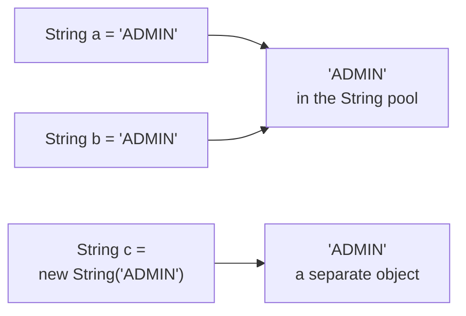
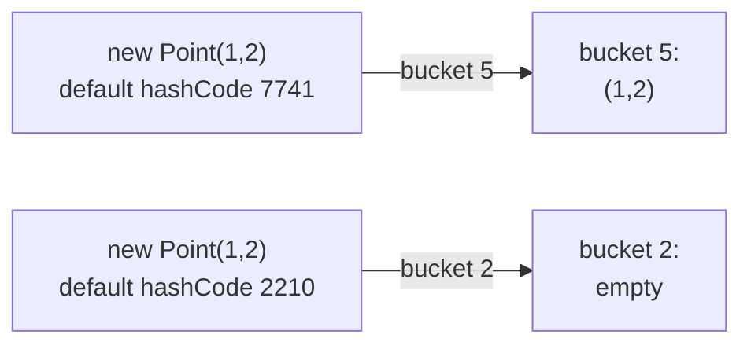
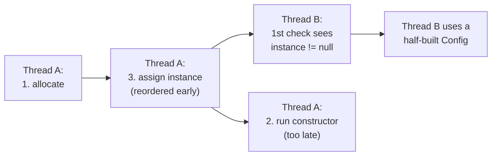

# Java Part 6: Strings, Immutability, equals/hashCode and Singletons

## 1. Strings and the String pool [P0]

A login service compares the role from a request with `"ADMIN"`:

```java
// Broken
String role = request.getParameter("role");   // "ADMIN", read from the request
if (role == "ADMIN") { grantAdmin(); }         // false: never runs
```

The text matches, but `==` is false, because `==` on objects compares **references** (are these the same object?), not contents.

Where Strings live:
- A **string literal** such as `"ADMIN"` goes into the **String pool**, a table of unique strings kept on the heap (since Java 7). Every literal `"ADMIN"` in the program refers to that one pooled object.
- `new String("ADMIN")`, and strings built at runtime (read from a request, concatenated in a loop), are **new objects outside the pool**.
- `s.intern()` returns the pooled copy of `s`, adding it if it is not there yet.



1. `a` and `b` are the same literal, so both point at the one pooled object: `a == b` is true.
2. `c` is a new object with the same text: `a == c` is false, `a.equals(c)` is true.

```java
// Fixed
if ("ADMIN".equals(role)) { grantAdmin(); }    // literal first: no NullPointerException if role is null
```

Always compare Strings with `equals` (or `equalsIgnoreCase`). `==` only works by accident, when both happen to be pooled.

Say it like this: "String literals are stored once in the String pool and shared; `new String` and runtime strings are separate objects, so I compare Strings with `equals`, never `==`."

## 2. Why Strings are immutable [P0]

Sharing one pooled `"ADMIN"` between every class in the program is only safe because nobody can change it. A `String` cannot be modified after creation: methods like `toUpperCase()` or `replace()` return a **new** String.

Four reasons, each a real benefit:
- **The pool**: one object can be shared by the whole program. If Strings were mutable, one class could change `"ADMIN"` to `"GUEST"` for everyone.
- **Security**: a value is checked, then used (a file path, a URL, a class name, a database user). If it could change between the check and the use, the check would mean nothing.
- **Hashing**: a String caches its `hashCode` after the first call, and a String key can never change after being put into a `HashMap`, so it never ends up in the wrong bucket. Strings are the ideal map key.
- **Thread safety**: immutable objects can be shared across threads with no locking.

Correction: "immutable means `final`." The `String` class is `final` (so nobody can subclass it and add mutable behaviour), but immutability comes from having no methods that change its state. A `final` variable only means the variable cannot point to another object.

Say it like this: "Strings are immutable so the pool can share them safely, a checked value can't change after the check, the hash code can be cached and keys never drift, and they are thread-safe for free."

## 3. String vs StringBuilder vs StringBuffer [P0]

A report joins 50,000 lines:

```java
// Broken: slow
String report = "";
for (String line : lines) {
    report += line + "\n";      // copies everything built so far, every time
}
```

Each `+=` creates a new String and copies all the characters built so far into it. For n lines that is about n*n/2 character copies: O(n^2). With 50,000 lines it takes seconds and creates 50,000 throwaway objects.

```java
// Fixed: one growable buffer
StringBuilder sb = new StringBuilder();
for (String line : lines) {
    sb.append(line).append('\n');
}
String report = sb.toString();
```

- **String**: immutable. Fine for values that do not change, and for a single expression like `a + ":" + b` (the compiler turns it into one efficient concatenation).
- **StringBuilder**: mutable, not synchronised, fast. Use it for building strings in loops. This is almost always the right choice.
- **StringBuffer**: the same as StringBuilder but every method is `synchronized`. From Java 1.0; rarely needed, because a string being built is almost never shared between threads.

Say it like this: "String is immutable, so concatenating in a loop is quadratic; I build strings with StringBuilder, which is unsynchronised and fast, and StringBuffer is the old synchronised version I almost never need."

## 4. Writing an immutable class [P0]

An `Order` is passed to a pricing service and an audit logger. The pricing service adds a free item to the order's list, and the audit log now records something the customer never ordered.

```java
// Broken: looks immutable, isn't
public final class Order {
    private final List<String> items;
    public Order(List<String> items) { this.items = items; }      // keeps the caller's list
    public List<String> items() { return items; }                  // hands out the same list
}
```

`final` stops `items` pointing to another list, but anyone holding the list can still change it.

The five rules:
1. Make the class `final`, so a subclass cannot add mutable state.
2. Make every field `private final`.
3. **Copy mutable inputs** in the constructor.
4. Provide no setters; "changes" return a new object.
5. **Never hand out a mutable field**: return a copy or an unmodifiable view.

```java
// Fixed
public final class Order {
    private final String id;
    private final List<String> items;

    public Order(String id, List<String> items) {
        this.id = id;
        this.items = List.copyOf(items);      // rule 3: an unmodifiable copy
    }
    public String id() { return id; }
    public List<String> items() { return items; }   // rule 5: already unmodifiable
    public Order withItem(String item) {             // rule 4: a new object
        var next = new ArrayList<>(items);
        next.add(item);
        return new Order(id, next);
    }
}
```

`List.copyOf` makes an unmodifiable copy, so it covers rules 3 and 5 at once.

Correction: "a record is fully immutable." A record's fields cannot be reassigned, but it is only **shallowly** immutable: a `List` component can still be changed by whoever else holds it. Copy it in the compact constructor:

```java
public record Order(String id, List<String> items) {
    public Order { items = List.copyOf(items); }
}
```

**Shallow vs deep copy.** A shallow copy (what `Object.clone()` does by default) creates a new outer object whose fields point to the **same** inner objects. A deep copy also copies the mutable objects inside. Prefer a copy constructor or a static factory (`Order.copyOf(other)`) to `clone()`, which is awkward (a checked exception, a cast, and easy to leave shallow). With immutable inner objects, a shallow copy is all you need.

Say it like this: "An immutable class is final, with private final fields, defensive copies in and out, and no setters; a record gives me most of it, but I still copy mutable components like lists."

## 5. The equals and hashCode contract [P0]

A `HashSet<Point>` should hold unique points, yet it holds two copies of `(1, 2)`. `Point` overrides `equals` but not `hashCode`.

How a `HashMap` (and `HashSet`, which uses one inside) finds an entry:
1. `hashCode()` picks the **bucket**.
2. Inside the bucket, `equals()` picks the **entry**.



1. The first point's default `hashCode` (based on identity) sends it to bucket 5.
2. An equal point gets a different default `hashCode`, so it goes to bucket 2. `equals` is never even called, because it only compares entries in the same bucket. The set stores a duplicate, and `contains` returns false.

**The contract**:
- If `a.equals(b)`, then `a.hashCode() == b.hashCode()`. This is the rule that matters.
- The reverse is not required: unequal objects may share a hash code (a **collision**). The map handles it by checking `equals` in the bucket.
- `equals` must be reflexive, symmetric, transitive, consistent, and `x.equals(null)` is false.

Overriding only one breaks it either way:
- Only `equals`: equal objects land in different buckets. Lookups fail, sets hold duplicates.
- Only `hashCode`: equal objects share a bucket, but the default `equals` compares identity, so they still never match.

```java
// Fixed: both from the same fields
@Override public boolean equals(Object o) {
    return o instanceof Point p && x == p.x && y == p.y;
}
@Override public int hashCode() { return Objects.hash(x, y); }
// or simply: record Point(int x, int y) {}  (writes both)
```

Keys must also be **immutable**. Put a mutable `Point(1, 2)` into a map, then change its `x` to 5: the entry stays in the bucket for `(1, 2)`, but its key now hashes somewhere else. Neither the old nor the new value can find it, and it is never removed: a memory leak. That is the hashing reason for String immutability again.

Say it like this: "Equal objects must have equal hash codes; HashMap uses hashCode to pick the bucket and equals to find the entry, so overriding only equals sends equal keys to different buckets, and overriding only hashCode still compares identity. I build both from the same immutable fields, or use a record."

## 6. Autoboxing and the Integer cache [P1]

**Autoboxing** converts between primitives and their wrapper objects automatically: `Integer x = 5` calls `Integer.valueOf(5)`; `int y = x` calls `x.intValue()`.

`Integer.valueOf` keeps a cache of `Integer` objects for -128 to 127, so boxed values in that range are shared:

```java
Integer a = 127, b = 127;
a == b;            // true: both from the cache
Integer c = 128, d = 128;
c == d;            // false: two different objects
c.equals(d);       // true
```

Three traps:
- `==` on wrappers compares references. It works for small values by accident and fails above 127. Compare with `equals`, or unbox first.
- Unboxing `null` throws `NullPointerException`: `int n = map.get("missing");` fails on a line that looks safe.
- Boxing in a hot loop creates an object per iteration. `Long sum = 0L; for (...) sum += i;` makes millions of `Long`s; use the primitive `long`.

`Long`, `Short`, `Byte` and `Character` (0 to 127) have similar caches; `Double` and `Float` do not.

Say it like this: "Autoboxing calls valueOf, which caches -128 to 127, so == on Integers works by accident only for small values; I compare wrappers with equals, watch for unboxing null, and use primitives in hot loops."

## 7. A thread-safe, lazy Singleton [P0]

A `Config` must be created once, lazily, and shared by every thread. A first attempt:

```java
// Broken: two threads can both see null and create two instances
public static Config get() {
    if (instance == null) instance = new Config();
    return instance;
}
```

Making the whole method `synchronized` fixes it, but every call then takes a lock forever, even after the instance exists. **Double-checked locking** takes the lock only while creating it:

```java
public final class Config {
    private static volatile Config instance;          // volatile is essential
    private Config() { }

    public static Config get() {
        Config c = instance;                           // 1st check, no lock
        if (c == null) {
            synchronized (Config.class) {
                c = instance;                          // 2nd check, with the lock
                if (c == null) instance = c = new Config();
            }
        }
        return c;
    }
}
```

Why the second check: another thread may have created the instance while this one waited for the lock.

Why `volatile`: `instance = new Config()` is three steps: allocate memory, run the constructor, assign the reference to the field. Without `volatile`, the JIT compiler or the CPU may **reorder** them and publish the reference before the constructor finishes.



1. Thread A allocates the object and, reordered, assigns it to `instance` before running the constructor.
2. Thread B does the first check without a lock, sees a non-null `instance`, and returns it.
3. Thread B reads fields the constructor has not set yet: nulls and zeros, a rare and nasty bug.
4. `volatile` forbids this reordering: everything the constructor wrote **happens before** the volatile write, and any thread that reads the field sees the finished object.

Simpler options that are already thread-safe:
- **Eager**: `private static final Config INSTANCE = new Config();` Class initialisation is thread-safe; not lazy.
- **Holder idiom**: a nested `private static class Holder { static final Config I = new Config(); }`, returned by `get()`. The JVM loads `Holder` only on the first `get()`, so it is lazy, with no lock and no `volatile`.
- **Enum**: `enum Config { INSTANCE; }` Thread-safe and safe from reflection and serialization; recommended by Effective Java.

In a Spring application, beans are singletons per container by default, so you rarely hand-write one.

Say it like this: "Double-checked locking checks without a lock, then locks and checks again; the field must be volatile because creating an object is allocate, construct, publish, and without volatile the publish can be reordered before construction, so another thread could see a half-built object. The holder idiom or an enum is simpler."

## 8. How a Singleton gets broken [P1]

- **Reflection**: `Constructor.setAccessible(true)` calls the private constructor and creates a second instance. Defence: throw from the constructor if an instance already exists.
- **Serialization**: deserializing creates a new object. Defence: add `private Object readResolve() { return INSTANCE; }` so the deserialized copy is replaced by the real one.
- **Cloning**: if the class (or a parent) is `Cloneable`, `clone()` copies it. Defence: do not implement `Cloneable`, or override `clone()` to throw.
- **Several class loaders** (application servers, plugins) each load the class and get their own instance.

An **enum** singleton is immune to the first three: the JVM forbids reflective creation of enum constants, and serialization maps enum constants back to the existing instance.

Say it like this: "Reflection, serialization and cloning can each create a second instance; I guard with a constructor check, readResolve and no Cloneable, or simply use an enum, which the JVM protects from all three."

## 9. Complete example: a thread-safe settings cache [P0]

Write a `Settings` singleton that holds an immutable map of key -> value, can be reloaded, and is safe for many threads:

```java
public final class Settings {
    private static final class Holder { static final Settings I = new Settings(); }
    public static Settings get() { return Holder.I; }      // lazy, no lock

    private volatile Map<String, String> values = Map.of();  // swapped atomically

    private Settings() { }

    public String value(String key) { return values.get(key); }

    public void reload(Map<String, String> fresh) {
        values = Map.copyOf(fresh);          // new immutable map, then one volatile write
    }
}
```

Expected behaviour:
- `Settings.get() == Settings.get()` is true from every thread: one instance, created on the first call.
- A reader during `reload` sees either the whole old map or the whole new map, never a half-updated one: the map is immutable and replaced with a single volatile write.
- `Settings.get().value("timeout")` after `reload(Map.of("timeout", "30"))` returns `"30"` on every thread.
- Changing the map passed to `reload` afterwards has no effect: `Map.copyOf` took a copy.

**Before the next part:** from memory, write the double-checked locking singleton and explain, step by step, what goes wrong without `volatile`; then write a `Point` with `equals` and `hashCode`, and say what a `HashSet` does if you delete the `hashCode`.
