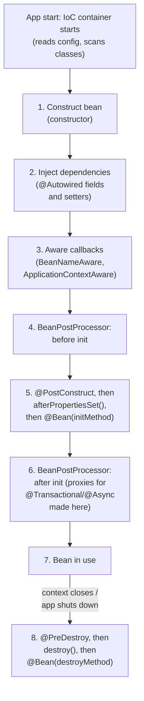
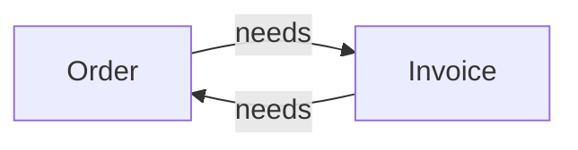
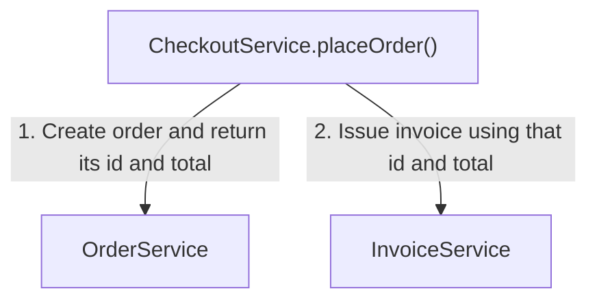

# Spring Part 2: Beans, Lifecycle and Dependency Injection

The questions, from most to least asked: **the bean lifecycle**, **constructor vs field vs setter injection**, **circular dependencies**, **two beans of one type**, **eager vs lazy**, **`@Component` vs `@Bean`**, **singleton vs prototype timing**, and **IoC vs DI vs DIP**.

**Mental model.** Draw an arrow from each class to the collaborator its constructor needs. To create `User(Order order)`, Spring first needs a bean definition that can supply an `Order`, then a usable reference to pass into the constructor. That reference may be a transaction proxy, as in Part 1. A missing bean, two equally eligible beans and a constructor cycle all fail at different points in that same process.

In one Java SDE-2 interview, the first round covered beans, cycles and lifecycle. The second returned to lifecycle and asked the candidate to compare constructor and setter injection. Practise explaining when a dependency first becomes available in each case. [Yes Madam SDE-2 interview report](https://leetcode.com/discuss/post/7649722/yes-madam-interview-experience-sde-2-jan-6bvb/)

## 1. Bean, IoC container, IoC and DI

- A **bean** is a Java object that Spring creates and manages.
- The **IoC container** (in code: `ApplicationContext`) holds all beans. It creates them, injects their dependencies, and destroys them on shutdown.

The problem DI solves:

```java
public class User {
    Order order = new OnlineOrder();     // User picks and builds its own Order
}
```

- **Tight coupling**: to switch to `OfflineOrder`, you must edit `User`.
- No mock in tests: `User` always builds a real `OnlineOrder`.
- It breaks the **Dependency Inversion Principle** (the D in SOLID): depend on an abstraction (an interface), not a concrete class.

**DI** fixes it: `User` only declares "I need an `Order`", and Spring passes one in.

- **IoC**: the idea. The framework, not your code, creates objects and wires them.
- **DI**: the way IoC is done, by passing dependencies in.
- **DIP**: the design rule DI helps you follow.

Correction: "If a bean is not found, Spring creates one and injects it." If no bean is defined, startup fails (`NoSuchBeanDefinitionException`).

**What does `ApplicationContext` add to `BeanFactory`?** A bean definition describes how to obtain an instance. The factory uses those definitions to create and wire beans. A Boot application's context also discovers registered post-processors, manages lifecycle callbacks and publishes application events. This is how a class found during scanning can ultimately reach its caller as a fully initialized, proxied object. [Spring container comparison](https://docs.spring.io/spring-framework/reference/core/beans/beanfactory.html)

## 2. Bean lifecycle



The ones to remember: **construct -> inject -> @PostConstruct -> use -> @PreDestroy**. Steps 3, 4 and 6 are the senior follow-up.

```java
@Component
public class User {
    @Autowired Order order;

    public User() { /* order is still null here */ }

    @PostConstruct
    public void init() { /* order is injected; safe to use */ }

    @PreDestroy
    public void cleanup() { /* close connections, flush buffers */ }
}
```

- **@PostConstruct**: runs once, after all dependencies are injected. Use it for setup that needs them (warm a cache, validate config).
- Why not the constructor? With field or setter injection, the fields are still null inside the constructor.
- **@PreDestroy**: runs when the context closes (normal shutdown, `context.close()`). It does not run on `kill -9` or a crash, and never for prototype beans.
- **BeanPostProcessor** runs for every bean. This is where Spring wraps a bean in a proxy, so the object you get injected may be a proxy, not your class.

Say it like this: "Spring constructs the bean, injects dependencies, runs Aware callbacks, then BeanPostProcessors around the init methods like @PostConstruct. The 'after' processor is where AOP proxies are created. The bean is used, and on context close @PreDestroy runs, though not for prototype beans."

## 3. Three ways to inject

**Field injection**

```java
@Autowired private Order order;     // Spring sets it through reflection
```

- Short and easy. That's the only plus.
- Can't be `final`. `new User()` outside Spring leaves `order` null, and the first call throws a NullPointerException.
- Tests need reflection to set the mock (`@InjectMocks` does this). It also hides how many dependencies a class has.

**Setter injection**

```java
@Autowired
public void setOrder(Order order) { this.order = order; }
```

- Good for **optional** dependencies, or ones that may change after creation. Can't be `final`.

**Constructor injection (recommended)**

```java
@Component
public class User {
    private final Order order;
    public User(Order order) { this.order = order; }    // @Autowired not needed
}
```

- **One constructor**: `@Autowired` is optional (since Spring 4.3).
- **Several constructors**: mark one with `@Autowired`. Otherwise Spring looks for a no-arg constructor, and if there is none, startup fails ("No default constructor found").

Why it is recommended:
- Fields can be `final`: the object is immutable and never half-built.
- No NullPointerException from missing dependencies, and no null checks.
- **Fails fast at startup**: a missing bean stops the app from starting ("Parameter 0 of constructor in User required a bean of type 'Order' that could not be found").
- Easy tests: `new User(mockOrder)`, no reflection.
- A constructor with 7 parameters is a visible sign the class does too much.

Correction: "Constructor injection fails at compile time if a dependency is missing." It fails at **application startup**.

Say it like this: "I use constructor injection for required dependencies: fields are final, the object is complete when created, a missing bean fails at startup, and tests just call new with mocks. Setter injection is for optional dependencies. I avoid field injection."

**Is the setter above optional as written?** Plain `@Autowired` makes its argument required. If the application has a sensible default, initialize the field to that default and mark the setter `@Autowired(required = false)`. With no matching bean, Spring skips the setter and the default stays in place. A constructor parameter of type `Optional<Order>` can also express that absence explicitly. [Spring autowiring rules](https://docs.spring.io/spring-framework/reference/core/beans/annotation-config/autowired.html)

## 4. Circular dependency



To build `Order` you need `Invoice`, and to build `Invoice` you need `Order`.

- **Constructor injection**: always fails (`BeanCurrentlyInCreationException`). Neither object can even be constructed.
- **Field or setter injection**: plain Spring can solve it by injecting a half-built object early. **Spring Boot 2.6+ blocks this by default**, so the app fails too. `spring.main.allow-circular-references=true` turns it back on, but that hides a design problem.

Fixes, best first:
1. **Redesign**: move the shared logic into a third class that both use. A cycle usually means two classes are doing each other's job.
2. **`@Lazy` at one injection point**: Spring injects a proxy now and creates the real bean on first use. This works with constructor injection too: `public Invoice(@Lazy Order order)`.
3. **Setter + `@PostConstruct`**: `Order` builds first, then in `@PostConstruct` calls `invoice.setOrder(this)`. Trap: `this` is the raw object, not the Spring proxy, so `@Transactional` or `@Async` on `Order` won't apply through that reference.

Say it like this: "Constructor cycles always fail. Field cycles fail by default since Boot 2.6. I'd first remove the cycle by extracting shared logic. If that's not possible right now, I put @Lazy on one injection point so Spring injects a proxy."

**How would you remove the cycle in a checkout?** Suppose `OrderService` calls `InvoiceService` to issue the invoice, and `InvoiceService` calls back into `OrderService` for the total. Give the sequence to the checkout service and pass the total as data.



Now either service can be constructed first. If both writes use the same database and must commit together, the checkout method is also the natural transaction boundary. [Spring dependency resolution](https://docs.spring.io/spring-framework/reference/core/beans/dependencies/factory-collaborators.html)

## 5. Two beans of the same type

Spring matches by **type** first. With `OnlineOrder` and `OfflineOrder` both implementing `Order`, `@Autowired Order order;` finds two matches. Startup fails with `NoUniqueBeanDefinitionException` (inside `UnsatisfiedDependencyException`): "expected single matching bean but found 2".

Fixes:
- **@Primary** on one implementation: the default whenever `Order` is injected without a qualifier.
- **@Qualifier("offlineOrder")** at the injection point: picks a specific bean by name. **@Qualifier beats @Primary.**
- **Field or parameter name**: if it matches a bean name (`Order offlineOrder`), Spring uses that bean. It works, but it's fragile, because renaming the variable changes the behavior.
- **Inject all of them**: `List<Order>` or `Map<String, Order>` (key = bean name). This is the usual way to choose an implementation at runtime (strategy pattern).

```java
public User(@Qualifier("offlineOrder") Order order) { this.order = order; }
```

Default bean name: the class name with a lowercase first letter (`OfflineOrder` -> `offlineOrder`). For a `@Bean` method, it's the method name.

Correction: "If two beans match, Spring picks the first one." It fails, unless a qualifier, primary, or matching name decides.

Correction: "@Primary and @Qualifier do the same thing." @Primary sets a default, @Qualifier picks exactly, and @Qualifier wins.

**Can two beans share a qualifier?** Yes. A qualifier can describe a group. If two `Order` beans are both tagged `@Qualifier("online")`, then `@Qualifier("online") List<Order>` receives both. For a single `Order` parameter with that qualifier, one matching `@Primary` can resolve the choice. A primary bean outside the qualified group is ineligible. [Spring qualifier matching](https://docs.spring.io/spring-framework/reference/core/beans/annotation-config/autowired-qualifiers.html)

## 6. When beans are created: eager vs lazy

- **Eager (default for singletons)**: created at startup. Good: mistakes like a missing bean fail at startup, not on the first user request.
- **Lazy**: `@Lazy` on the class means it's created the first time someone needs it. It saves startup time, but errors only appear at runtime.

A `@Lazy` bean injected into an eager bean is still created at startup: the eager bean needs it, so Spring must create it to inject it. `@Lazy` on the class only helps when no eager bean depends on it.

To truly delay it, put `@Lazy` at the injection point (`@Lazy @Autowired Order order;`). Spring injects a proxy, and the real `Order` is created on the first method call.

**Singleton vs prototype timing:**
- Singleton: one per container, created at startup, @PreDestroy called on close.
- Prototype: a new one per request or injection, no @PreDestroy.
- Trap: a prototype injected into a singleton is created only once, so the singleton keeps the same instance.

## 7. Two ways to create a bean: `@Component` and `@Bean`

**@Component** on your own class. Spring finds it by scanning and calls its constructor:

```java
@Component
public class OnlineOrder implements Order { ... }
```

- `@Service`, `@Repository` and `@Controller` are also `@Component`. They only name the layer.
- `@Repository` adds one extra: it translates DB exceptions into Spring's `DataAccessException`.

**@Bean** on a method in a `@Configuration` class. You write the creation code yourself:

```java
@Configuration
public class AppConfig {
    @Bean
    public User createUserBean() { return new User("defaultusername", "defaultemail"); }
}
```

- Use @Bean for classes you can't annotate (from a library, like `RestTemplate` or `ObjectMapper`), or when creation needs custom logic.
- Two @Bean methods returning `User` create two `User` beans (section 5 covers how to choose).

Trap: `@Component` on `User` with only a constructor `User(String username, String email)` fails at startup. Spring treats every constructor parameter as a bean to inject, and there is no `String` bean (`NoSuchBeanDefinitionException`). Fix: create it with `@Bean` and pass the values yourself.

Trap: in a `@Configuration` class, calling a `@Bean` method twice returns the **same** bean, because Spring proxies the config class. In `@Configuration(proxyBeanMethods = false)` or a `@Component` class, each call makes a new object.

How Spring finds beans:
- `@ComponentScan` (included in `@SpringBootApplication`) scans the main class's package and its sub-packages for `@Component` classes, plus `@Bean` methods in the `@Configuration` classes it finds.
- A class outside those packages is never found. Fix: move it, or set `@ComponentScan(basePackages = ...)`.

Correction: "@Component is Spring Boot auto-configuration." It is core Spring component scanning.

**Before the next part:** draw the lifecycle from memory (construct -> inject -> @PostConstruct -> use -> @PreDestroy) and mark where proxies are made. Then write `User` with constructor injection of `Order`, picking `offlineOrder` with `@Qualifier`.
