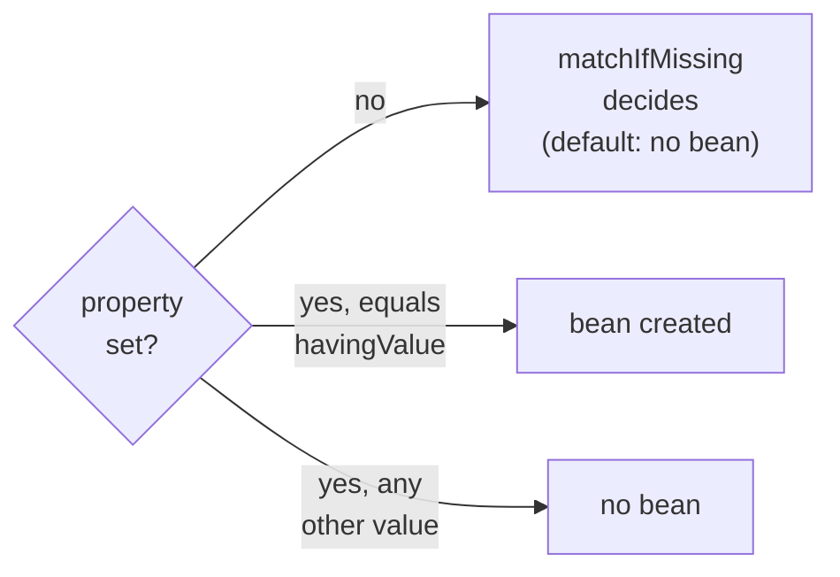

# Spring Part 3: @ConditionalOnProperty and Auto-configuration

The questions, from most to least asked: **what @ConditionalOnProperty does and its attributes**, **the other @Conditional annotations**, **writing your own auto-configuration or starter**, **use cases and feature toggles**, **injecting a bean that may not exist**, and **advantages and disadvantages**.

## 1. What it does

- `@ConditionalOnProperty` creates a bean **only if a property has a certain value**. The bean may be created or may not be.
- The decision is made once, at startup, from `application.properties` (or env variables / command-line args).
- It's a Spring Boot annotation (from auto-configuration), not core Spring.

**The problem it solves.** By default every scanned `@Component` is created. When a codebase holds alternative implementations (for example `MySQLConnection` and `NoSQLConnection`), all of them are created and injected. Two needs arise:
- **Use case 1**: create only one bean, either `MySQLConnection` or `NoSQLConnection`.
- **Use case 2**: two components (apps) share the same codebase, but one needs `MySQLConnection` and the other needs `NoSQLConnection`.

## 2. The solution: @ConditionalOnProperty

```java
@Component
@ConditionalOnProperty(prefix = "sqlconnection", value = "enabled",
                       havingValue = "true", matchIfMissing = false)
public class MySQLConnection { ... }

@Component
@ConditionalOnProperty(prefix = "nosqlconnection", value = "enabled",
                       havingValue = "true", matchIfMissing = false)
public class NoSQLConnection { ... }
```

```properties
sqlconnection.enabled=true
```

With this property only `MySQLConnection` is created.

- Use case 1: set only one property to `true`.
- Use case 2: the same code ships to both apps. Each app's `application.properties` turns on the bean it needs.

## 3. The attributes

- `prefix` + `value` (or `name`) = the property key: `sqlconnection` + `enabled` -> `sqlconnection.enabled`.
- `havingValue`: the value that must match. The comparison ignores case, so `TRUE` also matches.
- `matchIfMissing`: what to do when the property is **not set at all**.
  - `false` (default): the bean is not created.
  - `true`: the bean is created (an on-by-default feature).
- If `havingValue` is left out: any value **except `false`** creates the bean.
- Several names in `name = {"a", "b"}`: **all** must match.
- For true/false flags, Boot 3.5+ also has `@ConditionalOnBooleanProperty`.



Say it like this: "@ConditionalOnProperty creates a bean only if a property has a given value, checked once at startup. havingValue is the required value, case-insensitive, and if it's left out any value except false matches. matchIfMissing decides what happens when the property isn't set, and it defaults to false."

## 4. Injecting a bean that may not exist

- Normal `@Autowired` is `required = true`. If the bean wasn't created (its condition failed), startup fails with `NoSuchBeanDefinitionException` / `UnsatisfiedDependencyException`.
- `required = false` tells Spring "inject it if it exists, otherwise leave it null".

```java
@Component
public class DBConnection {
    @Autowired(required = false) MySQLConnection mySQLConnection;
    @Autowired(required = false) NoSQLConnection noSQLConnection;
}
```

- The cost: the field may be null, so the code must check it before use.
- Cleaner options: `Optional<NoSQLConnection>` or `ObjectProvider<NoSQLConnection>` as the injected type. They make "may be missing" explicit.
- Best design: make both classes implement one interface (`DataSourceConnection`) and turn exactly one on. `DBConnection` then injects the interface and never sees null.

## 5. The other @Conditional annotations (how auto-configuration decides)

`@ConditionalOnProperty` is one of a family. Spring Boot's own auto-configuration is just `@Configuration` classes guarded by these:

- `@ConditionalOnClass` / `@ConditionalOnMissingClass`: a class is (or isn't) on the classpath. Example: the Jackson config runs only if Jackson is in your jars.
- `@ConditionalOnBean` / `@ConditionalOnMissingBean`: a bean already exists (or doesn't).
- `@ConditionalOnProperty`: a property has a value.
- `@ConditionalOnWebApplication` / `@ConditionalOnNotWebApplication`: the app is (or isn't) a web app.
- `@ConditionalOnResource`: a file exists (like `classpath:config.json`).
- `@ConditionalOnExpression`: a SpEL expression is true. Use it rarely.

Boot's own features are switched by properties the same way. For example, AOP auto-configuration runs only if `spring.aop.auto` is `true` or not set; Boot 3.5 uses `@ConditionalOnBooleanProperty` for this.

**@ConditionalOnMissingBean = "your bean wins"** (the most asked one):

```java
@Bean
@ConditionalOnMissingBean            // only if the user hasn't defined an ObjectMapper
public ObjectMapper objectMapper() { return new ObjectMapper(); }
```

- Boot creates its default only if you haven't defined your own. This is called **backing off**.
- Trap: it checks only the beans registered **so far**. Use it in auto-configuration classes (they run after all your beans are registered), not in your normal `@Configuration` classes, where the result can depend on load order.

**Disabling or inspecting auto-configuration:**
- `@SpringBootApplication(exclude = DataSourceAutoConfiguration.class)`, or the property `spring.autoconfigure.exclude=...`.
- Or define your own bean, and the `@ConditionalOnMissingBean` default backs off.
- Run with `--debug` to see the condition report: which auto-configurations matched and why.

**@ConditionalOnProperty vs @Profile:**
- `@Profile("prod")`: the bean exists only when that profile is active. It groups beans by environment (dev, test, prod).
- `@ConditionalOnProperty`: the bean exists based on one property's value. It's better for turning a single feature on or off.
- Both are decided at startup. Neither switches at runtime.

Say it like this: "Auto-configuration classes are guarded by conditions: @ConditionalOnClass, @ConditionalOnMissingBean and @ConditionalOnProperty. Boot puts @ConditionalOnMissingBean on its defaults, so a bean I define replaces Boot's, and the --debug condition report shows what matched and why."

## 6. Writing your own auto-configuration / starter

Used when a company shares one library across many services (for example, an audit logger every team should get by just adding a dependency).

**Step 1: the auto-configuration class**

```java
@AutoConfiguration                                     // a @Configuration meant for auto-config
@ConditionalOnClass(AuditClient.class)                 // only if the library is present
@EnableConfigurationProperties(AuditProperties.class)
public class AuditAutoConfiguration {
    @Bean
    @ConditionalOnMissingBean                          // the user's own bean wins
    @ConditionalOnProperty(prefix = "acme.audit", name = "enabled", matchIfMissing = true)
    public AuditClient auditClient(AuditProperties props) { return new AuditClient(props.getUrl()); }
}
```

**Step 2: register it.** List the class in `META-INF/spring/org.springframework.boot.autoconfigure.AutoConfiguration.imports`, one class per line:

```
com.acme.audit.AuditAutoConfiguration
```

- Boot 2.x used `META-INF/spring.factories`. Since Boot 3, it's the `.imports` file.
- Auto-configuration classes must be loaded **only** through this file, never by component scanning. Keep them in their own package.

**Step 3: properties.** Use `@ConfigurationProperties("acme.audit")` with your **own** prefix. Never use Boot's prefixes (`spring`, `server`, `management`).

**Step 4: the starter.** A starter is an almost empty jar that only pulls in dependencies: your auto-configuration module + the library + `spring-boot-starter`.

- Naming: `acme-spring-boot-starter`. Don't start the name with `spring-boot`; that prefix is for official Spring starters (`spring-boot-starter-web`).
- Ordering: if your config must run after another auto-configuration, use `@AutoConfiguration(after = DataSourceAutoConfiguration.class)`.
- Testing: `ApplicationContextRunner` starts a small context so you can check "bean created" or "backed off" for each property and classpath combination.

## 7. Advantages and disadvantages

Advantages:
1. Feature toggling: turn a feature on or off from config, without code changes.
2. No unnecessary beans cluttering the application context.
3. Saves memory.
4. Reduces application startup time.

Disadvantages:
1. Misconfiguration can happen. A typo in the property name means the bean silently isn't created.
2. Code gets complex when overused.
3. Several beans created from the same configuration bring confusion: which one is active?
4. Harder to manage and test, because every on/off combination is a different app.

- It's a startup-time switch. Changing the property needs a restart. For flags that flip at runtime (gradual rollouts, per-user flags), use a feature-flag tool (Unleash, LaunchDarkly, Togglz) instead.

**Before the next part:** from memory, write the `@ConditionalOnProperty` line for a `NotificationService` that should be **on by default**, unless `notification.enabled=false` is set.
