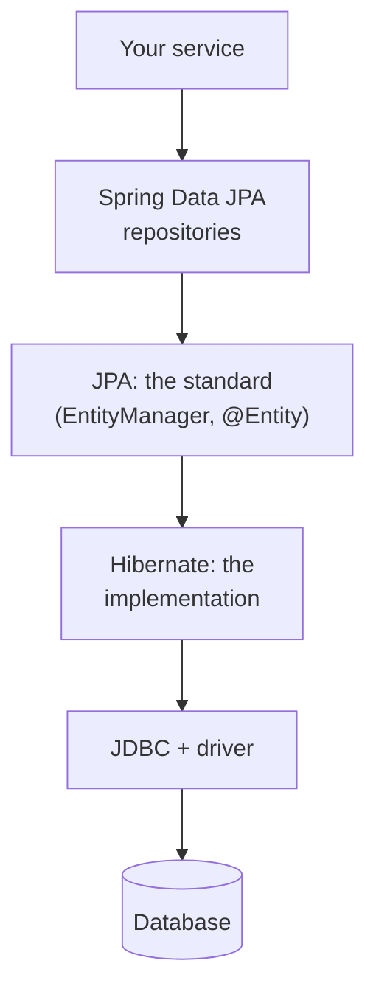
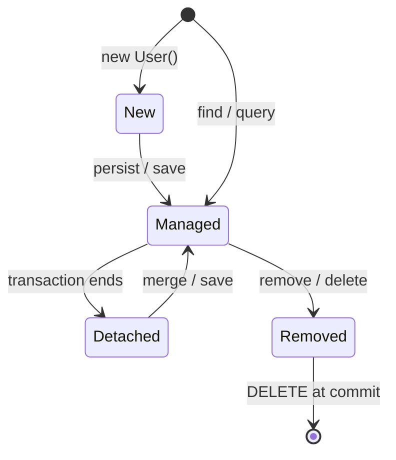
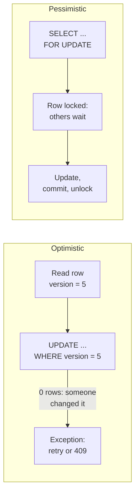
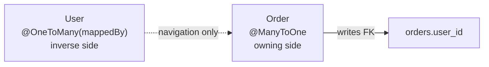
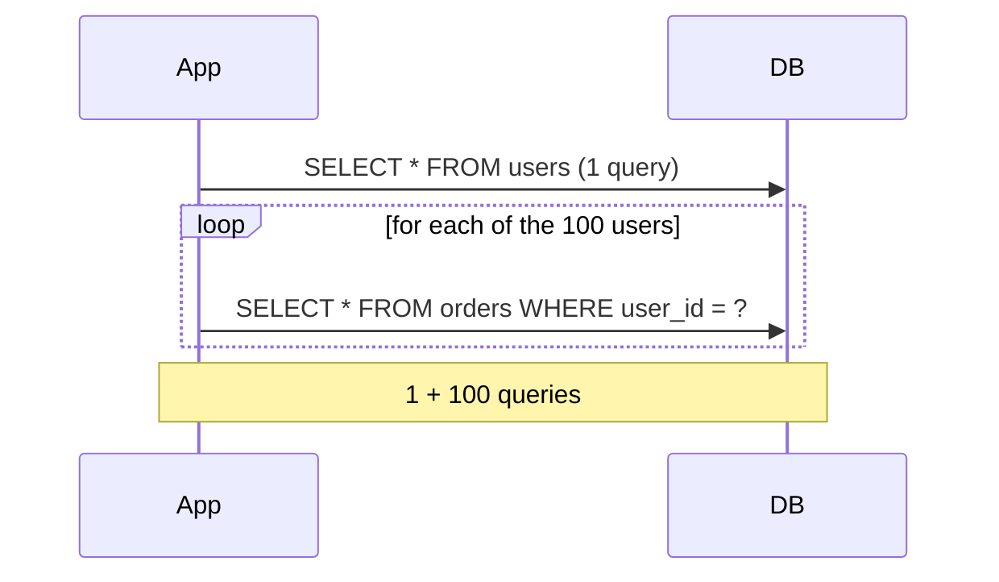

# Spring Part 4: JPA and Spring Data JPA

Everything JPA on one page, in the order interviews go. The most-asked questions, from most to least: **optimistic vs pessimistic locking**, **lazy vs eager and LazyInitializationException**, **the N+1 problem**, **pagination and why a deep OFFSET is slow**, **owning side and mappedBy**, and **JPA vs Hibernate vs Spring Data JPA**.

## 1. JDBC, JPA, Hibernate and Spring Data JPA



- **JDBC** is the low-level Java API: you write SQL, open connections, map every column by hand. Always use `PreparedStatement` (values sent separately from the SQL), never string concatenation, which is how SQL injection happens.
- **JPA** is a **specification**: annotations (`@Entity`, `@Id`) and interfaces (`EntityManager`). It does nothing on its own.
- **Hibernate** is the most used **implementation** of JPA. It turns entity operations into SQL.
- **Spring Data JPA** sits on top: you declare an interface like `UserRepository extends JpaRepository<User, Long>` and Spring generates the implementation, using `EntityManager` underneath.

Repository types: `CrudRepository` gives basic CRUD; `JpaRepository` adds paging and sorting plus JPA extras (`flush`, `saveAndFlush`, batch deletes, `getReferenceById`). Use `EntityManager` directly only for things repositories don't cover.

**Why an ORM, and when not:** an ORM removes boilerplate CRUD SQL, maps relationships, tracks changes and handles transactions in one place. The cost is hidden SQL (N+1 is the classic trap) and overhead on bulk work. For heavy batch jobs or complex reporting SQL, drop to `JdbcTemplate` or native queries.

Say it like this: "JPA is the standard, Hibernate implements it, and Spring Data JPA generates repositories on top so I write almost no data-access code. For bulk jobs or complex reporting I use JdbcTemplate or native SQL instead."

## 2. How JPA tracks entities: the persistence context

The **persistence context** is a map of the entities JPA is currently managing, one per transaction in a Spring app. It is also called the **first-level (L1) cache**.



**The four entity states:**

- **New**: a plain Java object; JPA does not know it.
- **Managed**: tracked by the persistence context. Changes are saved automatically.
- **Detached**: has a database row but is no longer tracked (the transaction ended). Changes are ignored until you merge it.
- **Removed**: scheduled for deletion at commit.

**Dirty checking.** When an entity is loaded, Hibernate keeps a snapshot of it. At flush (just before commit), it compares each managed entity with its snapshot and writes an UPDATE for every changed one. So inside a `@Transactional` method, changing a loaded entity is enough; **no `save()` call is needed**.

**Flush vs commit.** Flush sends the pending SQL to the database; commit makes it permanent. Flush happens automatically before commit and before queries that would see the pending changes.

**persist, merge, save, saveAndFlush:**

- `persist(entity)`: makes a new object managed; INSERT at flush.
- `merge(entity)`: copies a detached object's state onto a managed copy and **returns that copy** (use the returned object).
- Spring Data `save(entity)`: calls `persist` when the entity is new (id is null), otherwise `merge`.
- `saveAndFlush(entity)`: `save` plus an immediate flush, useful when you need a constraint error or a generated value right now. It still is not committed.
- `getReferenceById(id)` returns a proxy without a SELECT: handy for setting a foreign key without loading the row.

**L1 vs L2 cache.** L1 is the persistence context: always on, lives for one transaction, so it only avoids repeated reads of the same row within that transaction. **L2** is shared across the whole application instance, **off by default**, needs a cache provider (such as Ehcache), and risks stale data across multiple instances. Use L2 only for read-mostly reference data.

Say it like this: "Entities are new, managed, detached or removed. Managed entities are dirty-checked at flush, so changes inside a transaction are saved without calling save(). The persistence context is the first-level cache for one transaction; the second-level cache is shared, off by default and risky with multiple instances."

## 3. Optimistic vs pessimistic locking (the most-asked JPA question)

Two users update the same row at the same time. Without protection, the second write silently overwrites the first: a **lost update**.



**Optimistic locking** assumes conflicts are rare and detects them:

- Add a `@Version` field to the entity. Every UPDATE becomes `UPDATE ... SET ..., version = 6 WHERE id = ? AND version = 5`.
- If another transaction changed the row in between, the UPDATE matches **0 rows**, and Spring throws `ObjectOptimisticLockingFailureException`. You then **retry** or return **409 Conflict** ("someone else changed this, reload").
- No database locks are held, so it scales well.
- Use it when conflicts are rare and users take time between reading and writing: editing a profile, updating a product description.

**Pessimistic locking** assumes conflicts are likely and prevents them:

- `@Lock(LockModeType.PESSIMISTIC_WRITE)` on a repository method makes Hibernate run `SELECT ... FOR UPDATE`. The row stays locked until the transaction ends, and other writers wait.
- Use it when conflicts are frequent and a failed retry is costly: decrementing stock, booking the last seat, moving money.
- Costs: blocked threads, lock timeouts, and deadlocks if two transactions lock rows in different orders. Keep these transactions short, set a lock timeout, and lock rows in a consistent order.

A third option worth mentioning: an **atomic update**, `UPDATE stock SET qty = qty - 1 WHERE id = ? AND qty > 0`, which checks and changes in one statement with no read first.

Say it like this: "Optimistic locking uses a @Version column: the update only succeeds if the version hasn't changed, otherwise I retry or return 409. No locks are held, so it suits rare conflicts. Pessimistic locking takes SELECT FOR UPDATE and makes others wait, which suits frequent, costly conflicts like stock or seat booking, but I keep those transactions short to avoid blocking and deadlocks."

## 4. Relationships: owning side, mappedBy and cascades

**Where the foreign key lives:**

- **One-to-one**: an FK column in one of the two tables.
- **One-to-many / many-to-one**: the FK is always in the **"many" (child) table**: each order row points to its user.
- **Many-to-many**: neither table can hold it, so a **join table** stores pairs of ids.

**Owning side and mappedBy.** In a bidirectional relationship both entities reference each other, but there is still only one FK column. The **owning side** is the entity whose table holds the FK; it is the **only side Hibernate reads** when writing that column. The other side declares `mappedBy` and is just a back-reference for navigation in Java.



The standard one-to-many mapping:

```java
// Parent: inverse side
@OneToMany(mappedBy = "user", cascade = CascadeType.ALL, orphanRemoval = true)
private List<Order> orders = new ArrayList<>();

public void addOrder(Order o) { orders.add(o); o.setUser(this); }   // keep both sides in sync

// Child: owning side, holds the FK
@ManyToOne(fetch = FetchType.LAZY)
@JoinColumn(name = "user_id")
private User user;
```

The rules interviewers check:

- **Make `@ManyToOne` the owning side.** A one-to-many mapped only from the parent (no `mappedBy`) either creates an extra join table or runs extra UPDATEs to set the FK.
- **Use helper methods** that set both sides. Adding to the parent's list without setting `order.setUser(user)` saves the order with a **NULL foreign key**, because only the owning side is written.
- **Many-to-many**: use a `Set`, not a `List` (with a List, Hibernate deletes and re-inserts all join rows on every change). If the link needs its own data (quantity, price, date), replace it with a **join entity** with two `@ManyToOne` links. In real systems that is almost always the right model.

**Cascade and orphanRemoval:**

- **Cascade** repeats an operation from parent to child: `PERSIST` (save new children with the parent), `MERGE`, `REMOVE` (delete children with the parent), `ALL`.
- **orphanRemoval = true** also deletes a child when it is **removed from the parent's collection**, not only when the parent is deleted.
- Put cascades only on the parent side, and only for children that belong to that one parent (an order and its lines). **Never cascade from `@ManyToOne`** or on `@ManyToMany`: deleting one order would try to delete the shared user or products.

Say it like this: "The owning side is the entity whose table holds the foreign key, usually the @ManyToOne child; the parent uses mappedBy and is just a back-reference. I keep both sides in sync with helper methods, cascade only from a parent to children it truly owns, and model many-to-many with extra data as a join entity."

## 5. Lazy vs eager, LazyInitializationException and N+1

**Fetch types.** **EAGER** loads the related data together with the entity; **LAZY** loads it only when first accessed (Hibernate puts a **proxy** or an unloaded collection in the field). The defaults: **`@ManyToOne` and `@OneToOne` are EAGER; `@OneToMany` and `@ManyToMany` are LAZY.** The usual advice: make everything LAZY and load what each use case needs explicitly.

**LazyInitializationException** happens when you touch a lazy field **after the transaction (and persistence context) has closed**: for example, returning an entity from a controller and letting JSON serialization touch a lazy collection. The proxy has no open session to load from.

Fixes: load what you need inside the `@Transactional` service method with a fetch join or entity graph, or **return a DTO** built inside the transaction. Do not "fix" it by switching to EAGER.

**Open-in-view.** Spring Boot keeps the persistence context open for the whole web request by default (`spring.jpa.open-in-view=true`), which is why lazy loading "works" in controllers. Many teams turn it off: it hides lazy queries that run during JSON rendering and holds database connections longer.

**The N+1 problem.** Loading N parents takes 1 query; touching each parent's lazy association then runs 1 more query per parent.



**EAGER does not fix it**: list queries still load associations with one extra query per row. The fixes:

- **JOIN FETCH** in JPQL: `select u from User u left join fetch u.orders` loads parents and children in one query (`left` keeps users with no orders).
- **`@EntityGraph(attributePaths = "orders")`** on a repository method: the same thing, declared on the method.
- **`@BatchSize(size = 50)`** on the association: loads children for 50 parents at a time with `IN (...)`, a few queries instead of N. It works with pagination.
- **DTO projection**: select exactly the columns needed in one query.

How to catch it: enable SQL logging in development and watch the query count, or assert the number of queries in tests.

**JSON pitfalls** with entities: lazy proxies fail to serialize, and bidirectional relationships recurse forever. The clean fix for both is to **return DTOs, not entities**, from controllers.

Say it like this: "To-one associations are eager by default and collections lazy; I make everything lazy. LazyInitializationException means a lazy field was touched after the transaction closed, so I load what's needed inside the service with a fetch join or entity graph, or return a DTO. N+1 is one query for the parents plus one per parent; I fix it with join fetch, @EntityGraph, @BatchSize or a DTO projection, never with EAGER."

## 6. Queries and pagination

**Three ways to query:**

- **Derived queries**: Spring builds the query from the method name, such as `findByEmailAndStatus(email, status)`. Validated at startup. Good for simple conditions.
- **JPQL with `@Query`**: queries against entities and fields, not tables: `@Query("select o from Order o where o.user.id = :id and o.total > :min")`. Database-independent; use named parameters.
- **Native SQL** (`nativeQuery = true`): real tables and columns, for what JPQL cannot express (window functions, database-specific features). Ties you to one database.
- For filters chosen at run time (a search screen with optional fields), use **Specifications** or the Criteria API instead of string-building.

**Projections:** return only the columns you need, as an interface (`interface NameOnly { String getName(); }`) or a DTO via `select new com.app.UserDto(u.name, u.email) ...`. Less data, nothing tracked, no lazy-loading surprises.

**Bulk updates and deletes** use `@Modifying @Query("update ...")` in a transaction. They run one SQL statement directly and **bypass the persistence context**, so add `clearAutomatically = true` (and `flushAutomatically = true` so pending changes are not lost).

**Pagination.** Pass a `Pageable` (page number, size, sort):

- Return **`Page<T>`**: runs an extra **COUNT** query so it knows total pages.
- Return **`Slice<T>`**: fetches one extra row to know if there is a next page; **no COUNT**. Better for "load more" and infinite scroll.

**Why a deep OFFSET is slow.** `LIMIT 20 OFFSET 100000` makes the database read and throw away 100,000 rows before returning 20, so each page gets slower the deeper you go. Rows inserted while a user pages can also cause duplicates or skipped rows. The fix is **keyset (seek) pagination**: remember the last row seen and continue from it using an index:

```sql
SELECT * FROM orders
WHERE (created_at, id) < (:lastCreatedAt, :lastId)
ORDER BY created_at DESC, id DESC
LIMIT 20;
```

This costs the same on page 1 and page 5,000. Spring Data supports it with scrolling (`Window<T>` with a keyset scroll position). The trade-off: no jumping to an arbitrary page number.

**One trap:** `JOIN FETCH` on a collection together with pagination makes Hibernate load everything and paginate **in memory** (it logs a warning). Page the parent ids first, or use `@BatchSize`.

Say it like this: "I use derived queries for simple filters, JPQL for joins, native SQL only when JPQL can't do it, and DTO projections for read screens. For paging I return Slice when I don't need totals, to skip the COUNT. Deep OFFSET is slow because the database scans and discards all the skipped rows, so for large tables I use keyset pagination: continue from the last seen key with an indexed WHERE clause."

**Before the next part:** without looking, explain optimistic vs pessimistic locking with one example each, draw the N+1 query pattern and name three fixes, and write the keyset-pagination WHERE clause.
