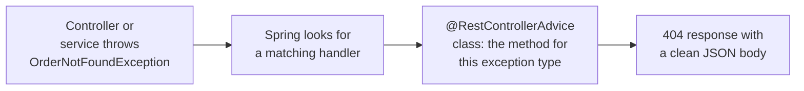

# Spring Part 8: Exception Handling: @ControllerAdvice and Error Contracts

When something goes wrong in an API (an order that does not exist, invalid input, a bug), the client should get the right status code and an error body it can understand, and every endpoint should fail the same way. Interviews ask three things here, in this order of frequency: **how do you handle exceptions globally**, **what the three annotations do**, and **what a good error response looks like**.

## 1. Global exception handling: one place for all errors [P0]

Without any handling, an exception thrown in a controller becomes a 500 with Spring Boot's default body. Copying try-catch blocks into every controller is worse: duplicated, inconsistent, easy to forget.

The standard answer is **one class that handles errors for the whole application**:



1. Your code throws an exception that describes the problem, for example `OrderNotFoundException`.
2. Spring catches it on the way out of the controller and looks for a handler method for that exception type.
3. The handler lives in a class annotated `@RestControllerAdvice`. It returns the status code and the error body.

```java
@RestControllerAdvice
class ApiErrors {

    @ExceptionHandler(OrderNotFoundException.class)
    ProblemDetail notFound(OrderNotFoundException ex) {
        return ProblemDetail.forStatusAndDetail(HttpStatus.NOT_FOUND, ex.getMessage());
    }

    @ExceptionHandler(Exception.class)            // catch-all: our bug
    ProblemDetail unexpected(Exception ex) {
        log.error("Unexpected error", ex);        // full details go to the log
        return ProblemDetail.forStatus(HttpStatus.INTERNAL_SERVER_ERROR);
    }
}
```

The rules interviewers check:

- **The most specific handler wins.** With handlers for `OrderNotFoundException` and `Exception`, a missing order goes to the first one.
- **Always have a catch-all** for `Exception` that returns a plain 500, logs the real error, and never sends a stack trace to the client.
- **Services throw business exceptions, not HTTP ones.** `OrderNotFoundException` knows nothing about 404; the advice class decides the status. So the same service works when called from a Kafka consumer or a batch job.

Say it like this: "I create one @RestControllerAdvice class with an @ExceptionHandler method per exception type. Services throw meaningful business exceptions, the advice maps each to a status code and a consistent error body, and a catch-all turns anything unexpected into a 500 while logging the details."

## 2. @ExceptionHandler vs @ControllerAdvice vs @RestControllerAdvice [P0]

The three differ only in **scope**:

- **`@ExceptionHandler`** marks a method that handles certain exception types. If you put it inside a controller, it only handles exceptions from **that controller**.
- **`@ControllerAdvice`** marks a class whose `@ExceptionHandler` methods apply to **all controllers** (or to a chosen subset, for example `basePackages = "com.shop.orders"`).
- **`@RestControllerAdvice`** is `@ControllerAdvice` plus `@ResponseBody`: whatever the handler returns is written as JSON. This is the one to use for REST APIs. Plain `@ControllerAdvice` is for apps that render HTML pages.

When two handlers could apply:

- A handler **inside the controller** beats the global advice for that controller.
- Among global advice classes, `@Order` decides which is checked first.

Say it like this: "@ExceptionHandler is the method that handles an exception; inside a controller it's local to that controller. @ControllerAdvice makes those handlers global, and @RestControllerAdvice is the same plus @ResponseBody, so the return value is serialized as JSON, which is what a REST API needs."

## 3. What a good error response looks like: ProblemDetail [P0]

If every endpoint returns errors in a different shape, every client has to guess. The fix is an **error contract**: one documented shape for all errors. The industry standard is **RFC 9457, "Problem Details for HTTP APIs"** (it replaced RFC 7807), sent with the content type `application/problem+json`:

```json
{
  "type": "https://api.example.com/errors/out-of-stock",
  "title": "Out of stock",
  "status": 409,
  "detail": "Only 2 units of SKU 123 are left; you asked for 5",
  "instance": "/orders",
  "traceId": "4bf92f3577b34da6"
}
```

What each field is for:

- **type**: a stable identifier for the kind of error. Clients write their logic against this, not against the message.
- **title**: a short, fixed summary of that kind of error.
- **status**: the HTTP status code, repeated in the body.
- **detail**: what went wrong in this particular request, readable by a person.
- **instance**: which request failed.
- **Extra fields** are allowed: a `traceId` so support can find the log line, or a list of field errors for validation.

Spring Boot 3 supports this out of the box: handlers return a `ProblemDetail` object (as in section 1), and the property `spring.mvc.problemdetails.enabled=true` makes Spring's own errors (bad JSON, missing parameter, wrong HTTP method) use the same format.

Never put stack traces, SQL or internal class names in the body: they help attackers and confuse clients. Log them, and return the trace id instead.

Say it like this: "Every error uses one contract, RFC 9457 problem details: type, title, status, detail and instance, plus extras like a trace id, as application/problem+json. In Spring Boot 3 my handlers return ProblemDetail, and I enable it for Spring's built-in errors too, so clients see one format everywhere."

## 4. Choosing the right status code [P1]

The handler's main job is picking the right status. The ones that matter:

- **400 Bad Request**: the input is malformed or fails validation.
- **401 Unauthorized**: not logged in or the token is invalid. **403 Forbidden**: logged in but not allowed.
- **404 Not Found**: the resource does not exist.
- **409 Conflict**: clashes with the current state (a duplicate, a version conflict, out of stock).
- **422 Unprocessable Content**: well-formed but breaks a business rule (some teams simply use 400).
- **500 Internal Server Error**: a bug on our side, never the client's fault.

**Validation errors**: with `@Valid` on a request body, bad input throws `MethodArgumentNotValidException`. Handle it as a 400 that lists each problem field ("email: must be a valid email"), so the client can show it next to the right input.

## 5. What @ControllerAdvice cannot catch [P1]

Correction: "@ControllerAdvice handles every exception in the app." It only sees exceptions thrown while Spring MVC is handling the request, that is inside controllers and the code they call.

Errors raised **before** the request reaches a controller, in servlet filters, are invisible to it. The most important case is Spring Security: its 401 and 403 responses come from the security filter chain. To make them use the same error contract, configure the security **authentication entry point** (for 401) and **access denied handler** (for 403) to write a ProblemDetail body.

Say it like this: "Controller advice only covers exceptions from controllers and the code they call. Security's 401 and 403 happen in filters before that, so I format those through the authentication entry point and access denied handler to keep one error contract."


**Before the next part:** without looking, explain out loud how a missing order becomes a 404 with a ProblemDetail body (who throws, who catches, what is returned), then name the five standard ProblemDetail fields and one error the advice cannot catch.
