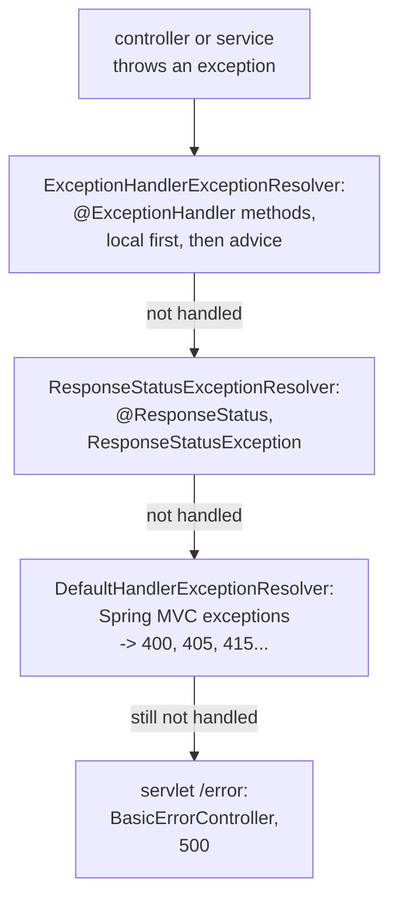

# Spring Part 8: Exception Handling: @ControllerAdvice and Error Contracts

`GET /orders/999` hits an order that does not exist. The service throws `OrderNotFoundException`. With no handling, the client gets a 500 and Spring Boot's default body, or worse, a stack trace. The right answer is a 404 with a body every client can parse, built in one place for the whole app.

## 1. Where exceptions are handled in Spring MVC [P0]

When a controller method throws, `DispatcherServlet` asks a list of **HandlerExceptionResolvers**, in order, to turn the exception into a response:



1. `ExceptionHandlerExceptionResolver` looks for an `@ExceptionHandler` method that matches the exception: first in the controller that threw it, then in `@ControllerAdvice` classes.
2. `ResponseStatusExceptionResolver` handles exceptions annotated with `@ResponseStatus`, and `ResponseStatusException`.
3. `DefaultHandlerExceptionResolver` maps Spring's own exceptions: a missing parameter becomes 400, a wrong method 405, an unsupported content type 415.
4. Anything left falls through to the servlet container's error page, which Spring Boot serves through `BasicErrorController` at `/error`, usually as a 500.

Correction: `@ControllerAdvice` only sees exceptions thrown while a controller handles the request. Exceptions thrown in a servlet filter, including Spring Security's 401 and 403, happen before the `DispatcherServlet` and never reach it. Handle those in the filter, or with the security entry point and access-denied handler.

Say it like this: "When a controller throws, DispatcherServlet's exception resolvers try @ExceptionHandler methods first, local then in controller advice, then @ResponseStatus, then Spring's default mappings, and only then the /error fallback."

## 2. @ExceptionHandler, @ControllerAdvice and @RestControllerAdvice [P0]

The three annotations differ only in scope:
- **`@ExceptionHandler`** marks a method that handles one or more exception types. Inside a controller, it applies to that controller only.
- **`@ControllerAdvice`** marks a class whose `@ExceptionHandler` (and `@InitBinder`, `@ModelAttribute`) methods apply to all controllers, or to the ones you select.
- **`@RestControllerAdvice`** is `@ControllerAdvice` + `@ResponseBody`: return values are written as JSON instead of being treated as view names. Use it for REST APIs.

```java
@RestControllerAdvice
class ApiErrors {
    @ExceptionHandler(OrderNotFoundException.class)
    ProblemDetail notFound(OrderNotFoundException ex) {
        ProblemDetail p = ProblemDetail.forStatusAndDetail(HttpStatus.NOT_FOUND, ex.getMessage());
        p.setTitle("Order not found");
        p.setType(URI.create("https://api.example/errors/order-not-found"));
        p.setProperty("orderId", ex.orderId());
        return p;
    }
}
```

The rules interviewers check:
- **Local beats global**: an `@ExceptionHandler` inside the controller wins over the advice for that controller.
- **Most specific type wins**: with handlers for `OrderNotFoundException` and `RuntimeException`, the specific one is chosen.
- **Several advice classes**: order them with `@Order`. Narrow scope with `@RestControllerAdvice(basePackages = "com.shop.orders")`, `assignableTypes = ...` or `annotations = RestController.class`.
- **A catch-all**: one `@ExceptionHandler(Exception.class)` returning a generic 500, with the real error logged and a correlation id, never the stack trace.

Say it like this: "@ExceptionHandler handles exceptions for its own controller, @ControllerAdvice applies handlers to all or selected controllers, and @RestControllerAdvice is the same with @ResponseBody, so a REST API puts its handlers there and the most specific, most local handler wins."

## 3. The error contract: ProblemDetail (RFC 9457) [P0]

Every endpoint returning a different error shape forces every client to guess. An **error contract** is one documented shape for all errors. The standard is **RFC 9457** "Problem Details for HTTP APIs" (it replaced RFC 7807), served as `application/problem+json`:

```json
{
  "type": "https://api.example/errors/order-not-found",
  "title": "Order not found",
  "status": 404,
  "detail": "Order 999 does not exist",
  "instance": "/orders/999",
  "orderId": 999,
  "traceId": "4bf92f3577b34da6"
}
```

- `type`: a URI identifying the kind of error; clients switch on it, not on the message.
- `title`: a short, fixed summary for that type. `detail`: this occurrence. `status`: the HTTP status, repeated in the body.
- `instance`: which request failed. Anything else is an extension (`orderId`, `traceId`, a list of field errors).

Spring 6 / Boot 3 support it natively:
- `ProblemDetail` is the class; return it from an `@ExceptionHandler`, as above. `setProperty` adds extensions.
- `spring.mvc.problemdetails.enabled=true` makes Spring's own exceptions (400s, 405s, 415s) use the same format.
- Or extend `ResponseEntityExceptionHandler` in your advice to customise those built-in cases, and add your own handlers next to them.
- Exceptions can carry their own response: `ErrorResponseException`, or `ResponseStatusException(HttpStatus.CONFLICT, "...")`.

Never put stack traces, SQL or class names in the body. Log them with the `traceId`, and return the id so support can find the log line.

Say it like this: "My error contract is RFC 9457 problem details: type, title, status, detail and instance plus extensions like a trace id, returned as application/problem+json from ProblemDetail in a @RestControllerAdvice."

## 4. Where to translate exceptions [P0]

A JPA call throws `EmptyResultDataAccessException`, the service wraps it, and the controller builds a 404. Which layer should know about HTTP?

```java
// Broken: HTTP leaks into the service, and every controller repeats the mapping
public Order find(long id) {
    return repo.findById(id).orElseThrow(() -> new ResponseStatusException(HttpStatus.NOT_FOUND));
}
```
```java
// Fixed: the service speaks the domain; one advice maps the domain to HTTP
public Order find(long id) {
    return repo.findById(id).orElseThrow(() -> new OrderNotFoundException(id));
}
// ApiErrors: OrderNotFoundException -> 404, InsufficientStockException -> 409, ...
```

- Repositories throw data exceptions (Spring already translates SQL errors into `DataAccessException`).
- Services throw **domain exceptions** that name the business problem: `OrderNotFoundException`, `InsufficientStockException`. They know nothing about HTTP, so the same service works from a Kafka consumer or a batch job.
- The **web edge** (one `@RestControllerAdvice`) maps domain exceptions to status codes and the error contract.


Status codes to get right:
- 400: malformed or invalid input (including validation). 404: not found. 409: conflict with current state (a duplicate, a version clash). 422: well-formed but breaks a business rule (some teams use 400). 500: our bug, never the client's.
- 401 and 403 come from security, not from this advice (section 1).

Validation: `@Valid @RequestBody CreateOrder body` throws `MethodArgumentNotValidException` on bad input. Map it to 400 with each field error listed:

```java
@ExceptionHandler(MethodArgumentNotValidException.class)
ProblemDetail invalid(MethodArgumentNotValidException ex) {
    ProblemDetail p = ProblemDetail.forStatusAndDetail(HttpStatus.BAD_REQUEST, "Validation failed");
    p.setProperty("errors", ex.getBindingResult().getFieldErrors().stream()
        .map(e -> Map.of("field", e.getField(), "message", e.getDefaultMessage())).toList());
    return p;
}
```

Also asked: checked or unchecked domain exceptions? Unchecked (extending `RuntimeException`): they pass through layers without `throws` clauses, and Spring's `@Transactional` rolls back on unchecked exceptions by default but not on checked ones.

Say it like this: "Services throw domain exceptions with no HTTP in them, and one @RestControllerAdvice at the web edge maps each to a status and a problem-details body, so the same service works from REST, Kafka or a batch job."

**Before the next part:** from memory, draw the resolver chain from a thrown exception to the /error fallback, then write the five standard ProblemDetail fields and a handler mapping a domain exception to 404.
