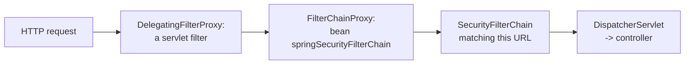

# Spring Part 9: Spring Security Architecture

You add `spring-boot-starter-security` to an API. Every endpoint now answers 401, a login page appears, and the log prints a generated password. Nothing in your controllers changed. Everything happened in a chain of servlet filters in front of them. This part is that chain, and how a request gets authenticated.

## 1. Authentication, authorization, 401 and 403 [P0]

- **Authentication** answers "who are you?": checking a password, a token or a certificate.
- **Authorization** answers "what may you do?": checking roles or permissions for this URL or method.

Authentication always comes first. The two failures have different status codes:
- **401 Unauthorized**: not authenticated. No credentials, or bad ones. Log in and try again.
- **403 Forbidden**: authenticated, but not allowed. Logging in again will not help.

Correction: despite its name, 401 means "unauthenticated". 403 is the real "unauthorized".

Say it like this: "Authentication is who you are and authorization is what you may do; 401 means I don't know who you are, 403 means I know and the answer is no."

## 2. The filter chain [P0]

A servlet **filter** is code that sees every request before it reaches Spring MVC's `DispatcherServlet`, and can stop it. Spring Security is a set of filters. The servlet container does not know about Spring beans, so Spring Security plugs in through two bridges:



- **DelegatingFilterProxy** is a normal servlet filter registered with the container (Tomcat). It does no security work. It looks up the Spring bean named `springSecurityFilterChain` and hands the request to it.
- **FilterChainProxy** is that bean. It picks the first **SecurityFilterChain** whose matcher fits the request and runs its filters in order.
- A **SecurityFilterChain** is an ordered list of security filters. You can define several, for example one for `/api/**` (stateless, tokens) and one for `/admin/**` (form login), ordered with `@Order` and `securityMatcher`.


The filters you should be able to name, in order:
1. `SecurityContextHolderFilter`: loads any existing security context (from the session, if there is one).
2. `CorsFilter`: answers CORS preflights before anything demands credentials.
3. `CsrfFilter`: checks the CSRF token on POST, PUT, PATCH and DELETE.
4. `LogoutFilter`.
5. Authentication filters: `UsernamePasswordAuthenticationFilter` (form login), `BearerTokenAuthenticationFilter` (JWT), `BasicAuthenticationFilter`. Each reads credentials from the request and, if present, authenticates.
6. `AnonymousAuthenticationFilter`: if nobody authenticated, sets an anonymous user.
7. `ExceptionTranslationFilter`: turns security exceptions into responses (section 4).
8. `AuthorizationFilter` (last): checks the rules in `authorizeHttpRequests` against the current user.

The configuration that builds a chain (Spring Security 6):

```java
@Bean
SecurityFilterChain api(HttpSecurity http) throws Exception {
    return http
        .securityMatcher("/api/**")
        .csrf(csrf -> csrf.disable())                         // header-based API
        .sessionManagement(s -> s.sessionCreationPolicy(SessionCreationPolicy.STATELESS))
        .authorizeHttpRequests(auth -> auth
            .requestMatchers("/api/public/**").permitAll()
            .requestMatchers(HttpMethod.DELETE, "/api/**").hasRole("ADMIN")
            .anyRequest().authenticated())
        .httpBasic(Customizer.withDefaults())
        .build();
}
```

Correction: `WebSecurityConfigurerAdapter` was removed in Spring Security 6. You declare `SecurityFilterChain` beans. `antMatchers` became `requestMatchers`, and `authorizeRequests` became `authorizeHttpRequests`.

Also asked: rules are matched top to bottom, first match wins. Put specific rules before general ones; `anyRequest()` goes last.

Say it like this: "DelegatingFilterProxy bridges the servlet container to the FilterChainProxy bean, which runs the first matching SecurityFilterChain: CORS, CSRF, the authentication filters, then ExceptionTranslationFilter and AuthorizationFilter last."

## 3. The authentication flow [P0]

A client logs in with a username and password. Who checks them?


1. An authentication filter (say `UsernamePasswordAuthenticationFilter`) reads the credentials and wraps them in an unauthenticated `UsernamePasswordAuthenticationToken`.
2. It calls the **AuthenticationManager**. The usual implementation, **ProviderManager**, holds a list of **AuthenticationProviders** and asks each one whether it supports this token type.
3. **DaoAuthenticationProvider** handles username and password. It calls **UserDetailsService**`.loadUserByUsername(name)` to load the user: password hash, enabled flag and authorities (roles).
4. It checks the raw password against the stored hash with the **PasswordEncoder**.
5. On success it returns an authenticated token holding the user and their authorities. The filter stores it in the **SecurityContextHolder**.
6. On failure it throws an `AuthenticationException` (bad credentials, locked, disabled), which becomes a 401.

The **SecurityContextHolder** keeps the current user's `Authentication` in a `ThreadLocal`, so any code on that request thread can read it:

```java
Authentication auth = SecurityContextHolder.getContext().getAuthentication();
String user = auth.getName();
```

In a controller, `@AuthenticationPrincipal UserDetails user` gives the same thing.

Also asked: `@Async` work runs on another thread, so it does not see the `ThreadLocal` context unless you propagate it (`DelegatingSecurityContextExecutor`).

Say it like this: "A filter builds an unauthenticated token, the ProviderManager finds a provider that supports it, DaoAuthenticationProvider loads the user through UserDetailsService and checks the hash with the PasswordEncoder, and the result goes into the ThreadLocal SecurityContextHolder."

## 4. When security fails: ExceptionTranslationFilter [P1]

`ExceptionTranslationFilter` sits just before `AuthorizationFilter` and catches what it throws:
- An `AuthenticationException`, or an `AccessDeniedException` for an anonymous user, goes to the **AuthenticationEntryPoint**: a 401 for an API, or a redirect to the login page for a web app.
- An `AccessDeniedException` for a logged-in user goes to the **AccessDeniedHandler**: a 403.

To return your own JSON error body, set both:
```java
http.exceptionHandling(e -> e
    .authenticationEntryPoint((req, res, ex) -> res.sendError(401))
    .accessDeniedHandler((req, res, ex) -> res.sendError(403)));
```

Correction: `@ControllerAdvice` cannot catch these. Security exceptions are thrown in the filter chain, before the request reaches a controller.

Say it like this: "ExceptionTranslationFilter turns an authentication failure into the entry point's 401 and an access-denied for a logged-in user into the handler's 403; controller advice never sees them because they happen in the filter chain."

## 5. Where users and passwords come from [P0]

`UserDetailsService` has one method, `loadUserByUsername`. Spring calls it; you decide where users live.

- **In memory**, for demos and tests: `new InMemoryUserDetailsManager(User.withUsername("asha").password("{bcrypt}...").roles("USER").build())`.
- **A database**, the normal case: implement `UserDetailsService` with a repository.

```java
@Service
class DbUserDetailsService implements UserDetailsService {
    private final UserRepository repo;
    DbUserDetailsService(UserRepository repo) { this.repo = repo; }

    public UserDetails loadUserByUsername(String email) {
        AppUser u = repo.findByEmail(email)
            .orElseThrow(() -> new UsernameNotFoundException(email));
        return User.withUsername(u.getEmail()).password(u.getPasswordHash())
                   .roles(u.getRole()).disabled(!u.isActive()).build();
    }
}
```

Passwords are stored as **hashes**, never plain text and never encrypted (encryption can be reversed). Use a slow, salted hash:

```java
@Bean PasswordEncoder passwordEncoder() {
    return PasswordEncoderFactories.createDelegatingPasswordEncoder();   // bcrypt by default
}
```

- **BCrypt** adds a random **salt** per password (so two users with "password123" get different hashes) and is deliberately slow (a **work factor**, default 10), so guessing billions of passwords is impractical. Argon2 and scrypt are stronger alternatives.
- The **DelegatingPasswordEncoder** stores the algorithm as a prefix, `{bcrypt}$2a$10$...`, so you can move to a new algorithm without breaking old passwords.
- Never compare hashes yourself; call `passwordEncoder.matches(raw, hash)`.

Correction: MD5 and SHA-256 are the wrong tools for passwords. They are fast, so attackers can test billions of guesses a second.

Roles vs authorities: an authority is any permission string (`orders:write`). A role is an authority with a `ROLE_` prefix; `hasRole("ADMIN")` checks the authority `ROLE_ADMIN`.

Say it like this: "Spring loads users through my UserDetailsService, usually from a database, and checks passwords with a PasswordEncoder; I store bcrypt hashes with a per-password salt, never plain text or fast hashes."

## 6. Sessions or tokens: stateful vs stateless [P0]

- **Stateful (sessions)**: after login, the server stores the security context in the HTTP session and gives the browser a `JSESSIONID` cookie. Each request sends the cookie, and the server looks the session up. Easy to revoke (delete the session). Behind several instances you need sticky sessions or a shared store such as Spring Session with Redis. Cookies bring CSRF with them.
- **Stateless (tokens)**: the server stores nothing. Every request carries a token (usually a JWT in the `Authorization` header) that proves who the user is. Any instance can verify it, which suits microservices and horizontal scaling. The cost: a token cannot easily be revoked before it expires.

```java
.sessionManagement(s -> s.sessionCreationPolicy(SessionCreationPolicy.STATELESS))
```
With `STATELESS`, Spring Security never creates a session or reads one, so every request must authenticate again.

Say it like this: "Sessions keep the user on the server behind a cookie and are easy to revoke but need shared storage to scale; tokens keep the server stateless and scale freely but are hard to revoke before expiry."

## 7. Securing a REST API, and method security [P1]

The usual answer to "how do you secure a Spring Boot REST API?":
- HTTPS everywhere.
- A stateless `SecurityFilterChain`: CSRF off (header-based tokens), sessions `STATELESS`, CORS configured.
- Authenticate with JWT bearer tokens, validated by a resource server filter.
- Authorize per URL with `authorizeHttpRequests`, and per method with method security.
- Return clear 401 and 403 responses through the entry point and access-denied handler.

**Method security** checks rules on service methods, where the business data is:

```java
@Configuration @EnableMethodSecurity      // replaces @EnableGlobalMethodSecurity
class MethodSecurityConfig {}

@PreAuthorize("hasRole('ADMIN') or #userId == authentication.name")
public Order getOrder(String userId, String orderId) { ... }
```

`@PreAuthorize` runs before the method, `@PostAuthorize` after it (it can check the returned object). It works through a Spring proxy, so a call from another method in the same class skips the check.

Say it like this: "I secure a REST API with a stateless filter chain and JWT bearer tokens, URL rules in authorizeHttpRequests, and @PreAuthorize on service methods for ownership checks."

**Before the next part:** from memory, draw the path of one request from Tomcat through DelegatingFilterProxy, FilterChainProxy and the filters to the controller, then the login path from the filter to UserDetailsService and the PasswordEncoder.
