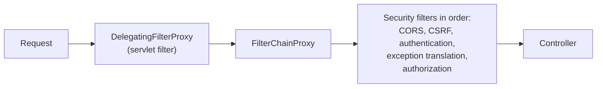
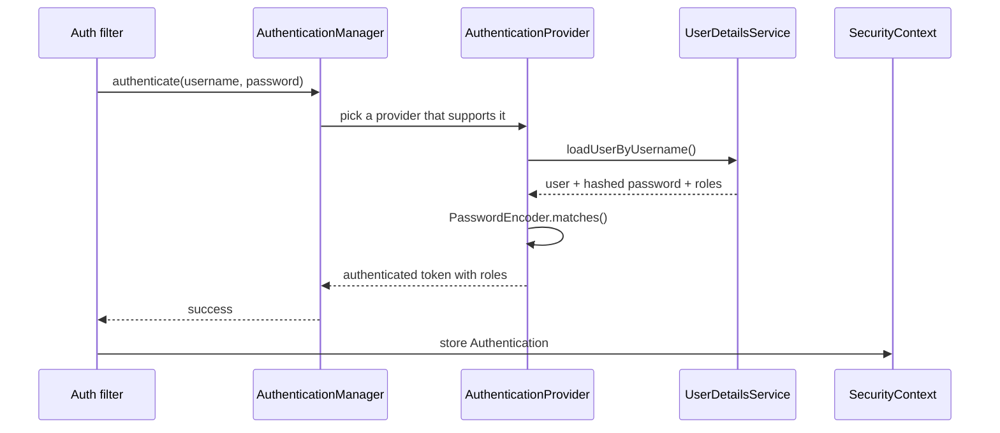

# Spring Part 9: Spring Security Architecture

What interviews ask, most frequent first: **how Spring Security works (the filter chain and the authentication flow)**, **authentication vs authorization and 401 vs 403**, **stateful sessions vs stateless tokens**, **where users and passwords come from**, and **how you secure a REST API**.

## 1. Authentication vs authorization, 401 vs 403

- **Authentication** answers "**who are you?**": checking a password, a token or a certificate.
- **Authorization** answers "**what may you do?**": checking roles or permissions for this action.
- **401 Unauthorized** means authentication failed or is missing: no token, an expired token, a wrong password. (The name is misleading; it really means "unauthenticated".)
- **403 Forbidden** means you are authenticated but not allowed: a normal user calling an admin endpoint.

Say it like this: "Authentication proves who you are, authorization decides what you can do. 401 means we don't know who you are; 403 means we know, and the answer is no."

## 2. How Spring Security works: the filter chain

Spring Security is a **chain of servlet filters** that runs **before** your controllers. Every request passes through it.



1. **DelegatingFilterProxy** is a plain servlet filter registered with Tomcat. It hands the request to a Spring bean.
2. **FilterChainProxy** is that bean. It picks the right **SecurityFilterChain** for the URL (you can have different chains for `/api/**` and `/admin/**`).
3. The chain's filters run in a fixed order. The ones worth naming:
   - **CorsFilter** and **CsrfFilter**: browser-related protections.
   - **An authentication filter**: `UsernamePasswordAuthenticationFilter` for form login, `BearerTokenAuthenticationFilter` for JWTs, `BasicAuthenticationFilter` for basic auth. It extracts credentials and authenticates them.
   - **ExceptionTranslationFilter**: turns security exceptions into responses: 401 for "not authenticated", 403 for "access denied".
   - **AuthorizationFilter**: the last one; checks the URL rules (`hasRole("ADMIN")`) before the request reaches the controller.

You configure all of this with a `SecurityFilterChain` bean:

```java
@Bean
SecurityFilterChain api(HttpSecurity http) throws Exception {
    return http
        .authorizeHttpRequests(a -> a
            .requestMatchers("/public/**").permitAll()
            .requestMatchers("/admin/**").hasRole("ADMIN")
            .anyRequest().authenticated())
        .oauth2ResourceServer(o -> o.jwt(Customizer.withDefaults()))
        .build();
}
```

Say it like this: "Spring Security is a chain of servlet filters in front of DispatcherServlet. DelegatingFilterProxy hands requests to FilterChainProxy, which picks the matching SecurityFilterChain. An authentication filter extracts and verifies credentials, ExceptionTranslationFilter turns failures into 401 or 403, and the authorization filter checks access rules before the controller runs."

## 3. The authentication flow



1. The authentication filter builds an unauthenticated token from the request (username and password, or a bearer token).
2. **AuthenticationManager** (usually `ProviderManager`) passes it to an **AuthenticationProvider** that supports that token type.
3. For username and password, `DaoAuthenticationProvider` loads the user through **UserDetailsService** and checks the password with the **PasswordEncoder**.
4. On success, the resulting `Authentication` (with the user's roles) is stored in the **SecurityContext**, held per request in a `ThreadLocal` through `SecurityContextHolder`. Controllers and later filters read it from there.
5. On failure, an exception is raised and translated into a 401.

## 4. Where users and passwords come from

- **UserDetailsService** has one method, `loadUserByUsername`. You implement it to load users from your database (or use the built-in in-memory or JDBC versions for demos).
- **Passwords are never stored in plain text or with fast hashes like MD5 or SHA-256.** Use a slow, salted algorithm: **BCrypt** (Spring's default through `PasswordEncoderFactories`), or Argon2 or PBKDF2. Slow hashing makes brute-forcing stolen hashes impractical; the salt makes identical passwords produce different hashes.
- `DelegatingPasswordEncoder` stores a prefix like `{bcrypt}$2a$10$...`, so you can migrate to a stronger algorithm later without breaking existing users.

Say it like this: "Users come from a UserDetailsService that loads them from my database, and passwords are stored only as slow, salted hashes, BCrypt by default, checked by the PasswordEncoder."

## 5. Stateful sessions vs stateless tokens

- **Stateful (session)**: after login, the server stores the user in a session and the browser sends a session-id cookie. Easy logout (delete the session) and easy revocation, but the session must be shared across servers (sticky sessions or a store like Redis), and cookies need CSRF protection.
- **Stateless (token)**: after login, the client gets a signed token (usually a JWT) and sends it in the `Authorization: Bearer` header on every request. Any server can verify it without shared storage, which scales well across services. The cost: a token stays valid until it expires, so revocation needs extra work (short lifetimes, refresh tokens, a denylist).
- Spring: `sessionManagement(s -> s.sessionCreationPolicy(SessionCreationPolicy.STATELESS))` for token APIs.

Say it like this: "Sessions keep state on the server and are easy to revoke, but need shared session storage and CSRF protection. Tokens like JWTs carry the identity themselves, so any instance can verify them, which suits microservices, but revoking them before expiry needs short lifetimes or a denylist."

## 6. Securing a REST API: the checklist

- **Stateless** with JWT bearer tokens, validated by Spring's resource-server support (`oauth2ResourceServer().jwt()`), not a hand-written parser.
- **HTTPS everywhere**; never tokens or passwords in URLs or logs.
- **URL rules** in the `SecurityFilterChain` plus **method security** (`@PreAuthorize`) for fine-grained rules.
- **CSRF disabled only** when authentication is purely by header, never with cookie-based auth.
- **CORS** configured for the real front-end origins only.
- **Input validation**, rate limiting on login and expensive endpoints, and consistent 401/403 error bodies (through the authentication entry point and access-denied handler).

**Before the next part:** without looking, draw the request path through DelegatingFilterProxy, FilterChainProxy and the key filters, then draw the username-and-password flow from the filter to the SecurityContext, and explain 401 vs 403 in one sentence each.
