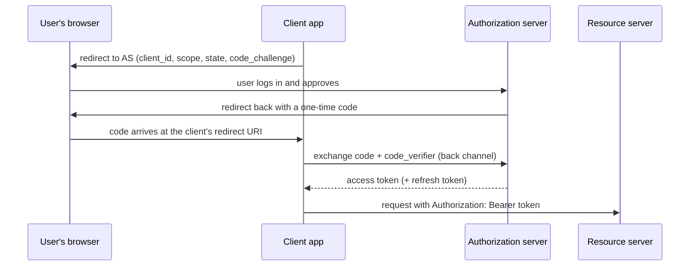
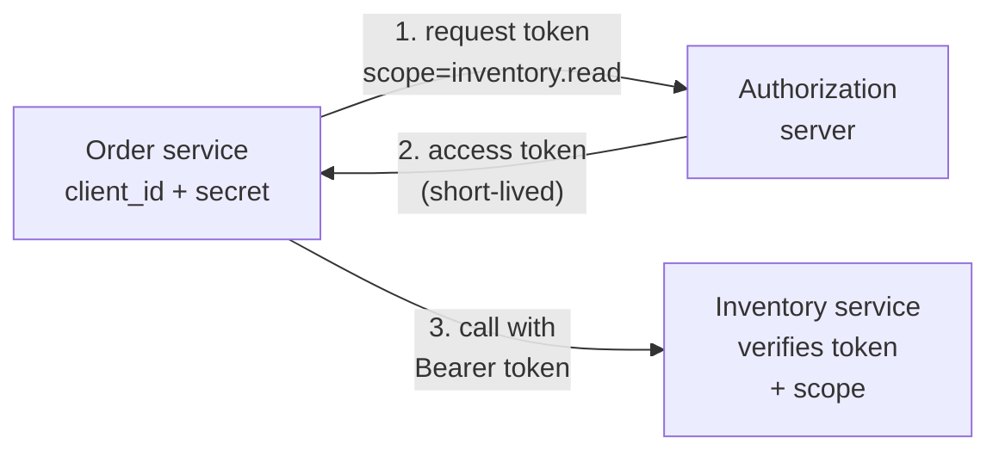

# Spring Part 10: OAuth 2.0 and Service-to-Service Tokens

Two questions come up: **"explain the OAuth 2.0 flow: authorization code vs client credentials"** (most of the time) and **"how are OAuth 2.0 and JWT related?"**.

## 1. What OAuth 2.0 solves, and the four roles

OAuth 2.0 lets an application get **limited, revocable access** to an API **without ever seeing the user's password**. Instead of a password, the app receives an **access token** that allows only specific actions (**scopes**, such as `photos.read`) for a limited time.

The four roles:

- **Resource owner**: the user who owns the data.
- **Client**: the application that wants access (a website, mobile app or backend service).
- **Authorization server**: logs the user in, asks for consent and issues tokens (Google, Okta, Keycloak, Azure AD).
- **Resource server**: the API that holds the data and accepts tokens.

Correction: "OAuth is a login protocol." OAuth is about **authorization** (delegated access to an API). Login is added on top by **OpenID Connect** (section 4).

Say it like this: "OAuth 2.0 lets a client get a scoped, short-lived access token from an authorization server to call an API on a user's behalf, without ever handling the user's password."

## 2. Authorization code flow (with PKCE): when a user is involved

Used by web apps, single-page apps and mobile apps.

1. The client redirects the user to the authorization server with its `client_id`, the requested scopes, a random `state`, and a **PKCE code challenge** (a hash of a secret `code_verifier` it keeps).
2. The user logs in **at the authorization server** (the client never sees the password) and approves the scopes.
3. The authorization server redirects back with a short-lived, **one-time authorization code**.
4. The client exchanges the code for tokens in a **direct server-to-server call**, sending the `code_verifier`.
5. The client calls the API with the access token.

Why each piece exists (a favourite follow-up):

- **A code, not a token, in the redirect**: browser URLs end up in history and logs; only a useless one-time code goes there, and the token comes through the direct call.
- **PKCE**: if an attacker intercepts the code, they cannot redeem it without the `code_verifier`. Required for mobile apps and single-page apps, recommended for all.
- **state**: ties the response to the request the browser actually started (prevents CSRF on the callback).

The old **implicit** grant (token in the URL) and **password** grant (the app collects the user's password) are deprecated. Use authorization code with PKCE.

## 3. Client credentials: service-to-service, no user

When the order service calls the inventory service in a nightly job, there is no user. The service acts **as itself**.

1. The calling service authenticates to the authorization server with its own `client_id` and secret and asks for the scopes it needs.
2. It gets a short-lived access token (no refresh token; it simply asks again).
3. It calls the other service with the token; the receiving service verifies it (usually a JWT checked locally) and checks the scope.

Getting it right in production:

- **Cache the token** until shortly before it expires; requesting one per call adds latency and overloads the authorization server. Spring's OAuth2 client support (`OAuth2AuthorizedClientManager`) does this for you.
- **One client per service with the narrowest scopes**, so a leaked secret exposes little.
- **Secrets in a vault**, never in code.
- Each API checks the token's **audience**, so a token minted for one service is not accepted by another.
- If the downstream service needs to know **which user** the call is for, client credentials is not enough: pass the user's token along or use **token exchange** to get a narrower token on the user's behalf.

**Authorization code vs client credentials in one line:** authorization code is for an app acting **on behalf of a user**, who logs in and consents; client credentials is for a service acting **as itself**, with no user at all.

Say it like this: "With a user, I use the authorization code flow with PKCE: redirect to the authorization server, get a one-time code back, and exchange it with the verifier for tokens on a back channel. Between services with no user, I use client credentials: the service authenticates with its own id and secret, gets a short-lived token with narrow scopes, caches it until near expiry, and the receiving service verifies it locally."

## 4. OAuth 2.0 vs JWT, and OpenID Connect

They are different kinds of things:

- **OAuth 2.0** is a **framework**: who issues tokens, through which flows, to whom.
- **JWT** is a **token format**: a signed JSON document.
- OAuth does not require JWTs. Access tokens are often JWTs (verified locally by the API, fast, but hard to revoke early), or **opaque** random strings that the API checks by asking the authorization server (**introspection**: a call per request, but instant revocation).

**OpenID Connect (OIDC)** adds login on top of OAuth: with the `openid` scope, the authorization code flow also returns an **ID token**, a JWT that tells the **client** who the user is. The rule: the **ID token is for the client to know who logged in; the access token is for calling APIs**. Never send the ID token to an API.

Say it like this: "OAuth is the authorization framework and JWT is just a token format it often uses for access tokens. OpenID Connect adds login on top: an ID token that tells the client who the user is, while the access token is for calling APIs."

**Before the next part:** without looking, draw the authorization code flow with PKCE and the client credentials flow, and say in one sentence each why the code, PKCE and state exist.
