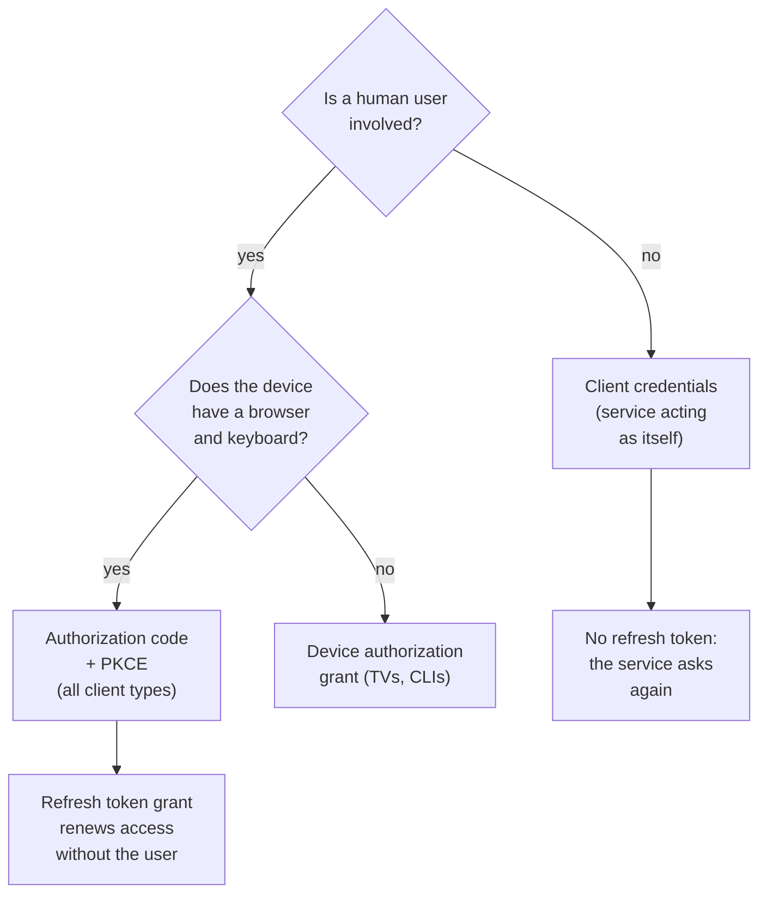
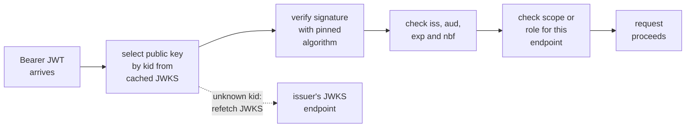
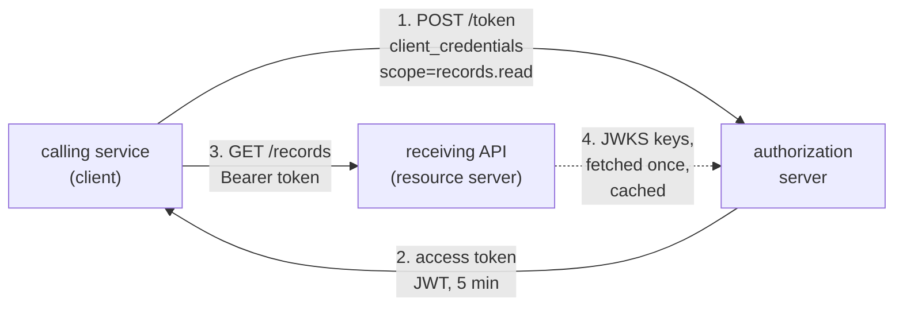

# Spring Part 10: OAuth 2.0 and Service-to-Service Tokens

OAuth 2.0 (RFC 6749) is the standard framework for **delegated authorization**: it lets an application call an API with a limited, expiring, revocable credential instead of the user's password. The same framework also covers the case where there is no user at all, and one service calls another as itself. This part covers the roles and vocabulary, the grants and when each applies, how a resource server validates a token, token formats and lifetimes, service-to-service calls, and OpenID Connect, with the Spring Security configuration for each side.

## 1. The problem, the four roles and the vocabulary [P0]

**The problem.** Before OAuth, an application that needed a user's data in another system asked for the user's password and logged in as them. That design has four structural flaws: the application gets *all* of the user's power, not the part it needs; the access never expires; it can only be withdrawn by changing the password, which breaks every other integration; and a breach of the application leaks real passwords. OAuth replaces the shared password with a **token** issued by the system that owns the account, limited to what the user approved.

**The four roles.** Every OAuth interaction has the same four parties:

- **Resource owner**: the entity that owns the data and can grant access to it, usually the end user.
- **Client**: the application that wants access. "Client" means the application, not the browser; a Spring Boot backend, a single-page app or a mobile app can each be the client.
- **Authorization server**: authenticates the resource owner, obtains consent, and issues tokens. Examples: Keycloak, Okta, Auth0, Microsoft Entra ID (Azure AD), Spring Authorization Server, or Google's and GitHub's own account servers.
- **Resource server**: the API that holds the protected data and accepts tokens.

**Tokens.** An **access token** is the credential the client presents to the resource server, in a header: `Authorization: Bearer <token>`. "Bearer" means whoever holds the token can use it, like cash, which is why access tokens are short-lived and must never be logged or exposed. A **refresh token** is a longer-lived credential the client presents only to the authorization server, to obtain new access tokens (section 6).

**Scopes.** A **scope** is a named permission carried by the token, such as `records.read`. The client requests scopes, the resource owner approves them, and the resource server enforces them on every call. A token with `records.read` cannot be used to delete records.

**Client registration.** Before any flow, the client is registered with the authorization server and receives a **client_id** (an identifier, not a secret) and, if it can protect one, a **client_secret**. It also registers its exact **redirect URIs**, the only addresses to which the authorization server will ever send results.

**Client types.** The specification distinguishes two:
- A **confidential client** runs on a server and can keep a credential secret (a backend service).
- A **public client** cannot: a single-page app, a mobile app or a desktop app. Anything shipped to a device can be extracted, so a public client has no secret, and the protocol compensates (PKCE, section 3).

Correction: "OAuth is a login protocol." OAuth 2.0 is about **authorization**: a client obtaining delegated access to an API. An access token does not, by specification, tell the client who the user is. Authentication is a separate layer built on top, OpenID Connect (section 8).

Say it like this: "OAuth 2.0 lets a client obtain a scoped, short-lived, revocable access token from an authorization server and use it to call a resource server, without the client ever handling the resource owner's password."

## 2. Grants: how a client obtains a token [P0]

A **grant** (or grant type) is a defined procedure for obtaining a token. The right grant follows from two questions: is a human user involved, and can the client keep a secret?



- **Authorization code with PKCE**: for every application with a human user, whether confidential or public. The user authenticates at the authorization server and the client receives a one-time code, which it exchanges for tokens (section 3).
- **Client credentials**: for a service acting on its own behalf, with no user (section 7).
- **Refresh token**: not a way to start a session, but to extend one: the client trades a refresh token for a new access token (section 6).
- **Device authorization grant** (RFC 8628): for devices with no browser or keyboard. The device shows a short code, the user approves it on a phone or computer, and the device polls the token endpoint until approval arrives.
- **Token exchange** (RFC 8693): a service trades a token it received for a new token suited to a downstream call (section 7).

Correction: the **implicit grant** (the token returned directly in the redirect URL) and the **resource owner password credentials grant** (the client collects the user's password and sends it to the token endpoint) are deprecated. RFC 9700, the OAuth 2.0 Security Best Current Practice (January 2025), says not to use them, and the OAuth 2.1 draft removes them. Single-page apps use authorization code with PKCE.

## 3. Authorization code flow with PKCE [P0]

This is the flow interviewers ask about most. It has two channels: a **front channel** through the user's browser (redirects, visible in URLs) and a **back channel**, a direct HTTPS call from the client to the authorization server. The design rule is that only harmless values travel on the front channel.


**Step 1: authorization request (front channel).** The client generates a random secret, the **code_verifier** (43 to 128 characters), and derives the **code_challenge** = base64url(SHA-256(code_verifier)). It stores the verifier and a random **state** value in the user's session, then redirects the browser to the authorization endpoint:

```http
GET https://auth.example.com/authorize
    ?response_type=code
    &client_id=web-app
    &redirect_uri=https://app.example.com/oauth/callback
    &scope=records.read
    &state=af0ifjsldkj
    &code_challenge=E9Melhoa2OwvFrEMTJguCHaoeK1t8URWbuGJSstw-cM
    &code_challenge_method=S256
```

**Step 2: authentication and consent, at the authorization server.** The user signs in on the authorization server's own page; the credentials are never typed into the client. The server shows the requested scopes and the user approves them.

**Step 3: authorization response (front channel).** The authorization server redirects the browser back to the registered URI with a code and the unchanged state:

```http
HTTP/1.1 302 Found
Location: https://app.example.com/oauth/callback?code=SplxlOBeZQQYbYS6WxSbIA&state=af0ifjsldkj
```

The **authorization code** is not a token. It is a short-lived (typically under a minute), single-use ticket bound to this client, this redirect URI and this code challenge. The client first checks that `state` equals the value it stored, and stops on a mismatch.

**Step 4: token request (back channel).** The client's backend calls the token endpoint directly:

```http
POST https://auth.example.com/token
Content-Type: application/x-www-form-urlencoded
Authorization: Basic base64(web-app:client_secret)

grant_type=authorization_code
&code=SplxlOBeZQQYbYS6WxSbIA
&redirect_uri=https://app.example.com/oauth/callback
&code_verifier=dBjftJeZ4CVP-mB92K27uhbUJU1p1r_wW1gFWFOEjXk
```

A public client sends `client_id` in the body instead of a Basic header, since it has no secret.

**Step 5: token response.** The authorization server authenticates the client (if confidential), checks that the code is unused, unexpired and issued to this client, that `redirect_uri` matches step 1, and that `SHA-256(code_verifier)` equals the stored `code_challenge`. Then:

```json
{
  "access_token": "eyJhbGciOiJSUzI1NiIs...",
  "token_type": "Bearer",
  "expires_in": 3600,
  "refresh_token": "8xLOxBtZp8...",
  "scope": "records.read"
}
```

Any failed check returns `400` with `{"error": "invalid_grant"}` and no tokens.

**Step 6: API call.** The client sends `Authorization: Bearer <access_token>`. The resource server validates the token (section 4). An expired or invalid token gets `401` with `WWW-Authenticate: Bearer error="invalid_token"`; a valid token without the required scope gets `403` with `error="insufficient_scope"` (RFC 6750).

### What each element defends against

- **A code instead of a token on the front channel.** Redirect URLs are recorded in browser history, proxy and server logs, and `Referer` headers. Only a short-lived, single-use code travels there; the token itself is delivered on the back channel.
- **PKCE** (Proof Key for Code Exchange, RFC 7636, said "pixie"). It defends against **authorization code interception**: on mobile platforms another app can register the same custom URL scheme and receive the redirect. Redeeming a code requires the verifier, which never left the legitimate client, so an intercepted code is useless. For a public client, PKCE is the only proof that the party redeeming the code is the party that started the flow. Current guidance requires PKCE for all clients, confidential ones included, because it also prevents authorization code injection.
- **state.** It defends against **CSRF on the callback**: without it, an attacker can obtain a code for their own account and make the victim's browser load the callback with it, linking the victim's session to the attacker's account. `state` binds the response to a request this browser actually started. (When OpenID Connect is used, `nonce` plays a similar role for the ID token.)
- **Exact redirect URI matching.** If the authorization server accepted wildcards or prefixes, an attacker could direct the code to a URL they control (an open redirector on the same domain is enough). RFC 9700 requires exact string matching against registered URIs.

Say it like this: "The client redirects the user to the authorization server with a PKCE code challenge and a state value. The user authenticates there, and the server redirects back with a one-time code. The client's backend exchanges the code plus the code verifier for tokens over a direct call. The password never reaches the client, the token never appears in a URL, and an intercepted code is useless without the verifier."

## 4. How a resource server validates an access token [P0]

The resource server must decide, for every request, whether the bearer token is genuine, meant for this API, still valid, and sufficient for this operation. With a JWT access token this happens locally, without calling the authorization server per request.

A **JWT** (JSON Web Token, RFC 7519) has three base64url parts, `header.payload.signature`. The header names the signing algorithm and a key id (`kid`); the payload holds **claims** such as `iss` (issuer), `sub` (subject), `aud` (audience), `exp` (expiry), `nbf` (not before), `iat` (issued at) and `scope`; the signature is made with the issuer's private key. RFC 9068 standardises a JWT profile for access tokens.



1. **Select the key.** The resource server fetches the issuer's public keys from its **JWKS** endpoint (JSON Web Key Set, for example `https://auth.example.com/.well-known/jwks.json`) and caches them. The token's `kid` selects the key. When an unknown `kid` appears, the server refetches the set; this is how signing keys rotate without downtime.
2. **Verify the signature** using an algorithm the server has pinned in configuration (RS256 or ES256). The `alg` in the token header must never decide the algorithm, and `none` must never be accepted; both are classic JWT library vulnerabilities.
3. **Check the issuer**: `iss` must equal the expected authorization server exactly.
4. **Check the audience**: `aud` must include this API. This is what stops a token minted for one API being replayed against another API that trusts the same issuer.
5. **Check time**: `exp` in the future and `nbf` in the past, with a small clock-skew allowance (Spring Security defaults to 60 seconds).
6. **Authorize**: check that the token's scopes (and, if used, the user's roles) permit this endpoint.

**In Spring Boot**, a resource server is the `spring-boot-starter-oauth2-resource-server` dependency, one property block and the authorization rules:

```yaml
spring:
  security:
    oauth2:
      resourceserver:
        jwt:
          issuer-uri: https://auth.example.com/realms/main
          audiences: records-api
```

```java
@Bean
SecurityFilterChain api(HttpSecurity http) throws Exception {
    http
        .authorizeHttpRequests(a -> a
            .requestMatchers(HttpMethod.GET, "/records/**").hasAuthority("SCOPE_records.read")
            .requestMatchers(HttpMethod.POST, "/records/**").hasAuthority("SCOPE_records.write")
            .anyRequest().authenticated())
        .oauth2ResourceServer(o -> o.jwt(Customizer.withDefaults()))
        .sessionManagement(s -> s.sessionCreationPolicy(SessionCreationPolicy.STATELESS));
    return http.build();
}
```

From `issuer-uri`, Spring reads the issuer's discovery metadata, finds the JWKS URL, and builds a `JwtDecoder` that validates signature, issuer, time and (with `audiences`) audience. The `BearerTokenAuthenticationFilter` extracts the token; on success it places a `JwtAuthenticationToken` in the `SecurityContext`, so controllers can read claims. By default each scope becomes a `GrantedAuthority` prefixed `SCOPE_`.

**Scopes and roles are different things.** A **scope** limits what the *client* may do on the user's behalf. A **role** describes what the *user* is allowed to do in the business domain. A request should pass both checks: the token carries the scope, and the subject has the role. Roles usually arrive in a custom claim and are mapped to authorities with a `JwtAuthenticationConverter`.

Say it like this: "A resource server validates a JWT access token locally: it selects the public key by kid from the issuer's cached JWKS, verifies the signature with a pinned algorithm, checks issuer, audience and expiry, then checks the scope for the endpoint. There is no call to the authorization server per request."

## 5. Token formats: JWT and opaque tokens [P0]

"OAuth vs JWT" is a common trick question because the two are different kinds of thing. **OAuth 2.0** is a framework: roles, grants, endpoints and how tokens are requested and presented. **JWT** is a token format: a signed, self-contained JSON document. OAuth does not mandate any access token format, and there are two common choices.

- **Self-contained (JWT) access token.** The resource server validates it locally with the issuer's public keys. It scales with no shared state and no per-request network call. The trade-off is revocation: the token remains valid until `exp`, because no one is asked.
- **Opaque (reference) token.** A random string that means nothing by itself. The resource server asks the authorization server's **introspection endpoint** (RFC 7662) whether it is active and what it allows, and receives `{"active": true, "scope": "...", "sub": "..."}`. Revocation is immediate, because the answer changes at the source. The trade-off is a network call per request, usually mitigated by caching results for a few seconds, which reintroduces a small revocation delay.

A common split is opaque tokens for tokens that leave the organisation's perimeter (third-party clients, where immediate revocation matters) and JWTs inside the platform, where call volume makes local validation worth it. In Spring, an opaque-token resource server uses `.oauth2ResourceServer(o -> o.opaqueToken(...))` with the introspection URI and client credentials.

Correction: "A JWT access token can be revoked instantly." A JWT stays valid until its `exp`. Early cut-off needs short lifetimes, a denylist checked on each request (which reintroduces shared state), or opaque tokens.

Say it like this: "OAuth is the authorization framework; JWT is a token format it often uses. A JWT access token is validated locally and cannot easily be revoked early; an opaque token is checked through introspection, costs a call, and can be revoked immediately."

## 6. Token lifetimes, refresh tokens and revocation [P0]

**Why access tokens are short-lived.** A bearer token that leaks can be used by anyone until it expires, and a JWT cannot be recalled. Keeping access tokens short (typically 5 to 60 minutes) bounds the damage of a leak. Forcing users to sign in again that often is unacceptable, so a second credential carries the long-lived part of the session.

**Refresh tokens.** A refresh token is presented only to the authorization server's token endpoint, never to APIs:

```http
POST /token
grant_type=refresh_token&refresh_token=8xLOxBtZp8...&client_id=web-app
```

Because it lives for days or weeks, it needs controls an access token does not:

- **Rotation.** Each use returns a new refresh token and invalidates the old one. If an invalidated refresh token is ever presented again, two parties hold copies, so one of them is an attacker; the authorization server revokes the entire **token family**, ending both the attacker's and the legitimate session. Current guidance requires rotation for public clients unless the refresh token is sender-constrained (section 9).
- **Revocation** (RFC 7009). Signing out or removing an application's access calls the revocation endpoint. The next refresh fails; already-issued JWT access tokens remain valid until their `exp`.
- **Binding.** A refresh token is bound to the client it was issued to; a confidential client must authenticate when using it.

**Token storage in browser applications.** Anything stored where JavaScript can read it (localStorage, sessionStorage, non-HttpOnly cookies) can be exfiltrated by a single XSS bug. The pattern recommended for browser apps is the **Backend-for-Frontend (BFF)**: a small server-side component acts as a confidential OAuth client, holds the tokens server-side, and gives the browser only an `HttpOnly`, `Secure`, `SameSite` session cookie. The browser calls the BFF; the BFF attaches the access token when calling APIs. Where there is no BFF, the fallback is to keep the access token in memory only and accept that a page reload needs a silent renewal.

Say it like this: "Access tokens are short so a leak expires quickly; refresh tokens keep the session alive and are protected by rotation with reuse detection, revocation and client binding. In browsers, tokens stay server-side behind a BFF, and the browser holds only an HttpOnly session cookie."

## 7. Service-to-service: the client credentials grant [P0]

When a service calls another service on its own behalf (a scheduled job, a background consumer, an internal integration), there is no user to authenticate and nothing to consent to. The calling service is both client and resource owner. This is the **client credentials grant**: no redirect, no browser, no code.



1. The calling service authenticates itself at the token endpoint and requests only the scopes it needs:

```http
POST /realms/main/protocol/openid-connect/token
Authorization: Basic base64(batch-service:s3cr3t)

grant_type=client_credentials&scope=records.read
```

2. The authorization server returns `{"access_token": "...", "expires_in": 300, "token_type": "Bearer"}`. No refresh token is issued: the service holds its own credentials and simply requests a new token.
3. The calling service sends the token as a bearer token.
4. The receiving API validates it exactly as in section 4. The `sub` claim (or `azp`/`client_id`) identifies the calling service, so logs and audit trails show which service made the call.

**Production requirements.**

- **Cache the token until shortly before expiry.** Requesting a token per call doubles latency and turns the authorization server into a bottleneck and a single point of failure. Renew at a fraction of the lifetime (for example 80%), and ensure concurrent requests trigger a single renewal, not one per thread.
- **One client registration per service, with the narrowest scopes.** A leaked credential then exposes only that service's permissions.
- **One audience per API**, validated by each API, so a token minted for one service is rejected by every other.
- **Credentials out of code.** Store secrets in a secret manager (Azure Key Vault, HashiCorp Vault, Kubernetes secrets) and rotate them. Stronger client authentication replaces the shared secret: **`private_key_jwt`**, where the client signs a short JWT assertion with its private key, or **mutual TLS client authentication** (RFC 8705), where the client proves itself with a certificate.

**In Spring**, the calling side is `spring-boot-starter-oauth2-client` configuration plus an HTTP client that attaches tokens:

```yaml
spring:
  security:
    oauth2:
      client:
        registration:
          records:
            client-id: batch-service
            client-secret: ${RECORDS_CLIENT_SECRET}
            authorization-grant-type: client_credentials
            scope: records.read
        provider:
          records:
            token-uri: https://auth.example.com/realms/main/protocol/openid-connect/token
```

```java
@Bean
RestClient recordsClient(OAuth2AuthorizedClientManager manager) {
    var interceptor = new OAuth2ClientHttpRequestInterceptor(manager);
    interceptor.setClientRegistrationIdResolver(request -> "records");
    return RestClient.builder()
        .baseUrl("https://records.internal")
        .requestInterceptor(interceptor)   // obtains, caches and attaches the Bearer token
        .build();
}
```

The `OAuth2AuthorizedClientManager` stores the authorized client (with its token) and requests a new token only when the current one is about to expire. For `WebClient`, the equivalent is `ServletOAuth2AuthorizedClientExchangeFilterFunction` (or `ServerOAuth2AuthorizedClientExchangeFilterFunction` in reactive apps).

**Propagating the user's identity.** A client credentials token says "this service is calling", not "this service, on behalf of this user". When a downstream API must know the user, there are two options:
- **Token relay**: forward the user's access token unchanged. Simple, but only valid if the token's audience includes the downstream API, and the token then works against every API in that audience.
- **Token exchange** (RFC 8693): the service presents the user's token to the authorization server and receives a new token whose audience and scopes fit the next hop, with the user still as `sub` and the calling service recorded as the actor (`act` claim). This preserves least privilege at every hop.

**Where mutual TLS fits.** A service mesh such as Istio can enforce mTLS between all workloads: each side presents a certificate, so the network layer knows *which workload* is calling and traffic is encrypted. Tokens add *what it may do* and *on whose behalf*. They are complementary layers.

Say it like this: "For service-to-service calls with no user, the caller uses the client credentials grant: it authenticates with its own credentials, gets a short-lived token with narrow scopes, and caches it until near expiry. The receiving API validates the JWT locally and checks scope and audience. If the user's identity must flow downstream, token exchange issues a new token per hop instead of relaying one broad token."

## 8. OpenID Connect: authentication on top of OAuth [P1]

**OpenID Connect (OIDC)** is an identity layer on the authorization code flow, and is what "Sign in with ..." buttons use.

- The client includes the scope `openid` (plus `profile`, `email` as needed).
- The token response then also contains an **ID token**: a JWT *about the user*, *for the client*, with `sub` (a stable user identifier), `iss`, `aud` (the client's id), `exp`, `iat`, `nonce` (echoing a value the client sent, to prevent replay) and profile claims.
- A **discovery document** at `/.well-known/openid-configuration` lists the issuer's endpoints and JWKS URL, so clients configure themselves from a single issuer URL.
- A **UserInfo endpoint** returns further profile claims for a valid access token.

The rule interviewers check: the **ID token proves to the client who signed in**; the **access token authorizes API calls**. An ID token must never be sent to an API as a bearer token, because its audience is the client, not the API.

In Spring, `spring-boot-starter-oauth2-client` with `http.oauth2Login(Customizer.withDefaults())` performs the whole flow: redirect, state, PKCE, code exchange, ID token validation and creation of an authenticated session.

Say it like this: "OpenID Connect adds authentication to OAuth: with the openid scope, the code flow also returns an ID token, a signed JWT that tells the client who signed in. The access token remains the credential for calling APIs."

## 9. Sender-constrained tokens and recurring design errors [P1]

**Sender-constrained tokens.** A bearer token works for anyone who holds it. A sender-constrained token is bound to a key held by the legitimate client, and is useless without proof of that key on each request:
- **DPoP** (RFC 9449): the client signs a small proof JWT per request with its private key; the token is bound to the matching public key.
- **mTLS-bound tokens** (RFC 8705): the token is bound to the client's TLS certificate thumbprint.
They are used for high-risk APIs (open banking is the common example) and allow refresh tokens for public clients without rotation.

**Design errors that recur in real systems**, each with the principle it violates:

- **No audience validation.** Every service trusts the same issuer, so a token for one API is accepted by all. Principle: each API accepts only tokens minted for it.
- **Long-lived access tokens.** A 24-hour bearer token that leaks is a 24-hour breach. Principle: short access tokens, long-lived state in rotated refresh tokens.
- **Tokens readable by JavaScript.** One XSS bug exfiltrates them. Principle: BFF or memory-only storage.
- **Tokens in logs.** `Authorization` headers end up in access logs, traces and error reports. Principle: mask credentials at the logging layer.
- **A new client credentials token per request.** Principle: cache until near expiry with a single renewal.
- **Validation only at the gateway.** Anything that reaches a service directly bypasses authorization. Principle: defence in depth, every service validates.

**Before the next part:** without looking, draw the authorization code flow with PKCE as four boxes (browser, client backend, authorization server, resource server), write the parameters on each arrow, and then state in one sentence each which attack the code, PKCE, `state`, exact redirect URI matching and the audience check defend against.
