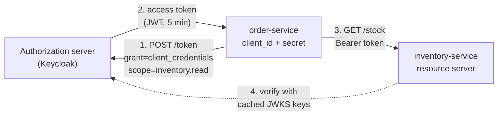

# Spring Part 10: OAuth 2.0 and Service-to-Service Tokens

A photo-printing site wants to print your Google Photos. You should never give it your Google password: it could read your mail, and you could never take access back without changing the password. OAuth 2.0 lets you give it a limited, revocable key instead. The same machinery also secures calls between your own microservices.

## 1. The four roles [P0]

Using the printing example:
- **Resource owner**: you, the user who owns the photos.
- **Client**: the printing site, the app that wants access.
- **Authorization server**: Google's login and consent server. It authenticates you and issues tokens. In company setups: Keycloak, Okta, Auth0, Azure AD, Spring Authorization Server.
- **Resource server**: the Google Photos API, which accepts tokens.

An **access token** is the limited key. A **scope** limits what it allows, for example `photos.read`. The client never sees your password.

Correction: "OAuth is a login protocol." OAuth 2.0 is for **authorization**: giving an app delegated access to an API. Login is added on top by OpenID Connect (section 5).

Say it like this: "OAuth 2.0 lets a client app get a scoped, revocable access token from an authorization server to call a resource server on the user's behalf, without ever seeing the user's password."

## 2. Authorization code flow with PKCE [P0]

The flow for any app with a user: web apps, single-page apps, mobile apps.


1. The client creates a random **code_verifier** and its SHA-256 hash, the **code_challenge**. It redirects the browser to the authorization server:
   `GET /authorize?response_type=code&client_id=printer&redirect_uri=https://printer.example/cb&scope=photos.read&state=xyz&code_challenge=E9Mel...&code_challenge_method=S256`
2. The user logs in at the authorization server (the client never sees the password) and approves the scopes.
3. The authorization server redirects back to `redirect_uri` with a short-lived, one-time **authorization code**: `https://printer.example/cb?code=SplxlO&state=xyz`. The client checks that `state` matches what it sent.
4. The client's backend calls the token endpoint directly, not through the browser: `POST /token` with `grant_type=authorization_code`, the code, the `redirect_uri`, the `code_verifier`, and its client credentials if it is a confidential client.
5. The authorization server hashes the verifier, compares it with the challenge from step 1, and returns an **access token** (and usually a **refresh token**).
6. The client calls the API with `Authorization: Bearer <access token>`.

Why each piece exists:
- **The code instead of a token in the redirect**: the browser URL, history and logs only ever see a short-lived code. The token is fetched on a direct back-channel call.
- **PKCE** (Proof Key for Code Exchange, "pixie"): if an attacker intercepts the code (a malicious app on a phone registered for the same URL scheme), they still cannot redeem it, because they do not have the `code_verifier`. Public clients such as SPAs and mobile apps cannot keep a client secret, so PKCE replaces it. Current guidance uses PKCE for every client.
- **state**: a random value tying the response to the request, which stops CSRF on the callback.
- **Exact `redirect_uri` matching**: the authorization server only redirects to pre-registered URLs, so a code can't be sent to an attacker's site.

Correction: the **implicit** grant (token returned straight in the URL fragment) and the **password** grant (the app collects the user's password) are deprecated. RFC 9700, the OAuth 2.0 security best current practice (January 2025), says not to use them. Use authorization code with PKCE.

Say it like this: "The client redirects the user to the authorization server with a PKCE code challenge, gets back a one-time code, and exchanges that code plus the code verifier on a back channel for tokens, so the token never travels through the browser URL and a stolen code is useless."

## 3. Client credentials: service-to-service [P0]

The order service calls the inventory service at night. No user is involved; the order service acts as itself.



1. The order service sends its own `client_id` and `client_secret` (or a signed JWT, or mTLS) to the token endpoint with `grant_type=client_credentials` and the scopes it needs.
2. The authorization server returns an access token for the service itself. There is no refresh token; the service simply asks again.
3. The order service calls the inventory service with the token as a Bearer header.
4. The inventory service is a resource server: it verifies the JWT locally with the issuer's cached public keys, and checks the scope.

In production:
- **Cache the token** until shortly before it expires. Asking for a new token on every call overloads the authorization server and adds latency. Spring's `OAuth2AuthorizedClientManager` does this caching for you.
- Give each service its **own client** and the **narrowest scopes**, so a leaked secret only exposes that service's permissions.
- Keep secrets in a vault or Kubernetes secrets, not in the code.

In Spring:
```yaml
spring.security.oauth2.client.registration.inventory:
  client-id: order-service
  client-secret: ${INVENTORY_CLIENT_SECRET}
  authorization-grant-type: client_credentials
  scope: inventory.read
spring.security.oauth2.client.provider.inventory.token-uri: https://auth.example/oauth2/token
```
A `WebClient` or `RestClient` configured with the authorized client manager adds the Bearer token, fetching and caching it automatically. The receiving service only needs `spring.security.oauth2.resourceserver.jwt.issuer-uri`.

Also asked: how does the user's identity reach a downstream service? Pass the user's own access token along (simple, if the audience allows), or use **token exchange** (RFC 8693) to swap it for a new token scoped to the downstream service. Client credentials alone says "the order service is calling", not "on behalf of Asha".

Also asked: **mTLS** (mutual TLS, where both sides present certificates, often done by a service mesh such as Istio) authenticates which service is calling at the network level. Tokens add fine-grained scopes on top.

Say it like this: "For service-to-service calls with no user, the calling service uses the client credentials grant to get a short-lived token for itself, caches it until expiry, and the receiving resource server verifies the JWT locally and checks its scope."

## 4. Opaque tokens vs JWT, and how OAuth relates to JWT [P0]

OAuth 2.0 does not say what an access token looks like. Two common choices:
- **JWT access token**: the resource server verifies it locally with the issuer's public keys. Fast, no call per request, but hard to revoke before it expires.
- **Opaque token**: a random string meaning nothing by itself. The resource server asks the authorization server's **introspection** endpoint (RFC 7662) whether it is active and what it allows. Easy to revoke instantly, but a network call per request (usually cached briefly).

So "OAuth vs JWT" compares two different things:
- **OAuth 2.0** is the framework: who issues tokens, through which grants, to whom.
- **JWT** is a token format. OAuth often uses JWTs as access tokens, and OpenID Connect always uses one for the ID token.

Say it like this: "OAuth is the authorization framework and JWT is just a token format it often uses; a JWT access token is verified locally, while an opaque token is checked through introspection and is easier to revoke."

## 5. OpenID Connect: adding login [P1]

"Sign in with Google" is not plain OAuth. **OpenID Connect (OIDC)** is a thin identity layer on top of the authorization code flow:
- the client adds the scope `openid` (plus `profile`, `email`);
- the token response then also contains an **ID token**: a JWT about the user (`sub`, `email`, `name`), meant for the client, with `aud` set to the client's id;
- discovery metadata at `/.well-known/openid-configuration` tells clients every endpoint and the JWKS URL.

The ID token proves who logged in, for the client. The access token is for calling APIs. Never send the ID token to an API as an access token.

In Spring, `spring-boot-starter-oauth2-client` with `http.oauth2Login()` runs the whole flow, and `issuer-uri` lets Spring read the discovery document.

Say it like this: "OpenID Connect adds login to OAuth: with the openid scope, the authorization code flow also returns an ID token, a JWT that tells the client who the user is, while the access token stays for APIs."

## 6. Other grants, briefly [P2]

- **Refresh token grant**: `grant_type=refresh_token` gets a new access token without asking the user again. Rotate refresh tokens for public clients.
- **Device authorization grant**: for TVs and CLIs with no browser. The device shows a code; the user approves it on their phone.

**Before the next part:** from memory, draw the authorization code flow with PKCE (browser, client, authorization server, API) with the parameters on each arrow, then the client credentials call between two services, and say why the code, PKCE and state each exist.
