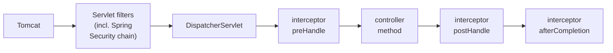

# Spring Part 11: Filters vs Interceptors, and Where Tenant Resolution Goes

A multi-tenant API must know, on every request, which tenant is calling, and must make sure no request ever sees another tenant's data. You also want request logging, a correlation id and timing. Each of these can live in a servlet filter, a Spring MVC interceptor, or an aspect. Interviewers want to know which runs first, what each can see, and where you would put tenant resolution.

## 1. The order a request travels [P0]



1. Tomcat passes the request through every **servlet filter**, in order. Spring Security's whole chain is one of them.
2. The filters hand it to Spring MVC's `DispatcherServlet`, which picks the controller method (the **handler**).
3. Each **HandlerInterceptor**'s `preHandle` runs. Returning `false` stops the request there.
4. The controller method runs.
5. `postHandle` runs after the controller, if it did not throw.
6. `afterCompletion` runs at the very end, always, even after an exception.
7. Control unwinds back out through the filters, which can still touch the response.

Say it like this: "A request passes the servlet filters, including Spring Security, then DispatcherServlet picks the handler, then interceptors' preHandle, the controller, postHandle and finally afterCompletion, and unwinds back out through the filters."

## 2. Servlet filters [P0]

A **filter** (`jakarta.servlet.Filter`) belongs to the servlet container, not to Spring MVC.

```java
@Component @Order(1)
class CorrelationIdFilter extends OncePerRequestFilter {
    protected void doFilterInternal(HttpServletRequest req, HttpServletResponse res, FilterChain chain)
            throws ServletException, IOException {
        String id = Optional.ofNullable(req.getHeader("X-Request-Id")).orElse(UUID.randomUUID().toString());
        MDC.put("requestId", id);                 // every log line gets the id
        res.setHeader("X-Request-Id", id);
        try { chain.doFilter(req, res); }          // call the rest of the chain
        finally { MDC.remove("requestId"); }       // clean up: threads are reused
    }
}
```

What a filter can and cannot do:
- It sees **every** request: static files, error dispatches, requests no controller handles.
- It sees the raw request and response, and can **wrap** them (for example `ContentCachingRequestWrapper`, to log a body that can otherwise be read only once) or replace them.
- It runs code before and after the rest of the chain, around `chain.doFilter`.
- It does **not** know which controller method will run.
- Its exceptions do not reach `@ControllerAdvice`; it must write the error response itself.

Registration: a `@Component` filter applies to all URLs. For URL patterns and order, use a `FilterRegistrationBean`. `OncePerRequestFilter` guarantees one run per request, even when the request is forwarded or dispatched again.

Use filters for cross-cutting work that is not about Spring MVC: authentication, CORS, correlation ids, request and response logging, compression, rate limiting.

Say it like this: "A filter is a servlet-level component that sees every request and the raw request and response, can wrap them and run code around the whole chain, but doesn't know which controller will handle the request."

## 3. HandlerInterceptors [P0]

A **HandlerInterceptor** belongs to Spring MVC and runs after `DispatcherServlet` has chosen the handler.

```java
class AuditInterceptor implements HandlerInterceptor {
    public boolean preHandle(HttpServletRequest req, HttpServletResponse res, Object handler) {
        if (handler instanceof HandlerMethod hm && hm.hasMethodAnnotation(Audited.class)) {
            req.setAttribute("start", System.nanoTime());
        }
        return true;                                    // false = stop here
    }
    public void afterCompletion(HttpServletRequest req, HttpServletResponse res, Object handler, Exception ex) {
        // log duration, status and ex; runs even if the controller threw
    }
}

@Configuration
class WebConfig implements WebMvcConfigurer {
    public void addInterceptors(InterceptorRegistry reg) {
        reg.addInterceptor(new AuditInterceptor()).addPathPatterns("/api/**").excludePathPatterns("/api/health");
    }
}
```

- `preHandle(req, res, handler)`: before the controller. The `handler` is usually a `HandlerMethod`, so you can read the method's annotations: the main thing a filter cannot do.
- `postHandle(..., ModelAndView)`: after the controller, before the view renders. Skipped if the controller threw. For `@ResponseBody` / REST controllers the body is already written, so changing the response here is too late.
- `afterCompletion(..., Exception ex)`: always runs, with the exception if any. The place for cleanup and timing.

Use interceptors for work that depends on the handler: checks driven by custom annotations, per-endpoint audit, locale or feature flags tied to controllers.

Also asked: **AOP aspects** (`@Around`) run around Spring bean methods, any layer, with the method's arguments. Use them for logging or metrics on service methods, not for request-level concerns.

Correction: "an interceptor can modify the response body in postHandle." For REST controllers the body has already been written by then. Use `ResponseBodyAdvice` to change a body before it is written, or a filter with a response wrapper.

Say it like this: "An interceptor is Spring MVC's hook after the handler is chosen: preHandle can read the controller method and its annotations, postHandle is skipped on exceptions and too late for REST bodies, and afterCompletion always runs for cleanup."

## 4. Choosing between them [P0]

- Needs to see every request, or wrap the raw request or response, or must run before Spring Security: a **filter**.
- Needs to know which controller method runs, or its annotations: an **interceptor**.
- Needs the method's arguments, in any layer: an **aspect**.

The usual examples: authentication, CORS, correlation id and body logging go in filters; annotation-driven checks and per-handler audit go in interceptors.

Say it like this: "I put anything that must see every raw request, like auth, CORS or correlation ids, in a filter, and anything that depends on the controller method or its annotations in an interceptor."

## 5. Where tenant resolution goes [P0]

Each request must carry a tenant, and every query must be scoped to it. The design most teams use:


1. Spring Security's authentication filter validates the JWT first.
2. A `TenantFilter`, placed **after** authentication in the security chain, reads the tenant: from the token's `tenant_id` claim (trusted, signed), or from a header such as `X-Tenant-ID` that it **checks against** the claim, never trusting the header alone.
3. It stores the tenant in a `ThreadLocal` holder, `TenantContext`, and puts it in the logging `MDC`.
4. Repositories or Hibernate's multi-tenancy (`CurrentTenantIdentifierResolver`) read `TenantContext` to pick the schema or add `tenant_id = ?` to queries.
5. In a `finally` block, the filter clears `TenantContext`.

```java
class TenantFilter extends OncePerRequestFilter {
    protected void doFilterInternal(HttpServletRequest req, HttpServletResponse res, FilterChain chain)
            throws ServletException, IOException {
        Jwt jwt = (Jwt) SecurityContextHolder.getContext().getAuthentication().getPrincipal();
        String tenant = jwt.getClaimAsString("tenant_id");
        String asked = req.getHeader("X-Tenant-ID");
        if (asked != null && !asked.equals(tenant)) { res.sendError(403); return; }
        TenantContext.set(tenant);
        try { chain.doFilter(req, res); }
        finally { TenantContext.clear(); }
    }
}

http.addFilterAfter(new TenantFilter(), BearerTokenAuthenticationFilter.class);
```

Why a filter and not an interceptor: the tenant must be set before anything else touches data, including other filters, and it does not depend on which controller runs. An interceptor is fine only when tenant rules depend on controller annotations.

The follow-ups on this design:
- **Why clear in `finally`?** Tomcat reuses threads. Without clearing, the next request on that thread, from another tenant, would see the old tenant: a data leak between tenants.
- **Async work**: `@Async` methods and `CompletableFuture` run on other threads, which do not see the `ThreadLocal`. Copy the tenant with a `TaskDecorator` on the executor, and clear it afterwards.
- **Kafka consumers and batch jobs** have no HTTP request. Carry the tenant in a message header and set `TenantContext` in the listener, in a try-finally.
- **Defence in depth**: also enforce the tenant in the database, with PostgreSQL row-level security or a schema per tenant, so one forgotten `where` clause cannot leak data.

Say it like this: "I resolve the tenant in a filter right after authentication, from the signed JWT claim, cross-checking any tenant header, store it in a ThreadLocal used by the data layer, and clear it in finally because threads are reused; async work and Kafka listeners set it explicitly."

**Before the next part:** from memory, draw a request from Tomcat through the filters, DispatcherServlet and the three interceptor methods, then draw the tenant filter's position in the security chain and say why it must clear the ThreadLocal.
