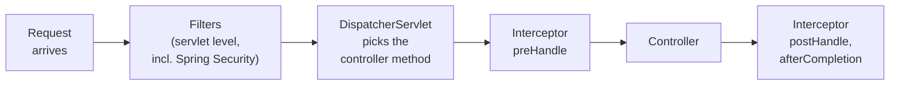
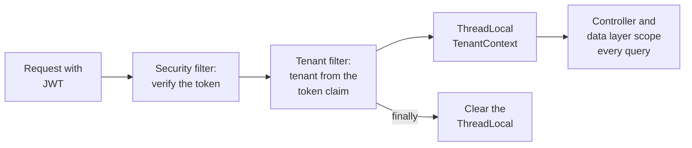

# Spring Part 11: Filters vs Interceptors, and Where Tenant Resolution Goes

Both filters and interceptors let you run code on every request without touching each controller: logging, authentication, timing, tenant checks. The interview question is almost always the same: **"Filter vs interceptor: where does each run, and which would you use?"** The common follow-up is **where you would resolve the tenant in a multi-tenant API.**

## 1. Where each one runs

1. A request first passes through the **filters**. They belong to the servlet container (Tomcat), not to Spring MVC. Spring Security is itself a chain of filters.
2. Then Spring MVC's **DispatcherServlet** decides which controller method will handle the request.
3. Only now do **interceptors** run, right before the controller.
4. The controller runs; interceptors get callbacks after it; finally the response travels back out through the filters.

The single most important fact: **filters run before Spring knows which controller will handle the request; interceptors run after.** Everything else follows from that.

Say it like this: "Filters run first, at the servlet level, before Spring MVC; that includes Spring Security. Then DispatcherServlet picks the controller method, and only then do interceptors run, around that controller."

## 2. Filters

A **filter** wraps the whole request. It runs code before passing the request on, and again after the response comes back.

What a filter can do:

- See **every** request, including static files, error pages and URLs no controller handles.
- Read and change the **raw** request and response, even replace them with wrappers (for example, to log a request body that can otherwise only be read once).
- Stop a request completely (for example, reject a missing or invalid token).

What it cannot do:

- Know which controller method will run, or read its annotations.
- Rely on `@ControllerAdvice`: an exception thrown in a filter never reaches it, so the filter must write its own error response.

Typical uses: **authentication, CORS, correlation or request ids, request and response logging, rate limiting, compression.**

In Spring Boot you usually extend `OncePerRequestFilter`, which guarantees the filter runs once per request even if the request is forwarded internally. Any filter that stores something per request (an id, a tenant) must clean it up in a `finally` block, because servlet threads are reused.

## 3. Interceptors

An **interceptor** (`HandlerInterceptor`) belongs to Spring MVC. Because it runs after the controller method is chosen, it **knows which method will run**, including its annotations. That is its whole reason to exist.

It has three methods:

- **preHandle**: runs before the controller. Returning `false` stops the request. This is where you check things that depend on the controller, for example "this method is annotated `@AdminOnly`, is the caller an admin?".
- **postHandle**: runs after the controller, **only if it did not throw**.
- **afterCompletion**: runs at the very end, **always**, even after an exception. Use it for timing and cleanup.

You register interceptors in a `WebMvcConfigurer` and can limit them to URL patterns, such as only `/api/**`.

Typical uses: **checks driven by custom annotations, per-endpoint auditing, timing per controller method.**

Correction: "postHandle can change the response body." For REST controllers the JSON body has already been written by the time postHandle runs. To change a body before it is written, use `ResponseBodyAdvice`; to transform raw responses, use a filter.

## 4. Which one would you use?

The rule of thumb:

- If it must apply to **every request**, needs the **raw request or response**, or must run **before Spring Security**: use a **filter**.
- If it depends on **which controller method** runs or its **annotations**: use an **interceptor**.

A third option interviewers sometimes add: an **AOP aspect** wraps any Spring bean's methods (services, repositories) and sees their arguments. It has nothing to do with HTTP. Use it for things like logging or metrics on service methods. `@Transactional` itself works this way.

Say it like this, the full answer: "A filter is a servlet-level component that runs before DispatcherServlet on every request and sees the raw request and response, so I use filters for authentication, CORS, correlation ids and logging. An interceptor is Spring MVC's hook that runs after the controller method is chosen, so it can read the method and its annotations; I use it for annotation-driven checks and per-endpoint auditing. Its preHandle can stop the request, postHandle is skipped on exceptions, and afterCompletion always runs. If I need to wrap service methods regardless of HTTP, that's an aspect."

## 5. Where tenant resolution goes

In a multi-tenant API every request belongs to one customer company (a **tenant**), and no request may ever see another tenant's data. The answer is a **filter, placed right after authentication**:

1. Spring Security's filter validates the user's token first.
2. A **tenant filter** runs next. It reads the tenant from the **verified token** (a `tenant_id` claim). If the client also sends a tenant header, the filter only accepts it when it matches the token; a header alone can be faked.
3. It stores the tenant in a request-scoped holder, usually a `ThreadLocal`, so the data layer can scope every query to that tenant.
4. In a `finally` block it **clears** the holder.

Why a filter and not an interceptor: the tenant must be known before anything touches data, and it does not depend on which controller runs.

The follow-up questions on this design:

- **Why clear it in finally?** Tomcat reuses threads. Without clearing, the next request on the same thread, possibly from a different tenant, would inherit the old tenant: a data leak between customers.
- **What about async work?** `@Async` methods and thread pools run on other threads, which do not see the `ThreadLocal`. The tenant must be copied to the worker thread explicitly (for example with a task decorator on the executor) and cleared afterwards.
- **What about Kafka consumers or batch jobs?** There is no HTTP request, so the tenant travels in the message (a header) and the listener sets and clears it itself.
- **Is the filter enough?** For defence in depth, the database also enforces it: row-level security or a schema per tenant, so one forgotten condition in a query cannot leak data.

Say it like this: "I resolve the tenant in a filter right after authentication, from the signed token's claim, cross-checking any tenant header. I store it in a ThreadLocal that the data layer uses to scope queries, and clear it in finally because threads are reused. Async work and message consumers set the tenant explicitly, and the database enforces isolation as a second line of defence."

**Before the next part:** without looking, draw a request going through filters, DispatcherServlet, the interceptor's three methods and the controller, then answer "filter vs interceptor" out loud in under a minute, and say why the tenant filter must clear its ThreadLocal.
