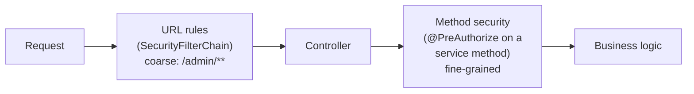

# Spring Part 13: Method Security: @PreAuthorize and @PostAuthorize

The question asked here is one: **"How do you implement role-based access control in Spring?"** The strong answer covers URL rules, method security with `@PreAuthorize`, roles vs authorities, and ownership checks.

## 1. Two layers of authorization



- **URL rules** in the `SecurityFilterChain` handle broad cases: `/admin/**` needs `ADMIN`, everything else needs a logged-in user. They run in a filter before any controller.
- **Method security** puts a rule on a specific method, usually in the service layer, where you know the business context: "only the owner of this order, or an admin, may cancel it". It applies no matter how the method is reached (REST, a message listener, a scheduled job).

Use both: URL rules as the outer fence, method security for the real business rules.

## 2. @PreAuthorize and @PostAuthorize

Enable it once with `@EnableMethodSecurity` on a configuration class. Then:

```java
@PreAuthorize("hasRole('ADMIN')")
public void deleteUser(Long id) { ... }

@PreAuthorize("hasRole('ADMIN') or #userId == authentication.principal.id")
public Profile getProfile(Long userId) { ... }

@PostAuthorize("returnObject.ownerId == authentication.principal.id")
public Order getOrder(Long id) { ... }
```

- **`@PreAuthorize`** checks **before** the method runs. The expression can use the method's arguments (`#userId`) and the current user (`authentication`, `principal`). If it fails, the method never runs and the caller gets **403**.
- **`@PostAuthorize`** checks **after** the method runs, against its result (`returnObject`). Useful when you only know the owner after loading the data. The method has already run, so it must not have side effects.
- For complex rules, call a bean from the expression: `@PreAuthorize("@orderSecurity.canCancel(#orderId, authentication)")`, keeping the logic in testable Java code.
- `@PreFilter` / `@PostFilter` filter collections (rarely asked).

**How it works:** method security is built on Spring **AOP proxies**, like `@Transactional`. Two consequences interviewers like:

- It only applies to **Spring beans called through the proxy**. A call from another method **in the same class** (`this.deleteUser(...)`) skips the check.
- It does not work on private methods.

Say it like this: "I enable method security and put @PreAuthorize on service methods, with expressions on roles, arguments and the current user, like hasRole('ADMIN') or owner checks. It's proxy-based, so self-invocation inside the same class bypasses it. @PostAuthorize checks the returned object after the method runs."

## 3. Roles vs authorities

- An **authority** is any permission string the user has, like `orders:read` or `ROLE_ADMIN`.
- A **role** is an authority with the `ROLE_` prefix. `hasRole('ADMIN')` checks for `ROLE_ADMIN`; `hasAuthority('ROLE_ADMIN')` is the same check written out.
- Roles are coarse groups (ADMIN, USER); **fine-grained permissions** (`orders:refund`) scale better as an application grows.
- With JWTs, Spring maps each **scope** to an authority with a `SCOPE_` prefix (`SCOPE_orders.read`), and you map custom role claims with a `JwtAuthenticationConverter`.

## 4. Role-based access control: the full answer

1. Users get roles (or permissions) from the database or from token claims.
2. Spring Security loads them as authorities into the `Authentication`.
3. URL rules in the `SecurityFilterChain` guard whole areas.
4. `@PreAuthorize` on service methods enforces business rules, including **ownership** ("is this the user's own order?"), which plain roles cannot express.
5. Failures return **403**; unauthenticated requests return **401**.

Say it like this: "Roles come from the database or the token's claims and become authorities. URL rules in the filter chain protect whole areas, and @PreAuthorize on service methods enforces the business rules, including ownership checks. It's AOP-based, so I avoid calling secured methods from inside the same class."

**Before the next part:** without looking, write one `@PreAuthorize` expression for "admin or the owner", explain the self-invocation trap, and explain the difference between `hasRole` and `hasAuthority`.
