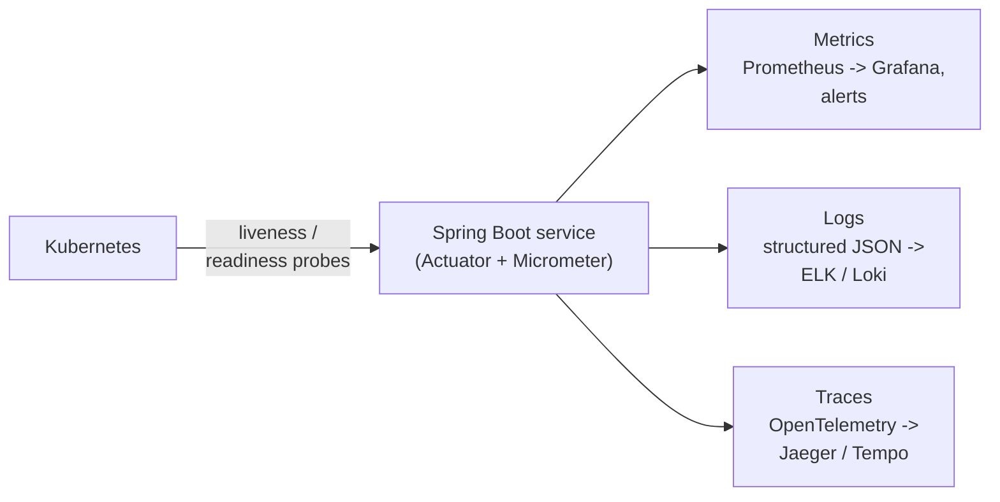

# Spring Part 14: Actuator, Health Probes and Monitoring

The questions: **"How do you monitor a Spring Boot service in production?"** (asked far more than anything else here) and **"What is Spring Boot Actuator: which endpoints, and how do you secure them?"**.

## 1. How you monitor a Spring Boot service: the three signals

Monitoring rests on three kinds of data, and a good answer names all three:

- **Metrics** (numbers over time): request rate, error rate, latency percentiles, JVM memory and GC, thread and connection pool usage. Collected by **Micrometer** through Actuator, scraped by **Prometheus**, shown in **Grafana**, with **alerts** on thresholds.
- **Logs** (what happened): structured JSON logs with a **correlation or trace id** on every line, shipped to a central store (ELK, Loki, Splunk) so one request can be followed across services.
- **Traces** (where the time went): distributed tracing with **OpenTelemetry** (Micrometer Tracing in Boot 3) shows one request's path and timing across services.

What to alert on: the **golden signals**: **latency** (p95/p99, not averages), **traffic**, **errors** (5xx rate) and **saturation** (CPU, memory, connection pool, queue lag). Alert on symptoms users feel, with dashboards per service.

Say it like this: "I monitor with metrics, logs and traces. Actuator and Micrometer expose metrics that Prometheus scrapes and Grafana shows, with alerts on latency percentiles, error rate, traffic and saturation. Logs are structured JSON with a trace id, centralised, and OpenTelemetry tracing shows where a slow request spent its time. Kubernetes uses Actuator's liveness and readiness probes."

## 2. What Actuator gives you

**Spring Boot Actuator** (`spring-boot-starter-actuator`) adds production endpoints under `/actuator`:

- **`/health`**: is the app up, including checks of its dependencies (database, disk, message broker). Returns `UP` or `DOWN`.
- **`/health/liveness`** and **`/health/readiness`**: the Kubernetes probes (section 3).
- **`/metrics`** and **`/prometheus`**: application and JVM metrics (`/prometheus` in Prometheus format, via the Micrometer Prometheus registry).
- **`/info`**: build and version information.
- **`/loggers`**: view and **change log levels at runtime**, without a restart.
- Sensitive ones: **`/env`** (configuration, possibly secrets), **`/heapdump`**, **`/threaddump`**, **`/configprops`**, **`/beans`**, **`/mappings`**.

Custom checks: implement `HealthIndicator` (for example, "can we reach the payment provider?"). Custom metrics: inject `MeterRegistry` and record counters, timers or gauges (orders placed, payment latency).

## 3. Liveness vs readiness probes

- **Liveness**: "is the process healthy, or stuck?" If it fails, Kubernetes **restarts** the container. Keep it simple: it should **not** check external dependencies, or a database outage would restart every pod for nothing.
- **Readiness**: "can this instance serve traffic right now?" If it fails, Kubernetes **stops sending traffic** to the pod without restarting it: during startup and warm-up, or when a critical dependency is unavailable.

Say it like this: "Liveness tells Kubernetes whether to restart the container, so it only checks the app itself. Readiness tells it whether to send traffic, so it can include dependencies and warm-up."

## 4. Securing Actuator

Actuator endpoints can leak secrets (`/env`), memory contents (`/heapdump`) and internal structure, so:

- **Expose only what you need**: by default only `health` is exposed over HTTP; add others explicitly with `management.endpoints.web.exposure.include=health,info,prometheus`. Never expose everything (`*`) in production.
- **Run management on a separate port** (`management.server.port=8081`) reachable only from inside the cluster or the monitoring network.
- **Require authentication** for anything beyond health and info, with a `SecurityFilterChain` rule (for example `EndpointRequest.toAnyEndpoint()` needing an `ACTUATOR` role).
- Limit health details for anonymous callers (`management.endpoint.health.show-details=when-authorized`).

Say it like this: "I expose only health, info and prometheus, put the management endpoints on a separate internal port, require authentication for anything sensitive like env, heapdump or loggers, and only show health details to authorised callers."

**Before the next part:** without looking, name the three monitoring signals with one tool each, the four golden signals, the difference between liveness and readiness, and two ways to secure Actuator.
