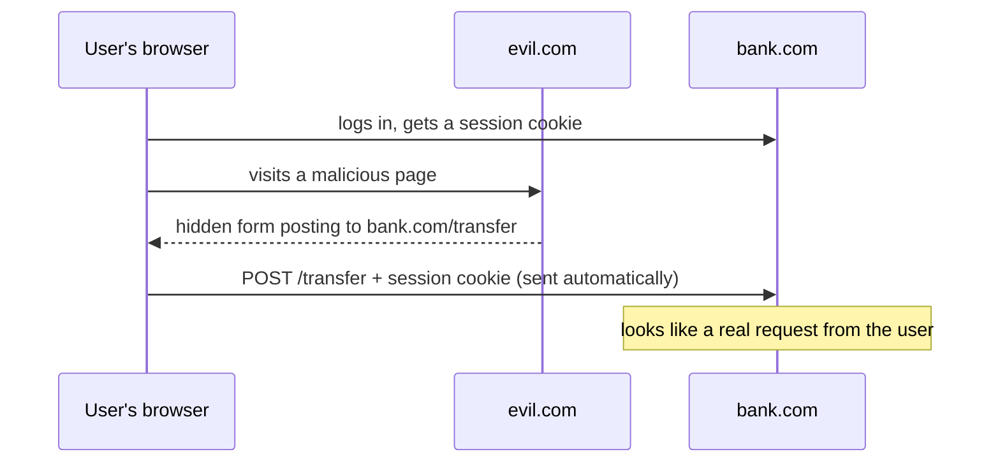
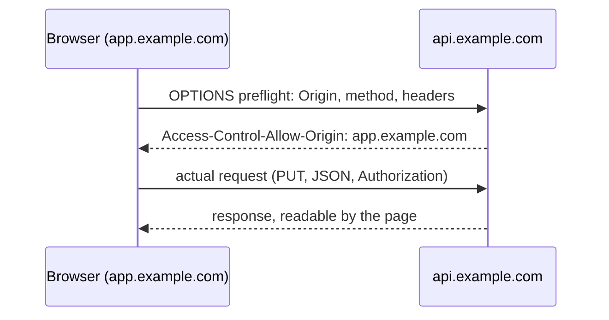

# Spring Part 15: Web Attacks: SQL Injection, XSS, CSRF and CORS

Four questions, asked about equally often: **what SQL injection is and how prepared statements prevent it**, **what XSS is and why a JWT in localStorage is risky**, **what CSRF is and why a stateless JWT API can disable CSRF protection**, and **what CORS is and who enforces it**.

## 1. SQL injection

**What it is:** user input becomes part of the SQL text, so the database runs it as code.

```java
// Vulnerable: input is glued into the SQL
"SELECT * FROM users WHERE name = '" + name + "'"
// name = x' OR '1'='1   ->   WHERE name = 'x' OR '1'='1'   (matches every row)
```

**The fix: prepared statements (parameter binding).** The SQL is sent with placeholders (`?`), and the values are sent separately. The database never parses the values as SQL, so the same input simply matches no rows.

- **JPA and Spring Data are safe when you bind parameters**: derived queries, `@Query` with `:name` parameters, `JdbcTemplate` with `?`.
- **An ORM does not protect a string you build yourself.** Concatenating input into JPQL or a native query is just as injectable.
- Placeholders only work for **values**. Table names, column names and `ORDER BY` direction cannot be parameters: map user choices to an **allow-list**.
- Defence in depth: the application's database user gets only the permissions it needs.

Say it like this: "SQL injection is input becoming part of the query text. Prepared statements send the SQL and the values separately, so input can never change the query. ORMs are only safe when I use their parameters, and anything that can't be a parameter, like a sort column, comes from an allow-list."

## 2. XSS, and why a JWT in localStorage is risky

**What it is:** cross-site scripting means an attacker gets **their JavaScript to run inside your site's pages**: for example, a comment containing `<script>` that you store and later render without escaping. That script runs with your site's privileges: it can read the page, call your APIs as the user, and read anything JavaScript can reach.

Prevention:

- **Escape output** for its context (HTML, attributes, URLs). Modern frameworks like React escape by default; the danger is raw HTML APIs (`dangerouslySetInnerHTML`, `innerHTML`).
- A **Content-Security-Policy** header that blocks inline and unknown scripts.
- Validate and sanitise any HTML you must accept.

**Why localStorage is risky for tokens:** any script on the page can read localStorage. One XSS hole lets the attacker read and send away every user's token, and a JWT keeps working until it expires.

**Safer:** keep tokens out of JavaScript's reach. Store the refresh token (or session) in an **HttpOnly, Secure, SameSite cookie**, which scripts cannot read, and keep a short-lived access token only in memory. Even better for browser apps: a backend-for-frontend that holds the tokens server-side and gives the browser only a session cookie.

Correction: "HttpOnly cookies stop XSS." They stop XSS from **stealing** the token; injected script can still act within the page while it runs. Preventing XSS itself is still required.

Say it like this: "XSS is an attacker's script running inside my site. I prevent it by escaping output and using a Content-Security-Policy. A JWT in localStorage is readable by any injected script, so one XSS hole leaks every token; I keep tokens in HttpOnly cookies or in memory instead."

## 3. CSRF, and why a stateless JWT API can disable it

**What it is:** cross-site request forgery tricks a logged-in user's browser into sending a request they did not intend. It works because **browsers attach cookies automatically**.



**Defences:**

- A **CSRF token**: a random value the server puts in its own forms (or a header) and checks on every state-changing request. The evil site cannot read it, so its forged request fails. Spring Security enables this **by default** for POST, PUT, PATCH and DELETE.
- **SameSite cookies** (`Lax` or `Strict`): the browser does not send the cookie on cross-site requests.
- Never change state with GET requests.

**Why a stateless JWT API can disable CSRF:** if the API authenticates **only** through the `Authorization: Bearer` header, the browser never adds that header on its own. A forged request from another site arrives without the token and fails authentication. So `http.csrf(c -> c.disable())` is safe there.

Correction: "We use JWT, so we can disable CSRF." Only if the JWT is sent in a header. **If the JWT is stored in a cookie**, the browser sends it automatically, and CSRF protection (or SameSite cookies) is required again.

Say it like this: "CSRF tricks a logged-in browser into sending a request, relying on cookies being attached automatically. Spring blocks it with CSRF tokens by default. A stateless API that only reads a bearer header can disable it, because browsers never add that header by themselves; if the token lives in a cookie, it can't."

## 4. CORS, and who enforces it

**The same-origin policy:** a browser lets a page **send** requests to other origins (scheme, host and port), but does not let its JavaScript **read** the responses.

**CORS** (cross-origin resource sharing) is how a server **relaxes** that rule: its response headers (`Access-Control-Allow-Origin` and friends) list which other origins may read the responses.



- For "non-simple" requests (JSON bodies, an `Authorization` header, PUT or DELETE), the browser first sends a **preflight** `OPTIONS` request to ask permission.
- **The browser enforces CORS.** Postman, curl and servers ignore it completely.
- Therefore **CORS is not a security control for your API**. It protects users' browsers from other sites reading your responses. Your API is protected by authentication and authorization.
- In Spring, configure CORS in the security chain (`http.cors(...)` with a `CorsConfigurationSource`), or the preflight, which carries no credentials, gets rejected with 401 before the CORS headers are added. List real origins: `*` cannot be combined with credentials.

A common question: "it works in Postman but the browser says blocked by CORS. Why?" Because only browsers enforce CORS: the server is not returning the allow-origin header for that origin, often because the preflight was rejected by security.

Say it like this: "The browser's same-origin policy stops pages reading responses from other origins, and CORS headers let a server allow specific origins, with a preflight for non-simple requests. The browser enforces it, not the server, so it doesn't protect the API itself; authentication does."

**Before the next part:** without looking, explain each attack in one sentence and its main fix in one more, then answer the two traps: when CSRF can be disabled with JWT, and why an API call works in Postman but fails in the browser.
