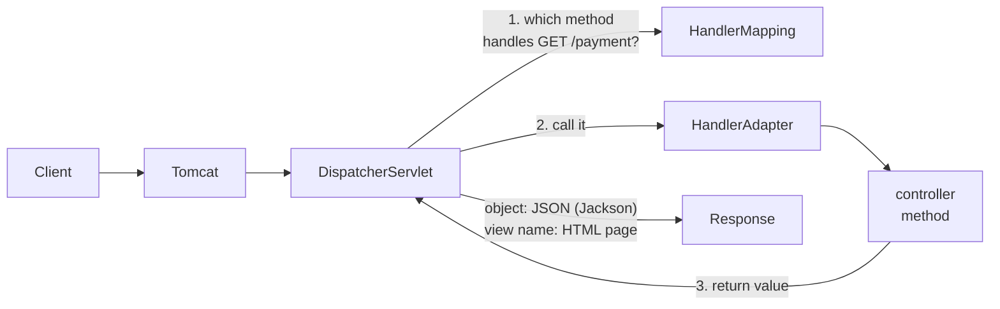
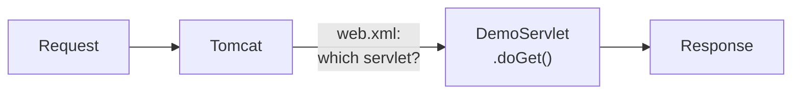

# Spring Part 17: From Servlets to Spring Boot

The questions, from most to least asked: **Spring vs Spring Boot**, **what @SpringBootApplication does**, **IoC and DI**, **how auto-configuration works**, **the DispatcherServlet request flow**, **the embedded server**, and, as background, **what a servlet is**.

## 1. What Spring Boot adds to Spring

Spring Boot is built on top of Spring. It doesn't replace Spring. It removes the setup work, using **convention over configuration**: sensible defaults that you can override.

In plain Spring MVC you had to set everything up yourself: register the DispatcherServlet, add `@EnableWebMvc` and `@ComponentScan`, then build a WAR and deploy it to Tomcat. Spring Boot removes these steps with three main things:

1. **Starters + version management**: `spring-boot-starter-web` brings Spring MVC, Tomcat and Jackson in one dependency. `spring-boot-starter-parent` fixes compatible versions, so you don't write version numbers.
2. **Auto-configuration**: creates the beans you'd otherwise write yourself (DispatcherServlet, Jackson, DataSource, ...) based on what's on the classpath (section 4).
3. **Embedded server**: Tomcat runs inside your app (section 6).

Plus production features like Actuator (health, metrics).

Correction: "Spring Boot is a replacement for Spring." It is a layer on top of Spring. Every Boot app is a Spring app.

Say it like this: "Spring gives the core: IoC, DI, MVC, transactions. Spring Boot is an opinionated layer on top that adds starters, auto-configuration and an embedded server, so a production-ready app runs from a main method with almost no config."

## 2. @SpringBootApplication and startup

```java
@SpringBootApplication
public class App {
    public static void main(String[] args) { SpringApplication.run(App.class, args); }
}
```

It is three annotations in one:
- `@SpringBootConfiguration`: this class is a config class (a special `@Configuration`).
- `@EnableAutoConfiguration`: turn on auto-configuration.
- `@ComponentScan`: find `@Component`, `@Service`, `@Controller` and so on in **this class's package and its sub-packages**.

Trap: a bean in a package outside the main class's package (like `com.other` when main is in `com.app`) is not found. Keep the main class in the root package.

Correction: "@ComponentScan scans the whole project." Only the main class's package and its sub-packages.

**What `SpringApplication.run()` does:**
- Decides the app type (servlet, reactive or none), then loads the properties and active profiles.
- Creates the ApplicationContext, registers beans (component scan plus auto-configuration), and refreshes the context. Singletons are created here, and the embedded Tomcat starts.
- Runs `CommandLineRunner` / `ApplicationRunner` beans, then the app is ready to take requests.

## 3. IoC and Dependency Injection

Without DI, a class creates its own dependency:

```java
class Payment {
    User sender = new User();       // tightly coupled to User
}
```

- You can't pass a mock `User` in a test; the real one always runs.
- You can't switch to `AdminUser` without editing `Payment`.

With DI, Spring creates the objects and hands them in:

```java
@Component
class Payment {
    private final UserService users;            // depend on an interface
    Payment(UserService users) { this.users = users; }   // Spring passes it in
}
```

- **IoC (Inversion of Control)**: the framework, not your code, creates objects and controls their life.
- **DI**: the way IoC is done. Dependencies are passed in (constructor, setter, or field).
- `@Component` = "Spring, manage this class as a bean". `@Autowired` = "Spring, fill this dependency".

Common mistake: field `@Autowired` of a concrete class (`@Autowired User sender;`) doesn't fix the problems above. The fix is to depend on an **interface** and use **constructor injection**. Then tests can pass a mock, fields can be `final`, and switching implementations needs no change.

Say it like this: "IoC means Spring creates and wires my objects instead of my code calling new. DI is how it does it, by passing dependencies in, usually through the constructor. That makes classes loosely coupled and easy to test with mocks."

## 4. Auto-configuration: how it works

- Boot ships about 150 auto-configuration classes, listed in `META-INF/spring/org.springframework.boot.autoconfigure.AutoConfiguration.imports` (older versions used `spring.factories`). `@EnableAutoConfiguration` loads them.
- Each one is guarded by **conditions** and only runs when they match:
  - `@ConditionalOnClass`: a class is on the classpath (Tomcat and Spring MVC present -> set up a web server and DispatcherServlet).
  - `@ConditionalOnMissingBean`: you haven't defined your own bean. **Your bean always wins.**
  - `@ConditionalOnProperty`: a property is set.

So adding `spring-boot-starter-data-jpa` plus a DB driver makes Boot create a `DataSource`, an `EntityManagerFactory` and a transaction manager; defining your own `DataSource` bean makes Boot's back off. This is also how a web app gets its embedded Tomcat and DispatcherServlet without any code: the web starter put Tomcat and Spring MVC on the classpath, and no bean of your own replaced them.

- See what was applied: run with `--debug` (prints the condition report).
- Turn one off: `@SpringBootApplication(exclude = DataSourceAutoConfiguration.class)`, or the property `spring.autoconfigure.exclude`.

Trap: adding `@EnableWebMvc` in a Boot app **switches off** Boot's Spring MVC auto-configuration (WebMvcAutoConfiguration). You lose things like Boot's default MVC setup and static-resource handling. Don't add it unless you want full manual control.

Correction: "Auto-configuration means Boot configures everything." It only adds what your classpath needs, and backs off when you define your own bean.

Say it like this: "@EnableAutoConfiguration loads the classes listed in AutoConfiguration.imports, and each runs only if its conditions pass: a class on the classpath, no bean of my own, a property set. My own bean wins because of @ConditionalOnMissingBean, and --debug shows the condition report."

## 5. Spring MVC and the DispatcherServlet

- **DispatcherServlet** is one servlet that receives every request. It is the "front controller". It finds the right controller method, so you don't write path if/else.



Common mistake: "DispatcherServlet creates a controller instance per request." No. Controllers are singleton beans created **once at startup**. Every request reuses the same object, so don't keep request data in controller fields.

- `@Controller`: a method's `String` return is treated as a **view name** (an HTML template).
- `@RestController` = `@Controller` + `@ResponseBody`: the return value is written straight to the response body (JSON for objects). Use it for REST APIs.

Say it like this: "The DispatcherServlet is the front controller: one servlet receives every request, HandlerMapping finds the controller method, HandlerAdapter calls it, and the result is written as JSON or rendered as a view. Controllers are singletons created at startup, not per request."

## 6. Embedded server

- Old way: build a WAR and deploy it to an installed Tomcat.
- Boot: Tomcat is a library inside the app. Build one jar and run `java -jar app.jar`.
- The default is Tomcat. To switch to Jetty, exclude `spring-boot-starter-tomcat` from the web starter and add `spring-boot-starter-jetty`.
- The port comes from `server.port` (default 8080).

## 7. Servlets and the servlet container (background)

- **Servlet**: a Java class that takes an HTTP request and returns a response (`doGet`, `doPost`, ...).
- **Servlet container** (like Tomcat): creates the servlets, manages their life, and sends each URL to the right servlet. The mapping lived in `web.xml` (or `@WebServlet` since Servlet 3.0).



Problems with plain servlets:
- `web.xml` grows huge and hard to read.
- One servlet does path routing by hand: `if (path.equals("/first")) ... else if ...`
- The container creates the objects, so you can't swap in mocks. Unit tests are hard.

Spring fixed these with annotations, DI, and Spring MVC.

**Before the next part:** from memory, draw the request flow (Tomcat -> DispatcherServlet -> HandlerMapping -> HandlerAdapter -> controller -> JSON). Then write the 3 annotations inside `@SpringBootApplication`.
