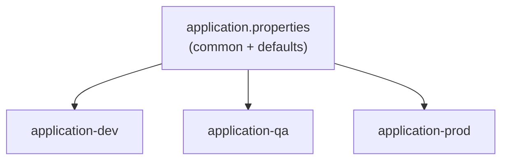
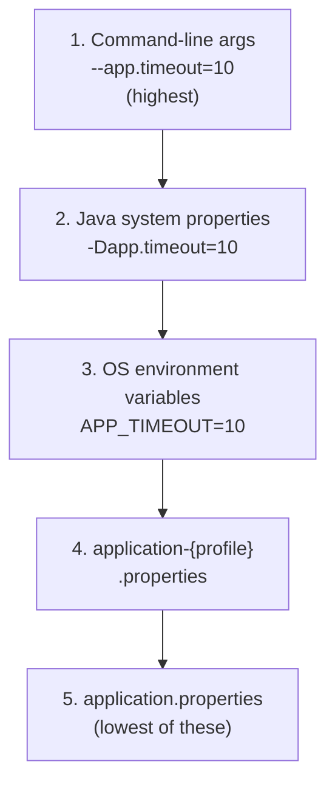

# Spring Part 18: Profiles, @Value and @ConfigurationProperties

The questions, from most to least asked: **@Value vs @ConfigurationProperties**, **profiles and how to activate them**, **@Profile**, **property precedence**, **several active profiles**, **validation**, **immutable config**, and **nested, list and map binding**.

## 1. The problem: config changes per environment

The same code runs on dev, QA and prod, but each connects to a different DB with different credentials. Not just credentials: URLs, ports, connection timeouts, request timeouts, throttle limits and retry counts also differ. You don't want a code change or a rebuild per environment. **Profiles** solve this, and `@Value` / `@ConfigurationProperties` read the result into beans.

## 2. @Value and @ConfigurationProperties

### @Value and its limits

```java
@Component
public class DBConnection {
    @Value("${app.username}")       private String username;
    @Value("${app.password}")       private String password;
    @Value("${app.db.url}")         private String dbUrl;
    @Value("${app.timeout:5000}")   private int timeout;    // 5000 if the key is missing
}
```

- Good for injecting **one** value. `${key:default}` gives a default value. It also supports SpEL.
- Problems as config grows:
  - Repetition: the same `@Value` keys get repeated across many classes.
  - No validation: you can't say "password must be present, 10 to 25 characters long".
  - No grouping: related settings are scattered instead of living in one object.
- A missing key with no default fails at startup ("Could not resolve placeholder").

### @ConfigurationProperties: bind config to a Java object

It maps a group of properties with the same **prefix** into one object. The config becomes structured, reusable, and validatable.

```properties
app.user.name=test_username
app.user.age=27
app.user.active=true
```

```java
@Component
@ConfigurationProperties(prefix = "app.user")
public class UserConfigurations {
    private String name;          // <- app.user.name
    private int age;              // <- app.user.age
    private boolean active;       // <- app.user.active
    // getters and setters (the binder uses setters)
}
```

- Inject it and use it like any Java object (`userConfigurations.getAge()`).
- **Relaxed binding**: `app.user.first-name`, `app.user.firstName` and the env variable `APP_USER_FIRSTNAME` all bind to the field `firstName`.
- Three ways to register it as a bean: `@Component` on the class, `@EnableConfigurationProperties(UserConfigurations.class)` on a config class, or `@ConfigurationPropertiesScan` on the main class.
- IDE autocompletion works for its keys.

**Trap: the `user` prefix.** With `@ConfigurationProperties(prefix = "user")` and `user.name=test_username` in `application.properties`, `getName()` returns the OS login name. Java always sets a system property `user.name` (the OS user), and system properties beat `application.properties`. The binder reads that value. Fix: use your own prefix, like `app.user.name`. Avoid prefixes such as `user`, `java` and `os`.

Say it like this: "I use @Value for a single value. For a group of related settings I use @ConfigurationProperties: one type-safe object, relaxed binding, and validation at startup, instead of @Value strings scattered across classes."

## 3. Profiles: profile-specific files



```properties
# application.properties
username=defaultUsername
password=defaultPassword

# application-prod.properties
username=prodUsername
password=prodPassword
```

- No profile active: only `application.properties` is used (Spring calls this the `default` profile).
- `prod` active: `application.properties` is loaded first, then `application-prod.properties` **on top**. For the same key, the profile file wins. Keys only in the base file still apply.

## 4. Activating a profile

- In `application.properties`: `spring.profiles.active=prod`. Fine for local work. Not used in real deployments, because the same jar goes to every environment.
- Command line: `java -jar app.jar --spring.profiles.active=prod`.
- Environment variable: `SPRING_PROFILES_ACTIVE=prod`. This is the usual way in Docker and Kubernetes.
- JVM option: `-Dspring.profiles.active=prod`.
- Maven, local run: `mvn spring-boot:run -Dspring-boot.run.profiles=prod`, or Maven profiles in `pom.xml` (`mvn spring-boot:run -Pproduction`).

**Several profiles at once:** `spring.profiles.active=prod,qa`.
- Beans for both profiles are created.
- For a key set in both files, the **last profile listed wins**. With `prod,qa`, `username` comes from `application-qa`. With `qa,prod`, it comes from `application-prod`.

Trap: `spring.profiles.active` can't be set inside a profile-specific file (like `application-dev.properties`). Boot rejects it at startup. Set it in the base file or from outside.

Say it like this: "Profiles give per-environment config in application-{profile}.properties and per-environment beans with @Profile, from one build. I activate them with SPRING_PROFILES_ACTIVE or --spring.profiles.active; the profile file loads on top of application.properties and wins for the same key, and with several profiles the last one listed wins."

## 5. @Profile: create a bean only for some profiles

```java
@Component
@Profile("prod")                 // created only when "prod" is active
public class MySQLConnection { ... }

@Component
@Profile("dev")                  // created only when "dev" is active
public class NoSQLConnection { ... }
```

- Active `prod` -> only `MySQLConnection` is created. Active `qa` -> neither is created.
- `@Profile("!prod")`: created in every profile **except** prod (e.g. a fake payment gateway).
- `@Profile({"dev", "qa"})`: created if dev **or** qa is active.
- Two apps, one shared codebase: put `@Profile("app1")` on the bean. App 1 sets `spring.profiles.active=app1`, app 2 sets `app2`. Only app 1 gets the bean.

**@Profile vs @ConditionalOnProperty:**
- `@Profile` groups beans by **environment** (dev, qa, prod).
- `@ConditionalOnProperty` turns **one feature** on or off from one property.
- Both are decided once, at startup.

## 6. Property precedence (which value wins)

When the same key is set in several places, the higher source wins:



- A file **outside** the jar (next to it, or in `./config/`) beats the same file inside the jar.
- This is why prod values usually come from env variables or args: they override whatever was packaged in the jar.
- It is also why `user.name` (a JVM system property) beats your `application.properties` value.

## 7. Validation

```java
@Component
@ConfigurationProperties(prefix = "app.user")
@Validated                                        // turn validation on
public class UserConfigurations {
    @NotBlank(message = "name must not be empty")
    private String name;
    @Min(value = 1, message = "Age can not be 0")
    private int age;
}
```

- Needs `spring-boot-starter-validation`.
- Checked right after binding, at startup. Bad config (`app.user.age=0`) means the **app fails to start**, instead of failing on some request later.
- Common ones: `@NotNull`, `@NotBlank` (strings), `@NotEmpty` (lists, maps), `@Min`, `@Max`, `@Positive`, `@Email`, `@Pattern(regexp = ...)`.

## 8. Immutable config: constructor binding

Setter binding means fields can't be `final`, so the config can be changed at runtime. To make it immutable, bind through the constructor:

```java
@ConfigurationProperties(prefix = "app.user")             // NO @Component
public record UserConfig(String name, int age, Duration timeout) {}

@SpringBootApplication
@ConfigurationPropertiesScan                              // registers it
public class App { ... }
```

- A record or a class with `final` fields and one constructor both work. The binder calls the constructor with the property values.
- Why no `@Component`? Then Spring would create it as a normal bean and try to inject `String name` as a bean, and startup fails ("No qualifying bean of type String"). Let the binder create it, through `@ConfigurationPropertiesScan` or `@EnableConfigurationProperties`.
- Validation works the same way (`@Validated` + constraints on the components or fields).
- Typed values work: `app.user.timeout=5s` -> `Duration`, `10MB` -> `DataSize`.

## 9. Nested objects, lists and maps (rarely asked)

```properties
app.user.address.city=Jaipur                # nested object
app.user.roles[0]=ADMIN                     # List<String>
app.user.course[0].name=Java                # List<Course>
app.user.preferences.theme=dark             # Map<String, String>
app.user.locations.home.city=Jaipur         # Map<String, AddressConfig>
```

```java
private AddressConfig address;
private List<String> roles;
private List<Course> course;
private Map<String, String> preferences;
private Map<String, AddressConfig> locations;

public static class AddressConfig { private String city; /* getters, setters */ }
```

- Nested classes must be **static**. A non-static inner class has no no-arg constructor (its constructor secretly takes the outer object), so the binder can't create it. If properties exist for it, startup fails with a binding error.

**Before the next part:** from memory, write the precedence order (top 5). Then write a `record` bound to prefix `app.db`, with a `url` and a `timeout`, and say how it gets registered.
