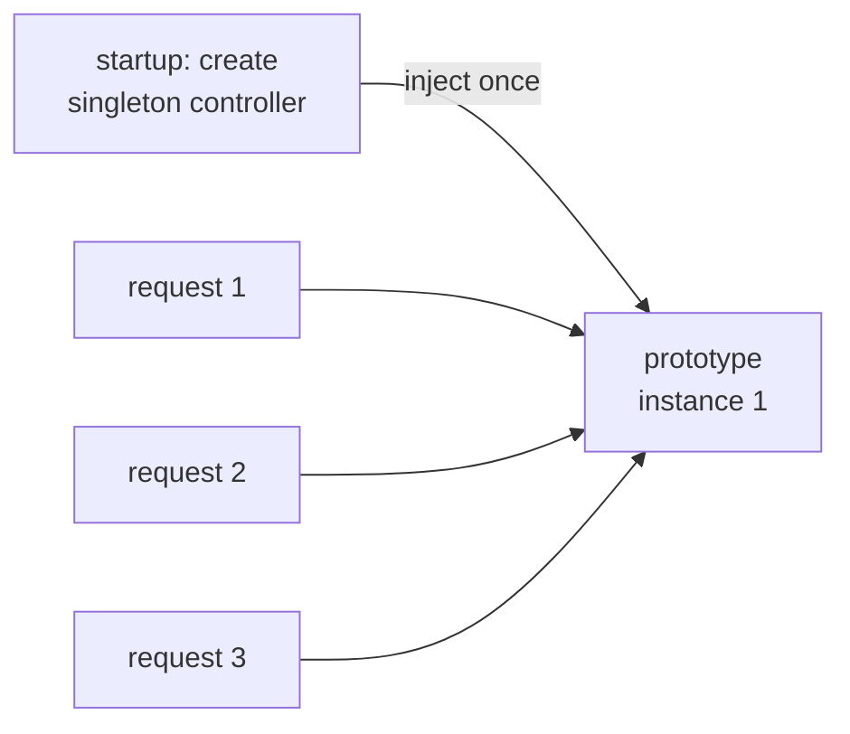
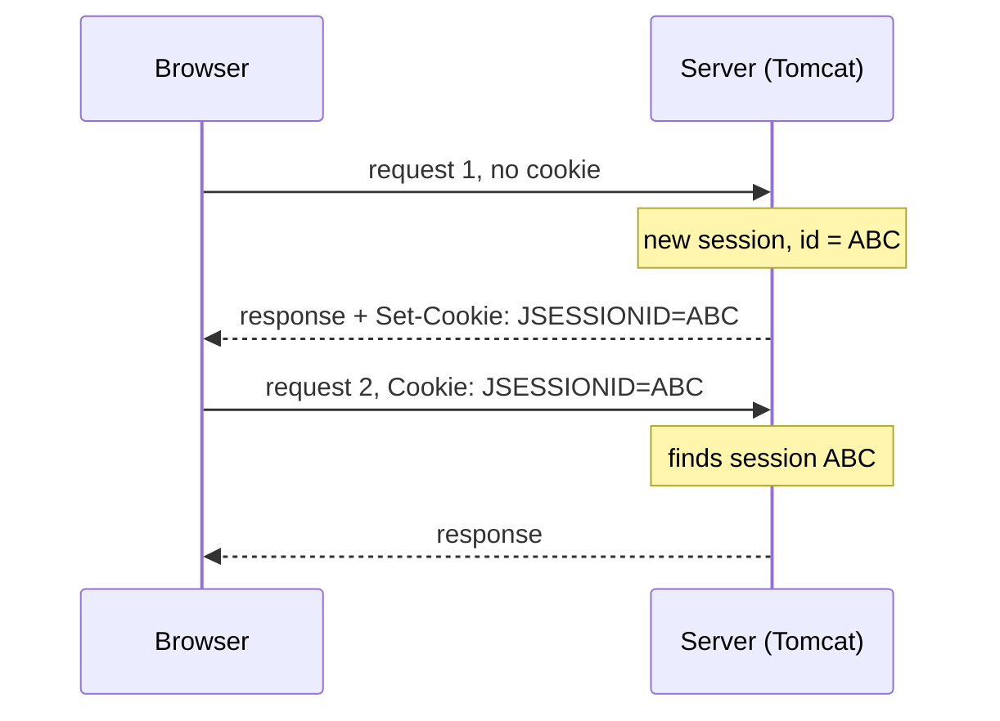
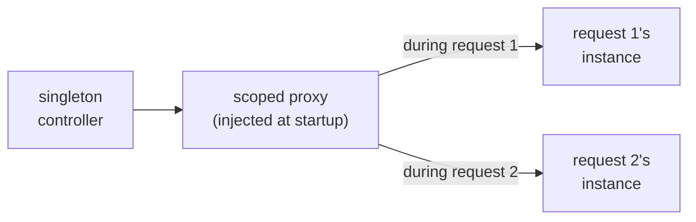

# Spring Part 21: Bean Scopes

The questions, from most to least asked: **a prototype bean inside a singleton**, **are singletons thread-safe**, **singleton vs prototype**, **request vs session scope**, and **Spring singleton vs GoF singleton**.

## 1. What a scope is

A scope decides **how many instances** of a bean exist and **how long each lives**.

- **singleton** (default): one instance per container.
- **prototype**: a new instance every time the bean is asked for.
- **request**: one instance per HTTP request.
- **session**: one instance per HTTP session.
- application: one per ServletContext. Rarely asked.

Singleton is eager (created at startup). Prototype, request and session instances are created when needed.

```java
@Component                     // singleton, same as @Scope("singleton")
@Component @Scope("prototype") // or ConfigurableBeanFactory.SCOPE_PROTOTYPE
@Component @RequestScope       // = @Scope(value = "request", proxyMode = TARGET_CLASS)
@Component @SessionScope       // = @Scope(value = "session", proxyMode = TARGET_CLASS)
```

## 2. A prototype inside a singleton

A dependency is injected **when the bean that holds it is created**. A singleton (every controller and service) is created once, at startup, so its prototype dependency is created once and kept forever. Every request then shares that one instance, exactly as if it were a singleton.



Fix: ask Spring for a new one at call time with `ObjectProvider` (preferred):

```java
private final ObjectProvider<Cart> carts;               // injected once; it's a factory

@PostMapping("/cart/{item}")
public String add(@PathVariable String item) {
    Cart cart = carts.getObject();                      // new Cart on every call
    cart.add(item);
    return cart.show();
}
```

- Now it really is a prototype: a fresh object every time you ask. That means it remembers nothing between calls. Prototype means "new object per use", **not** "one per user".
- Other fixes: a `@Lookup` method (`@Lookup public Cart newCart() { return null; }`, which Spring overrides), or `applicationContext.getBean(Cart.class)`, which ties your code to Spring.
- Trap: `@Scope(value = "prototype", proxyMode = TARGET_CLASS)` creates a new `Cart` on **every method call**, so `cart.add(item)` and then `cart.show()` run on two different carts.
- Spring does **not** call `@PreDestroy` on prototypes, and doesn't track them after creating them. You clean them up yourself.

Correction: "Prototype beans are always lazy." They're created when asked for, which is at startup if an eager singleton injects one.

Correction: "Prototype gives each user their own object." It gives a new object per use. Per user is session scope.

Say it like this: "A prototype injected into a singleton is created only once, when the singleton is built, so it behaves like a singleton. To get a new one each time, I inject ObjectProvider and call getObject(), or use a @Lookup method."

## 3. Singletons and thread safety

Spring does not make singletons thread-safe. It only guarantees safe creation. All request threads run the same object in parallel:

```java
@Service
public class CounterService {
    private int count = 0;                 // shared by all request threads
    public void hit() { count++; }         // race: read, add, write can interleave
}
```

- A singleton is right for stateless beans (services, repositories, controllers), and wrong for anything holding one user's data: every user and every thread sees the same object.
- A safe singleton is **stateless**: no mutable fields, only dependencies and local variables.
- If shared state is truly needed: `AtomicInteger`, `ConcurrentHashMap`, locks, or store it outside the app (DB, Redis).

Say it like this: "Singleton beans are not thread-safe by themselves; Spring only guarantees one instance, created safely. All request threads share it, so I keep services stateless, and use atomics, concurrent collections or external storage when state must be shared."

## 4. Singleton vs prototype

- **Singleton**: one per container, created at startup, @PreDestroy called on shutdown.
- **Prototype**: a new one per request for the bean, no @PreDestroy, and Spring doesn't track it after creating it.

## 5. HTTP request vs HTTP session

HTTP is **stateless**: by itself, the server doesn't know that two requests came from the same user.

- **HTTP request**: one call from the client and its response. It ends as soon as the response is sent.
- **HTTP session**: a series of requests from the **same client**, linked by a session id. The server keeps an `HttpSession` object in its memory, and the browser keeps the id in a cookie (`JSESSIONID`).



- A session ends on logout (`session.invalidate()`) or after inactivity (default 30 minutes, set by `server.servlet.session.timeout`).
- One session holds many requests. One request belongs to at most one session.
- REST APIs often skip sessions completely. The client sends a token (like a JWT) with every request, and the server stays stateless.

## 6. Request scope, session scope and the scoped proxy

**Request scope**: one instance per HTTP request. It's created on first use in that request and dropped when the response is sent.
- How is it different from prototype? **Inside one request**, everyone (a filter, the controller, a service) gets the **same** instance. A prototype gives a new one every time it's requested.
- Good for request-level data: the current user's details or a trace id, so you don't pass it through every method.

**Session scope**: one instance per HTTP session. All of a user's requests share it until logout or timeout, and a new session gets a new instance. This is the only scope that gives "one per user".

**Why both need a proxy.** A request-scoped bean **without** the proxy, injected into a singleton, makes startup fail (`UnsatisfiedDependencyException`): "Scope 'request' is not active for the current thread". The singleton is built at startup, when no HTTP request exists, so Spring can't create a request-scoped bean to inject.

Fix: the **scoped proxy**. Spring injects a stand-in object at startup. On every method call, the proxy finds the real instance of the current request (or session). `@RequestScope` and `@SessionScope` turn the proxy on by default.



- Calling the proxy outside a request (in a `@Scheduled` job or an `@Async` thread) fails with `ScopeNotActiveException`.

Say it like this: "Request scope gives one instance per HTTP request, shared by everything in that request; session scope gives one per user session, linked by the JSESSIONID cookie, until logout or timeout. Injected into a singleton, both need a scoped proxy, which @RequestScope and @SessionScope add, so each call is routed to the current request's or session's instance."

## 7. Spring singleton vs GoF singleton

- GoF singleton: one instance per class (per class loader), enforced by a private constructor.
- Spring singleton: one instance **per bean definition per container**. Two `@Bean` methods returning the same type give two objects, and both are "singletons".

**Before the next part:** from memory, write the `ObjectProvider<Cart>` version of `add()`. Then draw the browser/server picture showing two requests in one session with the JSESSIONID cookie.
