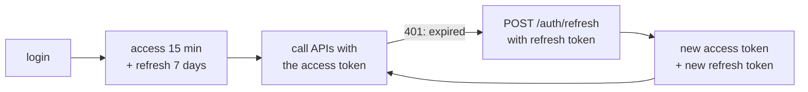

# Spring Part 23: JWT: Structure, Stateless Auth, Revocation and Refresh

A user logs in once. For the next 15 minutes, every request to any of your 20 service instances proves who they are, and no instance looks anything up. That is what a JWT buys you. Interviewers then dig into four things: how it is verified, where Spring checks it, how refresh works, and how you kill a token early.

## 1. What a JWT is [P0]

A **JWT** (JSON Web Token) is a signed, compact string that carries claims about a user. It has three parts separated by dots:

```text
eyJhbGciOiJSUzI1NiIsImtpZCI6ImsxIn0 . eyJzdWIiOiJhc2hhIiwicm9sZXMi... . Q2xHk9...
            header                              payload                  signature
```

Each part is **Base64URL** encoded (a URL-safe text encoding, not encryption). Decoded:

```json
// header
{ "alg": "RS256", "kid": "k1", "typ": "JWT" }

// payload: the claims
{ "iss": "https://auth.example", "sub": "asha", "aud": "orders-api",
  "exp": 1767225600, "iat": 1767224700, "jti": "7f3a...", "roles": ["USER"] }
```

- `iss` (issuer): who created it. `sub` (subject): who it is about. `aud` (audience): which API it is for.
- `exp` (expiry), `iat` (issued at), `nbf` (not before): times in seconds since 1970.
- `jti` (JWT id): a unique id, useful for revocation.
- Any custom claims, such as `roles`.


The **signature** is computed over `header.payload` with a key. Change one character of the payload and the signature no longer matches.

Correction: a JWT is signed, not encrypted. Anyone holding the token can decode and read the payload (paste it into jwt.io). Never put passwords or personal secrets in it. Encrypted tokens exist (JWE), but signed JWS is what people mean by "JWT".

Say it like this: "A JWT is header.payload.signature, each Base64URL encoded; the payload carries claims like sub, exp and roles, and the signature lets any service verify it was issued by us and not changed, but anyone can read it."

## 2. Signing and verifying [P0]

Two families of algorithm:
- **HS256** (HMAC with a shared secret): the same secret signs and verifies. Simple, but every service that verifies could also mint tokens, and the secret must be shared with all of them.
- **RS256 / ES256** (asymmetric): the auth server signs with a **private key**; services verify with the **public key**. Services cannot mint tokens. Public keys are published as a **JWKS** (JSON Web Key Set) at a URL such as `/.well-known/jwks.json`, and the header's `kid` says which key to use, which makes key rotation easy.

Prefer RS256 or ES256 whenever more than one service verifies tokens.

What a verifier must check, every time:
1. The signature, with an algorithm **you** fix, not the one the header asks for.
2. `exp` and `nbf`, allowing a little clock skew (Spring allows 60 seconds by default).
3. `iss`: it came from your auth server.
4. `aud`: it was meant for this API, not some other service.

The attacks these checks stop:
- **`alg: none`**: an attacker sends an unsigned token with `"alg": "none"`. A careless library accepts it. Fix: never accept `none`; pin the expected algorithm.
- **Algorithm confusion**: the server expects RS256, but the attacker sends HS256 signed with the server's **public** key as the HMAC secret. A library that trusts the header verifies it. Fix: pin the algorithm per key.

Say it like this: "I sign with RS256 so services verify with a public key from the JWKS endpoint and can't mint tokens, and I check the signature with a pinned algorithm plus exp, iss and aud on every request."

## 3. Where Spring validates the JWT [P0]

The JWT is checked in a filter, inside the security filter chain, before authorization. Two ways to do it.

**The standard way: Spring's resource server.** Add `spring-boot-starter-oauth2-resource-server`:

```yaml
spring.security.oauth2.resourceserver.jwt.issuer-uri: https://auth.example
```
```java
http.oauth2ResourceServer(o -> o.jwt(Customizer.withDefaults()));
```


1. `BearerTokenAuthenticationFilter` reads `Authorization: Bearer <token>`. No header: the request continues as anonymous.
2. The `JwtDecoder` (Nimbus) fetches the issuer's JWKS once, caches the keys, verifies the signature and checks `exp`, `nbf` and `iss`.
3. The `JwtAuthenticationConverter` turns claims into authorities (`scope` becomes `SCOPE_orders:read`) and builds a `JwtAuthenticationToken`.
4. The token goes into the `SecurityContextHolder`, and `AuthorizationFilter` checks the URL rules.
5. A bad token (wrong signature, expired) stops at step 2: the response is **401** with `WWW-Authenticate: Bearer error="invalid_token"`. A valid token without the needed role passes authentication and gets **403** from authorization.

**The hand-written way** (asked when you built your own login):

```java
@Component
class JwtFilter extends OncePerRequestFilter {
    private final JwtService jwt;
    JwtFilter(JwtService jwt) { this.jwt = jwt; }

    protected void doFilterInternal(HttpServletRequest req, HttpServletResponse res, FilterChain chain)
            throws ServletException, IOException {
        String h = req.getHeader("Authorization");
        if (h != null && h.startsWith("Bearer ")) {
            try {
                Claims c = jwt.verify(h.substring(7));          // signature, exp, iss, aud
                var auth = new UsernamePasswordAuthenticationToken(c.getSubject(), null, jwt.authorities(c));
                SecurityContextHolder.getContext().setAuthentication(auth);
            } catch (JwtException e) {
                SecurityContextHolder.clearContext();            // invalid: stay unauthenticated
            }
        }
        chain.doFilter(req, res);                                // always continue
    }
}

http.addFilterBefore(jwtFilter, UsernamePasswordAuthenticationFilter.class);
```

- `OncePerRequestFilter` guarantees one run per request, even with forwards.
- On an invalid token, do not throw out of the filter. Leave the context empty and continue; the entry point then returns a clean 401 for protected URLs.
- Public endpoints still work with no token.

Also asked: the resource server does not check `aud` by default. Add a validator: `JwtValidators.createDefaultWithIssuer(issuer)` combined with an audience check, set on the `NimbusJwtDecoder`.

Correction: "the JWT filter should load the user from the database on every request." Then it is no longer stateless. The token's claims should carry what authorization needs.

Say it like this: "With the resource server, BearerTokenAuthenticationFilter reads the Bearer header, the JwtDecoder verifies signature, expiry and issuer against cached JWKS keys, and the claims become authorities; a bad token gets a 401 with an invalid_token header before any controller runs."

## 4. Access tokens and refresh tokens [P0]

A stolen access token works until it expires, so access tokens are short-lived. But nobody wants to log in every 15 minutes. So there are two tokens.

- The **access token**: a JWT, short-lived (5 to 15 minutes), sent on every API call.
- The **refresh token**: long-lived (days), sent only to the auth server's refresh endpoint, to get a new access token. Usually an opaque random string stored server-side, so it can be revoked.



**Refresh token rotation**: every refresh returns a new refresh token and invalidates the old one. **Reuse detection**: if an already-used refresh token shows up again, someone copied it. The server revokes the whole token family and forces a new login.

Say it like this: "The access token is a short-lived JWT for API calls; the refresh token is long-lived, server-side and rotated on every use, and reusing an old one revokes the whole family."

## 5. Where tokens live in the browser [P0]

- **localStorage**: easy, but any script on the page can read it. One XSS bug and every user's token is stolen.
- **Memory** (a JavaScript variable): not readable after a page reload, so it is lost on refresh, but it is out of `localStorage`'s reach.
- **HttpOnly cookie**: JavaScript cannot read it, so XSS cannot steal it. But the browser sends it automatically, so CSRF is back. Use `Secure`, `SameSite=Strict` or `Lax`, and a CSRF token if cookies authenticate state-changing requests.

A common answer: keep the access token in memory, and the refresh token in an `HttpOnly; Secure; SameSite=Strict` cookie scoped to the refresh path (`Path=/auth/refresh`). After a reload, the app calls refresh to get a new access token.

Also asked: the **BFF** (backend for frontend) pattern keeps every token on a small server; the browser only holds an HttpOnly session cookie.

Say it like this: "I keep the access token in memory and the refresh token in an HttpOnly, Secure, SameSite cookie, because localStorage is readable by any XSS, and cookies need SameSite or a CSRF token."

## 6. Revoking a JWT before it expires [P0]

A user logs out, or an admin bans them. Their JWT is still valid for 12 more minutes, and every service will accept it, because no service checks anywhere. Options, from cheapest:

- **Short expiry**: 5 to 15 minutes caps the damage. Logging out deletes the refresh token, so no new access token can be minted.
- **A denylist**: store revoked `jti` values in Redis with a TTL equal to the token's remaining life. The filter checks it on each request. Small and self-cleaning, but every request now does a lookup.
- **A token version per user**: put `ver: 7` in the token; bump the user's version on logout-everywhere or password change; reject tokens with an older version. One small lookup per user, cacheable.
- **Revoke the refresh token**: the next refresh fails, so the session dies within one access-token lifetime.

Correction: "JWTs can't be revoked." They can, but every way of doing it brings back some server-side state. That trade-off is the real answer.

Say it like this: "I keep access tokens short, revoke refresh tokens on logout, and when I need instant revocation I add a jti denylist in Redis with a TTL, accepting that it brings back a lookup per request."

## 7. Complete example: issue and verify with jjwt [P1]

```java
@Service
class JwtService {
    private final SecretKey key = Keys.hmacShaKeyFor(secretBytes);   // HS256, 256-bit secret

    String issue(String user, List<String> roles) {
        Instant now = Instant.now();
        return Jwts.builder()
            .issuer("https://auth.example").subject(user).audience().add("orders-api").and()
            .claim("roles", roles).id(UUID.randomUUID().toString())
            .issuedAt(Date.from(now)).expiration(Date.from(now.plus(15, ChronoUnit.MINUTES)))
            .signWith(key).compact();
    }

    Claims verify(String token) {
        return Jwts.parser().verifyWith(key)                          // fixes the algorithm
            .requireIssuer("https://auth.example").requireAudience("orders-api")
            .build().parseSignedClaims(token).getPayload();            // checks exp too
    }
}
```

Expected behaviour:
- `verify(issue("asha", List.of("USER")))` returns claims with subject `asha`.
- Changing one character of the payload throws `SignatureException`.
- A token 16 minutes old throws `ExpiredJwtException`.
- A token with `"alg": "none"` is rejected, because `parseSignedClaims` requires a signature.

**Before the next part:** from memory, write a JWT's three parts with five claims, then draw the refresh flow with rotation, and list three ways to revoke a token with the cost of each.
