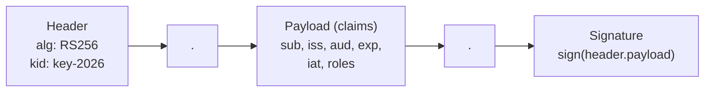

# Spring Part 23: JWT: Structure, Verification, Refresh and Revocation

By far the most-asked question here is **"how does a JWT work: its structure and how it is verified?"** (asked about seven times more often than anything else). The follow-ups: **where Spring validates it**, **access vs refresh tokens and where to store them**, and **how to revoke a JWT before it expires**.

## 1. How a JWT works: structure and verification

A **JWT** (JSON Web Token) is a compact, signed token that carries facts about a user ("claims"). Its whole point: **any service can verify it on its own, without calling a database or the server that issued it.**

It has three parts, base64url-encoded and joined by dots: `header.payload.signature`



- **Header**: the signing algorithm (`alg`) and which key was used (`kid`).
- **Payload**: the claims. Standard ones: `sub` (who the token is about), `iss` (who issued it), `aud` (which API it is for), `exp` (expiry), `iat` (issued at), `jti` (a unique id). Plus custom claims such as roles or tenant id.
- **Signature**: computed over the header and payload with the issuer's key.

**Signed, not encrypted.** Anyone holding the token can base64-decode the payload and read it. The signature only proves it was not **changed**. So never put secrets or sensitive personal data in a JWT.

**Verification**, done by every service that receives the token:

1. **Check the signature** with the issuer's key, using an algorithm the service has **pinned** (never trust the token's own `alg` blindly, and never accept `none`).
2. **Check `exp`** (not expired), **`iss`** (the expected issuer) and **`aud`** (meant for this API).
3. Then read the claims (user, roles) and authorize.

**Two kinds of signing keys:**

- **HS256 (shared secret)**: the same secret signs and verifies. Simple, but every service that verifies could also forge tokens.
- **RS256 / ES256 (key pair)**: the auth server signs with a **private key**; services verify with the **public key**, typically fetched from the issuer's **JWKS endpoint** and cached. Services cannot forge tokens. This is the standard for microservices.

Say it like this: "A JWT is header, payload and signature, base64url-encoded. The payload holds claims like subject, issuer, audience, expiry and roles. It's signed, not encrypted, so anyone can read it but nobody can change it unnoticed. A service verifies the signature with the issuer's public key from JWKS using a pinned algorithm, then checks expiry, issuer and audience, all without calling anyone."

## 2. Where Spring validates the JWT

In Spring Security, a JWT arriving as `Authorization: Bearer <token>` is handled by the resource-server support:

- **BearerTokenAuthenticationFilter** extracts the token from the header.
- A **JwtDecoder** verifies the signature (using the issuer's JWKS keys) and checks `exp`, `iss` and `aud`.
- On success, a `JwtAuthenticationToken` with the user's authorities is stored in the **SecurityContext**; controllers and `@PreAuthorize` read it from there. On failure, the response is 401.

Configuration is mostly properties:

```yaml
spring.security.oauth2.resourceserver.jwt.issuer-uri: https://auth.example.com
```

plus `http.oauth2ResourceServer(o -> o.jwt(Customizer.withDefaults()))` in the security chain, with sessions set to stateless.

**If asked to write a JWT filter by hand:** extend `OncePerRequestFilter`; read the `Authorization` header; if it starts with `Bearer `, verify the token; on success, put an authenticated `Authentication` into `SecurityContextHolder`; on failure, return 401 and stop; with no header, continue as anonymous and let the authorization rules decide. Register it before `UsernamePasswordAuthenticationFilter`. Then say you would use Spring's resource server in production, because it already handles key rotation, clock skew and the edge cases.

## 3. Access tokens, refresh tokens and where they live

- **Access token**: short-lived (5 to 15 minutes), sent with every API call, verified without any lookup. If stolen, it expires soon.
- **Refresh token**: long-lived, sent **only to the auth server** to get a new access token, and stored server-side so it **can be revoked**.
- **Rotation**: each refresh returns a new refresh token and invalidates the old one. If an old one is ever used again, someone stole it, so the whole token family is revoked.

**Where to keep them in a browser:**

- **Not in localStorage**: any script, including one injected through XSS, can read it.
- The access token **in memory** (a JavaScript variable), lost on reload and re-obtained silently.
- The refresh token in an **HttpOnly, Secure, SameSite cookie**, which scripts cannot read.
- Best for browser apps: a **backend-for-frontend** server keeps the tokens and gives the browser only a session cookie.

Say it like this: "The access token is short-lived and sent on every call; the refresh token is long-lived, only goes to the auth server, rotates on each use and can be revoked. In the browser I keep the access token in memory and the refresh token in an HttpOnly, Secure, SameSite cookie, never localStorage."

## 4. Revoking a JWT before it expires

The hard part: a JWT is valid until `exp` precisely because nobody is asked. Options, from simplest to strongest:

- **Short expiry, always**: limits the damage with no state at all. Combined with revoking the refresh token, a banned user is cut off within minutes.
- **A denylist**: store the token's `jti` (or the user id) in Redis with a time-to-live equal to the token's remaining life; the validation filter rejects listed tokens. Instant logout or ban, at the cost of one fast lookup per request.
- **A token version per user**: store a version (or "valid after" time) on the user; put it in the token; bump it to invalidate all of that user's tokens at once ("log out everywhere").
- **Opaque tokens with introspection**: the API asks the auth server about every token. Instant revocation, but a network call per request.

Say it like this: "JWTs can't be revoked by design, so I keep access tokens short-lived and revoke the refresh token. When a logout or ban must be instant, I add a Redis denylist of token ids with a TTL equal to the remaining lifetime, or a per-user token version for logging out everywhere."

**Before the next part:** without looking, write the three parts of a JWT with three claims in the payload, list the four checks a service makes, and give two ways to revoke a token early.
