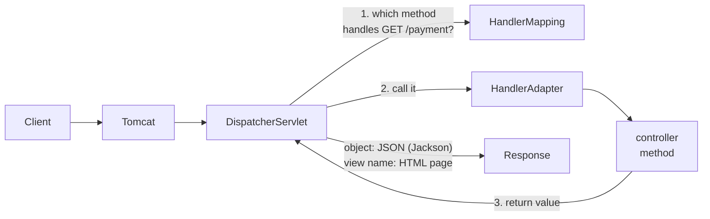
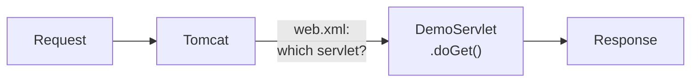
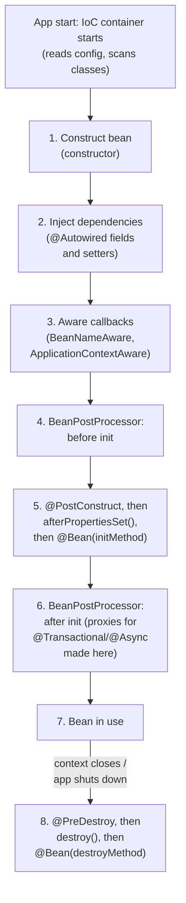
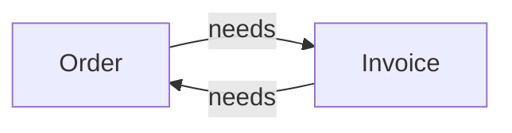
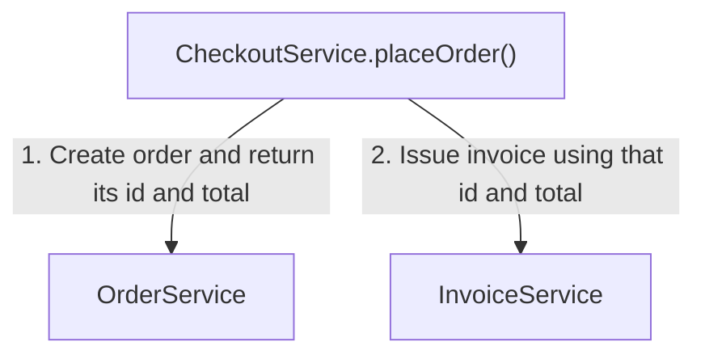
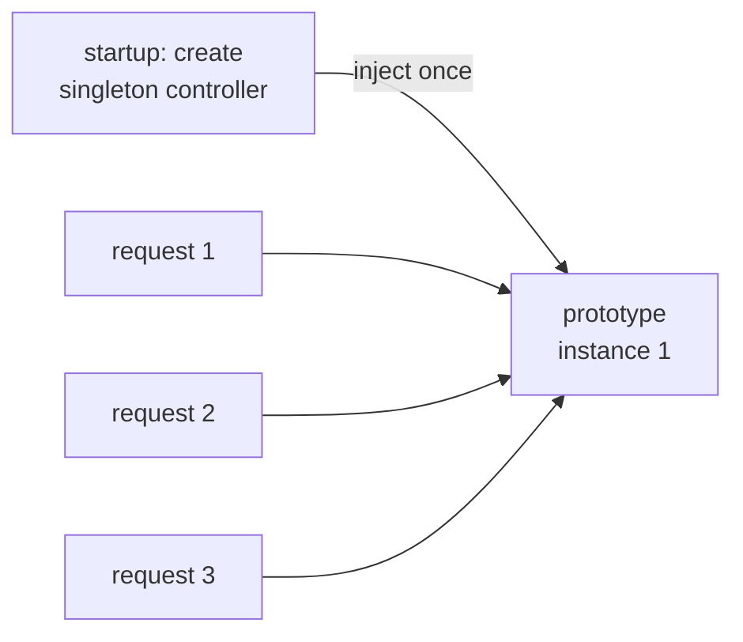
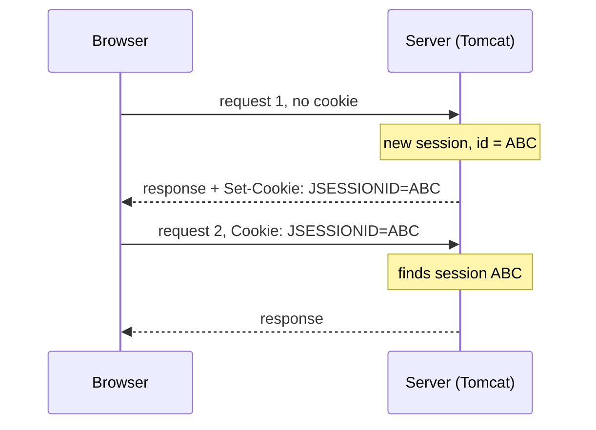
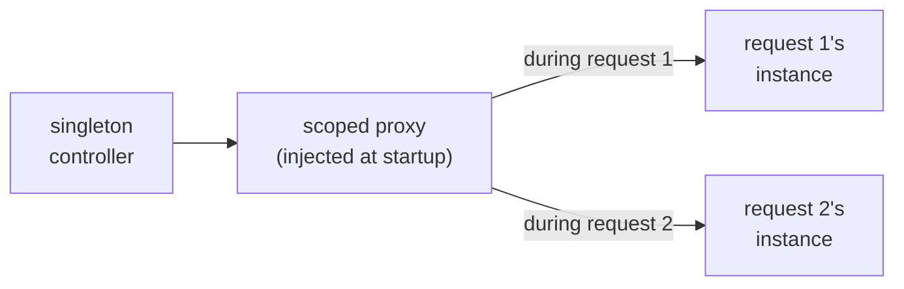

# Part 1 · Startup, beans and dependency injection

Follow an application from main() to its first request. Explain who creates the controller, which dependencies it receives and which objects two requests share.

## From Servlets to Spring Boot

The questions, from most to least asked: **Spring vs Spring Boot**, **what @SpringBootApplication does**, **IoC and DI**, **how auto-configuration works**, **the DispatcherServlet request flow**, **the embedded server**, and, as background, **what a servlet is**.

### 1. What Spring Boot adds to Spring

Spring Boot is built on top of Spring. It doesn't replace Spring. It removes the setup work, using **convention over configuration**: sensible defaults that you can override.

In plain Spring MVC you had to set everything up yourself: register the DispatcherServlet, add `@EnableWebMvc` and `@ComponentScan`, then build a WAR and deploy it to Tomcat. Spring Boot removes these steps with three main things:

1. **Starters + version management**: `spring-boot-starter-web` brings Spring MVC, Tomcat and Jackson in one dependency. `spring-boot-starter-parent` fixes compatible versions, so you don't write version numbers.
2. **Auto-configuration**: creates the beans you'd otherwise write yourself (DispatcherServlet, Jackson, DataSource, ...) based on what's on the classpath (section 4).
3. **Embedded server**: Tomcat runs inside your app (section 6).

Plus production features like Actuator (health, metrics).

Correction: "Spring Boot is a replacement for Spring." It is a layer on top of Spring. Every Boot app is a Spring app.

Say it like this: "Spring gives the core: IoC, DI, MVC, transactions. Spring Boot is an opinionated layer on top that adds starters, auto-configuration and an embedded server, so a production-ready app runs from a main method with almost no config."

### 2. @SpringBootApplication and startup

```java
@SpringBootApplication
public class App {
    public static void main(String[] args) { SpringApplication.run(App.class, args); }
}
```

It is three annotations in one:
- `@SpringBootConfiguration`: this class is a config class (a special `@Configuration`).
- `@EnableAutoConfiguration`: turn on auto-configuration.
- `@ComponentScan`: find `@Component`, `@Service`, `@Controller` and so on in **this class's package and its sub-packages**.

Trap: a bean in a package outside the main class's package (like `com.other` when main is in `com.app`) is not found. Keep the main class in the root package.

Correction: "@ComponentScan scans the whole project." Only the main class's package and its sub-packages.

**What `SpringApplication.run()` does:**
- Decides the app type (servlet, reactive or none), then loads the properties and active profiles.
- Creates the ApplicationContext, registers beans (component scan plus auto-configuration), and refreshes the context. Singletons are created here, and the embedded Tomcat starts.
- Runs `CommandLineRunner` / `ApplicationRunner` beans, then the app is ready to take requests.

### 3. IoC and Dependency Injection

Without DI, a class creates its own dependency:

```java
class Payment {
    User sender = new User();       // tightly coupled to User
}
```

- You can't pass a mock `User` in a test; the real one always runs.
- You can't switch to `AdminUser` without editing `Payment`.

With DI, Spring creates the objects and hands them in:

```java
@Component
class Payment {
    private final UserService users;            // depend on an interface
    Payment(UserService users) { this.users = users; }   // Spring passes it in
}
```

- **IoC (Inversion of Control)**: the framework, not your code, creates objects and controls their life.
- **DI**: the way IoC is done. Dependencies are passed in (constructor, setter, or field).
- `@Component` = "Spring, manage this class as a bean". `@Autowired` = "Spring, fill this dependency".

**The three types of DI:**

```java
public Payment(UserService users) { this.users = users; }        // 1. constructor
@Autowired public void setUsers(UserService users) { ... }       // 2. setter
@Autowired private UserService users;                            // 3. field
```

- **Constructor injection** (recommended): dependencies arrive as constructor parameters, so fields can be `final` and the object is never half-built. A missing bean fails at startup. With a single constructor, `@Autowired` is optional (since Spring 4.3). Use it for required dependencies.
- **Setter injection**: Spring calls an `@Autowired` setter after construction. Use it for optional dependencies, or ones that may be replaced later. Fields can't be `final`.
- **Field injection**: Spring sets the field directly through reflection. Shortest to write, but fields can't be `final`, an object created with `new` outside Spring has a null field, tests need reflection to set a mock, and a long list of dependencies stays hidden. Avoid it.

Common mistake: field `@Autowired` of a concrete class (`@Autowired User sender;`) doesn't fix the problems above. The fix is to depend on an **interface** and use **constructor injection**. Then tests can pass a mock, fields can be `final`, and switching implementations needs no change.

Say it like this: "IoC means Spring creates and wires my objects instead of my code calling new. DI is how it does it, by passing dependencies in, usually through the constructor. That makes classes loosely coupled and easy to test with mocks."

### 4. Auto-configuration: how it works

- Boot ships about 150 auto-configuration classes, listed in `META-INF/spring/org.springframework.boot.autoconfigure.AutoConfiguration.imports` (older versions used `spring.factories`). `@EnableAutoConfiguration` loads them.
- Each one is guarded by **conditions** and only runs when they match:
  - `@ConditionalOnClass`: a class is on the classpath (Tomcat and Spring MVC present -> set up a web server and DispatcherServlet).
  - `@ConditionalOnMissingBean`: you haven't defined your own bean. **Your bean always wins.**
  - `@ConditionalOnProperty`: a property is set.

So adding `spring-boot-starter-data-jpa` plus a DB driver makes Boot create a `DataSource`, an `EntityManagerFactory` and a transaction manager; defining your own `DataSource` bean makes Boot's back off. This is also how a web app gets its embedded Tomcat and DispatcherServlet without any code: the web starter put Tomcat and Spring MVC on the classpath, and no bean of your own replaced them.

- See what was applied: run with `--debug` (prints the condition report).
- Turn one off: `@SpringBootApplication(exclude = DataSourceAutoConfiguration.class)`, or the property `spring.autoconfigure.exclude`.

Trap: adding `@EnableWebMvc` in a Boot app **switches off** Boot's Spring MVC auto-configuration (WebMvcAutoConfiguration). You lose things like Boot's default MVC setup and static-resource handling. Don't add it unless you want full manual control.

Correction: "Auto-configuration means Boot configures everything." It only adds what your classpath needs, and backs off when you define your own bean.

Say it like this: "@EnableAutoConfiguration loads the classes listed in AutoConfiguration.imports, and each runs only if its conditions pass: a class on the classpath, no bean of my own, a property set. My own bean wins because of @ConditionalOnMissingBean, and --debug shows the condition report."

### 5. Spring MVC and the DispatcherServlet

- **DispatcherServlet** is one servlet that receives every request. It is the "front controller". It finds the right controller method, so you don't write path if/else.



Common mistake: "DispatcherServlet creates a controller instance per request." No. Controllers are singleton beans created **once at startup**. Every request reuses the same object, so don't keep request data in controller fields.

- `@Controller`: a method's `String` return is treated as a **view name** (an HTML template).
- `@RestController` = `@Controller` + `@ResponseBody`: the return value is written straight to the response body (JSON for objects). Use it for REST APIs.

Say it like this: "The DispatcherServlet is the front controller: one servlet receives every request, HandlerMapping finds the controller method, HandlerAdapter calls it, and the result is written as JSON or rendered as a view. Controllers are singletons created at startup, not per request."

### 6. Embedded server

- Old way: build a WAR and deploy it to an installed Tomcat.
- Boot: Tomcat is a library inside the app. Build one jar and run `java -jar app.jar`.
- The default is Tomcat. To switch to Jetty, exclude `spring-boot-starter-tomcat` from the web starter and add `spring-boot-starter-jetty`.
- The port comes from `server.port` (default 8080).

### 7. Servlets and the servlet container (background)

- **Servlet**: a Java class that takes an HTTP request and returns a response (`doGet`, `doPost`, ...).
- **Servlet container** (like Tomcat): creates the servlets, manages their life, and sends each URL to the right servlet. The mapping lived in `web.xml` (or `@WebServlet` since Servlet 3.0).



Problems with plain servlets:
- `web.xml` grows huge and hard to read.
- One servlet does path routing by hand: `if (path.equals("/first")) ... else if ...`
- The container creates the objects, so you can't swap in mocks. Unit tests are hard.

Spring fixed these with annotations, DI, and Spring MVC.

**Recall** from memory, draw the request flow (Tomcat -> DispatcherServlet -> HandlerMapping -> HandlerAdapter -> controller -> JSON). Then write the 3 annotations inside `@SpringBootApplication`.

## Beans, Lifecycle and Dependency Injection

The questions, from most to least asked: **the bean lifecycle**, **constructor vs field vs setter injection**, **circular dependencies**, **two beans of one type**, **eager vs lazy**, **`@Component` vs `@Bean`**, **singleton vs prototype timing**, and **IoC vs DI vs DIP**.

**Mental model.** Draw an arrow from each class to the collaborator its constructor needs. To create `User(Order order)`, Spring first needs a bean definition that can supply an `Order`, then a usable reference to pass into the constructor. That reference may be a transaction proxy, as in the transactions chapter. A missing bean, two equally eligible beans and a constructor cycle all fail at different points in that same process.

In one Java SDE-2 interview, the first round covered beans, cycles and lifecycle. The second returned to lifecycle and asked the candidate to compare constructor and setter injection. Practise explaining when a dependency first becomes available in each case. [Yes Madam SDE-2 interview report](https://leetcode.com/discuss/post/7649722/yes-madam-interview-experience-sde-2-jan-6bvb/)

### 1. Bean, IoC container, IoC and DI

- A **bean** is a Java object that Spring creates and manages.
- The **IoC container** (in code: `ApplicationContext`) holds all beans. It creates them, injects their dependencies, and destroys them on shutdown.

The problem DI solves:

```java
public class User {
    Order order = new OnlineOrder();     // User picks and builds its own Order
}
```

- **Tight coupling**: to switch to `OfflineOrder`, you must edit `User`.
- No mock in tests: `User` always builds a real `OnlineOrder`.
- It breaks the **Dependency Inversion Principle** (the D in SOLID): depend on an abstraction (an interface), not a concrete class.

**DI** fixes it: `User` only declares "I need an `Order`", and Spring passes one in.

- **IoC**: the idea. The framework, not your code, creates objects and wires them.
- **DI**: the way IoC is done, by passing dependencies in.
- **DIP**: the design rule DI helps you follow.

Correction: "If a bean is not found, Spring creates one and injects it." If no bean is defined, startup fails (`NoSuchBeanDefinitionException`).

**What does `ApplicationContext` add to `BeanFactory`?** A bean definition describes how to obtain an instance. The factory uses those definitions to create and wire beans. A Boot application's context also discovers registered post-processors, manages lifecycle callbacks and publishes application events. This is how a class found during scanning can ultimately reach its caller as a fully initialized, proxied object. [Spring container comparison](https://docs.spring.io/spring-framework/reference/core/beans/beanfactory.html)

### 2. Bean lifecycle



The ones to remember: **construct -> inject -> @PostConstruct -> use -> @PreDestroy**. Steps 3, 4 and 6 are the senior follow-up.

```java
@Component
public class User {
    @Autowired Order order;

    public User() { /* order is still null here */ }

    @PostConstruct
    public void init() { /* order is injected; safe to use */ }

    @PreDestroy
    public void cleanup() { /* close connections, flush buffers */ }
}
```

- **@PostConstruct**: runs once, after all dependencies are injected. Use it for setup that needs them (warm a cache, validate config).
- Why not the constructor? With field or setter injection, the fields are still null inside the constructor.
- **@PreDestroy**: runs when the context closes (normal shutdown, `context.close()`). It does not run on `kill -9` or a crash, and never for prototype beans.
- **BeanPostProcessor** runs for every bean. This is where Spring wraps a bean in a proxy, so the object you get injected may be a proxy, not your class.

Say it like this: "Spring constructs the bean, injects dependencies, runs Aware callbacks, then BeanPostProcessors around the init methods like @PostConstruct. The 'after' processor is where AOP proxies are created. The bean is used, and on context close @PreDestroy runs, though not for prototype beans."

### 3. Three ways to inject

**Field injection**

```java
@Autowired private Order order;     // Spring sets it through reflection
```

- Short and easy. That's the only plus.
- Can't be `final`. `new User()` outside Spring leaves `order` null, and the first call throws a NullPointerException.
- Tests need reflection to set the mock (`@InjectMocks` does this). It also hides how many dependencies a class has.

**Setter injection**

```java
@Autowired
public void setOrder(Order order) { this.order = order; }
```

- Good for **optional** dependencies, or ones that may change after creation. Can't be `final`.

**Constructor injection (recommended)**

```java
@Component
public class User {
    private final Order order;
    public User(Order order) { this.order = order; }    // @Autowired not needed
}
```

- **One constructor**: `@Autowired` is optional (since Spring 4.3).
- **Several constructors**: mark one with `@Autowired`. Otherwise Spring looks for a no-arg constructor, and if there is none, startup fails ("No default constructor found").

Why it is recommended:
- Fields can be `final`: the object is immutable and never half-built.
- No NullPointerException from missing dependencies, and no null checks.
- **Fails fast at startup**: a missing bean stops the app from starting ("Parameter 0 of constructor in User required a bean of type 'Order' that could not be found").
- Easy tests: `new User(mockOrder)`, no reflection.
- A constructor with 7 parameters is a visible sign the class does too much.

Correction: "Constructor injection fails at compile time if a dependency is missing." It fails at **application startup**.

Say it like this: "I use constructor injection for required dependencies: fields are final, the object is complete when created, a missing bean fails at startup, and tests just call new with mocks. Setter injection is for optional dependencies. I avoid field injection."

**Is the setter above optional as written?** Plain `@Autowired` makes its argument required. If the application has a sensible default, initialize the field to that default and mark the setter `@Autowired(required = false)`. With no matching bean, Spring skips the setter and the default stays in place. A constructor parameter of type `Optional<Order>` can also express that absence explicitly. [Spring autowiring rules](https://docs.spring.io/spring-framework/reference/core/beans/annotation-config/autowired.html)

### 4. Circular dependency



To build `Order` you need `Invoice`, and to build `Invoice` you need `Order`.

- **Constructor injection**: always fails (`BeanCurrentlyInCreationException`). Neither object can even be constructed.
- **Field or setter injection**: plain Spring can solve it by injecting a half-built object early. **Spring Boot 2.6+ blocks this by default**, so the app fails too. `spring.main.allow-circular-references=true` turns it back on, but that hides a design problem.

Fixes, best first:
1. **Redesign**: move the shared logic into a third class that both use. A cycle usually means two classes are doing each other's job.
2. **`@Lazy` at one injection point**: Spring injects a proxy now and creates the real bean on first use. This works with constructor injection too: `public Invoice(@Lazy Order order)`.
3. **Setter + `@PostConstruct`**: `Order` builds first, then in `@PostConstruct` calls `invoice.setOrder(this)`. Trap: `this` is the raw object, not the Spring proxy, so `@Transactional` or `@Async` on `Order` won't apply through that reference.

Say it like this: "Constructor cycles always fail. Field cycles fail by default since Boot 2.6. I'd first remove the cycle by extracting shared logic. If that's not possible right now, I put @Lazy on one injection point so Spring injects a proxy."

**How would you remove the cycle in a checkout?** Suppose `OrderService` calls `InvoiceService` to issue the invoice, and `InvoiceService` calls back into `OrderService` for the total. Give the sequence to the checkout service and pass the total as data.



Now either service can be constructed first. If both writes use the same database and must commit together, the checkout method is also the natural transaction boundary. [Spring dependency resolution](https://docs.spring.io/spring-framework/reference/core/beans/dependencies/factory-collaborators.html)

### 5. Two beans of the same type

Spring matches by **type** first. With `OnlineOrder` and `OfflineOrder` both implementing `Order`, `@Autowired Order order;` finds two matches. Startup fails with `NoUniqueBeanDefinitionException` (inside `UnsatisfiedDependencyException`): "expected single matching bean but found 2".

Fixes:
- **@Primary** on one implementation: the default whenever `Order` is injected without a qualifier.
- **@Qualifier("offlineOrder")** at the injection point: picks a specific bean by name. **@Qualifier beats @Primary.**
- **Field or parameter name**: if it matches a bean name (`Order offlineOrder`), Spring uses that bean. It works, but it's fragile, because renaming the variable changes the behavior.
- **Inject all of them**: `List<Order>` or `Map<String, Order>` (key = bean name). This is the usual way to choose an implementation at runtime (strategy pattern).

```java
public User(@Qualifier("offlineOrder") Order order) { this.order = order; }
```

Default bean name: the class name with a lowercase first letter (`OfflineOrder` -> `offlineOrder`). For a `@Bean` method, it's the method name.

Correction: "If two beans match, Spring picks the first one." It fails, unless a qualifier, primary, or matching name decides.

Correction: "@Primary and @Qualifier do the same thing." @Primary sets a default, @Qualifier picks exactly, and @Qualifier wins.

**Can two beans share a qualifier?** Yes. A qualifier can describe a group. If two `Order` beans are both tagged `@Qualifier("online")`, then `@Qualifier("online") List<Order>` receives both. For a single `Order` parameter with that qualifier, one matching `@Primary` can resolve the choice. A primary bean outside the qualified group is ineligible. [Spring qualifier matching](https://docs.spring.io/spring-framework/reference/core/beans/annotation-config/autowired-qualifiers.html)

### 6. When beans are created: eager vs lazy

- **Eager (default for singletons)**: created at startup. Good: mistakes like a missing bean fail at startup, not on the first user request.
- **Lazy**: `@Lazy` on the class means it's created the first time someone needs it. It saves startup time, but errors only appear at runtime.

A `@Lazy` bean injected into an eager bean is still created at startup: the eager bean needs it, so Spring must create it to inject it. `@Lazy` on the class only helps when no eager bean depends on it.

To truly delay it, put `@Lazy` at the injection point (`@Lazy @Autowired Order order;`). Spring injects a proxy, and the real `Order` is created on the first method call.

**Singleton vs prototype timing:**
- Singleton: one per container, created at startup, @PreDestroy called on close.
- Prototype: a new one per request or injection, no @PreDestroy.
- Trap: a prototype injected into a singleton is created only once, so the singleton keeps the same instance.

### 7. Two ways to create a bean: `@Component` and `@Bean`

**@Component** on your own class. Spring finds it by scanning and calls its constructor:

```java
@Component
public class OnlineOrder implements Order { ... }
```

- `@Service`, `@Repository` and `@Controller` are also `@Component`. They only name the layer.
- `@Repository` adds one extra: it translates DB exceptions into Spring's `DataAccessException`.

**@Bean** on a method in a `@Configuration` class. You write the creation code yourself:

```java
@Configuration
public class AppConfig {
    @Bean
    public User createUserBean() { return new User("defaultusername", "defaultemail"); }
}
```

- Use @Bean for classes you can't annotate (from a library, like `RestTemplate` or `ObjectMapper`), or when creation needs custom logic.
- Two @Bean methods returning `User` create two `User` beans (section 5 covers how to choose).

Trap: `@Component` on `User` with only a constructor `User(String username, String email)` fails at startup. Spring treats every constructor parameter as a bean to inject, and there is no `String` bean (`NoSuchBeanDefinitionException`). Fix: create it with `@Bean` and pass the values yourself.

Trap: in a `@Configuration` class, calling a `@Bean` method twice returns the **same** bean, because Spring proxies the config class. In `@Configuration(proxyBeanMethods = false)` or a `@Component` class, each call makes a new object.

How Spring finds beans:
- `@ComponentScan` (included in `@SpringBootApplication`) scans the main class's package and its sub-packages for `@Component` classes, plus `@Bean` methods in the `@Configuration` classes it finds.
- A class outside those packages is never found. Fix: move it, or set `@ComponentScan(basePackages = ...)`.

Correction: "@Component is Spring Boot auto-configuration." It is core Spring component scanning.

**Recall** draw the lifecycle from memory (construct -> inject -> @PostConstruct -> use -> @PreDestroy) and mark where proxies are made. Then write `User` with constructor injection of `Order`, picking `offlineOrder` with `@Qualifier`.

## Bean Scopes

The questions, from most to least asked: **a prototype bean inside a singleton**, **are singletons thread-safe**, **singleton vs prototype**, **request vs session scope**, and **Spring singleton vs GoF singleton**.

### 1. What a scope is

A scope decides **how many instances** of a bean exist and **how long each lives**.

- **singleton** (default): one instance per container.
- **prototype**: a new instance every time the bean is asked for.
- **request**: one instance per HTTP request.
- **session**: one instance per HTTP session.
- application: one per ServletContext. Rarely asked.

Singleton is eager (created at startup). Prototype, request and session instances are created when needed.

```java
@Component                     // singleton, same as @Scope("singleton")
@Component @Scope("prototype") // or ConfigurableBeanFactory.SCOPE_PROTOTYPE
@Component @RequestScope       // = @Scope(value = "request", proxyMode = TARGET_CLASS)
@Component @SessionScope       // = @Scope(value = "session", proxyMode = TARGET_CLASS)
```

### 2. A prototype inside a singleton

A dependency is injected **when the bean that holds it is created**. A singleton (every controller and service) is created once, at startup, so its prototype dependency is created once and kept forever. Every request then shares that one instance, exactly as if it were a singleton.



Fix: ask Spring for a new one at call time with `ObjectProvider` (preferred):

```java
private final ObjectProvider<Cart> carts;               // injected once; it's a factory

@PostMapping("/cart/{item}")
public String add(@PathVariable String item) {
    Cart cart = carts.getObject();                      // new Cart on every call
    cart.add(item);
    return cart.show();
}
```

- Now it really is a prototype: a fresh object every time you ask. That means it remembers nothing between calls. Prototype means "new object per use", **not** "one per user".
- Other fixes: a `@Lookup` method (`@Lookup public Cart newCart() { return null; }`, which Spring overrides), or `applicationContext.getBean(Cart.class)`, which ties your code to Spring.
- Trap: `@Scope(value = "prototype", proxyMode = TARGET_CLASS)` creates a new `Cart` on **every method call**, so `cart.add(item)` and then `cart.show()` run on two different carts.
- Spring does **not** call `@PreDestroy` on prototypes, and doesn't track them after creating them. You clean them up yourself.

Correction: "Prototype beans are always lazy." They're created when asked for, which is at startup if an eager singleton injects one.

Correction: "Prototype gives each user their own object." It gives a new object per use. Per user is session scope.

Say it like this: "A prototype injected into a singleton is created only once, when the singleton is built, so it behaves like a singleton. To get a new one each time, I inject ObjectProvider and call getObject(), or use a @Lookup method."

### 3. Singletons and thread safety

Spring does not make singletons thread-safe. It only guarantees safe creation. All request threads run the same object in parallel:

```java
@Service
public class CounterService {
    private int count = 0;                 // shared by all request threads
    public void hit() { count++; }         // race: read, add, write can interleave
}
```

- A singleton is right for stateless beans (services, repositories, controllers), and wrong for anything holding one user's data: every user and every thread sees the same object.
- A safe singleton is **stateless**: no mutable fields, only dependencies and local variables.
- If shared state is truly needed: `AtomicInteger`, `ConcurrentHashMap`, locks, or store it outside the app (DB, Redis).

Say it like this: "Singleton beans are not thread-safe by themselves; Spring only guarantees one instance, created safely. All request threads share it, so I keep services stateless, and use atomics, concurrent collections or external storage when state must be shared."

### 4. Singleton vs prototype

- **Singleton**: one per container, created at startup, @PreDestroy called on shutdown.
- **Prototype**: a new one per request for the bean, no @PreDestroy, and Spring doesn't track it after creating it.

### 5. HTTP request vs HTTP session

HTTP is **stateless**: by itself, the server doesn't know that two requests came from the same user.

- **HTTP request**: one call from the client and its response. It ends as soon as the response is sent.
- **HTTP session**: a series of requests from the **same client**, linked by a session id. The server keeps an `HttpSession` object in its memory, and the browser keeps the id in a cookie (`JSESSIONID`).



- A session ends on logout (`session.invalidate()`) or after inactivity (default 30 minutes, set by `server.servlet.session.timeout`).
- One session holds many requests. One request belongs to at most one session.
- REST APIs often skip sessions completely. The client sends a token (like a JWT) with every request, and the server stays stateless.

### 6. Request scope, session scope and the scoped proxy

**Request scope**: one instance per HTTP request. It's created on first use in that request and dropped when the response is sent.
- How is it different from prototype? **Inside one request**, everyone (a filter, the controller, a service) gets the **same** instance. A prototype gives a new one every time it's requested.
- Good for request-level data: the current user's details or a trace id, so you don't pass it through every method.

**Session scope**: one instance per HTTP session. All of a user's requests share it until logout or timeout, and a new session gets a new instance. This is the only scope that gives "one per user".

**Why both need a proxy.** A request-scoped bean **without** the proxy, injected into a singleton, makes startup fail (`UnsatisfiedDependencyException`): "Scope 'request' is not active for the current thread". The singleton is built at startup, when no HTTP request exists, so Spring can't create a request-scoped bean to inject.

Fix: the **scoped proxy**. Spring injects a stand-in object at startup. On every method call, the proxy finds the real instance of the current request (or session). `@RequestScope` and `@SessionScope` turn the proxy on by default.



- Calling the proxy outside a request (in a `@Scheduled` job or an `@Async` thread) fails with `ScopeNotActiveException`.

Say it like this: "Request scope gives one instance per HTTP request, shared by everything in that request; session scope gives one per user session, linked by the JSESSIONID cookie, until logout or timeout. Injected into a singleton, both need a scoped proxy, which @RequestScope and @SessionScope add, so each call is routed to the current request's or session's instance."

### 7. Spring singleton vs GoF singleton

- GoF singleton: one instance per class (per class loader), enforced by a private constructor.
- Spring singleton: one instance **per bean definition per container**. Two `@Bean` methods returning the same type give two objects, and both are "singletons".

**Recall** from memory, write the `ObjectProvider<Cart>` version of `add()`. Then draw the browser/server picture showing two requests in one session with the JSESSIONID cookie.

## Interview practice

Two requests reach a singleton checkout service at once. Draw the objects the requests share. Where would you keep each buyer’s cart? Now add a second payment implementation and explain which one the constructor receives and when a wiring error surfaces.

<details>
<summary>Walk through the case</summary>

Both requests can use the same singleton. Keep the cart in request-local data or in storage keyed to the buyer. Resolve the payment implementation with a qualifier or a single primary candidate. An ambiguous dependency fails when Spring creates the checkout bean, usually during startup.

</details>

### From Servlets to Spring Boot

22 of the 1,592 candidate write-ups in the Oct 2024 – Oct 2026 review mentioned this lesson. Each count below belongs to its question.

<details>
<summary>Spring vs Spring Boot — what does Boot actually add?</summary>

Spring is the framework (IoC container, MVC, data, transactions). Spring Boot is an **opinionated way to run it**:
- **Auto-configuration** — beans created from what's on the classpath and in properties.
- **Starters** — one dependency pulls a tested set of libraries.
- **Embedded server** — run `java -jar`, no WAR deployment to an external Tomcat.
- **Externalised config + profiles**, **Actuator** for health/metrics.

Same Spring underneath — Boot removes the XML/boilerplate setup.

*11 candidate write-ups · Apple · BharatPe · Cognizant · Goldman Sachs · Lenskart · Rakuten · Sunking · Yes Madam*

</details>

<details>
<summary>What happens when a request hits a Spring Boot application? Explain the DispatcherServlet flow.</summary>

1. Tomcat accepts the connection and gives the request to a **worker thread**.
2. The **filter chain** runs (Spring Security, logging, CORS).
3. **DispatcherServlet** (the front controller) asks the `HandlerMapping` which controller method matches.
4. Interceptors' `preHandle` run.
5. The `HandlerAdapter` resolves arguments (`@PathVariable`, `@RequestBody` via an `HttpMessageConverter` — Jackson for JSON) and calls your controller.
6. The return value is written back through a message converter; exceptions go to `@ControllerAdvice`.
7. Interceptors' `afterCompletion`, filters unwind, the thread returns to the pool.

*9 candidate write-ups · Cerner · Marsh McLennan · Microsoft · Oblivious · Target · Visa*

</details>

<details>
<summary>Which embedded server does Spring Boot use — and how do you change the port or swap it?</summary>

**Tomcat** by default (from `spring-boot-starter-web`). Change the port with `server.port=8081` (or `SERVER_PORT` env var, or `--server.port`).

Swap servers by excluding `spring-boot-starter-tomcat` and adding `spring-boot-starter-jetty`/`-undertow`. WebFlux apps use **Netty**.

Tomcat's request threads: `server.tomcat.threads.max` (default 200).

*4 candidate write-ups · EPAM · Infosys · Lenskart · Oracle*

</details>

### Beans, Lifecycle and Dependency Injection

73 of the 1,592 candidate write-ups in the Oct 2024 – Oct 2026 review mentioned this lesson. Each count below belongs to its question.

<details>
<summary>What are dependency injection and Inversion of Control — and what do they buy you?</summary>

**IoC**: your classes don't create their collaborators; the container does and hands them in. **DI** is how: through constructors (preferred), setters or fields.

```java
@Service
class OrderService {
  private final PaymentClient payments;
  OrderService(PaymentClient payments) { this.payments = payments; }   // injected
}
```

Benefits: loose coupling (depend on interfaces), easy testing (pass a mock), one place to configure lifecycles (singletons, proxies for `@Transactional`).

*45 candidate write-ups · EPAM · Visa · Adobe · Agoda · Amazon · Apple · Astrotalk · Bajaj Finserv Health · BharatPe · DP World · DoorDash · Expedia*

</details>

<details>
<summary>@Component vs @Service vs @Repository vs @Bean — is the difference only semantic?</summary>

`@Service`, `@Repository`, `@Controller` are all `@Component` — picked up by component scanning. Mostly semantic, **except**:
- `@Repository` enables **exception translation** (SQLException → Spring's `DataAccessException`).
- `@Controller`/`@RestController` are wired into Spring MVC.

`@Bean` is different: a method in a `@Configuration` class that **builds** the bean yourself — use it for third-party classes you can't annotate (e.g. an `ObjectMapper`, a `RestClient`).

*18 candidate write-ups · DP World · Blackrock · EPAM · JPMorgan · Lenovo · Mastercard · MobiKwik · Nike · Truemeds · Yes Madam*

</details>

<details>
<summary>Circular dependency — how does Spring handle it, and how do you fix it?</summary>

A needs B, B needs A.
- **Constructor injection**: impossible to build → `BeanCurrentlyInCreationException`. Since Boot 2.6 circular references are **rejected by default** even for field injection.
- Spring *can* break field/setter cycles by exposing an early reference (the "three-level cache"), but that's what got disabled.

Real fix: **redesign** — extract the shared logic into a third bean, or use events. Stop-gap: `@Lazy` on one injection point (injects a proxy).

*13 candidate write-ups · Google · Astrotalk · D. E. Shaw · Fancode · Lenskart · LinkedIn · Microsoft · Oracle · Truemeds · Visa · Yes Madam*

</details>

<details>
<summary>Explain the Spring bean lifecycle.</summary>

1. Bean definition read (component scan / `@Bean`).
2. **Instantiate** (constructor; constructor injection happens here).
3. **Populate** properties (setter/field injection).
4. `*Aware` callbacks (`BeanNameAware`, `ApplicationContextAware`).
5. `BeanPostProcessor.postProcessBeforeInitialization`.
6. **Init**: `@PostConstruct` → `InitializingBean.afterPropertiesSet()` → custom `initMethod`.
7. `BeanPostProcessor.postProcessAfterInitialization` — **this is where AOP proxies are created** (`@Transactional`, `@Async`).
8. Bean in use.
9. On shutdown: `@PreDestroy` → `DisposableBean.destroy()` → `destroyMethod`. (Prototype beans are never destroyed by the container.)

*11 candidate write-ups · Blackrock · EPAM · Gartner · JPMorgan · Kotak Mahindra Bank · Mastercard · Nagarro · Nike · Oracle Health · Yes Madam*

</details>

<details>
<summary>Constructor vs setter vs field injection — which is better and why?</summary>

**Constructor injection** — Spring's recommendation:
- dependencies can be `final` (immutable, never null),
- the class can be built in a plain unit test without Spring,
- a constructor with 8 parameters is a visible smell (the class does too much),
- circular dependencies fail fast at startup instead of hiding.

Setter injection for genuinely optional dependencies. Avoid field injection (`@Autowired` on a private field): hidden dependencies, needs reflection, hard to test. With one constructor, `@Autowired` isn't needed.

*8 candidate write-ups · Bajaj Finserv Health · Celonis · Coupa · EPAM · Mastercard · Swiggy · Truemeds · Yes Madam*

</details>

<details>
<summary>Two beans of the same type — how does Spring choose? (@Qualifier vs @Primary)</summary>

Without help, injection fails with `NoUniqueBeanDefinitionException`.

- `@Primary` on one bean → the default choice.
- `@Qualifier("razorpay")` at the injection point → pick explicitly (wins over `@Primary`).
- Inject `List<PaymentGateway>` or `Map<String, PaymentGateway>` to get all of them — handy for a strategy pattern.

*6 candidate write-ups · Autodesk · EPAM · Mastercard*

</details>

<details>
<summary>ApplicationContext vs BeanFactory — how does the IoC container work?</summary>

`BeanFactory` is the basic container: creates beans lazily on request.

`ApplicationContext` extends it and is what you always use: eagerly creates singletons at startup (so config errors fail fast), runs `BeanPostProcessor`s (AOP, `@Autowired`), publishes events, resolves messages (i18n), and reads `Environment`/profiles.

Startup: scan → register bean definitions → run post-processors → instantiate singletons in dependency order → publish `ContextRefreshedEvent`.

*5 candidate write-ups · Apple · NoBroker · Swiggy*

</details>

<details>
<summary>What is component scanning?</summary>

At startup Spring scans the packages under your `@SpringBootApplication` class (or `@ComponentScan(basePackages=…)`) for classes annotated with `@Component` and its stereotypes, and registers them as beans.

A bean in a package outside that tree isn't found — a classic "No qualifying bean" cause.

*1 candidate write-up · Lenovo*

</details>

### Bean Scopes

11 of the 1,592 candidate write-ups in the Oct 2024 – Oct 2026 review mentioned this lesson. Each count below belongs to its question.

<details>
<summary>What bean scopes does Spring have?</summary>

- **singleton** (default): one instance per container.
- **prototype**: a new instance every time it's requested.
- Web: **request** (one per HTTP request), **session**, **application**, **websocket**.

Real prototype example: a stateful builder or parser object you don't want shared.

*8 candidate write-ups · JPMorgan · Lenovo · Mastercard · Oracle · Publicis Sapient · Zycus*

</details>

<details>
<summary>Is a singleton bean thread-safe? How is a Spring singleton different from the Singleton pattern?</summary>

Spring guarantees **one instance**, not thread safety. Every request thread calls the same object, so a singleton must be **stateless** (only final, thread-safe dependencies). Storing request data in a field is a race.

GoF Singleton: one instance per **class loader**, enforced by the class itself (private constructor). Spring singleton: one per **container**, managed by Spring — you can still `new` it, and you can have two beans of the same class.

*4 candidate write-ups · Goldman Sachs · Oracle · Visa · Walmart*

</details>

<details>
<summary>A prototype bean injected into a singleton — does it stay prototype?</summary>

No. The singleton is created **once**, so the prototype is injected **once** — you get the same instance forever.

Fixes: inject `ObjectProvider<MyProto>` and call `getObject()` each time, use a `@Lookup` method, or make it a **scoped proxy** (`@Scope(value = "prototype", proxyMode = TARGET_CLASS)`).

Same problem with a request-scoped bean in a singleton: it fails at startup unless it's a scoped proxy, which resolves the right instance per request (via a ThreadLocal).

*3 candidate write-ups · Publicis Sapient · Visa · Zycus*

</details>

<!-- Generated by scripts/genCoreStack.mjs from the individual master notes, interview evidence and springCourse.mjs. -->
