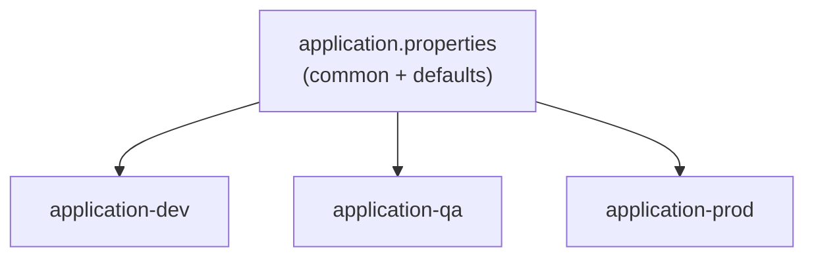
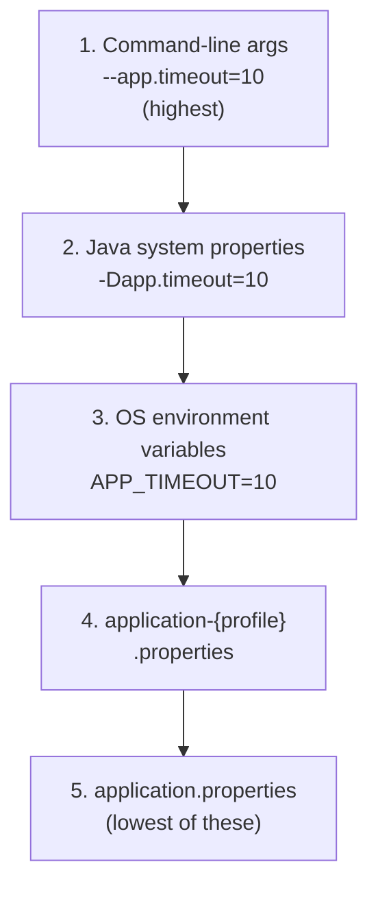
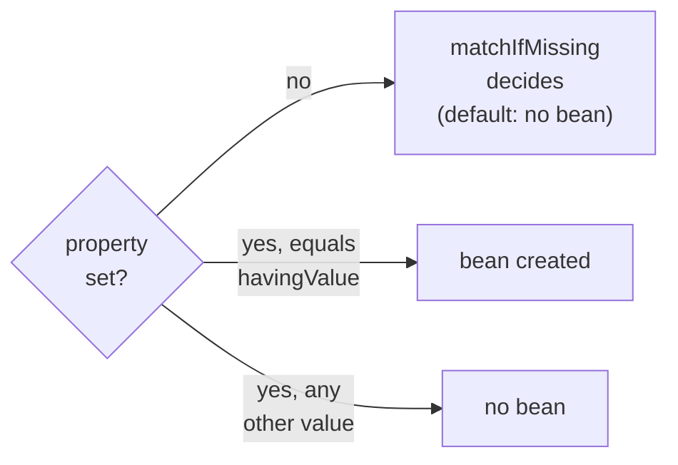

# Part 2 · Building and configuring a Boot service

Trace how a Maven dependency reaches the classpath, how Boot reads configuration and how those inputs decide which beans exist.

## Maven and the Boot application classpath

An interviewer's build question often starts with a service that compiles in the IDE and fails in the container. Follow one dependency from the POM to the executable jar.

### What runs when you build?

`mvn package` runs the default lifecycle through packaging, including compilation and unit tests. `mvn verify` also reaches the integration-test and verification phases. Integration tests run there when the build binds a plugin such as Failsafe. `clean` belongs to a separate lifecycle. The Spring Boot Maven plugin's `repackage` goal builds the executable archive when bound to the build. [Maven build lifecycle](https://maven.apache.org/guides/introduction/introduction-to-the-lifecycle.html) · [Boot executable archives](https://docs.spring.io/spring-boot/maven-plugin/packaging.html)

### Why can the runtime version surprise you?

A starter declares dependencies. A BOM in `dependencyManagement` supplies compatible versions for dependencies you actually use. Maven normally mediates competing transitive versions using the nearest declaration. Check `mvn dependency:tree` for the selected path and `mvn help:effective-pom` for inherited configuration. A `runtime` dependency is available when running the application, while a `test` dependency stays on the test classpath. An incompatible runtime version can surface as a `NoSuchMethodError` when the JVM links a call. [Maven dependency mechanism](https://maven.apache.org/guides/introduction/introduction-to-dependency-mechanism.html)

## Profiles, @Value and @ConfigurationProperties

The questions, from most to least asked: **@Value vs @ConfigurationProperties**, **profiles and how to activate them**, **@Profile**, **property precedence**, **several active profiles**, **validation**, **immutable config**, and **nested, list and map binding**.

### 1. The problem: config changes per environment

The same code runs on dev, QA and prod, but each connects to a different DB with different credentials. Not just credentials: URLs, ports, connection timeouts, request timeouts, throttle limits and retry counts also differ. You don't want a code change or a rebuild per environment. **Profiles** solve this, and `@Value` / `@ConfigurationProperties` read the result into beans.

### 2. @Value and @ConfigurationProperties

#### @Value and its limits

```java
@Component
public class DBConnection {
    @Value("${app.username}")       private String username;
    @Value("${app.password}")       private String password;
    @Value("${app.db.url}")         private String dbUrl;
    @Value("${app.timeout:5000}")   private int timeout;    // 5000 if the key is missing
}
```

- Good for injecting **one** value. `${key:default}` gives a default value. It also supports SpEL.
- Problems as config grows:
  - Repetition: the same `@Value` keys get repeated across many classes.
  - No validation: you can't say "password must be present, 10 to 25 characters long".
  - No grouping: related settings are scattered instead of living in one object.
- A missing key with no default fails at startup ("Could not resolve placeholder").

#### @ConfigurationProperties: bind config to a Java object

It maps a group of properties with the same **prefix** into one object. The config becomes structured, reusable, and validatable.

```properties
app.user.name=test_username
app.user.age=27
app.user.active=true
```

```java
@Component
@ConfigurationProperties(prefix = "app.user")
public class UserConfigurations {
    private String name;          // <- app.user.name
    private int age;              // <- app.user.age
    private boolean active;       // <- app.user.active
    // getters and setters (the binder uses setters)
}
```

- Inject it and use it like any Java object (`userConfigurations.getAge()`).
- **Relaxed binding**: `app.user.first-name`, `app.user.firstName` and the env variable `APP_USER_FIRSTNAME` all bind to the field `firstName`.
- Three ways to register it as a bean: `@Component` on the class, `@EnableConfigurationProperties(UserConfigurations.class)` on a config class, or `@ConfigurationPropertiesScan` on the main class.
- IDE autocompletion works for its keys.

**Trap: the `user` prefix.** With `@ConfigurationProperties(prefix = "user")` and `user.name=test_username` in `application.properties`, `getName()` returns the OS login name. Java always sets a system property `user.name` (the OS user), and system properties beat `application.properties`. The binder reads that value. Fix: use your own prefix, like `app.user.name`. Avoid prefixes such as `user`, `java` and `os`.

Say it like this: "I use @Value for a single value. For a group of related settings I use @ConfigurationProperties: one type-safe object, relaxed binding, and validation at startup, instead of @Value strings scattered across classes."

### 3. Profiles: profile-specific files



```properties
# application.properties
username=defaultUsername
password=defaultPassword

# application-prod.properties
username=prodUsername
password=prodPassword
```

- No profile active: only `application.properties` is used (Spring calls this the `default` profile).
- `prod` active: `application.properties` is loaded first, then `application-prod.properties` **on top**. For the same key, the profile file wins. Keys only in the base file still apply.

### 4. Activating a profile

- In `application.properties`: `spring.profiles.active=prod`. Fine for local work. Not used in real deployments, because the same jar goes to every environment.
- Command line: `java -jar app.jar --spring.profiles.active=prod`.
- Environment variable: `SPRING_PROFILES_ACTIVE=prod`. This is the usual way in Docker and Kubernetes.
- JVM option: `-Dspring.profiles.active=prod`.
- Maven, local run: `mvn spring-boot:run -Dspring-boot.run.profiles=prod`, or Maven profiles in `pom.xml` (`mvn spring-boot:run -Pproduction`).

**Several profiles at once:** `spring.profiles.active=prod,qa`.
- Beans for both profiles are created.
- For a key set in both files, the **last profile listed wins**. With `prod,qa`, `username` comes from `application-qa`. With `qa,prod`, it comes from `application-prod`.

Trap: `spring.profiles.active` can't be set inside a profile-specific file (like `application-dev.properties`). Boot rejects it at startup. Set it in the base file or from outside.

Say it like this: "Profiles give per-environment config in application-{profile}.properties and per-environment beans with @Profile, from one build. I activate them with SPRING_PROFILES_ACTIVE or --spring.profiles.active; the profile file loads on top of application.properties and wins for the same key, and with several profiles the last one listed wins."

### 5. @Profile: create a bean only for some profiles

```java
@Component
@Profile("prod")                 // created only when "prod" is active
public class MySQLConnection { ... }

@Component
@Profile("dev")                  // created only when "dev" is active
public class NoSQLConnection { ... }
```

- Active `prod` -> only `MySQLConnection` is created. Active `qa` -> neither is created.
- `@Profile("!prod")`: created in every profile **except** prod (e.g. a fake payment gateway).
- `@Profile({"dev", "qa"})`: created if dev **or** qa is active.
- Two apps, one shared codebase: put `@Profile("app1")` on the bean. App 1 sets `spring.profiles.active=app1`, app 2 sets `app2`. Only app 1 gets the bean.

**@Profile vs @ConditionalOnProperty:**
- `@Profile` groups beans by **environment** (dev, qa, prod).
- `@ConditionalOnProperty` turns **one feature** on or off from one property.
- Both are decided once, at startup.

### 6. Property precedence (which value wins)

When the same key is set in several places, the higher source wins:



- A file **outside** the jar (next to it, or in `./config/`) beats the same file inside the jar.
- This is why prod values usually come from env variables or args: they override whatever was packaged in the jar.
- It is also why `user.name` (a JVM system property) beats your `application.properties` value.

### 7. Validation

```java
@Component
@ConfigurationProperties(prefix = "app.user")
@Validated                                        // turn validation on
public class UserConfigurations {
    @NotBlank(message = "name must not be empty")
    private String name;
    @Min(value = 1, message = "Age can not be 0")
    private int age;
}
```

- Needs `spring-boot-starter-validation`.
- Checked right after binding, at startup. Bad config (`app.user.age=0`) means the **app fails to start**, instead of failing on some request later.
- Common ones: `@NotNull`, `@NotBlank` (strings), `@NotEmpty` (lists, maps), `@Min`, `@Max`, `@Positive`, `@Email`, `@Pattern(regexp = ...)`.

### 8. Immutable config: constructor binding

Setter binding means fields can't be `final`, so the config can be changed at runtime. To make it immutable, bind through the constructor:

```java
@ConfigurationProperties(prefix = "app.user")             // NO @Component
public record UserConfig(String name, int age, Duration timeout) {}

@SpringBootApplication
@ConfigurationPropertiesScan                              // registers it
public class App { ... }
```

- A record or a class with `final` fields and one constructor both work. The binder calls the constructor with the property values.
- Why no `@Component`? Then Spring would create it as a normal bean and try to inject `String name` as a bean, and startup fails ("No qualifying bean of type String"). Let the binder create it, through `@ConfigurationPropertiesScan` or `@EnableConfigurationProperties`.
- Validation works the same way (`@Validated` + constraints on the components or fields).
- Typed values work: `app.user.timeout=5s` -> `Duration`, `10MB` -> `DataSize`.

### 9. Nested objects, lists and maps (rarely asked)

```properties
app.user.address.city=Jaipur                # nested object
app.user.roles[0]=ADMIN                     # List<String>
app.user.course[0].name=Java                # List<Course>
app.user.preferences.theme=dark             # Map<String, String>
app.user.locations.home.city=Jaipur         # Map<String, AddressConfig>
```

```java
private AddressConfig address;
private List<String> roles;
private List<Course> course;
private Map<String, String> preferences;
private Map<String, AddressConfig> locations;

public static class AddressConfig { private String city; /* getters, setters */ }
```

- Nested classes must be **static**. A non-static inner class has no no-arg constructor (its constructor secretly takes the outer object), so the binder can't create it. If properties exist for it, startup fails with a binding error.

**Recall** from memory, write the precedence order (top 5). Then write a `record` bound to prefix `app.db`, with a `url` and a `timeout`, and say how it gets registered.

## @ConditionalOnProperty and Auto-configuration

The questions, from most to least asked: **what @ConditionalOnProperty does and its attributes**, **the other @Conditional annotations**, **writing your own auto-configuration or starter**, **use cases and feature toggles**, **injecting a bean that may not exist**, and **advantages and disadvantages**.

### 1. What it does

- `@ConditionalOnProperty` creates a bean **only if a property has a certain value**. The bean may be created or may not be.
- The decision is made once, at startup, from `application.properties` (or env variables / command-line args).
- It's a Spring Boot annotation (from auto-configuration), not core Spring.

**The problem it solves.** By default every scanned `@Component` is created. When a codebase holds alternative implementations (for example `MySQLConnection` and `NoSQLConnection`), all of them are created and injected. Two needs arise:
- **Use case 1**: create only one bean, either `MySQLConnection` or `NoSQLConnection`.
- **Use case 2**: two components (apps) share the same codebase, but one needs `MySQLConnection` and the other needs `NoSQLConnection`.

### 2. The solution: @ConditionalOnProperty

```java
@Component
@ConditionalOnProperty(prefix = "sqlconnection", value = "enabled",
                       havingValue = "true", matchIfMissing = false)
public class MySQLConnection { ... }

@Component
@ConditionalOnProperty(prefix = "nosqlconnection", value = "enabled",
                       havingValue = "true", matchIfMissing = false)
public class NoSQLConnection { ... }
```

```properties
sqlconnection.enabled=true
```

With this property only `MySQLConnection` is created.

- Use case 1: set only one property to `true`.
- Use case 2: the same code ships to both apps. Each app's `application.properties` turns on the bean it needs.

### 3. The attributes

- `prefix` + `value` (or `name`) = the property key: `sqlconnection` + `enabled` -> `sqlconnection.enabled`.
- `havingValue`: the value that must match. The comparison ignores case, so `TRUE` also matches.
- `matchIfMissing`: what to do when the property is **not set at all**.
  - `false` (default): the bean is not created.
  - `true`: the bean is created (an on-by-default feature).
- If `havingValue` is left out: any value **except `false`** creates the bean.
- Several names in `name = {"a", "b"}`: **all** must match.
- For true/false flags, Boot 3.5+ also has `@ConditionalOnBooleanProperty`.



Say it like this: "@ConditionalOnProperty creates a bean only if a property has a given value, checked once at startup. havingValue is the required value, case-insensitive, and if it's left out any value except false matches. matchIfMissing decides what happens when the property isn't set, and it defaults to false."

### 4. Injecting a bean that may not exist

- Normal `@Autowired` is `required = true`. If the bean wasn't created (its condition failed), startup fails with `NoSuchBeanDefinitionException` / `UnsatisfiedDependencyException`.
- `required = false` tells Spring "inject it if it exists, otherwise leave it null".

```java
@Component
public class DBConnection {
    @Autowired(required = false) MySQLConnection mySQLConnection;
    @Autowired(required = false) NoSQLConnection noSQLConnection;
}
```

- The cost: the field may be null, so the code must check it before use.
- Cleaner options: `Optional<NoSQLConnection>` or `ObjectProvider<NoSQLConnection>` as the injected type. They make "may be missing" explicit.
- Best design: make both classes implement one interface (`DataSourceConnection`) and turn exactly one on. `DBConnection` then injects the interface and never sees null.

### 5. The other @Conditional annotations (how auto-configuration decides)

`@ConditionalOnProperty` is one of a family. Spring Boot's own auto-configuration is just `@Configuration` classes guarded by these:

- `@ConditionalOnClass` / `@ConditionalOnMissingClass`: a class is (or isn't) on the classpath. Example: the Jackson config runs only if Jackson is in your jars.
- `@ConditionalOnBean` / `@ConditionalOnMissingBean`: a bean already exists (or doesn't).
- `@ConditionalOnProperty`: a property has a value.
- `@ConditionalOnWebApplication` / `@ConditionalOnNotWebApplication`: the app is (or isn't) a web app.
- `@ConditionalOnResource`: a file exists (like `classpath:config.json`).
- `@ConditionalOnExpression`: a SpEL expression is true. Use it rarely.

Boot's own features are switched by properties the same way. For example, AOP auto-configuration runs only if `spring.aop.auto` is `true` or not set; Boot 3.5 uses `@ConditionalOnBooleanProperty` for this.

**@ConditionalOnMissingBean = "your bean wins"** (the most asked one):

```java
@Bean
@ConditionalOnMissingBean            // only if the user hasn't defined an ObjectMapper
public ObjectMapper objectMapper() { return new ObjectMapper(); }
```

- Boot creates its default only if you haven't defined your own. This is called **backing off**.
- Trap: it checks only the beans registered **so far**. Use it in auto-configuration classes (they run after all your beans are registered), not in your normal `@Configuration` classes, where the result can depend on load order.

**Disabling or inspecting auto-configuration:**
- `@SpringBootApplication(exclude = DataSourceAutoConfiguration.class)`, or the property `spring.autoconfigure.exclude=...`.
- Or define your own bean, and the `@ConditionalOnMissingBean` default backs off.
- Run with `--debug` to see the condition report: which auto-configurations matched and why.

**@ConditionalOnProperty vs @Profile:**
- `@Profile("prod")`: the bean exists only when that profile is active. It groups beans by environment (dev, test, prod).
- `@ConditionalOnProperty`: the bean exists based on one property's value. It's better for turning a single feature on or off.
- Both are decided at startup. Neither switches at runtime.

Say it like this: "Auto-configuration classes are guarded by conditions: @ConditionalOnClass, @ConditionalOnMissingBean and @ConditionalOnProperty. Boot puts @ConditionalOnMissingBean on its defaults, so a bean I define replaces Boot's, and the --debug condition report shows what matched and why."

### 6. Writing your own auto-configuration / starter

Used when a company shares one library across many services (for example, an audit logger every team should get by just adding a dependency).

**Step 1: the auto-configuration class**

```java
@AutoConfiguration                                     // a @Configuration meant for auto-config
@ConditionalOnClass(AuditClient.class)                 // only if the library is present
@EnableConfigurationProperties(AuditProperties.class)
public class AuditAutoConfiguration {
    @Bean
    @ConditionalOnMissingBean                          // the user's own bean wins
    @ConditionalOnProperty(prefix = "acme.audit", name = "enabled", matchIfMissing = true)
    public AuditClient auditClient(AuditProperties props) { return new AuditClient(props.getUrl()); }
}
```

**Step 2: register it.** List the class in `META-INF/spring/org.springframework.boot.autoconfigure.AutoConfiguration.imports`, one class per line:

```
com.acme.audit.AuditAutoConfiguration
```

- Boot 2.x used `META-INF/spring.factories`. Since Boot 3, it's the `.imports` file.
- Auto-configuration classes must be loaded **only** through this file, never by component scanning. Keep them in their own package.

**Step 3: properties.** Use `@ConfigurationProperties("acme.audit")` with your **own** prefix. Never use Boot's prefixes (`spring`, `server`, `management`).

**Step 4: the starter.** A starter is an almost empty jar that only pulls in dependencies: your auto-configuration module + the library + `spring-boot-starter`.

- Naming: `acme-spring-boot-starter`. Don't start the name with `spring-boot`; that prefix is for official Spring starters (`spring-boot-starter-web`).
- Ordering: if your config must run after another auto-configuration, use `@AutoConfiguration(after = DataSourceAutoConfiguration.class)`.
- Testing: `ApplicationContextRunner` starts a small context so you can check "bean created" or "backed off" for each property and classpath combination.

### 7. Advantages and disadvantages

Advantages:
1. Feature toggling: turn a feature on or off from config, without code changes.
2. No unnecessary beans cluttering the application context.
3. Saves memory.
4. Reduces application startup time.

Disadvantages:
1. Misconfiguration can happen. A typo in the property name means the bean silently isn't created.
2. Code gets complex when overused.
3. Several beans created from the same configuration bring confusion: which one is active?
4. Harder to manage and test, because every on/off combination is a different app.

- It's a startup-time switch. Changing the property needs a restart. For flags that flip at runtime (gradual rollouts, per-user flags), use a feature-flag tool (Unleash, LaunchDarkly, Togglz) instead.

**Recall** from memory, write the `@ConditionalOnProperty` line for a `NotificationService` that should be **on by default**, unless `notification.enabled=false` is set.

## Interview practice

A payment client starts locally but is missing in production. Walk through the packaged dependency, active profile, effective property and condition report. If the starter supplies a default client, explain how an application-provided bean can replace it.

<details>
<summary>Walk through the case</summary>

Inspect the runtime dependency tree and packaged jar, then check the active profile and the winning property value. Boot’s condition evaluation report identifies the condition that failed. A starter can use @ConditionalOnMissingBean so its default backs off when the application supplies its own client.

</details>

### Maven and the Boot application classpath

6 of the 1,592 candidate write-ups in the Oct 2024 – Oct 2026 review mentioned this lesson. Each count below belongs to its question.

<details>
<summary>Maven lifecycle and pom.xml — what happens on mvn package?</summary>

Default lifecycle phases run in order: `validate → compile → test → package → verify → install → deploy`. `mvn package` runs everything up to `package` (compile, run tests, build the jar). Plugins bind **goals** to phases.

Scopes: `compile` (default), `provided` (container supplies it), `runtime`, `test`. `spring-boot-starter-parent` gives managed versions and plugin defaults; `spring-boot-maven-plugin` builds the executable fat jar.

*4 candidate write-ups · Infosys · Rakuten Symphony*

</details>

<details>
<summary>How do you resolve dependency version conflicts in Maven or Gradle?</summary>

Maven picks the **nearest** version in the tree (first declared wins on a tie) — which may not be the newest.

- See it: `mvn dependency:tree` (Gradle: `gradle dependencies`).
- Fix it: pin the version in `<dependencyManagement>` (or import a BOM), or `<exclusions>` on the dependency bringing the wrong one.
- Symptom in prod: `NoSuchMethodError` / `NoClassDefFoundError` at runtime.

*3 candidate write-ups · Autodesk · Rakuten Symphony*

</details>

### Profiles, @Value and @ConfigurationProperties

12 of the 1,592 candidate write-ups in the Oct 2024 – Oct 2026 review mentioned this lesson. Each count below belongs to its question.

<details>
<summary>How do you manage configuration across dev / staging / prod?</summary>

- Common settings in `application.yml`; per-environment overrides in `application-dev.yml`, `application-prod.yml`.
- Activate with `spring.profiles.active=prod` (usually an env var in the deployment).
- **Secrets never in the repo**: env vars, Kubernetes Secrets, or a vault (Azure Key Vault).
- Beans that differ per environment: `@Profile("dev")` or `@ConditionalOnProperty`.

Precedence (high → low): command-line args > env vars > profile-specific file > `application.yml`.

*6 candidate write-ups · Walmart · Infosys · JPMorgan · Truemeds*

</details>

<details>
<summary>How would you design feature flags — and handle a flag that breaks production?</summary>

- Store flags outside the code (DB / config service / a vendor), cache them in memory with a short TTL or push updates, so a flip needs **no redeploy**.
- Evaluate per request with context (tenant, user %, region) for gradual rollout.
- A flag that causes a bug: **flip it off** — that's the point; no rollback deploy needed. Keep a kill switch and an audit log of who changed what.
- Remove flags once rolled out, or they become permanent branches.

`@ConditionalOnProperty` is **not** a runtime flag — it's read once at startup.

*5 candidate write-ups · PayPal · Pharmeasy · Slice · Swiggy · Visa*

</details>

<details>
<summary>@Value vs @ConfigurationProperties — how do you read properties?</summary>

- `@Value("${payments.timeout:2s}")` — one value, quick, but scattered and stringly typed.
- `@ConfigurationProperties(prefix = "payments")` on a class/record — a typed group of settings, supports nested objects and lists, and `@Validated` fails startup on bad config.

Use `@ConfigurationProperties` for anything more than one or two values. In tests, override with `@TestPropertySource` or `properties = …` on `@SpringBootTest`.

*1 candidate write-up · Walmart*

</details>

<details>
<summary>How do you change configuration without restarting the service?</summary>

Options:
- **Spring Cloud Config** + `@RefreshScope` beans + `/actuator/refresh` (or Cloud Bus to refresh all instances).
- A feature-flag / config service the app polls or subscribes to.
- Kubernetes ConfigMap mounted as a file + a watcher.

Risk: beans holding the old value, half the fleet refreshed — keep refreshable config small and validated.

*1 candidate write-up · Apple*

</details>

### @ConditionalOnProperty and Auto-configuration

10 of the 1,592 candidate write-ups in the Oct 2024 – Oct 2026 review mentioned this lesson. Each count below belongs to its question.

<details>
<summary>How does Spring Boot auto-configuration work?</summary>

1. `@EnableAutoConfiguration` loads the list of auto-config classes from `META-INF/spring/org.springframework.boot.autoconfigure.AutoConfiguration.imports` (older: `spring.factories`).
2. Each is a `@Configuration` guarded by **conditions**: `@ConditionalOnClass` (is the library on the classpath?), `@ConditionalOnMissingBean` (did the user define their own?), `@ConditionalOnProperty`.
3. Matching ones create beans — e.g. HikariCP on the classpath + `spring.datasource.url` set → a `DataSource`.

Your own bean wins thanks to `@ConditionalOnMissingBean`. Debug with `--debug` (conditions report) or `/actuator/conditions`. Exclude with `@SpringBootApplication(exclude = …)`.

*5 candidate write-ups · Citi · EPAM · Truemeds*

</details>

<details>
<summary>What does @SpringBootApplication do?</summary>

It's three annotations in one:
- `@SpringBootConfiguration` (a `@Configuration`),
- `@EnableAutoConfiguration` — turn on auto-configuration,
- `@ComponentScan` — scan this package and below.

So its package position decides what gets scanned.

*4 candidate write-ups · IBS · Rakuten Symphony · Truemeds*

</details>

<details>
<summary>What are Spring Boot starters?</summary>

Curated dependency bundles: `spring-boot-starter-web` brings Spring MVC, Jackson, embedded Tomcat and validation at versions tested together. Versions come from the Spring Boot BOM, so you rarely write version numbers.

Starter = dependencies; auto-configuration = the beans that get created because those dependencies are present.

*4 candidate write-ups · EPAM · Truemeds*

</details>

<details>
<summary>How do you create a bean only under some condition (e.g. per environment)?</summary>

```java
@Bean
@ConditionalOnProperty(name = "payments.mode", havingValue = "stub")
PaymentClient stubPayments() { return new StubPaymentClient(); }
```

Others: `@Profile("dev")`, `@ConditionalOnClass`, `@ConditionalOnMissingBean`. All are evaluated **at startup** — to flip behaviour at runtime you need a feature-flag check in code, not a condition.

*1 candidate write-up · Oracle*

</details>

<!-- Generated by scripts/genCoreStack.mjs from the individual master notes, interview evidence and springCourse.mjs. -->
