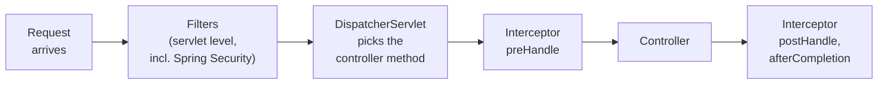
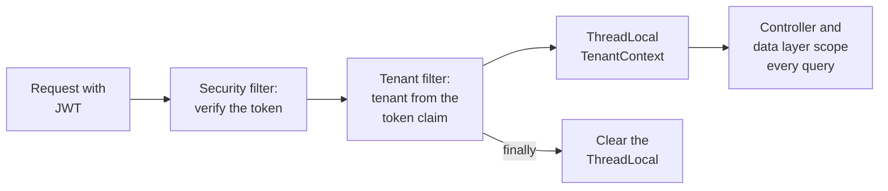
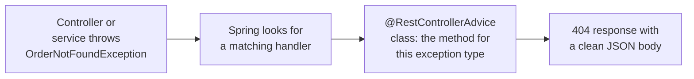

# Part 3 · HTTP requests, REST APIs and error handling

Trace a POST from the servlet filter to the controller and back to the client, including validation and the error path.

## Filters vs Interceptors, and Where Tenant Resolution Goes

Both filters and interceptors let you run code on every request without touching each controller: logging, authentication, timing, tenant checks. The interview question is almost always the same: **"Filter vs interceptor: where does each run, and which would you use?"** The common follow-up is **where you would resolve the tenant in a multi-tenant API.**

### 1. Where each one runs



1. A request first passes through the **filters**. They belong to the servlet container (Tomcat), not to Spring MVC. Spring Security is itself a chain of filters.
2. Then Spring MVC's **DispatcherServlet** decides which controller method will handle the request.
3. Only now do **interceptors** run, right before the controller.
4. The controller runs; interceptors get callbacks after it; finally the response travels back out through the filters.

The single most important fact: **filters run before Spring knows which controller will handle the request; interceptors run after.** Everything else follows from that.

Say it like this: "Filters run first, at the servlet level, before Spring MVC; that includes Spring Security. Then DispatcherServlet picks the controller method, and only then do interceptors run, around that controller."

### 2. Filters

A **filter** wraps the whole request. It runs code before passing the request on, and again after the response comes back.

What a filter can do:

- See **every** request, including static files, error pages and URLs no controller handles.
- Read and change the **raw** request and response, even replace them with wrappers (for example, to log a request body that can otherwise only be read once).
- Stop a request completely (for example, reject a missing or invalid token).

What it cannot do:

- Know which controller method will run, or read its annotations.
- Rely on `@ControllerAdvice`: an exception thrown in a filter never reaches it, so the filter must write its own error response.

Typical uses: **authentication, CORS, correlation or request ids, request and response logging, rate limiting, compression.**

In Spring Boot you usually extend `OncePerRequestFilter`, which guarantees the filter runs once per request even if the request is forwarded internally. Any filter that stores something per request (an id, a tenant) must clean it up in a `finally` block, because servlet threads are reused.

### 3. Interceptors

An **interceptor** (`HandlerInterceptor`) belongs to Spring MVC. Because it runs after the controller method is chosen, it **knows which method will run**, including its annotations. That is its whole reason to exist.

It has three methods:

- **preHandle**: runs before the controller. Returning `false` stops the request. This is where you check things that depend on the controller, for example "this method is annotated `@AdminOnly`, is the caller an admin?".
- **postHandle**: runs after the controller, **only if it did not throw**.
- **afterCompletion**: runs at the very end, **always**, even after an exception. Use it for timing and cleanup.

You register interceptors in a `WebMvcConfigurer` and can limit them to URL patterns, such as only `/api/**`.

Typical uses: **checks driven by custom annotations, per-endpoint auditing, timing per controller method.**

Correction: "postHandle can change the response body." For REST controllers the JSON body has already been written by the time postHandle runs. To change a body before it is written, use `ResponseBodyAdvice`; to transform raw responses, use a filter.

### 4. Which one would you use?

The rule of thumb:

- If it must apply to **every request**, needs the **raw request or response**, or must run **before Spring Security**: use a **filter**.
- If it depends on **which controller method** runs or its **annotations**: use an **interceptor**.

A third option interviewers sometimes add: an **AOP aspect** wraps any Spring bean's methods (services, repositories) and sees their arguments. It has nothing to do with HTTP. Use it for things like logging or metrics on service methods. `@Transactional` itself works this way.

Say it like this, the full answer: "A filter is a servlet-level component that runs before DispatcherServlet on every request and sees the raw request and response, so I use filters for authentication, CORS, correlation ids and logging. An interceptor is Spring MVC's hook that runs after the controller method is chosen, so it can read the method and its annotations; I use it for annotation-driven checks and per-endpoint auditing. Its preHandle can stop the request, postHandle is skipped on exceptions, and afterCompletion always runs. If I need to wrap service methods regardless of HTTP, that's an aspect."

### 5. Where tenant resolution goes

In a multi-tenant API every request belongs to one customer company (a **tenant**), and no request may ever see another tenant's data. The answer is a **filter, placed right after authentication**:



1. Spring Security's filter validates the user's token first.
2. A **tenant filter** runs next. It reads the tenant from the **verified token** (a `tenant_id` claim). If the client also sends a tenant header, the filter only accepts it when it matches the token; a header alone can be faked.
3. It stores the tenant in a request-scoped holder, usually a `ThreadLocal`, so the data layer can scope every query to that tenant.
4. In a `finally` block it **clears** the holder.

Why a filter and not an interceptor: the tenant must be known before anything touches data, and it does not depend on which controller runs.

The follow-up questions on this design:

- **Why clear it in finally?** Tomcat reuses threads. Without clearing, the next request on the same thread, possibly from a different tenant, would inherit the old tenant: a data leak between customers.
- **What about async work?** `@Async` methods and thread pools run on other threads, which do not see the `ThreadLocal`. The tenant must be copied to the worker thread explicitly (for example with a task decorator on the executor) and cleared afterwards.
- **What about Kafka consumers or batch jobs?** There is no HTTP request, so the tenant travels in the message (a header) and the listener sets and clears it itself.
- **Is the filter enough?** For defence in depth, the database also enforces it: row-level security or a schema per tenant, so one forgotten condition in a query cannot leak data.

Say it like this: "I resolve the tenant in a filter right after authentication, from the signed token's claim, cross-checking any tenant header. I store it in a ThreadLocal that the data layer uses to scope queries, and clear it in finally because threads are reused. Async work and message consumers set the tenant explicitly, and the database enforces isolation as a second line of defence."

**Recall** without looking, draw a request going through filters, DispatcherServlet, the interceptor's three methods and the controller, then answer "filter vs interceptor" out loud in under a minute, and say why the tenant filter must clear its ThreadLocal.

## Controller Annotations, `ResponseEntity` and HTTP Status Codes

The questions, from most to least asked: **401 vs 403**, **`@PathVariable` vs `@RequestParam`**, **`@Controller` vs `@RestController`**, **the status after create, update and delete**, **`ResponseEntity`**, **400 vs 422**, **500 vs 503**, **`@RequestBody`**, and, rarely, **3xx and 1xx**.

### 1. HTTP status codes

Five families: **1xx** info, **2xx** success, **3xx** redirect, **4xx** client mistake, **5xx** server failure.

#### 401 vs 403

- **401 Unauthorized**: **not authenticated**. The token is missing, invalid or expired. "Who are you?" The client should log in again.
- **403 Forbidden**: **authenticated but not allowed**. A normal user calling an ADMIN-only API. "I know you, but no." Logging in again won't help.

Correction: the name "Unauthorized" for 401 is misleading. It's about authentication, not permission; a wrong role is 403.

Say it like this: "401 means the request isn't authenticated: no token, or an invalid or expired one, so the client should log in again. 403 means the caller is authenticated but lacks permission, like a normal user calling an admin endpoint."

#### 2xx: success

- **200 OK**: success, with data in the body (GET, or an update that returns data).
- **201 Created**: a new resource was created (POST). Send a `Location` header with its URL.
- **202 Accepted**: accepted, but processing isn't finished (async jobs like export or import). Return a job id or status URL the client can poll.
- **204 No Content**: success with no body (DELETE, or an update that returns nothing).
- Correction: **206 Partial Content** is for range downloads (resuming a file, video streaming), not for "95 of 100 users saved". For partial success in a bulk call, return 200 (or 207 Multi-Status) with a result per item.

**After create, update and delete:**
- Create: 201 + a `Location` header (`ResponseEntity.created(uri)`).
- Update: 200 with the updated body, or 204 with no body.
- Delete: 204. Async work: 202 with a status URL.

#### 4xx: the client must fix the request

- **400 Bad Request**: the request is malformed: required field missing, wrong type, broken JSON.
- **401 Unauthorized** and **403 Forbidden**: above.
- **404 Not Found**: the resource doesn't exist (no user with id 123).
- **405 Method Not Allowed**: wrong HTTP method. The DispatcherServlet rejects it before the controller is reached.
- **409 Conflict**: clashes with the current state: email already registered, version conflict on update.
- **415 Unsupported Media Type**: the body's `Content-Type` isn't accepted.
- **422 Unprocessable Entity**: the request is well-formed, but fails a **business rule**: "accounts can't be opened for France yet".
- **429 Too Many Requests**: rate limit hit (max 10 calls per minute per user, and this is the 11th). Often sent with a `Retry-After` header.

**400 vs 422:** 400 means the request itself is broken (bad JSON, wrong type, missing required field); 422 means the request is valid but breaks a business rule.

#### 5xx: the server failed, even though the request was valid

- **500 Internal Server Error**: a generic bug or unexpected exception.
- **501 Not Implemented**: the server doesn't support this yet.
- **502 Bad Gateway**: a proxy or gateway (like Nginx) got a bad response from the app behind it, for example a misconfigured port.
- **503 Service Unavailable**: the server is temporarily down: overloaded, under maintenance, or a dependency is down. Retry later.
- **504 Gateway Timeout**: the proxy or gateway waited too long for the app behind it.

**500 vs 503:** 500 is an unexpected bug in our code; 503 is temporary unavailability, so the client should retry later. 502 and 504 come from a gateway that got a bad response, or none in time, from the service behind it.

#### 3xx: redirect (rarely asked)

- **301 / 308**: moved permanently, so clients should use the new URL (legacy API to new API). 308 keeps the HTTP method (POST stays POST). 301 may change it to GET.
- **302 / 307**: temporary redirect. 307 keeps the method.
- **304 Not Modified**: caching. The client sends `If-Modified-Since` (or `If-None-Match` with an ETag). If nothing changed, the server returns 304 with no body, and the client uses its cached copy. Don't use 304 for "update with the same value"; return 200 or 204 there.

#### 1xx (rarely asked)

- **100 Continue**: before uploading a large body, the client sends just the headers with `Expect: 100-continue`. The server checks auth, size and type, and replies 100. The client then sends the body on the **same** request.

### 2. `@Controller`, `@RestController`, `@ResponseBody`

- **@Controller**: the class handles HTTP requests. It's a `@Component`, so it becomes a bean.
- **@ResponseBody**: the method's return value is written into the HTTP response body (objects become JSON through Jackson).
- **@RestController = @Controller + @ResponseBody** on every method. Use it for REST APIs.

```java
@Controller
public class UserController {
    @GetMapping("/api/get-user")
    public String getUser() { return "XYZ"; }     // treated as a VIEW name, not data
}
```

- With plain `@Controller`, `"XYZ"` is treated as the name of an HTML page (view). No such page exists, so the client gets a **404** error response, not `"XYZ"`.
- Fix: `@RestController`, or `@ResponseBody` on the method.

Say it like this: "@RestController is @Controller plus @ResponseBody on every method, so return values become the response body, as JSON for objects. With plain @Controller, a returned String is treated as a view name."

### 3. @RequestMapping and its shortcuts

```java
@RequestMapping(path = "/fetchUser", method = RequestMethod.GET,
                consumes = "application/json", produces = "application/json")
```

- `path` and `value` mean the same thing. On the class, it sets a common prefix (`/api`).
- Shortcuts: `@GetMapping`, `@PostMapping`, `@PutMapping`, `@PatchMapping`, `@DeleteMapping`.
- `consumes`: the request `Content-Type` it accepts. `produces`: the response type it returns.

Spring rejects a request before your code runs if it doesn't match:
- Wrong HTTP method (DELETE on a POST endpoint) -> **405** Method Not Allowed.
- Wrong `Content-Type` (text sent where JSON is expected) -> **415** Unsupported Media Type.
- Client's `Accept` header doesn't match `produces` -> **406** Not Acceptable.
- No matching path -> **404**.

### 4. `@PathVariable` vs `@RequestParam`

`@RequestParam` reads query parameters. URL: `/api/fetchUser?firstName=Alex&lastName=Lee&age=32`

```java
@GetMapping("/fetchUser")
public String getUserDetails(@RequestParam("firstName") String firstName,
                             @RequestParam(name = "lastName", required = false) String lastName,
                             @RequestParam(name = "age") int age,
                             @RequestParam(name = "role", defaultValue = "USER") Role role) { ... }
```

- `required` is **true** by default. A missing param -> **400** Bad Request (`MissingServletRequestParameterException`).
- `required = false`: a missing param becomes `null`. `defaultValue`: a missing param gets that value.
- Automatic type conversion from the query string: primitives, wrappers, `String`, enums. A bad value (`age=abc`, `role=BOSS`) -> **400** (`MethodArgumentTypeMismatchException`), before the method runs.
- Custom conversion (rarely asked): register a `PropertyEditor` in an `@InitBinder` method, for example to trim and lowercase `firstName` before your method gets it.

```java
@InitBinder
protected void initBinder(WebDataBinder binder) {
    binder.registerCustomEditor(String.class, "firstName", new FirstNamePropertyEditor());
}
```

`@PathVariable` reads values from the URL path. URL: `/api/fetchUser/Alex`

```java
@GetMapping("/fetchUser/{firstName}")
public String getUserDetails(@PathVariable("firstName") String firstName) { ... }
```

When to use which:
- **@PathVariable** identifies **which resource**: `/users/123`, the user with id 123.
- **@RequestParam** filters, sorts or pages a collection: `/users?city=Delhi&page=2&sort=name`.

Say it like this: "@PathVariable reads part of the URL path and identifies the resource. @RequestParam reads the query string and is used for optional filters, sorting and pagination."

### 5. @RequestBody: JSON body to a Java object

```java
@PostMapping("/saveUser")
public String saveUser(@RequestBody User user) { ... }

public class User {
    @JsonProperty("user_name")        // JSON key "user_name" -> field username
    String username;
    String email;
}
```

```
POST /api/saveUser   Content-Type: application/json
{ "user_name": "alex", "email": "alex@example.com" }
```

- Jackson converts the JSON into `User`. This is done by an HTTP message converter.
- Trap: with `@JsonProperty("user_name")`, a JSON key `"username"` is **ignored**, so the field stays `null`. The response JSON also uses `user_name`.
- Unknown JSON fields are ignored by default in Spring Boot.
- Missing body or malformed JSON -> **400** (`HttpMessageNotReadableException`).
- `@RequestBody` (request JSON -> object) is the mirror of `@ResponseBody` (object -> response JSON).

### 6. ResponseEntity: full control of the response

A response has 3 parts: **status code**, **headers** (optional), **body**.

```java
@GetMapping("/get-user")
public ResponseEntity<String> getUser() {
    HttpHeaders headers = new HttpHeaders();
    headers.add("My-Header1", "SomeValue1");
    return ResponseEntity.status(HttpStatus.OK)      // returns a builder
            .headers(headers)                        // still a builder
            .body("My response body");               // builds the ResponseEntity
}
```

- It's the builder pattern: `status()` and `headers()` return a builder. `body()` or `build()` (for no body) return the final `ResponseEntity`, so they come last.
- `ResponseEntity<Void>` + `.build()` when there's no body.
- Shortcuts:
  - `ResponseEntity.ok(body)` -> 200
  - `ResponseEntity.created(uri).body(x)` -> 201, plus a `Location` header with the new resource's URL
  - `ResponseEntity.noContent().build()` -> 204
  - `ResponseEntity.notFound().build()` -> 404
  - `ResponseEntity.badRequest().body(err)` -> 400
- Without `ResponseEntity`: returning a POJO gives **200** + JSON. A `void` method gives **200** with an empty body.
- Alternative for a fixed status: `@ResponseStatus(HttpStatus.CREATED)` on the method.

Say it like this: "ResponseEntity represents the whole HTTP response: status, headers and body. I use it when the status or headers depend on the logic, like 201 with a Location header after a create, or 404 when the resource isn't found."

**Recall** from memory, write a POST endpoint that saves a `User` and returns 201 with a `Location` header. Then list one status code each for: bad JSON, wrong role, missing token, rate limit, server down for maintenance.

## Exception Handling: @ControllerAdvice and Error Contracts

When something goes wrong in an API (an order that does not exist, invalid input, a bug), the client should get the right status code and an error body it can understand, and every endpoint should fail the same way. Interviews ask three things here, in this order of frequency: **how do you handle exceptions globally**, **what the three annotations do**, and **what a good error response looks like**.

### 1. Global exception handling: one place for all errors

Without any handling, an exception thrown in a controller becomes a 500 with Spring Boot's default body. Copying try-catch blocks into every controller is worse: duplicated, inconsistent, easy to forget.

The standard answer is **one class that handles errors for the whole application**:



1. Your code throws an exception that describes the problem, for example `OrderNotFoundException`.
2. Spring catches it on the way out of the controller and looks for a handler method for that exception type.
3. The handler lives in a class annotated `@RestControllerAdvice`. It returns the status code and the error body.

```java
@RestControllerAdvice
class ApiErrors {

    @ExceptionHandler(OrderNotFoundException.class)
    ProblemDetail notFound(OrderNotFoundException ex) {
        return ProblemDetail.forStatusAndDetail(HttpStatus.NOT_FOUND, ex.getMessage());
    }

    @ExceptionHandler(Exception.class)            // catch-all: our bug
    ProblemDetail unexpected(Exception ex) {
        log.error("Unexpected error", ex);        // full details go to the log
        return ProblemDetail.forStatus(HttpStatus.INTERNAL_SERVER_ERROR);
    }
}
```

The rules interviewers check:

- **The most specific handler wins.** With handlers for `OrderNotFoundException` and `Exception`, a missing order goes to the first one.
- **Always have a catch-all** for `Exception` that returns a plain 500, logs the real error, and never sends a stack trace to the client.
- **Services throw business exceptions, not HTTP ones.** `OrderNotFoundException` knows nothing about 404; the advice class decides the status. So the same service works when called from a Kafka consumer or a batch job.

Say it like this: "I create one @RestControllerAdvice class with an @ExceptionHandler method per exception type. Services throw meaningful business exceptions, the advice maps each to a status code and a consistent error body, and a catch-all turns anything unexpected into a 500 while logging the details."

### 2. @ExceptionHandler vs @ControllerAdvice vs @RestControllerAdvice

The three differ only in **scope**:

- **`@ExceptionHandler`** marks a method that handles certain exception types. If you put it inside a controller, it only handles exceptions from **that controller**.
- **`@ControllerAdvice`** marks a class whose `@ExceptionHandler` methods apply to **all controllers** (or to a chosen subset, for example `basePackages = "com.shop.orders"`).
- **`@RestControllerAdvice`** is `@ControllerAdvice` plus `@ResponseBody`: whatever the handler returns is written as JSON. This is the one to use for REST APIs. Plain `@ControllerAdvice` is for apps that render HTML pages.

When two handlers could apply:

- A handler **inside the controller** beats the global advice for that controller.
- Among global advice classes, `@Order` decides which is checked first.

Say it like this: "@ExceptionHandler is the method that handles an exception; inside a controller it's local to that controller. @ControllerAdvice makes those handlers global, and @RestControllerAdvice is the same plus @ResponseBody, so the return value is serialized as JSON, which is what a REST API needs."

### 3. What a good error response looks like: ProblemDetail

If every endpoint returns errors in a different shape, every client has to guess. The fix is an **error contract**: one documented shape for all errors. The industry standard is **RFC 9457, "Problem Details for HTTP APIs"** (it replaced RFC 7807), sent with the content type `application/problem+json`:

```json
{
  "type": "https://api.example.com/errors/out-of-stock",
  "title": "Out of stock",
  "status": 409,
  "detail": "Only 2 units of SKU 123 are left; you asked for 5",
  "instance": "/orders",
  "traceId": "4bf92f3577b34da6"
}
```

What each field is for:

- **type**: a stable identifier for the kind of error. Clients write their logic against this, not against the message.
- **title**: a short, fixed summary of that kind of error.
- **status**: the HTTP status code, repeated in the body.
- **detail**: what went wrong in this particular request, readable by a person.
- **instance**: which request failed.
- **Extra fields** are allowed: a `traceId` so support can find the log line, or a list of field errors for validation.

Spring Boot 3 supports this out of the box: handlers return a `ProblemDetail` object (as in section 1), and the property `spring.mvc.problemdetails.enabled=true` makes Spring's own errors (bad JSON, missing parameter, wrong HTTP method) use the same format.

Never put stack traces, SQL or internal class names in the body: they help attackers and confuse clients. Log them, and return the trace id instead.

Say it like this: "Every error uses one contract, RFC 9457 problem details: type, title, status, detail and instance, plus extras like a trace id, as application/problem+json. In Spring Boot 3 my handlers return ProblemDetail, and I enable it for Spring's built-in errors too, so clients see one format everywhere."

### 4. Choosing the right status code

The handler's main job is picking the right status. The ones that matter:

- **400 Bad Request**: the input is malformed or fails validation.
- **401 Unauthorized**: not logged in or the token is invalid. **403 Forbidden**: logged in but not allowed.
- **404 Not Found**: the resource does not exist.
- **409 Conflict**: clashes with the current state (a duplicate, a version conflict, out of stock).
- **422 Unprocessable Content**: well-formed but breaks a business rule (some teams simply use 400).
- **500 Internal Server Error**: a bug on our side, never the client's fault.

**Validation errors**: with `@Valid` on a request body, bad input throws `MethodArgumentNotValidException`. Handle it as a 400 that lists each problem field ("email: must be a valid email"), so the client can show it next to the right input.

### 5. What @ControllerAdvice cannot catch

Correction: "@ControllerAdvice handles every exception in the app." It only sees exceptions thrown while Spring MVC is handling the request, that is inside controllers and the code they call.

Errors raised **before** the request reaches a controller, in servlet filters, are invisible to it. The most important case is Spring Security: its 401 and 403 responses come from the security filter chain. To make them use the same error contract, configure the security **authentication entry point** (for 401) and **access denied handler** (for 403) to write a ProblemDetail body.

Say it like this: "Controller advice only covers exceptions from controllers and the code they call. Security's 401 and 403 happen in filters before that, so I format those through the authentication entry point and access denied handler to keep one error contract."


**Recall** without looking, explain out loud how a missing order becomes a 404 with a ProblemDetail body (who throws, who catches, what is returned), then name the five standard ProblemDetail fields and one error the advice cannot catch.

## Interview practice

A client retries POST /orders after losing the response. Explain how a stored idempotency key and the order commit together, what a replay returns, and how you reject the same key with a different payload. Use a controller slice with MockMvc to check the HTTP contract for an invalid request. Exercise the uniqueness constraint and concurrent retries against the database.

<details>
<summary>Walk through the case</summary>

Scope a unique key to the caller and store a request fingerprint with the order ID and outcome. Perform the claim and order write atomically. A matching replay gets the recorded result. A conflicting fingerprint is a client error. If another attempt is in flight, serialize on the claim or give the client a documented retry response.

</details>

[Spring Boot testing guide](https://docs.spring.io/spring-boot/reference/testing/spring-boot-applications.html)

### Filters vs Interceptors, and Where Tenant Resolution Goes

6 of the 1,592 candidate write-ups in the Oct 2024 – Oct 2026 review mentioned this lesson. Each count below belongs to its question.

<details>
<summary>Filter vs interceptor — where does each run, and which would you use?</summary>

- **Filter** (Servlet API): runs **before DispatcherServlet**, sees every request including static files and errors. Spring Security is a chain of filters. Good for auth, CORS, request logging, tenant resolution from a header.
- **Interceptor** (Spring MVC): runs **around the controller** (`preHandle`, `postHandle`, `afterCompletion`) and knows which **handler method** was chosen. Good for checks that need the handler's annotations.
- **AOP**: around any bean method, not just web calls.

Order for one request: filter → DispatcherServlet → interceptor → controller (→ aspects).

*6 candidate write-ups · Demandbase · Mastercard · Visa · Zinier*

</details>

### Controller Annotations, `ResponseEntity` and HTTP Status Codes

88 of the 1,592 candidate write-ups in the Oct 2024 – Oct 2026 review mentioned this lesson. Each count below belongs to its question.

<details>
<summary>How do you make an API idempotent — e.g. a payment POST that gets retried?</summary>

Client sends an **Idempotency-Key** header (a UUID per logical operation).

Server:
1. Insert the key with status `IN_PROGRESS` under a **unique constraint** (or Redis `SET NX` with a TTL).
2. If the insert fails, the key exists → return the **stored response** (or 409 if still in progress).
3. Do the work, store the result against the key, return it.

Keep keys for the retry window (e.g. 24 h). GET, PUT and DELETE are idempotent by definition; POST and PATCH are not unless you build this.

*26 candidate write-ups · JPMorgan · American Express · Astrotalk · Blinkit · Goldman Sachs · Groww · MakeMyTrip · Microsoft · MobiKwik · Nexturn · Oracle · PayPay*

</details>

<details>
<summary>@Controller vs @RestController — and @RequestParam vs @PathVariable vs @RequestBody?</summary>

- `@RestController` = `@Controller` + `@ResponseBody`: return values are written as JSON instead of resolved as view names.
- `@PathVariable` — identifies a resource: `/orders/{id}`.
- `@RequestParam` — filters/options: `/orders?status=NEW&page=2`.
- `@RequestBody` — the JSON payload, deserialised by Jackson (`HttpMessageConverter`). Combine with `@Valid`.

*23 candidate write-ups · Infosys · Mastercard · Cerner · Ciena · Deloitte · EPAM · IBS · Lenovo · Lenskart · MobiKwik · NPCI · Nagarro*

</details>

<details>
<summary>How do you design a REST API — naming, versioning, pagination?</summary>

- **Nouns, plural, hierarchical**: `GET /customers/42/orders`, not `/getOrders`.
- **Versioning**: in the URL (`/v1/…` — simple, visible) or a header — pick one and keep old versions alive during migration.
- **Pagination**: `limit` + `cursor` (keyset) for large or changing data; `page`/`size` offset only for small sets. Return the next cursor.
- Filtering/sorting via query params; consistent error body; idempotency keys on POST; `201` + `Location` on create.

*17 candidate write-ups · Publicis Sapient · Target · Walmart · Autodesk · Bajaj Finserv Health · Flipkart · Hyperverge · Informatica · JPMorgan · Livspace · Qualys · Toast*

</details>

<details>
<summary>PUT vs POST vs PATCH (and GET vs POST) — which are idempotent?</summary>

- **GET**: read, safe, idempotent, cacheable. No body semantics.
- **POST**: create / trigger an action. Not idempotent (two calls → two orders).
- **PUT**: replace the whole resource at a known URI. Idempotent.
- **PATCH**: partial update. Not guaranteed idempotent (`{"op":"increment"}`).
- **DELETE**: idempotent (second call → 404 or 204, same end state).

*16 candidate write-ups · Cisco · Epsilon · Fidelity · Google · IBS · Lenskart · Marsh McLennan · Mastercard · NPCI · Paytm · SAP · Visa*

</details>

<details>
<summary>Which HTTP status codes do you return — 200, 201, 204, 400, 401, 403, 404, 409, 500?</summary>

- **200** OK with body; **201** Created (+ `Location` header); **202** Accepted (async job); **204** No Content.
- **400** bad input; **401** not authenticated; **403** authenticated but not allowed; **404** not found; **409** conflict (duplicate, version clash); **422** valid JSON but fails business rules; **429** rate limited.
- **500** our bug; **502/503/504** downstream or overload.

Never return 200 with `{"error": …}` in the body.

*15 candidate write-ups · Apple · Cisco · Confluent · Deutsche Bank · Goldman Sachs · JPMorgan · Lenovo · Marsh McLennan · Oracle Health · Publicis Sapient · SAP · Syfe*

</details>

<details>
<summary>How do you validate incoming requests?</summary>

Bean Validation on the DTO + `@Valid` on the parameter:

```java
record CreateOrder(@NotNull Long customerId, @Positive int qty, @Email String email) {}
@PostMapping("/orders")
ResponseEntity<?> create(@Valid @RequestBody CreateOrder req) { … }
```

Failures throw `MethodArgumentNotValidException` → map it in `@ControllerAdvice` to a 400 with field errors. Business rules (stock available?) belong in the service, not annotations.

*5 candidate write-ups · Knot Solutions · Marsh McLennan · MobiKwik*

</details>

<details>
<summary>REST vs SOAP — what makes an API RESTful?</summary>

REST: resources identified by URIs, standard HTTP methods and status codes, **stateless** requests, cacheable responses, usually JSON.

SOAP: an XML envelope protocol with a strict WSDL contract and built-in WS-* standards (security, transactions) — heavier, still common in banking/legacy integrations.

*3 candidate write-ups · Lowe's · Mastercard · Swiggy*

</details>

### Exception Handling: @ControllerAdvice and Error Contracts

20 of the 1,592 candidate write-ups in the Oct 2024 – Oct 2026 review mentioned this lesson. Each count below belongs to its question.

<details>
<summary>How do you implement global exception handling in Spring Boot?</summary>

```java
@RestControllerAdvice
class ApiErrors {
  @ExceptionHandler(OrderNotFoundException.class)
  ResponseEntity<ProblemDetail> notFound(OrderNotFoundException e) {
    return ResponseEntity.status(404).body(ProblemDetail.forStatusAndDetail(NOT_FOUND, e.getMessage()));
  }
  @ExceptionHandler(MethodArgumentNotValidException.class)
  ResponseEntity<ProblemDetail> invalid(MethodArgumentNotValidException e) { … 400 with field errors … }
  @ExceptionHandler(Exception.class)
  ResponseEntity<ProblemDetail> unexpected(Exception e) { log.error("…", e); … 500, no stack trace … }
}
```

Services throw meaningful domain exceptions; one place maps them to HTTP. Never leak stack traces.

*19 candidate write-ups · Aditya Birla · Deloitte · EPAM · Goldman Sachs · IBS · Infosys · Mastercard · MobiKwik · NPCI · Nike · Optum · Target*

</details>

<details>
<summary>What should an error response look like? (ProblemDetail / RFC 9457)</summary>

One consistent shape for every error. Spring Boot 3 supports **ProblemDetail** (RFC 9457, formerly 7807):

```json
{ "type": "https://api.example.com/errors/out-of-stock", "title": "Out of stock",
  "status": 409, "detail": "SKU 123 has 0 units", "instance": "/orders", "traceId": "…" }
```

Include a machine-readable type/code and a trace id for support; never internal details.

*3 candidate write-ups · ServiceNow · Walmart · dunnhumby*

</details>

<details>
<summary>@ControllerAdvice vs @RestControllerAdvice vs @ExceptionHandler — what's the scope of each?</summary>

- `@ExceptionHandler` inside a controller → handles exceptions from **that controller only**.
- `@ControllerAdvice` → a class whose handlers apply to **all controllers** (or a subset via `basePackages`).
- `@RestControllerAdvice` = `@ControllerAdvice` + `@ResponseBody`.

The most specific exception type wins. Exceptions thrown in **filters** (e.g. Spring Security) happen before DispatcherServlet, so advice doesn't see them.

*2 candidate write-ups · Infosys*

</details>

<!-- Generated by scripts/genCoreStack.mjs from the individual master notes, interview evidence and springCourse.mjs. -->
