# Part 4 · Persistence with JPA and Hibernate

Follow an order from Java object to SQL row, then load a page of orders with their line items. Predict the SQL, the number of queries and the effect of a concurrent edit.

## JPA and Spring Data JPA

JPA is the most-asked part of Spring data access. The questions, from most to least asked: **optimistic vs pessimistic locking**, **lazy vs eager and LazyInitializationException**, **the N+1 problem**, **pagination and why a deep OFFSET is slow**, **owning side and mappedBy**, **JPA vs Hibernate vs Spring Data JPA**, then many-to-many, query types, cascades, `save()` and dirty checking, and caching. Each section explains how the thing works first, then gives the answer to say out loud.

### 1. JDBC, JPA, Hibernate and Spring Data JPA

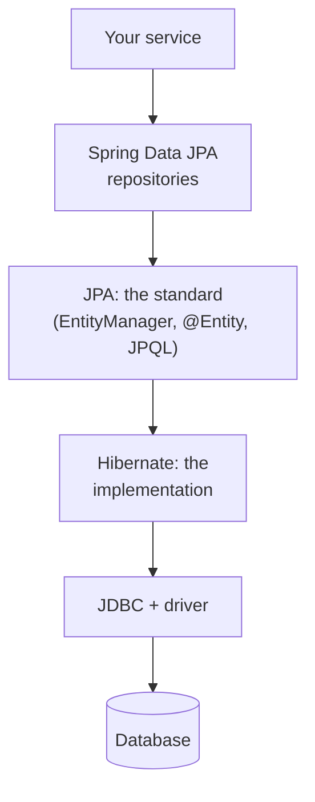

#### JDBC and PreparedStatement

**JDBC** is a set of interfaces in `java.sql` (`Connection`, `PreparedStatement`, `ResultSet`). Each database ships a driver jar that implements them, so the same code runs on PostgreSQL or MySQL. Everything above it in the diagram eventually becomes JDBC calls.

Plain JDBC is painful: you open and close connections, map every column by hand, catch the checked `SQLException` everywhere, and a forgotten `close()` leaks a connection.

- A **Statement** runs SQL built by joining strings, so user input becomes part of the SQL text. Input like `x' OR '1'='1` turns a filter into a condition that matches every row: **SQL injection**.
- A **PreparedStatement** has `?` placeholders. The values are sent separately and are **never parsed as SQL**, so the same input simply matches nothing. The database can also reuse the parsed plan.
- Placeholders work for **values only**, not for table names, column names or sort direction. For those, pick from an allow-list.

Connections come from a **pool** (HikariCP in Spring Boot): `close()` on a pooled connection returns it to the pool instead of closing the socket.

#### JdbcTemplate

`JdbcTemplate` is Spring's helper over JDBC. It borrows and returns the connection, creates and closes statements, and translates `SQLException` into Spring's unchecked `DataAccessException` hierarchy (a duplicate key becomes `DuplicateKeyException`). You write only the SQL and a `RowMapper` that turns one row into one object.

```java
jdbcTemplate.update("UPDATE accounts SET balance = balance - ? WHERE id = ?", amount, id);
List<Account> rows = jdbcTemplate.query("SELECT id, balance FROM accounts",
        (rs, n) -> new Account(rs.getLong("id"), rs.getBigDecimal("balance")));
```

Boot 3.2 adds `JdbcClient`, a fluent version of the same idea. `JdbcTemplate` and JPA can live in one application, sharing the same `DataSource` and the same `@Transactional` transactions.

#### JPA, Hibernate and Spring Data JPA

- An **ORM** (object-relational mapper) maps Java objects to table rows: you work with objects and it writes the SQL.
- **JPA** (Jakarta Persistence, `jakarta.persistence.*` in Boot 3) is a **specification**: annotations (`@Entity`, `@Id`, `@OneToMany`), the `EntityManager` interface and the JPQL query language. On its own it does nothing.
- **Hibernate** is the most used **implementation** of JPA. It turns entity operations into SQL and adds extras of its own (`@BatchSize`, `@DynamicUpdate`, the second-level cache). Hibernate's `Session` is its version of `EntityManager`, and `SessionFactory` of `EntityManagerFactory`.
- **Spring Data JPA** sits on top. You declare an interface such as `OrderRepository extends JpaRepository<Order, Long>`, and at startup Spring generates its implementation (`SimpleJpaRepository`), which calls `EntityManager` underneath.

#### What Spring Boot builds at startup

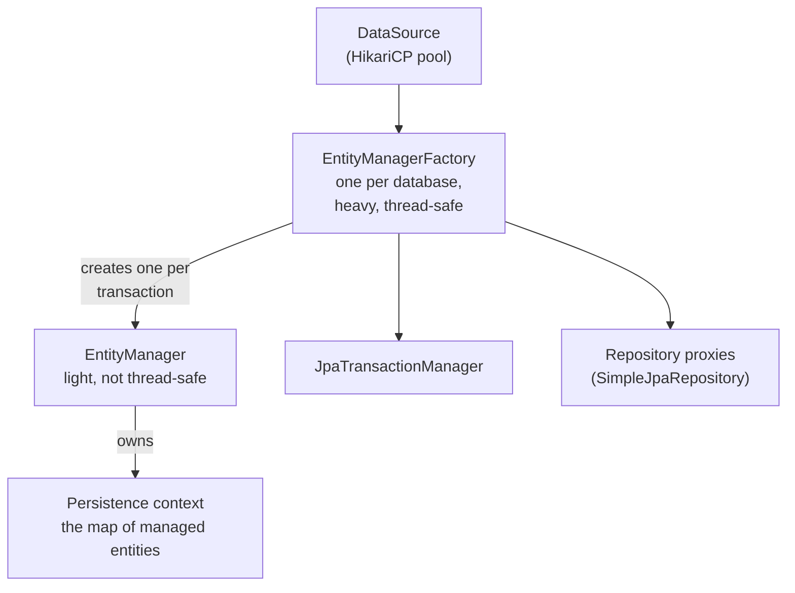

- The **EntityManagerFactory** is built once from the entity classes and `application.properties` (no `persistence.xml` in Boot).
- An **EntityManager** does `persist`, `merge`, `find`, `remove` and queries. It is not thread-safe, so the one you inject is a **shared proxy**: on every call it forwards to the real EntityManager bound to the current transaction.
- The **dialect** tells Hibernate which SQL flavour to generate. Boot 3 detects it from the connection.

#### EntityManager vs CrudRepository vs JpaRepository

- **`CrudRepository`**: `save`, `findById`, `findAll`, `delete`, `count`, `existsById`.
- **`PagingAndSortingRepository`**: `findAll(Pageable)` and `findAll(Sort)`.
- **`JpaRepository`**: all of the above, plus JPA specifics: `flush`, `saveAndFlush`, `deleteAllInBatch`, `getReferenceById`, and `List` instead of `Iterable` return types. This is the one you normally extend.
- **`EntityManager`**: the raw JPA API, for what repositories do not cover: `refresh`, `detach`, explicit locks, Criteria queries, `flush()` plus `clear()` in batch jobs.

One detail with big consequences: `SimpleJpaRepository` is `@Transactional(readOnly = true)` at class level, and `save` and `delete` carry their own `@Transactional`. So repository calls work without any annotation of yours, but **each call is its own transaction** unless a `@Transactional` service method wraps them.

#### Why an ORM, and when to drop to plain SQL

What an ORM gives: no hand-written CRUD SQL, relationships mapped to foreign keys, **dirty checking** (changes saved automatically), a first-level cache, one transaction model, and portability through the dialect.

What it costs: the SQL is **hidden**, so you can run hundreds of queries without noticing (N+1, section 5); it adds overhead on bulk work; and it is **not immune to SQL injection** if you build JPQL strings by concatenation.

The rule: JPA for domain CRUD; `JdbcTemplate` or native SQL for reporting, bulk writes and hand-tuned queries.

#### Configuration that gets asked

- **`spring.jpa.hibernate.ddl-auto`**: `none` (do nothing), `validate` (fail at startup if tables do not match the entities), `update` (add missing tables and columns, never drops; risky), `create`, `create-drop` (default for an embedded H2). In production use `validate` or `none` and manage the schema with **Flyway or Liquibase**.
- **Seeing the SQL**: `spring.jpa.show-sql=true` prints to standard out; better is `logging.level.org.hibernate.SQL=DEBUG` plus `logging.level.org.hibernate.orm.jdbc.bind=TRACE` for the bound values. This is the first thing to switch on when hunting N+1.

Say it like this: "JPA is the standard: annotations, EntityManager and JPQL. Hibernate is the implementation that generates the SQL, and Spring Data JPA generates repository implementations on top, so I write almost no data-access code. The cost is hidden SQL, so I watch the generated queries, and for reports or bulk jobs I use JdbcTemplate or native SQL, which share the same DataSource and transactions."

### 2. The persistence context: entity states, dirty checking and save()

The **persistence context** is the map of entities one EntityManager is currently managing, keyed by entity type and primary key. Almost every "why did JPA do that?" question comes back to it.

#### The four entity states

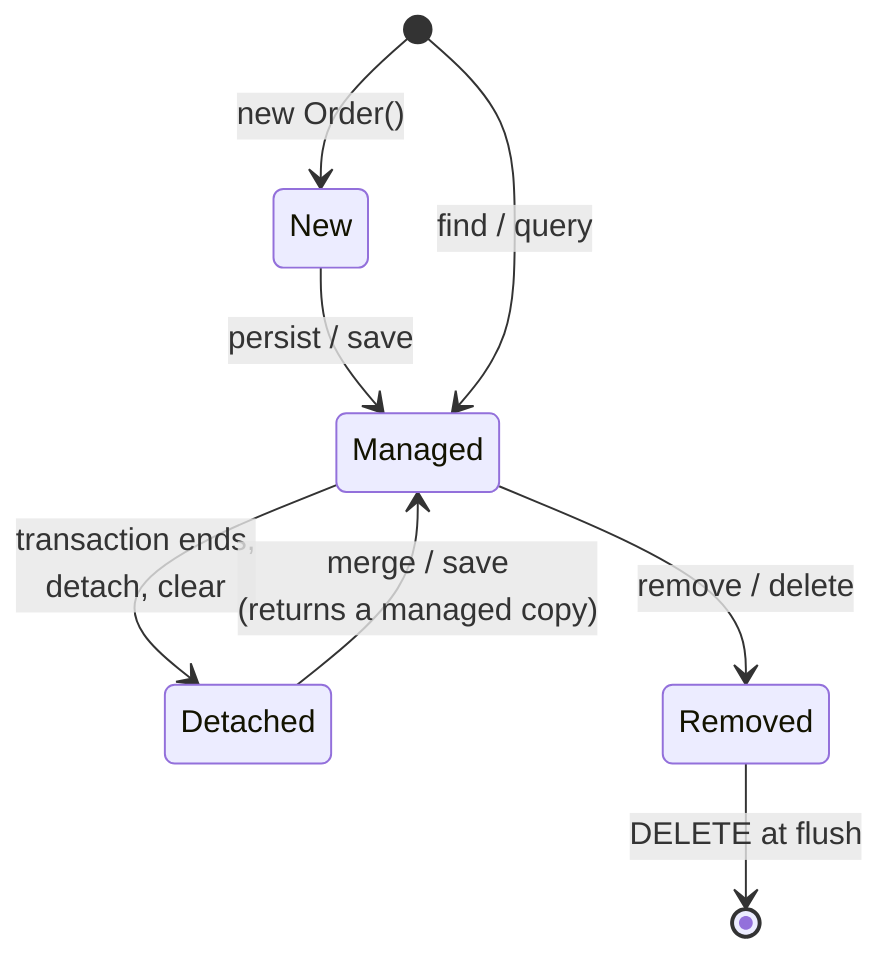

- **New (transient)**: a plain Java object. JPA does not know it and there is no row.
- **Managed**: tracked by the persistence context. Its changes are written automatically at flush. You get managed entities from `persist`, `find`, query results, and the object **returned** by `merge`.
- **Detached**: has a row and an id, but is no longer tracked, usually because the transaction ended. Changes to it are ignored until you merge it.
- **Removed**: scheduled for deletion; the DELETE runs at flush.

#### The three jobs of the persistence context

1. **Cache (the first-level cache)**: `find()` checks the map first and goes to the database only on a miss.
2. **Identity**: one Java object per row per context, so two `find` calls for the same id return the **same object**.
3. **Snapshots for dirty checking**: it keeps each entity's original state, to detect changes (below).

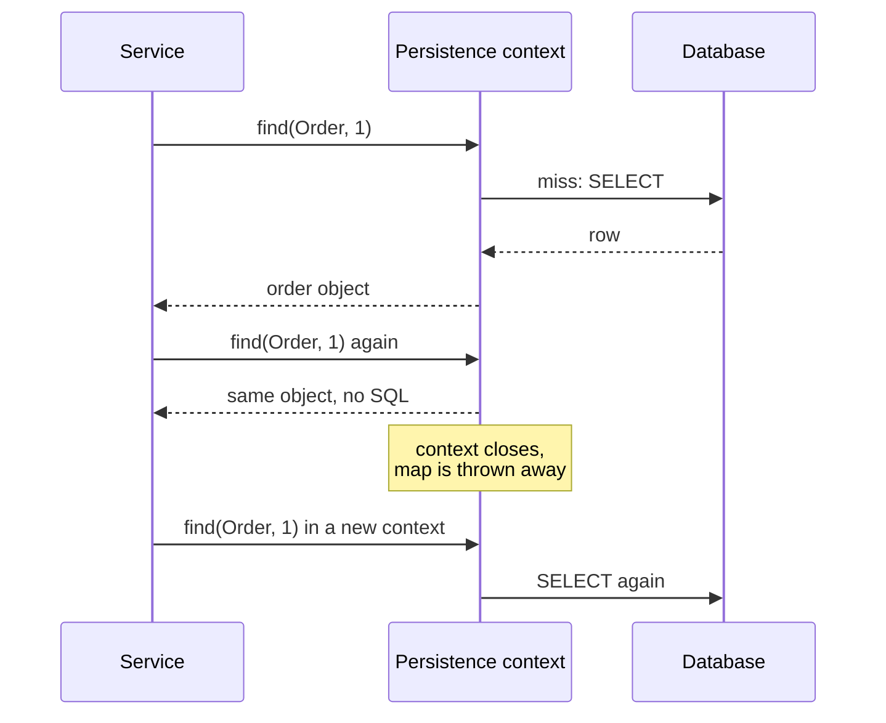

What interviewers probe:

- **Only lookups by id hit the cache.** `find` and `findById` can be served from the map; JPQL, derived queries and `findAll` **always run SQL**. If a returned row is already in the map, you get the existing object back, not a fresh copy.
- **It can be stale.** The map is not refreshed when another transaction changes the row. Use `refresh()` or a new transaction.
- **It grows.** Every loaded entity stays in the map until the context closes. Batch jobs call `flush()` and `clear()` every few hundred rows to keep memory flat.

#### How long the persistence context lives in Spring

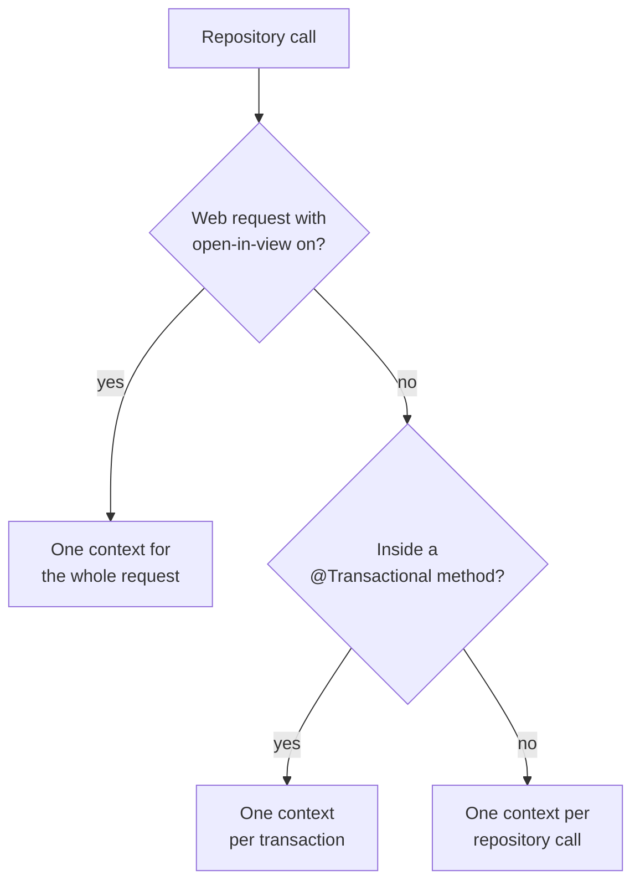

This decides whether a second read hits the database. `save()` followed by `findById()` in a background job with no `@Transactional` runs an INSERT and then a SELECT (two separate contexts); inside one `@Transactional` method it runs only the INSERT.

#### Dirty checking and flush

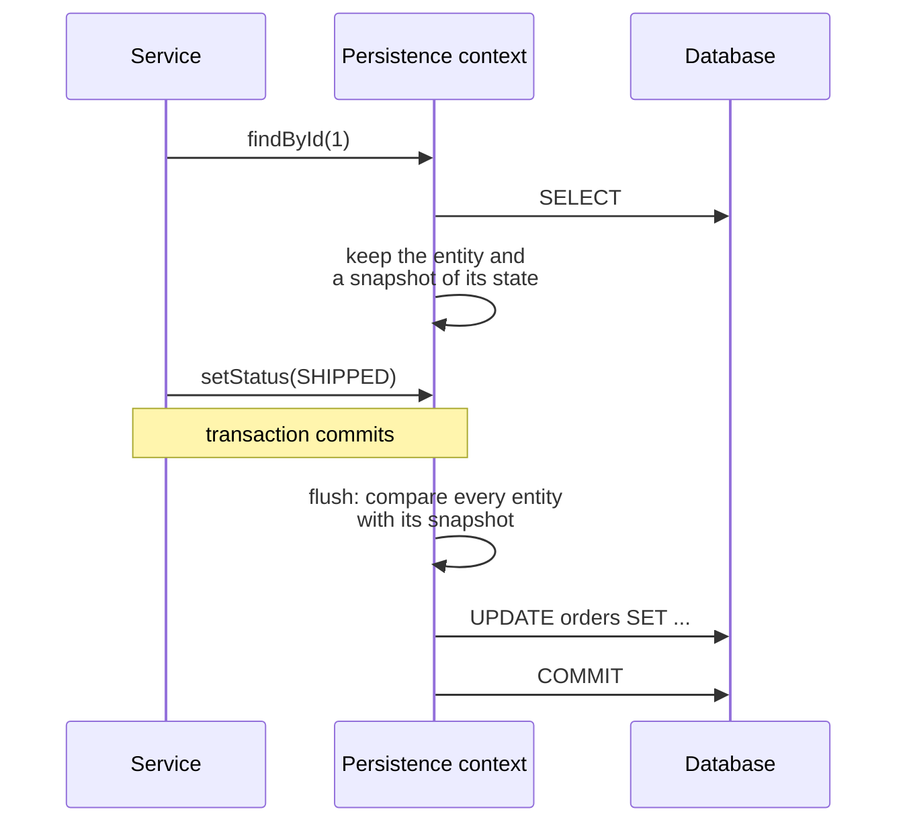

- On load, Hibernate stores a snapshot. At **flush** it compares every managed entity with its snapshot and writes an UPDATE for each changed one. So inside a `@Transactional` method, changing a loaded entity is enough: **no `save()` call is needed**.
- By default the UPDATE sets every column; `@DynamicUpdate` makes it set only the changed ones.
- **Flush is not commit.** Flush sends the pending SQL to the database inside the open transaction; commit makes it permanent. With the default flush mode, flush happens before commit, before a query that reads tables with pending changes (so the query sees your own writes), and when you call `flush()`.
- **`@Transactional(readOnly = true)`** tells Hibernate the transaction only reads: it skips snapshots and dirty checking, so a change to a loaded entity is **not saved**. It saves memory on big reads and can route to a read replica.
- Writes need a transaction. `persist` without one fails with `TransactionRequiredException`.

#### persist vs merge vs save vs saveAndFlush

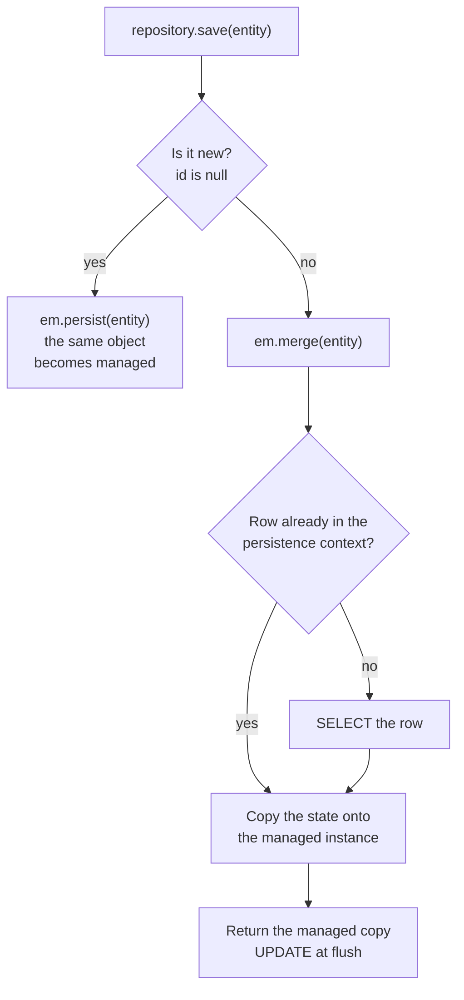

- **`persist(entity)`** (JPA): for new entities only. The object you pass becomes managed. On a detached entity it fails with `detached entity passed to persist`.
- **`merge(entity)`** (JPA): copies the state of your object onto a managed instance, loading it first if needed, and **returns that managed copy**. The object you passed stays detached, so always use the returned one.
- **`save(entity)`** (Spring Data, not JPA): `persist` when the entity is new, otherwise `merge`. "New" means the id is null (or, if the entity has a wrapper-type `@Version` field, the version is null).
  - Trap: with an id you assign yourself (a UUID set in code), every entity looks existing, so `save()` does a merge: an extra SELECT before each INSERT. Fix: implement `Persistable` with your own `isNew()`, or add a `@Version` field.
- **`saveAndFlush(entity)`**: `save` plus an immediate flush. Use it when you need the SQL to run **now**: to catch a unique-constraint violation at that line, or to read a value the database generates. It is still not committed.
- **`getReferenceById(id)`**: returns a proxy without a SELECT. Use it to set a foreign key ("this order belongs to customer 42") without loading the customer.
- Hibernate's own `Session.save()`, `update()` and `saveOrUpdate()` are deprecated since Hibernate 6; use `persist` and `merge`.

**IDENTITY vs SEQUENCE ids.** With `GenerationType.IDENTITY` the database generates the id on INSERT, so Hibernate must run the INSERT immediately at `persist()` to learn it, which **disables JDBC insert batching**. With a `SEQUENCE` and `hibernate.jdbc.batch_size` set, Hibernate fetches ids in blocks and sends many INSERTs in one batch. Use a sequence for bulk inserts.

Say it like this: "An entity is new, managed, detached or removed. Managed entities are dirty-checked: Hibernate snapshots them on load and writes an UPDATE at flush for anything that changed, so inside a transaction I don't call save(). Spring Data's save() calls persist for a new entity and merge otherwise, and merge returns a managed copy that I must use. saveAndFlush only forces the SQL early; it does not commit."

#### First-level vs second-level cache

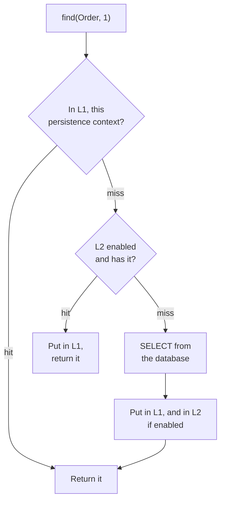

- **L1** is the persistence context itself: always on, cannot be disabled, lives for one transaction (or one request with open-in-view). It only saves repeated reads of the same row inside that unit of work.
- **L2** is shared by every EntityManager in the application instance. It is **off by default**, needs a cache provider (Ehcache or Caffeine through JCache, or a distributed one), and is enabled per entity with `@Cacheable` and a concurrency strategy. It caches entities by id; query results need the separate query cache.
- L2 **helps** for read-mostly reference data (countries, product categories). It **hurts** for frequently updated data (constant invalidation), with **several instances** (each pod has its own local copy, so one pod serves old data after another updates the row, unless the cache is distributed), and when other services change the table directly. The query cache is usually a trap: any write to the table invalidates it.

Say it like this: "L1 is the persistence context: per transaction, always on, so the same id is loaded once. L2 is shared across the whole application instance, off by default and needs a provider. I'd only use it for read-mostly reference data, because with several instances or frequent writes it serves stale data."

### 3. Optimistic vs pessimistic locking (the most-asked JPA question)

#### The problem: a lost update

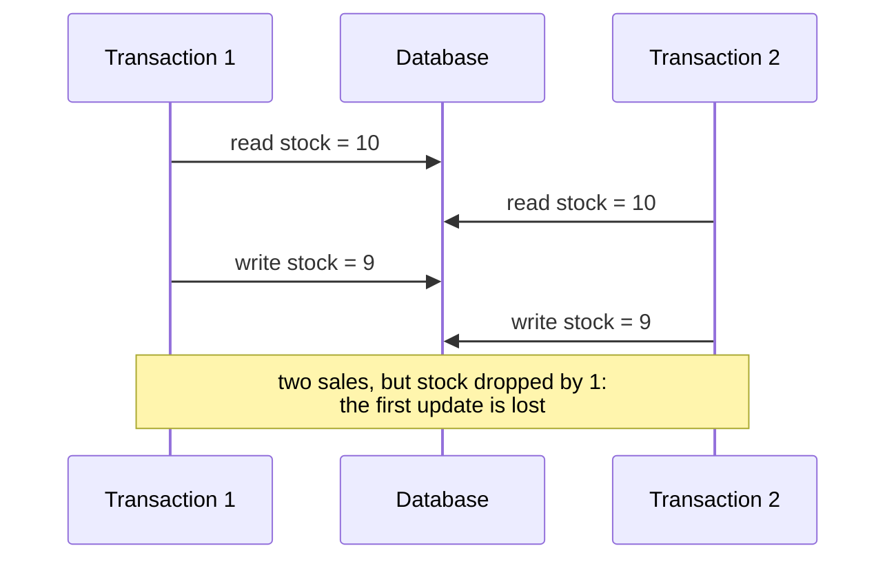

Two transactions read the same row, each changes it in memory, and each writes it back. The second write silently overwrites the first. The default isolation level (READ COMMITTED in PostgreSQL) does **not** prevent this: each statement sees committed data, but nothing checks that the row is still what you read. JPA gives two ways to stop it.

#### Optimistic locking: detect the conflict

Optimistic locking assumes conflicts are **rare**. It does not lock anything; it detects that someone else changed the row in between.

You add a version field to the entity:

```java
@Version
private Long version;
```

Hibernate then adds the version to every UPDATE and increments it:

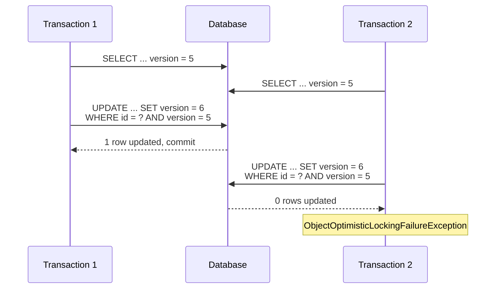

- If another transaction changed the row, the UPDATE matches **0 rows**. Hibernate throws `OptimisticLockException`, which Spring translates to **`ObjectOptimisticLockingFailureException`**.
- What you do with it:
  - For automatic work (a background job, a counter), **retry the whole transaction**: start fresh, re-read, re-apply the change, with a small retry limit. The retry must sit **outside** the transaction, so each attempt gets a new transaction and fresh data.
  - For a user editing a form, return **409 Conflict** ("someone else changed this, reload and try again").
- **Across HTTP requests**, optimistic locking is the only option: you cannot hold a database lock while a user looks at a form for five minutes. Send the version to the client with the data (in the DTO or as an ETag), have the client send it back with the update, and reject the update if it no longer matches the current version.
- Bulk `@Modifying` UPDATE queries **do not bump the version**; add `version = version + 1` to the query yourself when it matters.

Cost: no locks held, so it scales well; but under heavy contention many transactions fail and retry, wasting work.

**Use it when** conflicts are rare and there is time between reading and writing: editing a profile, a product description, a settings page.

#### Pessimistic locking: prevent the conflict

Pessimistic locking assumes conflicts are **likely**. It locks the row when reading it, so nobody else can change it until you finish.

```java
@Lock(LockModeType.PESSIMISTIC_WRITE)
@Query("select p from Product p where p.id = :id")
Optional<Product> findByIdForUpdate(@Param("id") Long id);
```

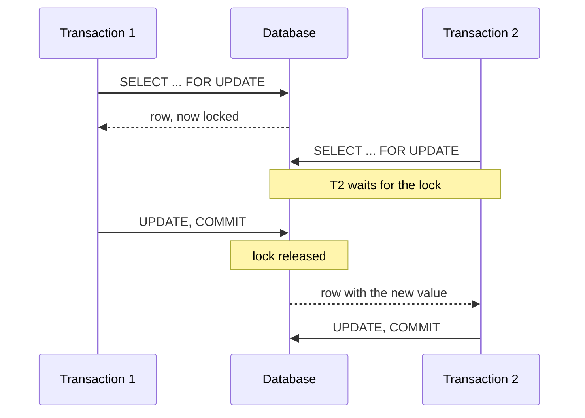

- `PESSIMISTIC_WRITE` becomes `SELECT ... FOR UPDATE`: other writers (and other `FOR UPDATE` readers) **wait** until the transaction commits or rolls back. `PESSIMISTIC_READ` becomes `FOR SHARE`: others may read-lock too, but nobody can write.
- The lock lives exactly as long as the transaction, so the method **must run inside `@Transactional`**, and the transaction should be **short**: never call a remote API while holding a row lock.
- **Set a lock timeout** (the `jakarta.persistence.lock.timeout` query hint, or the database's lock timeout setting), so a waiting request fails fast with a `PessimisticLockingFailureException` instead of hanging.
- **Deadlocks**: transaction A locks row 1 then wants row 2, while B locks row 2 then wants row 1. The database detects it and aborts one of them. Prevent it by locking rows in a **consistent order** (for example, sorted by id) and keeping transactions short.
- For queue-like work, where several workers each pick a pending job, use `FOR UPDATE SKIP LOCKED` (a native query): each worker takes rows nobody else has locked, instead of all waiting on the same row.

Cost: blocked threads and held connections under load, lock timeouts, deadlock risk.

**Use it when** conflicts are frequent and a failed retry is expensive or unacceptable: decrementing stock for a hot product, booking the last seat, moving money between accounts.

#### A third option: the atomic update

Often you do not need to read the row at all:

```sql
UPDATE product SET stock = stock - :qty WHERE id = :id AND stock >= :qty
```

The check and the change happen in **one statement**, so no other transaction can sneak in between. If it updates 0 rows, there was not enough stock. In Spring Data this is a `@Modifying` query (section 6). It is the simplest and fastest fix for counters and stock levels.

| | Optimistic | Pessimistic | Atomic update |
| --- | --- | --- | --- |
| How | `@Version`, check at UPDATE | `SELECT ... FOR UPDATE` | One `UPDATE ... WHERE` with the condition |
| On conflict | 0 rows, exception, retry or 409 | Others wait for the lock | 0 rows, handle as "not possible" |
| Cost | Wasted work when conflicts are frequent | Blocking, timeouts, deadlocks | None, but only for simple arithmetic |
| Use for | Rare conflicts, user edits, across requests | Hot rows, money, last seat | Counters, stock, balances |

Say it like this: "Without locking, two concurrent read-modify-write transactions cause a lost update. Optimistic locking adds a @Version column: every update includes WHERE version = the value I read, so if someone changed the row it updates zero rows and I get an exception, then I retry or return 409. No locks are held, so it fits rare conflicts and it's the only option across HTTP requests. Pessimistic locking uses SELECT FOR UPDATE, so others wait; I use it for hot, costly conflicts like stock or payments, with short transactions, a lock timeout and a consistent lock order to avoid deadlocks. For simple counters an atomic UPDATE with the condition in the WHERE clause is better than either."

### 4. Relationships: owning side, mappedBy, cascades and many-to-many

#### Where the foreign key lives

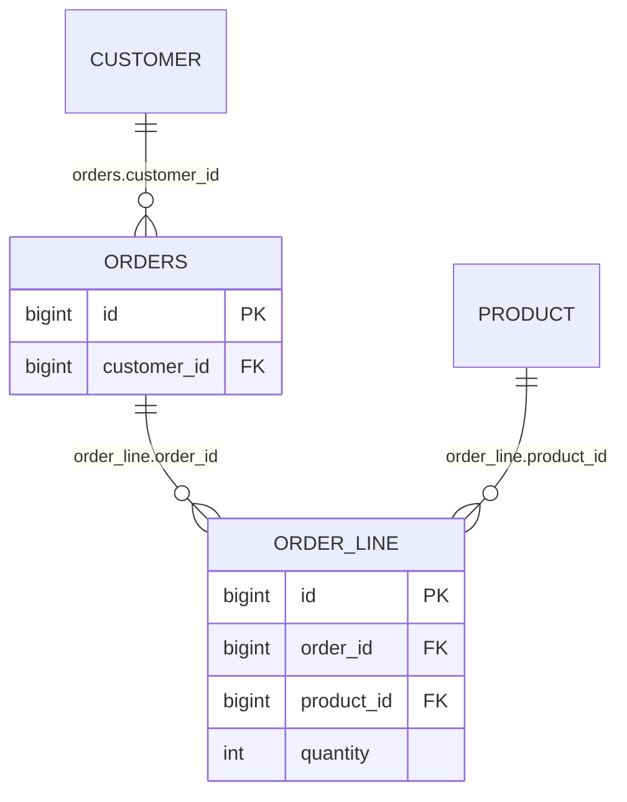

- **One-to-one**: an FK column in one of the two tables, with a unique constraint.
- **One-to-many / many-to-one**: the FK is always in the **"many" (child) table**. A parent row cannot hold many ids, so each child row points up to its parent.
- **Many-to-many**: neither table can hold it, so a third **join table** stores pairs of ids. When the pair needs its own data (quantity, price), the join table becomes an entity, as `ORDER_LINE` above.

#### Owning side and mappedBy

In a **bidirectional** relationship both entities reference each other in Java, but the database still has **one** FK column. JPA needs to know which Java field controls that column:

- The **owning side** is the entity whose table holds the FK. It is the **only side Hibernate reads** when writing the FK.
- The **inverse side** declares `mappedBy = "<field name on the owning side>"`. It has no column; it only lets you navigate back in Java.

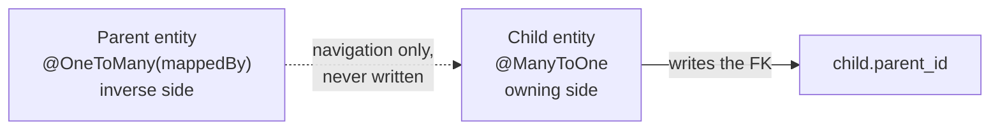

**The classic bug:** you set only the inverse side (`order.getLines().add(line)`) and the FK is saved as **NULL**, because Hibernate never looks at the inverse side. Always set the owning side, and keep both sides in sync with **helper methods** on the parent:

```java
// Parent: inverse side
@OneToMany(mappedBy = "order", cascade = CascadeType.ALL, orphanRemoval = true)
private List<OrderLine> lines = new ArrayList<>();

public void addLine(OrderLine l)    { lines.add(l);    l.setOrder(this); }
public void removeLine(OrderLine l) { lines.remove(l); l.setOrder(null); }

// Child: owning side, holds the FK
@ManyToOne(fetch = FetchType.LAZY)
@JoinColumn(name = "order_id")
private Order order;
```

Which side owns? The one whose table should hold the FK. For one-to-many that is **always the `@ManyToOne` child**; `@ManyToOne` does not even have a `mappedBy` attribute.

#### One-to-many: why it should be bidirectional (or just many-to-one)

A **unidirectional `@OneToMany`** (only the parent has the list, the child knows nothing) has a hidden cost either way:

- **Without `@JoinColumn`**, Hibernate creates an extra **join table** (parent id, child id), as if it were many-to-many.
- **With `@JoinColumn`**, the FK is in the child table, but the child entity does not know its parent, so Hibernate inserts the child with an empty FK and then runs an **extra UPDATE per child** to set it:

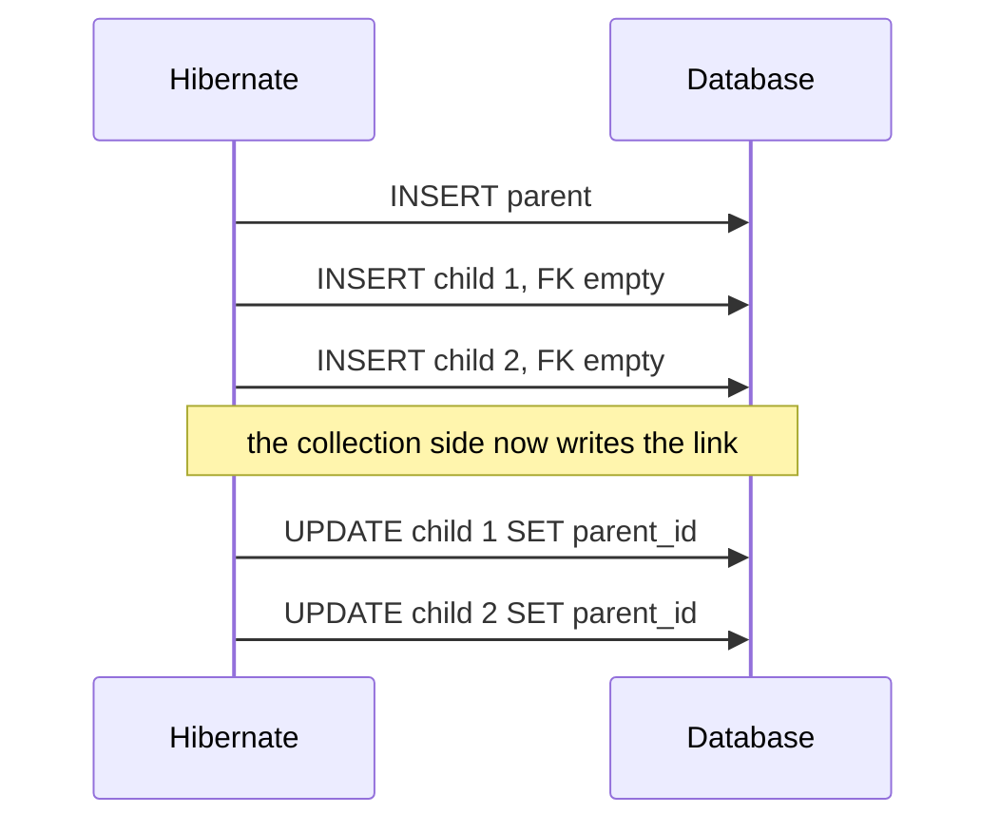

With the **bidirectional** mapping above, the child knows its parent, so the FK goes straight into each child's INSERT: no join table, no extra UPDATEs.

Often you do not need the collection at all: a **unidirectional `@ManyToOne`** on the child plus a repository query (`findByOrderId(orderId)`) is the simplest mapping, and avoids loading a large collection by accident.

Two more facts:

- **`@ManyToOne` is EAGER by default**: loading a child also loads its parent. Write `fetch = FetchType.LAZY` yourself.
- Deleting a parent with cascade REMOVE deletes the children **one by one** (a DELETE per child, then the parent). For large collections use a bulk delete query.

#### One-to-one

- The owning side has `@OneToOne` plus `@JoinColumn(name = "address_id")`. Hibernate adds a **unique constraint** on that column; that is how the database enforces "one".
- **LAZY does not work on the inverse side** of a one-to-one. On the owning side, the FK value is in the row, so Hibernate knows whether a child exists and can put a proxy there. On the inverse side there is no column, so Hibernate cannot know whether the child exists without asking the database, and a proxy must never stand in for "nothing". It ignores LAZY and runs an extra query per row, another N+1.
- The fix is a **shared primary key** with `@MapsId`: the child's primary key is also its FK to the parent, so the child's id is always the parent's id. Mark the parent's side `optional = false` and LAZY works. The simpler alternative is to keep the association one-way and load the child with its own repository.

Say it like this: "The owning side is the entity whose table holds the foreign key, which for one-to-many is always the @ManyToOne child; the parent uses mappedBy and is only a Java back-reference, so Hibernate ignores it when writing. I keep both sides in sync with helper methods, otherwise the FK is saved as null. I avoid a unidirectional @OneToMany, because it needs a join table or extra UPDATEs, and I make @ManyToOne lazy, since it's eager by default."

#### Many-to-many

```java
// owning side
@ManyToMany
@JoinTable(name = "student_course",
           joinColumns = @JoinColumn(name = "student_id"),
           inverseJoinColumns = @JoinColumn(name = "course_id"))
private Set<Course> courses = new HashSet<>();

// inverse side
@ManyToMany(mappedBy = "courses")
private Set<Student> students = new HashSet<>();
```

- One side owns the join table and describes it with `@JoinTable`; the other uses `mappedBy`. Only changes on the **owning side's** collection write join rows. If both sides declare `@JoinTable`, you get two join tables.
- **Use a `Set`, not a `List`.** A `List` without an order column is a "bag" with no row identity, so Hibernate cannot target one join row:

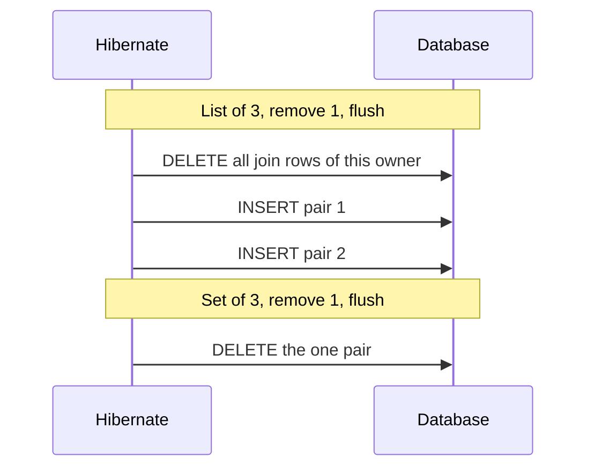

  Give the entities `equals` and `hashCode` based on a stable key, so the `Set` behaves.
- **No cascade REMOVE** (or ALL): the other side is **shared**, so deleting one student would try to delete courses other students are in. Without cascade, deleting the owner removes only its join rows. To link to an existing row, use `getReferenceById(id)` rather than a `new` object carrying an id, which fails with `detached entity passed to persist` under cascade PERSIST.
- **As soon as the link needs its own data** (enrolled date, status, quantity, price), replace `@ManyToMany` with a **join entity** that has two `@ManyToOne` fields, turning it into two one-to-many relationships. In real systems the link almost always gains data, so this is usually the right model from the start.

Say it like this: "A many-to-many is a join table owned by one side; the other uses mappedBy. I use a Set, because with a List Hibernate deletes and re-inserts every join row on each change, and I never cascade REMOVE, because the other side is shared. If the link has its own attributes, I model it as a join entity with two many-to-one relationships."

#### Cascade and orphanRemoval

Without a cascade, an operation on the parent never touches the child: saving a new parent that points to a new, unsaved child fails with `TransientObjectException`. A **cascade** makes JPA repeat the operation on the related entities. It is a JPA feature, not the database's `ON DELETE CASCADE`.

- **PERSIST**: persisting a new parent also inserts its new children.
- **MERGE**: merging a parent also merges its children.
- **REMOVE**: deleting the parent deletes its children.
- **REFRESH**, **DETACH**: the same for those operations. **ALL**: all five.

**The trap:** `save()` on an entity that already has an id is a **merge** (section 2). With `cascade = PERSIST` only, saving an existing parent with a changed child updates the parent and **silently ignores the child's changes**. Updates to children need MERGE as well.

**orphanRemoval vs REMOVE:**

- `CascadeType.REMOVE` deletes the child only when the **parent is deleted**.
- `orphanRemoval = true` also deletes a child when it is **removed from the parent's collection** (or a one-to-one field is set to null or replaced). The DELETE runs at flush.
- Without `orphanRemoval`, removing a child only from the parent's list changes **nothing** in the database, because the list is the inverse side. To unlink without deleting, set the child's parent field (the owning side) to null.

The rule: cascade and `orphanRemoval` belong on the **parent's `@OneToMany`**, and only for children that belong to that one parent (an order and its lines). **Never cascade from `@ManyToOne` or on `@ManyToMany`**: deleting one order with `cascade = ALL` on its `@ManyToOne` would try to delete the customer, failing on the FK if the customer has other orders, or silently deleting them if it was the last one.

Say it like this: "Cascade makes JPA repeat an operation from the parent to its children; I use it only where the parent truly owns the children, like an order and its lines, and never on many-to-one or many-to-many, where the other side is shared. Because Spring Data's save merges existing entities, child updates need MERGE, not just PERSIST. orphanRemoval goes further than REMOVE: it deletes a child as soon as it's removed from the collection."

### 5. Fetching: lazy vs eager, LazyInitializationException and N+1

#### Lazy vs eager

- **EAGER**: the related data is loaded together with the entity, every time.
- **LAZY**: it is loaded on **first access**. For a to-one field Hibernate puts a **proxy** there (a generated subclass that loads itself when you call a getter); for a collection it puts a wrapper (`PersistentBag`, `PersistentSet`) that loads on first use.
- **Defaults: `@ManyToOne` and `@OneToOne` are EAGER; `@OneToMany` and `@ManyToMany` are LAZY.** The idea was that a to-one link is one row, while a collection can be huge. In practice EAGER to-one links cause the same problems.

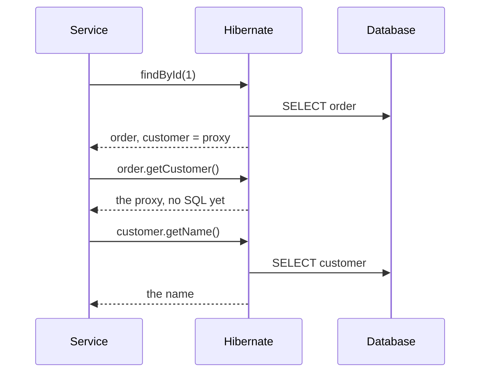

Calling `getId()` on a proxy does not load it, since the id is already known from the FK. Any other getter does.

Why EAGER is the wrong default: it **cannot be turned off per query**, so every use case pays for data it may not need, and list queries still trigger one extra query per row (the N+1 below). The rule: **make every association LAZY** (write `fetch = FetchType.LAZY` on to-one links) and load what each use case needs explicitly. Note that LAZY is only a hint in the JPA specification (see the one-to-one inverse side in section 4).

#### LazyInitializationException

A proxy can only load itself while its **persistence context is still open**. Touching a lazy field after the transaction has ended fails:

`LazyInitializationException: could not initialize proxy - no Session`

The classic scenario: a service method loads an entity in a transaction and returns it; the controller returns it as JSON; Jackson calls the getter of a lazy collection **after** the transaction has closed.

Fixes, best first:

1. **Return a DTO** built inside the service transaction, containing exactly what the response needs.
2. **Load what you need in the same query** inside the service: `join fetch` or `@EntityGraph` (below).
3. Do the work that needs the data inside the `@Transactional` method.

Not fixes: switching to EAGER (loads too much everywhere), turning open-in-view back on (hides the problem), or `hibernate.enable_lazy_load_no_trans` (opens a new session for every lazy access, an N+1 in disguise).

#### Open-in-view

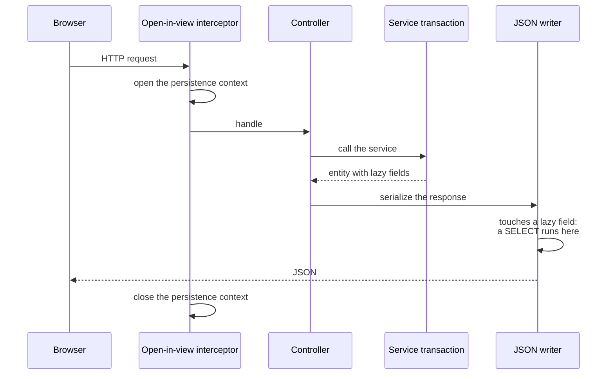

Spring Boot turns **open-in-view on by default** (`spring.jpa.open-in-view=true`, with a warning at startup): a web interceptor keeps the persistence context open for the whole request, which is why lazy loading "works" in controllers. Many teams turn it **off** because:

- lazy queries run during JSON rendering, outside the service layer, where N+1 piles up unnoticed;
- the database connection can stay tied to the request while the response is built, which hurts under load.

With it off, every lazy access outside a transaction throws `LazyInitializationException`, which forces data loading to be explicit in the service.

#### Returning entities as JSON

Two more failures come from serializing entities directly:

- **Proxy serialization**: Jackson fails on a lazy field with `No serializer found for class ...ByteBuddyInterceptor`. The cause is the proxy class itself (it has an internal `hibernateLazyInitializer` property), not missing data; it fails even after the proxy has loaded.
- **Infinite recursion**: in a bidirectional pair, the parent writes its children, each child writes its parent, and so on, until Jackson hits its nesting limit (or a `StackOverflowError` in older versions). Workarounds are `@JsonManagedReference` / `@JsonBackReference`, `@JsonIgnore` on one side, or `@JsonIdentityInfo`. Lombok's `@ToString`, `@EqualsAndHashCode` and `@Data` on both sides loop the same way.

The clean answer to both: **return DTOs, not entities**, from controllers. DTOs also stop the API from exposing your table structure.

Say it like this: "@ManyToOne and @OneToOne are eager by default and collections lazy; I make everything lazy and fetch per use case, because eager can't be turned off per query. A lazy field is a proxy that loads itself only while the persistence context is open, so LazyInitializationException means it was touched after the transaction ended, typically during JSON serialization. I fix it by building a DTO inside the service, using join fetch or an entity graph for what's needed. I don't switch to eager, and I turn open-in-view off so lazy loading can't hide in the controller."

#### The N+1 problem

Loading N parents takes **1** query. Touching each parent's lazy association then runs **1 more query per parent**: N+1 in total. It is invisible in code: one line, `findAll()`, followed by a loop.

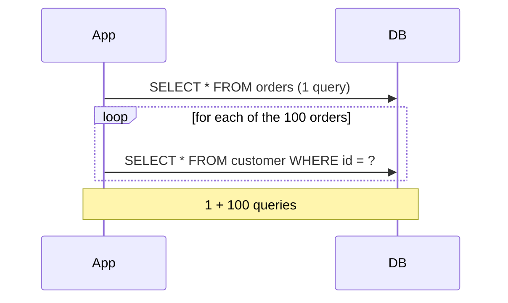

**EAGER does not fix it.** A JPQL query runs exactly as written, so it loads only the parents; Hibernate then has to honour EAGER by loading each parent's association separately, which is the same 1 + N queries, now on every use case.

**A plain `JOIN` does not fix it either.** `select o from Order o join o.customer c where c.country = :x` uses the join only to **filter**: the SELECT still returns order columns only, and each customer is loaded later. `JOIN FETCH` is what loads the association in the same query.

The fixes (keep the mapping LAZY and choose per query):

- **`LEFT JOIN FETCH`** in JPQL: `select o from Order o left join fetch o.customer` loads parents and their associations in **one query**. A plain `join fetch` is an inner join, so parents without children disappear; use `left` when the association is optional. Hibernate 6 removes duplicate parent rows itself, so `DISTINCT` is no longer needed.
- **`@EntityGraph(attributePaths = "customer")`** on a repository method: the same left join fetch, declared on the method, so it also works with derived queries.
- **Batch fetching**: `@BatchSize(size = 50)` on the association, or `hibernate.default_batch_fetch_size` globally. Hibernate loads the associations for 50 parents at a time with `WHERE id IN (...)`: 1 + N/50 queries instead of 1 + N. It **works with pagination**, which fetch joins on collections do not.
- **DTO projection**: select exactly the needed columns, joined, in one query. Best for read-only screens.

Two traps with fetch joins:

- **Fetch join plus pagination**: `join fetch` on a **collection** combined with a page request makes Hibernate load **all** matching rows and cut the page in memory (it logs `HHH90003004: firstResult/maxResults specified with collection fetch; applying in memory`). Page the parent ids first and then fetch their children with `where p.id in :ids`, or use batch fetching.
- **Two collections at once**: fetching two `List` collections of one entity in one query throws `MultipleBagFetchException`, and even with `Set`s it multiplies rows (a cartesian product). Fetch one collection per query; the second query fills the same parent objects in the persistence context.

How to catch N+1: turn on SQL logging in development and watch the query count per request, enable Hibernate statistics (`hibernate.generate_statistics`), or assert the number of queries in integration tests.

Say it like this: "N+1 is one query for the parents plus one per parent when a lazy association is touched in a loop. Eager doesn't fix it, because the query still loads only the parents and Hibernate then loads each association separately, and a plain join only filters. I fix it per use case: left join fetch or @EntityGraph to load it in one query, @BatchSize to load associations in IN batches, which also works with paging, or a DTO projection. I catch it with SQL logging and query-count assertions in tests."

### 6. Queries, bulk updates and pagination

#### Derived queries

Spring reads the **method name** and builds the query at startup:

```text
findByEmail(e)                       where email = ?
findByStatusAndCreatedAtAfter(s, t)  where status = ? and created_at > ?
findByStatusIn(statuses)             where status in (...)
findByNameStartingWith("A")          where name like 'A%'   (Spring adds the %)
findByNameLike("A")                  where name like 'A'    (no % added)
findTop10ByOrderByCreatedAtDesc()    order by created_at desc, first 10 rows
countByStatus(s), existsByEmail(e)   count(*), and a query that stops at one row
```

- The pattern: a prefix (`find`, `count`, `exists`, `delete`), optionally `First10` or `Distinct`, then `By`, then conditions joined with `And` / `Or`, then optional `OrderBy`.
- It uses **Java property names**, not column names, and a misspelled property fails at **startup**, not at runtime.
- `Like` adds no wildcard; `StartingWith`, `EndingWith` and `Containing` do.
- Good for simple filters. Past two or three conditions, or with joins, the names become unreadable: switch to `@Query`.

#### JPQL and native SQL

**JPQL** looks like SQL but is written against **entities and fields**, not tables and columns, so it stays database-independent:

```java
@Query("select o from Order o where o.customer.id = :customerId and o.total > :min")
List<Order> findLargeOrders(@Param("customerId") Long customerId, @Param("min") BigDecimal min);
```

- Use **named parameters** (`:name` with `@Param`); they survive reordering of method arguments, and bound parameters are never parsed as SQL.
- Joins follow the mapped fields (`join o.lines l`), and JPA writes the ON clause.
- A method returning a single entity that matches two rows throws `IncorrectResultSizeDataAccessException`; return `Optional` or `List` when more than one row is possible.

**Native SQL** (`nativeQuery = true`) uses real tables and columns. Use it only for what JPQL cannot express: window functions, `ON CONFLICT` upserts, JSONB operators, database hints. It ties the query to one database, and with paging you usually write the `countQuery` yourself.

Never build JPQL or native strings with `+`: an ORM is just as injectable as JDBC when you concatenate.

#### Dynamic filters: Specifications

For a search screen with many optional filters, concatenating JPQL strings is unreadable and unsafe. **Specifications** are small reusable conditions that you combine; a filter that is not set simply returns `null` and is skipped:

```java
Specification<Order> spec = where(hasStatus(status)).and(createdAfter(from)).and(forCustomer(id));
Page<Order> page = orderRepository.findAll(spec, pageable);   // repository extends JpaSpecificationExecutor
```

The JPA **Criteria API** underneath is type-safe but verbose; Querydsl is a popular alternative.

#### Projections: return less than the entity

Loading full entities for a list screen that shows three columns wastes memory and fills the persistence context.

- **Interface projection**: `interface OrderSummary { Long getId(); BigDecimal getTotal(); }` as the return type; Spring selects only those columns.
- **DTO in JPQL**: `select new com.app.OrderDto(o.id, c.name, o.total) from Order o join o.customer c`, using the class's full name and a matching constructor.

Projections are **read-only and not tracked**: smaller queries, no dirty checking, no lazy proxies to break JSON. Use them for read paths.

#### Bulk updates and deletes with @Modifying

```java
@Modifying(flushAutomatically = true, clearAutomatically = true)
@Query("update Order o set o.status = :status where o.createdAt < :before")
int expireOld(@Param("status") Status status, @Param("before") Instant before);
```

- `@Query` expects a SELECT; an UPDATE or DELETE needs `@Modifying`, and it must run in a **transaction**.
- It runs **one SQL statement** directly and returns the number of rows affected. It does **not** load entities, run cascades, fire entity callbacks or bump `@Version`.
- **It bypasses the persistence context**, which causes two traps:
  - **Stale reads**: entities already loaded in this transaction still show the old values after the update. `clearAutomatically = true` clears the context afterwards, so the next read goes to the database.
  - **Lost changes**: clearing throws away pending, unflushed changes to other entities. `flushAutomatically = true` flushes them **before** the statement. Use both flags together.

**Derived delete vs bulk delete:** a derived `deleteByStatus(s)` loads the matching entities and deletes them **one by one** (a SELECT, then a DELETE per row), running cascades and keeping the persistence context consistent. A `@Modifying` delete is one statement: much faster for many rows, but skips cascades. The same pair exists as `deleteAll()` (one by one) and `deleteAllInBatch()` (one statement).

Say it like this: "Derived queries are generated from the method name and checked at startup, fine for simple filters. For joins or anything longer I write JPQL with named parameters, native SQL only for database-specific features, and Specifications for optional search filters. Read screens return projections. Bulk updates use @Modifying; they skip the persistence context, so I set clearAutomatically and flushAutomatically to avoid stale or lost data."

#### Pagination: Page vs Slice

You pass a `Pageable` (page number from 0, size and sort) as the last parameter: `PageRequest.of(0, 20, Sort.by("createdAt").descending())`. The **return type** decides how much SQL runs:

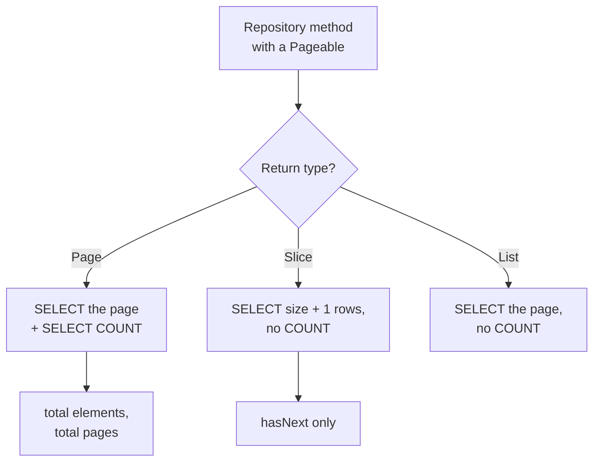

- **`Page`** runs an extra **COUNT** query, so it knows the total number of rows and pages. Spring skips the COUNT when it can work out the total, for example when the first page is not full.
- **`Slice`** asks for one extra row to know whether a next page exists, with **no COUNT**. On big tables the COUNT is often the slowest part, so use `Slice` for "load more" and infinite scroll.
- With `@Query`, Spring derives the count query; for complex or native queries supply it with `countQuery`.
- Sort by **property names**: `Sort.by("created_at")` fails with `PropertyReferenceException`.

#### Why a deep OFFSET is slow, and keyset pagination

`Pageable` becomes `LIMIT 20 OFFSET 100000` in SQL. The database cannot jump to row 100,000: it must **walk through and discard** the first 100,000 rows before returning 20, so each page gets slower the deeper you go.

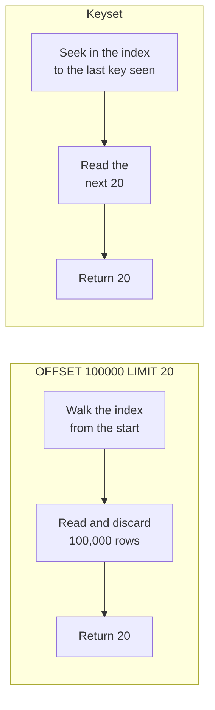

OFFSET also gives **inconsistent pages**: rows inserted or deleted while a user is paging shift everything, so the user sees duplicates or misses rows.

The fix is **keyset (seek, or cursor) pagination**: instead of a page number, remember the **last row seen** and continue from it:

```sql
SELECT * FROM orders
WHERE (created_at, id) < (:lastCreatedAt, :lastId)
ORDER BY created_at DESC, id DESC
LIMIT 20;
```

- With an index on `(created_at, id)`, the database seeks straight to the position, so **page 5,000 costs the same as page 1**, and inserts do not shift the pages.
- The sort needs a **unique tie-breaker** (the id), otherwise rows with the same timestamp can be skipped or repeated. Databases without row-value comparison use the expanded form: `created_at < :t OR (created_at = :t AND id < :id)`.
- The API returns an opaque **cursor** (the encoded last values) instead of a page number.
- The trade-off: **no jumping to page N** and no free total count. Keep OFFSET for small tables and admin screens that need page numbers.
- Spring Data supports it with the scroll API: a method like `findFirst20ByStatusOrderByCreatedAtDescIdDesc(Status s, ScrollPosition position)` returning a `Window<T>`, starting from `ScrollPosition.keyset()`.

Say it like this: "I paginate with a Pageable. Page runs an extra COUNT for totals, so I return Slice when I only need 'is there more'. A deep OFFSET is slow because the database reads and throws away every skipped row, and pages shift when rows are inserted. For large tables or infinite scroll I use keyset pagination: the client sends the last seen sort key plus id, and the query continues with an indexed WHERE clause, so every page costs the same. The trade-off is no jumping to an arbitrary page."

**Recall** without looking, draw the lost-update timeline and explain how @Version and SELECT FOR UPDATE each stop it; explain why setting only the inverse side saves a NULL foreign key; draw the N+1 pattern and name four fixes and the paging trap; and write the keyset-pagination WHERE clause.

## Interview practice

How would you prove a repository query avoids N+1 and still pages correctly? In a @DataJpaTest, seed several parents with children, flush and clear the persistence context, then inspect SQL and the returned parent IDs. Use PostgreSQL through Testcontainers for database-specific SQL or locking behavior.

<details>
<summary>Walk through the case</summary>

Fetch an ordered page of parent IDs first, including a unique tie-breaker. Fetch the children for those IDs in a second query and restore the parent order in the result. Assert page boundaries, complete children and a bounded statement count as the number of parents grows. Account for an extra count query if the API returns a Page.

</details>

[Spring Boot testing guide](https://docs.spring.io/spring-boot/reference/testing/spring-boot-applications.html)

### JPA and Spring Data JPA

77 of the 1,592 candidate write-ups in the Oct 2024 – Oct 2026 review mentioned this lesson. Each count below belongs to its question.

<details>
<summary>Optimistic vs pessimistic locking in JPA — when do you use each?</summary>

- **Optimistic**: add `@Version` to the entity. UPDATE includes `WHERE version = ?`; if another transaction changed the row, you get `OptimisticLockException` → retry or tell the user. No locks held — best when conflicts are **rare** (editing a profile).
- **Pessimistic**: `@Lock(PESSIMISTIC_WRITE)` → `SELECT … FOR UPDATE`; other writers wait. Best when conflicts are **frequent and costly** (decrementing stock, booking the last seat).

Keep pessimistic transactions short, and lock rows in a consistent order to avoid deadlocks.

*20 candidate write-ups · Paytm · Walmart · Autodesk · Bloomberg · Cisco · Coupa · Google · Kotak Mahindra Bank · Meesho · Microsoft · MobiKwik · Oracle*

</details>

<details>
<summary>Lazy vs eager loading — and what causes LazyInitializationException?</summary>

- **Lazy**: load the association only when it's accessed (Hibernate puts a proxy there).
- **Eager**: load it with the parent every time.

`LazyInitializationException`: the transaction/session has closed, then something touches a lazy field — classically Jackson serialising an entity in the controller.

Fix: fetch what you need inside the service (`JOIN FETCH`/entity graph) and return **DTOs**. Leaving `spring.jpa.open-in-view` on hides the error by keeping the session open for the whole request — and holds a DB connection that long.

*13 candidate write-ups · American Express · Arctic Wolf · Fortinet · IBM · Oracle · Publicis Sapient · ServiceNow · TripJack · Uniphore · Walmart*

</details>

<details>
<summary>What is the N+1 problem in Hibernate, and how do you fix it?</summary>

Loading 100 orders runs **1** query, then touching `order.getCustomer()` (lazy) runs **100** more.

Fixes:
- `JOIN FETCH` in JPQL: `select o from Order o join fetch o.customer`.
- `@EntityGraph(attributePaths = "customer")` on the repository method.
- Batch fetching: `@BatchSize(size = 50)` / `hibernate.default_batch_fetch_size` → `IN (...)` queries.
- A **DTO projection** query that selects only the columns you need.

Find it by turning on SQL logging or asserting query counts in tests. Don't "fix" it by switching to EAGER — that loads too much everywhere.

*11 candidate write-ups · Citi · DocuSign · Google · Info Edge · Microsoft · Oracle · Publicis Sapient · Rakuten · Target · athenahealth*

</details>

<details>
<summary>How do you paginate in Spring Data — and why is a deep OFFSET slow?</summary>

`Page<Order> findByStatus(Status s, Pageable p)` with `PageRequest.of(page, size, Sort.by("createdAt").descending())`. `Page` runs an extra **count** query; return `Slice` if you don't need totals.

`OFFSET 100000 LIMIT 20` still reads and throws away 100,000 rows. For deep or infinite scrolling use **keyset (cursor) pagination**: `WHERE (created_at, id) < (:lastTs, :lastId) ORDER BY created_at DESC, id DESC LIMIT 20` — uses the index, stable under inserts.

*9 candidate write-ups · Agoda · Adobe · LinkedIn · Mastercard · Truemeds · Uber · Walmart*

</details>

<details>
<summary>One-to-one vs one-to-many — how do you map them, and what is the owning side (mappedBy)?</summary>

The **owning side** holds the foreign key and is the one Hibernate reads when writing; the other side says `mappedBy`:

```java
@Entity class Order {
  @OneToMany(mappedBy = "order", cascade = ALL, orphanRemoval = true)
  List<OrderLine> lines = new ArrayList<>();
}
@Entity class OrderLine {
  @ManyToOne(fetch = LAZY) @JoinColumn(name = "order_id")   // owning side
  Order order;
}
```

For one-to-one, the side with the FK column owns it; `@MapsId` shares the primary key. Bidirectional pairs serialised to JSON recurse forever — return DTOs.

*8 candidate write-ups · Blinkit · Target · Urban Company · VMware · Yes Madam · Zomato*

</details>

<details>
<summary>JPA vs Hibernate vs Spring Data JPA — why use Hibernate at all?</summary>

- **JPA**: the specification (annotations, `EntityManager`, JPQL).
- **Hibernate**: the most common JPA **implementation** (plus extras).
- **Spring Data JPA**: repositories on top — `interface OrderRepo extends JpaRepository<Order, Long>` with derived queries — so you write almost no DAO code.

Why an ORM: maps rows ↔ objects, dirty checking, caching, portable queries. Cost: hidden queries (N+1) — you must still understand the SQL.

*7 candidate write-ups · Lenovo · Mastercard · Nike · Rakuten Symphony · Truemeds · Visa*

</details>

<details>
<summary>How do you model a many-to-many relationship (e.g. Person ↔ Job)?</summary>

```java
@ManyToMany
@JoinTable(name = "person_job", joinColumns = @JoinColumn(name = "person_id"),
           inverseJoinColumns = @JoinColumn(name = "job_id"))
Set<Job> jobs = new HashSet<>();
```

Use a `Set`, never cascade REMOVE. As soon as the link needs its own data (applied_at, status) — and it usually does — replace it with an explicit **join entity** (`Application` with two `@ManyToOne`s).

*3 candidate write-ups · Microsoft · Paytm · eBay*

</details>

<details>
<summary>Derived queries vs JPQL vs native SQL — how do you write complex queries in JPA?</summary>

- **Derived**: `findByStatusAndCreatedAtAfter(...)` — fine for simple filters; unreadable past ~3 conditions.
- **JPQL** with `@Query("select o from Order o where …")` — entity-based, portable.
- **Native** `@Query(nativeQuery = true)` — DB-specific features (window functions, `ON CONFLICT`, JSONB), returns rows/projections.
- Dynamic filters: Specifications / Criteria / Querydsl.

Return **projections** (interfaces or DTO constructor expressions) for read paths instead of full entities.

*3 candidate write-ups · Knot Solutions · Publicis Sapient · Rakuten Symphony*

</details>

<details>
<summary>EntityManager vs CrudRepository vs JpaRepository?</summary>

- `EntityManager` — the raw JPA API (`persist`, `find`, `merge`, queries).
- `CrudRepository` — Spring Data: save/find/delete/count.
- `PagingAndSortingRepository` — adds `Pageable`/`Sort`.
- `JpaRepository` — adds JPA specifics: `flush`, `saveAndFlush`, batch deletes, `getReferenceById`.

Use `JpaRepository`; drop to `EntityManager` for complex or bulk operations.

*2 candidate write-ups · Visa*

</details>

<details>
<summary>JDBC vs Hibernate — why use an ORM, and when would you still drop to plain JDBC (JdbcTemplate)?</summary>

- **JDBC / `JdbcTemplate`**: you write the SQL; `JdbcTemplate` removes the boilerplate (connections, `PreparedStatement`, closing, exception translation) and maps rows with a `RowMapper`. Full control, no hidden queries.
- **ORM (JPA/Hibernate)**: maps rows ↔ objects, dirty checking, L1 cache, relationships, portable JPQL — far less code for CRUD-heavy domains.

Reach for `JdbcTemplate` (or `JdbcClient` in Boot 3.2+) for reporting, bulk writes and hand-tuned SQL; both can live in one app and share the same `DataSource` and `@Transactional`.

*2 candidate write-ups · Walmart · Fortinet*

</details>

<details>
<summary>What is cascade in JPA — which cascade types are safe?</summary>

Cascade passes an operation from parent to children: `CascadeType.PERSIST`, `MERGE`, `REMOVE`, `REFRESH`, `DETACH`, `ALL`.

Use cascading only for real **ownership** (Order → OrderLines). `CascadeType.ALL`/`REMOVE` on a `@ManyToOne` or `@ManyToMany` can delete shared data (delete one order, lose the customer).

`orphanRemoval = true` deletes a child when it's removed from the parent's collection — different from `REMOVE`, which only fires when the parent is deleted.

*2 candidate write-ups · EPAM*

</details>

<details>
<summary>Which side should own a one-to-many — and why keep collections in sync?</summary>

Make the **`@ManyToOne` (child) side the owner** — the FK lives in the child table. A unidirectional `@OneToMany` without `mappedBy` makes Hibernate create a join table and extra UPDATEs.

In a bidirectional pair, set both sides in a helper:

```java
void addLine(OrderLine l) { lines.add(l); l.setOrder(this); }
```

Default fetch: `@ManyToOne`/`@OneToOne` are **EAGER** — set them to `LAZY`; collections are lazy already.

*2 candidate write-ups · Target · eBay*

</details>

<details>
<summary>save() vs saveAndFlush(), persist vs merge — and what is dirty checking?</summary>

Entity states: **new** → **managed** (in the persistence context) → **detached** (context closed) → **removed**.

- Managed entities are **dirty-checked**: change a field inside a transaction and Hibernate issues the UPDATE at flush/commit — no `save()` needed.
- `save()` = `persist` for new entities, `merge` for detached ones. It doesn't hit the DB immediately.
- `saveAndFlush()` forces the SQL now (useful to surface constraint errors early).
- `merge` copies a detached object's state onto a managed copy and returns **that** copy.

The persistence context is the first-level cache: the same id is loaded once per transaction.

*1 candidate write-up · Target*

</details>

<details>
<summary>How do you configure Hibernate — dialect, ddl-auto, and SQL logging?</summary>

- **Dialect**: tells Hibernate which SQL flavour to generate (auto-detected in Boot 3).
- `spring.jpa.hibernate.ddl-auto`: `validate` in prod (schema managed by Flyway/Liquibase), `update`/`create-drop` only locally.
- See the SQL: `spring.jpa.show-sql=true` or `logging.level.org.hibernate.SQL=debug` (+ bind parameters) — the first thing to switch on when hunting N+1.

*1 candidate write-up · Mastercard*

</details>

<details>
<summary>First-level vs second-level cache in Hibernate — when does L2 help or hurt?</summary>

- **L1**: the persistence context — per transaction/session, always on. Same id → same object, one SELECT.
- **L2**: shared across sessions (Ehcache, Caffeine, Redis via a provider), opt-in per entity with `@Cacheable` + a concurrency strategy.

L2 helps for **read-mostly reference data** (countries, product catalogue). It hurts for frequently-updated data (invalidation churn) and with **multiple instances** unless the cache is distributed or invalidated across nodes. The query cache is usually a trap — any write to the table invalidates it.

*Question banks only*

</details>

<details>
<summary>How do you build dynamic queries — Criteria API vs Specifications?</summary>

When filters are optional (search screen with 8 fields), string-concatenated JPQL becomes unreadable and injection-prone.

- **Criteria API**: type-safe, programmatic — but verbose.
- **Spring Data Specifications**: small reusable predicates you combine:

```java
Specification<Order> s = where(hasStatus(st)).and(createdAfter(from)).and(customerIs(id));
repo.findAll(s, pageable);   // repo extends JpaSpecificationExecutor<Order>
```

Each `null` filter just returns `null` and is skipped. Parameters are bound, so no SQL injection.

*Question banks only*

</details>

<!-- Generated by scripts/genCoreStack.mjs from the individual master notes, interview evidence and springCourse.mjs. -->
