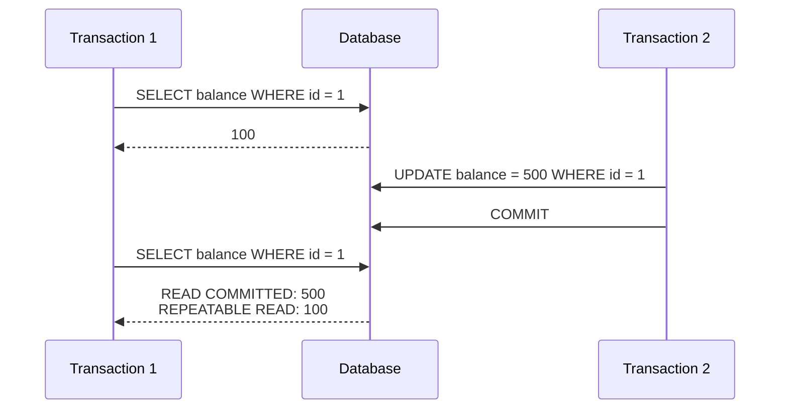
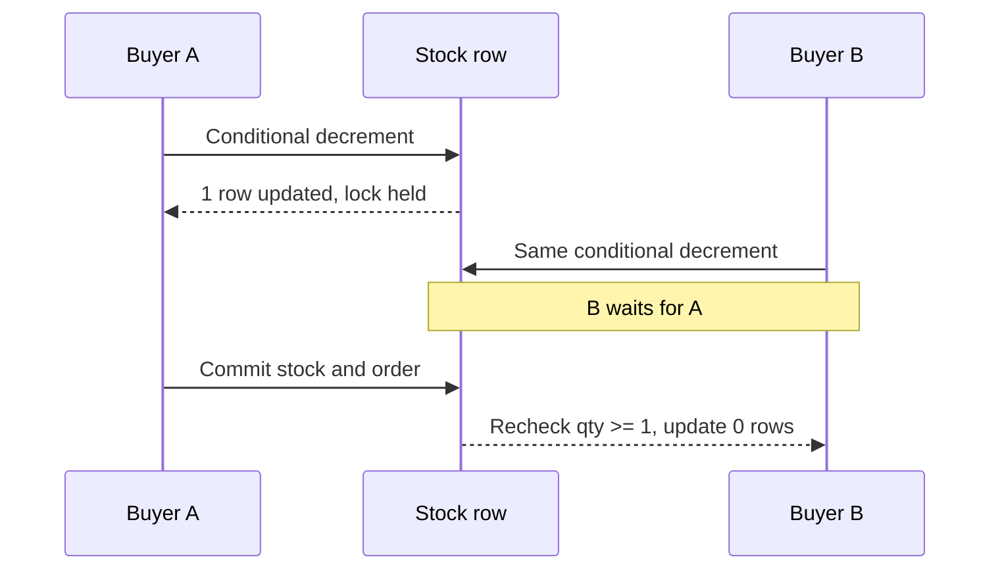
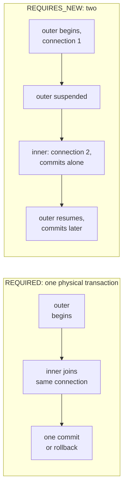
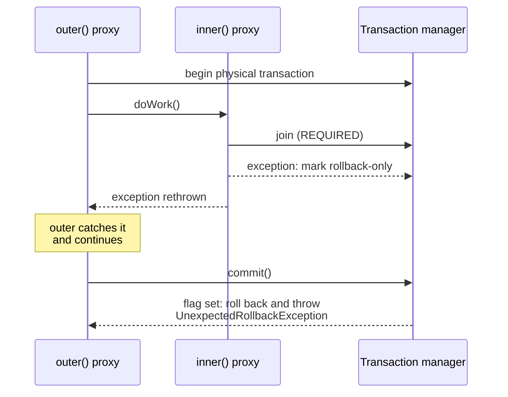
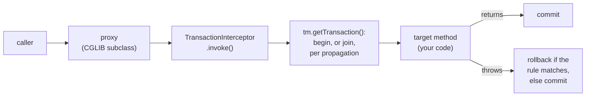
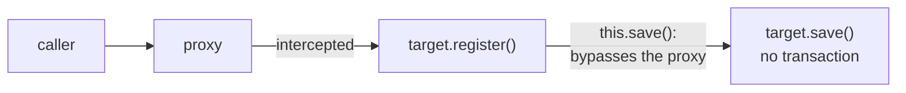

# Part 5 · Proxies, transactions and consistency

Trace a service call across its proxy and into the database. Identify the physical transaction, competing writes and the point at which rollback is still possible.

## How a Spring proxy changes a method call

Suppose the same checkout method needs timing, authorization and a transaction. Spring can inject a proxy implementing the service API. An incoming call goes through the matching interceptors before it reaches the target. Each interceptor can run code before the call, after it returns, or when it throws. The rule that selects the methods is a **pointcut**. The behavior attached to it is **advice**.

### Which calls can the proxy see?

A JDK proxy implements interfaces. A class-based proxy subclasses the target, so an overridable method is required for interception on that subclass. A final implementation method can still be reached through a JDK interface proxy. Once execution is inside the target, a call such as `this.reserve()` goes straight to the target. Any transaction already active on that thread continues, and the self-call adds no new advice. [Spring AOP proxying](https://docs.spring.io/spring-framework/reference/core/aop/proxying.html)

To test that distinction, call the Spring-managed service through its injected reference and inspect the observable result. A unit test that constructs the target with `new` is a good test of its business rules. A Spring integration test exercises the transaction interceptor as well.

## @Transactional: Isolation, Propagation, Rollback and Proxies

`@Transactional` is the most-asked Spring topic. The questions, from most to least asked: **isolation levels and what each prevents**, **what @Transactional does and where it belongs**, **propagation (REQUIRED vs REQUIRES_NEW and the rest)**, **which exceptions roll back**, **rolling back across several services**, and **how it works underneath, including why self-invocation breaks it**. Each section explains the mechanism first, then gives the answer to say out loud.

**Mental model.** If a checkout fails, start with the rows that must succeed together. Trace the call from the caller through the Spring proxy and put a box around each physical database transaction. Propagation tells you which writes share a box. Isolation tells you what a concurrent checkout can see or change while that box is open. At the end, identify who requests the commit and whether the transaction is still eligible to commit.

One SDE-2 candidate reported questions on Spring transactions, isolation levels and locking in the same round. A way to practise that combination is to take one stock reservation and explain exactly what happens when a second buyer arrives. [M2P Fintech SDE-2 interview report](https://leetcode.com/discuss/post/5270525/M2P-Fintech-or-SDE-2-or-Chennai-or-Interview-Experience/)

### 1. Transactions and ACID

A **transaction** is a group of database operations treated as one logical unit of work. Either all of them commit, or none of them take effect, and other transactions running at the same time cannot see the work half-done.

It addresses three separate failure classes, which is why ACID has more than one letter:

- **Partial failure**: one statement succeeds and a related one fails, leaving data that breaks an invariant (an amount removed from one row but never added to another).
- **Concurrency**: two transactions read and write the same rows at the same time and interfere.
- **Crashes**: the process or machine dies in the middle of writing.

The four properties, and how a database such as PostgreSQL implements each:

- **Atomicity**: all or nothing. Postgres stamps every row version with the id of the transaction that wrote it (`xmin`). A rollback does not undo anything physically; it marks that transaction id as aborted in the commit log, so its row versions are never visible. Rollback is cheap; commit is where the work is.
- **Consistency**: the database moves from one valid state to another, where "valid" means the declared constraints hold: primary and foreign keys, unique indexes, `CHECK` constraints. The database enforces only the rules it was given; business invariants that are not declared are the application's job.
- **Isolation**: concurrent transactions do not see each other's intermediate states. It is the only tunable property, and it is where nearly all of the cost of a database lives (section 2).
- **Durability**: once `COMMIT` returns, the change survives a power loss. Postgres appends every change to the **write-ahead log (WAL)** and `fsync`s it before commit returns; the data pages are written later. After a crash, the WAL is replayed. `synchronous_commit = off` trades a short window of durability for throughput.

Correction: "Consistency means the data is correct." It means the declared constraints and invariants hold before and after every transaction; the database cannot know about rules nobody declared.

Say it like this: "A transaction is a unit of work that either fully commits or fully rolls back, isolated from concurrent transactions. Atomicity handles partial failure, isolation handles concurrency, and durability handles crashes, which Postgres guarantees by flushing the write-ahead log before commit returns."

### 2. Isolation levels and what each prevents (the most-asked question)

#### The anomalies

Isolation levels are defined by which **anomalies** (read phenomena) they allow. Each anomaly is a way one transaction can observe another's work.

- **Dirty read**: reading a row another transaction has changed but not committed. If that transaction rolls back, the reader acted on a value that never existed.
- **Non-repeatable read**: reading the **same row** twice in one transaction and getting different values, because another transaction updated it and committed in between.
- **Phantom read**: running the **same range query** twice and getting a different **set of rows**, because another transaction inserted or deleted matching rows and committed in between.

The one-line distinction: a non-repeatable read is about a **row changing**; a phantom is about the **result set changing**.



Two further anomalies are not in the SQL standard's table but are asked about:

- **Lost update**: two transactions read the same value, both compute a new value from it, and both write; the second write silently discards the first. Fixed by an atomic update (`SET qty = qty - 1`), optimistic locking (`@Version`) or a row lock (`SELECT ... FOR UPDATE`).
- **Write skew**: two transactions each read an overlapping set of rows, check a condition that both see as true, and update *different* rows, together breaking the condition (two on-call records each removed because "the other one is still on call"). Row locks on the rows written do not catch it, because no row is written by both. Only true serializability prevents it.

#### The four standard levels

From weakest to strongest, each level prevents everything the one before it does, plus one more anomaly:

- **READ UNCOMMITTED**: allows dirty reads, non-repeatable reads and phantoms. Almost never useful.
- **READ COMMITTED**: prevents dirty reads. **Each statement** sees the data committed before that statement began, so two reads in one transaction can differ.
- **REPEATABLE READ**: also prevents non-repeatable reads. The **whole transaction** reads from one snapshot taken at its first statement. The standard still allows phantoms.
- **SERIALIZABLE**: prevents all of them. The outcome must equal some serial (one-after-another) execution of the transactions.

Stronger isolation means fewer anomalies and less concurrency, through more blocking, more aborts, or both.

#### How PostgreSQL actually implements them

Postgres uses **MVCC** (multi-version concurrency control): an update writes a new row version instead of overwriting, and each transaction reads the versions visible to its snapshot. Two consequences shape everything else: **readers never block writers, and writers never block readers**, and a reader can only ever see committed versions.

- **READ UNCOMMITTED behaves as READ COMMITTED.** MVCC never exposes uncommitted versions, so dirty reads are impossible at every level.
- **READ COMMITTED is the default.** A fresh snapshot per statement.
- **REPEATABLE READ is snapshot isolation**, and it also prevents phantoms, because the whole transaction reads one snapshot. The standard lists the anomalies a level must prevent; being stricter is allowed. Snapshot isolation still permits write skew.
- **SERIALIZABLE is Serializable Snapshot Isolation (SSI).** It runs like REPEATABLE READ, additionally tracks read/write dependencies between concurrent transactions with predicate (SIRead) locks, and aborts one transaction when a dependency cycle could produce a non-serializable result. This is what catches write skew.

MySQL InnoDB differs: its default is **REPEATABLE READ**, plain reads use a snapshot, and locking reads use next-key (gap) locks to block phantom inserts.

#### Abort-and-retry: SQLSTATE 40001

At REPEATABLE READ and SERIALIZABLE, Postgres does not wait for a conflict to resolve; it lets transactions proceed and **aborts** the one that would violate the level:

- `ERROR: could not serialize access due to concurrent update` (REPEATABLE READ, two transactions updating the same row)
- `ERROR: could not serialize access due to read/write dependencies among transactions` (SERIALIZABLE)

Both carry SQLSTATE **40001** (`serialization_failure`). The aborted transaction cannot be continued; the application must **retry the whole transaction from the start**, with backoff. The retry must wrap the transaction from outside, since retrying inside a transaction that is already doomed achieves nothing. Spring translates 40001 (and deadlocks, 40P01) into subclasses of `ConcurrencyFailureException`, so the retry belongs on a caller in another bean:

```java
@Service
class TransferFacade {
    private final TransferService transfers;   // a different bean: its @Transactional proxy runs per attempt

    @Retryable(retryFor = ConcurrencyFailureException.class, maxAttempts = 3,
               backoff = @Backoff(delay = 50, multiplier = 2))
    public void transfer(long from, long to, long amount) {
        transfers.transfer(from, to, amount);   // @Transactional(isolation = Isolation.REPEATABLE_READ)
    }
}
```

#### Locks: what readers and writers actually take

- A plain `SELECT` takes **no row lock** under MVCC; it reads from its snapshot.
- `UPDATE` and `DELETE` take an **exclusive row lock** automatically; a second writer to the same row waits until the first commits or rolls back.
- `SELECT ... FOR UPDATE` takes an exclusive row lock explicitly, for read-then-write logic; `SELECT ... FOR SHARE` takes a shared lock (others may read and share-lock, but not update).
- **Locks are held until the transaction ends.** This is why long transactions destroy throughput.

In JPA these appear as `@Lock(LockModeType.PESSIMISTIC_WRITE)` (`FOR UPDATE`), `PESSIMISTIC_READ` (`FOR SHARE`), and `@Version` for optimistic locking (`UPDATE ... WHERE id = ? AND version = ?`, where zero updated rows raises an `OptimisticLockException`). Optimistic locking suits rare conflicts: no locks are held and the loser retries. Pessimistic locking suits frequent, expensive conflicts, at the cost of concurrency and deadlock risk.

Often the best answer avoids both: a **conditional atomic update** such as `UPDATE stock SET qty = qty - 1 WHERE sku = ? AND qty >= 1`, followed by a check of the updated-row count. It is correct at READ COMMITTED, because the row lock taken by the `UPDATE` serialises concurrent decrements and the condition is re-checked against the latest committed version.

**Two buyers see one unit left. Can both check out?** At PostgreSQL READ COMMITTED, both buyers can read `qty = 1`, compute zero in Java and issue `SET qty = 0`. Each transaction can commit its own order. The stock count looks plausible even though two orders claimed the last unit. Now trace the conditional decrement above, using one stock row per SKU.



What if A rolls back instead? B wakes up, finds one unit available and updates one row. The application must inspect that row count. Only the buyer who updated a row creates an order, in the same transaction as the decrement. The database enforces the stock check even when both requests arrive together. [PostgreSQL READ COMMITTED semantics](https://www.postgresql.org/docs/18/transaction-iso.html#XACT-READ-COMMITTED)

#### Setting isolation in Spring

```java
@Transactional(isolation = Isolation.REPEATABLE_READ)
public void transfer(long from, long to, long amount) { ... }
```

- `Isolation.DEFAULT` (the default) uses the database's default: READ COMMITTED on Postgres and Oracle, REPEATABLE READ on MySQL InnoDB.
- The transaction manager sets the level on the JDBC connection when the transaction begins and restores it when the connection is released. With `JpaTransactionManager`, this needs a dialect that supports it (`HibernateJpaDialect` does; the generic dialect throws `InvalidIsolationLevelException` for anything but the default).
- Isolation only applies when a new transaction starts. A method that joins an existing transaction (propagation REQUIRED) runs at the outer transaction's level.

Correction: "Use SERIALIZABLE everywhere to be safe." It multiplies aborts under load and every caller must retry. The sound approach is READ COMMITTED by default, a stronger level only for the operation that needs it, and retry on 40001.

Say it like this: "Isolation levels are defined by the anomalies they allow: dirty reads, non-repeatable reads, where the same row changes, and phantoms, where the result set changes. READ COMMITTED prevents dirty reads, REPEATABLE READ also non-repeatable reads, SERIALIZABLE everything. Postgres uses MVCC, so readers never block writers and dirty reads are impossible; its REPEATABLE READ is snapshot isolation, which also stops phantoms, and SERIALIZABLE adds SSI, which catches write skew. At those two levels Postgres aborts conflicting transactions with SQLSTATE 40001, so I retry the whole transaction from outside. I stay on READ COMMITTED by default and often avoid locking entirely with a conditional atomic UPDATE."

### 3. What @Transactional does, and where it belongs

#### Declarative transaction boundaries

`@Transactional` declares a **transaction boundary** around a method: Spring begins a transaction before the method runs, commits when it returns normally, and rolls back when a `RuntimeException` or `Error` escapes. Every repository call inside the method uses the same connection and the same transaction, so several writes commit or roll back together.

```java
@Service
public class OrderService {
    @Transactional
    public void placeOrder(OrderRequest r) {      // one transaction for the whole use case
        stockRepository.decrement(r.sku(), r.qty());
        orderRepository.save(Order.from(r));
        paymentRepository.save(Payment.pending(r));
    }
}
```

#### Where to put it: the service layer

- **Service methods**, one per use case. A use case is the unit that must be atomic.
- **Not controllers**: that couples HTTP handling to the database and stretches the transaction over serialisation and network time.
- **Not only repositories**: Spring Data's `SimpleJpaRepository` is already annotated `@Transactional(readOnly = true)` at class level, with `@Transactional` on `save`, `delete` and the other writes. A bare repository call therefore works on its own, but **each call is its own transaction**. Two repository calls are atomic only inside a service-level transaction.

#### Class level vs method level

On a class, the annotation applies to every eligible method. A method-level annotation **overrides** the class-level one completely (the attributes are not merged):

```java
@Service
@Transactional(readOnly = true)                 // default for every method
public class ReportService {
    public List<Row> fetch() { ... }            // read-only, from the class

    @Transactional                              // read-write, overrides the class
    public void refreshSummary() { ... }
}
```

Spring resolves the attribute in this order, stopping at the first match (`AbstractFallbackTransactionAttributeSource`):

1. the method on the target class (most specific);
2. the target class;
3. the method as declared on the interface;
4. the interface or declaring class.

Spring's guidance is to **annotate concrete classes, not interfaces**. Since Spring 5.0, interface annotations are detected for both JDK and CGLIB proxies, but Java annotations are not inherited from interfaces, so AspectJ weaving mode does not see them, and the concrete class makes the boundary visible where the code is.

Correction: "With CGLIB proxies, @Transactional on an interface is ignored." That was true before Spring 5.0. It now works for proxies; the recommendation to annotate the class remains.

#### Which methods can be transactional

- **public**: always.
- **protected and package-private**: since Spring Framework 6.0, with class-based (CGLIB) proxies only. A JDK dynamic proxy implements the interface, and interface methods are public, so it can only ever intercept public methods.
- **private, final, static**: never with proxies. A CGLIB proxy is a generated subclass, and it cannot override these.
- **Called from another method of the same bean**: no (section 7).

Spring Boot uses CGLIB proxies by default (`spring.aop.proxy-target-class=true` since Boot 2.0), so non-public methods work on Boot 3.

Correction: "@Transactional only works on public methods." That was the rule until Spring 6.0.

#### Attributes worth knowing

```java
@Transactional(
    propagation = Propagation.REQUIRED,
    isolation = Isolation.DEFAULT,
    readOnly = false,
    timeout = 10,                          // seconds
    rollbackFor = Exception.class,
    transactionManager = "primaryTransactionManager"
)
```

- **readOnly = true** is more than a hint. Hibernate switches the session to `FlushMode.MANUAL` and read-only mode, so it skips dirty checking and does not keep entity snapshots, which saves memory and CPU on large reads. Spring marks the JDBC connection read-only, and Postgres then runs the transaction read-only and rejects writes. A routing data source can use the flag to send the transaction to a read replica. Use it on every read path.
- **timeout** is applied to the JDBC statements of the transaction (as a query timeout from the remaining time) and checked before each statement. It does not interrupt Java code running between statements. Database-side `statement_timeout` and `idle_in_transaction_session_timeout` are the real safety net.
- **transactionManager** selects a bean by name when there are several data sources.

**Can an inner method strengthen the caller's guarantees?** Suppose a READ COMMITTED checkout calls a second bean whose method declares REQUIRED and SERIALIZABLE. By default the inner query still runs at READ COMMITTED. Put the required isolation on the service that starts the atomic operation. The same reasoning applies when a read-only service calls a write repository. It keeps the outer transaction's settings. Whether a write is rejected depends on the driver and database, so use `readOnly` for read optimizations and database permissions for access control. [Spring propagation rules](https://docs.spring.io/spring-framework/reference/data-access/transaction/declarative/tx-propagation.html) · [Spring Data JPA transaction settings](https://docs.spring.io/spring-data/jpa/reference/jpa/transactions.html)

#### Declarative vs programmatic transactions

`@Transactional` makes the boundary the whole method. When the boundary must be narrower, or chosen at run time, use **`TransactionTemplate`**:

```java
public void placeOrder(OrderRequest r) {
    Quote quote = pricingClient.quote(r);            // remote call OUTSIDE the transaction

    Order order = tx.execute(status -> {             // transaction starts here
        stockRepository.decrement(r.sku(), r.qty());
        Order o = orderRepository.save(Order.from(r, quote));
        if (o.total() <= 0) status.setRollbackOnly();
        return o;
    });                                              // and commits here

    notifications.orderPlaced(order);               // OUTSIDE the transaction
}
```

`TransactionTemplate` involves no proxy, so it also works for calls within the same class. The raw `PlatformTransactionManager` API (`getTransaction`, `commit`, `rollback`) is the level underneath and is rarely used directly. Declarative is the default for business code; programmatic is for narrow boundaries, batch loops that commit in chunks, and keeping slow I/O out of the transaction.

**What happens to the notification when the total is zero?** Trace the example above assuming `tx.execute` started the transaction. The callback marks it rollback-only and returns an `Order`. The template rolls back and can still return that Java object, so the next line can announce an order that was never committed. Throw an unchecked validation exception inside the callback and let it escape `placeOrder` to skip that line. If delivery must also survive a process crash after commit, use the outbox in section 6. [Spring programmatic rollback](https://docs.spring.io/spring-framework/reference/data-access/transaction/programmatic.html)

#### Keep transactions short

A transaction holds a pooled connection for its whole duration, and row locks until it ends. A remote HTTP call inside a transaction holds both for the length of the call. Under load, the connection pool empties and every request waits on it, even though the database is idle. Remote calls, file I/O and message publishing belong before or after the transaction, never inside it.

#### Persistence-context effects that surface at commit

- **`save()` does not run SQL immediately.** Hibernate queues inserts and updates and flushes them at commit, or before a query that needs them. A constraint violation therefore often appears at commit time, thrown by the proxy after the method body, outside any try/catch inside the method. `saveAndFlush()` or `flush()` surfaces it earlier.
- **Open-in-view.** Spring Boot enables `spring.jpa.open-in-view` by default and logs a warning: the persistence context stays open for the whole HTTP request, so lazy loading works in controllers and views. It hides `LazyInitializationException`, holds a connection longer, and conceals N+1 queries. Set it to `false` and load what each use case needs explicitly (join fetch, entity graphs, DTO projections).
- **Tests.** A `@Transactional` test method rolls back after the test by default (`@Commit` changes that). The test then never exercises a real commit, so commit-time failures stay hidden.

Say it like this: "@Transactional declares a transaction boundary: Spring begins a transaction before the method, commits on return and rolls back on unchecked exceptions, so all repository calls inside are atomic. I put it on service methods, one per use case, use readOnly for queries, and keep remote calls outside the transaction, with TransactionTemplate when I need a boundary narrower than a method."

### 4. Propagation

**Propagation** decides what happens when a transactional method is called while a transaction may already exist. Two terms make it precise:

- A **physical transaction** is one real database transaction on one connection.
- A **logical transaction** is the scope of one `@Transactional` method. Several logical transactions can share one physical transaction.

#### The seven types

- **REQUIRED** (the default): join the existing transaction; if there is none, start one. A whole call chain shares one physical transaction, so a failure anywhere rolls back everything.
- **REQUIRES_NEW**: always start a new, independent physical transaction. If one exists, it is **suspended** (its connection unbound from the thread) and resumed afterwards. The inner transaction commits or rolls back on its own.
- **NESTED**: if a transaction exists, create a **savepoint** inside it (same physical transaction, same connection); if not, behave like REQUIRED. The inner work can roll back to the savepoint without affecting the outer work.
- **SUPPORTS**: join a transaction if one exists; otherwise run without one, where each statement auto-commits separately.
- **MANDATORY**: join the existing transaction; if there is none, throw `IllegalTransactionStateException`. A guard for helpers that must never run on their own.
- **NOT_SUPPORTED**: suspend any existing transaction and run without one. For long reads that should not hold a transaction open.
- **NEVER**: run without a transaction; if one exists, throw `IllegalTransactionStateException`.



#### REQUIRES_NEW: uses and hazards

The legitimate uses are writes that must survive the caller's rollback: audit records, failure logs, "record the attempt even if the operation fails".

Its hazards are the most common follow-up in this topic:

1. **A second connection while holding the first.** While the inner transaction runs, the thread holds two pooled connections. If the number of concurrent requests in that code path reaches the pool size, every thread holds one connection and waits for a second that no one will release. Nothing fails at once; requests hang until the pool's acquisition timeout (HikariCP's `connectionTimeout`, 30 seconds by default).
2. **It cannot see the outer transaction's uncommitted rows.** It is a different transaction, so rows the outer one inserted but has not committed are invisible to it. Passing it an entity that is not yet committed leads to missing-row and foreign-key errors.
3. **Self-deadlock on a row lock.** If the outer transaction has updated or `FOR UPDATE`-locked a row and the inner transaction writes the same row, the inner one waits for a lock held by its own suspended caller. The database sees no cycle (the outer transaction is idle, not waiting on a lock), so it does not detect a deadlock; the thread waits until a lock or statement timeout.
4. **Independent outcomes.** If the inner transaction commits and the outer one then rolls back, the inner data stays. That is the point for an audit log and a data-integrity bug for business data.

Correction: "A REQUIRES_NEW call inside a loop takes one connection per iteration." Each inner transaction returns its connection when it commits; one thread needs at most two at a time. Pool exhaustion comes from concurrency: many threads each holding one and waiting for a second.

#### NESTED: savepoints, and why it fails with JPA

NESTED keeps one physical transaction and uses a JDBC savepoint: an inner failure rolls back to the savepoint and the outer transaction continues, but if the **outer** transaction rolls back, the nested work is lost with it. That is the key difference from REQUIRES_NEW, whose committed work survives an outer rollback.

It requires savepoint support from the transaction manager. `DataSourceTransactionManager` (JDBC, `JdbcTemplate`, MyBatis) supports it. With `JpaTransactionManager` and Hibernate, Spring's JPA dialect exposes no savepoint support and the call fails with `NestedTransactionNotSupportedException`; JPA itself has no concept of nested transactions.

Say it like this: "Propagation decides what a transactional method does when a transaction may already exist. REQUIRED, the default, joins or starts one, so the whole chain is one physical transaction. REQUIRES_NEW suspends the caller and runs an independent transaction on a second connection, which suits audit logs, but it can exhaust the pool under concurrency and can deadlock on rows the caller has locked. NESTED uses a savepoint in the same transaction, so it dies with the outer rollback, and it does not work with JPA and Hibernate. The other four only join, suspend, require or forbid a transaction."

### 5. Rollback rules

#### The default

> Spring rolls back on **`RuntimeException`** and **`Error`**, and **commits** on checked exceptions.

```java
@Transactional
public void importFile(Path p) throws IOException {
    repository.save(entity);
    throw new IOException("unreadable");    // checked: the transaction COMMITS, the row is saved
}
```

The default comes from EJB conventions: a checked exception is a declared business outcome the caller is expected to handle, while an unchecked exception signals a bug or system failure. It is overridden per method or class:

```java
@Transactional(rollbackFor = Exception.class)                       // roll back on everything
@Transactional(noRollbackFor = DuplicateRequestException.class)     // commit despite this one
```

The decision is made in the interceptor: `completeTransactionAfterThrowing` asks the transaction attribute whether the exception matches a rollback rule, then rolls back or commits.

#### A swallowed exception commits

Spring only learns about an exception that **escapes the proxied method**:

```java
@Transactional
public void process() {
    try {
        repository.save(entity);
        riskyStep();
    } catch (RuntimeException e) {
        log.error("step failed", e);    // swallowed: nothing escapes, so the transaction COMMITS
    }
}
```

To keep handling the exception and still roll back, mark the transaction explicitly with `TransactionAspectSupport.currentTransactionStatus().setRollbackOnly()`, or rethrow.

#### UnexpectedRollbackException: the rollback-only flag

This is the most-asked rollback trap. An outer and an inner method are both `REQUIRED`, in different beans; the inner one throws, and the outer one catches and carries on:

```java
@Transactional
public void outer() {
    repository.save(a);
    try {
        inner.doWork();             // @Transactional (REQUIRED): joins the same physical transaction
    } catch (RuntimeException e) {
        log.warn("ignored", e);
    }
}                                   // commit fails here
```

The result: `UnexpectedRollbackException: Transaction rolled back because it has been marked as rollback-only`.



The mechanism: because inner joined the existing physical transaction, it cannot roll that transaction back on its own when it fails. It marks the shared transaction **rollback-only** instead. Outer caught the exception, so it requests a commit; the transaction manager finds the flag, rolls back, and throws so the caller is not misled into believing the work was saved.

Fixes, depending on intent:
- If the inner work is genuinely optional and independent, make inner `REQUIRES_NEW`, so its failure rolls back only its own transaction.
- If the outer transaction cannot succeed without the inner work, do not catch the exception; let it propagate.
- If the inner work should be undoable while keeping the outer work, NESTED does this with JDBC savepoints (not with JPA).

Correction: "Catching the exception lets the outer transaction continue normally." Once a joined inner transaction has failed, the shared transaction is already doomed.

Say it like this: "By default Spring rolls back on unchecked exceptions and errors and commits on checked ones; rollbackFor changes that. An exception caught inside the method never reaches the proxy, so the transaction commits. And if a REQUIRED inner method throws, it marks the shared transaction rollback-only, so when the outer method catches the exception and tries to commit, Spring rolls back and throws UnexpectedRollbackException. The fix is REQUIRES_NEW if the inner work is independent, or letting the exception propagate."

### 6. Transactions across services

A local transaction covers **one resource** (one database, through one transaction manager). Work that spans several services, or a database and a message broker, has no shared transaction, and two problems appear.

#### The dual-write problem

```java
@Transactional
public void placeOrder(OrderRequest r) {
    orderRepository.save(Order.from(r));
    kafkaTemplate.send("order-created", event);   // sent even if the transaction later rolls back
}
```

The database write and the message are two separate systems. The message may go out for an order that is then rolled back, or the commit may succeed and the send fail.

- **`@TransactionalEventListener(phase = TransactionPhase.AFTER_COMMIT)`** runs a listener only after the transaction commits, so a rolled-back order publishes nothing. It narrows the problem but does not close it: the process can still die between the commit and the send. If no transaction is active when the event is published, the listener does not run unless `fallbackExecution = true`.
- **The transactional outbox** closes it: the service writes the event to an `outbox` table **in the same local transaction** as the business data, and a separate relay (a poller, or change data capture such as Debezium) publishes outbox rows to the broker and marks them sent. The event exists if and only if the business change committed. Delivery becomes at-least-once, so consumers must be idempotent.

#### Coordinating several services

- **Two-phase commit (XA)**, through `JtaTransactionManager`: a coordinator asks every resource to prepare, then to commit. It gives atomicity across resources, but it is slow, holds locks across the network, blocks when the coordinator fails, and many modern stores and brokers do not support it. It is rarely used between microservices.
- **Saga**: a sequence of local transactions, one per service, each publishing an event or replying to a coordinator. If a step fails, **compensating transactions** undo the completed steps in reverse (release reserved stock, refund a payment). **Choreography** (services react to each other's events) suits short flows; **orchestration** (a coordinator drives the steps and compensations) suits flows with many steps or branches. A saga gives eventual consistency, not isolation: other requests can see the intermediate states, so steps are designed with that in mind (pending states, semantic locks).
- Every step and every compensation must be **idempotent**, keyed by a request or saga id, because retries and redeliveries are normal.

Say it like this: "@Transactional covers one database. Across services I use a saga: each service commits its local step, and on failure compensating actions undo the completed steps in reverse. Every step is idempotent, and each service publishes its events through a transactional outbox, so the database change and the event can never diverge. I'd avoid two-phase commit between services because it is slow and blocks when the coordinator fails."

### 7. How it works underneath, and why self-invocation fails

#### The infrastructure

Spring Boot's `TransactionAutoConfiguration` has the same effect as `@EnableTransactionManagement`, which imports `ProxyTransactionManagementConfiguration`. That registers three beans:

- **`AnnotationTransactionAttributeSource`** reads `@Transactional` and turns it into a `TransactionAttribute` (propagation, isolation, timeout, read-only, rollback rules).
- **`TransactionInterceptor`**, a `MethodInterceptor`: the advice.
- **`BeanFactoryTransactionAttributeSourceAdvisor`**: the advisor, pairing the advice with a pointcut.

The pointcut is `TransactionAttributeSourcePointcut`. Instead of an AspectJ expression, it asks the attribute source whether a method has a transaction attribute, which is equivalent to `@within(Transactional) || @annotation(Transactional)`.

#### Proxy creation

At startup, `AbstractAutoProxyCreator`, a `BeanPostProcessor`, checks each bean after initialisation. If the pointcut matches any of its methods, it wraps the bean in a proxy (CGLIB by default in Spring Boot). The proxy, not the original object, is what the container injects everywhere.

#### The call path



`TransactionInterceptor.invoke()` delegates to `TransactionAspectSupport.invokeWithinTransaction()`, which is the around advice. Simplified:

```java
TransactionAttribute txAttr = tas.getTransactionAttribute(method, targetClass);
TransactionManager tm = determineTransactionManager(txAttr);
TransactionInfo txInfo = createTransactionIfNecessary(tm, txAttr, joinpointId);  // begin or join
Object result;
try {
    result = invocation.proceedWithInvocation();     // the target method runs here
} catch (Throwable ex) {
    completeTransactionAfterThrowing(txInfo, ex);    // rollback if the rule matches, else commit
    throw ex;
} finally {
    cleanupTransactionInfo(txInfo);                  // restore the previous transaction info
}
commitTransactionAfterReturning(txInfo);             // commit
return result;
```

#### Where the transaction lives: a ThreadLocal

The active transaction's resources are bound to the current thread by **`TransactionSynchronizationManager`**, which keeps `ThreadLocal` maps from each `DataSource` (or `EntityManagerFactory`) to its connection holder. Two consequences:

- `JdbcTemplate`, `EntityManager` and repositories inside the method find the same connection without any parameter passing.
- **A transaction never crosses threads.** Work started with `@Async`, `CompletableFuture`, `parallelStream()` or any executor runs on a thread with no transaction bound, so it is not part of the caller's transaction.

#### Transaction managers

- `DataSourceTransactionManager`: plain JDBC, `JdbcTemplate`, MyBatis.
- `JpaTransactionManager`: Spring Data JPA with Hibernate; what Spring Boot configures for JPA applications. It also exposes the transaction to JDBC code on the same `DataSource`.
- `JtaTransactionManager`: XA transactions across several resources.
- `KafkaTransactionManager`: Kafka producer transactions. (`ChainedTransactionManager`, once used to combine managers, is deprecated.)

With several data sources, each manager is a named bean and a method selects one with `@Transactional("ordersTransactionManager")`.

#### Self-invocation

```java
@Service
public class AccountService {
    public void register(Account a) {
        save(a);                    // a plain call on `this`: no transaction
    }

    @Transactional
    public void save(Account a) {
        repository.save(a);
    }
}
```

The proxy intercepts only calls that arrive **through the proxy**. Inside `register`, the code is already executing on the target object, and `save(a)` means `this.save(a)`, a direct Java call on the target. It never passes through the interceptor, so no transaction begins.



**What if the caller already has a transaction?** Suppose a proxied checkout writes an order, calls a helper annotated REQUIRES_NEW to write an audit row, then throws an unchecked exception. Assume both use the same database and the audit row can stand alone.

| How checkout calls the helper | Which rows survive? |
|---|---|
| `this.recordAttempt()` | Neither. The self-call bypasses the inner annotation. Both writes use checkout's active transaction. |
| `auditService.recordAttempt()` through the injected proxy | The audit row survives. Its transaction commits before checkout resumes and rolls back the order. |

To prove the difference, call checkout through its injected bean from an integration test with no surrounding test transaction. Catch the expected exception in the test, then query both tables in a fresh transaction. Checking both rows also catches the case where an independent audit write was accidentally folded into the checkout. [Spring proxy semantics](https://docs.spring.io/spring-framework/reference/data-access/transaction/declarative/annotations.html) · [Spring test transactions](https://docs.spring.io/spring-framework/reference/testing/testcontext-framework/tx.html)

The same limitation applies to every proxy-based annotation: `@Async`, `@Cacheable`, `@Retryable`, `@PreAuthorize`.

Fixes, from best to worst:

1. **Move the method to another bean.** The call then goes through that bean's proxy. Almost always the right design.
2. **Use `TransactionTemplate`** inside the method, which needs no proxy.
3. **Self-injection**: inject the bean into itself (`@Autowired @Lazy private AccountService self;`, where `@Lazy` avoids a circular-reference failure) and call `self.save(a)`.
4. **`AopContext.currentProxy()`**, with `@EnableAspectJAutoProxy(exposeProxy = true)`. Works, but couples code to Spring AOP.
5. **AspectJ weaving** (`@EnableTransactionManagement(mode = AdviceMode.ASPECTJ)`): the transaction logic is woven into the class bytecode, so self-calls and even private methods work. It needs the AspectJ weaver at build or load time, and is rarely worth it.

Correction: "This is a Spring bug." It is an inherent property of proxy-based AOP: a call from inside the object does not cross the proxy boundary.

#### Why a transactional method silently has no transaction

Every common cause comes from the mechanism above:

- the method is called from inside the same bean (self-invocation);
- the method is private, final or static, or non-public with a JDK proxy;
- the object was created with `new` instead of being a Spring bean, so it has no proxy;
- the method is called from the bean's own `@PostConstruct`: the proxy is created after initialisation, and the call is a self-call anyway (use an `ApplicationReadyEvent` listener instead);
- the work runs on another thread (`@Async`, an executor);
- a checked exception was thrown, or an exception was swallowed, so the transaction committed instead of rolling back.

Say it like this: "Spring wraps the bean in a proxy. A call through the proxy goes to TransactionInterceptor, whose invokeWithinTransaction begins or joins a transaction per the propagation, calls my method, and commits or rolls back by the rollback rules. The transaction is bound to the thread through TransactionSynchronizationManager. A call from inside the same class goes to this, not to the proxy, so no transaction starts; I fix it by moving the method to another bean or using TransactionTemplate."

**Recall** without looking, draw the proxy call path from caller to commit and mark where self-invocation bypasses it, then draw the UnexpectedRollbackException sequence and explain in two sentences why the commit fails and which propagation would avoid it.

## Interview practice

Two buyers claim the last unit while checkout also writes an audit row. Draw the transaction boundaries and predict the result if checkout fails. Change only the call to the audit helper from an injected bean to a self-call and predict the rows again.

<details>
<summary>Walk through the case</summary>

Check the row count of a conditional stock decrement before inserting the order in the same transaction. If checkout rolls back, the unit is available again. An independent audit transaction can survive if its row does not require the uncommitted order. A self-call bypasses REQUIRES_NEW, so the audit row rolls back with checkout.

</details>

### How a Spring proxy changes a method call

7 of the 1,592 candidate write-ups in the Oct 2024 – Oct 2026 review mentioned this lesson. Each count below belongs to its question.

<details>
<summary>What is AOP, and how does Spring AOP work internally?</summary>

**AOP** pulls cross-cutting concerns (logging, transactions, security, metrics) out of business code.

Spring AOP is **proxy-based**: at startup a `BeanPostProcessor` wraps matching beans in a proxy; calls go proxy → advice → your method. Terms: **aspect** (the class), **advice** (the code: `@Before`, `@After`, `@AfterReturning`, `@AfterThrowing`, `@Around`), **pointcut** (which methods), **join point** (a method call).

`@Transactional`, `@Async`, `@Cacheable`, `@PreAuthorize` all work this way — which is why they all fail on self-invocation.

*7 candidate write-ups · Citi · EPAM · Kotak Mahindra Bank · Mastercard · MobiKwik · Paytm*

</details>

<details>
<summary>Write a custom annotation with an @Around aspect (e.g. log execution time).</summary>

```java
@Retention(RUNTIME) @Target(METHOD)
public @interface LogTime {}

@Aspect @Component
class LogTimeAspect {
  @Around("@annotation(LogTime)")
  Object time(ProceedingJoinPoint pjp) throws Throwable {
    long t = System.nanoTime();
    try { return pjp.proceed(); }
    finally { log.info("{} took {} ms", pjp.getSignature(), (System.nanoTime() - t) / 1_000_000); }
  }
}
```

Mention it won't fire for calls from inside the same class.

*1 candidate write-up · MobiKwik*

</details>

### @Transactional: Isolation, Propagation, Rollback and Proxies

42 of the 1,592 candidate write-ups in the Oct 2024 – Oct 2026 review mentioned this lesson. Each count below belongs to its question.

<details>
<summary>What are the isolation levels, and what does each prevent?</summary>

| Level | Dirty read | Non-repeatable read | Phantom |
|---|---|---|---|
| READ UNCOMMITTED | ✗ possible | possible | possible |
| READ COMMITTED (Postgres/Oracle default) | prevented | possible | possible |
| REPEATABLE READ (MySQL InnoDB default) | prevented | prevented | possible* |
| SERIALIZABLE | prevented | prevented | prevented |

*InnoDB and Postgres block most phantoms at REPEATABLE READ anyway.

Set per method: `@Transactional(isolation = Isolation.REPEATABLE_READ)`. Higher isolation = fewer anomalies, more locking/retries.

*18 candidate write-ups · Paytm · Adobe · Agoda · Autodesk · Cisco · Cognizant · Locus · Park+ · PayPay · Safe Security · Target · True Balance*

</details>

<details>
<summary>What does @Transactional do, and where should you put it?</summary>

It makes a method run inside one database transaction: everything commits together or rolls back together.

Put it on **service** methods (a use case), not on controllers or repositories. Keep transactions short: no remote HTTP calls or long waits inside — they hold a DB connection and locks the whole time.

`@Transactional(readOnly = true)` for queries: Hibernate skips dirty checking and the driver may route to a replica.

*12 candidate write-ups · Cognizant · EPAM · Knot Solutions · Morgan Stanley · Paytm · Qualcomm · True Balance · Yes Madam · athenahealth*

</details>

<details>
<summary>Transaction propagation — REQUIRED vs REQUIRES_NEW (and the others)?</summary>

- **REQUIRED** (default): join the current transaction or start one.
- **REQUIRES_NEW**: suspend the current one and run in a brand-new transaction that commits/rolls back on its own — e.g. write an **audit log** that must survive the outer rollback.
- **NESTED**: savepoint inside the current transaction (JDBC only).
- **SUPPORTS / NOT_SUPPORTED / MANDATORY / NEVER**: use / suspend / require / forbid an existing transaction.

REQUIRES_NEW needs a second DB connection — under load it can exhaust the pool.

*7 candidate write-ups · Google · Blinkit · Rakuten · Uber · Waymo*

</details>

<details>
<summary>Which exceptions roll back a @Transactional method by default?</summary>

By default: **unchecked** exceptions (`RuntimeException`, `Error`) roll back; **checked** exceptions **commit**.

Change it with `@Transactional(rollbackFor = Exception.class)` or `noRollbackFor`.

Traps: catching the exception inside the method (nothing propagates → commit); a `REQUIRED` inner method that throws marks the shared transaction **rollback-only**, so the outer commit fails with `UnexpectedRollbackException`.

*6 candidate write-ups · Cleartrip · Knot Solutions · Paytm · Visa*

</details>

<details>
<summary>An order touches payment, inventory and receipt services — how do you roll back across them?</summary>

`@Transactional` covers **one** database. Across services there is no shared transaction (2PC is slow and brittle), so use a **saga**:
- each service commits its local step and publishes an event,
- on failure, run **compensating actions** in reverse (release inventory, refund payment),
- make every step and compensation **idempotent**, and use the **outbox pattern** so the DB write and the event can't diverge.

Choreography (events) for simple flows, orchestration (one coordinator) when there are many steps.

*4 candidate write-ups · Lenovo · Salesforce*

</details>

<details>
<summary>How does @Transactional work under the hood — and why does it fail on self-invocation?</summary>

Spring wraps the bean in a **proxy** (CGLIB or JDK). A call that comes *through the proxy* opens a transaction (via `PlatformTransactionManager`), calls your method, then commits — or rolls back on an exception.

`this.save()` inside the same class **skips the proxy**, so the inner annotation is ignored. Same story for `private`/`final` methods and objects created with `new`.

Fixes: move the method to another bean, inject the bean into itself (`@Lazy` self-reference), or use `TransactionTemplate`.

*2 candidate write-ups · Mastercard · Paytm*

</details>

<!-- Generated by scripts/genCoreStack.mjs from the individual master notes, interview evidence and springCourse.mjs. -->
