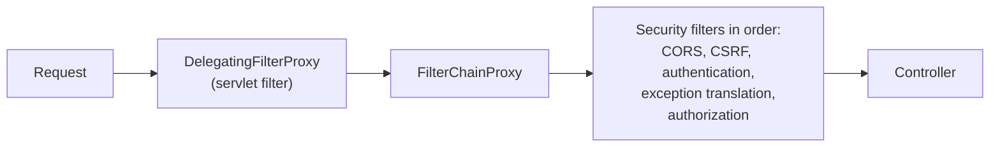
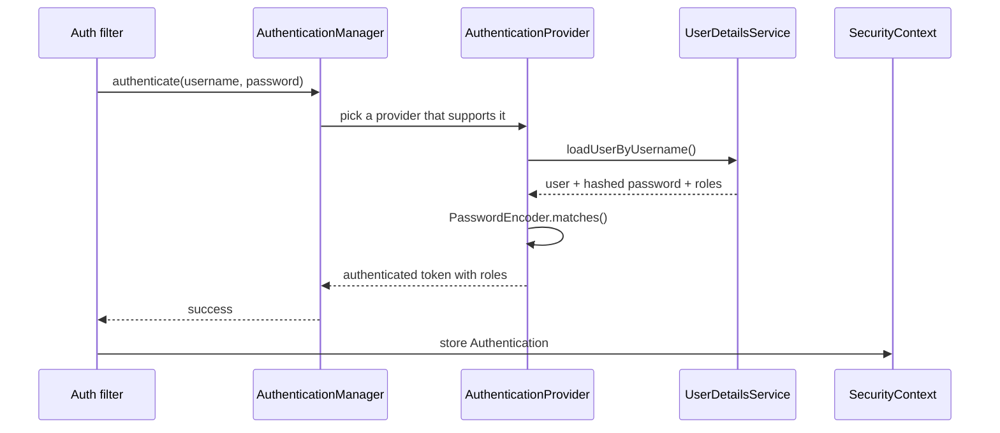
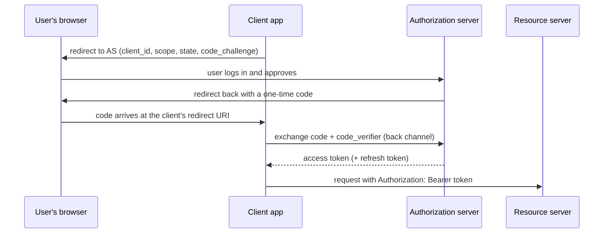
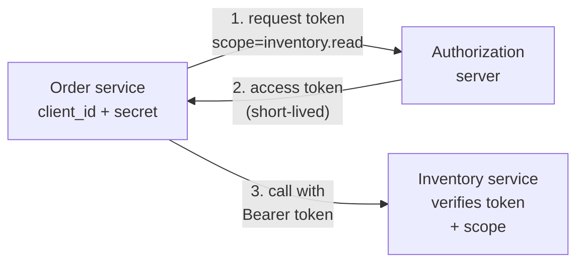
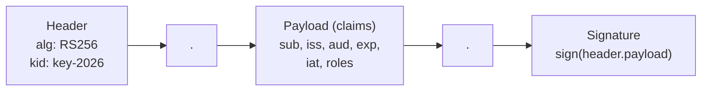
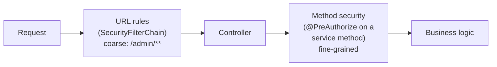
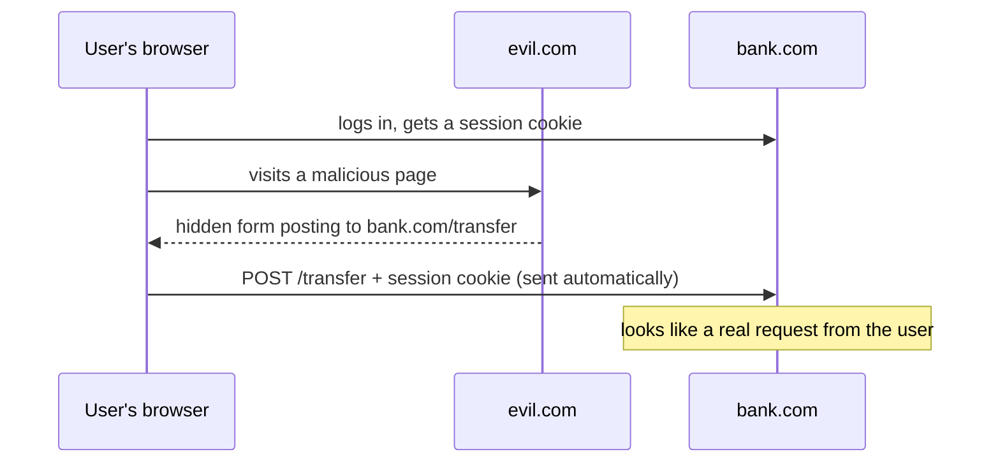
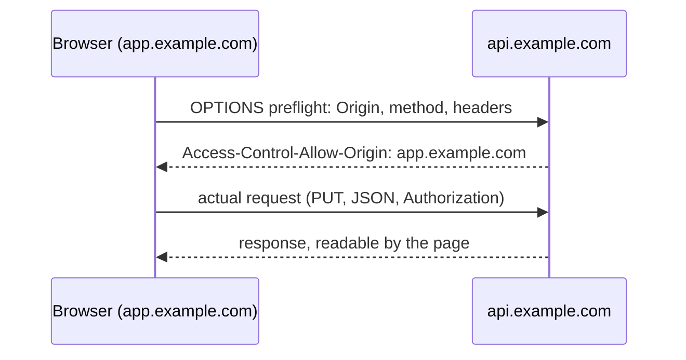

# Part 6 · Securing a request from token to method

Follow a credential from issuance through verification and authorization. Then ask what changes when a browser sends the credential automatically.

## Spring Security Architecture

What interviews ask, most frequent first: **how Spring Security works (the filter chain and the authentication flow)**, **authentication vs authorization and 401 vs 403**, **stateful sessions vs stateless tokens**, **where users and passwords come from**, and **how you secure a REST API**.

### 1. Authentication vs authorization, 401 vs 403

- **Authentication** answers "**who are you?**": checking a password, a token or a certificate.
- **Authorization** answers "**what may you do?**": checking roles or permissions for this action.
- **401 Unauthorized** means authentication failed or is missing: no token, an expired token, a wrong password. (The name is misleading; it really means "unauthenticated".)
- **403 Forbidden** means you are authenticated but not allowed: a normal user calling an admin endpoint.

Say it like this: "Authentication proves who you are, authorization decides what you can do. 401 means we don't know who you are; 403 means we know, and the answer is no."

### 2. How Spring Security works: the filter chain

Spring Security is a **chain of servlet filters** that runs **before** your controllers. Every request passes through it.



1. **DelegatingFilterProxy** is a plain servlet filter registered with Tomcat. It hands the request to a Spring bean.
2. **FilterChainProxy** is that bean. It picks the right **SecurityFilterChain** for the URL (you can have different chains for `/api/**` and `/admin/**`).
3. The chain's filters run in a fixed order. The ones worth naming:
   - **CorsFilter** and **CsrfFilter**: browser-related protections.
   - **An authentication filter**: `UsernamePasswordAuthenticationFilter` for form login, `BearerTokenAuthenticationFilter` for JWTs, `BasicAuthenticationFilter` for basic auth. It extracts credentials and authenticates them.
   - **ExceptionTranslationFilter**: turns security exceptions into responses: 401 for "not authenticated", 403 for "access denied".
   - **AuthorizationFilter**: the last one; checks the URL rules (`hasRole("ADMIN")`) before the request reaches the controller.

You configure all of this with a `SecurityFilterChain` bean:

```java
@Bean
SecurityFilterChain api(HttpSecurity http) throws Exception {
    return http
        .authorizeHttpRequests(a -> a
            .requestMatchers("/public/**").permitAll()
            .requestMatchers("/admin/**").hasRole("ADMIN")
            .anyRequest().authenticated())
        .oauth2ResourceServer(o -> o.jwt(Customizer.withDefaults()))
        .build();
}
```

Say it like this: "Spring Security is a chain of servlet filters in front of DispatcherServlet. DelegatingFilterProxy hands requests to FilterChainProxy, which picks the matching SecurityFilterChain. An authentication filter extracts and verifies credentials, ExceptionTranslationFilter turns failures into 401 or 403, and the authorization filter checks access rules before the controller runs."

### 3. The authentication flow



1. The authentication filter builds an unauthenticated token from the request (username and password, or a bearer token).
2. **AuthenticationManager** (usually `ProviderManager`) passes it to an **AuthenticationProvider** that supports that token type.
3. For username and password, `DaoAuthenticationProvider` loads the user through **UserDetailsService** and checks the password with the **PasswordEncoder**.
4. On success, the resulting `Authentication` (with the user's roles) is stored in the **SecurityContext**, held per request in a `ThreadLocal` through `SecurityContextHolder`. Controllers and later filters read it from there.
5. On failure, an exception is raised and translated into a 401.

### 4. Where users and passwords come from

- **UserDetailsService** has one method, `loadUserByUsername`. You implement it to load users from your database (or use the built-in in-memory or JDBC versions for demos).
- **Passwords are never stored in plain text or with fast hashes like MD5 or SHA-256.** Use a slow, salted algorithm: **BCrypt** (Spring's default through `PasswordEncoderFactories`), or Argon2 or PBKDF2. Slow hashing makes brute-forcing stolen hashes impractical; the salt makes identical passwords produce different hashes.
- `DelegatingPasswordEncoder` stores a prefix like `{bcrypt}$2a$10$...`, so you can migrate to a stronger algorithm later without breaking existing users.

Say it like this: "Users come from a UserDetailsService that loads them from my database, and passwords are stored only as slow, salted hashes, BCrypt by default, checked by the PasswordEncoder."

### 5. Stateful sessions vs stateless tokens

- **Stateful (session)**: after login, the server stores the user in a session and the browser sends a session-id cookie. Easy logout (delete the session) and easy revocation, but the session must be shared across servers (sticky sessions or a store like Redis), and cookies need CSRF protection.
- **Stateless (token)**: after login, the client gets a signed token (usually a JWT) and sends it in the `Authorization: Bearer` header on every request. Any server can verify it without shared storage, which scales well across services. The cost: a token stays valid until it expires, so revocation needs extra work (short lifetimes, refresh tokens, a denylist).
- Spring: `sessionManagement(s -> s.sessionCreationPolicy(SessionCreationPolicy.STATELESS))` for token APIs.

Say it like this: "Sessions keep state on the server and are easy to revoke, but need shared session storage and CSRF protection. Tokens like JWTs carry the identity themselves, so any instance can verify them, which suits microservices, but revoking them before expiry needs short lifetimes or a denylist."

### 6. Securing a REST API: the checklist

- **Stateless** with JWT bearer tokens, validated by Spring's resource-server support (`oauth2ResourceServer().jwt()`), not a hand-written parser.
- **HTTPS everywhere**; never tokens or passwords in URLs or logs.
- **URL rules** in the `SecurityFilterChain` plus **method security** (`@PreAuthorize`) for fine-grained rules.
- **CSRF disabled only** when authentication is purely by header, never with cookie-based auth.
- **CORS** configured for the real front-end origins only.
- **Input validation**, rate limiting on login and expensive endpoints, and consistent 401/403 error bodies (through the authentication entry point and access-denied handler).

**Recall** without looking, draw the request path through DelegatingFilterProxy, FilterChainProxy and the key filters, then draw the username-and-password flow from the filter to the SecurityContext, and explain 401 vs 403 in one sentence each.

## OAuth 2.0 and Service-to-Service Tokens

Two questions come up: **"explain the OAuth 2.0 flow: authorization code vs client credentials"** (most of the time) and **"how are OAuth 2.0 and JWT related?"**.

### 1. What OAuth 2.0 solves, and the four roles

OAuth 2.0 lets an application get **limited, revocable access** to an API **without ever seeing the user's password**. Instead of a password, the app receives an **access token** that allows only specific actions (**scopes**, such as `photos.read`) for a limited time.

The four roles:

- **Resource owner**: the user who owns the data.
- **Client**: the application that wants access (a website, mobile app or backend service).
- **Authorization server**: logs the user in, asks for consent and issues tokens (Google, Okta, Keycloak, Azure AD).
- **Resource server**: the API that holds the data and accepts tokens.

Correction: "OAuth is a login protocol." OAuth is about **authorization** (delegated access to an API). Login is added on top by **OpenID Connect** (section 4).

Say it like this: "OAuth 2.0 lets a client get a scoped, short-lived access token from an authorization server to call an API on a user's behalf, without ever handling the user's password."

### 2. Authorization code flow (with PKCE): when a user is involved

Used by web apps, single-page apps and mobile apps.



1. The client redirects the user to the authorization server with its `client_id`, the requested scopes, a random `state`, and a **PKCE code challenge** (a hash of a secret `code_verifier` it keeps).
2. The user logs in **at the authorization server** (the client never sees the password) and approves the scopes.
3. The authorization server redirects back with a short-lived, **one-time authorization code**.
4. The client exchanges the code for tokens in a **direct server-to-server call**, sending the `code_verifier`.
5. The client calls the API with the access token.

Why each piece exists (a favourite follow-up):

- **A code, not a token, in the redirect**: browser URLs end up in history and logs; only a useless one-time code goes there, and the token comes through the direct call.
- **PKCE**: if an attacker intercepts the code, they cannot redeem it without the `code_verifier`. Required for mobile apps and single-page apps, recommended for all.
- **state**: ties the response to the request the browser actually started (prevents CSRF on the callback).

The old **implicit** grant (token in the URL) and **password** grant (the app collects the user's password) are deprecated. Use authorization code with PKCE.

### 3. Client credentials: service-to-service, no user

When the order service calls the inventory service in a nightly job, there is no user. The service acts **as itself**.



1. The calling service authenticates to the authorization server with its own `client_id` and secret and asks for the scopes it needs.
2. It gets a short-lived access token (no refresh token; it simply asks again).
3. It calls the other service with the token; the receiving service verifies it (usually a JWT checked locally) and checks the scope.

Getting it right in production:

- **Cache the token** until shortly before it expires; requesting one per call adds latency and overloads the authorization server. Spring's OAuth2 client support (`OAuth2AuthorizedClientManager`) does this for you.
- **One client per service with the narrowest scopes**, so a leaked secret exposes little.
- **Secrets in a vault**, never in code.
- Each API checks the token's **audience**, so a token minted for one service is not accepted by another.
- If the downstream service needs to know **which user** the call is for, client credentials is not enough: pass the user's token along or use **token exchange** to get a narrower token on the user's behalf.

**Authorization code vs client credentials in one line:** authorization code is for an app acting **on behalf of a user**, who logs in and consents; client credentials is for a service acting **as itself**, with no user at all.

Say it like this: "With a user, I use the authorization code flow with PKCE: redirect to the authorization server, get a one-time code back, and exchange it with the verifier for tokens on a back channel. Between services with no user, I use client credentials: the service authenticates with its own id and secret, gets a short-lived token with narrow scopes, caches it until near expiry, and the receiving service verifies it locally."

### 4. OAuth 2.0 vs JWT, and OpenID Connect

They are different kinds of things:

- **OAuth 2.0** is a **framework**: who issues tokens, through which flows, to whom.
- **JWT** is a **token format**: a signed JSON document.
- OAuth does not require JWTs. Access tokens are often JWTs (verified locally by the API, fast, but hard to revoke early), or **opaque** random strings that the API checks by asking the authorization server (**introspection**: a call per request, but instant revocation).

**OpenID Connect (OIDC)** adds login on top of OAuth: with the `openid` scope, the authorization code flow also returns an **ID token**, a JWT that tells the **client** who the user is. The rule: the **ID token is for the client to know who logged in; the access token is for calling APIs**. Never send the ID token to an API.

Say it like this: "OAuth is the authorization framework and JWT is just a token format it often uses for access tokens. OpenID Connect adds login on top: an ID token that tells the client who the user is, while the access token is for calling APIs."

**Recall** without looking, draw the authorization code flow with PKCE and the client credentials flow, and say in one sentence each why the code, PKCE and state exist.

## JWT: Structure, Verification, Refresh and Revocation

By far the most-asked question here is **"how does a JWT work: its structure and how it is verified?"** (asked about seven times more often than anything else). The follow-ups: **where Spring validates it**, **access vs refresh tokens and where to store them**, and **how to revoke a JWT before it expires**.

### 1. How a JWT works: structure and verification

A **JWT** (JSON Web Token) is a compact, signed token that carries facts about a user ("claims"). Its whole point: **any service can verify it on its own, without calling a database or the server that issued it.**

It has three parts, base64url-encoded and joined by dots: `header.payload.signature`



- **Header**: the signing algorithm (`alg`) and which key was used (`kid`).
- **Payload**: the claims. Standard ones: `sub` (who the token is about), `iss` (who issued it), `aud` (which API it is for), `exp` (expiry), `iat` (issued at), `jti` (a unique id). Plus custom claims such as roles or tenant id.
- **Signature**: computed over the header and payload with the issuer's key.

**Signed, not encrypted.** Anyone holding the token can base64-decode the payload and read it. The signature only proves it was not **changed**. So never put secrets or sensitive personal data in a JWT.

**Verification**, done by every service that receives the token:

1. **Check the signature** with the issuer's key, using an algorithm the service has **pinned** (never trust the token's own `alg` blindly, and never accept `none`).
2. **Check `exp`** (not expired), **`iss`** (the expected issuer) and **`aud`** (meant for this API).
3. Then read the claims (user, roles) and authorize.

**Two kinds of signing keys:**

- **HS256 (shared secret)**: the same secret signs and verifies. Simple, but every service that verifies could also forge tokens.
- **RS256 / ES256 (key pair)**: the auth server signs with a **private key**; services verify with the **public key**, typically fetched from the issuer's **JWKS endpoint** and cached. Services cannot forge tokens. This is the standard for microservices.

Say it like this: "A JWT is header, payload and signature, base64url-encoded. The payload holds claims like subject, issuer, audience, expiry and roles. It's signed, not encrypted, so anyone can read it but nobody can change it unnoticed. A service verifies the signature with the issuer's public key from JWKS using a pinned algorithm, then checks expiry, issuer and audience, all without calling anyone."

### 2. Where Spring validates the JWT

In Spring Security, a JWT arriving as `Authorization: Bearer <token>` is handled by the resource-server support:

- **BearerTokenAuthenticationFilter** extracts the token from the header.
- A **JwtDecoder** verifies the signature (using the issuer's JWKS keys) and checks `exp`, `iss` and `aud`.
- On success, a `JwtAuthenticationToken` with the user's authorities is stored in the **SecurityContext**; controllers and `@PreAuthorize` read it from there. On failure, the response is 401.

Configuration is mostly properties:

```yaml
spring.security.oauth2.resourceserver.jwt.issuer-uri: https://auth.example.com
```

plus `http.oauth2ResourceServer(o -> o.jwt(Customizer.withDefaults()))` in the security chain, with sessions set to stateless.

**If asked to write a JWT filter by hand:** extend `OncePerRequestFilter`; read the `Authorization` header; if it starts with `Bearer `, verify the token; on success, put an authenticated `Authentication` into `SecurityContextHolder`; on failure, return 401 and stop; with no header, continue as anonymous and let the authorization rules decide. Register it before `UsernamePasswordAuthenticationFilter`. Then say you would use Spring's resource server in production, because it already handles key rotation, clock skew and the edge cases.

### 3. Access tokens, refresh tokens and where they live

- **Access token**: short-lived (5 to 15 minutes), sent with every API call, verified without any lookup. If stolen, it expires soon.
- **Refresh token**: long-lived, sent **only to the auth server** to get a new access token, and stored server-side so it **can be revoked**.
- **Rotation**: each refresh returns a new refresh token and invalidates the old one. If an old one is ever used again, someone stole it, so the whole token family is revoked.

**Where to keep them in a browser:**

- **Not in localStorage**: any script, including one injected through XSS, can read it.
- The access token **in memory** (a JavaScript variable), lost on reload and re-obtained silently.
- The refresh token in an **HttpOnly, Secure, SameSite cookie**, which scripts cannot read.
- Best for browser apps: a **backend-for-frontend** server keeps the tokens and gives the browser only a session cookie.

Say it like this: "The access token is short-lived and sent on every call; the refresh token is long-lived, only goes to the auth server, rotates on each use and can be revoked. In the browser I keep the access token in memory and the refresh token in an HttpOnly, Secure, SameSite cookie, never localStorage."

### 4. Revoking a JWT before it expires

The hard part: a JWT is valid until `exp` precisely because nobody is asked. Options, from simplest to strongest:

- **Short expiry, always**: limits the damage with no state at all. Combined with revoking the refresh token, a banned user is cut off within minutes.
- **A denylist**: store the token's `jti` (or the user id) in Redis with a time-to-live equal to the token's remaining life; the validation filter rejects listed tokens. Instant logout or ban, at the cost of one fast lookup per request.
- **A token version per user**: store a version (or "valid after" time) on the user; put it in the token; bump it to invalidate all of that user's tokens at once ("log out everywhere").
- **Opaque tokens with introspection**: the API asks the auth server about every token. Instant revocation, but a network call per request.

Say it like this: "JWTs can't be revoked by design, so I keep access tokens short-lived and revoke the refresh token. When a logout or ban must be instant, I add a Redis denylist of token ids with a TTL equal to the remaining lifetime, or a per-user token version for logging out everywhere."

**Recall** without looking, write the three parts of a JWT with three claims in the payload, list the four checks a service makes, and give two ways to revoke a token early.

## Method Security: @PreAuthorize and @PostAuthorize

The question asked here is one: **"How do you implement role-based access control in Spring?"** The strong answer covers URL rules, method security with `@PreAuthorize`, roles vs authorities, and ownership checks.

### 1. Two layers of authorization



- **URL rules** in the `SecurityFilterChain` handle broad cases: `/admin/**` needs `ADMIN`, everything else needs a logged-in user. They run in a filter before any controller.
- **Method security** puts a rule on a specific method, usually in the service layer, where you know the business context: "only the owner of this order, or an admin, may cancel it". It applies no matter how the method is reached (REST, a message listener, a scheduled job).

Use both: URL rules as the outer fence, method security for the real business rules.

### 2. @PreAuthorize and @PostAuthorize

Enable it once with `@EnableMethodSecurity` on a configuration class. Then:

```java
@PreAuthorize("hasRole('ADMIN')")
public void deleteUser(Long id) { ... }

@PreAuthorize("hasRole('ADMIN') or #userId == authentication.principal.id")
public Profile getProfile(Long userId) { ... }

@PostAuthorize("returnObject.ownerId == authentication.principal.id")
public Order getOrder(Long id) { ... }
```

- **`@PreAuthorize`** checks **before** the method runs. The expression can use the method's arguments (`#userId`) and the current user (`authentication`, `principal`). If it fails, the method never runs and the caller gets **403**.
- **`@PostAuthorize`** checks **after** the method runs, against its result (`returnObject`). Useful when you only know the owner after loading the data. The method has already run, so it must not have side effects.
- For complex rules, call a bean from the expression: `@PreAuthorize("@orderSecurity.canCancel(#orderId, authentication)")`, keeping the logic in testable Java code.
- `@PreFilter` / `@PostFilter` filter collections (rarely asked).

**How it works:** method security is built on Spring **AOP proxies**, like `@Transactional`. Two consequences interviewers like:

- It only applies to **Spring beans called through the proxy**. A call from another method **in the same class** (`this.deleteUser(...)`) skips the check.
- It does not work on private methods.

Say it like this: "I enable method security and put @PreAuthorize on service methods, with expressions on roles, arguments and the current user, like hasRole('ADMIN') or owner checks. It's proxy-based, so self-invocation inside the same class bypasses it. @PostAuthorize checks the returned object after the method runs."

### 3. Roles vs authorities

- An **authority** is any permission string the user has, like `orders:read` or `ROLE_ADMIN`.
- A **role** is an authority with the `ROLE_` prefix. `hasRole('ADMIN')` checks for `ROLE_ADMIN`; `hasAuthority('ROLE_ADMIN')` is the same check written out.
- Roles are coarse groups (ADMIN, USER); **fine-grained permissions** (`orders:refund`) scale better as an application grows.
- With JWTs, Spring maps each **scope** to an authority with a `SCOPE_` prefix (`SCOPE_orders.read`), and you map custom role claims with a `JwtAuthenticationConverter`.

### 4. Role-based access control: the full answer

1. Users get roles (or permissions) from the database or from token claims.
2. Spring Security loads them as authorities into the `Authentication`.
3. URL rules in the `SecurityFilterChain` guard whole areas.
4. `@PreAuthorize` on service methods enforces business rules, including **ownership** ("is this the user's own order?"), which plain roles cannot express.
5. Failures return **403**; unauthenticated requests return **401**.

Say it like this: "Roles come from the database or the token's claims and become authorities. URL rules in the filter chain protect whole areas, and @PreAuthorize on service methods enforces the business rules, including ownership checks. It's AOP-based, so I avoid calling secured methods from inside the same class."

**Recall** without looking, write one `@PreAuthorize` expression for "admin or the owner", explain the self-invocation trap, and explain the difference between `hasRole` and `hasAuthority`.

## Web Attacks: SQL Injection, XSS, CSRF and CORS

Four questions, asked about equally often: **what SQL injection is and how prepared statements prevent it**, **what XSS is and why a JWT in localStorage is risky**, **what CSRF is and why a stateless JWT API can disable CSRF protection**, and **what CORS is and who enforces it**.

### 1. SQL injection

**What it is:** user input becomes part of the SQL text, so the database runs it as code.

```java
// Vulnerable: input is glued into the SQL
"SELECT * FROM users WHERE name = '" + name + "'"
// name = x' OR '1'='1   ->   WHERE name = 'x' OR '1'='1'   (matches every row)
```

**The fix: prepared statements (parameter binding).** The SQL is sent with placeholders (`?`), and the values are sent separately. The database never parses the values as SQL, so the same input simply matches no rows.

- **JPA and Spring Data are safe when you bind parameters**: derived queries, `@Query` with `:name` parameters, `JdbcTemplate` with `?`.
- **An ORM does not protect a string you build yourself.** Concatenating input into JPQL or a native query is just as injectable.
- Placeholders only work for **values**. Table names, column names and `ORDER BY` direction cannot be parameters: map user choices to an **allow-list**.
- Defence in depth: the application's database user gets only the permissions it needs.

Say it like this: "SQL injection is input becoming part of the query text. Prepared statements send the SQL and the values separately, so input can never change the query. ORMs are only safe when I use their parameters, and anything that can't be a parameter, like a sort column, comes from an allow-list."

### 2. XSS, and why a JWT in localStorage is risky

**What it is:** cross-site scripting means an attacker gets **their JavaScript to run inside your site's pages**: for example, a comment containing `<script>` that you store and later render without escaping. That script runs with your site's privileges: it can read the page, call your APIs as the user, and read anything JavaScript can reach.

Prevention:

- **Escape output** for its context (HTML, attributes, URLs). Modern frameworks like React escape by default; the danger is raw HTML APIs (`dangerouslySetInnerHTML`, `innerHTML`).
- A **Content-Security-Policy** header that blocks inline and unknown scripts.
- Validate and sanitise any HTML you must accept.

**Why localStorage is risky for tokens:** any script on the page can read localStorage. One XSS hole lets the attacker read and send away every user's token, and a JWT keeps working until it expires.

**Safer:** keep tokens out of JavaScript's reach. Store the refresh token (or session) in an **HttpOnly, Secure, SameSite cookie**, which scripts cannot read, and keep a short-lived access token only in memory. Even better for browser apps: a backend-for-frontend that holds the tokens server-side and gives the browser only a session cookie.

Correction: "HttpOnly cookies stop XSS." They stop XSS from **stealing** the token; injected script can still act within the page while it runs. Preventing XSS itself is still required.

Say it like this: "XSS is an attacker's script running inside my site. I prevent it by escaping output and using a Content-Security-Policy. A JWT in localStorage is readable by any injected script, so one XSS hole leaks every token; I keep tokens in HttpOnly cookies or in memory instead."

### 3. CSRF, and why a stateless JWT API can disable it

**What it is:** cross-site request forgery tricks a logged-in user's browser into sending a request they did not intend. It works because **browsers attach cookies automatically**.



**Defences:**

- A **CSRF token**: a random value the server puts in its own forms (or a header) and checks on every state-changing request. The evil site cannot read it, so its forged request fails. Spring Security enables this **by default** for POST, PUT, PATCH and DELETE.
- **SameSite cookies** (`Lax` or `Strict`): the browser does not send the cookie on cross-site requests.
- Never change state with GET requests.

**Why a stateless JWT API can disable CSRF:** if the API authenticates **only** through the `Authorization: Bearer` header, the browser never adds that header on its own. A forged request from another site arrives without the token and fails authentication. So `http.csrf(c -> c.disable())` is safe there.

Correction: "We use JWT, so we can disable CSRF." Only if the JWT is sent in a header. **If the JWT is stored in a cookie**, the browser sends it automatically, and CSRF protection (or SameSite cookies) is required again.

Say it like this: "CSRF tricks a logged-in browser into sending a request, relying on cookies being attached automatically. Spring blocks it with CSRF tokens by default. A stateless API that only reads a bearer header can disable it, because browsers never add that header by themselves; if the token lives in a cookie, it can't."

### 4. CORS, and who enforces it

**The same-origin policy:** a browser lets a page **send** requests to other origins (scheme, host and port), but does not let its JavaScript **read** the responses.

**CORS** (cross-origin resource sharing) is how a server **relaxes** that rule: its response headers (`Access-Control-Allow-Origin` and friends) list which other origins may read the responses.



- For "non-simple" requests (JSON bodies, an `Authorization` header, PUT or DELETE), the browser first sends a **preflight** `OPTIONS` request to ask permission.
- **The browser enforces CORS.** Postman, curl and servers ignore it completely.
- Therefore **CORS is not a security control for your API**. It protects users' browsers from other sites reading your responses. Your API is protected by authentication and authorization.
- In Spring, configure CORS in the security chain (`http.cors(...)` with a `CorsConfigurationSource`), or the preflight, which carries no credentials, gets rejected with 401 before the CORS headers are added. List real origins: `*` cannot be combined with credentials.

A common question: "it works in Postman but the browser says blocked by CORS. Why?" Because only browsers enforce CORS: the server is not returning the allow-origin header for that origin, often because the preflight was rejected by security.

Say it like this: "The browser's same-origin policy stops pages reading responses from other origins, and CORS headers let a server allow specific origins, with a preflight for non-simple requests. The browser enforces it, not the server, so it doesn't protect the API itself; authentication does."

**Recall** without looking, explain each attack in one sentence and its main fix in one more, then answer the two traps: when CSRF can be disabled with JWT, and why an API call works in Postman but fails in the browser.

## Interview practice

An API receives a token with a valid signature but the wrong audience. Where should the request stop? Now give it the right audience but insufficient authority. Explain the different HTTP responses. Finally, move the credential into a cookie and revisit CSRF protection.

<details>
<summary>Walk through the case</summary>

Configure the resource server to validate the expected audience. A token for another API fails authentication and yields 401. An accepted token without the required permission yields 403. If a browser automatically sends the credential in a cookie, protect state-changing requests against CSRF.

</details>

### Spring Security Architecture

50 of the 1,592 candidate write-ups in the Oct 2024 – Oct 2026 review mentioned this lesson. Each count below belongs to its question.

<details>
<summary>How does Spring Security work — the filter chain and the authentication flow?</summary>

Requests pass a `SecurityFilterChain` (a `DelegatingFilterProxy` in the servlet filter chain) **before** DispatcherServlet.

Login flow: an auth filter builds an unauthenticated `Authentication` → `AuthenticationManager` (`ProviderManager`) → an `AuthenticationProvider` (e.g. `DaoAuthenticationProvider` → `UserDetailsService` loads the user → `PasswordEncoder` checks the password) → on success the `SecurityContextHolder` gets the authenticated principal (ThreadLocal) → `AuthorizationFilter` checks access.

Boot 3 config is a `SecurityFilterChain` bean — `WebSecurityConfigurerAdapter` is gone.

*21 candidate write-ups · Publicis Sapient · Citi · EPAM · Goldman Sachs · Google · Mastercard · Oracle · Paytm · S&P Global · Salesforce · Visa*

</details>

<details>
<summary>Authentication vs authorization — and 401 vs 403?</summary>

- **Authentication**: who are you? (login, token validation) → failure = **401 Unauthorized**.
- **Authorization**: what may you do? (roles, scopes, ownership) → failure = **403 Forbidden**.

In Spring Security, authentication fills the `SecurityContext`; authorization rules (`authorizeHttpRequests`, `@PreAuthorize`) read it.

*17 candidate write-ups · Mastercard · Adobe · Avathon · Epsilon · Freshworks · Goldman Sachs · Hyperverge · JPMorgan · Marsh McLennan · Oracle · Qualys · Rakuten Symphony*

</details>

<details>
<summary>Stateful (session) vs stateless (token) authentication?</summary>

- **Session**: server stores the session; the browser holds a session-id cookie. Easy to revoke, but needs sticky sessions or a shared store (Redis) to scale.
- **Stateless token (JWT)**: the token carries the claims, any instance can verify it with the key — scales easily, but revoking before expiry is hard.

Spring: `sessionCreationPolicy(STATELESS)` for token APIs. Basic auth = username/password on every request — only over HTTPS and for internal tools.

*10 candidate write-ups · Adobe · Delivery Hero · Fynd · Okta · OneLap · Oracle · Safe Security · Tekion · UKG*

</details>

<details>
<summary>Where do users and passwords come from — UserDetailsService and password hashing?</summary>

Implement `UserDetailsService.loadUserByUsername()` to load the user and roles from your table; Spring compares the submitted password using a `PasswordEncoder`.

Store passwords with a **slow, salted** hash — `BCryptPasswordEncoder` (or Argon2). Never plain SHA-256 (too fast to brute-force), never reversible encryption. Roles become `GrantedAuthority` objects (`ROLE_ADMIN`).

*5 candidate write-ups · Cleartrip · Hyperverge · UKG · Walmart*

</details>

<details>
<summary>How do you secure REST APIs in a Spring Boot service?</summary>

- **Authenticate** every request statelessly: validate a JWT/OAuth2 access token (`spring-boot-starter-oauth2-resource-server`), or mTLS / client credentials between services.
- **Authorize** at the URL level and on methods (`@PreAuthorize`), and check **ownership** (user 42 can only read order 42's).
- HTTPS only, validate input, rate-limit, don't leak stack traces, keep secrets in a vault, add CORS rules, log security events.

*3 candidate write-ups · Publicis Sapient · Mastercard*

</details>

### OAuth 2.0 and Service-to-Service Tokens

10 of the 1,592 candidate write-ups in the Oct 2024 – Oct 2026 review mentioned this lesson. Each count below belongs to its question.

<details>
<summary>Explain the OAuth 2.0 flow — authorization code vs client credentials.</summary>

Roles: resource owner (user), client (your app), authorization server, resource server (the API).

- **Authorization Code + PKCE** (users): browser is redirected to the auth server, user logs in, the app gets a short **code**, then exchanges it server-side (with the PKCE verifier) for access + refresh tokens.
- **Client Credentials** (service-to-service, no user): the service posts its client id + secret (or a certificate) to get an access token. This is what machine-to-machine calls use.
- Implicit and password grants are **deprecated** (RFC 9700).
- **OIDC** adds an ID token — *who* the user is — on top of OAuth's *what you may access*.

*10 candidate write-ups · Apple · Avathon · Fortinet · Goldman Sachs · IBM · Microsoft · Paytm · Walmart*

</details>

<details>
<summary>OAuth 2.0 vs JWT — how are they related?</summary>

Not alternatives. **OAuth 2.0** is a *protocol* for obtaining an access token. **JWT** is a *token format*. OAuth access tokens are very often JWTs, but they can also be opaque strings checked via introspection.

*2 candidate write-ups · Apple · Avathon*

</details>

### JWT: Structure, Verification, Refresh and Revocation

32 of the 1,592 candidate write-ups in the Oct 2024 – Oct 2026 review mentioned this lesson. Each count below belongs to its question.

<details>
<summary>How does JWT work — structure and verification?</summary>

`header.payload.signature`, each Base64URL-encoded:
- header: algorithm (`RS256`/`HS256`),
- payload: claims (`sub`, `exp`, `iat`, roles),
- signature: sign(header + payload, key).

The server **verifies the signature** and `exp` on every request — no DB lookup. It is **signed, not encrypted**: anyone can read the payload, so no secrets in it. RS256 lets services verify with a public key without holding the signing key.

*29 candidate write-ups · Apple · Goldman Sachs · Avathon · Delivery Hero · Hyperverge · IBM · Lenovo · Marsh McLennan · Mastercard · Microsoft · Okta · Publicis Sapient*

</details>

<details>
<summary>Where is the JWT validated in the Spring Security filter chain — how do you write a JWT filter?</summary>

Either use the built-in resource server (`oauth2ResourceServer().jwt()` → `BearerTokenAuthenticationFilter`), or write a `OncePerRequestFilter` added **before** `UsernamePasswordAuthenticationFilter`:

1. Read `Authorization: Bearer <token>`.
2. Verify signature and expiry.
3. Build an `Authentication` with the user and authorities and set it in `SecurityContextHolder`.
4. Continue the chain.

Invalid/expired token → don't set the context; the `AuthenticationEntryPoint` returns **401**. Exceptions here happen before DispatcherServlet, so `@ControllerAdvice` won't format them.

*4 candidate write-ups · Mastercard · Publicis Sapient · S&P Global*

</details>

<details>
<summary>Access token vs refresh token — where should tokens live on the client?</summary>

- **Access token**: short-lived, sent on every API call.
- **Refresh token**: long-lived, sent only to the auth endpoint to get a new access token; rotate it on each use and detect reuse.

Storage: refresh token in an **HttpOnly Secure SameSite** cookie; access token in memory. localStorage is readable by any XSS script. Keep the refresh call out of your token-attaching interceptor, or it loops.

*4 candidate write-ups · Capgemini · Hyperverge · Paytm · Publicis Sapient*

</details>

<details>
<summary>How do you revoke or invalidate a JWT before it expires?</summary>

You can't "un-sign" it, so:
- **Short-lived access tokens** (5–15 min) + refresh tokens — revoke the refresh token on logout.
- A **denylist** of token ids (`jti`) in Redis until their `exp` (a lookup per request, but tiny).
- A per-user **token version** in the DB/claims — bump it to kill all of a user's tokens.
- Rotate the signing key for an emergency mass revocation.

*2 candidate write-ups · S&P Global*

</details>

### Method Security: @PreAuthorize and @PostAuthorize

13 of the 1,592 candidate write-ups in the Oct 2024 – Oct 2026 review mentioned this lesson. Each count below belongs to its question.

<details>
<summary>How do you implement role-based access control in Spring (@PreAuthorize)?</summary>

Enable with `@EnableMethodSecurity`, then:

```java
@PreAuthorize("hasRole('ADMIN') or #userId == authentication.name")
public Order get(String userId, long orderId) { … }
```

- URL-level rules in `SecurityFilterChain` (`.requestMatchers("/admin/**").hasRole("ADMIN")`).
- `@PostAuthorize` checks the returned object (e.g. `returnObject.owner == authentication.name`) — the method has already run, so never use it for writes.
- Roles come from the JWT claims or DB as `GrantedAuthority`. It's AOP — so self-invocation bypasses it too.

*13 candidate write-ups · Amazon · Arctic Wolf · Citi · Gartner · Goldman Sachs · Lowe's · Mastercard · Okta · Pan Science Innovations(PSI) · PayPay*

</details>

### Web Attacks: SQL Injection, XSS, CSRF and CORS

11 of the 1,592 candidate write-ups in the Oct 2024 – Oct 2026 review mentioned this lesson. Each count below belongs to its question.

<details>
<summary>What is SQL injection — and how do PreparedStatement and ORMs prevent it?</summary>

Untrusted input concatenated into SQL becomes code: `"… WHERE name = '" + input + "'"` with `' OR '1'='1`.

Prevent: **bind parameters** (`PreparedStatement`, JPA `:param`) — the value is sent separately and never parsed as SQL. ORMs do this for you unless you build JPQL/native strings by concatenation. Also validate input and give the DB user least privilege.

*4 candidate write-ups · Fortinet · JPMorgan*

</details>

<details>
<summary>XSS — and why is storing a JWT in localStorage risky?</summary>

XSS: attacker-supplied script runs in your page (stored or reflected). Any script on the page can read **localStorage**, so a token there is one XSS bug away from being stolen.

Safer: an **HttpOnly, Secure, SameSite** cookie (JS can't read it) — then add CSRF protection. Plus escape output, a Content-Security-Policy, and short-lived access tokens.

*4 candidate write-ups · Apple · Swiggy*

</details>

<details>
<summary>What is CSRF — and why can a stateless JWT API disable CSRF protection?</summary>

CSRF: a malicious site makes your browser send a request to a site where you're logged in; the browser attaches your **session cookie** automatically.

Defences: CSRF token (Spring Security default for session apps), `SameSite` cookies.

A stateless API that reads a JWT from the `Authorization` header is not exposed — the browser doesn't add that header automatically — so `csrf().disable()` is fine there. If the JWT lives in a cookie, you need CSRF protection again.

*3 candidate write-ups · Fortinet · Fynd*

</details>

<details>
<summary>What is CORS, and who enforces it?</summary>

The **browser** enforces the same-origin policy; CORS is how a server says which other origins may call it (`Access-Control-Allow-Origin`, methods, headers, credentials). Non-simple requests send an `OPTIONS` **preflight** first.

It is not server-side security — curl ignores it. In Spring: `@CrossOrigin` or a `CorsConfigurationSource` registered with Spring Security (so preflights aren't blocked by auth).

*3 candidate write-ups · Apple · Delivery Hero · Flipkart*

</details>

<!-- Generated by scripts/genCoreStack.mjs from the individual master notes, interview evidence and springCourse.mjs. -->
