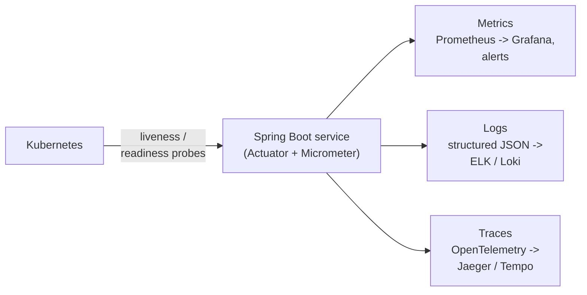

# Part 7 · Async work, scheduling and production monitoring

Move work off the request thread, decide how it survives a restart, and show how to detect a job that has stopped making progress.

## Async execution and scheduled jobs

A checkout page needs a price and a shipping estimate. Both can be fetched at the same time. An overnight export must survive a restart once the API accepts it. Decide who starts the work, which thread owns it, and where the result lives.

### Run independent calls and combine the results

Enable async processing with `@EnableAsync`. Put the blocking calls on a separate Spring bean. The caller invokes its injected proxy, which submits each method to the named executor. In the example, both lookups start before the caller waits for either result.

```java
@Service
class Lookups {
    private final PricingClient pricingClient;
    private final CarrierClient carrierClient;

    Lookups(PricingClient pricingClient, CarrierClient carrierClient) {
        this.pricingClient = pricingClient;
        this.carrierClient = carrierClient;
    }

    @Async("ioExecutor")
    public CompletableFuture<Price> price(String sku) {
        return CompletableFuture.completedFuture(pricingClient.fetch(sku));
    }

    @Async("ioExecutor")
    public CompletableFuture<Shipping> shipping(String sku) {
        return CompletableFuture.completedFuture(carrierClient.quote(sku));
    }
}

// In the caller, lookups is the injected bean.
CompletableFuture<Quote> quote(String sku) {
    var price = lookups.price(sku);
    var shipping = lookups.shipping(sku);
    return price.thenCombine(shipping, Quote::new);
}
```

For two required results, `thenCombine` builds the quote once both succeed. If either lookup fails, the combined future completes exceptionally. For a variable number, `CompletableFuture.allOf(...)` yields a `CompletableFuture<Void>`. Read the individual futures after the barrier succeeds. Decide explicitly whether a partial answer is acceptable. Set deadlines on the HTTP clients as well as on the aggregate future. Completing a future with a timeout can leave the underlying I/O running. [Java CompletableFuture API](https://docs.oracle.com/en/java/javase/21/docs/api/java.base/java/util/concurrent/CompletableFuture.html)

### When the executor is full

Define a `ThreadPoolTaskExecutor` bean named `ioExecutor` with a core size, maximum size and bounded queue. Under the usual pool policy, tasks fill the core workers, then the queue, then additional workers up to the maximum. Size concurrency against the downstream connection budget. An unbounded queue can turn a slow dependency into a memory and latency problem. With the abort policy the submitter sees a rejection. With caller-runs, a saturated pool can execute the blocking task on the HTTP thread. Record queue wait, execution time and rejections separately.

Calling `this.price(sku)` bypasses the async proxy and blocks the caller. A future exposes worker failures to its caller. A `void` method has no return channel, so configure an `AsyncUncaughtExceptionHandler` when failures need handling. [Spring task execution](https://docs.spring.io/spring-framework/reference/integration/scheduling.html)

### What crosses the thread boundary?

Pass an order ID and immutable inputs. A worker running on another thread gets its own transaction when it calls a proxied transactional service. The caller's JDBC transaction and persistence context stay on the caller's thread. Submitting before commit lets the worker race the commit and miss the order. An after-commit listener fixes that ordering for best-effort work. For a promised export, write the job or outbox row in the same transaction as the request and return `202 Accepted` with a job ID. A worker can recover pending work after restart. [Spring transaction-bound events](https://docs.spring.io/spring-framework/reference/data-access/transaction/event.html)

### Choose the clock, then account for every replica

With `@EnableScheduling`, Spring registers scheduled methods. A scheduler handles triggers and an executor handles submitted async work. A scheduled method can run the job itself. Offloading it changes what the scheduler regards as completion. [Spring scheduling](https://docs.spring.io/spring-framework/reference/integration/scheduling.html)

| Requirement | Trigger | If one run is slow |
|---|---|---|
| Poll again 30 seconds after the last poll finishes | `@Scheduled(fixedDelay = 30_000)` | The delay begins when the method returns. If it only submits work, successive workers can overlap. |
| Aim for one invocation per minute | `@Scheduled(fixedRate = 60_000)` | On a standard pool scheduler a single repeating task can start late. Extra threads allow other tasks to run. |
| Run at 02:00 in a specified time zone | `@Scheduled(cron = "0 0 2 * * *", zone = "UTC")` | Spring cron has six fields, starting with seconds. Specify the business zone when daylight-saving behavior matters. |

With Boot's regular auto-configured thread-pool scheduler, the default pool size is one. A long poll can delay unrelated schedules. Virtual-thread scheduling uses a different scheduler, so check the active configuration before diagnosing starvation. [Spring Boot scheduler configuration](https://docs.spring.io/spring-boot/reference/features/task-execution-and-scheduling.html)

**Three pods wake up at 02:00. Who exports the file?** Each pod has its own trigger. Give each business run a unique key such as `(job_type, business_date)`. Let workers atomically claim pending work with a recoverable lease. If a worker dies after uploading and before marking the job done, retry with the same output key. A lock limits overlap while it is held. The idempotent write handles that crash window. Monitor oldest pending job age, last successful run, retries and duration. A healthy HTTP endpoint can coexist with a stalled scheduler.

## Actuator, Health Probes and Monitoring

The questions: **"How do you monitor a Spring Boot service in production?"** (asked far more than anything else here) and **"What is Spring Boot Actuator: which endpoints, and how do you secure them?"**.

### 1. How you monitor a Spring Boot service: the three signals

Monitoring rests on three kinds of data, and a good answer names all three:



- **Metrics** (numbers over time): request rate, error rate, latency percentiles, JVM memory and GC, thread and connection pool usage. Collected by **Micrometer** through Actuator, scraped by **Prometheus**, shown in **Grafana**, with **alerts** on thresholds.
- **Logs** (what happened): structured JSON logs with a **correlation or trace id** on every line, shipped to a central store (ELK, Loki, Splunk) so one request can be followed across services.
- **Traces** (where the time went): distributed tracing with **OpenTelemetry** (Micrometer Tracing in Boot 3) shows one request's path and timing across services.

What to alert on: the **golden signals**: **latency** (p95/p99, not averages), **traffic**, **errors** (5xx rate) and **saturation** (CPU, memory, connection pool, queue lag). Alert on symptoms users feel, with dashboards per service.

Say it like this: "I monitor with metrics, logs and traces. Actuator and Micrometer expose metrics that Prometheus scrapes and Grafana shows, with alerts on latency percentiles, error rate, traffic and saturation. Logs are structured JSON with a trace id, centralised, and OpenTelemetry tracing shows where a slow request spent its time. Kubernetes uses Actuator's liveness and readiness probes."

### 2. What Actuator gives you

**Spring Boot Actuator** (`spring-boot-starter-actuator`) adds production endpoints under `/actuator`:

- **`/health`**: is the app up, including checks of its dependencies (database, disk, message broker). Returns `UP` or `DOWN`.
- **`/health/liveness`** and **`/health/readiness`**: the Kubernetes probes (section 3).
- **`/metrics`** and **`/prometheus`**: application and JVM metrics (`/prometheus` in Prometheus format, via the Micrometer Prometheus registry).
- **`/info`**: build and version information.
- **`/loggers`**: view and **change log levels at runtime**, without a restart.
- Sensitive ones: **`/env`** (configuration, possibly secrets), **`/heapdump`**, **`/threaddump`**, **`/configprops`**, **`/beans`**, **`/mappings`**.

Custom checks: implement `HealthIndicator` (for example, "can we reach the payment provider?"). Custom metrics: inject `MeterRegistry` and record counters, timers or gauges (orders placed, payment latency).

### 3. Liveness vs readiness probes

- **Liveness**: "is the process healthy, or stuck?" If it fails, Kubernetes **restarts** the container. Keep it simple: it should **not** check external dependencies, or a database outage would restart every pod for nothing.
- **Readiness**: "can this instance serve traffic right now?" If it fails, Kubernetes **stops sending traffic** to the pod without restarting it: during startup and warm-up, or when a critical dependency is unavailable.

Say it like this: "Liveness tells Kubernetes whether to restart the container, so it only checks the app itself. Readiness tells it whether to send traffic, so it can include dependencies and warm-up."

### 4. Securing Actuator

Actuator endpoints can leak secrets (`/env`), memory contents (`/heapdump`) and internal structure, so:

- **Expose only what you need**: by default only `health` is exposed over HTTP; add others explicitly with `management.endpoints.web.exposure.include=health,info,prometheus`. Never expose everything (`*`) in production.
- **Run management on a separate port** (`management.server.port=8081`) reachable only from inside the cluster or the monitoring network.
- **Require authentication** for anything beyond health and info, with a `SecurityFilterChain` rule (for example `EndpointRequest.toAnyEndpoint()` needing an `ACTUATOR` role).
- Limit health details for anonymous callers (`management.endpoint.health.show-details=when-authorized`).

Say it like this: "I expose only health, info and prometheus, put the management endpoints on a separate internal port, require authentication for anything sensitive like env, heapdump or loggers, and only show health details to authorised callers."

**Recall** without looking, name the three monitoring signals with one tool each, the four golden signals, the difference between liveness and readiness, and two ways to secure Actuator.

## Interview practice

Design a ten-minute export across three replicas. The client can retry, one worker can die after writing the file, and the scheduler can fire again during recovery. Describe the HTTP response, durable job state, claim and retry rules, an idempotent output key, and the metrics that reveal a growing backlog.

<details>
<summary>Walk through the case</summary>

Commit one job per client request key and return 202 with its status URL. Claim it with an expiring lease and fence stale workers when updating completion. Write to a stable output key with conditional publication so a retry cannot publish a second result. Watch oldest pending age and last successful completion alongside retry counts.

</details>

### Async execution and scheduled jobs

10 of the 1,592 candidate write-ups in the Oct 2024 – Oct 2026 review mentioned this lesson. Each count below belongs to its question.

<details>
<summary>@Async or a message queue for long-running background work?</summary>

`@Async` runs work in the **same JVM's memory**: if the pod restarts, queued and running tasks are lost, there's no retry, and you can't spread load across instances.

A queue (Kafka/SQS/RabbitMQ) or a jobs table gives **durability, retries, back-pressure and horizontal scaling**.

Rule: `@Async` for best-effort, short, losable work (send a notification, warm a cache). A queue or job store for anything the user is waiting on or that must not be lost — return `202 Accepted` with a job id and let the client poll or get a callback.

*6 candidate write-ups · Adobe · Kotak Mahindra Bank · Microsoft · Paytm · ServiceNow*

</details>

<details>
<summary>@Async — how does it work, and why does it sometimes run synchronously?</summary>

`@EnableAsync` makes Spring wrap the bean in a **proxy**; calls to an `@Async` method through the proxy are submitted to an executor and return immediately (`void` or `CompletableFuture<T>`).

It silently runs **synchronously** when:
- called from **the same class** (`this.method()` skips the proxy),
- the method is `private`/`final` or the class isn't a Spring bean,
- `@EnableAsync` is missing.

Always define your own `ThreadPoolTaskExecutor` (bounded queue, named threads). Exceptions from `void` methods go to an `AsyncUncaughtExceptionHandler`, and the security/transaction context does **not** follow into the new thread.

*2 candidate write-ups · Kotak Mahindra Bank*

</details>

<details>
<summary>@Scheduled jobs — how do you stop a cron job running on every instance?</summary>

`@Scheduled(cron = "0 0 2 * * *")` (with `@EnableScheduling`) runs on **every** instance — three pods, three runs.

Ways to run it once:
- **ShedLock** — a lock row in the DB (or Redis) taken before the job runs.
- A **Kubernetes CronJob** instead of in-app scheduling.
- Leader election.
- Make the job **idempotent** anyway (claim rows with `SELECT … FOR UPDATE SKIP LOCKED` or a status update), so overlap can't double-process.

Also: by default all `@Scheduled` methods share **one** thread — a slow job delays the others.

*2 candidate write-ups · Visa*

</details>

<details>
<summary>How do you configure the executor for @Async (ThreadPoolTaskExecutor)?</summary>

```java
@Bean(name = "ioExecutor")
ThreadPoolTaskExecutor ioExecutor() {
  var ex = new ThreadPoolTaskExecutor();
  ex.setCorePoolSize(8); ex.setMaxPoolSize(32); ex.setQueueCapacity(500);
  ex.setThreadNamePrefix("io-");
  ex.setRejectedExecutionHandler(new ThreadPoolExecutor.CallerRunsPolicy());
  ex.setWaitForTasksToCompleteOnShutdown(true); ex.setAwaitTerminationSeconds(30);
  return ex;
}
// @Async("ioExecutor") on the method
```

Bounded queue, named threads, a rejection policy, and graceful shutdown — say each and why.

*2 candidate write-ups · NPCI · Rubrik*

</details>

### Actuator, Health Probes and Monitoring

34 of the 1,592 candidate write-ups in the Oct 2024 – Oct 2026 review mentioned this lesson. Each count below belongs to its question.

<details>
<summary>How do you monitor a Spring Boot service in production?</summary>

- **Metrics**: Micrometer → Prometheus → Grafana: request rate, error rate, p95/p99 latency, JVM heap/GC, DB pool usage. Alert on symptoms (latency, errors), not on CPU alone.
- **Logs**: structured JSON with a trace id (ELK/Splunk).
- **Traces**: Micrometer Tracing / OpenTelemetry to see where time goes across services.
- **Health probes**: liveness = the process is alive (keep it shallow); readiness = can take traffic (DB reachable) — a DB outage should fail readiness, not restart pods.

*30 candidate write-ups · Microsoft · Autodesk · Agoda · Apple · BharatPe · EPAM · Freshworks · HackerRank · IBM · Knot Solutions · Paytm · Swiggy*

</details>

<details>
<summary>What is Spring Boot Actuator — which endpoints, and how do you secure them?</summary>

Production endpoints: `/actuator/health` (liveness/readiness groups for Kubernetes), `/metrics` and `/prometheus` (Micrometer), `/info`, `/loggers` (change log level at runtime), `/env`, `/heapdump`, `/threaddump`, `/conditions`.

Expose only what you need (`management.endpoints.web.exposure.include=health,info,prometheus`), put them on a separate management port, and secure the rest — `/env` and `/heapdump` leak secrets. Custom health: implement `HealthIndicator`.

*7 candidate write-ups · EPAM · Cerner · Knot Solutions · UKG*

</details>

<!-- Generated by scripts/genCoreStack.mjs from the individual master notes, interview evidence and springCourse.mjs. -->
