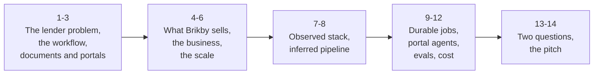
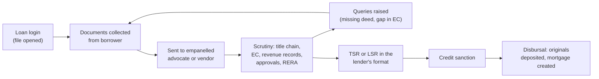
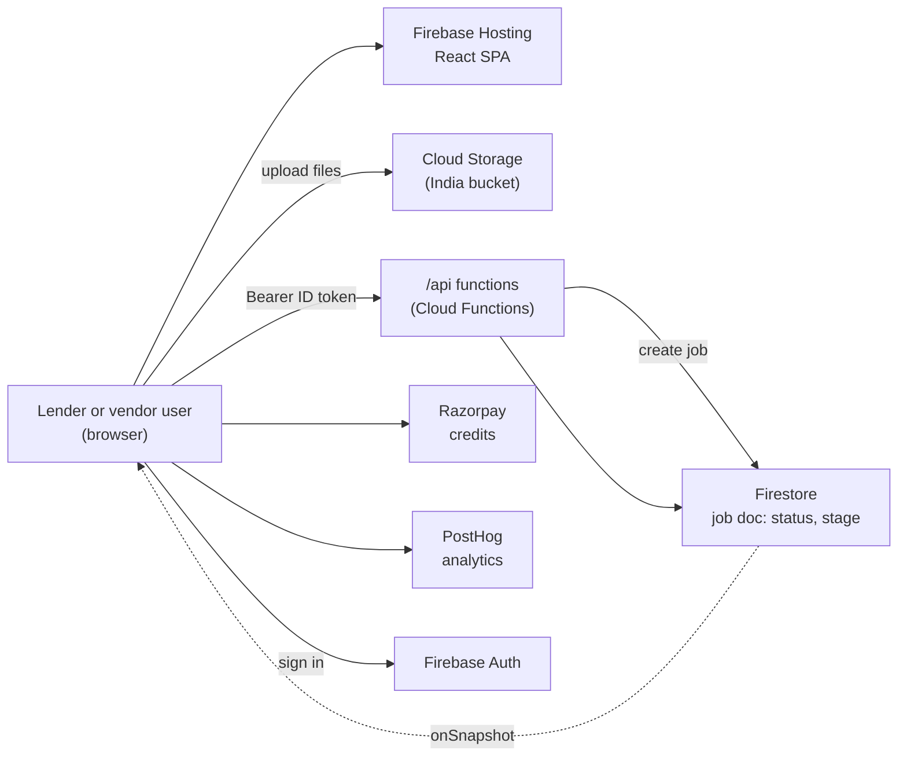
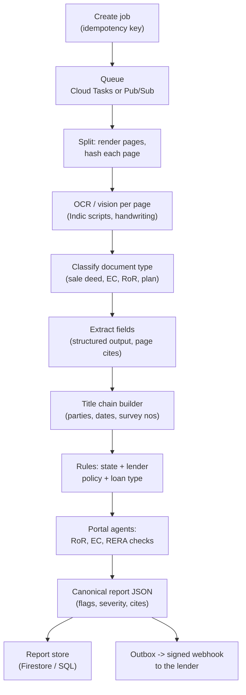
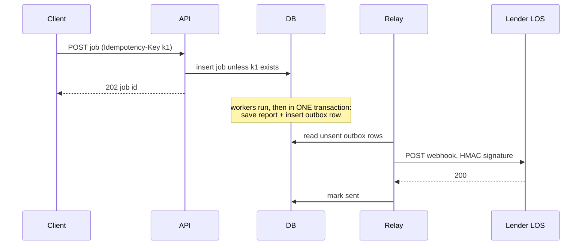

Brikby, for a Founding Engineer system design round: what they sell, the lender workflow it replaces, how big they probably are, how their system is likely built, and the two design questions worth raising. These notes follow the lecture above topic by topic (1 to 14).

Every claim is labelled one of three ways:

| Label | Meaning | Can you say it in the room? |
|---|---|---|
| **[public]** | on their marketing pages, careers page or LinkedIn | yes, freely ("I read your site") |
| **[observed]** | what any visitor's browser downloads (page scripts, headers, DNS) | **no**; use it only to aim your questions |
| **[estimate]** | my arithmetic or an industry assumption | yes, if you say it is an estimate |

Nothing here came from behind a login. No sign-in, no form posts, no calls to their API. The REA tool (github.com/morluto/rea) was read first: its web mode only attaches to a browser you start yourself and records what the page loads, and its bundle analysis parses scripts without running them. These notes do the same thing by hand, with a muted headless browser on public pages.

## 1. The problem

A housing loan or a loan against property (LAP) in India is secured by the property. **Before the lender disburses, it must be sure the borrower (or the mortgagor) really owns the property, that the title is clean and marketable, and that nobody else has a charge on it.** If the title is defective, the security is worthless.

Lenders do not do this check themselves. They send each file to an **empanelled advocate or a legal vendor firm**, who reads every document, traces the title back 13 or 30 years, searches the registrar's records for encumbrances, and writes a **Title Search Report (TSR)** or **Legal Scrutiny Report (LSR)** in that lender's own format. Raised queries go back to the borrower; the report goes to the credit team; only then sanction and disbursal.

Why it hurts **[public, from Brikby's site]**:

| Pain | Their number |
|---|---|
| Manual verification cycle | 7-15 days; their customers' TAT went from 4 days to under 30 minutes |
| Regional and handwritten records | 30-40% of the reviewer's time goes to interpreting them |
| Manual review | risk of oversight and legal exposure |
| No standard workflow | inconsistent legal opinions across vendors and branches |

**Q. Who carries the loss if a title defect is missed?** The lender: its security is unenforceable. That is why lenders pay for a legal opinion on every file, and why accuracy matters more than speed.

## 2. The lender's workflow, step by step

What the advocate actually checks (this vocabulary is the job):

| Check | What it means | Typical source |
|---|---|---|
| **Chain of title** | every transfer from the oldest deed (the "mother deed") to the present owner, with no gap and no break | sale deeds, gift / partition / release deeds, wills, POAs |
| **Search period** | how far back: commonly **13 years** for smaller retail loans and **30 years** otherwise; it is set by each lender's policy | lender policy |
| **Encumbrance Certificate (EC)** | registered charges, mortgages and transfers on the property over the search period | Sub-Registrar Office (SRO) / state IGR portal |
| **Revenue records (RoR)** | who the state's land records show as owner, and the mutation in their favour | state land-record portals |
| **Mutation** | the revenue record updated after a transfer; a deed without mutation is a query | revenue office |
| **Approvals** | sanctioned plan, OC / CC, conversion (agri to non-agri), RERA registration for projects | development authority, RERA |
| **POA in the chain** | a power of attorney sale (especially a GPA sale) is a classic red flag | the deeds |
| **Litigation, acquisition** | court cases, government acquisition, land ceiling issues | courts, gazettes |

Loan type changes the check **[public / observed]**: Home Loan, LAP, Balance Transfer and Self Construction ask different questions (in a LAP the current owner is the mortgagor; in a purchase the seller's title is what you verify).

**Q. Why is a 4-year gap in the EC a query and not a pass?** A charge registered in those missing years would be invisible; the vendor must ask for a fresh EC covering the gap.

## 3. The documents and the government portals

Every state keeps land records its own way, under its own names, on its own portal. That is the core difficulty: **one product must read 28 states' formats in a dozen scripts, many of them scanned or handwritten.**

| State | Revenue record (RoR) | Portal(s) |
|---|---|---|
| Uttar Pradesh | Khatauni | UP Bhulekh |
| Odisha | RoR (Khatiyan) | Bhulekh Odisha |
| Karnataka | RTC / Pahani | **Bhoomi** (RoR), **Kaveri 2.0** (registration, EC) |
| Telangana | Pahani, pattadar passbook | **Dharani, replaced by Bhu Bharati in April 2025** |
| Maharashtra | 7/12 extract, property card | Mahabhumi; **IGR Maharashtra** (Index II, e-search) |
| Haryana, Punjab | Jamabandi, Fard | Jamabandi portals |
| Tamil Nadu | Patta, Chitta, Adangal | TN e-services; TNREGINET (EC) |
| Every state | project registration | the state RERA website |

What these portals are like to integrate with (this is the "websites never built for you" line in the JD): session cookies, multi-step forms with dropdowns that load the next dropdown (district, then tehsil, then village), CAPTCHAs, HTML tables, PDFs rendered from scans, frequent downtime, and rate limits nobody documents.

**Q. Telangana's Dharani is in an old checklist you are given. What do you say?** It was replaced by Bhu Bharati in April 2025; records migrated, so a connector must target the new portal and old Dharani references in documents are still valid history.

## 4. What Brikby sells

**[public]** Brikby (Gurugram, founded 2025) is "instant property ownership verification" for BFSI. You upload a file's documents (any state, any language, any format, handwritten included) and get, in under 30 minutes:

1. **Document scrutiny**: every document listed with its key fields (parties, dates, survey / khasra / khata numbers, SRO, registration numbers).
2. **Title flow**: the chain of title reconstructed across the deeds.
3. **Missing documentation**: a deed referred to in the EC but not supplied.
4. **Red flags with severity**: high (missing title document), medium (fresh EC needed, search gap), low (owner name spelt differently in deed vs revenue record).
5. **Loan-type-specific insights** for the lender.
6. **A report in the customer's own format**, "bank format-trained, bank policy-trained".
7. **Verification against government records "in real time"**.

Their public numbers: **80% faster turnaround, 95%+ accuracy, 50+ regional languages, 15,000+ loan logins processed since January, TAT from 4 days to under 30 minutes.** Their plan: become the gold standard in BFSI, then ownership verification for any use case (B2C, infrastructure, telecom).

Founders **[public]**: Rishabh Agarwal, CEO (ex-Savills real estate valuations), and Sahith Desham, CTO (ex-UBS investment bank data engineer). Their interview loop **[public]**: a 20-minute intro, a technical interview ("walk us through something you built, then solve a real problem with us"), a founder conversation, an offer.

**Q. In one sentence, what does Brikby replace?** The 4-to-15-day manual legal scrutiny by an empanelled advocate, with an AI draft in under 30 minutes that the lawyer or credit team reviews.

## 5. The business

| Question | Answer |
|---|---|
| Who uses it | lenders' legal / credit teams (banks, NBFCs, HFCs) and the legal vendor firms they empanel |
| Who pays | **[public / observed]** organisations buy report credits shared by their members; self-serve list price **Rs 200 per report** (pay-per-use, Razorpay). Enterprise pricing is presumably negotiated **[estimate]** |
| Why they pay | TAT (faster disbursal wins borrowers), fewer people per file ("4x productivity", "less manpower"), consistency across vendors, smoother month-end peaks |
| What they replace | advocate time. Per-file legal fees vary widely by city and lender; low thousands of rupees per file is a fair working assumption **[estimate]** |
| Moat | the long tail: every state's documents and rules, every lender's format and policy, and the eval set that proves accuracy on them |
| Competition | TEAL (API-based property due diligence for lenders), Landeed (AI title reports, record retrieval), Square Yards' data / risk suite |

The value line to use: **a vendor's turnaround is the lender's disbursal time, and a missed defect is the lender's loss. Brikby sells speed without giving up the defensibility of the opinion.**

**Q. Why does "bank format-trained" matter commercially?** Lenders do not change their report formats for a vendor; matching each lender's format and policy is what lets a vendor or a lender adopt it without changing their process.

## 6. Their likely scale (evidence, then estimates)

| Signal | Value | Label |
|---|---|---|
| Loan logins processed | 15,000+ since January 2026 | public |
| Sample report | 13 documents in one file | public |
| Customer formats | a few dozen lender- and vendor-specific report formats exist | observed |
| Team | two founders hiring their first engineers | public |

Arithmetic **[estimate]**:

| Quantity | Working |
|---|---|
| Files per month | 15,000 over ~10.5 months = **~1,400 / month** |
| Files per working day | ~1,400 / 22 = **~65**; month-end peaks 2-3x = **~150-200** |
| Documents per file | ~13 (their sample) |
| Pages per file | sale deeds run 10-40 pages, ECs and RoRs 1-5: **~60-80 pages** |
| Pages per day | ~65 x 70 = **~4,500**, peaks ~12,000 |
| Concurrency | 200 files over a 10-hour peak day = 20 / hour; 15-25 min each = **~5-8 files in flight** |
| Growth | a few large lenders onboarding could mean 10x within a year |

**The insight to say out loud:** at this scale throughput is easy. The hard problems are **correctness** on messy documents, **tail latency** from slow government portals and model calls, **cost per file**, and **auditability** (every flag traceable to a page).

**Q. Roughly how many pages a day, and is that a hard throughput problem?** Thousands, low tens of thousands at peak. Not a throughput problem; a correctness, tail latency and cost problem.

## 7. The observed stack (public signals only)

**[observed]** What a visitor's browser shows, nothing more:

| Layer | Signal |
|---|---|
| Edge / hosting | Firebase Hosting behind Google's edge (served from a Delhi cache), HSTS preload, frame-ancestors locked |
| Web app | React single-page app built with Vite; Radix / shadcn-style components; React Router; TanStack Query |
| Identity | Firebase Auth; the ID token is sent as a Bearer token to the API |
| API | serverless functions behind same-origin `/api/*` rewrites (Cloud Functions; region us-central1) |
| Files | Cloud Storage bucket for uploads (India region); PDF, PNG, JPEG, WebP, TIFF up to 50 MB each, folders allowed |
| Jobs | an analysis request creates a job; the browser listens to the job's Firestore document for `status` and `stage`; completion carries a report id; cancel supported |
| Reports | listed with cursor pagination, search and a qualification filter (positive / negative); fields editable by the user (human in the loop); Word reports in each customer's format generated in the browser |
| Tenancy | organisations, invites, join requests, a shared credit pool |
| Payments | Razorpay checkout, credits |
| Analytics | PostHog (product events including API latency per call, session replay, surveys, error capture) |
| Mail | Google Workspace |

**What you may say about it:** "From the outside it looks like a lean GCP / Firebase stack", if they ask what you know. Do not quote endpoint names, regions, bucket names or customer formats.

**Q. Why is a Firestore listener a good fit for a 20-minute job?** The browser does not poll; the worker writes stage changes to one document and every open tab sees them in real time, with reconnection and offline handling built in.

## 8. The inferred pipeline (how I would expect it to work)

**[estimate]** Nothing below is observed. It is the design the product implies, and it is the board you can draw in the room as "how I'd build this".

| Stage | Why it is a separate step |
|---|---|
| Split and hash | pages are the unit of retry and cache; a re-uploaded deed costs nothing the second time |
| OCR / vision | the expensive, slow, flaky step; it should run in parallel per page with its own retries |
| Classify | the type decides which schema to extract and which rules apply |
| Extract | structured output against a per-type schema; every field carries a page reference |
| Title chain | deterministic code joins deeds on parties and property identifiers; the LLM only resolves what code cannot (name variants, transliteration) |
| Rules | lender policy (13 vs 30 years), state rules, loan type: code and configuration, not prompts |
| Portal agents | slow and unreliable; isolated so a down portal delays one check, not the whole report |
| Report | one canonical JSON; every lender format is a rendering of it |

**Q. Where should the LLM sit, and where should code sit?** LLMs read and extract (messy input to structured fields) and resolve fuzzy matches; code builds the chain, applies policy and computes gaps, because those must be exact and explainable.

## 9. Durable jobs: queues, retries, idempotency, outbox, signed webhooks

These are the JD's words; here is what each one does in this pipeline.

| Mechanism | In this pipeline |
|---|---|
| **Queue** | the API answers in milliseconds; work runs from a queue (Cloud Tasks for per-job HTTP pushes with rate and retry control, Pub/Sub for fan-out) |
| **Retries with backoff** | OCR and model calls fail transiently (429, 503, timeouts); retry with exponential backoff and jitter, capped, then dead-letter |
| **Idempotency key** | the client sends a key with "create job"; a retried or double-clicked request returns the same job instead of charging two credits |
| **Idempotent steps** | each step's output is keyed by (job, page hash, step version); redelivery overwrites the same row, never appends a duplicate |
| **Outbox** | the "report ready" event is written in the same transaction as the report; a relay publishes it afterwards, so you never notify about a report that was not saved, or save one and lose the notification |
| **Signed webhook** | the lender's system receives `report.completed` with an HMAC-SHA256 signature over timestamp + body; the receiver checks it and rejects old timestamps (replay) |

**Q. A worker crashes after saving the report but before sending the webhook. What happens?** Nothing is lost: the outbox row was committed with the report, so the relay sends it on its next pass. The receiver dedupes on the event id, because delivery is at-least-once.

## 10. Government-source agents

"Build out our multi agent system and the tools it uses across government sources" **[public, JD]**. Each portal is a tool: input a property identifier, output a structured record with a fetched-at time and the raw page kept as evidence.

| Problem | Design |
|---|---|
| Sessions and multi-step forms | a per-portal connector (Playwright or plain HTTP with a cookie jar) that replays the form sequence; one connector per portal, versioned |
| HTML that changes | parse into a schema with validation; a parse failure is an alert, not a silent empty result; keep the raw HTML for re-parsing |
| Rate limits, politeness | a per-portal token bucket in a shared store; small concurrency per portal; back off on errors |
| Downtime | the check becomes "pending", the report ships with that item marked, and a scheduled retry fills it in later |
| CAPTCHAs | do not try to defeat them; prefer official APIs or licensed data where they exist, and a human-assisted step otherwise |
| Cost and freshness | cache records by (portal, identifier) with a TTL; a re-run within hours reuses the fetch |
| Evidence | store the response and a screenshot next to the extracted fields, so a lawyer can see exactly what the portal said |

The agent part: a planner reads the extracted documents, decides which portal checks the file needs (state, document types, loan type), calls the tools, and reconciles the results with the documents ("RoR shows owner X, sale deed says Y": a flag).

**Q. A portal is down for six hours at month-end. What does the customer see?** The report on time, with that verification marked pending and retried automatically, not a stuck job.

## 11. LLM correctness: structured outputs, traces, evals

| Need | Design |
|---|---|
| Machine-usable output | structured output against a JSON schema per document type; validate, and re-ask once on failure |
| Grounding | every extracted field and every flag carries (document, page, bounding box or quote); no citation, no flag |
| Debugging | a trace per job: each step's inputs, model, prompt version, tokens, latency, output (LangSmith / Langfuse or OpenTelemetry spans) |
| Measuring | a golden set per (state, document type): field-level precision / recall, flag precision / recall, chain correctness |
| Keeping fixes fixed | every wrong output a lawyer corrects becomes a regression case; evals run on every prompt or model change |
| Learning from users | the user's edits to a report are labelled data: diff the AI draft against the final |

"95%+ accuracy" **[public]** begs the question "95% of what?" Field accuracy, flag precision and flag recall are different numbers; for a lender, **recall on high-severity flags** is the one that matters most.

**Q. Which error is worse here: a false flag or a missed one?** A missed high-severity flag (a lost security); a false flag only costs a reviewer a few minutes. So tune for recall on critical flags and measure it separately.

## 12. Cost and latency on GCP

**[estimate]** A cost model per file, order of magnitude only (check current prices):

| Item | Working | Per file |
|---|---|---|
| OCR (Document AI class) | ~70 pages at about $1.5 per 1,000 pages | ~$0.10 |
| Vision / extraction with a fast model | ~70 pages x ~1,500 tokens in, structured JSON out | ~$0.05-0.10 |
| Reasoning over the chain with a stronger model | tens of thousands of tokens | ~$0.10-0.20 |
| Portal fetches, storage, compute | small | ~$0.02 |
| **Total** | | **~$0.3-0.5, i.e. Rs 25-45**, against a Rs 200 list price |

Levers, in the order I would pull them:

1. **Page-hash caching**: the same deed arrives in many files (resales, re-submissions, balance transfers).
2. **Model routing**: a fast model for classification and extraction, a strong one only for ambiguity and the chain.
3. **Batch where latency allows** (batch prediction is roughly half price) for re-runs and back-fills, never for the 30-minute path.
4. **Parallelism per page** for latency: TAT is bounded by the slowest page and the slowest portal, so fan out and put timeouts on both.
5. **Keep compute next to data**: one region for bucket, workers, model endpoints and database (egress and round trips).

**Q. Where does the 30 minutes go, and what do you parallelise?** Mostly OCR / model calls and portal fetches. Fan out per page and per portal; the critical path becomes the slowest single page plus the chain and the report.

## 13. Two questions worth raising

Phrase both as "for a pipeline like this I would expect X; how do you handle Y?". Neither depends on anything you could only know from their code.

**Question 1. The report as data, delivered by integration.**

> "For a pipeline like this I'd expect the report to exist once, as a canonical versioned JSON on the server, with every lender format rendered from it, and the result pushed into the lender's loan-origination system with a signed webhook through an outbox. How do reports reach your lenders today: download and upload, or an integration? And when a lawyer edits a field, which version is the source of truth?"

Why it matters: lenders at volume want reports inside their LOS, not in email; one canonical JSON makes formats cheap to add, edits auditable (who changed what, AI draft vs final) and the edits usable as training and eval data. It also puts the JD's outbox and signed-webhook line to work.

**Question 2. Where processing runs.**

> "For lender documents I'd keep storage, OCR, the model endpoints and the database in one Indian region, Mumbai or Delhi. Lenders' vendor-risk reviews under RBI's IT outsourcing directions ask where data is stored and processed, the DPDP Act adds its own duties, and same-region also saves egress and a round trip on every call. How do you answer data-residency questions in lender security reviews?"

Why it matters: it is a cost, latency and sales question at once; a founding engineer who raises it unprompted sounds like someone who has been through an enterprise security review.

**Q. Why are these good questions to ask, beyond being correct?** Each one ties a JD line (signed webhooks / outbox; GCP cost and latency) to revenue (integrations, enterprise sales), and neither implies you looked at their systems.

## 14. How to present it

**The 60-second version** (say it when they ask "what do you know about us?"):

> "Lenders can't disburse a home loan or LAP until a legal vendor confirms the title: 13 or 30 years of deeds, the EC, revenue records, approvals, written up in that lender's format. Today that's days of an advocate's time per file, and much of it is reading regional and handwritten records. Brikby reads the whole file, rebuilds the chain of title, flags what's missing or inconsistent with severity, checks it against government records and produces the report in the customer's format in under 30 minutes. You've done 15,000+ logins this year. At your scale throughput isn't the problem: correctness, tail latency from portals and models, and cost per file are, and that's the part of the system I'd want to own."

**Map your own work onto their JD:**

| Their line | Your story |
|---|---|
| queues, retries, idempotency | DeepLogLens: Kafka with offsets committed after durable writes, content-fingerprint upserts (at-least-once delivery, exactly-once effects) |
| multi-agent orchestration, HITL | Inventory Ops Agent: LangGraph supervisor and subagents, human approval interrupts |
| traces and evals | DeepLogLens: LLM-as-judge groundedness loop, labelled incident set, recall numbers |
| ingestion pipeline at volume | DeepLogLens: constant-heap streaming of GB archives split into byte ranges |
| SQL, cost | Blue Yonder: Postgres and Snowflake, per-request connection routing |
| React, Node, shipping end to end | InterviewPlanPrep: React, Node, Firebase, 250+ students |
| Firebase specifically | InterviewPlanPrep runs on Firebase Auth and Firestore: you already know its listeners and security rules |

**Questions to ask them** (pick two):

1. Which part of the pipeline produces most of the corrections lawyers make today: reading, chain building, or policy?
2. How do you measure accuracy, and which number do lenders ask for?
3. Which states or document types are the hardest, and how do you decide which state to add next?
4. How do lenders receive reports today, and what does an integration look like?

**What not to say:** endpoint names, regions, bucket names, customer formats or anything else from their page scripts. If asked how you know the stack, "it looks like Firebase from the outside" is the most you need.

**Q. They ask "why this role?" What is the one-line answer?** "It's the same problem I've been solving, messy input turned into exact, auditable output through an async pipeline with an LLM in the loop, but with real lenders depending on it and a team where I'd own it end to end."

Sources (public)

- brikby.com: home, About Us (/team), Careers (Founding Engineer role)
- linkedin.com/company/brikby
- Telangana: Bhu Bharati replaced Dharani in April 2025 (Deccan Herald, The South First, Deccan Chronicle)
- Lender search periods: ICICI asks for a 13-year title search, HDFC's regional lists ask for 30 years by panel advocate
- Competitors: TEAL, Landeed (AI title reports), Square Yards (data and risk suite)
- Cloud prices: Document AI and Gemini on Vertex AI public pricing pages (check current values)

