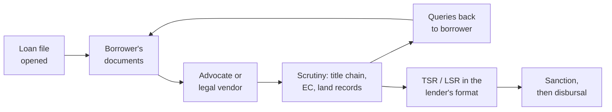
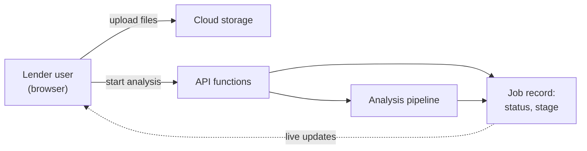

Brikby, for the Founding Engineer interview: what they do, who pays and why, how big they are, and a high-level view of how the system works. Know sections 1 to 4 cold; 5 and 6 are enough to talk about infrastructure.

Every claim is labelled:

| Label | Meaning | Can you say it in the room? |
|---|---|---|
| **[public]** | on their site, careers page or LinkedIn | yes ("I read your site") |
| **[observed]** | what any visitor's browser downloads (page scripts, headers) | **no**; use it only to aim your questions |
| **[estimate]** | my arithmetic or an industry assumption | yes, if you say it is an estimate |

Nothing came from behind a login: public pages only, read with a muted browser.

## 1. The problem they solve

A home loan or a loan against property (LAP) in India is secured by the property. **Before the lender pays out, it must be sure the borrower really owns the property, the title is clean, and nobody else has a charge on it.** If the title is bad, the lender's security is worthless.

Lenders don't check this themselves. Each file goes to an **empanelled advocate or legal vendor firm**, who:

1. reads every property document in the file;
2. traces ownership back **13 or 30 years** (set by the lender's policy);
3. checks the government's records for loans or charges on the property;
4. writes a **Title Search Report (TSR) / Legal Scrutiny Report (LSR)** in that lender's own format.

Only then does credit sanction the loan and the money go out.

Why it hurts **[public]**: it takes **7-15 days** per file, **30-40%** of the reviewer's time goes to reading regional and handwritten records, manual review misses things, and opinions differ across vendors and branches.

**Who loses if a defect is missed?** The lender: the property can't be enforced as security. That's why accuracy matters more than speed.

## 2. The workflow, and the words to know

| Term | Meaning |
|---|---|
| **Chain of title** | every transfer from the oldest deed (the "mother deed") to today's owner, with no gap |
| **Encumbrance Certificate (EC)** | the registrar's list of registered sales, mortgages and charges on the property over the search period |
| **Revenue record (RoR)** | who the state's land records show as owner (Khatauni in UP, 7/12 in Maharashtra, RTC in Karnataka) |
| **Mutation** | the land record updated after a sale; a deed without mutation is a query |
| **Approvals** | sanctioned building plan, occupancy certificate, RERA registration for projects |
| **Red flags** | a gap in the EC, a missing deed, a power-of-attorney sale in the chain, names that don't match |

The core difficulty: **every state keeps land records its own way, on its own portal, in its own language**, often scanned or handwritten. (One current fact worth knowing: Telangana's Dharani portal was replaced by **Bhu Bharati** in April 2025.)

## 3. What Brikby sells

**[public]** Brikby (Gurugram, founded 2025) does **instant property ownership verification for banks and NBFCs**. You upload a file's documents (any state, any language, handwritten included) and in **under 30 minutes** get:

1. **Document scrutiny**: each document with its key fields (parties, dates, survey numbers, registration details).
2. **Title flow**: the chain of title rebuilt across the deeds.
3. **Missing documents**: e.g. a deed the EC mentions that wasn't supplied.
4. **Red flags by severity**: high (missing title document), medium (fresh EC needed), low (name spelt differently).
5. **Loan-type insights**: home loan, LAP, balance transfer and self-construction ask different questions.
6. **The report in the customer's own format** ("bank format-trained, bank policy-trained").
7. **Checks against government records.**

Their numbers **[public]**: **80% faster, 95%+ accuracy, 50+ regional languages, 15,000+ loan files since January, turnaround from 4 days to under 30 minutes.**

Founders **[public]**: Rishabh Agarwal, CEO (ex-Savills, real estate valuations) and Sahith Desham, CTO (ex-UBS data engineer). Plan: become the standard in BFSI, then ownership verification for any use case.

**One sentence:** Brikby replaces days of an advocate's manual title check with an AI-drafted report in under 30 minutes that the lawyer or credit team reviews.

## 4. The business

| Question | Answer |
|---|---|
| **Customers** | lenders' legal and credit teams (banks, NBFCs, housing finance companies) and the legal vendor firms they empanel |
| **Pricing** | report credits shared by an organisation; self-serve list price **Rs 200 per report** **[public]**; enterprise deals presumably negotiated **[estimate]** |
| **Why they pay** | faster disbursal wins borrowers; fewer people per file; the same quality across vendors and branches; month-end peaks handled |
| **What it replaces** | advocate time, a few thousand rupees per file **[estimate]** |
| **Moat** | the long tail: every state's documents and portals, every lender's format and policy, and the eval data that proves accuracy on them |
| **Competitors** | TEAL (API due diligence for lenders), Landeed (AI title reports), Square Yards (data and risk) |

The value line: **the vendor's turnaround is the lender's disbursal time, and a missed defect is the lender's loss. Brikby sells speed without giving up a defensible legal opinion.**

Why "the customer's own format" matters: lenders won't change their report format for a vendor, so matching it is what makes adoption easy.

## 5. Scale (rough, say "roughly")

**[estimate]** from their public 15,000+ files:

- about **1,400 files a month**, **~65 a working day**, 2-3x at month-end;
- ~13 documents and ~70 pages per file, so **thousands of pages a day**;
- only **5-8 files in flight** at a busy hour.

**The point to make:** at this size throughput is easy. The hard problems are **correctness on messy documents, slow and flaky government portals, cost per file, and auditability** (every flag traceable to a page).

## 6. The infrastructure, high level

**What it looks like from outside [observed; say only "it looks like Firebase / GCP"]:** a React web app on Firebase, Firebase login, serverless API functions, uploads to cloud storage, and **an analysis runs as a job** whose status the browser watches live (no polling). Reports can be edited by the user, and payments are credits.

**How I'd expect the pipeline to work [estimate, draw this as "how I'd build it"]:**

Five design points, one line each:

- **The LLM reads, code decides.** Models turn messy pages into fields; code builds the chain and applies lender policy, because that must be exact and explainable.
- **Every flag cites its page**, so a lawyer can verify it in seconds.
- **Durable jobs:** a queue, retries with backoff, idempotency keys so a double click never charges twice, and an outbox so "report ready" is never lost.
- **Portals are unreliable:** each is a separate connector with rate limits and caching; a portal that's down marks one check "pending" instead of blocking the report.
- **Accuracy is measured:** a test set per state and document type, and every lawyer correction becomes a test case. "95% accuracy" should mean recall on high-severity flags, since a missed flag costs far more than a false one.

## 7. Two questions to ask them

1. **"How do reports reach your lenders today: download, or an integration into their loan system? And when a lawyer edits a field, which version is the source of truth?"** (Where it leads: one canonical report, delivered by a signed webhook.)
2. **"Where does processing run? For lender documents I'd keep storage, OCR, models and the database in one Indian region, which also helps with lenders' security reviews and data-residency questions."**

Others, if there's time: which step produces most of the lawyers' corrections; which states are hardest; how they measure accuracy.

## 8. What to say

**"What do you know about us?" (60 seconds):**

> "Lenders can't disburse a home loan or LAP until a legal vendor confirms the title: 13 or 30 years of deeds, the encumbrance certificate, land records, written up in the lender's own format. That's days of an advocate's time per file, much of it reading regional and handwritten records. Brikby reads the whole file, rebuilds the chain of title, flags what's missing with severity, checks government records, and produces the report in the customer's format in under 30 minutes, with 15,000+ files done this year. At your size the hard part isn't throughput, it's correctness, slow portals and cost per file, and that's the part I'd want to own."

**Your work against their job description:**

| They need | You did |
|---|---|
| queues, retries, idempotency | DeepLogLens: Kafka, commits after durable writes, idempotent upserts |
| agents with human approval | Inventory Ops Agent: LangGraph with approval interrupts |
| traces and evals | DeepLogLens: LLM judge, labelled set, recall numbers |
| Firebase, React, shipping end to end | InterviewPlanPrep: Firebase Auth and Firestore, React, 250+ students |

**"Why this role?"** "It's the problem I've been solving, messy input turned into exact, auditable output through an async pipeline with an LLM in the loop, but with real lenders depending on it, and I'd own it end to end."

**Never say:** endpoint names, regions, bucket names or customer formats from their page scripts.
