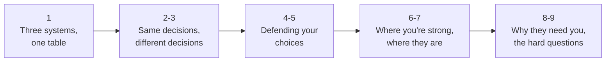

Your two systems next to Brikby's: the decisions you made the same way, the ones you made differently and how to defend each, where your version is stronger, where theirs is, and how to turn all of it into "you need someone who has already built this". These notes follow the lecture above topic by topic (1 to 9). Brikby claims keep BRIK-01's labels: **[public]** say it, **[observed]** never quote it, **[inferred]** call it a guess.

## 1. Three systems, one table

| Dimension | DeepLogLens | InterviewPlanPrep | Brikby |
|---|---|---|---|
| Input | GB log archives | a student's clicks and notes | scanned, handwritten, regional property documents [public] |
| Output | grounded incident report + Q&A citing lines | synced progress, versioned notes, reminders | a due-diligence report with flags and severity [public] |
| Frontend | React SPA on Vercel | React + Vite SPA on Vercel | React + Vite SPA on Firebase Hosting [observed] |
| Auth | not part of the story | Firebase Auth, Bearer ID token to functions | Firebase Auth, Bearer ID token to functions [observed] |
| Server | Spring Boot modular monolith on Render (API + all Kafka workers) | Vercel functions (Node.js) + Vercel Cron | serverless functions on GCP [observed]; workers unknown |
| Async work | Kafka (Redpanda): request, parts, enrich, retry, DLQ topics (a polled jobs table was v1, rejected) | none needed (sync in the browser), crons for reminders | a job record + a backend pipeline [observed / inferred] |
| Live status | session status in Postgres (PARSING ... DONE or FAILED with a reason) | Firestore listeners (3 per account) | Firestore listener on the job document [observed] |
| System of record | Postgres 16 + pgvector | Firestore | Firestore [observed]; SQL is in the JD, so likely also SQL [inferred] |
| Files | presigned PUT to Backblaze B2 | none (screenshots as data URLs) | direct upload to Cloud Storage [observed] |
| LLM role | only on flagged windows; judge loop; corrective RAG | none | reading documents, extraction, risk flags [public]; agents for portals [public] |
| Idempotency | SHA-256 content-fingerprint PK, `ON CONFLICT DO NOTHING RETURNING` | claim-before-send transaction; CAS on notes | unknown; "idempotency keys, outbox, signed webhooks" are in the JD [public] |
| Evals | seeded eval harness in CI with thresholds; judge calibrated with kappa | none needed | "95%+ accuracy" [public]; method unknown |
| Analytics | eval reports | first-party `/api/track`, hashed IPs | PostHog [observed] |

**Q. Which of your two projects is closest to Brikby's front half, and which to its back half?** InterviewPlanPrep is their front half (Firebase Auth, ID tokens to functions, Firestore listeners); DeepLogLens is their back half (large messy input, async fan-out, LLM only where needed, grounded output, evals).

## 2. The decisions you made the same way

| Decision | Your version | Their version | One line to say |
|---|---|---|---|
| The request path never does heavy work | DLL: upload returns in ms, work behind Kafka | analysis is a job, not a long request [observed] | "the API accepts; workers do" |
| Bytes bypass the API | presigned PUT straight to B2 | browser uploads straight to Cloud Storage [observed] | "the cheapest byte is the one the API never touches" |
| Browser identity = a verified Google-signed token | IPP: `verifyIdToken`, uid and email from the token | Bearer ID token to their functions [observed] | "the server trusts the token, never the body" |
| Push, don't poll | IPP: snapshot listeners | job status by listener [observed] | "the worker writes a field, every tab is told" |
| Code decides what must be exact; the LLM reads and explains | DLL: 8 parsers count every line; LLM on 20% of windows | rules, chain and gaps are naturally code [inferred] | "LLMs read; code counts and decides" |
| Every claim cites evidence | DLL: chunk fingerprint -> exact line range | report fields and flags tied to documents [public sample] | "no citation, no claim" |
| Serverless where it fits | IPP: Vercel functions + cron | GCP functions [observed] | "no servers to patch for request/response work" |
| Measure the product | IPP: first-party analytics per verified sign-in | PostHog incl. API latency per call [observed] | "instrument what you ship" (their JD's words) |

**Q. Name two decisions you and Brikby made the same way, with the reason.** Bytes go straight to storage, never through the API (the API stays small and fast); and live status is pushed by a Firestore listener rather than polled (no wasted requests, every tab updates at once).

## 3. The decisions you made differently

| Topic | You | Brikby (likely) | Why they differ |
|---|---|---|---|
| Queue | **Kafka** | Cloud Tasks / Pub/Sub or similar [inferred] | DLL needed partitions as rate-limit lanes, replay, and byte-range fan-out; at Brikby's volume a managed queue is simpler |
| Compute | a long-running JVM (consumers live forever) | functions + some worker runtime [inferred] | Kafka consumers need long-lived processes; request/response work suits functions |
| Database | Postgres + pgvector | Firestore (+ SQL) | DLL needs SQL aggregation, multi-row transactions, vector + full-text search; a job document and live status suit Firestore |
| Where the report is assembled | server-side (`compose_report`, stored) | many lender formats produced client-side [observed: never quote] | your version keeps one canonical artifact; this is your question 1 |
| Concurrency control | DLL: PK conflicts and an atomic finalizer claim; IPP: CAS in rules | unknown | different failure modes: redelivery (DLL), stale devices (IPP) |
| Offline | IPP is offline-first | online jobs | a lawyer's report is not edited on a plane |
| Analytics | first-party, privacy-first | third-party PostHog | they need funnels and replay fast; you needed zero cost and no PII |

**Q. Which of your differences would you change if you were building Brikby, and which would you keep?** Change: Kafka for a managed queue (Cloud Tasks or Pub/Sub) at their volume. Keep: one canonical report on the server, idempotent steps keyed by content, and evals in CI.

## 4. Defending your choices I: DeepLogLens

**"Why Kafka for a side project? Isn't that overkill?"**
> "The constraints chose it. I had 30 requests a minute per Groq key, so I gave every key its own partition and one consumer thread: a lane that runs at its own full rate and never blocks the others. Kafka also gave me replay for testing exactly-once effects, and a retry topic and a DLQ for free. For a system the size of yours I'd start with Cloud Tasks or Pub/Sub, and reach for Kafka only when I needed replay or per-key ordering at volume."

**"Why Postgres, not Firestore, in DeepLogLens?"**
> "Every question was relational or search: exact counts per minute and category, joins from findings to chunks, a transaction that writes a part's marker and its rows together, and hybrid vector plus full-text search. Postgres with pgvector does all of that in one place. Firestore is what I'd pick for per-user documents and live updates, which is exactly how I used it in InterviewPlanPrep."

**"Why one Java deployable instead of microservices?"**
> "It fit the free tier and consumer groups already let me run more copies. The first thing I'd split out is enrichment: it's rate-limited and scales with anomalies, not HTTP traffic."

**"How do you know it's exactly-once?"**
> "It isn't exactly-once delivery: it's at-least-once delivery with exactly-once effects. Every chunk's primary key is a SHA-256 fingerprint of its content and position, so a redelivered part conflicts on every row and writes nothing; offsets commit only after the transaction. I tested it with kill -9 mid-part, replays and rebalances."

**Q. In one sentence, why is Kafka defensible in DeepLogLens but not what you'd pick for Brikby today?** In DeepLogLens partitions were the rate-limit lanes and replay was the test harness; at Brikby's volume a managed queue gives retries and rate control with nothing to operate.

## 5. Defending your choices II: InterviewPlanPrep

**"Why put the concurrency check in the security rules?"**
> "Because devices edit offline and sync later, a client transaction isn't possible, and a client-side check isn't atomic. The rule compares the save's base revision with the stored revision in the same step as the write, for every client, so a stale device is refused and merges instead of overwriting."

**"Why Vercel functions and not Cloud Functions?"**
> "The site was already on Vercel, so the functions deploy with it, sit behind the same CDN, and Vercel Cron covers schedules without a paid Firebase plan. The functions use the Firebase admin SDK, so to Firestore they look the same."

**"Isn't a local store plus a journal plus Firestore's cache too much?"**
> "Each one does a job the others can't: the local store gives synchronous reads, the journal records what changed and when for per-entry merging, and Firestore's cache handles offline reads and queued writes."

**"How would this look for a lawyer editing a report?"** (the bridge to their product)
> "The same model: the AI draft is revision one, every edit is a new revision built on a named base, a stale save is refused and merged, and history is append-only. That gives you an audit trail of who changed what in the opinion, and the diff between the AI draft and the final is free eval data."

**Q. What's the bridge from your notes versioning to Brikby's product?** Report edits as revisions with compare-and-swap and append-only history: an audit trail for a legal opinion, and the AI-vs-final diff as eval data.

## 6. Where your version is stronger (what you bring)

| Strength | Evidence | Why Brikby needs it |
|---|---|---|
| Exactly-once effects on at-least-once delivery | content-fingerprint PK, offsets after commit, kill -9 / replay tests | no double-charged credits, no duplicate flags, no duplicate webhooks |
| Rate-limit-aware fan-out | a partition and lane per API key; 429 -> retry topic with `notBefore`; DLQ | the same pattern for LLM quotas and **government portals** |
| Never stuck | every upload ends parsed, or failed with a readable reason | "a down portal delays one check, never the whole report" |
| Evals in CI with thresholds | seeded eval, F1 0.90, retrieval recall, judge kappa 0.625, fails the build below thresholds | "find why LLM output goes wrong, fix it at the root, build evals that keep it fixed" (their JD) |
| Cost discipline | LLM on 20% of windows: 42,205 calls instead of 220,657 | cost per file at month-end peaks |
| Constant-memory streaming | 2 GB under a 256 MB heap | 200-page scanned files on small instances |
| Server-enforced versioning and audit | CAS in rules; append-only history | lawyer edits to reports; regulated customers |
| The exact same Firebase stack | IPP: Auth, ID tokens to functions, listeners, rules, admin SDK | zero ramp-up on their front half |
| External sources that fail | IPP contests: clist first, platform APIs as fallback, `Promise.allSettled`, 8 s timeouts, last-good list kept per platform | the shape of a portal connector |

**Q. Pick the three strengths that map most directly onto their JD.** Idempotency and exactly-once effects (queues, retries, idempotency); evals in CI (traces and evals); rate-limited fan-out with retries and a DLQ (government sources with rate limits).

## 7. Where their version is stronger (say it honestly)

| Their strength | Why it matters | What to say |
|---|---|---|
| Real customers and real volume | 15,000+ files since January [public]; real feedback | "your system has been shaped by lenders; mine by test sets" |
| Messy multimodal input | scanned, handwritten, 50+ languages vs structured log lines | "OCR and vision on handwritten regional scans is harder than parsing logs; I'd want to learn how you evaluate it" |
| Domain knowledge encoded | state rules, lender policies, bank formats [public] | "that's the moat; I'd bring the engineering around it" |
| Simplicity for a tiny team | managed, serverless, little to operate | "Kafka would be the wrong call at your size; I'd keep it simple" |
| Human-in-the-loop in the product | users review and edit reports [observed: never quote; the public site says reports are reviewed] | "the editing flow is where evals and audit should come from" |
| Hostile government portals | sessions, forms, CAPTCHAs, downtime | "I've built against flaky APIs with fallbacks and timeouts, not against portals with sessions and CAPTCHAs; that's a gap I'd close fast" |

Admitting these is a strength in a founding-engineer interview: it shows judgment about where your experience transfers and where it doesn't.

**Q. Which gap will you admit, and how do you turn it?** OCR on handwritten regional scans and stateful portal scraping; turn it with the transferable part: evals that measure it, and connectors built like your lanes (rate limits, retries, timeouts, evidence, never stuck).

## 8. Why they need you: the pitch

**The mapping, JD line by JD line:**

| Their JD [public] | Your proof | What you'd do first |
|---|---|---|
| queues, retries, idempotency, logs and traces | DLL: lanes, retry topic, DLQ, fingerprint upserts | idempotency keys on job creation; per-step keys by page hash |
| idempotency keys, outbox, signed webhooks | DLL effects; IPP HMAC-signed links with `timingSafeEqual` | outbox + signed webhooks for lender LOS delivery |
| LLM output goes wrong -> fix at the root -> evals | DLL eval harness, thresholds in CI, judge kappa | a golden set per state and document type, run on every prompt change |
| multi-agent system and tools over government sources | IOA: LangGraph supervisor, subagents, HITL; IPP contest fallbacks | a connector framework: rate limiter, cache, evidence, pending checks |
| TypeScript, Node, React, SQL, GCP cost and latency | IPP (React, Node, Firebase); DLL (SQL); BY (Postgres, Snowflake) | a cost and latency trace per file |
| measure, instrument | IPP first-party analytics; DLL eval reports | one dashboard: TAT, cost per file, flag recall |

**The 30-second version:**
> "Your front half is the stack I run InterviewPlanPrep on: Firebase Auth, ID tokens to functions, Firestore listeners, security rules. Your back half is the problem DeepLogLens solves: huge messy input, fanned out asynchronously, code for what must be exact, an LLM only where it's needed, every claim grounded, and evals in CI so it stays right. What I haven't done is OCR on handwritten regional documents or scraping state portals; that's exactly what I'd want to learn here, and I'd bring the reliability and eval discipline around it."

**Q. Say the 30-second version out loud.** (Front half = IPP's Firebase stack; back half = DLL's pipeline discipline; the honest gap = OCR and portals; the offer = reliability and evals around it.)

## 9. The hard questions they may ask

| Question | Answer |
|---|---|
| "Your projects are small. Have you run anything at scale?" | "DeepLogLens was built and measured at GB scale: 2 GB in a 256 MB heap, 205 parts in parallel, 42,000 LLM calls under per-key rate limits. At Blue Yonder I worked on allocation services for retail tenants in production. And your scale today is a correctness problem more than a throughput problem." |
| "Would you use Kafka here?" | "Not today. Cloud Tasks or Pub/Sub, with idempotent steps. Kafka when replay or per-key ordering at volume earns it." |
| "Firestore or Postgres for reports?" | "Firestore for the job and live status; a relational store for reports, users and billing if you need joins, audits and analytics. The canonical report JSON can live in either; its versions must be append-only." |
| "How would you make a 30-minute TAT reliable?" | "Fan out per page and per portal with timeouts, retries with backoff, a pending state for portals that are down, and a trace per file so the slowest step is visible." |
| "How would you know the AI is right?" | "A golden set per state and document type, field accuracy plus flag precision and recall separately, recall on high-severity flags as the headline, and every lawyer's correction added as a test." |
| "Why should we hire you over someone with OCR experience?" | "OCR is a component you can buy or call; making a pipeline around it correct, idempotent, measurable and cheap is the job, and that's what I've built twice." |

**Final check.** "What's the one decision you'd copy from your own projects into Brikby on day one?" Answer in two sentences.

Answer

Idempotent steps keyed by content (a page hash per step), so a retried or redelivered task can never double-charge, double-flag or double-notify. It's the same idea as DeepLogLens's content-fingerprint keys, and it's what makes queues and retries safe.

