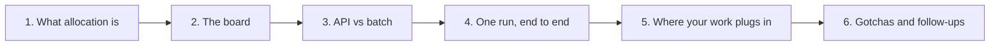
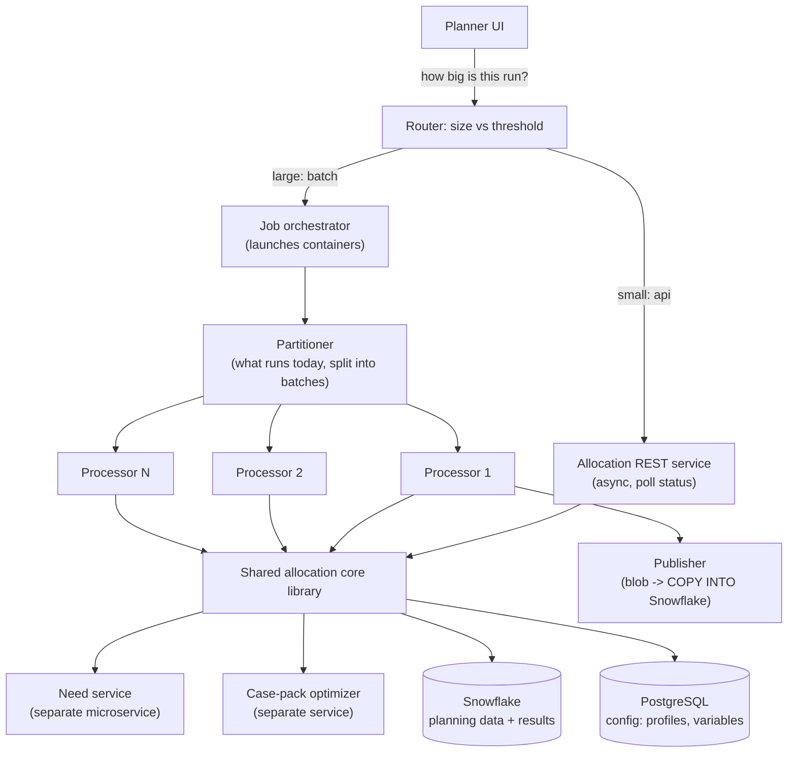
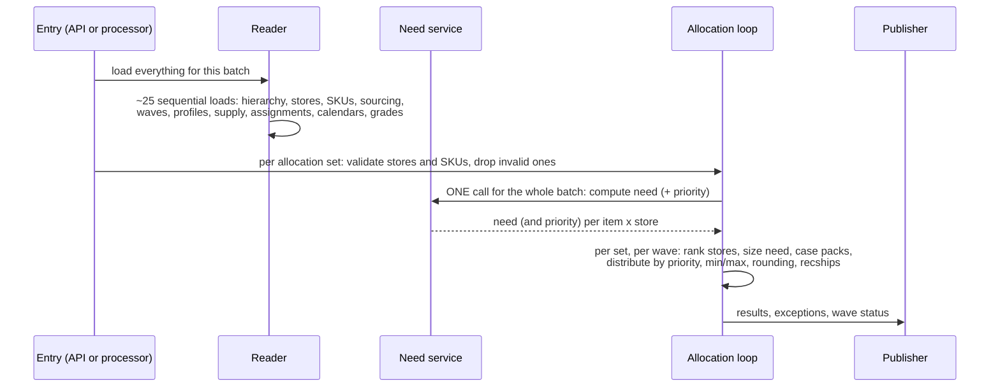
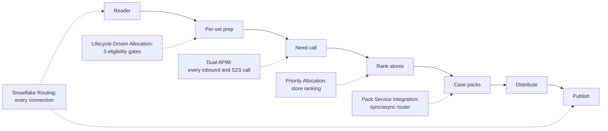

The allocation platform at Blue Yonder: the system every one of your allocation stories lives inside. Read this first. Priority Allocation, Lifecycle-Driven Allocation, Runtime Snowflake Routing and the Pack Service all plug into the pipeline below, so if you can draw this board in two minutes, every follow-up has a place to land.

These notes are written at interview level. Internal repository names, class names, flag identifiers, account URLs and exception codes from the team documentation are left out on purpose: say "the allocation engine", "the location-priority map", "a runtime feature flag", never an internal identifier.



## 1. What allocation is (say this in 30 seconds)

A retailer buys stock centrally: it sits at a distribution centre (DC) or arrives on purchase orders. **Allocation** decides how much of each item goes to each store, and in which order the stores are served when there is not enough for everyone.

| Term | Meaning |
|---|---|
| Allocation set | one unit of work: a set of items, the supply to distribute, and the stores to serve |
| Need | how much a store should get (computed from forecast, sales, on-hand, min/max) |
| Supply | what can be shipped: DC on-hand, purchase orders, packs |
| Sourcing | which source (DC) can ship to which destination (store), with transit times |
| Wave | an allocation set runs in ordered waves; leftover supply carries to the next wave |
| Store priority | the order in which stores are served when supply is short (lower number = served first) |
| Recship | the output: a recommended shipment from a source to a store |
| Realm / tenant | one customer; the service is multi-tenant (1,000+ tenant environments) |

The product is multi-tenant SaaS, Java + Spring Boot microservices on Azure (know your exact Java and Boot versions before the interview), with operational config in PostgreSQL and the large planning data (items, locations, forecasts, results) in Snowflake.

## 2. The board



Three deployables share one library:

| Piece | Owns | Does not own |
|---|---|---|
| REST service | HTTP, auth, validation, tenant context, the api-vs-batch decision | any allocation logic |
| Batch jobs | runner per container, partitioning, staging files, publishing, purge | any allocation logic |
| Core library | the domain model, data loading, the need call, the algorithm, exceptions, publishing | HTTP, triggers |

**Say it like this:** "The two services are thin shells. The real logic is a shared core library, so the interactive path and the batch path run exactly the same algorithm."

## 3. API vs batch

| | API (interactive) | Batch |
|---|---|---|
| Chosen when | the run is below a size threshold | above it |
| Runs in | the REST service, on an async executor | separate containers launched by the job orchestrator |
| Client sees | HTTP 200 + a process id immediately; it polls a status endpoint | a scheduled job; results land in Snowflake |
| Parallelism | one process | N processor containers, one per batch of allocation sets (default 10 sets per batch) |
| Bulk file reads (Parquet) | never | possible, behind a runtime flag |

**The batch layer is not Spring Batch.** Each container is a plain Spring Boot `CommandLineRunner` selected by a Spring profile (partitioner, processor, publisher, and a few more). It exits 0 or 1, and the orchestrator retries or fans out. Concurrency comes from launching N containers, not from threads.

**"Today" is a business date, not the clock.** The partitioner reads the tenant's demand post date and every schedule check compares against that. Changing the server clock changes nothing; a stale demand post date silently runs the wrong day.

## 4. One run, end to end



1. **Reader.** About 25 strictly sequential loads, each timed into a per-run performance map (the first place to look when a run is slow). A reader failure aborts the whole batch.
2. **Per-set preparation.** Validate stores and SKUs, remove invalid destinations, prepare supply. *(Lifecycle-Driven Allocation inserts its three gates here.)*
3. **Need call.** One call to the need service for the whole batch. It returns `need` and, since Priority Allocation, a `priority` value per item x store. A failure here fails every set in the batch.
4. **Allocation loop.** Sets are processed in priority order (they share supply through an in-batch ledger). Inside a set, waves run strictly in sequence because leftover supply carries forward. Per wave: rank stores *(Priority Allocation)*, size need, call the case-pack optimizer *(Pack Service Integration)*, distribute in store-priority order, enforce min/max, round, create recships. One failing set does not abort the batch.
5. **Publish.** Results go to blob storage, then `COPY INTO` Snowflake. Every Snowflake read and write goes through the connection layer *(Runtime Snowflake Routing)*.

## 5. Where each of your stories plugs in



| Story | Stage | One line |
|---|---|---|
| Priority Allocation | rank stores | turned a static, network-configured store order into a ranking computed from a business measure, per allocation set |
| Lifecycle-Driven Allocation | per-set prep | made the assortment plan the source of truth for which stores may get a product, and when |
| Runtime Snowflake Routing | every DB call | chose standard / OAuth / sharded connections at runtime, per tenant |
| Pack Service Integration | case packs | sync/async router with fallback for the external optimizer |
| Dual APIM | every HTTP edge | the service works behind Azure APIM and Gravitee at the same time |
| Intern work | around it | tenant onboarding, config import/export, the regression framework |

## 6. Gotchas that make you sound like you worked there

| Gotcha | Why it matters |
|---|---|
| Call order inside per-set prep is load-bearing | a later "remove invalid stores" step re-adds destinations; anything that filters stores must run after it |
| Lower priority number = served first | every ranking you produce must respect it; business measures often point the other way |
| Waves are sequential | leftover supply carries forward; never parallelise them |
| Allocation set order matters | sets share supply in a batch, so earlier sets can starve later ones |
| REST returns 200 even when the run fails | the real status is only on the status endpoint |
| No protection against two concurrent runs of the same set | a double click can delete the first run's working rows (see below) |
| Parquet is batch-only | enforced in one gate; the interactive path never reads files |

### The concurrency gap (a great "what would you improve" answer)

Each interactive request mints a fresh process id, then deletes the working rows **by allocation set id only** and inserts its own. A second click on the same set deletes the first run's in-flight rows; the table's key includes the process id, so the database never rejects the duplicate. Symptoms: short quantities that do not reproduce, status flipping between allocated and failed.

**The fix you would propose:** an atomic status claim at the entry point.

```sql
UPDATE allocation_set
   SET status = 'IN_PROGRESS', process_id = :pid, claimed_at = now()
 WHERE id = :id AND status <> 'IN_PROGRESS';
-- 0 rows updated -> another run owns it -> HTTP 409
-- 1 row updated  -> proceed; release in the existing finally block
```

Plus: scope the delete by process id as well, accept an idempotency key on the REST call, and a reaper for stale claims so a crashed container does not lock a set forever.

## 7. Follow-ups

**Q. Why a shared library instead of one service?** The interactive and batch paths must produce identical results. One library means one algorithm, and the two deployables only differ in how they are triggered and scaled.

**Q. Why not Spring Batch?** The orchestration platform already handles scheduling, fan-out and retries by launching containers. Each container does one step and exits. Spring Batch's job repository would duplicate that. The cost: no built-in duplicate-job protection or step restart, which the orchestrator has to provide.

**Q. How is a large run parallelised?** The partitioner decides which sets run today (two passes: eligibility first, then chunking, so batch numbers are stable), chunks them, and the orchestrator launches one processor container per chunk. Optionally the partitioner exports the input data once to Parquet on blob storage so N processors read files instead of hitting the database N times.

**Q. Where would you look if a run is slow?** The per-run performance map logged at the end: every reader DAO and the allocation service are timed. Then the Snowflake query history for that run's query tag.

**Q. How do you debug a store that got nothing?** Was it dropped in per-set prep (invalid store, no sourcing, or an assortment gate: each raises a typed exception)? Did it have need? Was it low in the ranking with short supply? The exception report answers the first two; the priority map answers the third.

### Rapid fire

| Question | Answer |
|---|---|
| Lower or higher priority number wins? | lower is served first |
| How many need-service calls per batch? | one |
| Why are waves sequential? | leftover supply carries forward |
| What is "today"? | the demand post date, not the clock |
| Default batch size? | 10 allocation sets per processor |
| Reader fails? | the whole batch fails |
| One set fails in allocation? | only that set fails |
