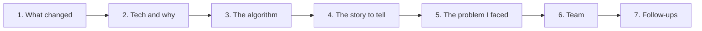
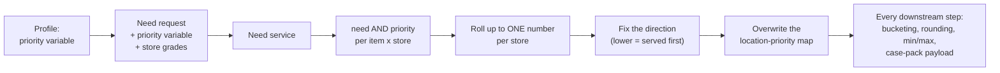

Priority Allocation: the store-ranking logic that decides which stores get inventory first when there is not enough for everyone. This is a 25-minute story. It has a clean before/after, a real algorithm with a worked example, a cross-team contract change, and a subtle determinism bug that makes the best "problem I faced" answer you have.

Read BY-00 (the platform overview) first if the pipeline is not fresh: this feature sits in the "rank stores" stage.

**Your resume line, the thread through everything below:**

> Priority Allocation: built the ranking logic deciding which stores receive inventory first, with fair-share splitting on tied demand; runs in 100% of customer allocations and contributed to a 20% sales lift. Drove cross-team API contracts and schema changes.



## 1. What we did, and how the system changed

### Before

When supply is short, the engine serves stores in the order of a **location-priority map**: store -> number, **lower number served first**. That number came from **static master data**: the distribution-network configuration. So:

1. **The ranking could not react to performance.** A store that sold out last week and a store sitting on dead stock had the same rank they had a year ago.
2. **Every allocation got the same order.** Swimwear and winter coats, allocated against the same network, served stores in the same sequence.
3. **The data was already there and ignored.** The need service already returned a `priority` field per item x store. Nothing read it.
4. Location priority was only honoured if the planner also picked a specific stock-out rule; otherwise the order was ignored entirely.

### After

The planner picks a **priority variable** on the allocation profile: a business measure such as weekly sales rate, sell-through or forecast. At run time:



**One sentence for the interviewer:** "The engine used to rank stores from static network config; I made it rank them per allocation set from a live business measure the planner chooses, computed by the need service, without rewriting the allocation algorithms."

### What all we did

| Layer | Change |
|---|---|
| Config and schema | the profile's "priority order" setting now holds either a measure name or the default "By Need"; the measure's definition carries a type and a sort direction |
| Profile | a `priorityVariable` field on the base profile class, so the set-level profile and every wave profile see it |
| Need-service contract | request gains the priority variable and the store grades; response carries `priority` and the variable name per item x store |
| The algorithm | roll item x store priorities up to one number per store (section 3) |
| Wiring | install the result into the existing location-priority map, and force location-priority behaviour on when a priority variable is set |
| Consumers | the case-pack optimizer payload now reads the store priority from the same map instead of a stale field on each SKU |
| Hardening (v2) | activation keyed on the priority variable itself, responses filtered by variable name, a deterministic direction transform (section 5) |

The design choice that makes it small: **reuse the existing location-priority map as the single choke point.** Bucketing of sourcings, rounding, min/max ordering, bulk allocation and the case-pack payload all already read that map. Overwrite it once and the whole engine re-ranks, with a diff of a few hundred lines instead of touching every algorithm.

### The numbers, and how to say them

| Claim | How to say it |
|---|---|
| **20% sales lift** | "On the customer pilot, ranking by sales rate meant the strongest premium stores were served first in short-supply scenarios, so they stocked out less. The customer's business team measured about a 20% sales lift at those premium stores over the season. I say *contributed*: I built the capability, they owned the measurement." |
| **100% of customer allocations** | "The ranking stage sits on the main path of every allocation run. It became the default way customers configure allocation, so every customer allocation goes through it." Know which of the two your team meant (on the path of every run, or configured by every customer) and say that one. |
| **Fair-share on tied demand** | "Stores that tie on priority land in the same priority bucket, and the supply for that bucket is split in proportion to need instead of first-come-first-served." (Section 3.5.) |

## 2. Technology, and why that one

| Technology | Used for | Why this and not something else |
|---|---|---|
| **Java + Spring Boot** | the engine and the orchestration service | the whole allocation core is a Java library shared by the API and batch paths; the feature had to live there to behave identically in both |
| **Plain Java domain objects** | the allocation set and its ranking logic | the allocation set has no Spring wiring; the service resolves batch-wide values (the allocation level) once and pushes them in, so the algorithm stays a pure, unit-testable POJO |
| **Spring Data JPA, native scalar queries** | reading a measure's type and sort direction | the measure entity eagerly loads six child collections; loading it inside a per-set loop to read two columns would fan out into many queries. Two scalar projections are one round trip each |
| **`@Qualifier` on the repository** | injection | the service has several datasources (OLTP Postgres and Snowflake-backed DAOs), so more than one bean can match a type; the qualifier removes the ambiguity |
| **PostgreSQL (config) + Liquibase** | the profile setting and measure definitions | config is small, relational and transactional; schema changes ship as versioned Liquibase changesets with the service |
| **Snowflake** | the product hierarchy (which level is "style-colour") | planning dimensions live in Snowflake; the allocation level is resolved once per batch, not per set |
| **REST + JSON to the need service** | computing priorities | the need service already computes measures per item x store; asking it for one more measure reuses its engine instead of duplicating measure logic in allocation |
| **Java collections** | the roll-up | `HashMap<product, HashMap<store, List<Double>>>` keeps every value because averaging needs the count; the result is a `Map<store, Long>` |

**Q. Why ask the need service instead of computing the measure in allocation?** The need service is where measures are defined and computed (sales rate, forecast, grades). Duplicating that in allocation would create two definitions of the same number that drift. One extra field on an existing call is cheaper and consistent.

**Q. Why send store grades to the need service?** Some priority measures are expressed in terms of store grades (A/B/C clusters). Grades were computed during the batch read but never forwarded. We transposed them from a `(item, store) -> grades` map into `store -> item -> grades`: a tuple key has no clean JSON form, and the need service evaluates store by store, so store-outer matches how it reads.

## 3. The algorithm

**Contract:** given `priority` values per item x store, produce one number per store and install it in the location-priority map, where **lower = served first**.

### 3.1 Step 1: group by product and store, honouring the leading product

Items roll up to the **allocation level** (typically style-colour: all sizes of one colour of one style). If product ratios are configured ("allocate these products together in a 2:1 ratio"), only the **leading product** counts, because the others are derived from it by ratio and are not independent signals.

### 3.2 Step 2: average within a product, sum across products

| Axis | Operator | Why |
|---|---|---|
| Sizes of one product at one store | **average** | sizes are facets of the same product; summing would make a style with 12 sizes outrank one with 3 |
| Different products at one store | **sum** | a store that ranks well across several products accumulates standing |

### 3.3 Step 3: fix the direction

The map says lower is served first. A measure can point either way: for "days of cover" a small value is urgent; for "sales rate" a large value is important. The measure's **sort order** records the planner's intent:

| Sort order | Meaning | Transform |
|---|---|---|
| ASC | serve the smallest raw value first (e.g. days of cover) | none: raw values already mean "small first" |
| DESC | serve the largest raw value first (e.g. sales rate) | reflect: `value -> total - value` |

Reflection makes the biggest seller the smallest number. It is **order-independent**: the result for a store depends only on its own value and the total, never on iteration order. (Version 1 did this differently; that is the story in section 5.)

### 3.4 Step 4: install

For every SKU in the set (not every response: responses can include stores that were filtered out), look up the store's computed value and **overwrite** the map entry. Stores with no computed value keep their network value.

**Why overwrite (`put`) instead of the usual "keep the minimum" merge?** The network values are small integers (1-10); a sales-rate value can be 0-50,000. A min-merge would let an arbitrary network number win. "Computed priority replaces configured priority" is the semantic we wanted.

```java
// Illustrative, simplified (v2 behaviour)
Map<String, Double> storeScore = new HashMap<>();
for (Map<String, List<Double>> byStore : byProductThenStore.values())
  for (var e : byStore.entrySet())
    storeScore.merge(e.getKey(), average(e.getValue()), Double::sum);   // avg in product, sum across

if ("DESC".equalsIgnoreCase(sortOrder)) {                              // bigger is better
  double total = storeScore.values().stream().mapToDouble(d -> d).sum();
  storeScore.replaceAll((store, v) -> total - v);                      // order-independent
}
for (Sku sku : skuMap.values()) {                                       // only in-scope stores
  Double v = storeScore.get(sku.store());
  if (v != null) locPriority.put(sku.store(), (long) Math.floor(v));
}
```

### 3.5 Worked example (say this on a whiteboard)

One product, sizes S and M, three stores, priority variable = weekly sales rate, sort order DESC (bigger is better).

| Store | S | M | Step 2: average |
|---|---|---|---|
| ST01 | 10 | 20 | 15 |
| ST02 | 4 | 6 | 5 |
| ST03 | 30 | 30 | 30 |

Step 3, reflect with total = 50: ST01 -> 35, ST02 -> 45, ST03 -> 20.
Map: `{ST03: 20, ST01: 35, ST02: 45}`. Order served: **ST03 (best seller), ST01, ST02.** Correct.

Same data with ASC (smaller is more urgent, e.g. days of cover): no transform, `{ST02: 5, ST01: 15, ST03: 30}`, so the weakest store by that measure is served first, which is right for "days of cover".

### 3.6 Fair share on ties

Downstream, stores are grouped into **buckets by priority value** and served bucket by bucket. When two stores have the same value they land in the same bucket and compete for that bucket's supply together: supply is split **in proportion to each store's need**, then rounded to packs and min/max.

Example: one bucket, ST04 needs 60 and ST05 needs 40, only 50 units left. First-come would give ST04 50 and ST05 0. Fair share gives 30 and 20. The determinism fix in section 5 is what made "same value, same bucket" true.

### 3.7 Blast radius: who reads the map

| Consumer | Effect of the new ranking |
|---|---|
| sourcing buckets | which stores compete against each other |
| bulk allocation | the order supply is handed out |
| min-rounding rule | finer rounding for top-priority stores |
| min/max validation | minimums satisfied for high-priority stores first |
| case-pack optimizer payload | store priority sent to the optimizer (inverted: it expects higher = more important) |

Turning on a priority variable is not a local change; it re-orders all of these at once. That is why the feature was opt-in by configuration and why "no priority variable configured" had to be byte-for-byte identical to before.

## 4. The story to tell

### The 30-second pitch

> Allocation decides which stores get stock first when supply is short. The order used to come from static network config, the same for every allocation. I made it data-driven: the planner picks a business measure like sales rate, the need service computes it per item and store, and I roll that up into one priority per store, fix its direction, and install it into the map the whole engine already ranks by. So one change re-ranked every downstream step. Ties are split fair-share. It is on the path of every customer allocation and contributed to a 20% sales lift at premium stores in the pilot.

### The 2-minute version: add three points

1. **Reuse the choke point.** Rather than threading a new concept through dozens of algorithms, overwrite the existing location-priority map; one write re-ranks bucketing, rounding, min/max and the case-pack payload.
2. **The roll-up.** Average across sizes, sum across products, leading product only when ratios exist, reflect when bigger is better.
3. **Determinism.** The first version could give tied stores different ranks run to run; I made the transform order-independent so ties stay ties and get a fair-share split.

### The 25-minute walkthrough (a plan, with timings)

| Minutes | Cover | Draw |
|---|---|---|
| 0-3 | what allocation is; why order matters when supply is short | the pipeline from BY-00 |
| 3-6 | the before: static network priority; the three limitations | the map with network values |
| 6-10 | the design: config -> need request -> response -> roll-up -> map | section 1 flow |
| 10-15 | the algorithm and the worked example | the table in 3.5 |
| 15-18 | direction, ties, fair share | the bucket example |
| 18-22 | the problem I faced (section 5) | two runs, two orders |
| 22-25 | team, rollout, results, what I'd improve | |

Pause after 10 and after 18 and ask "should I go deeper into the algorithm, or the rollout?" Interviewers steer; let them.

## 5. The problem I faced: the same input gave two different rankings

**Use this one in every interview.** It is a real class of bug, the root cause is concrete, and the fix ties directly to the "fair-share on tied demand" line on your resume.

**Situation.** A few weeks after the first version went to a QA tenant, our nightly regression suite (it re-runs fixed allocation sets and compares results with stored baselines in Snowflake) started failing intermittently on one module. No code had changed. Re-run it: pass. Re-run again: fail. A flaky test is usually blamed on the test, but the diff was always the same shape: two stores swapping quantities.

**Investigation.**

1. I pulled the two result sets side by side. Two stores, ST14 and ST27, with **identical** sales rates: in one run ST14 got the full quantity and ST27 nothing, in the other run the reverse.
2. I logged the location-priority map for both runs. Same scores going in, different priority numbers coming out.
3. The first version handled "bigger is better" with a **rank swap**: sort stores by score, then give the store with the smallest score the largest value, and so on. Sorting is stable, but the starting order came from **iterating a HashMap**, which has no guaranteed order. With two equal scores, which store came first, and therefore which got the better rank, depended on hash layout, which varies with capacity and insertion history.
4. Ties were not rare: the final step truncates the double to a long, so 10.9 and 10.1 both become 10.

**Root cause in one line:** a rank-based transform on a data structure with no defined order turned a tie into an arbitrary winner.

**Fix.**

1. Replaced the rank swap with an **arithmetic reflection** (`total - value`). Each store's result depends only on its own value and the total, so the output is the same regardless of iteration order. Ties stay **exactly equal**.
2. Equal values put tied stores in the **same priority bucket**, where supply is split **in proportion to need**. That is the fair-share behaviour: the tie is resolved by need, not by luck.
3. Anywhere an explicit order is still needed (logging, reports), a total comparator: by value, then by store id.
4. Added a **determinism unit test**: shuffle the input responses 100 times, assert the identical map each time; and a tie test asserting tied stores get equal priority.

**Result.** The flaky module went green and stayed green; the same input now always produces the same allocation, which matters because planners compare runs and auditors ask "why did this store get less".

**The trade-off you can mention:** reflection does not preserve the original numbers (they scale with the total), but the map only cares about relative order, so that is fine. The only place the absolute value is visible is the case-pack payload, which inverts it anyway.

**Lesson to say out loud:** "Anything that ranks must be deterministic under ties. If the result depends on iteration order of an unordered structure, it is a bug even if every test you wrote passes."

## 6. Team collaboration

| Who | What we worked out |
|---|---|
| **Need-service team** | the contract: request gains the priority variable and store grades; response returns a priority and the variable name per row. I wrote the contract proposal with example payloads; they implemented the computation. Later we added the variable name per response so allocation could filter priority rows from need rows. |
| **Config / UI team** | the "priority order" dropdown, the "By Need" default, and the schema change for the profile. When v2 changed which sort order triggers the transform, we agreed a config migration and a release note so existing profiles kept ranking the same way. |
| **Case-pack optimizer team** | confirmed their priority field convention (higher = more important), so we invert before sending. |
| **QA automation** | the colleague who owned the nightly baselines flagged the flaky module; we debugged it together and added the tie and shuffle tests to the suite. |
| **Product owner** | the business rules: leading product only when ratios exist; average within a product and sum across products. |

**How to say it:** "Most of the hard part was not the code, it was agreeing the contract. I drove a short design doc with the need-service team, with example requests and responses, before anyone wrote code, and that is why the integration went in without surprises."

## 7. Follow-ups and answers

### Design

**Q. Why overwrite the existing map instead of adding a new ranking concept?** The map is the single choke point every downstream algorithm already reads. One write re-ranks the engine. A parallel concept would have to be taught to each consumer, and missing one would give inconsistent orderings. The cost: the source of a priority is no longer visible from its value, so I'd add a small "priority source" log line per run.

**Q. Why force location-priority behaviour on when a priority variable is set?** Otherwise a planner could configure a priority measure and see no effect because the stock-out rule ignores location priority. Configuring a priority variable is an unambiguous statement of intent; requiring a second setting invites misconfiguration. The side effect, deliberately accepted: the case-pack payload now carries real priorities instead of zeros.

**Q. Why average within a product and sum across products?** Averaging normalises away size-range depth. Summing rewards stores that are strong across many products. Honest weakness: under ASC, a sum makes a store in more products look *worse* (bigger number). With ratios configured it cannot happen (one product contributes). For multi-product sets without ratios I'd switch to an average across products, which is scale-invariant.

**Q. Why only the leading product when ratios are configured?** The other products' quantities are derived from it, so their measures are not independent; blending them would let a derived product distort the ranking.

**Q. What about stores the need service gave no priority for?** They keep their network value. That can mix scales (a network "2" beats a measure "15"). The fix I'd make: give unscored stores an explicit worst rank so they never jump the queue.

**Q. Once per set, or per wave?** The first version ranked once per set, before the wave loop. The current code ranks per wave, from that wave's need responses, because waves can carry different need. Either way, never inside the distribution loop.

**Q. Why truncate to a long?** The map is `Map<store, Long>`. Truncation creates ties when values are in a narrow band (0.0-5.0 becomes six buckets). Better: scale before rounding (`Math.round(v * 1000)`), which keeps discrimination; that is on my improvements list.

### Correctness and edge cases

**Q. What if the need service fails?** The need call is one call for the whole batch; if it fails, every set in the batch fails and is reported, nothing half-ranked is published.

**Q. A null pointer risk you know about?** Reading a store's priority from the map and unboxing it into a `long`: if a destination is missing from the map, it throws. `getOrDefault(store, 0L)` restores the old safe behaviour.

**Q. How did you keep it safe to roll out?** It is opt-in by configuration. With no priority variable, the ranking code never runs and the output is identical to before. We verified that with the baseline suite: all existing modules unchanged, and new modules added for the priority scenarios.

**Q. Complexity?** Grouping is O(R) over need responses; reflection is O(S) over stores; install is O(K) over SKUs. With 500 items x 1,000 stores that is 500k responses in memory, which the batch already holds anyway.

**Q. Thread safety?** Ranking runs single-threaded per set; sets in a batch run sequentially (they share a supply ledger); parallelism is across processor containers, which share nothing in memory.

### Business

**Q. How do you know the 20% was because of you?** I don't claim it alone. The customer compared sales at premium stores before and after switching to a sales-rate priority during a comparable season. The engine change made it possible; merchandising choices also mattered. That is why it says "contributed".

**Q. What did "fair share" replace?** Within a tie, the first store processed used to take what it needed and the next got the remainder. Now a tied bucket is split in proportion to need.

### Rapid fire

| Question | Answer |
|---|---|
| Lower or higher number served first? | lower |
| Where does the priority value come from? | the need service, per item x store |
| Roll-up within a product? | average across sizes |
| Across products? | sum |
| Ratios configured? | leading product only |
| Bigger-is-better measure? | reflect: total - value |
| Why not rank swap? | non-deterministic on ties |
| Ties downstream? | same bucket, split in proportion to need |
| Why overwrite, not min-merge? | different scales |
| No priority variable configured? | identical to before |

## 8. What I'd improve

1. Average across products (scale-invariant) instead of sum when there are no ratios.
2. Unscored stores get an explicit worst rank, not their network value.
3. Scale before truncating, so narrow measures keep resolution.
4. `getOrDefault` where the map is unboxed.
5. Cache the measure's type and sort order per batch instead of two queries per set.
6. A per-run log of "priority source: measure X, direction Y, N stores scored" for support.
