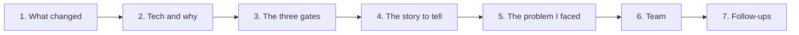
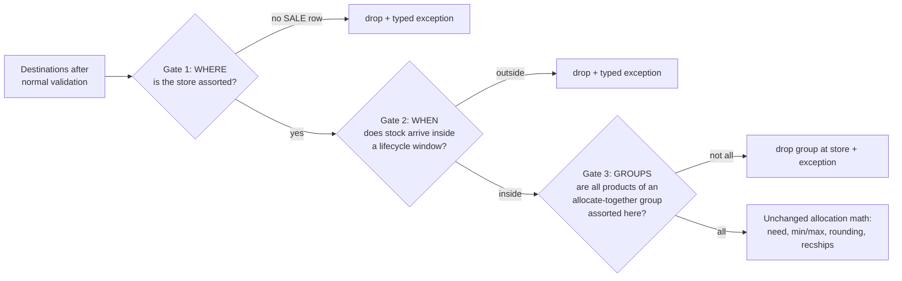

Lifecycle-Driven Allocation: the integration that made the Assortment Plan the source of truth for **where** a product may be allocated and **when**. This is a 25-minute story with a crisp design (three gates that only remove destinations), strong engineering patterns (double-gated flag, fail-open, backward compatibility through a database default flip), and a "problem I faced" about call ordering that every senior engineer recognises.

It sits in the per-set preparation stage of the pipeline in BY-00.

**Your resume line:**

> Lifecycle-Driven Allocation: designed and delivered the Assortment Planning integration that made lifecycle data the source of truth for store eligibility; lifecycle-window validation and multi-product rules cut allocations to ineligible stores by 30%+.



## 1. What we did, and how the system changed

### Before

Which stores could receive a product was decided by the distribution network and the planner's store-group selection. But merchandising decides **assortment** separately, in an Assortment Planning product: "this jacket is sold in these 120 stores, from 1 March to 30 June". Allocation did not read it. So:

1. Stores **not in the assortment** still received stock, which then sat unsold or had to be transferred back.
2. Stock arrived **before launch** (it could not go on the floor) or **after end-of-life** (it went straight to markdown).
3. Products meant to be sold **together** (a suit's jacket and trousers) could arrive at a store where only one of them was assorted.
4. Planners fixed this by hand: reviewing allocations and deleting lines, every cycle.

### After

Assortment Planning publishes **SALE assignments**: per item x store, an eligibility record with a lifecycle window (effective from, effective up to). Allocation reads them and applies three gates before any quantity math:



**One sentence:** "I made allocation respect the assortment plan: three gates in the need phase decide which item-store pairs survive, by eligibility, by lifecycle window and by group consistency, and nothing about the quantity math changes."

### What all we did

| Piece | What |
|---|---|
| Data contract | a new read-only input from Assortment Planning: item, location, effective from, effective up to, type = SALE. Read by a **separate** query from the existing replenishment (ORDER) assignments |
| Reader | load SALE rows into their own collection, keyed store -> item -> list of windows, only when the environment flag is on |
| Gate 1: WHERE | drop store destinations with no SALE row |
| Gate 2: WHEN | drop destinations whose earliest scheduled arrival date is outside every window |
| Gate 3: GROUPS | for allocate-together groups with a ratio, keep the group only at the intersection of stores where every member survived |
| Need bridges | zero the need of dropped destinations so the ratio math does not size other products against demand that can never be served |
| Activation | an environment kill switch AND a per-profile bypass |
| Schema | a per-profile "ignore assortment plan" column, rolled out with a two-step default flip |
| Exceptions | three typed exception codes, one per gate, so every drop is explainable |
| Behaviour matrix | ten agreed scenarios with the product owner and QA |

### The 30% number, and how to say it

"We measured the share of allocated units going to stores that the assortment plan said were not eligible at that time, on the pilot tenants, before and after enabling it. It fell by more than 30%." 

**Why not 100%** (they will ask): the feature is fail-open by design. Profiles that bypass it, allocation sets with no SALE data, and existing tenants that were backfilled to bypass all behave as before. The gates enforce the plan wherever the plan exists; the remaining gap was mostly tenants whose assortment data was incomplete.

## 2. Technology, and why that one

| Technology | Used for | Why this one |
|---|---|---|
| **Java (streams, iterators, collections)** | the gates and bridges | gates walk the valid-destinations map and remove entries; `Iterator.remove()` is the only safe way to remove while iterating a `HashMap` (a for-each plus `map.remove` throws `ConcurrentModificationException`). `anyMatch` gives multi-window support for free |
| **Spring Boot `@Value` with a default** | the environment kill switch | `@Value("${flag:false}")`: off unless explicitly enabled, no redeploy of code to flip per environment |
| **Snowflake** | the SALE assignments on the database read path | planning data lives there; a second, separate query joins the process view on item and location and filters type = SALE |
| **Apache Parquet on blob storage** | the same data on the batch file path | in batch mode the partitioner exports inputs once as Parquet and N processors read files; the SALE folder is marked optional, so a missing export does not fail the run |
| **PostgreSQL + Liquibase** | the per-profile bypass column | versioned migration; the two-step default flip (below) is a Liquibase pattern |
| **DAO separation** | reading SALE vs ORDER | read and write paths are separate classes, which is what makes the isolation rule enforceable |
| **Typed exceptions + existing publishers** | explaining drops | each gate raises its own code; the existing exception publisher reports them; no new output table |

### Why a separate query, not a widened ORDER query

The existing replenishment (ORDER) assignments are read **and written back**: the ORDER writer stamps type = ORDER and republishes what it touches. If a SALE row ever entered that collection it would be mutated and published as a replenishment order. So SALE rows live in their own collection, loaded by their own query, and never touch the ORDER path. That is a stated invariant, and the reason for the second query.

### The database default flip (a great 1-minute answer)

The new column is "ignore assortment plan constraint" per allocation profile.

1. Add the column with **default true**. Every existing profile backfills to *bypass*: existing customers see no change on upgrade.
2. Then change the column default to **false**. Every **new** profile *enforces* the assortment plan.
3. Read it null-safe, defaulting to bypass.

Old tenants are untouched, new tenants get the feature, no data migration script, and it is reversible.

## 3. The three gates in depth

### 3.1 Activation: double-gated, off by default

```text
active = environmentFlagOn  AND  NOT profile.ignoreAssortmentPlan
```

Four safety layers, so "do nothing new" is always the default:

1. **Environment flag**: a kill switch per environment. It also gates the SALE **read**, so when it is off the feature costs zero query time.
2. **Profile bypass**: per allocation profile, checked before any SALE lookup. Same semantics as the existing "ignore distribution network constraint" checkbox, so planners already understand it.
3. **Fallback**: a set with zero SALE rows makes every gate a no-op.
4. **Type isolation**: SALE never touches the ORDER path.

### 3.2 Where the gates sit (the ordering is load-bearing)

```text
validate stores, validate SKUs
remove invalid stores        <- re-adds destinations through network validation!
GATE 1 eligibility           <- must be AFTER the line above
prepare supply               <- computes the scheduled arrival date
GATE 2 lifecycle window      <- must be AFTER the line above
GATE 3 group consistency     <- only if product ratios are configured
build need request -> need service
ratio math -> need bridges
unchanged allocation math
```

**The drop lever** for all gates is the same: remove the destination from the valid-sourcings map. Allocation skips anything not in that map, so a dropped item x store gets no shipment, and a typed exception is raised.

### 3.3 Gate 1: WHERE (eligibility)

1. No SALE data at all -> return (not assortment-controlled).
2. Take the stores from the wave-0 store-group selection. Empty -> return (fail-open). Wave 0 only because network validation also adds **intermediate tiers** (regional DCs) as destinations; SALE rows exist only for stores, so non-store destinations must never be gated.
3. **Per-set trigger**: gate the set only if at least one store destination has a SALE row. Otherwise this set is not under assortment control; return.
4. Walk the destinations with an iterator; every store destination with no SALE row: remove, record (store -> item) for the need bridge, raise "store not eligible".

**Product decision:** inside an assortment-controlled set, an item with no SALE row anywhere is dropped at **all** stores, not partially allocated. Unassorted means unassorted.

### 3.4 Gate 2: WHEN (lifecycle window)

The question is "will the stock **land** in the store inside a window", not "is it at the DC". So the gate tests the **scheduled arrival date**: the earliest date supply can reach the store after transit, across the destination's valid sources.

1. No windows for this destination -> skip.
2. No computable arrival date -> skip (fail-open; never reject on missing data).
3. In any window (`anyMatch`) -> keep. Multiple windows per item x store (a product returning for a second season) work for free.
4. Otherwise -> remove, record, raise "dates conflict".

**The inclusive comparator.** The existing date helper was upper-exclusive, which would reject an arrival landing exactly on the end date. A new helper:

```java
static boolean withinWindow(long arrival, long from, long upto) {
  if (arrival < from) return false;          // pre-launch
  if (upto == OPEN_ENDED) return true;       // null end date is stored as a sentinel
  return arrival <= upto;                    // INCLUSIVE end date
}
```

### 3.5 Gate 3: GROUPS (allocate-together with a ratio)

Runs only when product ratios are configured ("jacket and trousers 1:1").

**Rule:** the group can be honoured at a store only if **every** member product survived Gates 1 and 2 there. So the group allocates exactly at the **intersection** of the members' surviving stores.

```text
storesByProduct = { JACKET: {S1, S2, S3},  TROUSER: {S2, S3, S4} }
groupStores     = intersection          = {S2, S3}
blockedStores   = selected - groupStores = {S1, S4}
```

Every group destination outside the intersection is dropped with an "allocate-together conflict". **Fail-open guard:** if the product level of the ratio does not match any destination (a config mismatch), return, because an empty intersection would silently block every store with no explaining exception.

Allocate-together **without** a ratio needs no code: Gate 3 is skipped and each item is judged by Gates 1 and 2 independently.

### 3.6 The need bridges (the subtle part)

The gates work on the **destinations** map; the ratio engine works on a separate **store-level need** map. Dropping a destination stops the shipment but leaves its **need** in place, so the ratio engine would size the trousers against jacket demand that can never be served.

Two bridges zero that need:

1. **Per item:** for each (store, item) dropped by a gate, set its need to 0 before product-level aggregation (`replace` only, never add a key). This also renormalises the item shares.
2. **Per store:** for a store blocked by Gate 3, zero all item need and skip the ratio math for it (no extra exception: Gate 3 already raised one).

**Downstream effect:** the freed supply raises other stores' quantities through the normal fair-share redistribution. A pack cannot be split, so a pack-only set with a partially assorted store gets nothing there.

### 3.7 The behaviour matrix (agreed with the product owner and QA)

| # | Scenario | Behaviour |
|---|---|---|
| 1 | no SALE entry for any store | allocate as before |
| 2 | SALE for some stores only | allocate those, drop the rest with an exception |
| 3 | arrival before the window | drop (pre-launch) |
| 4 | arrival after the window | drop (post end-of-life) |
| 5 | profile bypass on | as before, silently |
| 6 | allocate-together, leading product not eligible anywhere | whole group gets nothing |
| 7 | allocate-together, no ratio | each item judged independently |
| 8 | allocate-together, partially eligible | group allocates at the intersection |
| 9 | several windows | valid if arrival is in any |
| 10 | new / end-of-life classification from SALE dates | out of scope for this release |

### 3.8 Invariants to recite

- Additive and fallback-safe: flag off or no SALE data = identical output.
- Gates only **remove** destinations; no quantity math changes.
- Ordering: Gate 1 after invalid-store removal; Gate 2 after supply preparation.
- Fail-open everywhere: missing selection, missing arrival date, or product-level mismatch means "do nothing", never a silent all-zero allocation.
- SALE never crosses into the ORDER path.
- Reversible: flip a switch back; no migration, no cache invalidation.

## 4. The story to tell

### The 30-second pitch

> Merchandisers decide which stores sell a product and when, in Assortment Planning, but allocation ignored it, so stock went to stores that could not sell it, or arrived before launch or after end-of-life. I designed the integration that made lifecycle data the source of truth: three gates in the need phase. Where: is the store assorted. When: does the stock land inside a lifecycle window. Groups: for products sold together, only stores where every member is assorted. The gates only remove destinations, so all quantity math is untouched, and it is double-gated and fail-open. Allocations to ineligible stores dropped by more than 30% on the pilot tenants.

### The 2-minute version: add

1. **Arrival date, not DC date.** Window checks use when stock will land after transit.
2. **Need bridges.** Dropping a destination is not enough; its need must be zeroed or the ratio engine mis-sizes the related products.
3. **Safe rollout.** Environment kill switch, per-profile bypass, a database default flip so old tenants are untouched and new ones enforce.

### The 25-minute walkthrough

| Minutes | Cover | Draw |
|---|---|---|
| 0-3 | allocation in one line; what assortment planning is | BY-00 pipeline |
| 3-6 | the before: four symptoms, manual cleanup | |
| 6-9 | data contract; why a separate query; isolation | reader with two collections |
| 9-16 | Gates 1, 2, 3 with the example sets | the gate flowchart; the intersection |
| 16-19 | need bridges; freed supply redistributes | two maps side by side |
| 19-22 | the problem I faced (section 5) | the ordering list in 3.2 |
| 22-25 | rollout, default flip, results, team, improvements | |

## 5. The problem I faced: the gate "worked" and the store still got stock

**Situation.** In QA, a tester sent me an allocation where the exception report said "store not eligible" for a jacket at store S12, and the same run had a recommended shipment of that jacket to S12. The gate had fired, and its decision had been ignored.

**Investigation.**

1. Reproduced it locally with the tester's allocation set and a debugger.
2. Logged the size of the valid-destinations map after every preparation step. After my gate: 340. A few steps later: 352. Something was **adding destinations back**.
3. The culprit was the existing "remove invalid stores" step. Despite its name, it runs network validation, which **rebuilds** destinations from the sourcing network, re-adding the ones my gate had removed.
4. My first implementation had put Gate 1 right after store validation, which looked like the natural place, and **before** that step.

**Fix.**

1. Moved Gate 1 to **after** invalid-store removal, and wrote the reason in a code comment next to the call, because the next person will think the order is arbitrary.
2. Checked the other gates for the same class of problem and found one: Gate 2 needs the scheduled arrival date, which only exists after supply preparation. So Gate 2 runs after it.
3. Gate 2 then hit a `NullPointerException`: the arrival-date calculation reads the current wave, which is not set yet in the need phase. Pre-set wave 0 there (the wave loop overwrites it later).
4. Added an end-to-end test asserting the invariant directly: **no destination that raised an assortment exception has a shipment**. That test would have caught the original bug, and it protects the ordering from future refactors.

**Result.** The contradiction disappeared, and the invariant test became part of the regression suite. The ordering constraint is now documented in the team's architecture notes as one of the "load-bearing" orders.

**A second, smaller one if they ask for more:** the first version used the existing date helper, which is upper-exclusive; an arrival exactly on the last day was rejected. A product owner caught it in the behaviour-matrix review. Fixed with the inclusive comparator in 3.4.

**Lesson:** "When you insert a filter into an existing pipeline, find every later step that can re-create what you filtered. Test the invariant end to end, not just your function."

## 6. Team collaboration

| Who | What |
|---|---|
| **Assortment Planning team** | the data contract: columns, open-ended windows (null end date), how often it refreshes, and adding the SALE data to the batch Parquet export as an optional folder |
| **Product owner** | the business rules, decided explicitly: an unassorted item in a controlled set is dropped at all stores; groups allocate at the intersection; no exception on profile bypass. I wrote each as a scenario with a concrete example and got a yes/no, which became the behaviour matrix |
| **QA** | turned the matrix into test cases; the tester who found the ordering bug |
| **Config / DB owners** | the per-profile column and the two-step default flip, reviewed so upgrades would not change existing tenants |
| **Support** | the three exception codes and a note: "filter the exception report to these codes to explain an assortment drop" |

**How to say it:** "I wrote the behaviour matrix before writing the gates. Every ambiguous case became a one-line question to the product owner with an example, and the answers became tests. That is why there were no surprises in UAT."

## 7. Follow-ups and answers

### Design

**Q. Why gates that only remove destinations, instead of changing need or quantities?** Because the quantity math (need, min/max, rounding, ratios) is complex and heavily used; touching it risks regressions everywhere. Eligibility is a yes/no per item x store, so the cleanest place is the existing "valid destinations" map that allocation already respects. One lever, three gates.

**Q. Why fail-open instead of fail-closed?** The worst outcome is a silent all-zero allocation: nothing ships, no exception explains why. If assortment data is missing for a set, allocating as before is the safer default and matches what the customer had yesterday. Where data exists and says no, we drop and explain.

**Q. Why test the scheduled arrival date and not today's date?** Stock allocated today lands after transit. A product launching on the 10th should be allocated on the 5th if transit is five days. Testing today's date would block exactly the pre-launch allocations planners want.

**Q. Why the per-set trigger?** If no store in the set has any SALE row, the set is not under assortment control (the customer has not planned it). Gating it would drop everything.

**Q. Why the earliest arrival across sources?** A destination can be served by several DCs; if any can land the stock inside the window, the destination is valid.

**Q. How do multiple windows work?** A list of windows per item x store; `anyMatch` keeps the destination if the arrival is in any of them.

**Q. Why compute an intersection for groups instead of dropping only the ineligible product?** A ratio group must arrive together; shipping jackets without trousers to a store breaks the ratio and the customer experience. So the group goes only where every member is allowed.

**Q. Why zero need instead of letting allocation figure it out?** The ratio engine sizes related products from the leading product's need at each store. If a dropped store keeps its need, the related product is sized against demand that can never be filled, and those units are stranded or mis-distributed.

### Implementation

**Q. Why `Iterator.remove()`?** Removing from a `HashMap` while iterating its key set with for-each throws `ConcurrentModificationException`. The iterator's own `remove` is the safe way.

**Q. Complexity?** Each gate is O(D) over destinations with O(1) hash lookups into store -> item -> windows. The intersection is O(P x S) for P products and S stores. All in memory, negligible next to the reader.

**Q. Why does the environment flag also gate the read?** So that when it is off, the feature costs nothing: no extra Snowflake query, no extra memory.

**Q. What happens in batch mode with Parquet?** The partitioner exports SALE assignments to their own folder; the processor reads it with a dedicated Parquet reader. The folder is optional, so a missing export does not fail the run; on the database path, a failed SALE query fails fast, because a partial read would silently change eligibility.

**Q. How is it reversible?** Flip either switch. No data was migrated and nothing is cached, so the next run is identical to pre-feature.

**Q. How do you explain a drop to a planner?** Each gate raises its own exception code with item and store; the existing exception report shows them. Profile bypass raises nothing by design.

### Testing and rollout

**Q. How did you test it?** Unit tests per gate (eligible, ineligible, no data, open-ended window, end-date inclusive, several windows, intersection, product-level mismatch), the end-to-end invariant test (no exception-raising destination has a shipment), and the baseline regression: with the flag off, every existing module had to be unchanged.

**Q. Rollout?** Flag on in a QA environment, then pilot tenants with profiles set to enforce, then the default flip so new profiles enforce by default.

### Rapid fire

| Question | Answer |
|---|---|
| What do gates change? | only which destinations survive |
| Gate 1? | is the store assorted (WHERE) |
| Gate 2? | does the arrival date fall in a window (WHEN) |
| Gate 3? | intersection for allocate-together with a ratio |
| End date inclusive? | yes, new comparator |
| Missing data? | fail-open |
| Flag off? | byte-for-byte identical |
| Old tenants after upgrade? | backfilled to bypass |
| Why a separate SALE query? | the ORDER path writes back what it reads |
| Freed supply? | redistributed fair-share to other stores |

## 8. What I'd improve

1. A metric per run: units dropped by each gate, so the 30% is tracked continuously, not measured once.
2. Use SALE dates for new and end-of-life classification (scenario 10, deferred).
3. A warning when a set is assortment-controlled but a large share of stores have no SALE row (likely incomplete data upstream).
4. Make the load-bearing call order structural (a pipeline of named steps with declared dependencies) instead of relying on comments.
