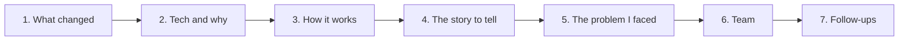
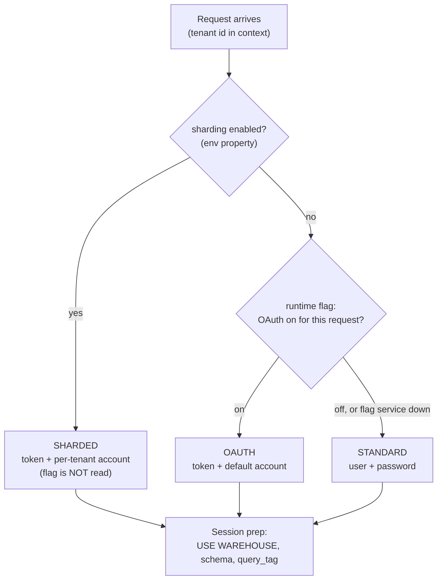
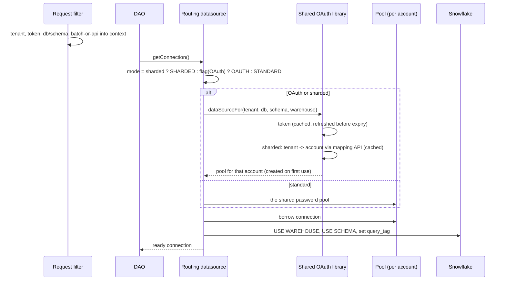

Runtime Snowflake Connection Routing: the layer that decides, for every request, which Snowflake account to connect to and how to authenticate, across three modes, for 1,000+ tenants. This is a 25-minute story about multi-tenancy, OAuth, connection pooling, feature flags and a thread-context bug that could have routed one tenant's query to another tenant's account.

**Your resume line:**

> Runtime Snowflake Connection Routing: designed a feature-flag-controlled framework routing Snowflake connections across three runtime modes (standard, OAuth via B2C, and sharded via a tenant-mapping API), with lazy datasource initialization across 1,000+ tenants; sharding cut batch runtime by 12%.

**The ownership rule, say it early in the interview:** "We owned the *decision* of which mode to use and how the connection is opened and prepared. Token fetching and the tenant-to-account mapping lived in a shared platform library owned by another team." Interviewers trust a clear boundary.



## 1. What we did, and how the system changed

### Before

Every service instance connected to **one** Snowflake account with **one** username and password, shared by all 1,000+ tenants.

| Problem | In practice |
|---|---|
| **Long-lived shared secret** | one password on every instance; rotating it meant a coordinated redeploy; a leak exposed every tenant |
| **No isolation** | one account = one blast radius; a heavy tenant's queries competed with everyone's for the same warehouse |
| **No room to scale out** | growth could only go to a bigger warehouse on the same account |

### After

Three runtime modes, chosen per environment and per request:

| Mode | Auth | Account | Tenant mapping API |
|---|---|---|---|
| **Standard** | user + password | one shared account | not used |
| **OAuth** | short-lived token (client credentials via Azure AD B2C) | one default account | not used |
| **Sharded** | short-lived token | **per tenant**, looked up from a mapping API | used |



**One sentence:** "Every request needs a Snowflake connection; two startup properties decide which beans exist, a runtime flag decides OAuth vs fallback per request when sharding is off, and in sharded mode each tenant is routed to its own account through a mapping API, with pools created lazily on first use."

### What all we did

| Piece | What |
|---|---|
| Mode selection | two environment properties (OAuth enabled, sharding enabled) decide which Spring beans load; a runtime feature flag decides per request when sharding is off |
| Conditional wiring | the OAuth library's beans are scanned only when needed; turning a property on without the library fails at startup, not at 3 a.m. |
| Routing datasource | one entry point every DAO uses: read the tenant from the request context, pick the mode, borrow a connection from the right pool |
| Lazy pools | per tenant-account pools created on first use and cached, instead of 1,000+ pools at startup |
| Session prep | after borrowing a connection: `USE WAREHOUSE`, schema, and a `query_tag` with tenant and environment |
| Context propagation | the tenant id captured at the request filter and carried explicitly onto async and pooled threads (section 5) |
| Observability | a mode tag in logs, the query tag in Snowflake's query history, and the account per tenant in connection logs |
| Rollout plan | property on (no behaviour change), verify startup, flag on, verify, flip back in seconds if needed |

### The numbers

| Claim | How to say it |
|---|---|
| **1,000+ tenants** | "about 1,200 tenant realms share the service" |
| **lazy initialization** | "a pool is built the first time a tenant's account is used, then cached; most tenants are not active at the same time, so we never hold connections for idle ones" |
| **12% faster batch** | "after tenants were spread across accounts, heavy tenants stopped queueing behind each other on one warehouse. We compared median end-to-end batch duration over two weeks before and after on the sharded environment, and queue time in Snowflake's query history; batch runtime dropped about 12%" |

## 2. Technology, and why that one

### Snowflake basics you must be fluent in

| Term | Meaning | Why it matters here |
|---|---|---|
| Account | one Snowflake instance with its own URL | sharding = tenants spread over several accounts |
| Warehouse | the compute that runs queries, billed per warehouse | must be selected per session, or queries fail |
| Database / schema | the data namespace | set per session |
| Role | the permission set | what the session may read and write |
| Session parameters | warehouse, schema, `query_tag` | apply to one connection only, so they are set on every connection we hand out |

**What breaks if you skip session prep:** "No active warehouse selected in the current session". It looks like a Snowflake outage, but it is ours: the library does not apply the warehouse we ask for, so we run `USE WAREHOUSE` ourselves.

### The stack

| Technology | Used for | Why this one |
|---|---|---|
| **JDBC + HikariCP** | connections | opening a Snowflake connection is slow (network plus auth handshake); a pool reuses open ones. HikariCP is Spring Boot's default and the fastest mainstream pool. Each mode is just "which pool, authenticated how" |
| **OAuth 2.0 client credentials** | machine-to-machine auth | no user is involved; the service proves itself with a client id and secret and gets a short-lived access token, sent instead of a password |
| **Azure AD B2C** | the token issuer | the platform's identity provider; tokens are minted per account client. Errors like `invalid_client` mean a wrong secret, at the token step, not the connection step |
| **Two credential pairs** | account pair for data connections (both OAuth modes); admin pair for the mapping API (sharded only) | if sharded fails but OAuth works, suspect the admin pair |
| **Tenant mapping API** | tenant -> account | the source of truth for where each tenant lives; cached by the library |
| **Harness feature flag** | OAuth on/off per request | changes in seconds without a redeploy; evaluated per environment; if the flag service is unreachable it fails safe to Standard |
| **Spring Boot conditional beans** | which mode is even possible | `@ConditionalOnProperty` loads the library only when needed; `@ComponentScan` picks up its beans; `ObjectProvider<T>` is a lazy, optional handle, so we fail with a clear message if the bean is missing |
| **ThreadLocal context** | the tenant id deep in the call stack | each request runs on its own thread; a filter sets the tenant, the datasource reads it without threading it through every method |
| **Azure Key Vault (mounted as env vars)** | secrets | never in code or config files; injected at deploy time; rotation without code changes |

**Q. Feature flag vs environment property: why both?**

| | Feature flag | Environment property |
|---|---|---|
| Changes at | runtime, seconds | deploy time |
| Scope | per request | per process |
| Decides | what one request does | which beans Spring creates |

"The properties decide what the app is *able* to do; the flag decides what a request *does*. That split is what gives us a seconds-long rollback without leaving half-configured code paths in production."

## 3. How it works

### 3.1 One request



### 3.2 The decision rules (the most misunderstood part)

1. **Sharding on short-circuits the flag.** In a sharded environment the OAuth flag is never read. Turning it off does not disable OAuth there. Why: sharded tenants live in different accounts; falling back to the shared password account would point a tenant at an account that does not hold its data.
2. **Sharded has no default-account fallback.** A tenant missing from the mapping fails at connection time. (So onboarding a tenant must include adding it to the mapping.)
3. **Flag unreachable means Standard.** Fail-safe, but **silent** (section 5.2).
4. **Standard pool is eager, per-tenant pools are lazy.** The shared password pool is built at startup (a missing password fails startup loudly); tenant-account pools are built on first use.

### 3.3 Lazy pools

```java
// Illustrative: the shape of lazy, thread-safe pool creation
private final ConcurrentHashMap<String, DataSource> pools = new ConcurrentHashMap<>();

DataSource poolFor(String accountKey) {
  return pools.computeIfAbsent(accountKey, k -> buildHikariPool(k)); // built once, on first use
}
```

- `computeIfAbsent` on a `ConcurrentHashMap` guarantees one pool per key even if two requests race.
- Total connections = active accounts x pool size, not tenants x pool size, because many tenants share an account. Worth watching when shards are added.
- Pools for accounts nobody uses are never created.

### 3.4 Session prep and the query tag

Every connection handed out gets the warehouse, schema and a `query_tag` such as `tenant=R123;env=prod;mode=sharded`. Pools reuse connections, so prep runs on every borrow, not once at startup. The query tag gives **cost attribution per tenant** and is one of the three ways to prove which mode a query ran in.

### 3.5 Rollout and rollback

**Turning OAuth on (non-sharded):**

1. Deploy with the OAuth property on. The library loads; behaviour is unchanged because the flag still gates it.
2. Confirm a clean startup. A bean-creation failure here means classpath or secrets, not logic.
3. Flip the flag on. It applies to the next request; no restart.
4. Verify with two signals (below). If anything is wrong, flip it off: rollback in seconds.

**Sharded environments have no runtime switch.** Rolling back means a redeploy with the property changed, and the Standard user and password must still be provisioned, or the fallback pool cannot be built.

**How to verify which mode is live, use at least two:**

| Signal | Where | Tells you |
|---|---|---|
| mode tag in logs | `[OAUTH-NO-SHARDING]` / `[OAUTH-WITH-SHARDING]`; absent = Standard | which path was taken |
| query tag | Snowflake query history | tenant and env per query: session prep ran |
| account per tenant | connection logs / login history | in sharded mode it must differ per tenant; if every tenant shows one account, sharding is not routing |

### 3.6 Day-one triage table

| Symptom | Likely cause | Whose |
|---|---|---|
| startup fails, bean creation | property on, library or secret missing | ours: config |
| startup fails in Standard | user or password missing (eager pool) | ours: config |
| "missing tenant in context" | filter did not run, or async work lost context | ours (section 5) |
| `invalid_client` | wrong secret in Key Vault | deploy config; token step is the library's |
| OAuth expected, Standard used, no errors | flag off or unreachable | ours: flag, then alerting |
| tenant hits the wrong account | stale or wrong mapping entry | library team |
| "no active warehouse" | session prep skipped | ours |

## 4. The story to tell

### The 30-second pitch

> All 1,200 tenants shared one Snowflake account and one password: a long-lived secret, no isolation, and nowhere to scale. I designed the routing layer that picks one of three modes at runtime: the old password mode, OAuth with short-lived tokens, and sharded, where each tenant goes to its own account through a mapping API. Two startup properties decide which beans exist, a feature flag decides OAuth per request so rollback takes seconds, and pools are created lazily per account. Sharding cut batch runtime about 12% because heavy tenants stopped competing for one warehouse.

### The 2-minute version: add

1. **The boundary.** Tokens and the mapping are a platform library's job; the decision, the wiring, session prep and context propagation are ours.
2. **Session prep.** Warehouse, schema and query tag are per session, so they are applied to every connection we hand out.
3. **The context bug.** Tenant id is thread-local; pooled threads do not inherit it reliably; we capture and restore it explicitly.

### The 25-minute walkthrough

| Minutes | Cover | Draw |
|---|---|---|
| 0-3 | multi-tenant service, why Snowflake, the three problems | one account, many tenants |
| 3-7 | the three modes and why each exists | the mode table |
| 7-12 | the decision tree; why sharding ignores the flag | the flowchart in section 1 |
| 12-15 | one request end to end; session prep; lazy pools | the sequence in 3.1 |
| 15-19 | the problem I faced (section 5) | three threads |
| 19-22 | rollout, rollback, verifying the mode, silent fallback | the signals table |
| 22-25 | team, 12% result, what I'd improve | |

## 5. The problem I faced: a tenant id that leaked across threads

**Use this one in every interview.** It is a classic Java concurrency trap, it had a security dimension, and the fix is clean.

**Situation.** We turned OAuth on in a pilot environment. Synchronous API calls were fine. But interactive allocation runs, which execute on an async executor, started failing intermittently with "missing tenant in context for OAuth connection". It never happened right after a deployment, only after the service had been up for a while.

**Investigation.**

1. The tenant id lived in an `InheritableThreadLocal`, set by a request filter. "Inheritable" copies the value to a child thread **at the moment the child thread is created**.
2. Right after a deployment, the async pool creates its threads lazily, during requests, so each new thread inherited the current tenant: it worked.
3. Later the pool **reuses** those threads. A reused thread carries whatever it inherited when it was created, or nothing. Nothing gave us the error.
4. Then the worse case: a thread created during tenant A's request keeps **A's** id forever. A later task for tenant B on that thread would route to **A's account**. In Standard mode it went unnoticed (one shared account); in sharded mode it would be a cross-tenant data access. **The error we saw was the lucky case.**
5. Besides the async executor, the allocation core runs three post-processing steps as `CompletableFuture`s on their own executors, and `supplyAsync` without an executor uses the common fork-join pool, which bypasses any decoration.

**Fix.**

1. Stopped relying on inheritance. A **capture-and-restore** wrapper: capture the context on the submitting thread, set it on the worker before the task runs, **clear it in `finally`**.

```java
// Illustrative: a TaskDecorator applied to every executor we own
public Runnable decorate(Runnable task) {
  TenantContext captured = TenantContext.capture();   // on the submitting thread
  return () -> {
    TenantContext previous = TenantContext.capture();
    TenantContext.restore(captured);                  // on the worker thread
    try { task.run(); }
    finally { TenantContext.restore(previous); }      // never leak to the next task
  };
}
```

2. Registered it on the async executor, and passed decorated executors explicitly to every `supplyAsync` so nothing fell back to the common pool.
3. **Fail fast:** if the tenant is missing when a connection is requested, throw with a clear message; never default to anything.
4. **A test that reproduces the bug:** a single-thread executor, alternate tasks for tenants A and B, assert each connection request sees its own tenant. With the old code it fails on the second task; with the wrapper it passes.

**Result.** The intermittent failures stopped, and the cross-tenant routing risk was closed before sharding reached production. The pattern became the team's rule: "context crosses threads only through the wrapper".

### 5.2 A second issue to mention if they want more: the silent fallback

If the flag service is unreachable, requests quietly use Standard. Nothing errors, nothing alerts. In a pilot we found OAuth had been "on" for days while most requests used the password pool. We added the mode tag to the connection log line and proposed an alert: "OAuth mode tag absent for N minutes in an OAuth-enabled environment". Lesson: **every fail-safe needs a signal**, or it hides the failure it protects you from.

## 6. Team collaboration

| Who | What |
|---|---|
| **Platform team (owned the OAuth library)** | the boundary: one method in, a ready datasource out. When a tenant hit the wrong account, it was their mapping; I raised it with the evidence (tenant, expected account, connection log) instead of patching around it |
| **DevOps / infra** | Key Vault entries for both credential pairs per environment, the environment properties in deployment manifests, and keeping the Standard password provisioned in sharded environments so a redeploy rollback works |
| **Snowflake admins** | accounts, warehouses and roles per shard; which tenants moved first |
| **SRE / on-call** | the triage table and the silent-fallback alert proposal |
| **QA** | pilot-environment runs in all three modes, with the verification signals |

**How to say it:** "Half of the debugging time on a project like this goes to people investigating token behaviour that is not yours to change. Writing the boundary down, ours vs theirs, saved the team a lot of time."

## 7. Follow-ups and answers

### Security and auth

**Q. Why OAuth tokens instead of a password?** A token is short-lived and scoped; a leak expires on its own. A shared password lives for months, sits on every instance, and rotating it needs a coordinated redeploy.

**Q. Client credentials vs authorization code?** Client credentials is machine-to-machine: no human, the service authenticates with its own id and secret. Authorization code is for acting on behalf of a signed-in user.

**Q. Who refreshes tokens?** The library: it caches the token and fetches a new one before expiry. We never handle token lifetimes.

**Q. Where are secrets?** In Key Vault, mounted as environment variables at deploy time. Never in code, config files or logs.

### Routing and multi-tenancy

**Q. Why does sharding ignore the flag?** In sharded mode, tenants live in different accounts. The fallback (Standard) points at one shared account, which does not hold a sharded tenant's data. A per-request fallback would be wrong, so rollback there is a redeploy, planned in advance.

**Q. What if a tenant is not in the mapping?** Connection fails; there is no default account in sharded mode. The fix is procedural: adding a tenant to the mapping is part of onboarding.

**Q. What if the mapping API is down?** Cached mappings keep working; a tenant not yet cached fails until it recovers. That is the trade-off of not having a default account.

**Q. How do you prevent one tenant's query from reaching another's account?** The tenant comes from the authenticated request, is carried explicitly across threads, is required (fail fast if missing), and the account is resolved from it by the mapping. The query tag records the tenant for audit.

**Q. Database-per-tenant, schema-per-tenant or shared tables?** Here: shared accounts, with tenants spread across several accounts (sharding), each tenant in its own database or schema. It balances isolation and cost; one account per tenant would multiply fixed cost for 1,200 tenants.

### Pools and performance

**Q. How many pools and connections?** One pool per active account and credential, created lazily. Connections scale with active accounts x pool size. Size pools from expected concurrency per instance, and keep the total under Snowflake's connection limits.

**Q. Why lazy initialization?** Most tenants are idle at any moment; eager pools for 1,200 tenants would hold thousands of idle connections and slow startup. `computeIfAbsent` builds exactly one pool per key, on first use.

**Q. Why does session prep run on every borrow?** Session settings belong to a connection, and pools hand the same connection to different requests. Setting them on borrow guarantees the warehouse, schema and query tag match the current request.

**Q. Where did the 12% come from?** Fewer tenants per warehouse means less queueing. The main win is queue time, visible in Snowflake's query history, not faster individual queries.

**Q. Why not just a bigger warehouse?** Vertical scaling has a ceiling and costs more for everyone. Sharding gives isolation (a heavy tenant hurts only its shard) and horizontal room.

### Spring and design

**Q. Why `ObjectProvider` instead of `@Autowired`?** The library bean may not exist (properties off). `ObjectProvider` lets us ask "give it to me if it exists" and fail with a clear message, instead of a startup failure in environments that do not use OAuth.

**Q. Why fail at startup when the property is on and the library is missing?** Fail fast and loud during deployment, not on the first request at night.

**Q. How would you test the routing?** Unit tests for the decision table (sharding on/off x flag on/off/unreachable); the two-tenant single-thread executor test; an integration test per mode against a test account; and in a pilot, verification with two signals.

### Rapid fire

| Question | Answer |
|---|---|
| Three modes? | standard, OAuth, sharded |
| Which decides beans? | environment properties |
| Which decides per request? | the feature flag (sharding off only) |
| Sharding on, flag off? | still OAuth, sharded |
| Flag service down? | Standard, silently |
| Who refreshes tokens? | the shared library |
| Pools? | per account, lazy, `computeIfAbsent` |
| Why `USE WAREHOUSE` per connection? | session settings are per connection |
| Inheritable thread local problem? | copied only at thread creation; pools reuse threads |
| Fix? | capture and restore with a task decorator, clear in finally |

## 8. What I'd improve

1. Build the silent-fallback alert and make flag ownership per environment explicit.
2. A runtime switch for sharded environments too (e.g. per-tenant routing overrides), so rollback does not need a redeploy.
3. Metrics per pool: active, idle, wait time, per account.
4. Add "register tenant in the mapping" as an automated onboarding step with a health check.
