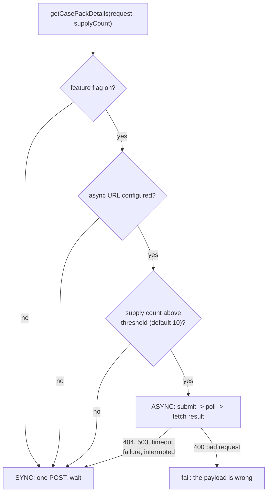

Pack Service Integration: a feature-flagged sync/async integration layer between the allocation engine and the external case-pack optimizer, with fallback, that removed a 10% timeout-driven failure rate. A 10-minute story about integration patterns: routing, polling, retries and graceful degradation.

**Your resume line:**

> Pack Service Integration: developed a feature-flagged sync/async integration layer with async fallback on sync timeout, eliminating a 10% timeout-driven failure rate.

## 1. What we did, and how the system changed

**Context.** Many retailers ship in **case packs**: a pre-packed carton (say 2 S, 4 M, 4 L). The allocation engine asks an external **case-pack optimizer** service which combination of packs best meets each store's need. It is called per wave, inside the allocation loop (BY-00).

**Before.** One synchronous HTTP POST that blocked until the optimizer answered. For large allocation sets (many supplies, many stores) the optimizer took longer than the HTTP timeout, the call failed, and the allocation set failed. About **10% of pack-based allocations failed this way**, always the largest, most important ones.

**After.** A router chooses per request:



| Mode | How | For |
|---|---|---|
| Sync | `POST`, blocks until the optimizer answers | small sets, low latency |
| Async | `POST` submit -> request id; poll `GET /{id}/status` every 5 s, up to 60 times (5 minutes); on `DONE`, `GET /{id}/results` | large sets that would time out |

**What all we did:** the router; the async client (submit, status, result); the polling loop with a bounded timeout; retries on each call; fallback rules; DTOs for the three async responses; configuration with safe defaults; and examples for other teams that wanted to call the async API directly.

## 2. Technology, and why that one

| Technology | Why |
|---|---|
| **Spring `RestTemplate` (platform-configured bean)** | the platform's instance already injects the service-to-service `Authorization` header through an interceptor; reusing it means no token code in this class |
| **Spring Retry `@Retryable`** | 3 attempts, 2 s backoff, on connection errors and API errors, declaratively, on each call (submit, status, result, sync) |
| **Async job pattern (submit / poll / fetch)** | the optimizer's work is long-running; a job id decouples request time from compute time, so no HTTP connection is held for minutes |
| **Feature flag (runtime toggle service)** | master switch per environment; off = exactly the old sync behaviour |
| **Externalised config** | threshold, polling interval and attempts are properties, so ops can tune them without a code change |
| **W3C `traceparent` header** | the trace id flows into the optimizer's logs, so one allocation can be followed across both services |

**Q. Why polling and not a callback/webhook?** The allocation run is a batch container or an async task waiting for the answer anyway; a callback needs an inbound endpoint reachable from the optimizer, auth for it, and correlation state. Polling a status endpoint every 5 seconds is simple and the optimizer already exposed it.

**Q. Why not a message queue?** It would be the cleanest for very long jobs, but both sides would need new infrastructure. The job API existed; the integration had to ship without changing the optimizer.

## 3. The details interviewers probe

**Routing order (first match wins):** flag off -> sync; async URL missing -> sync; supply count at or below threshold -> sync; otherwise async. Small sets stay on the faster, simpler path.

**Polling loop:**

```java
// Illustrative
String id = submit(request).requestId();               // empty id -> error
for (int i = 0; i < maxAttempts; i++) {                 // 60 x 5 s = 5 minutes
  String status = status(id);
  if ("DONE".equals(status))   return toResponse(result(id));
  if ("FAILED".equals(status)) throw new ApiException("OPTIMIZATION_FAILED", result(id).error());
  Thread.sleep(intervalMs);                             // PENDING / RUNNING
}
throw new ApiException("OPTIMIZATION_TIMEOUT");
```

**Fallback rules:**

| Async failure | Fallback to sync? | Why |
|---|---|---|
| 404 (endpoint missing) | yes | async not deployed in that environment |
| 503 (unavailable) | yes | async side degraded; sync may still work |
| timeout, connection error, optimization failed | yes | try the proven path |
| thread interrupted while polling | yes, and **re-set the interrupt flag** | do not swallow an interrupt |
| **400 bad request** | **no**, rethrow | the payload is invalid; sync would fail the same way, only slower |

**Result:** the large sets that used to time out now run async; the timeout-driven failures disappeared. Small sets are unchanged.

## 4. The story to tell

### The 30-second pitch

> The allocation engine calls an external case-pack optimizer synchronously, and on large sets it timed out: about 10% of pack allocations failed, the biggest ones. I built a feature-flagged integration layer that routes large requests to the optimizer's async job API, submit, poll, fetch, with a bounded wait, retries on each call, and fallback to sync when the async side is unavailable, except on a 400, because a bad payload fails either way. Timeout failures went away and small requests kept the fast path.

## 5. The problem I faced: the fallback that doubled the damage

**Situation.** In the first version every async failure fell back to sync. In QA, an allocation with a malformed pack definition took over a minute to fail, and the optimizer team asked why we were hitting them so hard.

**Investigation.** The trace showed: async submit -> 400, retried 3 times (each `@Retryable`), then fallback -> sync POST -> 400, retried 3 times again. Six calls and all the backoff delays, for a request that could never succeed.

**Fix.**

1. **No fallback on 400.** A client error means the payload is wrong; rethrow immediately with the optimizer's message.
2. **No retry on 4xx in general** except where the API documents it as transient; retries are for connection errors and 5xx.
3. When polling is interrupted, fall back but **restore the thread's interrupt flag**, so the caller's cancellation still works.
4. Tests for each row of the fallback table using a mock server.

**Result.** Bad payloads fail in one call with a clear error; the optimizer team saw the retry storm stop.

**Lesson:** "Fallback and retry are for failures that might succeed on a second try or another path. A validation error never will."

## 6. Team collaboration

- **Optimizer team:** the async contract (status values, terminal states, result shape), the threshold, and rate expectations for polling.
- **Ops:** tuned the threshold and polling defaults per environment.
- **QA:** the fallback matrix as test cases against a mock server.

## 7. Follow-ups

**Q. Why a supply-count threshold instead of always async?** Async adds at least one poll interval of latency and three calls. For small sets sync is faster and simpler.

**Q. Why is the effective async timeout 5 minutes?** 60 polls x 5 s. Long enough for the largest observed jobs, bounded so a stuck job cannot hold a processor forever.

**Q. Is `Thread.sleep` in a polling loop OK?** In a batch container or a dedicated async worker, yes: the thread is waiting for this result anyway. In a request thread of a reactive or high-concurrency service I'd use a scheduled executor or non-blocking client instead.

**Q. What if the job finishes after we time out?** We fell back to sync, so the result arrives through the sync path; the async result is simply never fetched. Making submit idempotent (a client request id) would let a retry pick up the earlier job instead of starting another.

**Q. Exponential backoff?** For polling, a fixed interval is fine because the server does the work at its own pace; for retries of failed calls, exponential backoff with jitter is better under load. That is an improvement I'd make.

**Q. Circuit breaker?** If the optimizer is down, every set pays the retry cost. A Resilience4j circuit breaker would fail fast after N failures and probe periodically.

### Rapid fire

| Question | Answer |
|---|---|
| When async? | flag on, URL set, supplies above threshold |
| Poll interval and attempts? | 5 s x 60 = 5 min |
| Retries per call? | 3, 2 s backoff |
| Fallback on 400? | no |
| Interrupted while polling? | fall back and re-set the interrupt flag |
