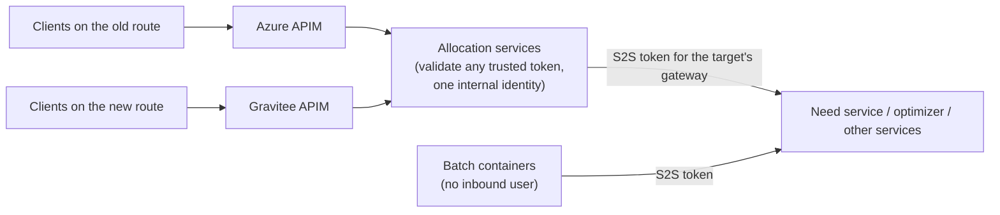

Dual APIM Support: making the allocation services work behind two API gateways at once, Azure API Management and Gravitee, during a migration, with zero downtime. A 10-minute story about authentication at the edge, identity propagation and service-to-service tokens.

**Read this first.** No team document was provided for this story, so this page is built from your resume line and how such a migration is normally done. The architecture below is the standard, defensible design; before an interview, replace any detail that differs from what your team actually did (the claim names, how traffic was switched, which identity providers were involved). Never present a detail here as fact if you cannot recall it.

**Your resume line:**

> Dual APIM Support: drove a zero-downtime gateway migration on dual-identity infrastructure running Azure and Gravitee APIM in parallel: gateway-agnostic auth, unified identity propagation across sync, async, and batch flows, and adaptive OAuth S2S tokens.

## 1. What we did, and how the system changed

**An API gateway (APIM)** sits in front of the microservices: it routes requests, validates or forwards tokens, applies rate limits and policies. The platform was moving from **Azure APIM** to **Gravitee APIM**. For a migration window both had to run **in parallel**: some tenants and routes through Azure, others through Gravitee, with the same backend services behind both.

**Before:** the services quietly depended on one gateway: headers it injected, and the token issuer and audience it used. Moving a route to the other gateway broke auth.

**After:**

| Concern | Design |
|---|---|
| **Gateway-agnostic auth** | the service validates the JWT itself (signature, issuer, audience, expiry) and trusts a configured **list of issuers**, each with its own key set. It never relies on headers only one gateway adds |
| **Unified identity** | claims from either issuer are normalised into one internal identity (tenant, user, roles) at the edge, so the rest of the code never knows which gateway the request came through |
| **Propagation: sync** | outgoing HTTP calls forward the caller's identity through a client interceptor |
| **Propagation: async** | identity captured on the request thread and restored on the worker (the same capture/restore wrapper as in BY-03) |
| **Propagation: batch** | batch containers have no inbound user; they act as the service, with a service-to-service token, and carry the tenant from the job parameters |
| **Adaptive S2S tokens** | a token provider picks the right issuer and audience/scope for the **target** (which gateway and identity setup it sits behind), caches tokens per (issuer, audience) and refreshes before expiry |
| **Zero downtime** | the services accept both gateways' tokens for the whole window; routes move one at a time; moving back is a routing change, not a deploy |

## 2. Technology, and why that one

| Technology | Why |
|---|---|
| **Spring Security resource server** | standard JWT validation; supports several trusted issuers (an issuer-based authentication manager resolver) with key sets fetched from each issuer's JWKS endpoint |
| **OAuth 2.0 client credentials** | service-to-service calls with no user: the service authenticates with its own client id and secret |
| **Azure APIM and Gravitee** | the old and new gateways; running both lets traffic move gradually |
| **Interceptors / task decorators** | propagate identity on outgoing HTTP and across thread hops without touching business code |
| **Key Vault** | client secrets per environment and per identity setup |
| **Feature flags / config per route** | which audience a downstream call needs, switchable without code changes |

**Q. Why validate in the service if the gateway already validates?** Defence in depth, and portability. If the service trusts "the gateway checked it" it is tied to that gateway's behaviour and is open to anyone who reaches it bypassing the gateway. A service that validates the token itself works behind any gateway.

## 3. The story to tell

### The 30-second pitch

> The platform moved from Azure APIM to Gravitee, and for months both had to run in parallel in front of the same services. I drove the allocation side: services validate tokens themselves against a list of trusted issuers, so they don't care which gateway a request came through; identities from either side are normalised into one internal identity; that identity propagates across sync calls, async threads and batch jobs; and service-to-service calls get a token minted for whichever gateway the target sits behind. Routes moved over one at a time with zero downtime.

### The 10-minute walkthrough

| Minutes | Cover |
|---|---|
| 0-2 | what a gateway does; why two at once |
| 2-4 | gateway-agnostic validation; unified identity |
| 4-6 | propagation in sync, async and batch |
| 6-8 | adaptive S2S tokens |
| 8-10 | the problem I faced; rollout; results |

## 4. The problem I faced: batch jobs got 401 after a route moved

**Situation.** A pilot tenant's routes moved to Gravitee. Interactive allocations worked. That night, the tenant's **batch** runs failed with 401 when calling the need service.

**Investigation.**

1. Interactive calls forwarded the planner's token, which was valid for the new route.
2. Batch containers have no planner; they call downstream services with a **service-to-service token**. The token provider minted every S2S token for the **old** gateway's audience.
3. The need service's route for that tenant now sat behind Gravitee, which expected a different audience. Valid token, wrong audience: 401.

**Fix.**

1. Made the token provider **target-aware**: each downstream route maps (in config) to the issuer and audience it expects; the provider mints and caches tokens per (issuer, audience) and refreshes them before expiry.
2. One code path for all three flows: sync, async and batch all ask the same provider "a token for *this* target", so batch can never drift from interactive again.
3. Added a pre-switch checklist for moving a route: update the audience mapping, run one batch and one interactive call in the pilot environment, then switch.

**Result.** Batch and interactive behaved the same on both gateways, and the remaining routes moved without incidents.

**Lesson:** "During a migration, test the flows without a user (batch, async, scheduled), not just the ones a person clicks."

## 5. Team collaboration

- **Platform / gateway team:** route definitions and policies on both gateways, the issuer list, and the migration schedule.
- **Identity team:** the claim names on each side, so the normaliser mapped tenant and roles correctly.
- **Downstream service teams:** which audience each of their routes expected during the window.
- **DevOps:** secrets per identity setup in Key Vault, and the route switch per tenant.

## 6. Follow-ups

**Q. How do you accept tokens from two issuers safely?** An explicit allowlist of issuers; each issuer's keys from its own JWKS endpoint; audience checked per issuer; algorithm pinned. Tokens from any other issuer are rejected.

**Q. How do you avoid fetching a token on every call?** Cache per (issuer, audience), refresh a little before expiry (minus a skew), and single-flight the refresh so concurrent callers don't all fetch at once.

**Q. How does identity reach an async thread?** Captured on the request thread and restored on the worker by a task decorator, cleared in finally; thread-local inheritance is not reliable on pooled threads.

**Q. What does zero downtime mean here?** No release required a maintenance window: the services accepted both gateways before any route moved, routes moved one at a time, and moving back was a routing change.

**Q. What would you do differently?** Contract tests per route that assert the expected issuer and audience, run in CI, so a mapping mistake fails a build instead of a night's batch.

### Rapid fire

| Question | Answer |
|---|---|
| Who validates the JWT? | the service itself, against a list of trusted issuers |
| Batch identity? | service-to-service token + tenant from job parameters |
| Async identity? | capture and restore with a task decorator |
| Adaptive S2S? | token per target's (issuer, audience), cached |
| Rollback? | move the route back |
