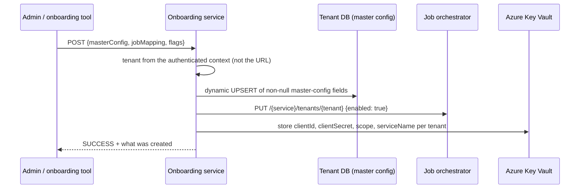
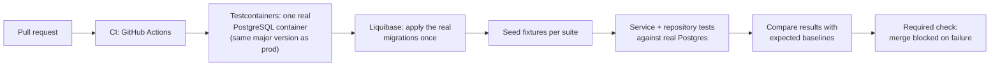

Your internship at Blue Yonder (Jan-Jun 2024): tenant onboarding with credentials in Azure Key Vault, config import/export APIs, and the PostgreSQL + Testcontainers regression framework that gates every PR. A 10-minute story; interviewers use it to check that you can build clean REST APIs and that you care about correctness.

**Your resume lines:**

> Built tenant onboarding, OAuth credential management (Azure Key Vault), and CSV config import/export APIs across 1,000+ tenants.
> Built the team's PostgreSQL-Testcontainers regression framework gating every PR merge, plus JUnit suites at 90%+ coverage.

## 1. Tenant onboarding API

**Problem.** Bringing a new tenant onto the allocation service took several manual steps: insert its master configuration row, register the tenant with the job orchestrator (so batch jobs can run for it), and store the tenant's OAuth client credentials. Manual steps meant typos and forgotten secrets, discovered only when the first batch failed.

**What we built:** one REST resource, `/api/v1/allocation/onboarding`, with create (POST), partial update (PATCH), read (GET) and delete (DELETE).



| Design point | Why |
|---|---|
| **Tenant from the security context, not a path parameter** | a caller can only onboard the tenant their token belongs to; no "edit tenant X" by changing a URL |
| **`@PreAuthorize`: admins and planners, never view-only** | onboarding changes configuration |
| **Dynamic UPSERT of non-null fields** | PATCH semantics: send only what changes; the same code serves create and update |
| **Flags to run each part independently** | re-run just the orchestrator registration or just the config, after a partial failure |
| **Secrets in Key Vault, named per tenant** | never in the database or logs; rotation without code changes |
| **Idempotent steps** | UPSERT and PUT are safe to repeat, which matters because of the next point |

**The consistency point interviewers like:** the database part is `@Transactional`, but the orchestrator call and Key Vault writes are **external side effects a database rollback cannot undo**. So each step is idempotent and the API can be re-run safely; the response says which parts succeeded. That is the practical answer to "distributed transactions" at this scale: idempotency and retry, not two-phase commit.

**An honest improvement:** errors were returned as HTTP 200 with `status: ERROR` in the body. I'd now return proper 4xx/5xx with an error code, and never echo secrets in responses.

## 2. Config import/export APIs

**Problem.** Moving a tenant's allocation configuration between environments (test -> UAT -> prod) or restoring it meant hand-written SQL.

**What we built:**

| Endpoint | What |
|---|---|
| `GET /export-db-records` | ZIP of CSVs, one per configured table (headers + rows, typed by JDBC column type) |
| `POST /import-db-records` (multipart ZIP) | validate, then UPSERT each CSV into its table by primary key; per-table summary ("10/10 records upserted") |
| async card export | `POST` starts a large CSV export in the background -> `202 Accepted` + download id; poll status; download the compressed file from blob storage when `COMPLETED` |

**Design points:**

- **Allowlist of tables in config.** Only tables listed for export or import are touched; an unknown file name in the ZIP is rejected (400). The lists can differ per direction.
- **Metadata-driven import.** Read the target table's columns and primary key from JDBC metadata, match CSV headers case-insensitively, UPSERT by key. Adding a table to the allowlist needs no code.
- **Row-level errors collected, not fatal.** One bad row does not abort the table; the summary reports it.
- **Temp files always cleaned up** in `finally`.
- **Async for big exports.** A large card export can take minutes; holding an HTTP request open would time out. `202` + a status resource + blob storage is the standard long-running-operation pattern.

### The security catch: Zip Slip

A ZIP entry named `../../etc/cron.d/x` would be written **outside** the temp directory if you join paths naively. The import normalises each entry path and rejects any that does not stay inside the extraction directory:

```java
Path target = tempDir.resolve(entry.getName()).normalize();
if (!target.startsWith(tempDir)) throw new BadRequestException("invalid entry");
```

Mention it unprompted; it shows security awareness in an API that accepts files.

## 3. The PostgreSQL + Testcontainers regression framework

**Problem.** Integration tests ran against **H2**, an in-memory database. But production is PostgreSQL, and our code used things H2 does not behave the same way on: native queries, `ON CONFLICT` upserts, JSON columns, Liquibase changesets with Postgres syntax. Tests passed; production failed.

**What we built:**



| Design point | Why |
|---|---|
| **Real PostgreSQL in a container** | same SQL dialect, same constraints, same migration behaviour as production |
| **One container for the whole run (singleton)** | starting a container per test class made the suite far too slow |
| **Real Liquibase migrations** | the migrations themselves get tested on every PR |
| **Isolation per test** | each test runs in a transaction rolled back at the end, or truncates its tables, so order does not matter |
| **Baseline comparison for regression** | allocation outputs compared with stored expected rows, ignoring known unstable columns |
| **Required status check** | a failing suite blocks the merge |
| **JaCoCo coverage, 90%+ on the services we owned** | coverage as a floor, not a goal; the real value was the Postgres-level tests |

**Q. Why not H2 in Postgres compatibility mode?** It is still not Postgres: upsert syntax, JSON operators, some functions and error behaviour differ. The bugs we cared about lived exactly in those differences.

**Q. Why not a shared test database?** Shared state makes tests flaky and order-dependent, and two CI runs collide. A container per CI run is isolated and disposable.

### How it fits the team's wider quality setup (context you can mention)

- A **nightly orchestrator workflow** fans out to seven service repositories and runs unit tests with coverage, mutation tests (PIT), static analysis (CodeQL), coverage reporting and a dependency security scan, then publishes one dashboard and emails a summary. A known gotcha: many steps continue on error so reports are always produced, so "green workflow" is not "all checks passed"; the summaries are the source of truth.
- A **batch regression suite** runs fixed allocation sets through the deployed services, extracts results from Snowflake, and compares them with CSV baselines using **subset validation** (every produced row must exist in the baseline) while ignoring known unstable columns. Baselines are updated only through a workflow that opens a **pull request**, so every expected-result change is reviewed.

## 4. The story to tell

### The 30-second pitch

> As an intern I built three things. A tenant onboarding API that writes the tenant's configuration, registers it with the job orchestrator and stores its OAuth credentials in Key Vault, idempotent so it can be safely retried. Config import/export APIs: a ZIP of CSVs out, validated upserts in, with an allowlist and a zip-slip check. And the team's integration-test framework: real PostgreSQL in Testcontainers with our real Liquibase migrations, gating every PR, replacing H2 tests that passed while production failed.

## 5. The problem I faced: the framework was too slow to gate PRs

**Situation.** The first version started a fresh Postgres container and ran all migrations for **every test class**. The suite took about 15 minutes; developers started asking to make it optional, which would have defeated the point.

**Investigation.** Profiling the CI log: most of the time was container start-up and migrations, repeated dozens of times; the tests themselves were seconds.

**Fix.**

1. A **singleton container** shared by the whole test run (a static container started once, reused by every class).
2. **Migrations once** at start-up, not per class.
3. **Per-test isolation** by transaction rollback (or table truncation for tests that commit), so sharing the database did not make tests depend on each other.
4. Cached the Postgres image and Gradle dependencies in CI.

**Result.** The suite went from about 15 minutes to under 4, the team kept it as a required check, and it caught real dialect bugs (an upsert that worked in H2 and failed in Postgres was the first).

**Lesson:** "A check that gates every merge has to be fast enough that nobody wants to turn it off."

## 6. Team collaboration

- **My mentor and the tech lead:** reviewed the API design (tenant from the token, PATCH semantics, idempotency) before I wrote the code.
- **Platform team:** the orchestrator's tenant-registration API and Key Vault naming conventions.
- **The whole team:** I wrote a short "how to write a Testcontainers test here" guide and migrated the first few suites with their owners, so adoption did not depend on me.

## 7. Follow-ups

**Q. How do you keep secrets out of logs?** Never log request bodies of credential endpoints; mask fields; store only in Key Vault; return only what the caller already sent or nothing.

**Q. What if onboarding fails halfway?** Each part is idempotent (UPSERT, PUT, set-secret), so the admin re-runs it; the response says which parts succeeded; the flags allow re-running only the failed part.

**Q. How do you import a CSV safely?** Allowlisted table names; header-to-column mapping from database metadata; values bound as parameters, never concatenated; UPSERT by primary key; row errors collected; zip-slip check on entries.

**Q. Why `202 Accepted` for the export?** The work outlives the request. 202 + a status resource is the standard long-running-operation pattern; the client polls, then downloads.

**Q. Unit vs integration tests here?** Unit tests (JUnit + Mockito) for logic like header mapping and validation; Testcontainers tests for anything that touches SQL, migrations or transactions.

### Rapid fire

| Question | Answer |
|---|---|
| Where does onboarding get the tenant? | the authenticated context |
| Where do credentials live? | Azure Key Vault, per tenant |
| DB rollback undoes Key Vault writes? | no: idempotent steps instead |
| Import safety? | allowlist, metadata mapping, bound values, zip-slip check |
| Why Testcontainers over H2? | real Postgres dialect and real migrations |
| Made it fast how? | singleton container, migrations once, rollback per test |
