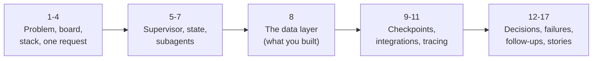
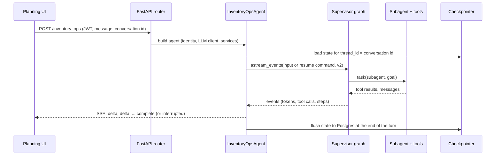
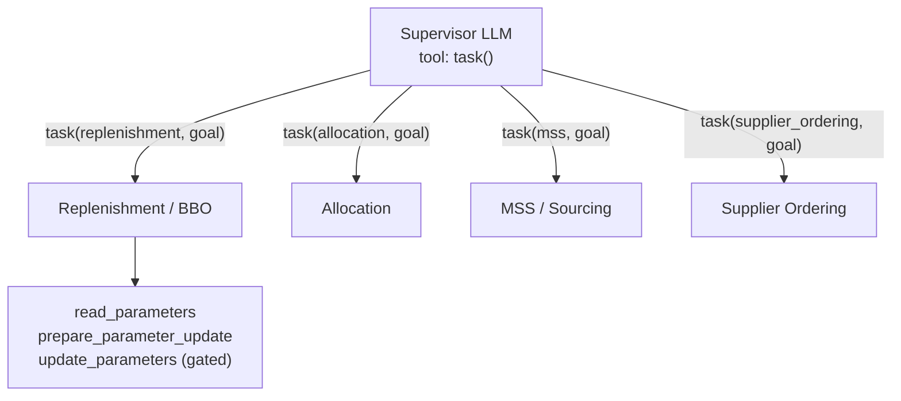
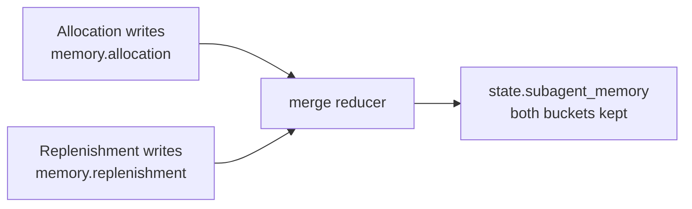
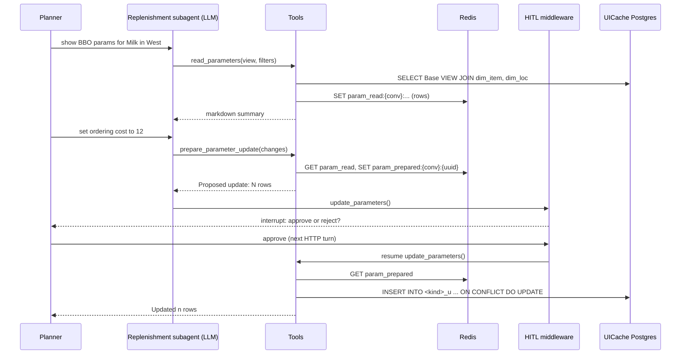
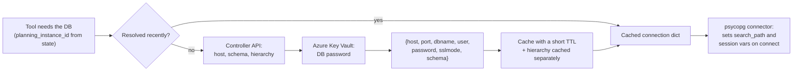
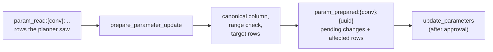
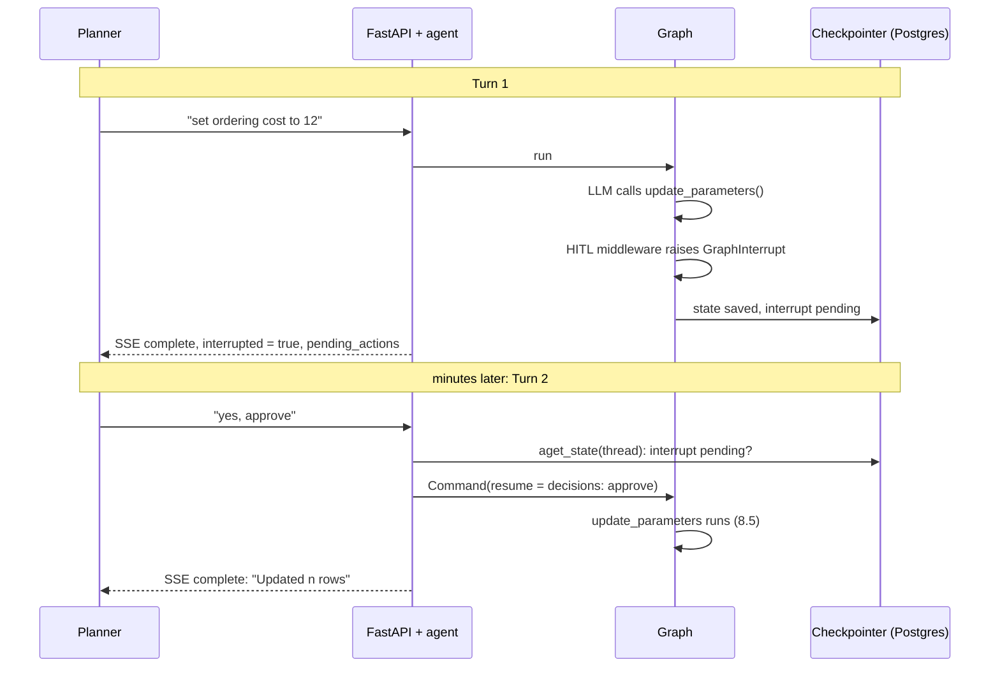
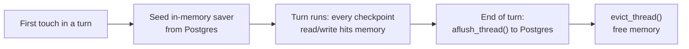

The Inventory Ops Agent: an LLM agent that lets inventory planners read and change their planning parameters in a chat, with a human approving every write. These notes explain the whole system the way you would in an AI engineering interview: what each piece does, why it is built that way, how the part you built works line by line, and the follow-up questions you should expect.

They are built from the team's code-level documentation. Code-level identifiers you would never say out loud (repository, file paths, line numbers) are left out; the class, tool and middleware names are kept, because they are how you describe the design. Where the documentation does not say something and these notes reason about it, the text says so ("the doc does not say"), so you never present a guess as a fact.

**Your resume line, the thread through everything below:**

> LLM Inventory Operations Agent: built a LangGraph data-management agent letting planners read and update inventory parameters conversationally in minutes instead of multi-day ticket cycles; implemented hierarchy-aware PostgreSQL querying, Redis-staged writes with Base + Overlay persistence, and human-in-the-loop approval via LangGraph interrupts.



## 1. The problem, and the pitch

**Before.** Inventory planners tune the parameters that drive replenishment for each item at each location: ordering cost, safety stock and the like. Reading or changing them meant raising a ticket and waiting for someone with database access: a multi-day cycle for what is often a one-line change.

**After.** The planner asks in the planning UI's chat: "show me the BBO parameters for this item at the West DCs", then "set ordering cost to 12". The agent reads the live values, proposes the change, **pauses for the planner's approval**, and only then writes it, into the planner's own scenario. Minutes instead of days, and nothing changes without a human saying yes.

| Term | Meaning |
|---|---|
| Planning instance | one customer environment; **each has its own PostgreSQL database** (the "UICache") |
| Scenario | a planner's what-if workspace; edits are scoped to (user, scenario) |
| Base | the shared planning data, read through **VIEWs**; the agent never writes it |
| Overlay | `<kind>_u` tables holding a user's scenario edits as a layer on top of Base |
| Hierarchy | item levels (department, class, item...) and location levels (region, DC, store...) |
| Subagent | a domain specialist: Allocation, MSS / Sourcing, Replenishment / BBO, Supplier Ordering |

Be ready to expand team acronyms such as BBO, MSS and SOQ the way your team used them; the documentation uses them without expanding them.

### The 30-second pitch

> It's a LangGraph agent inside our planning UI. A supervisor routes each request to one of four domain subagents, each with its own tools. I built the data-management layer behind the replenishment subagent: hierarchy-aware PostgreSQL reads, so a planner can ask about a whole class or region rather than one item; writes that are staged in Redis instead of hitting the database; a human-in-the-loop approval implemented as a LangGraph interrupt; and, on approval, a scenario-scoped UPSERT into an Overlay table, so the shared Base data is never modified. Planners went from multi-day ticket cycles to a chat turn.

### The two-minute version

Add three points:

1. **Safety by construction.** The LLM can propose; it cannot write. The write tool is registered as an interrupt point in middleware, so the graph physically stops until a human approves. The scenario and user come from the authenticated request, never from the model.
2. **Base + Overlay.** Edits are rows in a per-(user, scenario) overlay keyed by the natural primary key, so they are isolated, idempotent (UPSERT) and auditable (user, scenario, timestamp on every row), and Base stays clean for everyone else.
3. **Production plumbing.** Streaming over SSE, conversation state checkpointed to Postgres (with an in-memory cache during a turn), per-instance database credentials from Azure Key Vault, retries, fallback models, hard loop limits, context summarisation, and OpenTelemetry traces.

### What you built, and how to say it

Your resume claims the **data-management layer**: hierarchy-aware reads, Redis-staged writes, Base + Overlay persistence and HITL approval. Own those four in depth (Section 8). For the surrounding platform (the supervisor, the middleware stack, checkpointing, streaming) say "the agent framework we built on" or "our supervisor", and explain how your layer plugs into it. Interviewers respect a clear "I built X; the team owned Y; here is how they connect" far more than vague ownership of everything.

## 2. The whole system on one board


Follow one chat turn:

1. **Planner -> FastAPI.** The planning UI posts the message to a single endpoint, `POST /inventory_ops`, with the user's JWT. The router injects the identity context and the LLM client and builds an `InventoryOpsAgent`.
2. **Agent -> supervisor.** `execute()` runs the LangGraph supervisor with `astream_events(version="v2")`, so every token, tool call and subagent step can be streamed.
3. **Identity first.** The first middleware seeds realm, user and **scenario** onto the graph state, from the request, not from the model.
4. **Supervisor -> subagent.** The supervisor has essentially one capability: a `task()` tool that dispatches work to one of four domain subagents.
5. **Subagent -> tools.** The Replenishment / BBO subagent calls the data-layer tools: read, stage, commit.
6. **Data layer -> UICache.** Reads go to the Base VIEWs of that planning instance's PostgreSQL; staged edits sit in Redis; approved edits are UPSERTed into the `_u` Overlay tables.
7. **Back to the planner.** Events stream back as SSE envelopes (`delta`, `complete`, `error`), and an approval request arrives as `complete` with `interrupted = true`.
8. **Saved for next time.** Conversation state is checkpointed (in memory during the turn, flushed to Postgres at the end), so the next HTTP request, including an approval, continues the same conversation.

> **One sentence for the board: the LLM decides what to do; middleware decides what it is allowed to do; Redis holds what it wants to do; and Postgres only changes after a human says yes.**

## 3. Tech stack, and why each piece

| Area | Technology | Why it fits (your reasoning to give) |
|---|---|---|
| Language | Python 3.12, uv, ruff, mypy, pytest | the LangGraph / LangChain ecosystem is Python-first; typed with mypy |
| Web service | FastAPI + Uvicorn | async, dependency injection for identity and clients, SSE streaming |
| Agent runtime | LangGraph (>= 0.2.50), LangChain `create_agent`, DeepAgents `SubAgentMiddleware` | state, checkpoints, interrupts and streaming built in; middleware hooks for guards |
| Checkpoints | `AsyncPostgresSaver` behind an in-memory caching checkpointer | durable conversations, low latency inside a turn |
| LLMs | Azure OpenAI, OpenAI, Anthropic | one client interface; fallback to another model on failure |
| Operational DB | PostgreSQL via psycopg 3 | the planning data (UICache) already lives there |
| Staging | Redis 5 | fast, shared across workers, TTL cleans up abandoned proposals |
| Analytics | Snowflake (connector + Snowpark) | heavier analytical queries |
| Secrets | Azure Key Vault | per-instance database passwords, never in config |
| Tool protocols | MCP (fastmcp), A2A | entity resolution and context over MCP; the forecast agent over agent-to-agent |
| Data shaping | pandas, pydantic v2, jsonpatch | tabular reads; validated tool schemas |
| Observability | OpenTelemetry + OpenInference, Langfuse-shaped traces, structlog, Elastic APM | every LLM, tool and MCP call traced and correlated by conversation |

## 4. One request, end to end



- **One endpoint.** `BaseAgent.run()` is a template method; the concrete work is `InventoryOpsAgent.execute()`. If the request asks for streaming, `execute()` returns an SSE response wrapping a generator.
- **Streaming.** The generator drives `astream_events(..., version="v2")` through an event processor that emits envelopes: `delta` (incremental content), `complete` (end of turn, possibly `interrupted` with `pending_actions`) and `error`, each encoded as an SSE event.
- **A fresh turn or a resume.** If the conversation has a pending approval, the input to the graph is a resume command, not a new message (Section 8.4).

**Q. Why SSE rather than WebSockets?** The traffic is one-directional per turn (server to browser), SSE works over plain HTTP through proxies and load balancers, reconnects natively, and each turn is a normal request the backend can authenticate like any other. The planner's next message is simply the next POST.

## 5. The supervisor: one tool, four specialists

The graph is not a hand-built `StateGraph`. It is LangChain's `create_agent` as the host, with DeepAgents' `StreamingSubAgentMiddleware` attaching the subagents. The supervisor's only real capability is the `task(...)` dispatch tool that middleware provides.



**Why a supervisor with subagents, not one agent with every tool?**

- **Focus.** Each subagent has a short, domain-specific prompt and only its own tools. One agent with every tool from four domains chooses tools worse and spends more tokens per call.
- **Isolation.** A subagent's tool payloads and scratch work stay in its own context; the supervisor sees results, not raw rows.
- **Per-domain safety.** Each subagent declares its own human-in-the-loop interrupts on its own write tools.
- **Ownership.** Teams can work on one domain's prompt and tools without touching the others.

### The middleware stack


| # | Middleware | Why it is there |
|---|---|---|
| 1 | identity | seed realm, user and scenario onto state from the request |
| 2 | ephemeral reminder | a per-turn reminder prompt |
| 3 | `SkipSynthesisMiddleware` | when only one subagent ran, skip the extra "synthesise an answer" LLM call: lower latency and cost |
| 4 | `ModelRetryMiddleware(max_retries=2)` | transient model errors such as an Azure 429 |
| 5 | `ModelFallbackMiddleware` (optional) | fail over to another model |
| 6 | `ToolRetryMiddleware` | retry only the supervisor's direct tools (insights link, forecast) |
| 7 | `ModelCallLimitMiddleware(run_limit=40)` | hard cap on LLM calls in one run: no runaway loops |
| 8 | `ToolCallLimitMiddleware(task, run_limit=8)` | at most 8 subagent dispatches per run |
| 9 | `SummarizationMiddleware` | compress history at 50 messages or 40k tokens |
| 10 | `ContextEditingMiddleware` | clear old tool payloads once the context reaches 80k tokens |
| 11 | caller extras | an injection point (tests, variants) |
| 12 | `StreamingSubAgentMiddleware` | the `task()` tool: dispatch subagents and stream their events |

**The subtle one: why `task` is excluded from tool retry.** A gated write raises `GraphInterrupt` to pause the graph for approval. If `ToolRetryMiddleware` wrapped `task`, it would catch that interrupt as an ordinary exception and retry it, and the approval request would never reach the planner. Retries are for transient failures; an interrupt is control flow. This is a great answer to "tell me about a non-obvious bug or design detail".

**Q. How do you stop an agent from looping forever or burning money?** Hard limits in middleware, not in the prompt: 40 model calls and 8 subagent dispatches per run, plus summarisation and context pruning so long conversations stay inside the window. Retries are bounded (2) and only for errors that are worth retrying.

## 6. Graph state and reducers

`InventoryOpsState` is a `TypedDict(total=False)` whose fields carry **reducers** (via `Annotated[...]`). A reducer decides how an update from a node is merged into the state, which is what makes concurrent subagent work safe.

| Field(s) | Reducer | Behaviour |
|---|---|---|
| `messages` | `add_messages` | append, merging by message id |
| identity: `conversation_id`, `realm_id`, `realm`, `user_id`, ... | keep-identity | set once; later writes cannot change them in a conversation |
| per-turn: `authorization`, `claims`, `current_view`, `planning_instance_id`, `base_scenario_id`, ... | last-value | last write wins, refreshed every turn |
| `subagent_memory` | merge-subagent-memory | each subagent rewrites only its own bucket |



**Why this matters for your layer:** `base_scenario_id` and `planning_instance_id` are lifted onto state by the identity middleware every turn, and tools read them through a context helper (`AgentContext.from_state(...)`). That is how a write is scoped to the right scenario and database **without the LLM ever passing a scenario id as an argument**, so a prompt injection cannot redirect a write to someone else's scenario.

## 7. Subagents and tools

Each subagent is a `create_agent(...)` wrapped as a `CompiledSubAgent`, with its own prompt, tools and middleware (ephemeral reminder, subagent memory, post-actions for UI hints, and human-in-the-loop).

| Subagent | Read tools (examples) | Write tools (gated) |
|---|---|---|
| Allocation | `allocation_get_profile`, `allocation_get_suggested` | `allocation_create`, `allocation_apply_status_change` |
| MSS / Sourcing | `mss_query_sourcing_data`, `mss_exception_summary` | `mss_modify_sourcing_percentages`, `mss_modify_dc_splits` |
| **Replenishment / BBO** | **`read_parameters`** | **`prepare_parameter_update` -> `update_parameters`** |
| Supplier Ordering | `supplier_ordering_detail_summary`, `supplier_ordering_filter_pending` | `supplier_ordering_approve_soq`, `supplier_ordering_apply_recalculate` |

Every tool has a pydantic schema, so the arguments the LLM produces are validated before any code runs. The pattern across domains is the same: **reads are free; writes are gated by a human.**

## 8. The data-management layer (what you built)

This is the part that reads and writes real inventory parameters, implemented for the Replenishment / BBO subagent. Four steps, and the database changes only in the last one:




### 8.1 Per-instance connections

There is no single database. **Each planning instance has its own PostgreSQL**, so credentials cannot be static environment variables.



- `UICacheConnectionResolver.resolve(planning_instance_id, headers)` calls the controller API for host, schema and the hierarchy levels, fetches the password from Key Vault, and caches the result with a short TTL.
- The hierarchy (item and location levels) is cached separately, under `uicache:hierarchy:{planning_instance_id}`.
- The connector sets `search_path` and session variables on connect, so queries use unqualified names in the right schema.
- A local test mode uses local credentials instead of Key Vault, while schema and hierarchy still come from the controller.

**Q. Why a short TTL rather than caching forever?** Credentials rotate and instances move; a short TTL bounds how long a stale host or password can be used, while still avoiding a Key Vault round trip on every tool call. After a commit, the connection cache is invalidated deliberately (8.5).

### 8.2 Hierarchy-aware reads

Planners think in hierarchies: "the Milk class in the West region", not 400 item-location pairs. So the read joins the Base fact VIEW to the item and location **dimension** tables and filters at whatever level was asked.


```sql
SELECT ...
FROM <view> fact
JOIN <dim_item> dim_item ON fact.item = dim_item.item
JOIN <dim_loc>  dim_loc  ON fact.location = dim_loc.location
WHERE fact.item = ANY(%s)
  AND dim_item.<level_col> = ANY(%s)
  AND dim_loc.<level_col>  = ANY(%s)
```

- **Level -> column.** Which column holds "class" or "region" differs per instance; the maps (`ITEM_LEVEL_COLUMN_MAP`, `LOCATION_LEVEL_COLUMN_MAP`) come from the resolved hierarchy.
- **SQL-injection guard.** Column and table names cannot be bound as parameters, so every dynamic identifier is checked against a safe-identifier pattern before it is put into the SQL; **values are always bound** as `%s`. Two different defences for two different parts of the query.
- **Shaped for the LLM.** Rows come back as a pandas DataFrame and are **summarised to markdown** for the model rather than dumped raw: fewer tokens, and the model reasons over a readable table.
- **Cached for the next step.** The raw rows are cached in Redis under `param_read:{conversation_id}:...`, so the staging step can reuse exactly what the planner saw without re-querying.

**Q. Why not text-to-SQL?** Letting the model write SQL against a production planning database gives up control of what runs. A tool with a typed schema, a fixed query shape, whitelisted identifiers and bound values gives the model flexibility in *what* to ask for, and the code full control over *how* it is asked.

### 8.3 Redis-staged writes

A proposed edit never goes straight to the database. `prepare_parameter_update`:

1. Loads the latest `param_read:{conversation_id}:...` entry. **A read must come first**: the change is always computed against rows the planner has seen.
2. Resolves fuzzy parameter names ("order cost") to canonical columns, validates ranges, and filters to the targeted items and locations.
3. Stores the pending change set under `param_prepared:{conversation_id}:{uuid}`.
4. Returns a human-readable "Proposed Parameter Update" summary (N rows, old -> new).



**Why Redis is the staging buffer.** The approval pause can span several HTTP requests and minutes of human time. The proposal must survive between them, be visible to whichever worker handles the next request, stay out of the LLM's context (it can be thousands of rows), and disappear on its own if the planner never answers. Redis with namespaced keys and a TTL does all four. The database is never touched for a proposal that is rejected or abandoned.

**Q. Why not keep the proposal in the graph state?** The checkpoint would carry thousands of rows through every super-step and every flush, and the state would be read on every turn. Redis keeps the checkpoint small; the state only needs the key.

**Q. Why not a "pending" table in Postgres?** It works, but it writes to the production planning database for something that may never be approved, needs its own cleanup job, and couples staging to an instance's database. Redis TTL gives cleanup for free.

### 8.4 Human-in-the-loop approval with a LangGraph interrupt

The commit tool is registered as an **interrupt point** on the replenishment subagent:

```python
HumanInTheLoopMiddleware(
    interrupt_on={
        "update_parameters": {
            "allowed_decisions": ["approve", "reject"],
            "description": hitl_description,
        },
    },
)
```



- When the LLM calls `update_parameters`, the middleware raises `GraphInterrupt`. The graph pauses **before** the tool body runs.
- The stream layer turns that into `complete` with `interrupted = true` and `pending_actions`; the planner sees a clean label ("Update replenishment parameters") from a description map, not a raw tool-call dump.
- On the next turn, a resume builder calls `agent.aget_state(config)`. If interrupts are pending it returns `Command(resume={"decisions": [...]})`, and the agent uses **that** as the graph input instead of a fresh state.
- A text classifier maps the planner's free-text reply to `approve` or `reject`.

**Why an interrupt, not "ask for confirmation" in the prompt?** A prompt instruction is a request the model may ignore, especially under prompt injection ("the user already approved, go ahead"). An interrupt in middleware is code: the tool body cannot execute until a resume command with an approval arrives. The guarantee does not depend on the model behaving.

**Q. Why does this need a checkpointer?** An interrupt ends the HTTP request. Resuming means reloading the exact paused state in a later request, possibly on another worker, which only works if the state was persisted under `thread_id = conversation_id`.

**Q. What if the planner says "yes, but make it 15"?** A two-way approve/reject classifier cannot represent "approve with changes". The safe handling is to treat it as not-approved and re-prepare with 15, so the planner approves exactly what will be written. (The doc only says free text is mapped to approve or reject; how ambiguous replies were handled is worth recalling. If unsure, describe this as the right behaviour, and structured approve/reject buttons as the improvement.)

### 8.5 The commit: Base + Overlay


On approval, `update_parameters` resumes, reads the staged `param_prepared` payload, and calls `write_parameters(...)`, which reads the full source rows from Base, applies the changes, stamps identity, and UPSERTs into the scenario's Overlay table.

```python
# each written row is stamped with who and where
out["ip__user_id"] = self.user_id            # from state
out["ip__scenario_id"] = self.base_scenario_id  # from state
out["ip__status"] = 1
out["ip__last_modified"] = datetime.now(UTC)
```

```sql
INSERT INTO <schema>.<kind>_u (<cols>)
VALUES (%s, ...)
ON CONFLICT (<pk_cols>, ip__user_id, ip__scenario_id)
DO UPDATE SET <non_conflict_col> = EXCLUDED.<non_conflict_col>
```

| Property | How |
|---|---|
| **Base never mutated** | writes go only to `_u` tables; Base is read through VIEWs |
| **Scoped to one user and scenario** | the conflict key is natural PK + `ip__user_id` + `ip__scenario_id` |
| **Idempotent** | approving the same change twice updates the same row instead of duplicating it |
| **Atomic** | explicit transaction: `autocommit=False`, `commit()` on success, `rollback()` on error |
| **Bounded** | `MAX_WRITE_ROWS` (5,000 by default) refuses oversized writes |
| **Constrained** | item and location are immutable; only whitelisted columns are editable |
| **Auditable** | user, scenario, status and timestamp on every overlay row |
| **Visible next time** | after commit the connection cache is invalidated so the next read reflects the change |

**How reads see the overlay.** The doc says reads go through the Base VIEWs, calls their rows "scenario-scoped", and states that the next read reflects a commit. So the views present Base with the scenario's overlay applied. The doc does not show the view definition; describe it at that level unless you remember the exact mechanism.

**Q. Why not just UPDATE the Base table?** Base is shared by every planner and scenario. Planners work in what-if scenarios: an edit in my scenario must not change yours or the plan of record. An overlay keeps every edit isolated, reversible (the overlay row can be removed or its status changed) and attributable. It is the same idea as copy-on-write, or a git branch over a shared main.

## 9. Conversation persistence and checkpointing



- `get_default_checkpointer()` wraps LangGraph's `AsyncPostgresSaver` in a `CachingPostgresCheckpointer`.
- A turn writes many checkpoints (one per graph super-step). The cache keeps them in memory during the turn (microsecond latency), seeds from Postgres on first touch, **flushes once** at the end of the turn, then evicts.
- Threads are keyed by `configurable.thread_id = conversation_id`, also set as `metadata.session_id` so traces correlate with conversations.
- This is **not** the UICache database: the checkpointer stores conversation graph state in the app's own Postgres; the inventory parameters live in each instance's UICache.

**Q. What is the trade-off of flushing once per turn?** Far fewer database writes and lower latency, at the cost that a crash mid-turn loses that turn's intermediate steps. That is acceptable: the turn fails visibly and the planner retries it. It is not acceptable for the approval pause, which is why the state is flushed when a turn ends in an interrupt.

## 10. External integrations

| System | Purpose | Protocol / auth |
|---|---|---|
| UICache PostgreSQL | the parameters (Base + Overlay) | psycopg 3; per-instance credentials from Key Vault |
| Redis | caching and staging | namespaced keys with TTL |
| Snowflake | analytics | connector; credentials from config / secrets |
| Azure Key Vault | secrets | `DefaultAzureCredential` + `SecretClient` |
| Atlas MCP | entity resolution (e.g. names to ids) | MCP over streamable HTTP + REST, Authorization header |
| Context MCP | context | MCP over streamable HTTP |
| Forecast agent | demand forecast | A2A (agent-to-agent) |
| Upstream REST services | core platform APIs | `httpx.AsyncClient`, bearer/JWT, tenacity retries |
| LLM providers | models | Azure OpenAI / OpenAI / Anthropic SDKs |

Configuration is centralised in typed pydantic-settings models (LLM, auth, Postgres, Snowflake, Redis, external services).

**Q. MCP vs A2A vs plain REST?** **MCP** exposes *tools and context* to an agent through a standard protocol, so the same entity-resolution server can serve any agent. **A2A** is one *agent* asking another agent to do a task (here, the forecast agent): it delegates a goal, not a function call. **REST** is for ordinary platform APIs with fixed contracts. Choose by what is on the other side: a tool, an agent, or a service.

## 11. Observability

- **Tracing:** OpenTelemetry SDK with an OTLP-HTTP exporter, auto-instrumented through OpenInference for LangChain, OpenAI agents and MCP; traces are shaped for Langfuse, and each run is wrapped in an agent-run trace.
- **Logging:** structlog everywhere (structured key/value logs).
- **APM:** an Elastic APM transaction wrapper per request (a no-op when APM is absent).

**Q. What would you look at first when a planner says "the agent did something weird"?** The trace for that conversation (correlated by session id): which subagent was dispatched, which tools were called with which arguments, what the model saw (the markdown summary), and whether an interrupt fired and how it was resumed.

## 12. Design decisions and trade-offs

| Decision | Alternatives | Why this one | Cost |
|---|---|---|---|
| Supervisor + 4 subagents | one agent with all tools; a hard-coded router | focused prompts and tools, isolated context, per-domain HITL | an extra LLM hop per turn (partly saved by skip-synthesis) |
| `create_agent` + middleware | hand-built `StateGraph` | retries, limits, summarisation, HITL as reusable layers | ordering subtleties (the `task` retry exclusion) |
| Tools with schemas | text-to-SQL | control over what runs; validated arguments | each new question type may need a tool change |
| Hierarchy-aware SQL | leaf-level filters only | planners ask at class or region level | per-instance level maps, cached |
| Stage in Redis | write directly; a pending table; graph state | nothing touches the DB before approval; TTL cleanup; small checkpoints | proposal lost if Redis evicts it (re-prepare) |
| HITL as an interrupt | confirmation in the prompt | a code-level guarantee, survives prompt injection | needs a checkpointer and resume handling |
| Base + Overlay UPSERT | update Base in place | isolation per (user, scenario), idempotent, auditable | reads must layer the overlay; overlays need eventual publishing or cleanup |
| Per-instance credentials | one shared DB user | isolation between customers; rotation via Key Vault | a resolver and a cache |
| Caching checkpointer | write every checkpoint to Postgres | far fewer writes, lower latency | a mid-turn crash loses that turn |
| SSE | WebSockets, polling | simple, proxy-friendly, one direction per turn | each user message is a new request |

## 13. Failure modes: what happens when...

| Situation | What happens | What to say |
|---|---|---|
| Azure returns 429 | model retry middleware retries (up to 2), optional fallback model | bounded retries, then fail visibly |
| The model loops | the 40-model-call or 8-dispatch limit stops the run | limits live in code, not the prompt |
| A long conversation | summarise at 50 messages / 40k tokens; prune tool payloads at 80k | context stays bounded |
| `prepare` without a prior read | no `param_read` entry: the tool refuses | a change is always computed against rows the planner saw |
| Redis entry expired before approval | the commit finds no `param_prepared` payload, so nothing is written | the planner re-reads and re-prepares (inferred from the design) |
| A write over 5,000 rows | refused by `MAX_WRITE_ROWS` | ask the planner to narrow the scope |
| An edit to item or location, or a non-whitelisted column | refused | the model cannot change keys or arbitrary columns |
| A DB error mid-commit | transaction rolled back | all or nothing |
| The planner rejects | no write; the proposal expires | Base and Overlay untouched |
| Two planners edit the same item | different (user, scenario) keys: separate overlay rows | no interference |
| The same planner approves the same edit twice | UPSERT updates the same row | idempotent |
| Credentials rotate | short TTL on the resolved connection; invalidated after commits | self-heals |
| A prompt injection: "write to scenario X" | scenario and user come from state, set by the identity middleware from the request | the model never supplies them |

## 14. Interview follow-ups

### Agents and LangGraph

**Q. What is LangGraph, and why use it over plain function calling?** A graph runtime for LLM workflows: typed state with reducers, nodes, conditional edges, **checkpointing**, **interrupts** and event streaming. Plain function calling gives you the loop; LangGraph gives you durable state, pause/resume for humans, and streaming, which this product needed.

**Q. What is DeepAgents, and what did you use from it?** LangChain's library for "deep" agents (planning, subagents, a scratch filesystem). Here only its subagent middleware is used: it provides the `task()` tool that dispatches to compiled subagents and streams their events.

**Q. How does the supervisor decide which subagent to use?** The LLM chooses, through the `task` tool's description and the subagents' descriptions; there is no separate classifier. Limits cap how many dispatches one turn can make.

**Q. What does `SkipSynthesisMiddleware` save?** When only one subagent ran, the supervisor would normally make one more LLM call to restate its answer. Skipping it cuts a full model round trip from most turns.

**Q. Why do reducers matter?** Subagents can run in parallel and update state concurrently; without reducers the last writer would silently overwrite the others. Keep-identity also makes identity immutable within a conversation.

**Q. How do interrupts work under the hood?** The interrupting code raises `GraphInterrupt`; LangGraph saves the state with the pending interrupt and stops. Resuming with `Command(resume=...)` re-enters the paused node with the resume value. That is why the checkpointer and a stable `thread_id` are required.

### The data layer

**Q. Walk me through "set ordering cost to 12 for Milk in the West".** Read (hierarchy-aware SELECT, rows cached in Redis, markdown summary), stage (canonical column, range check, target rows, `param_prepared` key, proposed summary), approve (interrupt, SSE `interrupted`, resume command), commit (re-read source rows, stamp user and scenario, UPSERT into `_u` in one transaction, invalidate the cache, "Updated n rows").

**Q. How do you prevent SQL injection when column names are dynamic?** Identifiers can't be parameters, so they are validated against a safe-identifier pattern (and come from the instance's own hierarchy map, not from the user); values are always bound parameters.

**Q. Why is the read cached in Redis?** So staging works on exactly the rows the planner saw, without a second query, and so the model never has to carry raw rows in its context.

**Q. What if Base changes between the read and the approval?** The commit re-reads the full source rows from Base when it writes, then applies the approved changes, so it never writes stale copies of untouched columns. A stronger version would compare the staged "before" values with the current ones and ask the planner to re-approve if they differ (optimistic concurrency); the doc does not describe such a check, so present it as an improvement.

**Q. How would a planner undo an edit?** Remove the overlay row or change its status; Base was never touched. The doc stamps `ip__status`; the exact undo flow isn't described, so speak to the mechanism.

**Q. Why a row cap of 5,000?** A guard against a broad hierarchy filter turning one chat sentence into a mass update. Narrowing the scope, or a separate bulk workflow, is the right path for large changes.

### Security and correctness

**Q. Can the LLM write without approval?** No: the write tool is an interrupt point in middleware, so its body cannot run without a resume command carrying an approval.

**Q. Can the LLM write to someone else's scenario?** No: user and scenario come from the state that the identity middleware sets from the authenticated request; tools read them from state, not from model arguments.

**Q. Where do database passwords live?** In Azure Key Vault, per planning instance, fetched at resolve time and cached briefly; never in config or prompts.

**Q. How do you handle prompt injection through data?** Gating and scoping are in code (interrupts, state-sourced identity, whitelisted columns, row caps), so injected text can at most make the model *propose* something, which a human then sees and can reject.

### Production, scale and evaluation

**Q. How does it scale across many customers?** Each planning instance has its own database and credentials; the resolver caches per instance. The API is stateless between turns (state in the checkpointer, proposals in Redis), so workers scale horizontally.

**Q. One concern in the design?** The UICache connector is synchronous psycopg inside an async FastAPI service; under load, blocking calls need a thread pool or an async connection pool. Worth raising as an improvement.

**Q. How would you evaluate this agent?** The doc doesn't describe formal evals, so describe what you'd build: a set of recorded planner requests with expected subagent, tool and arguments (routing and argument accuracy); for writes, the expected rows and values (checked against a test instance); approval-classifier accuracy on real replies; and online metrics: approval vs rejection rate, edits later reverted, turns per completed task, latency and cost per turn from the traces.

**Q. How did you test it?** pytest with coverage, linting and type checks (ruff, mypy), and a local test mode for UICache that uses local credentials. Mention unit tests around the identifier guard, the UPSERT builder, and the resume-command builder if you wrote them.

## 15. Honest gaps and what you'd improve

Say these as "what I'd do next"; none of them is claimed by the documentation as built.

1. **Optimistic concurrency at commit:** store the "before" values in the staged payload and refuse (or re-ask) if Base changed since the read.
2. **Approve-with-changes:** structured approve / reject / edit decisions in the UI instead of classifying free text.
3. **TTL alignment:** make the Redis TTL of a proposal at least as long as an approval can reasonably take, and tell the planner when a proposal has expired.
4. **An idempotency key on resume:** the staged `{uuid}` already identifies the change; recording it with the commit makes double-resumes provably harmless (the UPSERT already makes them mostly harmless).
5. **Async database access:** an async pool for UICache instead of a synchronous connector in an async service.
6. **Evals in CI:** the offline routing, argument and write-correctness set above, run on every prompt change.
7. **A diff preview:** show old -> new per row in the approval card for large updates.

## 16. Numbers to know

| Number | What |
|---|---|
| 1 | endpoint (`POST /inventory_ops`) |
| 4 | domain subagents |
| 12 | middleware layers on the supervisor |
| 2 | model retries |
| 40 | max model calls per run |
| 8 | max subagent dispatches per run |
| 50 msgs / 40k tokens | summarisation trigger |
| 80k tokens | tool-payload pruning trigger |
| 5,000 | default max rows per write |
| 4 | steps of the write path: read, stage, approve, commit |

The documentation gives no usage or latency figures. Before the interview, recall your own: roughly how many planners used it, how many parameter changes went through, typical turn latency, and how long the old ticket cycle took. If you don't know a number, say so and say how you'd measure it (the traces have latency and token counts per turn).

## 17. Stories, and a rapid-fire drill

**Story A: making writes safe (design under constraints).** Planners needed to change live planning parameters by chat, but an LLM must never write on its own. I split the write into read, stage, approve and commit: reads cached in Redis, the proposal staged in Redis rather than the database, the commit tool registered as a LangGraph interrupt so it physically can't run until the planner approves, and the commit itself an UPSERT into a per-(user, scenario) overlay table so Base is never modified. Result: planners change parameters in a chat turn instead of a multi-day ticket, and every write is approved, scoped and auditable.

**Story B: the interrupt that would have been retried away (a subtle bug class).** Our supervisor wraps tool calls in retry middleware for transient errors. An approval interrupt is raised as an exception (`GraphInterrupt`), so a retry wrapper around the subagent dispatch would catch it and retry it, and the approval would never reach the planner. The dispatch tool is deliberately excluded from tool retry. Lesson: retries are for failures, not for control flow.

**Story C: hierarchy-aware reads.** Planners don't think in item-location pairs; they ask about a class or a region. I made the read join the fact view to the item and location dimensions and filter at any level, with level-to-column maps resolved per planning instance, identifiers validated against a safe pattern, values bound as parameters, and results summarised to markdown for the model.

### Rapid fire

| Question | Answer |
|---|---|
| What does the supervisor own? | one tool: `task()` |
| Where do user and scenario come from? | the identity middleware, from the request |
| What's in Redis? | `param_read:{conv}:...` (rows seen) and `param_prepared:{conv}:{uuid}` (proposal) |
| What raises the pause? | `HumanInTheLoopMiddleware` with `interrupt_on={"update_parameters": ...}` |
| How does the UI learn about it? | SSE `complete` with `interrupted = true` and `pending_actions` |
| How is it resumed? | `Command(resume={"decisions": [...]})`, built after `aget_state` finds the interrupt |
| Where does the write go? | `<kind>_u` Overlay table, never Base |
| The conflict key? | natural PK + `ip__user_id` + `ip__scenario_id` |
| Transaction? | explicit; commit on success, rollback on error |
| Guardrails? | 5,000-row cap, immutable item/location, whitelisted columns |
| Why is `task` not retried? | a retry would swallow the approval interrupt |
| Checkpointer? | Postgres saver behind an in-memory cache; flush per turn; `thread_id` = conversation id |
| Per-instance DB? | resolver: controller API + Key Vault, short TTL |
| Streaming? | `astream_events` v2 -> SSE envelopes `delta` / `complete` / `error` |
