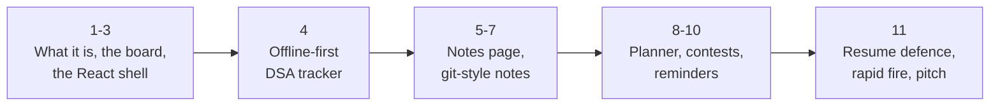
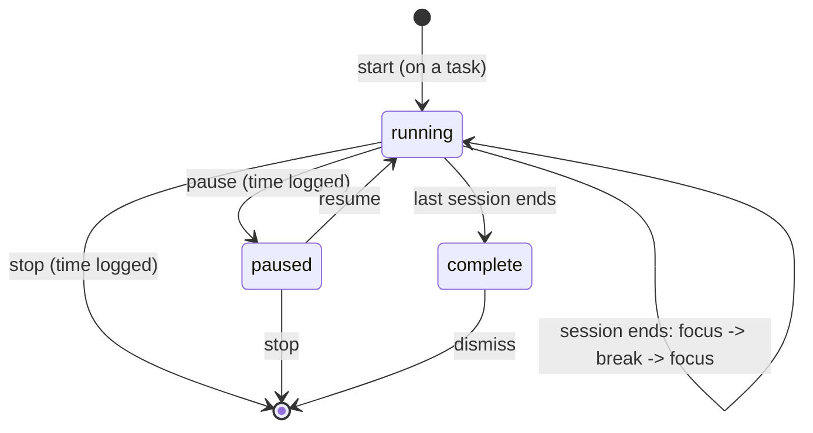

InterviewPlanPrep, end to end: this site, the way a signed-in student uses it, with every resume line defended. For every piece you get what the student sees (real screens from the site), the mechanism behind it, the alternatives you rejected and why, and **the attack**: the sceptical question an interviewer asks about that resume line, with the answer. These notes follow the lecture above topic by topic (1 to 11). It is mostly frontend, so it is short.

**Your resume, the thread through everything below:**

> **InterviewPlanPrep: Interview-Prep Platform with Git-Style Notes, DSA Tracker, Planner and Contests** (JavaScript, React, Node.js, Tailwind CSS, Firebase (Auth, Firestore), Vercel Serverless & Cron; Oct 2023 - Present; interviewplanprep.vercel.app)
> - Interview-prep platform serving 250+ students, covering DSA, Java & Spring Boot, a job tracker and upcoming coding contests.
> - Day planner with drag-and-drop tasks and a Pomodoro timer; upcoming coding contests fetched from the clist.by API, with cached results and email reminders before each contest.
> - Git-style note-taking with an append-only version history, restore, and a three-way merge for edits made on two devices at once; offline-first DSA tracker that saves progress to a local cache and syncs it to Firestore.



How each topic is built:

1. **What the student sees.** A real screen, as a signed-in student sees it.
2. **The mechanism.** The code path, step by step.
3. **The alternatives.** What else you could have done, and why you didn't.
4. **The attack.** The interviewer's sceptical question about that resume line, and your answer.
5. **A check.** Answer out loud before reading on.

## 1. What it is, and your resume as a map


One React app with five pages: **Core Stack, DSA, Planning, Jobs and Contests**. The planner is the home page. Anyone can browse every page without an account; the moment you try to change something (tick a problem, write a note, plan a day) the site asks you to sign in. Once signed in, everything you do is saved on the device first and synced to your account, so the same progress shows on your laptop and your phone.

| Resume phrase | What it is on the site | Topic |
|---|---|---|
| serving 250+ students | Firebase Auth accounts + first-party analytics | 11 |
| covering DSA | a tracker of the most-asked problems, by pattern | 4 |
| Java & Spring Boot | Core Stack: a topic list, what to watch, your own notes per topic | 5-7 |
| a job tracker | a pipeline board of applications | 11 |
| upcoming coding contests | one list of LeetCode, Codeforces and CodeChef | 9 |
| day planner, drag and drop, Pomodoro | native HTML5 drag and drop; a wall-clock timer | 8 |
| clist.by API, cached results | clist.by first, four caches | 9 |
| email reminders before each contest | a day and an hour before; claim before send | 10 |
| git-style notes: history, restore, three-way merge | revisions with compare-and-swap in the rules; merge3 | 6-7 |
| offline-first DSA tracker, local cache, Firestore | the store, the pending journal, per-entry merging | 4 |

> **One sentence that ties it together: the browser owns the data it shows, Firestore keeps every device in step, and the server only does what a browser can't be trusted with (secrets, other people's email addresses, schedules).**

**Check.** A guest ticks a DSA problem. What happens?
<details><summary>Answer</summary>

The store refuses the write (guests read everything, change nothing), the sign-in prompt opens, and the page re-reads its data, so the tick visibly undoes.
</details>

## 2. The whole system on one board


1. **The app.** A React single-page app built with Vite, served as static files from Vercel's CDN. Every page is its own chunk.
2. **The store.** Every page reads and writes a small store over localStorage, synchronously. Nothing on screen waits for the network.
3. **The sync engine** pushes changes to Firestore in the background and listens (snapshot listeners) for changes from your other devices.
4. **Firebase Auth** (email/password or Google) issues an ID token (a signed JWT). The Firestore SDK attaches it automatically.
5. **Vercel serverless functions on Node.js**: the contest list, reminder sign-ups, email links, page-view tracking. The browser calls them with `Authorization: Bearer <ID token>`.
6. **Vercel Cron** calls the reminder job about every 15 minutes; functions reach clist.by for contests and Gmail over SMTP for email.

| Layer | Technology | Why |
|---|---|---|
| UI | React 18 (hooks), React Router 6 | component model; client-side routes |
| Build | Vite 5 (moved from Create React App in Dec 2023) | native ES modules in dev; Rollup build with a chunk per page |
| Styling | Tailwind CSS 3, colour tokens in CSS variables | dark mode is one class on the root, no `dark:` partner per element |
| Auth | Firebase Auth | sign-in without running an auth server |
| Data | Cloud Firestore (web SDK 10) | real-time listeners, an offline cache (IndexedDB), per-user security rules |
| Server | Vercel functions on Node.js (Web `Request` -> `Response`) | no server to patch; same repo; CDN in front |
| Server SDKs | firebase-admin, Nodemailer | server-only collections, token checks; email over Gmail SMTP |
| Schedules | Vercel Cron, GitHub Actions as a backup | free scheduling for the reminder job |

**The attack: "Your resume says Node.js. Where is the Node?"** Every file in `api/` is a Node.js serverless function: a standard Web `Request` comes in, a `Response` goes out. Inside, firebase-admin reaches the server-only collections and Nodemailer sends email over SMTP. In development a small Vite plugin runs the same files inside the dev server, so local and production share one code path.

**Check.** Why must the reminder job run on the server, not in the browser?
<details><summary>Answer</summary>

It needs secrets (the Gmail app password, the cron secret), other people's email addresses (which no browser may read), and a schedule that runs when nobody has the site open.
</details>

## 3. The React shell: routes, chunks, one small store

### The routes a student uses

| Route | Page |
|---|---|
| `/` -> `/planning` | the planner (home) |
| `/core-stack`, `/notes/corestack/:topic` | the topic list; one full page per topic's notes |
| `/dsa-prep`, `/contests`, `/job-tracker` | the tracker, the contest list, the pipeline board |
| `/sign-in`, `/sign-up`, `/forgot-password` | one form component, errors inline next to the field |
| anything else | -> `/core-stack`, never a blank page |

### Every page is its own chunk, and can be preloaded

```js
function lazyPage(factory) {
  let Loaded = null;
  let pending = null;
  const preload = () =>
    (pending ||= factory().then((m) => {
      Loaded = m.default;
      return m;
    }));
  const Lazy = lazy(preload);
  const Page = (props) => {
    const [Comp] = useState(() => Loaded || Lazy);  // picked once per mount
    return createElement(Comp, props);
  };
  Page.preload = preload;
  return Page;
}
export const Planning = lazyPage(() => import("./pages/Planning/Planning"));
```

- A dynamic `import()` per page makes Rollup split it into its own chunk: opening the planner doesn't download the notes page's markdown renderer.
- One promise per page: preloading twice is one download.
- `Suspense` shows a skeleton of placeholder cards while a chunk arrives, so the footer doesn't jump.
- **The detail worth saying:** a plain `React.lazy` suspends once even when the chunk already arrived, which flashes the skeleton for a frame. So the page picks, once per mount, the real component if it is loaded. `preload` lets the site tour load every page before it starts.

### No Redux: localStorage plus one event bus

| Piece | What it does |
|---|---|
| `loadJSON` / `saveJSON` | synchronous reads and writes over localStorage: a tick is on screen and on disk in the same frame |
| key `u:{uid}:{key}` | two accounts on one browser never see each other's cache |
| `subscribe(fn)` -> `(key, info)` | `info` says where a change came from: a local save `{ ids, prev }`, the cloud `{ remote }`, another tab `{ external }`, an account switch `{ account }`, a refused guest write `{ blocked }` |
| the `storage` event | another tab wrote the same key: every open tab stays consistent |
| guest guard | a guest's write is refused at the store; the sign-in prompt opens; the page re-reads so the change visibly doesn't stick |

**Why no state library?** The data has to live in localStorage anyway, to survive a reload and work offline. Redux would be a second, in-memory copy that still needs persisting, still needs cross-tab sync, and gives two sources of truth. The cost of this store is discipline: a page must subscribe to every key it shows.

**Check.** Why does `lazyPage()` pick the loaded component when it can, instead of always using `React.lazy`?
<details><summary>Answer</summary>

`React.lazy` suspends once even when the chunk has already arrived, which flashes the loading skeleton. A preloaded page renders straight away.
</details>

## 4. Offline-first: local cache first, Firestore second


The problem list is static data shipped inside the page's chunk, so browsing needs no API. A tick is saved on this device first, instantly, with its solve time ("solved 3 days ago"). The solved count, the ring and the per-pattern bars all read the local store. Firestore gets the change in the background. That is the resume line exactly: **saves progress to a local cache and syncs it to Firestore.**


### One tick, from click to Firestore

1. The page calls `saveJSON`; localStorage is updated. That is all the click waits for.
2. The store emits an event naming the changed entry (`two-sum`).
3. The sync engine records it in the **pending journal** (`sync:pending:{uid}`, also in localStorage): `{ key: { entryId: editedAtMs } }`. The change is owed to the cloud before anything leaves the device.
4. After **800 ms** without further changes it pushes the entry and its edit time. Ten quick ticks are one write.
5. Snapshot listeners on your other devices deliver it.
6. **Offline:** the journal keeps it; the browser's `online` event pushes at once; a failed push retries with backoff, 1 s doubling to 30 s. A tab closed during the debounce is flushed on `pagehide`, and the persisted journal covers a crash.

### When two devices disagree

- **Per entry, not per document.** A tick on problem A on the phone and on problem B on the laptop both survive.
- **The newer edit wins**, by edit time. Edit times are stored beside the values, in `_meta`.
- **Deletes are tombstones.** A deleted entry keeps its edit time, so an older copy can't bring it back.
- **Clock skew:** "the cloud went back in time" only counts beyond **5 minutes**, so two slightly-off clocks can't flip a value forever.
- **No push before the first server snapshot.** After a reload, nothing is pushed until the server's copy has arrived and been merged, so a device asleep for a week can't overwrite this morning's edits.

### The alternatives

| Option | Why not (alone) |
|---|---|
| Read Firestore directly | every screen waits on the network; nothing to show offline |
| Firestore's offline cache alone | it is used (persistent IndexedDB cache, multi-tab manager), but on its own the last write to a field wins |
| CRDTs | merge without conflicts, but metadata per entry and a library to own, for ticks and stars |
| **Store + journal (chosen)** | instant UI, works offline, per-entry newer-wins with tombstones |

**Why a journal when Firestore already queues offline writes?** Firestore's queue delivers the writes it has been handed. The journal records **what changed and when**, which the merge rules need, and covers the window before a write is handed over (the debounce, a crash, a refresh).

**The attack: "Offline-first? Does your app even load without internet?"** Offline-first is about where the data lives: every read and write goes to the local cache first and Firestore is synced behind it. Once the page is open you can lose the network for a day, keep ticking and writing, and it all syncs when you're back. The app shell comes from the CDN; caching it with a service worker is the natural next step, a single file on top of a data layer that is already offline.

**Check.** The laptop ticked problem A at 10:00. The phone, offline, un-ticked it at 10:05 and came online at 11:00. What does the account end up with?
<details><summary>Answer</summary>

Un-ticked. Per entry, the newer edit wins by its edit time, not by who reached the server first.
</details>

## 5. The notes page: highlights and pinned notes


A Core Stack topic page: what to watch first, then the student's own notes in markdown. Any section opens in place for editing from the pen in its margin. On the right, the note's contents with a "learnt" tick per section.

### How a highlight lands in the markdown

1. Every rendered block (paragraph, list item, table cell...) carries `data-s` / `data-e`: the offsets of the markdown that produced it, from the markdown syntax tree's positions.
2. A selection is traced back to its block, and to which copy of the text it is inside that block (the same words can appear twice); the same copy is found in the block's source.
3. That span is wrapped: `<mark class="hl-yellow">...</mark>`. Inline code is literal text, so a code span is wrapped whole, never inside.
4. The result is ordinary note text, so **a highlight syncs, versions and merges like any other edit**.

### Personal notes are pinned to the text you see

- **Anchor** = the quoted passage + **40 characters of context** either side + which occurrence it was and how many there were.
- **Found again by text** after any edit; when the passage appears more than once, the copy with the most surviving context wins.
- **Painted with the CSS Custom Highlight API** (`CSS.highlights.set(name, new Highlight(...ranges))`): no spans inserted, so React's DOM is never touched and a re-render can't wipe it.
- **Edited away?** The note is not pinned to some other copy: a wrong pin is worse than none.
- Diagrams are text too: a mermaid code block renders as a diagram, and Mermaid is fetched only the first time a note has one.

| Option | Why not |
|---|---|
| Markdown offsets | break on any edit above; rendered-only text has no offset |
| Wrap the passage in DOM spans | fights React's re-render; breaks inside highlighted code |
| **Text quote + context (chosen)** | survives edits elsewhere; the same idea as the W3C Web Annotation text-quote selector |

> A highlight belongs to the note's text, so it lives in the markdown. A personal note belongs to the passage you read, so it lives beside it.

**Check.** Why the CSS Custom Highlight API instead of wrapping the passage in a `<span>`?
<details><summary>Answer</summary>

Inserting spans mutates the DOM React owns, so a re-render wipes them, and they break inside highlighted code. The Highlight API paints a range without changing the DOM.
</details>

## 6. Git-style notes I: revisions and compare-and-swap

**The bug this design exists for.** The phone has been offline since yesterday; on the laptop you wrote three paragraphs. The phone comes online and saves a one-word typo fix. With last-writer-wins its whole copy replaces the note and the paragraphs are gone. Last-writer-wins is fine for a tick; for a long note it silently loses work.


Each note has a revision number in its own Firestore document. A save says "my edit is based on revision 7, this is 8". **The security rules refuse it unless 7 is still the head.** The phone's save is refused (head is 8); it fetches the head, merges (topic 7), and saves "based on 8, this is 9".

```js
// firestore.rules: userProgress/{uid}/notes/{noteId}
function validNote(noteId) {
  let n = request.resource.data;
  return n.keys().hasOnly(['key', 'id', 'value', 'deleted', 'rev', 'base', 'updatedAt'])
    && n.rev is int && n.base is int
    && n.rev == n.base + 1
    && noteId.matches(n.key + '~.+');
}
match /notes/{noteId} {
  allow read: if signedInAs(uid);
  allow update: if signedInAs(uid) && validNote(noteId)
    && request.resource.data.base == resource.data.rev;
}
```

**Why in the rules, not the client?** Checking and writing must be one atomic step. If the client checks, two devices can both read revision 7, both pass, and both write; an old or buggy client might skip the check. The rules are evaluated with the write: one wins, the other is refused, for every client. Name it: **optimistic locking** (`UPDATE ... WHERE version = ?`), or git refusing a non-fast-forward push.

Where an account's data lives (a Firestore document holds at most 1 MiB, so the account is split):


| Place | Holds |
|---|---|
| `userProgress/{uid}` | DSA ticks, solve times, stars, planned days, time log, `_meta` |
| `data/{key}` | one document per other key (Core Stack ticks, job tracker, timer...) |
| `notes/{key}~{id}` | one document per note, with `rev` and `base` |
| `history/{note}/revisions/{time-device}` | every saved version, append-only |
| `noteAssets/{id}` | a screenshot as a compressed data URL (under ~500 KB; the rules cap it below 900,000 characters), because Cloud Storage needs a paid plan |

**Check.** The head is revision 12. A device saves with base 11, rev 12. What do the rules do?
<details><summary>Answer</summary>

Refuse it. `rev == base + 1` holds, but the base (11) isn't the stored head (12): the edit was built on an old version, so the device fetches the head and merges.
</details>

## 7. Git-style notes II: merge, history, restore

### A refused save decides like git

| Case | Decision |
|---|---|
| The cloud's copy hasn't moved since the edit began | fast-forward: ours |
| Both sides ended up identical | theirs (nothing to do) |
| Both changed, different lines | **three-way merge** against the base, saved as the next revision; toast "both sets of changes were merged" |
| Both changed the same lines | the head stands; our edit goes into History as "not kept"; a toast says so. Nothing is guessed, nothing is lost |

### merge3, on lines

```text
base (rev 7):  A / B  / C / D
phone (ours):  A / B2 / C / D      <- changed line 2
laptop (head): A / B  / C / D2     <- changed line 4
merged (rev 9): A / B2 / C / D2    hunks don't overlap: both apply
```

1. Trim the common prefix and suffix, so a long note with one edit diffs only a few lines.
2. Diff base -> ours and base -> theirs with a **longest common subsequence** table; each diff becomes **hunks** ("replace base lines [s, e) with these lines").
3. Sort all hunks by position and apply. Two hunks **collide** if their base ranges overlap or both insert at the same point; identical changes are taken once; any other collision is a conflict.
4. Guard: above **4 million cells** (n x m) it doesn't diff; it's a conflict, so a pathological note can't freeze the tab.

Personal notes are lists of objects with ids, so they merge **by id**: added, removed or edited on one side is taken; edited differently on both sides is a conflict.

### Append-only history, and restore

- Every change is a **revision**: a full snapshot of text + personal notes, with time and device, at `history/{note}/revisions/{time-device}`.
- **Append-only, enforced by the rules:** create and read only. No device and no bug can rewrite history.
- **Grouped typing:** a revision after **20 s** of pause, at least one every **2 min** while typing; a highlight or a restore is a revision straight away.
- **Fingerprinted** with a fast 53-bit hash (cyrb53): an identical version isn't stored twice. The id `<time>-<device>` makes a retried write land on the same document.
- **Restore** writes the old version back as the newest, a new revision itself: **git revert, not git reset**. Nothing after it is lost.

**The attack: "Why not real-time collaboration like Google Docs? Why not OT or CRDTs?"** The workload is one person on a few devices, editing in bursts, rarely at the same moment. Character-level merging adds metadata per character and a library to own. Git's model is enough, explainable to a student in one sentence, and with the history nothing is ever lost. If two people edited one note live, I'd move to a CRDT such as Yjs.

**Check.** Base "A/B/C". The phone saves "A/X/C"; the laptop already saved "A/Y/C". What happens to the phone's edit?
<details><summary>Answer</summary>

Both replaced line 2 with different text: a conflict. The laptop's head stays; the phone's version is kept in History as "not kept", and a toast tells the student, who can restore it.
</details>

## 8. The planner: drag and drop, and the Pomodoro timer


A day is a list of tasks, each linked to a Core Stack topic, a DSA problem, or free text. Ticking a linked task ticks the real topic, because both pages write the same completion store. Any task can start a Pomodoro timer (focus sessions with short breaks, sized to the task's estimate), and focused time is logged per task, per day.

### Native drag and drop: four handlers and one splice

```js
const handleDragStart = (e, idx) => { setDragIdx(idx); e.dataTransfer.effectAllowed = "move"; };
const handleDragOver = (e, idx) => {
  e.preventDefault();               // allow a drop here
  e.dataTransfer.dropEffect = "move";
  setOverIdx(idx);                  // draw the drop line
};
const handleDrop = (e, idx) => {
  e.preventDefault();
  if (dragIdx !== null && dragIdx !== idx) {
    const next = [...items];
    const [moved] = next.splice(dragIdx, 1);
    next.splice(idx, 0, moved);
    persist(next);                  // saveJSON -> synced like any edit
  }
  setDragIdx(null); setOverIdx(null);
};
```

| Option | Verdict |
|---|---|
| react-beautiful-dnd | no longer maintained; a big dependency for one list |
| dnd-kit | touch and keyboard sensors: the pick if reordering had to work on phones |
| **Native HTML5 (chosen)** | zero kilobytes; right for a short vertical list with a mouse |

### The timer counts by the clock, not by ticks

- **The bug that shaped it:** browsers throttle `setInterval` in background tabs (about once a minute after a few minutes hidden), so counting ticks loses the time spent in another tab.
- **Anchor:** the moment `remaining` was last exact. On every read, the real time since the anchor is applied, walking through any focus and break sessions that finished meanwhile; the same catch-up runs when the page is reopened. The leftover fraction of a second stays in the new anchor, so the count never drifts.
- **Saved on events, not every second** (start, pause, resume, extend, finish, stop): while running it's stored rewound to its start with the anchor moved back, so sync traffic stays tiny.
- **Synced as one whole value** (session, time left and anchor only make sense together): the timer follows the account to every tab and device.
- **No double-counted time:** each timer has an id and a logged-seconds counter; a pause or stop adds only the seconds not yet logged, even if another tab or device logged some.
- The chime is synthesised with the Web Audio API: no audio file to download.



**Check.** A 25-minute session is started, then the tab is hidden for 20 minutes. Why does it still show 5 minutes left?
<details><summary>Answer</summary>

It never counts ticks: on every read it computes the real time since its anchor from the wall clock, so throttled background timers can't lose time.
</details>

## 9. Contests from clist.by, cached four ways


LeetCode, Codeforces and CodeChef in one list, the next one big at the top with a countdown, every time in the student's own time zone, grouped by day, and one button for email reminders.

**Where the list comes from.**

- **clist.by first:** one query for the three hosts, the next 30 days. The API key lives only in the server environment.
- **Fallback:** without a key, or if clist fails, each platform's own API in parallel (LeetCode GraphQL `upcomingContests`, Codeforces `contest.list`, CodeChef's list) with `Promise.allSettled` and 8 s timeouts, so one slow platform can't hold up the others.
- **Normalised** to `{ id, platform, name, url, start, durationMin }`; future contests only, at most 6 hours, de-duplicated, sorted.
- **Two bugs worth telling:** the old contest API this replaced filtered `duration > 5400`, which dropped every LeetCode contest (they last exactly 90 minutes); and clist's times carry no time zone marker, so they were read as local time. The parser appends `Z` when it is missing.


| Layer | Fresh for | Why this layer |
|---|---|---|
| Browser | 1 min | one fetch promise reused, so moving between pages doesn't refetch |
| Vercel edge | `s-maxage=300, stale-while-revalidate=86400` | every visitor answered instantly; the edge refreshes in the background, hiding cold starts |
| Function memory | while warm | a warm instance skips Firestore |
| Firestore `appCache/contests` | 10 min, **per platform** | shared by every instance and the reminder job; a failed platform keeps its last good list, retried after 60 s |

An empty answer caused by failures is sent `no-store`: an outage is never cached.

**The attack: "Four caches for a contest list? Isn't that over-engineering?"** Each layer removes a different cost: the browser cache stops refetching between pages, the edge hides cold starts from every visitor, memory saves Firestore reads inside a warm instance, and the Firestore copy is the only one the reminder job can share (serverless instances don't share memory, and the job doesn't go through the CDN). It also means the platforms are asked at most once per 10 minutes, however many students there are.

**Check.** clist works but CodeChef's data is missing this time. What does a student see?
<details><summary>Answer</summary>

The last known CodeChef contests next to fresh LeetCode and Codeforces ones: the cache is kept per platform, and CodeChef is retried after 60 s.
</details>

## 10. Email reminders before each contest


**Turning them on.** The button calls `/api/contest-alerts` with the student's ID token as a bearer token. The function verifies it with firebase-admin and takes the **email address from the verified token, never from the request body**, so nobody can subscribe someone else. It stores the subscriber with their time zone in a collection only the server can reach. A Google account's email is already verified; an email/password account gets a confirmation email first (at most one every 10 minutes) and receives nothing until it is confirmed: double opt-in.

**Scheduling on a free plan.**

- Vercel's Hobby plan runs each cron job at most once a day, at some minute within its hour, so `vercel.json` declares **96 daily jobs**, four per hour: the reminder job runs about every 15 minutes.
- A GitHub Actions workflow calls the same endpoint every 10 minutes as a backup (GitHub's schedule is best-effort).
- Because a run can start late, each reminder is a **window**: the day reminder from 24 h 5 min until 3 h before; the hour reminder from 65 min until 2 min before.
- The key is `{contestId}@{start}:{kind}`, so a rescheduled contest is reminded about again at its new time.

**Claim before send.** For each due reminder, a **Firestore transaction** reads `contestReminders/{key}.sentTo`, keeps the subscribers not in it, and writes them in **before any email is sent**. Two overlapping runs can't both claim the same person. Each person then gets one email per run with all their due reminders, in their own time zone, over one pooled SMTP connection. If a send fails, their claims are released, so the next run retries.

> **Don't say "exactly-once".** Say: **never a duplicate; at worst one skipped email.** The claim is written before the send, so a function that dies between the two skips that person. That trade-off is chosen on purpose: a missed reminder is better than spam.

| Email detail | Why |
|---|---|
| Nodemailer over Gmail SMTP with an app password | a reputable sender without owning a domain; ~500 recipients a day |
| `List-Unsubscribe` + `List-Unsubscribe-Post` (RFC 8058) | mail apps show their own one-click unsubscribe |
| links signed with HMAC-SHA256, compared with `timingSafeEqual` | nobody can forge a confirm or unsubscribe link |
| opening a link (GET) only shows a button; POST acts | mail scanners open every link; a GET that acted would unsubscribe people on the scanner's visit |

**Check.** Two runs overlap and both find a contest due for Asha. Why one email, not two?
<details><summary>Answer</summary>

Each run claims her in a transaction on `sentTo` before sending; only one transaction can add her, and the other sees her already claimed and skips her.
</details>

## 11. Defending the resume, line by line

**The first attack: "Serving 250+ students. How do you know?"** Two sources. Firebase Auth's account list, which counts real accounts; and first-party analytics (`/api/track`): every sign-in is recorded against the verified account from its ID token, your own devices are excluded, bots and malformed requests are dropped, and a nightly email sums it up. So it's distinct people, not page views. No raw IP is stored: the IP only feeds a keyed hash that changes every day. Before an interview, open the Authentication tab so you can say today's exact number.


**"... a job tracker".** Every job link moves To Apply -> Asked for Referral -> Applied, and ends in Closed. On a desktop a card (or one job in it) is dragged to another stage with the same native drag and drop as the planner. A link untouched for **45 days** is erased automatically; live applications (OA, Interview, Offer) stay. The company list is a large dataset in its own chunk, downloaded only when someone opens the tracker.

### Say each bullet with its evidence

| Claim | Evidence | Say |
|---|---|---|
| serving 250+ students | Firebase Auth accounts; analytics per verified sign-in | "accounts, not page views" |
| DSA, Java & Spring Boot, job tracker, contests | the five public pages | name the mechanism behind each |
| day planner, drag and drop | native HTML5 handlers, one splice, synced | "no library: the platform does it" |
| Pomodoro timer | wall-clock anchor, synced as one value, no double-counted time | "background tabs can't lose time" |
| contests from the clist.by API | clist first, platform APIs as fallback, times fixed to UTC | the 90-minute LeetCode bug |
| cached results | browser, edge SWR, memory, Firestore per platform | "each layer removes a different cost" |
| email reminders before each contest | 96 crons + GitHub backup; claim-before-send transaction | "never a duplicate; at worst one skipped" |
| append-only version history | rules allow create + read only | "like commits" |
| restore | the old version written back as a new revision | "git revert, not reset" |
| three-way merge for two devices | CAS in the rules; merge3 on lines; same lines -> History | "a stale device can't overwrite anything" |
| offline-first DSA tracker, local cache, Firestore | localStorage + journal + Firestore's IndexedDB cache | "where the data lives" |
| Node.js | every `api/` file is a Node.js function | firebase-admin, Nodemailer |
| Oct 2023 - Present | first commit 2023-10-26; CRA -> Vite in Dec 2023 | still running |

**The hardest follow-up: "What breaks first if this grows 100x?"** In order: Gmail's ~500 recipients a day (move to a transactional email service with a domain); the reminder job sending one by one inside a function's time limit (batch the sends, or queue them); note history growing forever (pruning or compaction); localStorage's ~5 MB per site for a heavy note-taker (move the local store to IndexedDB; the sync model doesn't change).

### Rapid fire

| Question | Answer |
|---|---|
| The UI's source of truth? | localStorage, namespaced `u:{uid}:key` |
| Push debounce and retry? | 800 ms quiet; backoff 1 s doubling to 30 s |
| Clock-skew guard? | 5 minutes |
| Where is a note conflict checked? | Firestore rules: `base == stored rev`, `rev == base + 1` |
| Same-line edits on two devices? | the head stands; ours goes to History as "not kept" |
| History's rules? | create and read only; restore = a new revision on top |
| Revision grouping? | 20 s idle, at least every 2 min |
| Personal notes are anchored how? | quote + 40 chars of context; painted with the CSS Highlight API |
| Why is the timer accurate? | wall-clock anchor, not counting `setInterval` ticks |
| The four contest caches? | browser 1 min; edge 5 min + SWR; memory; Firestore 10 min per platform |
| Cron trick? | 96 daily jobs, about every 15 min |
| Duplicate-email guard? | a transaction claims each person before sending; released on failure |
| Why does a GET show a button? | mail scanners open every link |

### The 30-second pitch

> InterviewPlanPrep is an interview-prep platform I built and still run: a day planner with a Pomodoro timer, Java and Spring Boot notes, a DSA tracker and contest reminders. It's a React app on Vercel, with Firebase Auth and Firestore, and Node.js functions and cron jobs for the server side. The interesting part is the data layer: every edit is saved locally first and synced in the background, so it works offline, and notes are versioned like git: a stale device can't overwrite a newer version, edits from two devices merge line by line, and the history is append-only.

### Stories

**Story A: the edit that could vanish (data integrity).** Notes synced as last-writer-wins, so a phone that had been offline could overwrite a longer note written on the laptop. I made notes versioned like git: every save names the revision it was built on, and the Firestore rules accept it only if that is still the head, a compare-and-swap the server enforces. A refused save fetches the head and runs a three-way line merge; if both edited the same lines, the newer version stays and the other edit is kept in an append-only history. No silent overwrites, and every version recoverable.

**Story B: reminders on a free plan (constraints).** Vercel's free plan runs each cron once a day, but reminders need runs every few minutes. I declared 96 daily jobs, one per quarter hour, with a GitHub Actions backup; made reminders windows rather than instants because runs start late; and made sending safe to repeat with a transaction that claims each person before emailing and releases them if the send fails. Overlapping runs, retries and late subscribers never produce a duplicate email.

**Story C: the missing LeetCode contests (debugging).** The contests page never showed LeetCode. The old contest API filtered out contests of 90 minutes or less, and every LeetCode contest is exactly 90 minutes. Rewriting the fetch on clist.by directly, I also found its timestamps had no time zone marker and were read as local time. Now there's a direct clist query with fixed parsing, the platforms' own APIs as a fallback, and caches that keep each platform's last good list.

**Final check.** "So your notes are just last-writer-wins with extra steps?" Answer in two sentences.
<details><summary>Answer</summary>

No: every save names its base revision, and the Firestore rules refuse it unless that base is still the head, so a stale device can't overwrite anything. A refused save is merged line by line, and if both changed the same lines nothing is lost: the other edit is kept in an append-only history.
</details>
