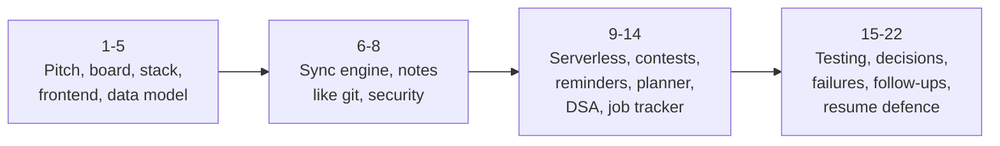
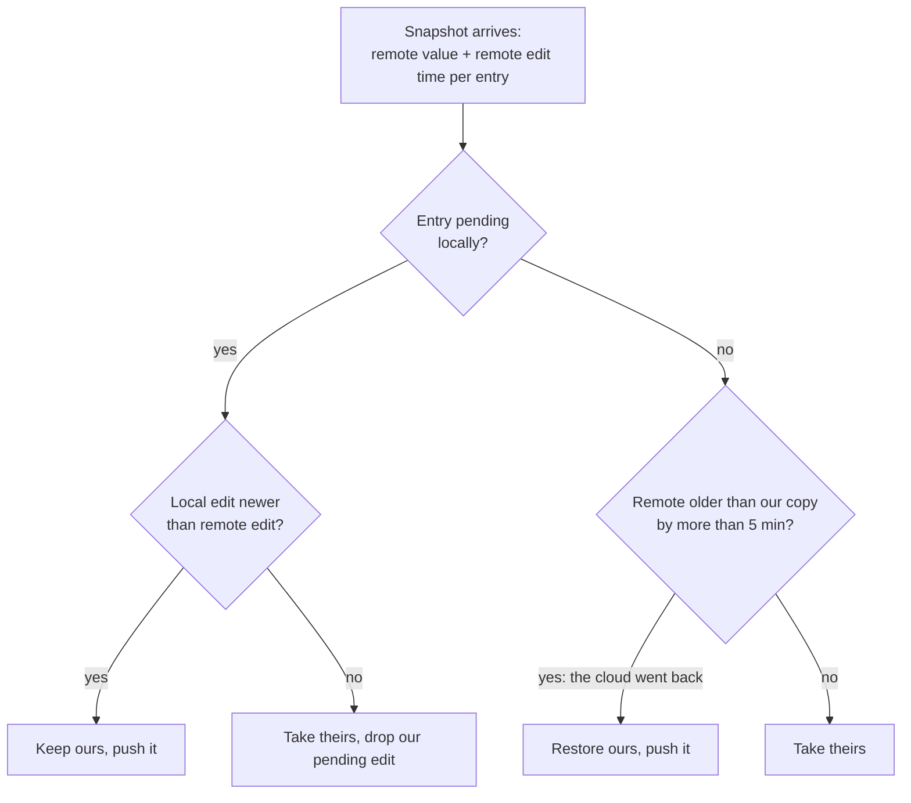
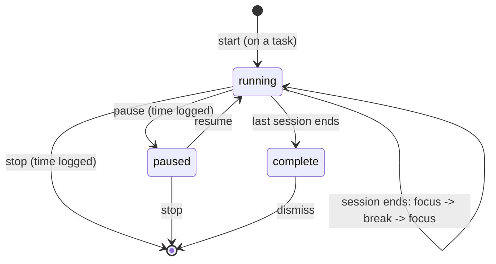

InterviewPlanPrep (this site, repository CodeNITW): the architecture, the decisions behind it, and how each technology works in it. Everything here was checked against the current code, not against the September study guide, and it covers only what every visitor uses: the Planner, Core Stack notes, the DSA tracker, Contests and the public half of the Job Tracker. Owner-only pages (AI Stack, Projects, HLD, the web-basics banks, Job Tracker contacts and openings, the job radar) are left out.

**Your resume entry, the thread through everything below:**

> **InterviewPlanPrep: Interview-Prep Platform with Git-Style Notes, DSA Tracker, Planner and Contests** (JavaScript, React, Node.js, Tailwind CSS, Firebase (Auth, Firestore), Vercel Serverless & Cron; Oct 2023 - Present)
> - Interview-prep platform serving 250+ students, covering DSA, Java & Spring Boot, a job tracker and upcoming coding contests.
> - Day planner with drag-and-drop tasks and a Pomodoro timer; upcoming coding contests fetched from the clist.by API, with cached results and email reminders before each contest.
> - Git-style note-taking with an append-only version history, restore, and a three-way merge for edits made on two devices at once; offline-first DSA tracker that saves progress to a local cache and syncs it to Firestore.



## 1. What it is, and the pitch

A study platform for interview preparation, open to anyone: browse without an account, sign in to keep progress on every device.

| Feature | What a student does |
|---|---|
| Planner (home page) | plan a day of tasks (drag to reorder), time them with a Pomodoro timer, see time spent per task |
| Core Stack | Java and Spring Boot topics; write markdown notes per topic, highlight, pin personal notes, browse the version history and restore |
| DSA tracker | 361 problems by pattern and topic; tick solved, star, write notes; works offline |
| Contests | upcoming LeetCode, Codeforces and CodeChef contests; email reminders a day and an hour before |
| Job Tracker (public part) | a pipeline board of applications and a list of companies |

### The 30-second pitch

> InterviewPlanPrep is an interview-prep platform I built and run on Vercel: a day planner with a Pomodoro timer, Java and Spring Boot notes, a DSA tracker and a contests page with email reminders. It's a React single-page app; accounts and data are on Firebase Auth and Firestore; everything server-side runs as Vercel serverless functions and cron jobs. The interesting engineering is the data layer: every edit is saved locally first and synced in the background, so it works offline, and notes are versioned like git: an out-of-date device can't overwrite a newer version, edits from two devices are merged line by line, and history is append-only.

### The two-minute version

Add three points:

1. **Local-first sync.** localStorage is the source of truth for the UI; every change is recorded in a persisted pending journal and pushed after a short debounce. Simple data resolves per entry by edit time (newer wins); notes use revisions with **compare-and-swap enforced by Firestore security rules**, and a three-way merge when two devices edited the same note.
2. **Contests that don't fall over.** clist.by first, the three platforms' own APIs as a fallback, four layers of caching (browser, Vercel edge with stale-while-revalidate, function memory, a shared 10-minute Firestore cache that keeps each platform's last good list).
3. **Reminders that never double-send.** A cron job every ~15 minutes claims each (reminder, person) pair in a Firestore transaction before sending, and releases it if the send fails, so overlapping runs and retries are safe.

## 2. The whole system on one board


1. **Static app from the CDN.** The Vite build (HTML, JS chunks, CSS) is served by Vercel's CDN. Each page is its own chunk, loaded when first visited.
2. **Reads and writes are local.** Pages read and write `planStore` (localStorage) synchronously. Nothing in the UI waits on the network.
3. **Background sync.** `cloudSync` listens to Firestore (three snapshot listeners per account), reconciles, and pushes pending changes; `noteHistory` appends revisions.
4. **Auth.** Firebase Auth (email/password or Google) issues ID tokens (JWTs). The Firestore SDK attaches them automatically; calls to the Vercel API send them as `Authorization: Bearer`.
5. **Server-side work** runs in Vercel functions: the contest feed, reminder subscriptions, email links, the reminder job and visit tracking. They use **firebase-admin** to reach collections the browser can't.
6. **Scheduled work.** Vercel Cron (plus a GitHub Actions backup) calls the reminder job, which emails subscribers over Gmail SMTP.

> **One sentence for the board: the browser owns the data it shows, Firestore keeps every device in step, and the server only does what a browser can't be trusted with (secrets, other people's emails, schedules).**

## 3. Tech stack, and why each piece

| Layer | Technology | Why (what to say) |
|---|---|---|
| UI | React 18 (function components, hooks) | component model; state -> UI; the ecosystem |
| Build | Vite 5 (moved from Create React App in Dec 2023) | instant dev server on native ES modules; Rollup production build with code splitting |
| Routing | react-router 6 | client-side routes, nested owner-only routes, lazy pages |
| Styling | Tailwind CSS 3 + design tokens (`tokens.css`), dark mode by class | no hand-written CSS files; consistent spacing and colours |
| Motion, toasts | framer-motion, react-toastify | enter/exit animation; toasts only for what the screen can't show |
| Markdown | @uiw/react-markdown-preview, mermaid | notes rendering, diagrams in notes |
| Auth | Firebase Auth | email/password and Google sign-in without running an auth server |
| Database | Cloud Firestore (web SDK 10) | real-time listeners, an offline cache, per-user security rules, a free tier |
| Server | Vercel serverless functions (Node, Web `Request`/`Response`) | no server to run; same repo; CDN in front; cron |
| Server SDK | firebase-admin | trusted access to server-only collections; ID-token verification |
| Email | Nodemailer over Gmail SMTP (app password) | a reputable sender without owning a domain; ~500 recipients a day |
| Contest data | clist.by API; LeetCode GraphQL, Codeforces and CodeChef APIs as fallback | one normalised list from public sources |
| Scheduling | Vercel Cron, GitHub Actions as backup | free scheduling for the reminder job |

## 4. Frontend architecture

### Routes (public)

| Route | Page | Notes |
|---|---|---|
| `/` -> `/planning` | Planner | the home page; a guest sees a sample day |
| `/core-stack` | Core Stack topic list | |
| `/notes/:source/:topicId` | one topic's notes page | the page itself refuses owner-only sources |
| `/dsa-prep` | DSA tracker | |
| `/contests` | Contests | |
| `/job-tracker` | Job Tracker | Contacts and Openings tabs are owner-only inside the page |
| `/sign-in`, `/sign-up`, `/forgot-password` | auth | |
| `*` | -> `/core-stack` | an owner-only URL for a non-owner lands here too, so it looks like any unknown URL |

### Code splitting, with preloading

Every page is a lazy chunk. A plain `React.lazy` suspends once even when its chunk has already arrived, which flashes the loading skeleton; the app's `lazyPage()` wraps it so that a **preloaded** page renders immediately:

```js
function lazyPage(factory) {
  let Loaded = null;
  let pending = null;
  const preload = () => (pending ||= factory().then((m) => { Loaded = m.default; return m; }));
  const Lazy = lazy(preload);
  const Page = (props) => {
    const [Comp] = useState(() => Loaded || Lazy);  // picked once per mount
    return createElement(Comp, props);
  };
  Page.preload = preload;
  return Page;
}
```

The site tour preloads the pages it visits; `Suspense` shows a skeleton (placeholder cards, so the footer doesn't jump) while a chunk arrives. Owner-only code (Job Tracker contacts, templates) is in chunks that are only requested for the owner's account, so it never reaches anyone else's browser.

### No Redux: a small store with events

`planStore` is a plain module: `loadJSON` / `saveJSON` over localStorage plus a `subscribe(fn)` event bus. Every save emits `(key, info)`; pages re-read what they show. `info` says where a change came from, which matters to sync:

| info | Meaning |
|---|---|
| `{ ids, prev }` | a local save: which entries changed, and their previous values |
| `{ remote }` | the sync layer applied data from Firestore |
| `{ external }` | another tab wrote the same localStorage (the `storage` event) |
| `{ account }` | the signed-in account changed: re-read everything |
| `{ blocked }` | a guest's write was refused: re-read so the change visibly doesn't stick |

**Why not Redux or Context?** The data must survive reloads and work offline anyway, so localStorage is the store; a global state library would be a second copy to keep in step. Pages subscribe to the keys they show. Cross-tab consistency comes free from the browser's `storage` event.

### Guests, and the site tour's sandbox

`authGate` holds the auth state (`unknown`, `guest`, `user`) outside React. `saveJSON` refuses a guest's write to user data and opens the sign-in prompt, and app-initiated writes (migrations) are refused *quietly*. The site tour turns on a **sandbox**: a guest's actions really happen, but into a throwaway namespace (`u:tour:...`) with in-memory history, wiped when the tour ends.

## 5. The data model

Locally, every value is stored under `u:{uid}:{key}` (`u:anon:` when signed out), so two accounts on one browser can never see each other's cached data. In Firestore an account's data is split across documents, because **a Firestore document holds at most 1 MiB**:


| Place | Holds | Why there |
|---|---|---|
| `userProgress/{uid}` (main document) | DSA ticks, solve times, stars, planned days, time log, `_meta` | small, frequently read together |
| `data/{key}` | one document per other key (Core Stack ticks, job tracker, timer...) | independent growth |
| `notes/{key}~{id}` | one document per note | notes are the big, growing part; each gets its own revision |
| `history/{note}/revisions/{time-device}` | every saved version | append-only |
| `noteAssets/{id}` | a screenshot as a compressed data URL | images without Cloud Storage |

**Why screenshots in Firestore?** Cloud Storage buckets now require Firebase's paid Blaze plan. Each image is compressed in the browser down a ladder of sizes and qualities until it is under ~500 KB (about 667 KB once base64-encoded), stored in its own document (never the main one), and referenced from the note as `/note-asset/{id}`. The rules cap the field below 900,000 characters.

**Accounts from before the split** still hold old copies in the main document. They are read as a fallback and never written again; the client builds one "view" by laying each newer place over the old copy, entry by entry.

## 6. The local-first sync engine


**The write path.** A page calls `saveJSON(key, value)`: localStorage is updated, an event fires with the changed entry ids, and the sync layer records each entry in the **pending journal** (`sync:pending:{uid}` in localStorage: `{ key: { entryId: editedAtMs } }`). After 800 ms without further changes it pushes.

**Why a journal when Firestore already queues offline writes?** Firestore's offline queue (IndexedDB, enabled with `persistentLocalCache` and a multi-tab manager) delivers writes the SDK has been handed. The journal records **what changed and when**, which the conflict rules need, and covers the window before a write is handed over (the debounce, a crash, a refresh). Both layers together make an edit hard to lose.

**Nothing is pushed until the session has heard from the server.** After a reload, local storage may be stale. Pushing before the first server snapshot could overwrite another device's newer edit, so pushes wait for reconciliation (`serverReady`).

### Plain data: the newer edit wins, per entry



- **Per entry, not per document.** A tick on problem A on the phone and a tick on problem B on the laptop both survive. Edit times live in `_meta` beside the values.
- **Deletes are tombstones.** A deleted entry keeps its edit time in `_meta`, so an old copy can't bring it back.
- **Clock skew.** Device clocks drift, so "the cloud went back in time" only counts beyond **5 minutes**, preventing two slightly-off clocks from undoing each other forever.
- **Whole keys.** The Pomodoro timer's fields only make sense together, so it is decided as one value.

### Reliability details worth naming

| Concern | How it's handled |
|---|---|
| Tab closed during the debounce | flush on `pagehide`, `beforeunload` and `visibilitychange`; the journal still has it otherwise |
| Offline | status `offline`; the `online` event triggers an immediate push |
| Push fails | exponential backoff: 1 s, 2 s, 4 s ... capped at 30 s |
| A note the server keeps refusing | the other notes are pushed first; the push then fails and backs off |
| Two tabs | one localStorage, one journal; the `storage` event re-reads |
| A brand-new account | creates the main document, then seeds the cloud from local data |
| An old client's data | a one-time migration turns unsynced local differences into pending entries, dated to the last sync (not "now") |
| Size | warns at 800 KB of the main document's 1 MiB |

**"Saved" means saved.** The notes page shows two steps: saved on this device (instant), then saved to the account. "Saved" only appears once the cloud has the change, so a slow connection can't hide an unsynced edit.

## 7. Notes, versioned like git


Each note has a revision number in the cloud. An edit remembers the revision and text it started from (its **base**). Saving writes the note's own document with `base` and `rev = base + 1`, and **the security rules refuse it unless `base` is still the head**: compare-and-swap, enforced by the server, so a buggy or out-of-date client can't overwrite a newer version.

When a save is refused, or a snapshot shows the head moved, the device decides like git:

| Case | Decision |
|---|---|
| The cloud's copy hasn't moved since the edit started | fast-forward: ours |
| Both sides ended up identical | theirs |
| Both changed, different lines | three-way merge against the base; saved as the next revision; toast "both sets of changes were merged" |
| Both changed the same lines | the cloud's head stands; this device's edit goes into History as a "not kept" copy; toast says so |

### The three-way merge (`merge3`)

Like `git merge-file`, on lines:

1. Trim the common prefix and suffix first, so a long note with a few edits diffs only a few lines.
2. Diff base -> ours and base -> theirs with a **longest common subsequence** table, turning each diff into **hunks** ("replace base lines [start, end) with these lines").
3. Sort all hunks by position and apply them. Two hunks **collide** if their base ranges overlap or both insert at the same point; identical changes on both sides are taken once; any other collision is a conflict, and nothing is guessed.
4. Guard: if the middle is larger than 4 million cells (n x m), don't diff; treat it as a conflict.

```text
base:   A / B / C / D          ours:   A / B2 / C / D        theirs: A / B / C / D2
hunks:  ours replaces line 2;  theirs replaces line 4  -> no overlap
merged: A / B2 / C / D2
```

Personal notes pinned to passages are lists of objects with ids, so they merge **by id** (`mergeById`): an item added, removed or edited on one side is taken; one edited differently on both sides is a conflict.

### Version history: append-only

- Every change becomes a **revision**: a full snapshot of the text and personal notes, with time and device, at `history/{note}/revisions/{time-device}`.
- **Append-only:** the rules allow only create and read, so no device and no bug can rewrite history. The id (`<time>-<device>`) sorts by time and makes a retried write land on the same document, not a duplicate.
- **Grouped typing:** a revision after 20 seconds of pause, and at least one every 2 minutes while typing; discrete actions (a highlight, a restore) are revisions straight away.
- **Fingerprinted:** a fast 53-bit hash (cyrb53) of the content skips saving an identical revision.
- **Restore** writes the old version back as the newest, which becomes a new revision itself: nothing after it is lost, exactly like `git revert` rather than `git reset`.

## 8. Security model

| Layer | Rule |
|---|---|
| Firestore, per user | `signedInAs(uid)`: only the account itself reads or writes `userProgress/{uid}/...` |
| Main document | update only if `fastForward()`: a save that changes a note must name its base, change one note, and move its revision up by exactly one |
| Note documents | `validNote()`: a fixed set of fields, `rev == base + 1`, and `base` equal to the current head (create: the main document's revision) |
| History | create and read only |
| Screenshots | a string under 900,000 characters |
| Everything else | `allow read, write: if false` (default deny) |
| Server-only collections | contest cache, subscribers, sent reminders, visits: reachable only through firebase-admin in functions |
| API identity | the function verifies the Firebase ID token; the subscriber's **email comes from the verified token, never from the request**, so nobody can subscribe someone else |
| Email links | HMAC-SHA256 of action + account, compared in constant time (`timingSafeEqual`) |
| Cron | `Authorization: Bearer CRON_SECRET` required |
| Secrets | server env vars only; anything prefixed `VITE_` is inlined into the browser bundle, so secrets never use that prefix |

**Q. Isn't the Firebase API key in the bundle a leak?** No. A Firebase web config identifies the project; it isn't a secret. Access control is the security rules plus Auth. The real secrets (service account, Gmail app password, cron secret, clist key) exist only in Vercel's server environment.

## 9. The serverless backend

Each file in `api/` is a function exporting `GET`, `POST` or `DELETE` handlers that take a standard Web `Request` and return a `Response`. In development, a small Vite plugin runs the same files inside the dev server (it builds a `Request` from the Node request and streams the `Response` back), so there is one code path for local and production.

| Function | Does |
|---|---|
| `GET /api/contests` | the upcoming-contest list, edge-cached |
| `GET/POST/DELETE /api/contest-alerts` | read, turn on, turn off reminders for the signed-in account |
| `GET/POST /api/email-link` | confirm / unsubscribe links from the emails |
| `GET /api/contest-reminders` | the reminder job (cron) |
| `POST /api/track` | first-party page views and sign-ins |

## 10. Contests: four caches deep


**Sources.** clist.by is primary (one query for the three hosts, the next 30 days). Without a key, or if it fails, the platforms are asked directly in parallel (`Promise.allSettled`, 8-second timeouts): LeetCode's GraphQL `upcomingContests`, Codeforces' `contest.list`, CodeChef's contest list. Everything is normalised to `{ id, platform, name, url, start, durationMin }`, filtered to future contests no longer than 6 hours, de-duplicated and sorted.

Two bugs from the old third-party contest API this replaced are worth telling: its `duration > 5400` filter silently dropped every LeetCode contest (they last exactly 90 minutes), and clist's times carry no time zone marker, so they were read as local time; the parser now appends `Z` when it's missing.

**The caches.**

1. **Browser:** the fetch promise is reused for a minute; the site tour warms it so the page opens with data.
2. **Vercel edge:** `Cache-Control: public, s-maxage=300, stale-while-revalidate=86400`, so visitors are answered instantly and the edge refetches in the background. An empty answer caused by failures is sent `no-store`, so an outage is never cached.
3. **Function memory:** this instance's copy skips Firestore while fresh.
4. **Firestore `appCache/contests`:** shared by every instance and the reminder job; fresh for 10 minutes. **Per platform:** a platform that failed keeps its last known contests while the others refresh, the cache counts as not refreshed, and the failed source is retried after 60 seconds.

**Q. Why cache in Firestore and not just at the edge?** The reminder job needs the same list and doesn't go through the CDN; and serverless instances don't share memory. One shared copy also keeps the platforms from being asked more than once per 10 minutes overall.

## 11. Reminder emails


**Subscribing.** The Contests page's button calls `/api/contest-alerts` with the user's ID token. The function verifies it and takes the address from it. A Google account's email is already verified; an email/password account gets a **confirmation email first** (at most one every 10 minutes) and receives nothing until it is confirmed: double opt-in.

**Scheduling on a free plan.** Vercel's Hobby plan runs each cron job at most once a day, at some minute within its hour. So `vercel.json` declares **96 daily jobs**, four per hour, which together call the reminder job roughly every 15 minutes. A GitHub Actions workflow calling the same endpoint every 10 minutes is the backup (GitHub's schedule is best-effort and can skip runs).

**Which reminders are due.** Because a run can start late, each reminder is a window, not an instant:

| Kind | Due when the contest is | Notes |
|---|---|---|
| day | within 24 h 5 min, but more than 3 h away | skipped if the hour reminder is close anyway |
| hour | within 65 min, but more than 2 min away | |

The reminder key is `{contestId}@{start}:{kind}`, so a rescheduled contest is reminded about again at its new time.

**Exactly-once-ish delivery.** For each due reminder, a **Firestore transaction** reads `contestReminders/{key}.sentTo`, keeps the subscribers not in it, and writes them in **before any email is sent**. Two overlapping runs can't both claim the same person. Each person then gets one email per run with all their due reminders, in their own time zone. If a send fails, their claims are **released** (deleted from `sentTo`), so the next run retries. The trade-off is deliberate: claim-before-send means a crash between claim and send could skip one email, but nobody ever gets the same reminder twice.

**Email details.** Nodemailer with a pooled single SMTP connection to Gmail per run; `List-Unsubscribe` and `List-Unsubscribe-Post` headers give mail apps a **one-click unsubscribe** (RFC 8058). Links are signed (HMAC). **Opening a link (GET) only shows a page with a button; the change happens on POST**, because mail providers and security scanners open every link in an email to check it, and a GET that acted would confirm or unsubscribe on their visit. The one-click button POSTs directly. `?dryRun=1` lists what's due without sending; `?test=1` sends a sample to the site's own address.

## 12. The Planner and the Pomodoro timer

**Days** are stored by date key (`PlanningDays: { "2026-11-08": [items] }`), each item linked to a source (a Core Stack topic, a DSA problem) or free text, so ticking a planned card ticks the real topic too: both pages use the same completion store. Reordering uses **native HTML5 drag and drop** (`draggable`, `onDragStart` / `onDragOver` / `onDrop`), no library.

**The timer counts by the clock, not by ticks.** Browsers throttle timers in background tabs (to about once a minute after a while), so counting `setInterval` ticks loses time. The timer stores an **anchor** (when `remaining` was last exact) and, whenever it is read, works out how far it really got, walking through any focus and break sessions that finished meanwhile; the same catch-up runs when the page is reopened.



- **Saved on events, not every second:** while running it is stored rewound to its start with the anchor moved back, so it only needs writing on start, pause, resume, extend, finish and stop. That keeps sync traffic tiny.
- **Synced as one value** across tabs and devices (a "whole key" in the sync engine), so the timer follows the account.
- **Time log without double counting:** each timer has an id and a `flushedSec` counter. When it is paused or stopped, only the seconds not yet logged are added, and if another tab or device already logged some, its saved counter says how many.
- A short chime is synthesised with the Web Audio API (no audio file to download).

## 13. The DSA tracker

- **361 problems** with pattern, topic, difficulty and priority, shipped as static data in the page's chunk: no API needed to browse.
- Tick solved (a solve is permanent; the time it was solved is recorded so the page shows "3 days ago"), star, and write a note per problem (notes are versioned like the topic notes).
- **Offline-first:** every tick is a local save first; the sync engine pushes it when the network allows. DSA progress lives in the main Firestore document because it is small and read together.
- A one-time backfill gives solves recorded before timestamps existed a time, quietly (an app write, so a guest is never prompted).

## 14. The Job Tracker (public part)

- **Pipeline:** a board of job links by stage; links are dragged between stages with native drag and drop. Adding a link for a company not in the list creates the company in the same single write, so the two can't come apart.
- **Companies:** a large company dataset that is only downloaded when someone opens the tracker (its own chunk).
- **Versioned resets:** when the company roster is regenerated with new ids, a bumped token triggers a one-time clean slate for stale per-company tracking, keeping companies the user added.
- Contacts and Openings are owner-only and their code is never sent to other accounts.

## 15. First-party analytics, and where a user count comes from

`/api/track` records page views and sign-ins without third-party analytics. Privacy by design: **no raw IP is stored**; the IP only feeds a keyed hash that changes every day (enough to count distinct visitors within a day, useless for following anyone across days); location is Vercel's city-level estimate; names and emails appear only for signed-in users, from their verified token; bots, oversized or malformed requests and the owner's own devices are dropped. A nightly email summarises the numbers. **This is where a "250+ students" figure should come from**: know exactly what you are counting (accounts, or distinct visitors over a period) before you say it.

## 16. Testing the hard parts

The sync engine and the rules are tested against the **Firebase emulators**, never real data:

- `rules.test.mjs`: 23 cases on the security rules alone: a note's first save must build on the main document's copy; a stale base, a skipped revision, a delete, an unknown key, a mismatched document id or an extra field is refused; a tombstone is allowed; another account can't read or write; `data/` documents can't be deleted; and a main-document write that changes a note without the fast-forward marker is refused.
- `e2e.mjs`: **two browsers on one account** against an emulated Firestore: an account seeded in the old (pre-split) layout, checking that old copies are never written, that notes and keys land in their own documents, that a second device sees old and new data combined, and that concurrent edits are merged (or, on the same line, kept in history).

## 17. Decisions and trade-offs

| Decision | Alternatives | Why this one | Cost |
|---|---|---|---|
| Local-first, localStorage as UI truth | read from Firestore directly | instant UI, works offline, survives reloads | a sync engine to own; ~5 MB localStorage budget |
| Per-entry last-writer-wins for plain data | per-document LWW; CRDTs | concurrent edits to different entries both survive; simple | relies on device clocks (5-min skew guard) |
| Revisions + CAS in rules for notes | LWW for notes too | a stale device can't silently overwrite a long note | merge code and a conflict path |
| Line-level three-way merge | operational transform, CRDT text | notes are edited in bursts, rarely simultaneously; git's model is explainable and enough | same-line edits become a conflict copy, not a character-level merge |
| Append-only history in a subcollection | overwrite-in-place | an audit trail no client can rewrite; restore is non-destructive | storage grows; no pruning yet |
| Split account across documents | one document | the 1 MiB document limit | the client stitches a view; a migration path |
| Firestore for images | Cloud Storage | no paid plan needed | compression to ~500 KB; documents per image |
| Vercel functions | an always-on server | free, same repo, CDN in front | cold starts (hidden by edge caching), no shared memory |
| 96 daily crons | a paid plan; an external scheduler | free; plus a GitHub backup | ~15-min granularity, hence reminder windows |
| Claim-before-send transaction | send then record | never a duplicate email | a crash after claim can skip one email |
| Gmail SMTP | a transactional email service | free, reputable sender | ~500 recipients/day; one sender account |
| No state library | Redux, Zustand | the store must persist anyway; events are enough | discipline: pages must re-read on events |

## 18. What happens when...

| Situation | What happens |
|---|---|
| The network drops mid-edit | edits keep saving locally; status "offline"; pushed on reconnect |
| The tab is closed 300 ms after an edit | flushed on `pagehide`; else the persisted journal pushes it next visit |
| The phone was offline while the laptop edited the same note | the phone's save is refused (stale base); merged if different lines, else kept in History |
| Two devices tick different problems | both kept (per-entry edit times) |
| A device's clock is 3 minutes fast | inside the 5-minute skew guard: no flip-flopping |
| clist.by is down | the platforms are asked directly |
| CodeChef is down | its last known contests stay in the cache; retried after 60 s |
| Two cron runs overlap | the transaction lets only one claim each person |
| Gmail rejects a send | that person's claims are released; the next run retries |
| A mail scanner opens an unsubscribe link | GET only shows a button; nothing changes |
| A guest ticks a box | the sign-in prompt opens; the tick visibly undoes |
| The main document nears 1 MiB | a warning at 800 KB |

## 19. Interview follow-ups

### Frontend

**Q. Why Vite over Create React App?** The project started on CRA (Oct 2023) and moved to Vite in Dec 2023: the dev server serves native ES modules (no full re-bundle per change), production builds use Rollup with code splitting, and CRA is no longer maintained.

**Q. How does code splitting work here?** Dynamic `import()` per page creates a chunk per route; `React.lazy` + `Suspense` render it; `lazyPage()` adds `preload()` so a page loaded ahead of time renders without a skeleton flash.

**Q. How do two tabs stay consistent?** One localStorage per origin; a write in one tab fires the `storage` event in the others, which re-read the key. Firestore's multi-tab cache manager keeps the IndexedDB cache coherent too.

**Q. How is dark mode done?** Tailwind's `darkMode: "class"` with colour tokens in CSS variables; components use token classes, not paired light/dark colours.

### Data and sync

**Q. What does offline-first mean here, precisely?** The data layer: once the app is loaded, every read and write works without a network, and changes sync later. There is no service worker, so the app itself needs a connection to load the first time.

**Q. Why not just use Firestore's own offline support?** It is used (persistent IndexedDB cache), but it doesn't decide conflicts: by default the last write to a field wins. The journal and edit times give per-entry newer-wins, tombstones and "cloud went back" repair; notes get revisions and merging.

**Q. What is compare-and-swap here?** The note document's update rule: `request.resource.data.base == resource.data.rev`. The write succeeds only if the stored revision is the one the client based its edit on, the same idea as an `UPDATE ... WHERE version = ?` or a git non-fast-forward rejection.

**Q. Why can't the client just be trusted to check the revision?** Two clients could check, both see the same head, and both write. The check has to be atomic with the write, which the rules evaluation is.

**Q. Walk me through merge3 on a real conflict.** Base "A/B/C", ours "A/X/C", theirs "A/Y/C": both hunks replace line 2 with different text, overlapping ranges, so it's a conflict. The head (theirs) stays; ours is saved in History as "not kept", and the user is told.

**Q. Complexity of the merge?** LCS is O(n x m) in time and memory on the part between the common prefix and suffix, which for real edits is tiny; a 4-million-cell guard turns pathological cases into a conflict instead of freezing the tab.

**Q. Why LWW with client clocks? Isn't that unsafe?** For ticks, stars and plans the cost of a wrong winner is small and the user can re-tick. A server timestamp would need a round trip before the UI knows the order. The skew guard prevents the pathological case (two clocks flipping a value back and forth).

**Q. CRDTs?** They would merge without conflicts but add metadata and complexity per character; for notes edited by one person on a few devices, git-style merging plus history covers it and is easy to explain to users.

### Backend

**Q. Why serverless functions?** Low, bursty traffic; no server to patch; free tier; the API lives next to the UI; the CDN in front absorbs reads.

**Q. How do you hide cold starts?** The contest list is edge-cached with stale-while-revalidate, so visitors never wait on the function; the reminder job runs on a schedule where a cold start doesn't matter.

**Q. How do you prevent duplicate emails?** Claim in a Firestore transaction before sending; release on failure. Keys include the contest start time.

**Q. Why is the confirmation link a page with a button?** Link scanners pre-open every link; a GET must never change state.

**Q. How do you stop someone subscribing another person?** The address comes from the verified ID token, never the request body; unverified addresses must confirm by email.

**Q. Gmail limits?** About 500 recipients a day for a Gmail account; one email per person per run with all their due reminders keeps it low. Beyond that, a transactional email service (SES, Resend) with a domain.

### Scale

**Q. What breaks first if this grows 100x?** Gmail's sending limit, then the reminder job's sequential sends inside a function time limit (60 s; batch or queue them), then Firestore writes per account if notes are edited heavily (history grows unbounded, so add pruning or compaction), then localStorage's ~5 MB per origin for heavy note-takers.

## 20. Honest gaps

1. **No service worker:** the app shell isn't cached, so a first load needs the network.
2. **Client clocks** decide plain-data conflicts (with a skew guard).
3. **History grows forever;** no pruning or compaction yet.
4. **Gmail SMTP** caps reminder volume; no bounce handling.
5. **Claim-before-send** can skip an email if the function dies between claim and send.
6. **localStorage** limits (~5 MB per origin) cap how much a heavy user can keep locally.
7. **Tests** cover sync and rules with emulators; pages have no automated UI tests.

## 21. Resume defence

| Claim | Status | Evidence | What to say |
|---|---|---|---|
| serving 250+ students | check | first-party analytics + accounts (Section 15) | say what it counts and over what period |
| DSA, Java & Spring Boot, a job tracker, contests | verified | public routes (Section 4) | the job tracker's pipeline and companies are public |
| day planner, drag and drop | verified | native HTML5 drag and drop on plan cards | "native drag and drop, no library" |
| Pomodoro timer | verified | wall-clock timer, synced, time log | mention the background-tab throttling fix |
| contests from the clist.by API | verified | primary source; platforms as fallback | say both |
| cached results | verified | browser, edge SWR, memory, shared Firestore cache | "four layers; per-platform fallback" |
| email reminders before each contest | verified | a day and an hour before; cron + transaction | "idempotent claims, never a duplicate" |
| append-only version history, restore | verified | rules allow create + read only; restore = new revision | "like commits" |
| three-way merge for two devices | verified | `merge3` on lines; `mergeById` for personal notes | same-line edits go to History |
| offline-first DSA tracker, local cache, synced | verified for data | localStorage + journal + Firestore IndexedDB cache | "no service worker, so first load needs the network" |
| Node.js | verified | Vercel functions run Node | |
| Firebase Auth, Firestore | verified | email/password + Google; rules | |
| Vercel Serverless & Cron | verified | `api/`, 96 crons | the Hobby-plan trick |
| Oct 2023 - Present | verified | first commit 2023-10-26 | CRA -> Vite in Dec 2023 |

## 22. Stories, and a rapid-fire drill

**Story A: the edit that could vanish (data integrity).** Notes synced as last-writer-wins, so a phone that had been offline could overwrite a longer note written on the laptop. I made notes versioned like git: every save names the revision it was built on, and the Firestore rules accept it only if that is still the head, a compare-and-swap the server enforces. A refused save fetches the head and runs a three-way line merge; if both edited the same lines, the newer version stays and the other edit is kept in an append-only history. Result: no silent overwrites, and every version recoverable.

**Story B: reminders on a free plan (constraints).** Vercel's free plan runs each cron once a day, but contest reminders need runs every few minutes. I declared 96 daily jobs, one per quarter hour, with a GitHub Actions backup; made reminders windows rather than instants because runs start late; and made sending idempotent with a transaction that claims each person before emailing and releases them if the send fails. Overlapping runs, retries and late subscribers are all handled without a single duplicate email.

**Story C: the missing LeetCode contests (debugging).** The contests page never showed LeetCode. The old contest API filtered out contests of 90 minutes or less, and every LeetCode contest is exactly 90 minutes. Rewriting the fetch on clist.by directly, I also found its timestamps had no time zone marker and were being read as local time. Now there's a direct clist query with fixed parsing, the platforms' own APIs as a fallback, and caches that keep each platform's last good list.

### Rapid fire

| Question | Answer |
|---|---|
| Source of truth for the UI? | localStorage, namespaced `u:{uid}:` |
| Push debounce? | 800 ms |
| Retry backoff? | 1 s doubling to 30 s |
| Clock-skew guard? | 5 minutes |
| Note conflict detection? | rules: `base == resource.data.rev`, `rev == base + 1` |
| Merge algorithm? | line-level three-way merge via LCS hunks; same-line = conflict |
| History rules? | create + read only |
| Revision grouping? | 20 s idle, at least every 2 min |
| Firestore doc limit and the fix? | 1 MiB: notes and keys in their own documents |
| Screenshots? | compressed to ~500 KB, a data URL in its own document |
| Contest caches? | 1 min browser, 5 min edge + SWR 1 day, memory, 10 min Firestore |
| Reminder windows? | day: 24h05m to 3h; hour: 65 to 2 min |
| Cron trick? | 96 daily jobs, ~every 15 min |
| Duplicate-email guard? | transaction on `sentTo` before sending; release on failure |
| Why GET shows a button? | link scanners open links |
| Timer accuracy? | anchor + wall clock, not tick counting |
