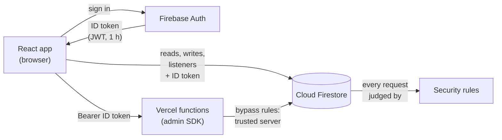
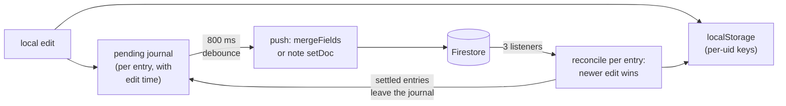
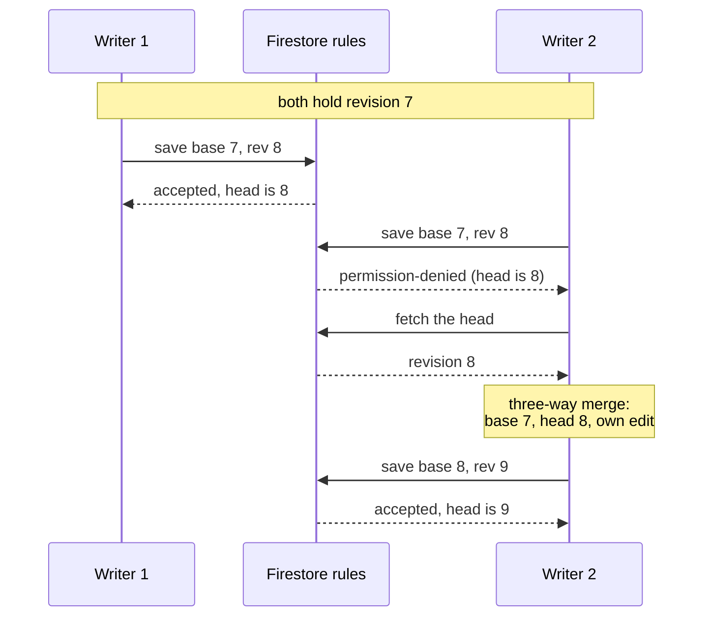

This document explains Firebase Authentication and Cloud Firestore concept by concept, and for each concept states how InterviewPlanPrep (IPP) applies it. It is organised around the two questions any design with a browser talking directly to a database must answer: how data stays consistent across devices, and what prevents one user from reading or overwriting another user's data. Every IPP detail matches the code in `src/firebase.jsx`, `src/Data/firestoreClient.js`, `src/Data/cloudSync.js`, `firestore.rules`, `api/_lib/admin.mjs` and `api/contest-reminders.mjs`.



## 1. Backend-as-a-service: the architectural trade

**Firebase** is Google's backend-as-a-service platform, built on Google Cloud. In a conventional three-tier design, the browser calls an application server, and that server owns both data access and authorization. Firebase removes the middle tier for most operations: **client SDKs talk to Google's managed services directly**.

The two products IPP uses:

- **Firebase Authentication** signs users in (email and password, Google, phone and others) and issues signed tokens.
- **Cloud Firestore** is a document database with real-time listeners and an offline cache. It is the same service as Firestore in the Google Cloud console; "Firebase" denotes the client SDKs, console and tooling around it.

**What the trade costs.** With no application server in the request path, authorization cannot live in application code. It moves into **security rules**: declarative conditions that Google evaluates on its servers for every read and write (section 8). Anything that needs a secret, access to other users' data, or a schedule still requires trusted server code (section 10).

**IPP's choices.** IPP uses Auth and Firestore. It does not use Firebase Hosting or Cloud Functions: the site and its server functions run on Vercel, with Vercel Cron for schedules. It does not use Cloud Storage, which requires the paid plan; screenshots are stored as compressed data URLs in Firestore documents. App Check is not enabled (section 11). `src/firebase.jsx` initialises the Firebase app and is imported first; Firestore is deliberately not initialised there (section 7).

Say it like this: "Firebase lets the client talk to Google's database directly, so there is no API tier to build or scale. The price is that security rules become the server-side authorization, and anything that needs secrets, other users' data or a schedule still needs real server code."

## 2. Firebase Authentication and the ID token

**The credentials.** A successful sign-in (`signInWithEmailAndPassword`, or `signInWithPopup` with `GoogleAuthProvider`) gives the SDK two credentials:

- An **ID token**: a JWT signed by Google with RS256, valid for **one hour**. Its claims include `sub` (the user's uid), `email`, `email_verified`, `aud` (the Firebase project id) and `iss` (`https://securetoken.google.com/<project-id>`).
- A **refresh token**: long-lived, held by the SDK, which exchanges it for a fresh ID token before the current one expires. Application code never handles it.

**Session lifecycle.** The SDK persists the session in IndexedDB, so a reload keeps the user signed in. `onAuthStateChanged` fires on sign-in, sign-out and initial load, and is the single source of truth for the current identity.

*In IPP:* the `onAuthStateChanged` handler in `src/App.jsx` calls `startCloudSync(uid)` on sign-in and `stopCloudSync()` on sign-out. Before any storage access, the sync engine scopes every local key to the account (`u:{uid}:...`), so two accounts used in one browser never share local data.

**Two ways the token is consumed.**

1. **By Firestore, implicitly.** The SDK attaches the token to every request; security rules see the verified identity as `request.auth`.
2. **By the application's own server code, explicitly.** The client calls `user.getIdToken()` and sends `Authorization: Bearer <token>`. The server verifies it with the admin SDK's `verifyIdToken`, which checks Google's signature against Google's published public keys, the audience, the issuer and the expiry.

*In IPP:* `verifiedUser(request)` in `api/_lib/admin.mjs` extracts the bearer token and returns the decoded token, or null if it is missing or invalid. The principle it enforces: **identity comes from the verified token, never from the request body.** The contest-alert subscription endpoint takes the email address from the token, so no caller can subscribe an address that is not theirs, and it sends a confirmation email first when the token's `email_verified` is false.

**Revocation semantics.** `verifyIdToken` does not check whether the user's sessions were revoked (for example after a password change) unless called with `checkRevoked: true`, which costs an extra lookup. Without it, a revoked session's ID token remains acceptable until it expires, at most one hour. IPP accepts that window for its low-risk endpoints.

Say it like this: "The browser holds a Google-signed ID token, a one-hour JWT the SDK refreshes on its own. Firestore reads it as request.auth; my functions verify it with the admin SDK and take the uid and email from the token, never from the request body."

## 3. The Firestore data model

**Documents and collections.** Firestore stores **documents**: maps of typed fields (strings, numbers, booleans, timestamps, nested maps, arrays). Documents live in **collections**, and a document can own **subcollections**, so paths alternate `collection/doc/collection/doc`. A subcollection is not part of its parent document's size or reads.

**The constraints that drive schema design.**

- **No joins.** Data is shaped around the reads the application performs, and duplicated where necessary.
- **The document is the unit of billing** (each document read, write and delete is charged) and the **unit of change notification** (a listener fires when a document changes).
- **A document holds at most 1 MiB.**
- **A single document sustains roughly one write per second** (a soft limit); sustained higher rates on one document cause contention.

**Design principle: split by growth pattern.** Data that is small and bounded can share a document; data that grows without bound, or is edited independently, belongs in its own documents. A single per-user document holding everything eventually approaches the 1 MiB cap, and every small change rewrites a large document.

*In IPP:* each account lives under one root document, with unbounded data split out:

- `userProgress/{uid}`: the main document, holding DSA progress (ticks, solve times, stars), planned days, the time log, `_meta` (an edit time per entry) and `_rev` (revision numbers for the older in-document note copies).
- `userProgress/{uid}/data/{key}`: one document per other kind of progress (Core Stack ticks, the job tracker and similar), so one large tracker cannot crowd out the rest.
- `userProgress/{uid}/notes/{key}~{id}`: one document per note, with fields `key`, `id`, `value`, `deleted`, `rev`, `base` and `updatedAt`. Each note has its own 1 MiB budget and its own revision counter, which the concurrency control in section 9 needs.
- `userProgress/{uid}/history/{target}/revisions/{revisionId}`: every saved version of a note, append-only.
- `userProgress/{uid}/noteAssets/{id}`: a screenshot as a compressed data URL under 900,000 characters.

Collections that only server code touches sit outside `userProgress`: `contestSubscribers`, `contestReminders`, `visits` and `appCache`. Accounts created before the split still hold older copies of notes and other keys in the main document; those copies are read as a fallback and never written again.

Say it like this: "Each user's data hangs off one root document, and anything that grows without bound, notes and large trackers, gets its own documents, because a Firestore document caps at 1 MiB and is also the unit of cost and of change notification."

## 4. Queries and indexes

**Reading.** `getDoc` reads one document by path. `getDocs(query)` returns every matching document, each billed as a read. Queries support equality and range filters (`where`), ordering (`orderBy`), `limit`, and cursor-based pagination (`startAfter`, `startAt`).

**Every query is served by an index.** Single-field indexes are created automatically. A query that combines filters or orderings on several fields needs a **composite index**, declared in advance (the error for a missing one links to its creation). A query no index can serve is rejected rather than executed as a scan. The consequence is the property Firestore is designed around: **query cost and latency scale with the size of the result set, not the size of the collection.**

**Aggregations.** `count()`, `sum()` and `average()` run on the server and return a number without downloading documents; they are billed per batch of index entries scanned rather than per document.

**Pagination.** Cursor pagination (`startAfter(lastValue)`) is the efficient form. Offset pagination still reads, and bills, the skipped documents. A unique tie-breaker in the ordering (such as the document id) keeps pages stable when sort values repeat.

*In IPP:* the browser never queries; it only listens to the account's own documents (section 6). Queries run in server code: the reminder job reads `contestSubscribers.where("confirmed", "==", true)`, and the openings API pages with `orderBy("openedAt", "desc")` plus the document id as tie-breaker, a `startAfter` cursor, and `count()` for the total.

## 5. Write semantics

The choice of write operation decides whether concurrent writers can destroy each other's data.

- `setDoc(ref, data)` **replaces** the entire document.
- `setDoc(ref, data, { merge: true })` **deep-merges** the given fields into the existing document.
- `setDoc(ref, data, { mergeFields: [...] })` writes **only** the listed field paths, ignoring other fields in `data`.
- `updateDoc(ref, ...)` updates fields and fails if the document does not exist.
- `deleteField()` removes a field; `serverTimestamp()` sets a field from Google's clock rather than the device's.
- A **batched write** applies several writes atomically, all or nothing, with no reads.
- A **transaction** reads, decides and writes atomically. In client SDKs, transactions are **optimistic**: if a document read in the transaction changes before commit, the transaction function is retried, and the client must be online. Server SDKs use **pessimistic locking** on the documents read.

**Design principle: write only what this writer changed.** A writer holding a stale copy of a map that replaces or merges the whole map silently reverts every entry other writers changed in the meantime. Writing individual field paths confines a write's effect to the entries it actually modified.

*In IPP:* progress entries are pushed with `setDoc(ref, data, { mergeFields })`, one field path per changed entry (for example `["DSAPrepCompleted", "two-sum"]`) together with that entry's edit time under `_meta`. A removed entry is written as `deleteField()` while its `_meta` time is kept, which acts as a **tombstone**: the deletion carries a time and can win against an older edit of the same entry. Notes are written as whole documents with `setDoc`, and the rules decide whether that write is accepted (section 9).

Say it like this: "Progress is pushed with mergeFields, one field path per changed entry plus its edit time, so a stale device can never overwrite entries it did not touch, and deletes are tombstones with a time."

## 6. Real-time listeners

**Mechanism.** `onSnapshot(ref, options, callback)` opens a long-lived stream. The callback fires first with the current data, then again whenever the document (or query result) changes, from any client.

**Snapshot metadata.**

- `metadata.fromCache` is true when the data came from the local cache and has not been confirmed by the server.
- `metadata.hasPendingWrites` is true when the snapshot includes local writes the server has not yet acknowledged.
- With `includeMetadataChanges: true`, the callback also fires when only these flags change, for example when a pending write is acknowledged.

**Latency compensation.** A local write fires local listeners immediately, before the server acknowledges it. This is why Firestore interfaces feel instantaneous, and also why application logic must distinguish local, unconfirmed state from server state.

**Billing.** The initial snapshot costs one read per document returned; subsequent updates cost one read per changed document. A listener that reconnects within 30 minutes is not re-billed for unchanged documents.

*In IPP:* `cloudSync.js` keeps three listeners per signed-in account (the main document, the `data` subcollection and the `notes` subcollection), all with `includeMetadataChanges: true`. Three invariants govern them:

1. **No decision until all three listeners have reported.** A note's own document must never be judged against only the main document's older copy of it.
2. **No push until the server has confirmed state** (`fromCache` false on all three). A device with an empty cache sees "no documents", which proves nothing; acting on it could overwrite real data with emptiness. A brand-new account is only created after the server confirms it does not exist.
3. **No reconciliation while local writes are unacknowledged** (`hasPendingWrites`): the local store already reflects them.

## 7. Offline persistence and the sync engine

**Firestore's offline cache.** With persistent caching enabled, the SDK keeps a cache in IndexedDB. Reads are served from it when offline. Writes are applied locally at once, queued, and sent when connectivity returns, including after a reload. A write's promise resolves only on server acknowledgement; if the rules refuse it, the SDK rolls back the local change and the promise rejects with `permission-denied`.

```js
// src/Data/firestoreClient.js
export const db = initializeFirestore(app, {
  localCache: persistentLocalCache({ tabManager: persistentMultipleTabManager() }),
});
```

The **multi-tab manager** lets several open tabs share one cache coherently. *In IPP*, this module is a chunk of its own, loaded on demand through `loadFirestore()`: the Firestore SDK is the largest dependency, so a guest never downloads it, and a signed-in visit renders from local storage while it loads.

**Why an application sync layer on top of the SDK cache.** Firestore's cache and queue do not provide everything a multi-device application needs:

- **Synchronous reads.** The UI renders from data that must be available synchronously; the Firestore API is asynchronous.
- **Merge policy.** Firestore resolves concurrent writes to the same field as "last write to arrive wins". The required policy is "the most recent *edit* wins, per entry", which needs edit times, tombstones and protection against clock skew.
- **Durability before handoff.** Writes are batched by a debounce; Firestore's queue only holds writes already handed to it, so anything inside the debounce window would be lost on a crash or refresh.
- **Three-way merge.** Text notes need git-style merging, which requires the base revision each edit started from.



*IPP's sync engine, as concepts:*

- **Local store as the source for the UI.** Every read and write goes to `localStorage` under the account's namespaced keys, synchronously.
- **Write-ahead pending journal.** Every local change is recorded per entry, with its edit time, in a journal that is itself in `localStorage`. It survives a refresh, a crash or a closed tab, and all tabs see the same journal. An entry leaves the journal only once the cloud has it.
- **Debounced, coalesced pushes.** Pushes wait for 800 ms of quiet, so a burst of edits becomes one write, which also keeps writes per document well under the sustained-rate limit. Failed pushes retry with exponential backoff from 1 to 30 seconds. On sign-out or page hide, pending changes are flushed immediately.
- **Per-entry last-writer-wins by edit time.** For every entry both sides hold, the newer edit time wins: a newer pending local edit stays and is pushed; an older one is dropped; an old edit from before this session loses to a newer saved one.
- **Clock-skew guard.** If the cloud's edit time for an entry appears to go *backwards* relative to what this device holds, by more than five minutes, the device treats the cloud as having regressed and restores its own newer copy. The threshold stops two slightly wrong clocks from repeatedly undoing each other.

Say it like this: "Every edit lands synchronously in a local store and a write-ahead journal. After 800 ms of quiet, only the changed entries are pushed with mergeFields and their edit times. Each device listens to its account's documents, reconciles per entry with newer-edit-wins and a clock-skew guard, and never pushes before it has heard from the server. Firestore's IndexedDB cache sits underneath for offline reads and queued writes."

## 8. Security rules

**What they are.** Security rules are declarative conditions attached to document paths, evaluated by Google's servers on every client read and write. Access is **denied unless a rule explicitly allows it**. Because clients reach the database directly, the rules are the authorization layer.

**Vocabulary.**

- `request.auth`: the verified identity (`uid`, token claims), or null.
- `resource.data`: the document as currently stored. `request.resource.data`: the document as it would be after the write.
- `request.resource.data.diff(resource.data).affectedKeys()`: the set of fields this write changes.
- `get()` and `exists()`: read another document inside a rule. Each is billed as a read, and they are limited (10 per single-document request, 20 per batch or transaction).

**Rules are not filters.** A query is allowed only if the rules can prove that *every* document it could return is readable; otherwise the entire query is refused. A rule permitting "only documents you own" therefore requires the query itself to constrain ownership, for example `where("owner", "==", uid)`.

**Server SDKs bypass rules.** Code authenticated with a service account (the admin SDK) is not subject to security rules. This is why admin credentials must never reach a client.

Correction: "Rules filter query results." They do not; a query that could return a forbidden document is rejected as a whole.

Correction: "The admin SDK obeys the rules." It does not; rules apply only to client SDK requests.

*IPP's rules (`firestore.rules`), as properties:*

1. **Ownership.** `signedInAs(uid)` is `request.auth != null && request.auth.uid == uid`; a user can reach only `userProgress/{their uid}` and its subcollections.
2. **Default deny.** A final `match /{document=**}` denies everything else, which makes subscribers, reminders, visits and caches server-only by construction.
3. **Size validation.** A screenshot must be a string under 900,000 characters, so an oversized write is rejected before it can hit the 1 MiB cap. History revision text must be under 1,000,000 characters.
4. **Append-only history.** Note revisions allow `create` and `read` only, with no `update` or `delete`, so history immutability is enforced by the database rather than by trusting clients.
5. **Non-deletable data.** `data/{key}` and note documents may be read, created and updated by their owner, never deleted; a deleted note keeps its document with `deleted: true`, so an older copy elsewhere cannot reappear.
6. **Schema validation.** A note document may contain only the allowed fields, with the correct types, and its id must match its path.
7. **Fast-forward-only writes** for notes, described next.

Say it like this: "Each user can touch only documents under their own uid, and everything else is denied. History is create-and-read only, so it is append-only by construction, and note saves must be fast-forwards of the stored revision, checked atomically with the write."

## 9. Optimistic concurrency enforced in security rules

**The problem: lost updates.** Two writers read a record at version 7 and each produce an edit. If the store accepts both, the second write silently replaces the first. This is the classic **lost update** anomaly, and it is the normal case for offline-capable clients, which edit stale copies by design.

**The technique: compare-and-swap on a version.** **Optimistic concurrency control** lets writers proceed without locks, then rejects any write that was not based on the current version. The writer names the version it read; the store accepts the write only if that is still the current version, and increments it atomically. It is the same idea as `UPDATE t SET ..., version = 8 WHERE id = ? AND version = 7` in SQL, or git refusing a non-fast-forward push.

**Implementing it in rules.** Firestore has no conditional-write API for clients outside transactions, but a rule can compare the incoming document with the stored one, and rule evaluation is atomic with the write:

```js
match /notes/{noteId} {
  allow update: if signedInAs(uid) && validNote(noteId)
    && request.resource.data.key == resource.data.key
    && request.resource.data.id == resource.data.id
    && request.resource.data.base == resource.data.rev;   // built on the current head?
}
// validNote: only the allowed fields and types, rev == base + 1, id matches the path
```

Each save carries `base` (the revision it was built on) and `rev` (= `base + 1`). The rule accepts it only if `base` equals the stored `rev`. A note's first document must build on the revision of the main document's older copy, read with `get()`; this is the only rule that reads another document. The main document's older note copies follow the same protocol through `_write.base` and `_rev`, and its rule also requires that a save changes exactly one note and raises exactly that note's revision by one.



**Resolution on rejection.** *In IPP*, `pushNote` in `cloudSync.js` catches exactly `permission-denied`, fetches the current head, and decides:

- If the head has not really moved (same content), the edit is a fast-forward and is saved on the current revision.
- Otherwise a **three-way merge** against the common base runs (`merge3` for note text, line by line; `mergeById` for structured personal notes). Non-overlapping changes are combined and saved as the next revision.
- If both sides changed the same lines differently, nothing is guessed: the head stands, and this device's version is saved to the note's history as a conflicting copy, with a notice to the user.

**Why rules rather than the alternatives.**

- A **client-side check-then-write** is not atomic: two writers can both read 7, both pass the check, and both write. It also binds only well-behaved clients.
- A **client transaction** is atomic but requires connectivity at commit time, which defeats offline editing.
- A **rule on the write** makes the comparison and the write one atomic step on the server, applies to every client, and judges an offline write whenever it finally arrives.

Say it like this: "A note save names the revision it was built on, and the security rule compares that with the stored revision in the same atomic step as the write. A stale writer gets permission-denied, three-way merges with the head, and saves again; a true conflict keeps the head and preserves the other version in history."

## 10. Trusted server code: the admin SDK

**When server code is required.** Three categories of work cannot run in a client, whatever the rules allow:

- work that needs **secrets** (mail credentials, third-party API keys, a cron secret);
- work over **other users' data** (for example, every reminder subscriber);
- work on a **schedule**, independent of any open client.

**The admin SDK.** Server code initialises Firebase Admin with a service-account credential. It has full access and bypasses security rules, so its credential must stay server-side.

*In IPP:* the server code runs as Vercel serverless functions on Node.js rather than Cloud Functions: they deploy from the same repository with the site, Vercel Cron triggers schedules, and no paid Firebase plan is needed. `api/_lib/admin.mjs` initialises the admin app lazily from the `FIREBASE_SERVICE_ACCOUNT` environment variable and exports `db()`, `auth()` and `verifiedUser()`:

```js
// api/_lib/admin.mjs
initializeApp({ credential: cert(account) });   // account parsed from FIREBASE_SERVICE_ACCOUNT
export const db = () => getFirestore(app());
export const auth = () => getAuth(app());
export async function verifiedUser(request) { /* Bearer token -> auth().verifyIdToken */ }
```

**Idempotent scheduled delivery: claim before send.** A scheduled job can run twice concurrently (overlapping triggers, a backup scheduler, a manual retry), and an external side effect such as an email cannot be undone. The general pattern is to **record the intent atomically before performing the side effect**, and release the record if the effect fails.

*In IPP:* `api/contest-reminders.mjs` requires `Authorization: Bearer <CRON_SECRET>`. Vercel Cron calls it roughly every 15 minutes, and a scheduled GitHub Actions workflow acts as a backup. For each due reminder, a transaction reads `contestReminders/{key}.sentTo`, keeps only confirmed subscribers not already in it, and writes them in. Only then are emails sent, one per person per run. If a send fails, that person's claim is removed with `update({ "sentTo.<id>": FieldValue.delete() })`, so a later run retries. Because claims happen inside transactions, two concurrent runs cannot both claim the same person.

The resulting guarantee is **at-most-once delivery per run, with retry on known failure**: never a duplicate, and at worst a missed email if a process dies between claim and send. For reminders, a duplicate is worse than an occasional miss, so this is the right side to err on.

Say it like this: "Anything needing secrets, other users' data or a schedule runs in a server function with the admin SDK. For reminders, each recipient is claimed in a transaction before sending and released if the send fails, so overlapping runs never double-send."

## 11. Limits, cost and fit

**Limits that shape a Firestore design**, and IPP's response to each:

- **1 MiB per document**: notes and large trackers have their own documents.
- **About one sustained write per second per document**: the 800 ms debounce coalesces bursts.
- **Billing per document read, written and deleted**: the SDK loads only for signed-in users, listeners cover only the account's own documents, and public data (the contest list) is cached at the edge instead of read from Firestore per visitor.
- **Free quota** (50,000 reads, 20,000 writes and 20,000 deletes per day, 1 GiB stored): covers IPP's traffic.
- **`get()` inside rules is billed as a read**: only a note's first save performs one.
- **The database location is fixed at creation.** Data-residency requirements must be decided up front (for India, `asia-south1` in Mumbai or `asia-south2` in Delhi).

**Known gaps in IPP:** App Check (attesting that requests come from the genuine app) is not enabled; `checkRevoked` is not used on server endpoints; and there is no scheduled export of Firestore to Cloud Storage for backups.

**When Firestore fits and when it does not.** It fits per-user or per-entity documents that must sync live to clients and work offline, with access controlled per document. It is the wrong tool for relational or analytical workloads: joins, ad-hoc reporting, heavy aggregation, full-text or vector search, and high-volume multi-entity transactions. Those belong in PostgreSQL (with pgvector for embeddings), a search engine, or a warehouse such as BigQuery.

Say it like this: "Firestore fits per-user data that must sync live and work offline. For joins, analytics, search or vectors I would use Postgres or BigQuery; choosing the store is about the access pattern."

## 12. Summary of IPP's design

- **Sync:** synchronous local store and write-ahead journal; debounced `mergeFields` pushes of changed entries with edit times; three listeners; per-entry newer-edit-wins with tombstones and a clock-skew guard; no push before server-confirmed state.
- **Concurrency for notes:** optimistic concurrency with `base`/`rev`, enforced atomically in security rules; three-way merge on rejection; conflicting copies preserved in append-only history.
- **Authorization:** own-uid access only, default deny, schema and size validation, append-only history, no deletes.
- **Server trust:** the server verifies the Firebase ID token with the admin SDK and takes identity from the token, never from the request body.
- **Server-side side effects:** claim in a transaction before sending, release on failure.
