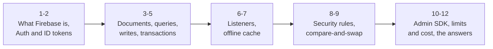
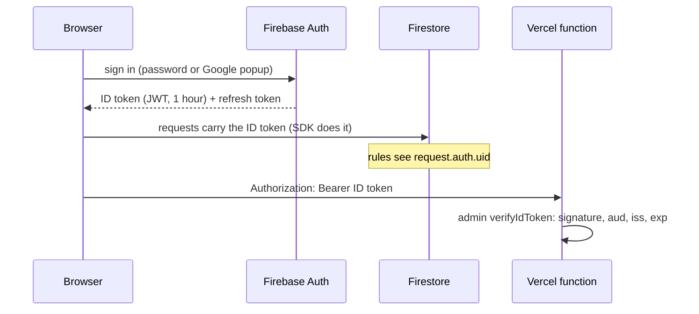

Firebase and Firestore from zero, then exactly how InterviewPlanPrep uses each piece. Brikby runs on the same family (Firebase Auth, Firestore listeners, functions behind the ID token), so expect "how does your Firestore sync work?" and "how do your security rules work?". These notes follow the lecture above topic by topic (1 to 12). Every IPP claim below is checked against the code: `src/firebase.jsx`, `src/Data/firestoreClient.js`, `src/Data/cloudSync.js`, `firestore.rules`, `api/_lib/admin.mjs`, `api/contest-reminders.mjs`.



## 1. What Firebase is

Firebase is Google's **backend-as-a-service** on top of Google Cloud. The idea that changes everything: **the browser talks to Google's services directly**. There is no API server of yours between the React app and the database.

| Product | What it does | IPP uses it? |
|---|---|---|
| **Firebase Auth** | sign-in (email/password, Google, phone...), issues ID tokens | yes |
| **Cloud Firestore** | a document database with real-time listeners and an offline cache | yes |
| Firebase Hosting | static hosting on Google's CDN | no (Vercel) |
| Cloud Functions | server code triggered by HTTP or events | no (Vercel functions) |
| Cloud Storage | files and images | no (needs the paid plan; screenshots are compressed data URLs in Firestore) |
| App Check | proves requests come from your real app | no (an honest gap; see 12) |

If the browser talks to the database directly, **who stops user A reading user B's data?** The **security rules** (topic 8): a small program Google runs on every request. That is the deal Firebase makes: no server to write, but your authorization lives in the rules.

Firestore **is** Google Cloud Firestore: the same database you see in the GCP console. "Firebase" is the developer-facing SDKs and console on top.

**Q. In one line, what is the trade Firebase makes?** No backend to run; in exchange, the client talks to the database directly and the security rules become your server-side authorization.

## 2. Firebase Auth and the ID token



| Piece | What it is |
|---|---|
| **ID token** | a JWT signed by Google (RS256), valid **1 hour**. Claims: `sub`/`uid`, `email`, `email_verified`, `aud` = your project id, `iss` = `https://securetoken.google.com/<project>`, `exp` |
| **Refresh token** | long-lived; the SDK swaps it for a new ID token before the old one expires. You never handle it |
| **Persistence** | the browser SDK keeps the session in IndexedDB, so a reload stays signed in |
| `onAuthStateChanged` | fires on sign-in, sign-out and page load: the app's single source of "who is signed in" |
| **Verification on a server** | `admin.auth().verifyIdToken(token)` checks the signature against Google's public keys, the audience, the issuer and expiry. It does **not** check revocation unless you pass `checkRevoked` (an extra call) |

**In IPP:**
- Sign-in with **email/password** (`createUserWithEmailAndPassword`, `signInWithEmailAndPassword`, `sendPasswordResetEmail`) or **Google** (`signInWithPopup` with `GoogleAuthProvider`).
- `onAuthStateChanged` starts and stops the sync for that account (`startCloudSync(uid)`), and scopes the local cache to `u:{uid}:...`.
- The Firestore SDK attaches the token itself; the rules read it as `request.auth.uid`.
- For Vercel functions the page calls `user.getIdToken()` and sends `Authorization: Bearer <token>`; `api/_lib/admin.mjs` -> `verifiedUser()` runs `verifyIdToken`. **The email for reminders comes from the verified token, never from the request body.**

**Q. Why can't a user subscribe someone else's email to reminders?** The function takes the email from the verified ID token, which only Google can sign, not from anything the browser sends.

## 3. The data model: documents and collections

- A **document** is a map of fields (strings, numbers, booleans, timestamps, maps, arrays, references), at most **1 MiB**.
- A **collection** holds documents; a document can own **subcollections**. Paths alternate: `collection/doc/collection/doc`.
- **No joins.** You shape data around the screens that read it, and duplicate when you must.
- A document read is the unit of cost and of real-time updates.

**IPP's layout** (one account, under `userProgress/{uid}`):

| Path | Holds | Why separate |
|---|---|---|
| `userProgress/{uid}` | DSA ticks, solve times, stars, planned days, `_meta` (edit times), `_rev` | the original single document |
| `.../data/{key}` | one document per other kind of progress (Core Stack ticks, job tracker, timer...) | a big job tracker must not push the main doc past 1 MiB |
| `.../notes/{key}~{id}` | one document per note: `value`, `rev`, `base`, `deleted`, `updatedAt` | each note gets its own revision and its own size budget |
| `.../history/{target}/revisions/{time-device}` | every saved version of a note | append-only history |
| `.../noteAssets/{id}` | a screenshot as a compressed data URL, < 900,000 chars | no paid Cloud Storage |

Server-only collections (the rules deny the browser everything outside `userProgress/{uid}`): `contestSubscribers`, `contestReminders`, `visits`, `appCache`.

**Q. Why are notes split into their own documents?** The 1 MiB document limit: one heavy note-taker would fill the main document; and a per-note document gives each note its own revision for compare-and-swap.

## 4. Reading: get, queries, indexes

| Operation | Notes |
|---|---|
| `getDoc(ref)` | one document, one read |
| `getDocs(query)` | every matching document is one read |
| `where`, `orderBy`, `limit`, cursors (`startAfter`) | **every query is served by an index**, so its cost and speed depend on the size of the result, not the collection |
| single-field indexes | automatic |
| composite indexes | declared for queries that filter or order on several fields; the error message links to create one |
| `count()` | an aggregation query: counts without downloading the documents |

**In IPP** (server side, admin SDK): reminders read `contestSubscribers.where("confirmed", "==", true)`; the job radar lists openings `orderBy("openedAt", "desc").orderBy(documentId, "desc")` with a cursor, and `count()` for totals. The browser side never queries: it listens to the account's own documents.

**Q. Why does a Firestore query stay fast as a collection grows?** Every query is answered from an index, so it costs in proportion to the results returned, not to the documents scanned.

## 5. Writing: set, merge, update, batches, transactions

| Call | Behaviour |
|---|---|
| `setDoc(ref, data)` | replace the whole document |
| `setDoc(ref, data, { merge: true })` | merge into what is there |
| `setDoc(ref, data, { mergeFields: [...] })` | write **only** the listed fields (by `FieldPath`) |
| `updateDoc` | merge, but fails if the document doesn't exist |
| `deleteField()` | remove one field |
| `serverTimestamp()` | the server's clock, not the device's |
| **batched write** | several writes, all or nothing; no reads |
| **transaction** | read, decide, write, all or nothing. Client SDKs are **optimistic** (retried if a read document changed; they need to be online). Server SDKs use **pessimistic** locks on what they read |

**In IPP:**
- **Ticks and other entries:** `setDoc(ref, data, { mergeFields })` with one `FieldPath` per changed entry (`["DSAPrepCompleted", "two-sum"]`), plus its edit time in `_meta`. A deleted entry is `deleteField()` plus a tombstone time. So a push touches exactly the entries this device changed.
- **Notes:** `setDoc(noteRef, { key, id, value, deleted, rev, base, updatedAt })`, the whole note document, judged by the rules (topic 9).
- **Reminders (server):** `db.runTransaction` reads `contestReminders/{key}.sentTo`, keeps the people not in it, writes them in, then emails. Failed send: `update({ "sentTo.<id>": FieldValue.delete() })` releases the claim.

**Q. Why `mergeFields` instead of writing the whole map of ticks?** A whole-map write from a stale device would overwrite entries it never touched; `mergeFields` writes only the entries this device changed.

## 6. Real-time listeners

`onSnapshot(ref or query, callback)` opens a stream (WebChannel in the browser). You get the current state first, then a new snapshot every time a document changes, from any device.

| Snapshot metadata | Meaning |
|---|---|
| `metadata.fromCache` | true: this came from the local cache, the server hasn't confirmed it yet |
| `metadata.hasPendingWrites` | true: it includes this device's own write that the server hasn't acknowledged |
| `includeMetadataChanges: true` | also fire when only those flags flip (e.g. "now confirmed by the server") |

**Latency compensation:** your own write fires your listener immediately, with `hasPendingWrites: true`, before the server has it.

**Billing:** the first snapshot costs one read per document; afterwards one read per **changed** document. A listener that reconnects within 30 minutes isn't billed again for unchanged documents.

**In IPP (`cloudSync.js` -> `listen`):** three listeners per signed-in account, on the main document, the `data` subcollection and the `notes` subcollection, all with `includeMetadataChanges: true`. **Nothing is decided until all three have answered**, and nothing is pushed until a snapshot **from the server** has arrived. As the code says: *a cached "doesn't exist" proves nothing*, so a new device never mistakes an empty cache for an empty account.

This is the same mechanism Brikby's app uses for an analysis job's status: write a status field on the server, every open tab gets it pushed.

**Q. Why wait for a snapshot that is not `fromCache` before pushing?** The cache may be days old; deciding from it could push stale data over newer data on the server. The server's copy must be merged first.

## 7. The offline cache, and why IPP still has its own store

```js
// src/Data/firestoreClient.js
export const db = initializeFirestore(app, {
  localCache: persistentLocalCache({ tabManager: persistentMultipleTabManager() }),
});
```

- **Persistent cache in IndexedDB:** reads work offline; writes are applied locally at once and queued; they reach the server when the network returns, even after a reload.
- **Multi-tab manager:** several open tabs share one cache safely.
- A write's promise resolves only when **the server acknowledges** it. If the rules refuse it, the SDK rolls the local change back and the promise rejects with `permission-denied`.
- **Loaded on demand:** `loadFirestore()` imports the SDK in its own chunk the first time it's needed. A guest never downloads it; a signed-in visit renders from localStorage while it loads.

**Why IPP keeps a localStorage store and a journal on top:**

| Need | Firestore cache alone | IPP's store + journal |
|---|---|---|
| synchronous reads for instant UI | async API | `loadJSON` is synchronous |
| per-entry "newer edit wins" | last write to a field wins | edit times in `_meta`, tombstones, 5-minute skew guard |
| survive the debounce window, a crash, a refresh | only writes already handed to the SDK | the pending journal is written first |
| merge notes like git | no | base revision + three-way merge |

**Q. Firestore already queues offline writes. Why the journal?** The queue only holds writes already handed over, and it can't say what changed and when; the journal records that, which the merge rules need, and covers the debounce, crashes and refreshes.

## 8. Security rules

Because the browser talks to Firestore directly, the rules are the server-side authorization. They run on Google's servers for **every** read and write.

| Concept | Meaning |
|---|---|
| `request.auth` | the verified token (`uid`, claims), or null |
| `resource.data` | the document as stored now |
| `request.resource.data` | the document as it would be after this write |
| `diff(...).affectedKeys()` | which fields this write changes |
| `get()` / `exists()` | read another document inside a rule (billed as a read; at most 10 per request, 20 in a batch or transaction) |
| default | **deny**: anything not matched is refused |
| **rules are not filters** | a query must be provably limited to allowed documents, or the whole query is refused |
| admin SDK | **bypasses rules** entirely: it is trusted server code |

**IPP's rules, in plain words:**
1. `signedInAs(uid)`: you can only touch `userProgress/{your uid}` and below.
2. Everything else (`/{document=**}`) is `allow read, write: if false`: so subscribers, reminders, visits and caches are server-only.
3. `noteAssets`: the data is a string under 900,000 characters, so an oversized write is never attempted.
4. `history/.../revisions`: **create and read only**. No update, no delete: append-only, enforced by Google, not by the app.
5. `data/{key}`: read, create, update for the owner; never deleted.
6. Notes: fast-forward only (next topic).

**Q. A bug in the client tries to delete a history revision. What happens?** The rules have no `allow delete` on revisions, so Google refuses it; history can't be rewritten by any client, buggy or malicious.

## 9. Compare-and-swap in the rules

```js
match /notes/{noteId} {
  allow update: if signedInAs(uid) && validNote(noteId)
    && request.resource.data.key == resource.data.key
    && request.resource.data.id == resource.data.id
    && request.resource.data.base == resource.data.rev;   // built on the head?
}
// validNote: only the allowed fields, rev == base + 1, id matches the key
```

A save says "I built this on revision 7, this is 8". The rule accepts it only if 7 is still the stored revision. A stale device is refused with `permission-denied`; `cloudSync.js` catches exactly that code, fetches the head, runs the three-way merge, and saves "based on 8, this is 9".

**Why rules and not a Firestore transaction?**

| Option | Problem |
|---|---|
| client transaction | needs to be online; IPP edits offline and syncs later |
| client-side check, then write | two devices can both check revision 7, both pass, both write |
| **rule on the write (chosen)** | the check and the write are one atomic step on the server, enforced for every client, and an offline write is simply judged when it arrives |

Name it: **optimistic locking** (`UPDATE ... WHERE version = 7`), or git refusing a non-fast-forward push.

**Q. Why is a client-side version check not enough?** It isn't atomic with the write, and it only binds well-behaved clients; the rule is checked with the write, for every client.

## 10. The admin SDK and the serverless functions

```js
// api/_lib/admin.mjs
initializeApp({ credential: cert(JSON.parse(process.env.FIREBASE_SERVICE_ACCOUNT)) });
export const db = () => getFirestore(app());
export const auth = () => getAuth(app());
export async function verifiedUser(request) { /* Bearer -> auth().verifyIdToken */ }
```

- The **service account** (a private key in Vercel's environment) makes the function a trusted admin: it **bypasses the rules**, so it can read every subscriber, which no browser can.
- **Vercel functions on Node.js**, not Cloud Functions: same repo and deploy as the site, the CDN in front, Vercel Cron for schedules, no paid Firebase plan needed.
- What runs on the server, and why: anything needing **secrets** (Gmail app password, clist key, cron secret), **other people's data** (subscriber emails), or **a schedule** (reminders every ~15 minutes via 96 daily crons).
- **Claim before send:** the reminder transaction writes the claim before any email, so overlapping runs never double-send: never a duplicate, at worst one skipped email.

**Q. The browser can talk to Firestore directly. Why does IPP need any server at all?** Secrets, other users' data and schedules can never be trusted to a browser.

## 11. Limits and cost, and what IPP does about them

| Limit or price | Value | IPP's answer |
|---|---|---|
| document size | 1 MiB | notes and other keys split into their own documents |
| sustained writes to one document | about 1 per second (a soft limit) | 800 ms debounce; ten quick ticks = one write |
| billing | per document read, write, delete | lazy SDK; listeners on the account's own documents only; edge-cached contest list |
| free quota | 50,000 reads, 20,000 writes, 20,000 deletes a day, 1 GiB stored | comfortably inside it |
| `get()` in rules | billed as reads | only the first save of a note reads the main document |
| location | chosen once when the database is created; can't be moved | (relevant to Brikby's question 2: pick asia-south1 or asia-south2 on day one) |
| not for | joins, ad-hoc analytics, heavy aggregation, full-text or vector search | that is why DeepLogLens uses Postgres |

**Q. When would you not choose Firestore?** When the work is relational or analytical: joins, ad-hoc reports, full-text or vector search, multi-row transactions at volume. Then Postgres (or BigQuery for analytics).

## 12. The answers to give

**"How does Firestore sync work in your app?"**
> "Every edit is written to a local store first, synchronously, and recorded in a pending journal. After 800 milliseconds of quiet the sync engine pushes only the changed entries to Firestore with `mergeFields`, with their edit times. Each device keeps three snapshot listeners on the account's documents; it reconciles per entry, newer edit wins, and it never pushes before it has heard from the server. Firestore's own IndexedDB cache sits underneath for offline reads and queued writes."

**"How do your security rules work?"**
> "Each user can only touch documents under their own uid; everything else is denied, which makes subscribers and caches server-only. History is create-and-read only, so it's append-only by construction. And notes are fast-forward only: a save must name the revision it was built on, the rule compares that with the stored revision in the same step as the write, so a stale device is refused and merges instead."

**"How does your server trust the browser?"**
> "It doesn't trust the body. The browser sends its Firebase ID token as a bearer token; the function verifies it with the admin SDK, which checks Google's signature, the audience and expiry, and takes the uid and email from the token."

**"What would you add?"**
> "App Check, so only my real app can call Firestore and the functions; checkRevoked on sensitive endpoints; and a scheduled export of Firestore to Cloud Storage for backups."

**Rapid fire:**

| Question | Answer |
|---|---|
| ID token lifetime? | 1 hour; the SDK refreshes it |
| What verifies a token on a server? | `verifyIdToken`: signature, `aud`, `iss`, `exp` |
| Max document size? | 1 MiB |
| How does a client transaction handle conflicts? | optimistic: retries if a read document changed; needs to be online |
| Server transaction? | pessimistic locks on the read documents |
| `fromCache`? | the snapshot came from the local cache, not yet confirmed by the server |
| `hasPendingWrites`? | it includes a local write not yet acknowledged |
| Do rules filter queries? | no: an unprovable query is refused whole |
| Does the admin SDK obey rules? | no, it bypasses them |
| Can you move a database's region? | no: chosen at creation |
| Free quota? | 50K reads, 20K writes, 20K deletes a day |
