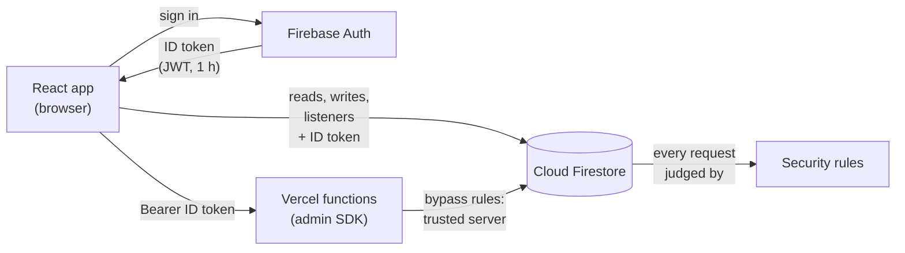

Asha ticks "Two Sum" as solved on her laptop on a train with no signal. That evening she opens InterviewPlanPrep on her phone and the tick is there. The next morning she edits the same note on both devices before either has synced, and neither edit is lost. No server code of yours ran for any of it: the browser talked straight to Google's database.

This article explains how that works: Firebase and Firestore from first principles, then exactly how InterviewPlanPrep (IPP) uses each piece. It is written for the two questions interviewers ask whenever Firebase is on a resume: "how does your sync work?" and "if the browser talks to the database, what stops one user reading another's data?". Every IPP detail matches the code: `src/firebase.jsx`, `src/Data/firestoreClient.js`, `src/Data/cloudSync.js`, `firestore.rules`, `api/_lib/admin.mjs` and `api/contest-reminders.mjs`.



## 1. The trade Firebase makes

Firebase is Google's **backend-as-a-service**, built on Google Cloud. In a classic app, the browser calls your API server, and your server talks to the database and decides who may see what. Firebase removes the middle: **the browser talks to Google's services directly**. The products IPP uses:

- **Firebase Auth** signs users in (email and password, Google, phone) and issues tokens.
- **Cloud Firestore** is a document database with real-time listeners and an offline cache. It is the same database as Google Cloud Firestore in the GCP console; "Firebase" is the developer-facing SDKs and console on top.

Products IPP does not use, and what it does instead: Firebase Hosting and Cloud Functions (IPP runs on Vercel, with Vercel serverless functions and Vercel Cron), Cloud Storage (it needs the paid plan, so screenshots are compressed data URLs stored in Firestore), and App Check (an honest gap, section 10).

If there is no server in between, the obvious question is who stops user A reading user B's documents. The answer is **security rules**: a small program Google runs on its servers for every single read and write (section 7). That is the deal: you write no backend, and in exchange your authorization lives in the rules, not in code you control at runtime.

Say it like this: "Firebase lets the client talk to Google's database directly, so there's no API server to build or scale. The price is that security rules become your server-side authorization, and anything that needs secrets, other users' data or a schedule still needs real server code."

## 2. Signing in: Firebase Auth and the ID token

When Asha signs in, IPP calls `signInWithEmailAndPassword` (or `signInWithPopup` with `GoogleAuthProvider`). Firebase Auth checks the credentials and gives the browser two things:

- An **ID token**: a JWT signed by Google with RS256, valid for **one hour**. Its claims include `sub` (her uid), `email`, `email_verified`, `aud` (the Firebase project id) and `iss` (`https://securetoken.google.com/<project-id>`).
- A **refresh token**: long-lived. The SDK silently exchanges it for a fresh ID token before the old one expires. Application code never touches it.

The SDK keeps the session in IndexedDB, so a reload keeps her signed in. `onAuthStateChanged` fires on sign-in, sign-out and page load, and it is IPP's single source of truth for "who is signed in": it starts the sync engine for that uid (`startCloudSync(uid)`) and scopes the local cache keys to `u:{uid}:...`, so two accounts on one browser never mix data.

The token then travels two ways:

1. **To Firestore**, automatically: the SDK attaches it to every request, and the rules see it as `request.auth.uid`.
2. **To IPP's own functions**, explicitly: the page calls `user.getIdToken()` and sends `Authorization: Bearer <token>`. The function's `verifiedUser()` in `api/_lib/admin.mjs` runs the admin SDK's `verifyIdToken`, which checks Google's signature against Google's public keys, the audience, the issuer and expiry.

That second path is where a classic bug hides. The contest-reminder function needs Asha's email. If it took the email from the request body, anyone could subscribe anyone. It takes the email **from the verified token**, which only Google can sign.

One detail worth knowing: `verifyIdToken` does not check whether the session was revoked (for example after a password change) unless you pass `checkRevoked: true`, which costs an extra call. For a one-hour token on a low-risk endpoint, IPP accepts that window.

Say it like this: "The browser gets a Google-signed ID token, a one-hour JWT that the SDK refreshes on its own. Firestore reads it as `request.auth`; my functions verify it with the admin SDK and take the uid and email from the token, never from the request body."

## 3. Shaping data for Firestore

Firestore stores **documents**: maps of typed fields (strings, numbers, booleans, timestamps, nested maps, arrays), each at most **1 MiB**. Documents live in **collections**, and a document can own **subcollections**, so paths alternate: `collection/doc/collection/doc`.

Three facts drive every design decision:

- **There are no joins.** You shape data around the screens that read it, and duplicate when you must.
- **A document is the unit of cost** (you pay per document read and written) and the unit of real-time updates (a listener fires when a document changes).
- **A document is capped at 1 MiB**, and one document should not be written more than about once a second for long.

IPP started with one document per user, `userProgress/{uid}`, holding everything. That worked until heavy users arrived: one person with long notes and a big job tracker would push the document toward 1 MiB, and every tick rewrote a large document. So the data was split by how it grows and how it changes:

- `userProgress/{uid}` keeps DSA ticks, solve times, stars, planned days, `_meta` (an edit time per entry) and `_rev`.
- `userProgress/{uid}/data/{key}`: one document per other kind of progress (Core Stack ticks, the job tracker, the timer), so a big tracker never crowds out the rest.
- `userProgress/{uid}/notes/{key}~{id}`: one document per note, with `value`, `rev`, `base`, `deleted` and `updatedAt`. Each note gets its own size budget and its own revision number, which the conflict handling in section 8 needs.
- `.../history/{target}/revisions/{time-device}`: every saved version of a note, append-only.
- `.../noteAssets/{id}`: a screenshot as a compressed data URL under 900,000 characters.

Collections only the server touches sit outside `userProgress`: `contestSubscribers`, `contestReminders`, `visits` and `appCache`.

Say it like this: "I modelled per user under one root document, then split out anything that grows without bound, notes and big trackers, into subcollections, because a Firestore document caps at 1 MiB and is also the unit of cost and of sync."

## 4. Reading: why every query is fast

`getDoc` reads one document. `getDocs(query)` reads every matching document, and each one is billed as a read. Queries support `where`, `orderBy`, `limit` and cursors (`startAfter`), and here is the property that makes Firestore scale: **every query is served from an index**. Single-field indexes are automatic; a query that filters or sorts on several fields needs a **composite index**, and the error message links straight to creating it. The consequence: a query's cost and speed depend on the size of the result, not the size of the collection. A query that cannot use an index is simply not allowed.

For totals, an **aggregation query** (`count()`) counts on the server without downloading documents.

In IPP the browser never queries: it only listens to the account's own documents (section 5). Queries run on the server: the reminder job reads `contestSubscribers.where("confirmed", "==", true)`, and the job radar pages openings with `orderBy("openedAt", "desc")` plus document id as a tie-breaker, a cursor, and `count()` for totals.

## 5. Writing: replace, merge, or only the fields you mean

Writes come in a few shapes, and choosing the right one is the difference between correct sync and lost data:

- `setDoc(ref, data)` **replaces** the whole document.
- `setDoc(ref, data, { merge: true })` **merges** into whatever is there.
- `setDoc(ref, data, { mergeFields: [...] })` writes **only** the listed field paths.
- `updateDoc` merges but fails if the document doesn't exist.
- `deleteField()` removes a field; `serverTimestamp()` uses Google's clock instead of the device's.
- A **batched write** groups several writes, all or nothing, with no reads.
- A **transaction** reads, decides and writes atomically. In the client SDKs transactions are **optimistic**: if a document you read changes before commit, the whole function retries, and it needs to be online. Server SDKs take **pessimistic locks** on what they read.

Why IPP uses `mergeFields` for ticks: imagine the phone has been offline for a week and still holds an old map of ticks. If it wrote the whole map, it would silently undo everything ticked on the laptop that week. Instead each push names exactly the entries this device changed, as field paths such as `["DSAPrepCompleted", "two-sum"]`, along with each entry's edit time in `_meta`. A removed entry is written as `deleteField()` plus a tombstone time, so "deleted on Tuesday" can beat "ticked on Monday". A push touches only what this device changed.

Notes are written as a whole document, `setDoc(noteRef, { key, id, value, deleted, rev, base, updatedAt })`, and the rules decide whether that write is allowed (section 8).

Say it like this: "Ticks are pushed with `mergeFields`, one field path per changed entry plus its edit time, so a stale device can never overwrite entries it didn't touch."

## 6. Real-time listeners and the offline cache

`onSnapshot(ref, callback)` opens a long-lived stream to Firestore. The callback fires first with the current data, then again every time the document changes, from any device. Each snapshot carries metadata worth understanding:

- `metadata.fromCache` is true when the data came from the local cache and the server has not confirmed it yet.
- `metadata.hasPendingWrites` is true when the snapshot includes this device's own write that the server hasn't acknowledged.
- With `includeMetadataChanges: true`, the callback also fires when only those flags change, for example when a pending write becomes confirmed.

Your own write fires your own listener immediately, before the server has it. That is **latency compensation**, and it is why Firestore apps feel instant.

Billing for listeners: the first snapshot costs one read per document; after that, one read per **changed** document. A listener that reconnects within 30 minutes is not billed again for documents that didn't change.

**The offline cache.** IPP initialises Firestore with a persistent cache:

```js
// src/Data/firestoreClient.js
export const db = initializeFirestore(app, {
  localCache: persistentLocalCache({ tabManager: persistentMultipleTabManager() }),
});
```

The cache lives in IndexedDB. Reads work offline. Writes apply locally at once, are queued, and reach the server when the network returns, even after a reload. The multi-tab manager lets several open tabs share one cache safely. A write's promise resolves only when the server acknowledges it; if the rules refuse it, the SDK rolls the local change back and the promise rejects with `permission-denied`. The SDK itself is loaded on demand in its own chunk, so a guest never downloads it, and a signed-in visit renders from local storage while it loads.

**How IPP listens.** `cloudSync.js` keeps three listeners per signed-in account (the main document, the `data` subcollection and the `notes` subcollection), all with `includeMetadataChanges: true`. Two rules make it safe:

1. **Nothing is decided until all three listeners have answered.**
2. **Nothing is pushed until a snapshot from the server has arrived** (`fromCache` false). A new device has an empty cache, and a cached "this document doesn't exist" proves nothing. Without this rule a fresh phone could decide the account is empty and push emptiness over a year of progress.

**Why IPP keeps its own store on top of Firestore's cache.** Firestore already caches and queues, so why have more?

- The UI needs **synchronous** reads to render instantly; the Firestore API is asynchronous. IPP's local store (`loadJSON`) is synchronous.
- Firestore's merge is "last write to a field wins". IPP needs "**the newer edit wins**, per entry", which needs edit times, tombstones and a guard against device clocks that are wrong (a five-minute skew guard).
- Edits wait 800 ms before being pushed, so ten quick ticks become one write. Firestore's queue only holds writes already handed to it; a crash or refresh inside that window would lose them. IPP writes a **pending journal** first, so nothing in the window is lost.
- Notes need a **three-way merge** like git, which needs the base revision each edit was built on.

Say it like this: "Every edit lands synchronously in a local store and a pending journal. After 800 ms of quiet, the sync engine pushes only the changed entries with `mergeFields` and their edit times. Each device listens to its account's documents, reconciles per entry with newer-edit-wins, and never pushes before it has heard from the server. Firestore's IndexedDB cache sits underneath for offline reads and queued writes."

## 7. Security rules: the server-side authorization

Because the browser talks to Firestore directly, the rules are the only thing standing between a user and everyone else's data. They run on Google's servers on every request, and anything not explicitly allowed is **denied**.

The vocabulary:

- `request.auth` is the verified token (with `uid` and custom claims), or null.
- `resource.data` is the document as stored now; `request.resource.data` is the document as it would be after this write.
- `request.resource.data.diff(resource.data).affectedKeys()` lists which fields this write changes.
- `get()` and `exists()` read another document inside a rule. They are billed as reads and limited (10 per request, 20 in a batch or transaction).

Two misconceptions to correct in an interview:

Correction: "Rules filter query results." They don't. A query must be **provably** limited to documents the user may read, or the whole query is refused. A rule saying "only your own documents" means the query itself must say `where("owner", "==", uid)`.

Correction: "The admin SDK obeys the rules." It doesn't. Server code with a service account bypasses rules completely, which is exactly why it must never run in a browser.

IPP's rules, in plain words:

1. `signedInAs(uid)`: `request.auth != null && request.auth.uid == uid`. You can only touch `userProgress/{your uid}` and below.
2. Everything else is denied, which makes subscribers, reminders, visits and caches server-only by construction.
3. Screenshots: the data must be a string under 900,000 characters, so an oversized write is never attempted against the 1 MiB cap.
4. Note history: **create and read only**. There is no update and no delete, so history is append-only, enforced by Google rather than by trusting the app.
5. `data/{key}` documents may be read, created and updated by their owner, never deleted.
6. Notes are fast-forward only, next section.

Say it like this: "Each user can touch only the documents under their own uid, and everything else is denied. History is create-and-read only, so it's append-only by construction. And note saves must be fast-forwards of the stored revision, checked in the same step as the write."

## 8. Compare-and-swap inside the rules

Back to Asha's morning. Her note is at revision 7. The laptop and the phone both edit it offline.

The phone syncs first and saves "built on 7, this is 8". Accepted: the note is now at 8. Then the laptop comes online and saves "built on 7, this is 8". If the database simply accepted it, the phone's edit would vanish: a classic lost update.

IPP stops this in the rules:

```js
match /notes/{noteId} {
  allow update: if signedInAs(uid) && validNote(noteId)
    && request.resource.data.key == resource.data.key
    && request.resource.data.id == resource.data.id
    && request.resource.data.base == resource.data.rev;   // built on the current head?
}
// validNote: only the allowed fields, rev == base + 1, id matches the path
```

The laptop's save says `base: 7`, but the stored `rev` is now 8, so Google refuses it with `permission-denied`. `cloudSync.js` catches exactly that error code, fetches the current note, runs a three-way merge (the common ancestor 7, the phone's 8, the laptop's edit), and saves "built on 8, this is 9". Both edits survive. The older main-document copies of notes use the same idea through `_write.base` and `_rev`, with the rule also checking that a save changes exactly one note and moves its revision up by exactly one.

Why in the rules and not somewhere else:

- A **client-side check** ("read rev, compare, then write") is not atomic: both devices can read 7, both pass, both write. It also only binds well-behaved clients.
- A **client transaction** would be atomic, but it needs to be online, and IPP edits offline and syncs later.
- A **rule on the write** makes the check and the write one atomic step on Google's servers, enforced for every client, and an offline write is simply judged when it finally arrives.

This is **optimistic locking**, the same idea as `UPDATE notes SET ... WHERE id = ? AND version = 7`, or git refusing a non-fast-forward push.

Say it like this: "A note save must name the revision it was built on, and the rule compares that with the stored revision in the same atomic step as the write. A stale device gets permission-denied, merges with the head three ways, and saves again."

## 9. The server side: admin SDK and functions

A browser that talks to Firestore directly still cannot do everything. Three kinds of work need trusted server code:

- **Secrets**: the Gmail app password for sending emails, the contest API key, the cron secret.
- **Other people's data**: the list of every reminder subscriber, which no browser may read.
- **Schedules**: sending reminders every 15 minutes whether anyone has the site open or not.

IPP runs that code as **Vercel serverless functions on Node.js**, not Cloud Functions: they ship from the same repository and deploy as the site, Vercel Cron triggers the schedules, and no paid Firebase plan is needed.

```js
// api/_lib/admin.mjs
initializeApp({ credential: cert(JSON.parse(process.env.FIREBASE_SERVICE_ACCOUNT)) });
export const db = () => getFirestore(app());
export const auth = () => getAuth(app());
export async function verifiedUser(request) { /* Bearer token -> auth().verifyIdToken */ }
```

The service account's private key lives in Vercel's environment variables. With it, the function is a trusted admin and bypasses the rules.

**Never sending a reminder twice.** Cron runs can overlap, and a retried run must not email someone twice. The reminder function **claims before it sends**: inside a transaction it reads `contestReminders/{key}.sentTo`, keeps only the subscribers not already in it, writes them in, and only then sends the emails. If a send fails, it releases that claim with `update({ "sentTo.<id>": FieldValue.delete() })` so a later run can retry. The guarantee is "never a duplicate, at worst one skipped email", which is the right side to err on for reminders.

Say it like this: "Anything needing secrets, other users' data or a schedule runs in a server function with the admin SDK. For reminders I claim each recipient in a transaction before sending, so overlapping runs never double-send."

## 10. Limits, cost, and when not to use Firestore

The limits that shaped IPP:

- **1 MiB per document**: notes and large trackers live in their own documents.
- **About one sustained write per second per document** (a soft limit): the 800 ms debounce turns ten quick ticks into one write.
- **Billing per document read, written and deleted**: the SDK loads only for signed-in users, listeners cover only the account's own documents, and the public contest list is cached at the edge instead of read from Firestore per visitor.
- **The free quota** (50,000 reads, 20,000 writes and 20,000 deletes a day, 1 GiB stored) comfortably covers IPP's traffic.
- **`get()` inside rules is billed as a read**: only a note's first save reads the main document.
- **The database location is chosen once** at creation and cannot be moved. For a product with Indian data-residency needs, that means picking `asia-south1` (Mumbai) or `asia-south2` (Delhi) on day one.

What IPP would add next: **App Check**, so only the real app can call Firestore and the functions; `checkRevoked` on sensitive endpoints; and a scheduled export of Firestore to Cloud Storage for backups.

**When not to choose Firestore.** It is excellent for per-user documents that sync live to clients. It is the wrong tool when the work is relational or analytical: joins, ad-hoc reports, heavy aggregation, full-text or vector search, multi-row transactions at high volume. That is why DeepLogLens uses PostgreSQL with pgvector, and why an analytics workload would go to BigQuery.

Say it like this: "Firestore fits per-user data that must sync live and work offline. For joins, analytics, search or vectors I'd use Postgres or BigQuery; picking the store is about the access pattern."

## 11. Complete example: one note, two offline devices

Setup: Asha's note `DSAPrepNotes~two-sum` is at revision 7 on the server. Both devices have synced it.

1. On the train, the laptop goes offline. She adds a paragraph. IPP writes it to the local store and the pending journal at once, so the UI updates instantly. The push is queued.
2. At home, the phone is online. She fixes a typo in the same note. After 800 ms the phone saves `{ base: 7, rev: 8, value: ... }`. The rule checks `base == stored rev` (7 == 7) and accepts. The server is now at 8, and the laptop's listener will hear about it once it reconnects.
3. The laptop reconnects. Its listeners first deliver snapshots from the cache, so it decides nothing yet. Then a server snapshot arrives showing revision 8.
4. The laptop pushes its edit as `{ base: 7, rev: 8 }`. The rule sees `base` 7 against stored `rev` 8 and refuses: `permission-denied`. Its local optimistic change is rolled back.
5. `cloudSync.js` catches that code, fetches the head (8), and merges three ways: ancestor 7, theirs 8 (typo fixed), ours (new paragraph). It saves `{ base: 8, rev: 9 }`. Accepted.
6. Both devices' listeners fire with revision 9, containing the typo fix and the new paragraph. The history subcollection holds 7, 8 and 9, and no client can delete them.

Expected result: no edit lost, no duplicate, and the conflict handled without any server code of IPP's own.

**The answers, ready to say:**

- "How does your sync work?" Local store and journal first, debounced `mergeFields` pushes with edit times, three listeners, per-entry newer-wins, never pushing before the server has answered.
- "How do your rules work?" Own-uid only, deny by default, append-only history, fast-forward-only notes.
- "How does your server trust the browser?" It verifies the Firebase ID token with the admin SDK and takes identity from the token, never from the body.
- "What would you add?" App Check, revocation checks on sensitive endpoints, and scheduled backups.
