# Kafka End to End: from one event to exactly-once effects

One running example the whole way: an order service publishes `order-events`
(key = orderId), and payment, inventory, notification and analytics services read them.

```
Order service --publish--> [ Kafka: stores events on disk ] --read--> Payment service
                                                            --read--> Inventory service
                                                            --read--> Email service
```

---

# Part A: The log

## 1. What is Kafka  [P1]

<mark class="hl-yellow">Kafka is a distributed event</mark> **<mark class="hl-yellow">streaming</mark>** <mark class="hl-yellow">system</mark> (not a classic pub/sub queue). It lets you:

- **<mark class="hl-yellow">Publish</mark>** <mark class="hl-yellow">events (write)</mark>
- **<mark class="hl-yellow">Store</mark>** <mark class="hl-yellow">events (on disk, kept for a retention time)</mark>
- **<mark class="hl-yellow">Subscribe</mark>** <mark class="hl-yellow">to events (read)</mark>

<mark class="hl-yellow">Key point about "store": reading an event does</mark> **<mark class="hl-yellow">not</mark>** <mark class="hl-yellow">delete it.
The same event can be read again and again (re-read from the start, replay).
That is the big difference from a normal queue, where a message is gone once consumed.</mark>

Say it like this: "<mark class="hl-yellow">Kafka is a distributed event streaming platform: producers publish events,
Kafka stores them durably on disk, and consumers subscribe and read them, even many times.</mark>"

---

## 2. Producer, topic, event  [P0]

- <mark class="hl-yellow">A</mark> **<mark class="hl-yellow">producer</mark>** <mark class="hl-yellow">is an application that publishes events to Kafka.</mark>
- <mark class="hl-yellow">It does</mark> **<mark class="hl-yellow">not</mark>** <mark class="hl-yellow">know or care who will consume the event.</mark>
- <mark class="hl-yellow">A</mark> **<mark class="hl-yellow">topic</mark>** <mark class="hl-yellow">is a named category (like a folder) that events are published to.</mark>
  Example: all order events go to `order-events`. Many producers can write to the same topic.

What a producer sends:

```
topic : "order-events"
key   : "123"                                  (optional, e.g. orderId)
value : {"orderId":123,"status":"CREATED"}     (the event itself)
```

Say it like this: "<mark class="hl-yellow">A producer just writes events to a topic; it is decoupled from consumers.</mark>"
And: "<mark class="hl-yellow">A topic is a named stream of related events, like order-events.</mark>"

---

## 3. Partition  [P0]

<mark class="hl-yellow">A topic is split into</mark> **<mark class="hl-yellow">partitions</mark>**<mark class="hl-yellow">. A partition is a</mark> **<mark class="hl-yellow">physical, ordered, append-only log</mark>**<mark class="hl-yellow">.
A topic can have many partitions.</mark>

**Physical:** <mark class="hl-yellow">events are really stored on disk. Each partition is a</mark> **<mark class="hl-yellow">directory</mark>** <mark class="hl-yellow">on the broker
(not one single file). Its name is</mark> <mark class="hl-yellow">`<topic>-<partition number>`</mark>:

```
/tmp/kraft-combined-logs/
  order-events-0/        <- partition 0
  order-events-1/        <- partition 1
  order-events-2/        <- partition 2
```

<mark class="hl-yellow">Inside that directory are the actual data files (segments, section 5).</mark>

**<mark class="hl-yellow">Ordered:</mark>** <mark class="hl-yellow">each event gets an increasing number called an offset (section 4).</mark>

**<mark class="hl-yellow">Append-only:</mark>** <mark class="hl-yellow">new events are only added at the end. Old events are never edited or moved.</mark>

Why partitions exist: one topic can be spread over many brokers and read by many consumers in
parallel. More partitions = more parallelism.

Say it like this: "<mark class="hl-yellow">A partition is an ordered, append-only log stored on disk; a topic is a set
of partitions.</mark>"

---

## 4. Offsets and the ordering guarantee  [P0]

**<mark class="hl-yellow">Offset</mark>** <mark class="hl-yellow">= position of an event inside one partition.</mark>

- <mark class="hl-yellow">Each partition keeps its own "next offset" counter.</mark>
- <mark class="hl-yellow">When an event arrives: Kafka gives it the next offset, then appends it to the end of the log.</mark>
- **Offsets start at 0**, not 1.

```
P0 | 0:E0 | 1:E3 |      |      ->  next offset = 2
P1 | 0:E1 | 1:E4 |      |      ->  next offset = 2
P2 | 0:E2 | 1:E5 |      |      ->  E5 just appended, next offset = 2
```

- **Inside one partition: order is guaranteed.** Kafka never reorders a partition.
- **Across partitions: no order guarantee.** Offset 1 in P0 and offset 1 in P1 say nothing about
  which happened first.

Example with 3 partitions, key = orderId, produced as 123 CREATED, 456 CREATED, 789 CREATED,
123 PAID, 456 PAID, 123 SHIPPED. A consumer reading the whole topic got:

```
P2 offset 0..4   123 CREATED, 456 CREATED, 123 PAID, 456 PAID, 123 SHIPPED
P1 offset 0      789 CREATED      <- produced 3rd, seen last
```

Across partitions the order broke. Inside P2 every order's own steps stayed in order.
Need global order for a whole topic? Only with 1 partition, which kills parallelism. You almost
always need order **per key** only, which section 6 gives you.

Say it like this: "<mark class="hl-yellow">Kafka guarantees order only within a partition, not across the whole topic.</mark>"

---

## 5. Segments and the index  [P2]

<mark class="hl-yellow">One partition directory does not hold one giant file. The log is cut into</mark> **<mark class="hl-yellow">segments</mark>**<mark class="hl-yellow">.</mark>

- <mark class="hl-yellow">When the current segment reaches</mark> <mark class="hl-yellow">`segment.bytes`</mark> <mark class="hl-yellow">(default</mark> **<mark class="hl-yellow">1 GB</mark>**<mark class="hl-yellow">), Kafka closes it and
  starts a new one.</mark>
- Each segment file is named by the **first offset inside it** (base offset), padded to 20 digits.

```
order-events-0/
  00000000000000000000.log         offsets 0 .. 1024
  00000000000000000000.index       offset -> byte position in that .log
  00000000000000000000.timeindex   timestamp -> offset ("read from 10:00 AM")
  00000000000000001025.log         offsets 1025 .. 2048
  00000000000000002049.log         offsets 2049 ..   (active, being written)
```

The index is **sparse**: about one entry per 4 KB written (`index.interval.bytes` = 4096), and
an entry points to a batch, not to every record. A read for offset 1500:

```
1. Pick segment:  largest base offset <= 1500     -> 00000000000000001025.log
2. Search index:  binary search, largest entry <= 1500 -> byte position
3. Jump there and scan forward a few records       -> found
```

Small segments also make cleanup cheap: Kafka deletes whole old segments.

Say it like this: "<mark class="hl-yellow">A partition is stored as a series of segment files, each named by its first
offset, so Kafka can jump to the right file quickly.</mark>"

---

## 6. Which partition does an event go to?  [P0]

The **producer** decides. Three cases:

```
partition given in the record -> use it
key given                     -> murmur2(keyBytes) % numPartitions   (Kafka's murmur2, not hashCode())
no key                        -> sticky partitioner (Kafka 2.4+)
```

**With a key:** same key -> same partition, always (while the partition count stays the same).
Same partition -> order guaranteed. So **all events of one key stay in order**.

Two things people get wrong:

1. A partition holds **many keys**. Keys 123 and 456 can both land in P2.
2. **Adding partitions breaks the mapping.** Grow `order-events` from 3 to 5 and "123 DELIVERED"
   goes to P0 while its older events sit in P2. A consumer can now see DELIVERED before SHIPPED.
   Kafka does not move old data, so pick the partition count up front for keyed topics.

**No key:** Correct fact: <mark class="hl-yellow">the default producer is</mark> **<mark class="hl-yellow">not</mark>** <mark class="hl-yellow">round robin per event. Since Kafka 2.4 it uses a</mark>
**<mark class="hl-yellow">sticky</mark>** <mark class="hl-yellow">partitioner: it fills one partition for a while (a batch worth of data, about</mark>
<mark class="hl-yellow">`batch.size`</mark> <mark class="hl-yellow">= 16 KB), then moves to another. Over time it is even. In the short run it is not.</mark>

Why sticky: round robin spreads 5 records into 3 tiny batches and 3 sends; sticky makes 1 full
batch and 1 send. Bigger batches -> fewer requests -> better throughput. True round robin only
if you set `partitioner.class=RoundRobinPartitioner`.

**Custom partitioner:** implement `Partitioner` (e.g. "India" -> P0, rest -> P1). Risk: a hot
partition if most traffic is India.

Say it like this: "With a key, Kafka hashes the key to pick the partition, so all events with
the same key land in one partition and stay in order; without a key, the sticky partitioner
fills one partition's batch and then switches."

---

## 7. Broker  [P0]

- <mark class="hl-yellow">A</mark> **<mark class="hl-yellow">broker</mark>** <mark class="hl-yellow">is one Kafka server (one running Kafka process).</mark>
- It actually stores the data (partition directories on its disk) and serves producers and
  consumers.
- It stores **some partitions of some topics**, not everything.

```
     Broker 1             Broker 2             Broker 3
+----------------+   +----------------+   +----------------+
| order-events-0 |   | order-events-1 |   | order-events-2 |
| payments-1     |   | payments-0     |   |                |
+----------------+   +----------------+   +----------------+
```

(One copy of each partition shown. Extra copies on other brokers are replication, Part C.)

Say it like this: "<mark class="hl-yellow">A broker is one Kafka server that stores some partitions and serves reads and
writes for them; partitions of a topic are spread across brokers.</mark>"

---

# Part B: Reading

## 8. Consumers and consumer groups  [P0]

- <mark class="hl-yellow">A</mark> **<mark class="hl-yellow">consumer</mark>** <mark class="hl-yellow">is an application that reads events from a topic.</mark>
- <mark class="hl-yellow">It</mark> **<mark class="hl-yellow">pulls</mark>**<mark class="hl-yellow">: it calls</mark> <mark class="hl-yellow">`poll()`</mark> <mark class="hl-yellow">again and again, and Kafka returns the next events.</mark>
- <mark class="hl-yellow">A</mark> **<mark class="hl-yellow">consumer group</mark>** <mark class="hl-yellow">= all consumers that share the same</mark> <mark class="hl-yellow">`group.id`</mark><mark class="hl-yellow">.</mark>
  Together they split the partitions of the topic. Usually one group = one service.

```java
consumer.subscribe(List.of("order-events"));
while (true) {
    ConsumerRecords<String, String> records = consumer.poll(Duration.ofSeconds(1));
    for (var r : records) process(r);
}
```

Say it like this: "<mark class="hl-yellow">A consumer pulls events from partitions with poll() and reads each partition
in offset order.</mark>" And: "<mark class="hl-yellow">A consumer group is a set of consumers with the same group.id that divide a
topic's partitions among themselves to share the load.</mark>"

### <mark class="hl-yellow">Rule 1: inside one group, a partition goes to only one consumer</mark>

<mark class="hl-yellow">Inside one group, the same partition is never read by two consumers at the same time.
One consumer can read many partitions.</mark> Two readers of P0 in one service would process the same
events twice and break per-partition order.

```
consumers = partitions (3, 3)   C1 -> P0   C2 -> P1   C3 -> P2
consumers < partitions (3, 6)   C1 -> P0,P1   C2 -> P2,P3   C3 -> P4,P5
consumers > partitions (5, 3)   C1 -> P0   C2 -> P1   C3 -> P2   C4, C5 -> idle
```

Max useful consumers in a group = number of partitions. Extra ones sit idle (they take over if
an active one dies). Traffic doubles and you add 3 consumers to a 3-partition topic? Nothing
improves. Add partitions first (careful: that remaps keys).

Say it like this: "<mark class="hl-yellow">Within a group each partition is owned by exactly one consumer, so the
partition count is the upper limit on parallelism for that group.</mark>"

### Rule 2: different groups each read every event

<mark class="hl-yellow">Different groups are fully independent. Each group gets</mark> **<mark class="hl-yellow">every</mark>** <mark class="hl-yellow">event.</mark>

```
                     +--> group notification-service : reads P0
order-events  P0 ----+--> group analytics-service    : reads P0
                     +--> group audit-service        : reads P0
```

Say it like this: "Inside a group, partitions are shared out (queue style); across groups,
every group gets every event (pub/sub style)."

---

## 9. Committed offsets and where they live  [P0]

<mark class="hl-yellow">Each group remembers, per partition, how far it has got. This is the</mark> **<mark class="hl-yellow">committed offset</mark>**<mark class="hl-yellow">.
It is stored per</mark> **<mark class="hl-yellow">(group, topic, partition)</mark>**<mark class="hl-yellow">.</mark>

Correct meaning: the committed offset is the **next offset to read**, not the last one
processed. Processed 0 to 99 -> commit **100**.

```
GROUP          TOPIC  PARTITION  COMMITTED OFFSET  LOG END  LAG
notification   ord1   0          6                 6        0
analytics      ord1   0          2                 6        4
```

Lag = log end - committed. Same partition, two numbers: groups do not affect each other.

**Where:** in Kafka itself, the internal topic `__consumer_offsets` (50 partitions, **compacted**
so only the latest commit per key survives). Each commit is a record
`key (group, topic, partition) -> value offset`. A group always uses partition
`abs(groupId.hashCode()) % 50`.

<mark class="hl-yellow">The broker that is the leader of that partition is the group's</mark> **<mark class="hl-yellow">group coordinator</mark>**<mark class="hl-yellow">.
It keeps an in-memory map from those records: key (group, topic, partition) -> committed offset.</mark>

Recovery after a crash:

```
1. New consumer (group "analytics") asks any broker: "who is my coordinator?"
2. The broker computes abs("analytics".hashCode()) % 50 = 10 -> leader of __consumer_offsets P10.
3. Consumer asks the coordinator: "committed offset for ord1 P0?" -> 2.
4. Consumer starts reading ord1-0 from offset 2.
```

Correction: the consumer does not compute the hash itself; the broker does.
No committed offset yet? `auto.offset.reset` decides: `latest` (default, only new events) or
`earliest`.

Say it like this: "Commits are records in the compacted internal topic __consumer_offsets; the
broker leading the group's partition there is the coordinator that hands back the committed
offset after a restart."

---

## 10. Auto-commit vs manual commit  [P0]

**Auto-commit** (`enable.auto.commit=true`, every `auto.commit.interval.ms` = 5 s, the plain
client default). Correct fact: it does not fire on a timer mid-work. It happens **inside
`poll()`** (and `close()`): when 5 s have passed, poll commits what the **previous** poll returned.

```
Case 1: process inside the loop, crash before the next poll
  poll() -> 0..5, processing, CRASH            no poll -> no commit
  restart: reads 0..5 again                    -> duplicates, nothing lost

Case 2: hand events to a worker thread, keep polling
  poll() -> 0..5 handed off
  poll() again after 1.5 s -> auto-commits 6   worker not done yet
  CRASH                                        worker never finished
  restart: starts at 6                         -> events 0..5 LOST
```

Say it like this: "<mark class="hl-yellow">Auto-commit commits on poll() every 5 seconds; it is simple but you do not
control when an offset is marked done, so you can get duplicates or, with async processing,
lost events.</mark>"

**Manual commit** (`enable.auto.commit=false`): poll, process **all**, then commit.

```java
ConsumerRecords<String, String> records = consumer.poll(Duration.ofSeconds(1));
for (var r : records) process(r);
consumer.commitSync();   // processed 0..5 -> commits 6, waits for Kafka to confirm
```

```
crash BEFORE commitSync  -> events read again after restart  (duplicates, at-least-once)
crash AFTER  commitSync  -> nothing read again
```

<mark class="hl-yellow">Nothing is lost, but duplicates are possible. So the processing must be</mark> **<mark class="hl-yellow">idempotent</mark>**
<mark class="hl-yellow">(running it twice has the same effect as once). Example: store processed orderId and skip if
already seen.</mark>

`commitSync()` blocks and retries. `commitAsync()` does not block and **does not retry** (a
retried old commit could overwrite a newer one). Common pattern: async in the loop, sync once in
`finally` before `close()`.

Say it like this: "With manual commit I commit only after processing, which gives at-least-once
delivery, so my consumer logic must handle duplicates."

---

# Part C: The cluster

## 11. Replication: leader and followers  [P0]

A **Kafka cluster** = brokers working together: scalability (partitions spread over machines),
fault tolerance and high availability (copies of each partition).

<mark class="hl-yellow">Each partition is copied to several brokers. Each copy is a</mark> **<mark class="hl-yellow">replica</mark>**<mark class="hl-yellow">.
For every partition:</mark> **<mark class="hl-yellow">one replica is the leader, the others are followers.</mark>**
Replication factor (RF) counts **all** copies: RF 2 = 1 leader + 1 follower.

```
+---------------------------- Kafka cluster ----------------------------+
|   Broker-1             Broker-2             Broker-3                  |
|   +--------------+     +--------------+     +--------------+          |
|   | P0  leader   |     | P1  leader   |     | P0  follower |          |
|   | P1  follower |     | P2  follower |     | P2  leader   |          |
|   +--------------+     +--------------+     +--------------+          |
+-----------------------------------------------------------------------+
Producer and consumers -> Broker-1 for P0;  Broker-3 (P0 follower) fetches P0 from Broker-1
```

- <mark class="hl-yellow">The two replicas of a partition are always on</mark> **<mark class="hl-yellow">different</mark>** <mark class="hl-yellow">brokers. A copy on the same
  machine would not help when that machine dies.</mark> So RF cannot exceed the broker count
  (RF 2 on 1 broker: topic creation fails).
- <mark class="hl-yellow">Leaders are spread (P0 on B1, P1 on B2, P2 on B3), so no single broker takes all the traffic.</mark>

**Leader:** takes all producer writes and consumer reads for the partition, tracks how far each
follower has copied.
**Follower:** <mark class="hl-yellow">Copies data from the leader. It</mark> **<mark class="hl-yellow">pulls</mark>** <mark class="hl-yellow">it, by fetching from the leader like a consumer</mark>.
Ready to become leader. <mark class="hl-yellow">Does not serve producers. By default it does not serve consumers either.</mark>
(Since 2.4 consumers can be configured to read from a nearby follower; off by default.)

Broker-1 crashes: P0's follower on Broker-3 becomes the P0 leader and clients switch to it. P1 keeps
working on Broker-2, it just lost a follower. Nothing is lost if the followers were in sync.

Say it like this: "Each partition has one leader replica that serves reads and writes and
follower replicas on other brokers that pull data from it; if the leader's broker dies, an
in-sync follower takes over."

---

## 12. The controller and KRaft  [P1]

<mark class="hl-yellow">Someone has to decide which broker holds which replica, and which replica is the leader.
That is the</mark> **<mark class="hl-yellow">Controller</mark>**<mark class="hl-yellow">.</mark>
<mark class="hl-yellow">It manages the</mark> **<mark class="hl-yellow">cluster metadata</mark>** <mark class="hl-yellow">(facts about topics, partitions, brokers, leaders).</mark> Its jobs:

- Create and delete topics; choose leaders and followers for each partition.
- Detect broker failures by heartbeats (each broker every 2 s; none for 9 s = dead).
- When a broker dies, pick new leaders for its partitions from the in-sync followers.

Two corrections:

- **<mark class="hl-yellow">The controller does not move data when a broker dies.</mark>** <mark class="hl-yellow">It only switches leadership to a
  follower that already has a copy.</mark> P2 `Leader: 5, Replicas: 5,6,4` became
  `Leader: 6, Replicas: 5,6,4`.
- **<mark class="hl-yellow">In KRaft, brokers pull the metadata.</mark>** <mark class="hl-yellow">The controller does not push it to them. Brokers
  fetch the metadata log from the active controller and apply each change. They appear in the
  quorum as "Observers" (section 12).</mark> (Observers copy the metadata log but cannot vote.)

Every change is a record in the one-partition internal log `__cluster_metadata`, copied by every
controller and broker. Production runs **dedicated controllers** (`process.roles=controller`) so
data traffic cannot slow cluster decisions; `broker,controller` combined is for local testing.

**ZooKeeper vs KRaft.** ZooKeeper (old) was a separate system to deploy and run (Zab consensus).
<mark class="hl-yellow">KRaft (Kafka Raft, current way):</mark> <mark class="hl-yellow">built into Kafka. Controllers are Kafka nodes, with
nothing extra to run. It uses the</mark> **<mark class="hl-yellow">Raft</mark>** <mark class="hl-yellow">consensus protocol.</mark> KRaft production-ready in
3.3, ZooKeeper deprecated in 3.5 and **removed in 4.0**.

**One active, the rest standby.** <mark class="hl-yellow">Run several controllers (usually 3). Only</mark> **<mark class="hl-yellow">one is active</mark>** <mark class="hl-yellow">(the Raft leader). The others are</mark>
**<mark class="hl-yellow">standby</mark>** <mark class="hl-yellow">(followers) and keep a full copy of the metadata log.</mark>
<mark class="hl-yellow">Who decides which controller is active? Not a "controller of controllers", which would loop
forever. The controllers</mark> **<mark class="hl-yellow">vote</mark>** <mark class="hl-yellow">among themselves using Raft, and a majority wins.</mark>

**<mark class="hl-yellow">Quorum</mark>** <mark class="hl-yellow">= majority of the voting controllers. A decision is final only when a majority
agrees.</mark>

```
quorum = floor(N / 2) + 1        N=1 -> can lose 0   N=2 -> can lose 0
                                 N=3 -> can lose 1   N=4 -> can lose 1   N=5 -> can lose 2
```

So controller counts are odd (3 or 5); 2 is no better than 1. Any two majorities share a node,
so two leaders can never be elected at once (no split brain).

How a metadata change commits (log at 99, new record 100, 3 controllers):

```
1. Active controller appends record 100 to its own log.
2. Standbys fetch from it and append 100.
3. Active + one standby = 2 of 3 = majority -> committed (high watermark = 100).
4. Next fetch replies tell standbys and brokers "committed = 100"; brokers apply it.
```

<mark class="hl-yellow">In KRaft, standbys and brokers</mark> **<mark class="hl-yellow">pull</mark>** <mark class="hl-yellow">(fetch) from the active controller, and the committed
  offset comes back in those fetch replies. Classic Raft textbooks describe the leader pushing
  entries with heartbeats; Kafka's version is pull-based.</mark>

Lose 2 of 3 controllers: no topic can be created and no leader failover can happen, but existing
partition leaders keep serving reads and `acks=all` writes. Metadata is not lost.

So who decides replica placement and leaders? <mark class="hl-yellow">the</mark> **<mark class="hl-yellow">Controller</mark>**<mark class="hl-yellow">, a special broker role that manages the cluster's metadata and makes
these decisions.</mark>

Say it like this: "<mark class="hl-yellow">The controller owns the cluster metadata: it creates topics, assigns leaders,
detects dead brokers through heartbeats and fails leadership over to an in-sync follower.</mark>"

---

## 13. ISR, acks and min.insync.replicas  [P0]

**<mark class="hl-yellow">ISR</mark>** <mark class="hl-yellow">= for one partition, the replicas that are caught up with the leader.
The leader is always in the ISR. The controller stores the ISR as part of cluster metadata.</mark>

```
Broker1 (leader)   : [0][1][2][3][4][5][6][7][8][9]   log end = offset 9
Broker2 (follower) : [0][1][2][3][4][5][6][7][8][9]   caught up    -> in ISR
Broker3 (follower) : [0][1][2][3][4][5][6]            stuck behind -> removed (rejoins when caught up)
ISR = {Broker1, Broker2}
```

<mark class="hl-yellow">Correct rule: it is</mark> **<mark class="hl-yellow">time-based</mark>**<mark class="hl-yellow">, not "how many messages behind".
A follower stays in the ISR if it has fully caught up to the leader's log end at least once in
the last</mark> <mark class="hl-yellow">`replica.lag.time.max.ms`</mark> <mark class="hl-yellow">(default</mark> **<mark class="hl-yellow">30 s</mark>**<mark class="hl-yellow">).</mark>
Slow but alive -> the leader asks the controller to shrink the ISR. Dead (no heartbeat 9 s) -> the
controller removes it.

<mark class="hl-yellow">Why ISR matters: only an ISR member can become the new leader. It has all committed data, so
nothing acknowledged is lost on failover.</mark>

**acks** (producer) decides when a write counts as done:

- **<mark class="hl-yellow">acks=0: fire and forget</mark>** - no wait; the producer cannot know if it landed (offset -1).
- **<mark class="hl-yellow">acks=1: wait for the leader only</mark>** - loss case: leader writes offset 50, acks, crashes
  before followers copy it; the new leader has only 0..49, and the producer was told "success".
- **<mark class="hl-yellow">acks=all (same as -1): wait for all current ISR replicas</mark>** - safest, the **default since 3.0**.

Catch: <mark class="hl-yellow">`all`</mark> <mark class="hl-yellow">means all replicas</mark> **<mark class="hl-yellow">currently in the ISR</mark>**<mark class="hl-yellow">, not all replicas. If the ISR has
shrunk to only the leader,</mark> <mark class="hl-yellow">`acks=all`</mark> <mark class="hl-yellow">behaves like</mark> <mark class="hl-yellow">`acks=1`</mark><mark class="hl-yellow">. That is why the next setting
exists.</mark>

<mark class="hl-yellow">`min.insync.replicas`</mark> <mark class="hl-yellow">= the minimum ISR size a partition must have to</mark> **<mark class="hl-yellow">accept</mark> <mark class="hl-yellow">`acks=all`</mark>
<mark class="hl-yellow">writes</mark>**<mark class="hl-yellow">. You set it per topic or per broker.</mark> **<mark class="hl-yellow">Default is 1.</mark>**
Correction: it does **not** stop the ISR from shrinking; it only makes the leader **reject
`acks=all` writes** when the ISR is too small.

RF 3, `min.insync.replicas=2`, brokers dying one by one:

```
all 3 up         ISR {4,5,6}   acks=all OK
kill broker 5    ISR {6,4}     acks=all OK (2 >= 2)
kill broker 6    ISR {4}       acks=all REJECTED (NotEnoughReplicasException)
                               acks=1 / acks=0 accepted, reads still work
kill broker 4    ISR {}        no leader -> partition offline
restart 5                      out of sync, so NOT made leader (it may miss acknowledged data)
```

The standard safe setup: `replication.factor=3`, `min.insync.replicas=2`, `acks=all`. Lose one
broker: no loss, still writing. Lose two: writes stop instead of risking loss. (min.insync = RF
would block writes on every single broker restart.)

Say it like this: "acks=0 doesn't wait, acks=1 waits for the leader, acks=all waits for every
in-sync replica; with RF 3, min.insync 2 and acks=all, I can lose one broker without losing data
or availability."

---

# Part D: The full flows

Two terms both flows turn on:

- **Log end offset (LEO)**: the next offset to be written. A replica holding 0..510 has LEO 511.
- **High watermark (HW)**: the lowest LEO across all ISR replicas. Records below the HW are
  **committed**: every in-sync replica has them.

Setup: `order-events` RF 3; P1 leader Broker2, P2 leader Broker2; group `notification-service`
maps to `__consumer_offsets` P23, led by Broker3 (its coordinator).

## 14. Complete producer write flow  [P0]

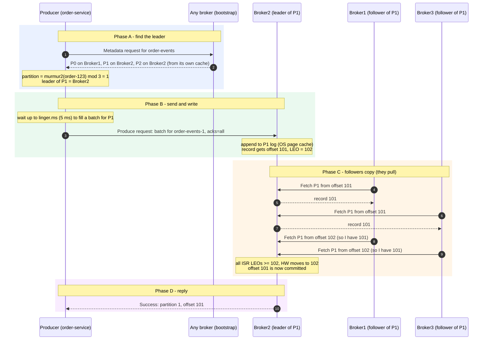

**Phase A, find the leader.** The producer knows only a few `bootstrap.servers`. Any broker
answers from **its own copy of the metadata** and the producer caches it (refresh every
`metadata.max.age.ms` = 5 min, or on "not leader"). <mark class="hl-yellow">It then computes the partition itself:</mark> <mark class="hl-yellow">`murmur2(key) mod 3 = 1`</mark><mark class="hl-yellow">. Same key, same partition.</mark>
Correction: <mark class="hl-yellow">the broker does</mark> **<mark class="hl-yellow">not</mark>** <mark class="hl-yellow">forward the metadata request to the active controller.
In a real run with 2 of 3 controllers dead (no active controller at all), a freshly started
producer still got metadata and wrote successfully.</mark>

**Phase B, send and write.** Records are batched per partition (`batch.size` 16 KB, `linger.ms`
5 ms) and the batch goes straight to the leader. It gets offset **101**.
<mark class="hl-yellow">"Writes to disk" really means "writes to the OS page cache" (section 17). Fast.</mark>

**Phase C, followers copy.** <mark class="hl-yellow">Followers are not pushed to. They keep sending</mark> **<mark class="hl-yellow">fetch</mark>** <mark class="hl-yellow">requests, like a consumer.</mark>
"Fetch from 102" means "I have up to 101": no separate ack message.
<mark class="hl-yellow">When every ISR replica has passed 101, the leader moves the</mark> **<mark class="hl-yellow">HW to 102</mark>**<mark class="hl-yellow">. Offset 101 is now</mark>
**<mark class="hl-yellow">committed</mark>**<mark class="hl-yellow">.</mark>

**Phase D, reply.** `acks=all`: after the HW passes the record. `acks=1`: right after Phase B.
`acks=0`: no reply. If the leader dies between A and B, the send fails, the producer refreshes
metadata, retries on the new leader, and your code sees nothing (until `delivery.timeout.ms`).

Say it like this: "The producer gets partition leaders from any broker's metadata cache, hashes
the key to pick the partition, batches and sends straight to the leader; the leader appends,
followers pull the data, and with acks=all the producer is answered once the high watermark
passes the record."

---

## 15. Complete consumer read flow  [P0]

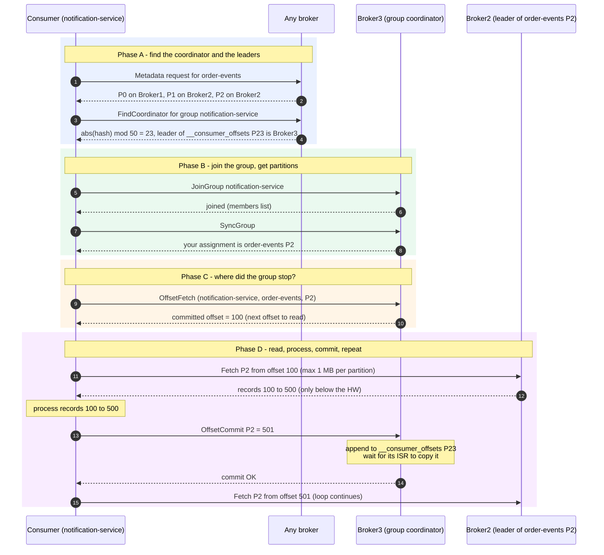

**Phase A.** Metadata as for the producer, then <mark class="hl-yellow">Find the</mark> **<mark class="hl-yellow">group coordinator</mark>**<mark class="hl-yellow">: the broker that tracks this group's members and commits.
  The consumer just asks "who is the coordinator for notification-service?". The</mark> **<mark class="hl-yellow">broker</mark>**
  <mark class="hl-yellow">computes</mark> <mark class="hl-yellow">`abs(groupId.hashCode()) mod 50 = 23`</mark><mark class="hl-yellow">, and the leader of</mark> <mark class="hl-yellow">`__consumer_offsets`</mark> <mark class="hl-yellow">P23
  (Broker3) is the coordinator.</mark>

**Phase B.** <mark class="hl-yellow">The consumer asks the coordinator to join. The coordinator waits for all members, then gives
  each one its partitions. Here this consumer gets P2.</mark>
<mark class="hl-yellow">Correction on who computes the split. In the default (classic) protocol, one</mark> **<mark class="hl-yellow">consumer</mark>** <mark class="hl-yellow">is
  picked as group leader and computes the assignment. A real run logged "Performing assignment
  using strategy range" inside the consumer. The coordinator only collects it and hands it out
  (that is the SyncGroup step).</mark>
<mark class="hl-yellow">In the newer protocol (</mark><mark class="hl-yellow">`group.protocol=consumer`</mark><mark class="hl-yellow">), the coordinator computes it.
  Default is still</mark> <mark class="hl-yellow">`classic`</mark><mark class="hl-yellow">.</mark>

**Phase C.** <mark class="hl-yellow">The coordinator looks up key</mark> <mark class="hl-yellow">`(notification-service, order-events, 2)`</mark> <mark class="hl-yellow">in its map, built
  from</mark> <mark class="hl-yellow">`__consumer_offsets`</mark> <mark class="hl-yellow">P23. It returns</mark> **<mark class="hl-yellow">100</mark>**<mark class="hl-yellow">.</mark>
The consumer starts **at 100**, not 101. This is group data on brokers, not controller metadata.

**Phase D.**
- <mark class="hl-yellow">The consumer fetches directly from the</mark> **<mark class="hl-yellow">leader</mark>** <mark class="hl-yellow">of P2 (Broker2). The coordinator is not
  in this path.</mark>
- <mark class="hl-yellow">Size limits per request:</mark> <mark class="hl-yellow">`max.partition.fetch.bytes`</mark> <mark class="hl-yellow">(1 MB per partition) and</mark>
  <mark class="hl-yellow">`fetch.max.bytes`</mark> <mark class="hl-yellow">(50 MB total).</mark> <mark class="hl-yellow">`poll()`</mark> <mark class="hl-yellow">returns at most</mark> <mark class="hl-yellow">`max.poll.records`</mark> <mark class="hl-yellow">(500) at a time.</mark>
- <mark class="hl-yellow">The leader returns only records</mark> **<mark class="hl-yellow">below the high watermark</mark>**<mark class="hl-yellow">. Uncommitted records stay
  invisible, so a consumer never reads something that could vanish in a leader failover.</mark>
- <mark class="hl-yellow">After processing 100..500, the consumer commits</mark> **<mark class="hl-yellow">501</mark>** <mark class="hl-yellow">(the next one to read).</mark>
- <mark class="hl-yellow">The coordinator writes that commit to</mark> <mark class="hl-yellow">`__consumer_offsets`</mark> <mark class="hl-yellow">P23 and waits until that
  partition's in-sync replicas have it, like</mark> <mark class="hl-yellow">`acks=all`</mark><mark class="hl-yellow">. The consumer has no</mark> <mark class="hl-yellow">`acks`</mark> <mark class="hl-yellow">setting for
  commits.</mark>
- <mark class="hl-yellow">Loop: next fetch starts at 501.</mark>

Crash after processing 100..500 but before the commit? The new owner starts at 100 and
reprocesses: at-least-once.

**Pull, not push.** Every data movement is a fetch: consumers from leaders, followers from
leaders. The consumer sets its own speed, batches well, and replays by fetching an older offset.
Empty topic? **Long polling**: the broker holds the fetch until `fetch.min.bytes` (1) exists or
`fetch.max.wait.ms` (500 ms) passes. No busy loop.

Say it like this: "A consumer finds its group coordinator, joins the group to get partitions,
fetches the committed offset, then pulls records from each partition's leader, which only
returns data below the high watermark, and commits the next offset back to the coordinator."

---

## 16. Retention and compaction  [P1]

The setting is `cleanup.policy`: `delete` (default) or `compact`. Cleanup is by **whole
segment**, never single records, and **never in the active segment** for compaction.

**delete, by time** (`retention.ms`, 7 days): a segment goes once its **newest** record is older
than the limit. Offsets never restart: after deleting 0..2 the next record is still 3.

**delete, by size** (`retention.bytes`, per partition, default -1 = no limit): the oldest
segments go only **while what remains stays at or above the limit**. Limit 1 GB, segments
600 MB + 600 MB + 300 MB: nothing is deleted (deleting one would leave 900 MB).

**compact**: <mark class="hl-yellow">`cleanup.policy=compact`</mark> <mark class="hl-yellow">keeps</mark> **<mark class="hl-yellow">only the latest value for each key</mark>**<mark class="hl-yellow">. Older values of the
same key are removed.</mark> For "current state per key" topics; `__consumer_offsets` is one.

```
before: 100 user1 v1 | 101 user2 v1 | 102 user1 v2 | 103 user3 v1 | 104 user2 v2
after : 102 user1 v2 | 103 user3 v1 | 104 user2 v2       offsets and order kept, with gaps
```

The active segment is not compacted, so a key can still appear twice: readers take the **last**
value per key. The log cleaner runs in the background, with no promise of when.

Say it like this: "With the delete policy Kafka drops whole old segments by age or size;
compaction keeps at least the latest record per key, keeps offsets and order, and never touches
the active segment."

---

## 17. Why Kafka is fast even though it writes to disk  [P0]

<mark class="hl-yellow">Disk is slow when you</mark> **<mark class="hl-yellow">jump around</mark>** <mark class="hl-yellow">(random access). Kafka never jumps around on writes.</mark>

### <mark class="hl-yellow">Writes: sequential append + OS page cache</mark>

<mark class="hl-yellow">So every write lands at the end of the file. That is</mark> **<mark class="hl-yellow">sequential I/O</mark>**<mark class="hl-yellow">, the fastest thing a
disk can do.</mark>

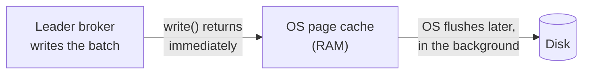

- <mark class="hl-yellow">Kafka hands the data to the operating system, which keeps it in</mark> **<mark class="hl-yellow">RAM (page cache)</mark>** <mark class="hl-yellow">and
  writes it to disk later.</mark> No fsync per message by default.
- Durability comes from **replication**, not from syncing each write: with `acks=all` every ISR
  replica has it, so one machine losing power before its flush loses nothing.
- Consumers mostly read what was just written, so reads usually hit the page cache too.

### Reads: zero-copy with `sendfile()`

Normal path: disk -> page cache -> copy into the JVM heap -> copy back to a socket buffer -> NIC.
Kafka's way: "<mark class="hl-yellow">do not bring the data into my process at all</mark>":

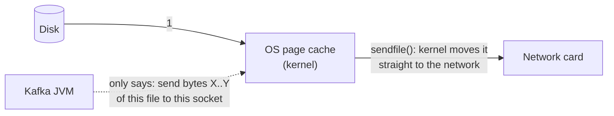

- <mark class="hl-yellow">The data never enters the Kafka JVM. No copy into the heap and back, so less CPU, less
  memory, and less garbage collection.</mark>
- <mark class="hl-yellow">This works because Kafka stores batches on disk in</mark> **<mark class="hl-yellow">the exact format</mark>** <mark class="hl-yellow">it sends over the
  network. There is nothing to change on the way out.</mark>
- Lost with TLS (data must be encrypted in the JVM) and with old-format clients needing conversion.

Add batching and compression on the producer (section 19) and you have the whole answer.

Say it like this: "<mark class="hl-yellow">Kafka is fast because writes are sequential appends into the OS page cache,
durability comes from replication instead of per-write fsync, and reads use zero-copy sendfile
so data goes from page cache to the socket without entering the JVM.</mark>"

---

# Part E: When things fail

The timers that decide how fast each failure is noticed:

```
controller.quorum.fetch.timeout.ms   2 s    standbys notice the active controller is gone
broker.session.timeout.ms            9 s    controller notices a broker is gone
replica.lag.time.max.ms             30 s    leader notices a follower is too slow
heartbeat.interval.ms                3 s    consumer says "alive" this often
session.timeout.ms                  45 s    coordinator notices a consumer is gone
max.poll.interval.ms                5 min   consumer notices it is stuck processing
leader.imbalance.check.interval     5 min   leadership moves back to the preferred broker
```

## 18. Broker-side failures  [P1]

### Active controller fails

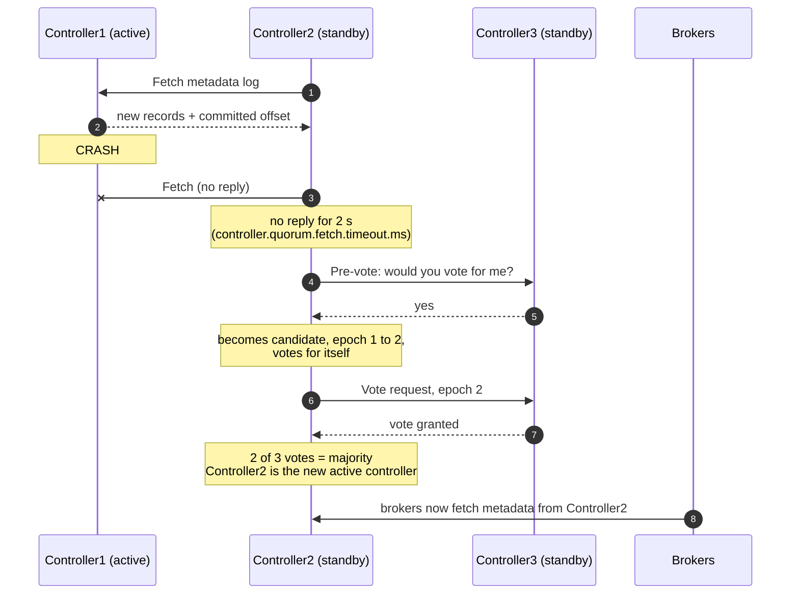

- **<mark class="hl-yellow">Noticing (arrows 1 to 3).</mark>** <mark class="hl-yellow">In KRaft the active controller does not push heartbeats.
  The standbys keep</mark> **<mark class="hl-yellow">fetching</mark>** <mark class="hl-yellow">from it. When a fetch gets no answer for 2 s, they know it is
  gone.</mark>
- **Pre-vote** first, so a node that only lost its own network cannot disturb a healthy leader.
- **Election:** raise the epoch, vote for itself, ask the others; one vote per voter per epoch,
  so never two winners. A returning old controller sees the higher epoch and joins as standby.
- Producers and consumers do not notice; only metadata changes pause for about 2 s.

Say it like this: "<mark class="hl-yellow">If the active controller dies, the standbys stop getting fetch responses,
run a Raft election, and the one with a majority of votes becomes active in a couple of
seconds; data traffic on brokers continues the whole time.</mark>"

### Partition leader's broker fails

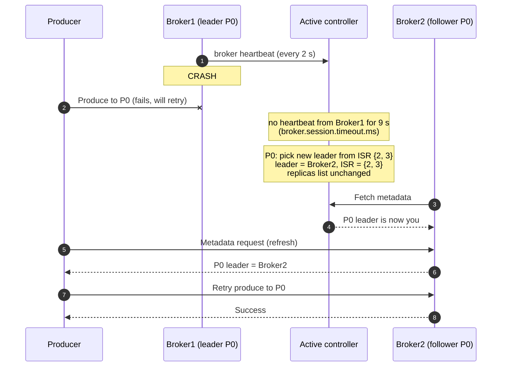

- The controller watches **brokers**, not partitions: no heartbeat for 9 s = dead.
- It picks a new leader **from the ISR only**; no data moves. Clients are not pushed anything:
  the failed request makes them refresh metadata and retry. 3000 `acks=all` sends during a
  leader kill: 3000 acked, 0 lost, slowest send 8.6 s (the detection window).
- "No data loss" holds only for **committed** records (`acks=all`). With `acks=1`, records the
  old leader acked but followers had not fetched are gone.
- **No** ISR member alive -> no leader, partition offline. Kafka will not promote an
  out-of-sync replica (`unclean.leader.election.enable=false`): safety over availability.

### Follower fails, whole broker fails, it comes back

- **Follower dies:** removed from the ISR after 9 s; `acks=all` now waits for fewer replicas.
  No downtime while ISR >= `min.insync.replicas`.
- **Broker dies:** both of the above at once. <mark class="hl-yellow">Partitions where broker 4 was</mark> **<mark class="hl-yellow">leader</mark>** <mark class="hl-yellow">(P2, P4) get a new leader from the ISR.</mark>
  <mark class="hl-yellow">Partitions where broker 4 was</mark> **<mark class="hl-yellow">follower</mark>** <mark class="hl-yellow">just drop it from the ISR and keep running.</mark>
- **A topic never fails as a whole.** It is a name; single partitions lose their leader, and only
  keys hashing there are blocked.
- **Group coordinator's broker dies:** <mark class="hl-yellow">The group coordinator is simply the</mark> **<mark class="hl-yellow">leader of one</mark> <mark class="hl-yellow">`__consumer_offsets`</mark> <mark class="hl-yellow">partition</mark>**<mark class="hl-yellow">. So it
fails over like any partition leader.</mark> Consumers ask "who is my coordinator?" again; commits
  were replicated, so they are safe.
- **Broker comes back:** registers, becomes a follower everywhere, **truncates** any uncommitted
  tail the new leader never had, catches up, rejoins the ISR, and later gets its leadership back
  (preferred leader = first in the replica list, checked every 5 min).

Say it like this: "<mark class="hl-yellow">When a broker dies, the controller detects missing heartbeats, re-elects
leaders from the ISR for the partitions it led, shrinks the ISR for the ones it followed, and
clients transparently retry against the new leaders.</mark>"

---

## 19. Consumer-side failures  [P0]

Two separate checks in the Java consumer:

```
background heartbeat thread -> every 3 s, even while you process   proves: "the process is alive"
your poll() loop            -> poll() at least every 5 min          proves: "it is making progress"
```

```
process dead or frozen   -> no heartbeats -> removed after session.timeout.ms (45 s)
process alive but stuck  -> no poll()     -> leaves itself after max.poll.interval.ms (5 min)
process stops cleanly    -> close()       -> LeaveGroup, rebalance immediately
```

**Crash before commit:** last commit 100, polled 100..199, processed to 150, crashed. The next
owner gets **100** (never "99"), reprocesses 100..150: at-least-once.

### <mark class="hl-yellow">Consumer too slow:</mark> <mark class="hl-yellow">`max.poll.interval.ms`</mark> <mark class="hl-yellow">exceeded  [P0]</mark>

<mark class="hl-yellow">A slow consumer is</mark> **<mark class="hl-yellow">still heartbeating</mark>**<mark class="hl-yellow">. It is not detected by missing heartbeats. The</mark>
**<mark class="hl-yellow">consumer itself</mark>** <mark class="hl-yellow">sees that poll() has not been called for too long, and it</mark> **<mark class="hl-yellow">leaves the
group on its own</mark>**<mark class="hl-yellow">.</mark>

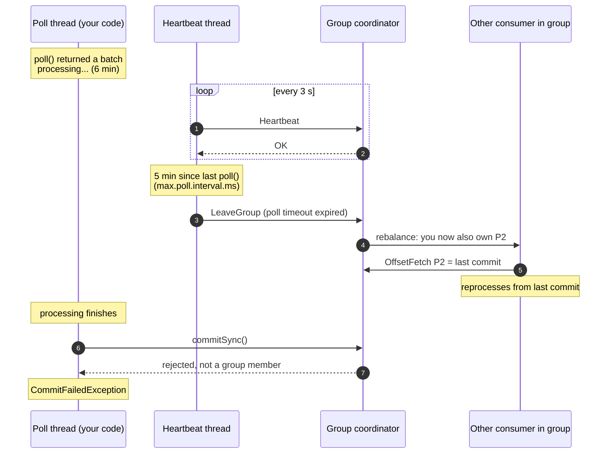

<mark class="hl-yellow">Result: the work is wasted</mark> **<mark class="hl-yellow">and</mark>** <mark class="hl-yellow">duplicated. The new owner reprocesses the same records from
the last commit.</mark> <mark class="hl-yellow">If one poll's records can take longer than 5 min, either lower</mark> <mark class="hl-yellow">`max.poll.records`</mark> <mark class="hl-yellow">or raise</mark>
  <mark class="hl-yellow">`max.poll.interval.ms`</mark><mark class="hl-yellow">. Example: 500 records x 1 s each = 500 s, which is over 300 s. That
  causes a rebalance every poll, and commits fail.</mark>

Fixes:

1. <mark class="hl-yellow">Increase</mark> <mark class="hl-yellow">`max.poll.interval.ms`</mark> <mark class="hl-yellow">if the processing time is truly that long.</mark>
2. <mark class="hl-yellow">Reduce</mark> <mark class="hl-yellow">`max.poll.records`</mark> <mark class="hl-yellow">(default 500), so each batch finishes faster.</mark>
3. <mark class="hl-yellow">Make the processing faster.</mark>
4. Process on a pool and keep polling with `pause()` on those partitions, committing only fully
   processed offsets.

Say it like this: "<mark class="hl-yellow">Heartbeats come from a background thread and only prove the process is
alive; max.poll.interval.ms proves progress, and if poll() isn't called in time the consumer
leaves the group itself, its partitions are rebalanced, and its later commit fails with
CommitFailedException.</mark>"

---

# Part F: Inside the producer

## 20. What happens when you call send()  [P0]

<mark class="hl-yellow">`send()`</mark> <mark class="hl-yellow">does</mark> **<mark class="hl-yellow">not</mark>** <mark class="hl-yellow">send anything over the network. The record passes through stages
inside the producer, and a separate background thread does the network call later.</mark>

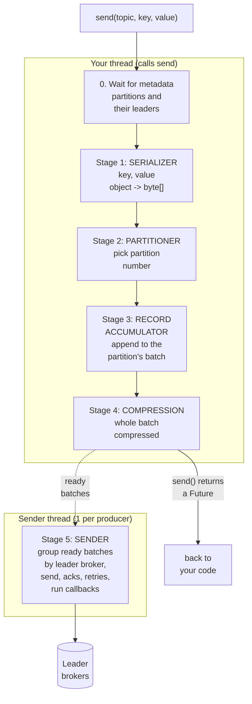

- **<mark class="hl-yellow">1. Serializer:</mark>** <mark class="hl-yellow">Kafka only stores bytes, so key and value become</mark> <mark class="hl-yellow">`byte[]`</mark><mark class="hl-yellow">.</mark>
  (`StringSerializer`; `JsonSerializer` comes from spring-kafka. A serializer that throws makes
  `send()` itself throw: no Future, no callback.)
- **2. Partitioner:** section 6.
- **<mark class="hl-yellow">3.</mark> <mark class="hl-yellow">Record accumulator:</mark>** <mark class="hl-yellow">an in-memory buffer holding one open</mark> **<mark class="hl-yellow">batch per partition</mark>**<mark class="hl-yellow">.</mark>
  <mark class="hl-yellow">`send()`</mark> <mark class="hl-yellow">returns here.</mark> All batches share `buffer.memory` (32 MB).
  <mark class="hl-yellow">The</mark> **<mark class="hl-yellow">record accumulator</mark>** <mark class="hl-yellow">is an in-memory buffer inside the producer. It keeps</mark> **<mark class="hl-yellow">one open
batch per topic-partition</mark>**<mark class="hl-yellow">. Batching is the main reason producers achieve high throughput.</mark>
- **<mark class="hl-yellow">4. Compression:</mark>** <mark class="hl-yellow">the batch is compressed as a whole (if enabled).</mark>
- **<mark class="hl-yellow">5. Sender thread:</mark>** <mark class="hl-yellow">takes ready batches and sends them to the leader brokers, then
  completes the Future and runs your callback.</mark>

**send() can still block**, on your thread, for metadata or buffer space, up to `max.block.ms`
(60 s). In a REST controller that is a request thread hanging for a minute; lower it to fail fast.

Say it like this: "<mark class="hl-yellow">send() serializes the record, picks a partition and appends it to an
in-memory batch for that partition, then returns a future; a single background sender thread
later ships ready batches to the partition leaders and completes the future.</mark>"

## 21. Batching, compression, the sender  [P0]

<mark class="hl-yellow">Two knobs decide when a batch is</mark> **<mark class="hl-yellow">ready to send</mark>**<mark class="hl-yellow">. Whichever happens first wins.</mark>

```
batch.size = 16384 (16 KB)   max bytes in one partition's batch
linger.ms  = 5               max time to wait for more records (older clients: 0)

P0 batch  [E1]...[E16] full at 4 ms -> ready (batch.size)
P1 batch  [E1]..[E5]  at 5 ms       -> ready half-empty (linger.ms)
```

<mark class="hl-yellow">Trade-off: bigger</mark> <mark class="hl-yellow">`batch.size`</mark> <mark class="hl-yellow">and</mark> <mark class="hl-yellow">`linger.ms`</mark> <mark class="hl-yellow">give more throughput and better compression,
but more latency per record. Smaller values give lower latency but more requests.</mark>

<mark class="hl-yellow">Follow-up often asked:</mark> **<mark class="hl-yellow">"batch.size is 32 KB but one record is 100 KB?"</mark>**
<mark class="hl-yellow">The record is not rejected. It goes alone in its own batch. Real run: a 100 KB record with</mark>
<mark class="hl-yellow">`batch.size=32768`</mark> <mark class="hl-yellow">was stored as one batch of 100,073 bytes. The real limit is</mark>
<mark class="hl-yellow">`max.request.size`</mark> <mark class="hl-yellow">(1 MB default).</mark>

**Compression** (`compression.type`: none, gzip, snappy, lz4, zstd) is per batch. The broker stores
it compressed and consumers decompress: less network and less disk. 100 repetitive order JSONs:
13,577 bytes plain, 1,996 with snappy. lz4/snappy for speed, zstd for ratio.

**Sender thread:** exactly one per producer. It groups ready batches **by leader broker** into one
ProduceRequest per broker, handles acks and retries, and runs callbacks. **Callbacks run on the
sender thread**, so no DB or HTTP calls in them: they stall the whole producer.
`max.in.flight.requests.per.connection` = 5 lets it pipeline 5 unanswered requests per broker.

**acks, retries, timeouts** (current defaults): `acks=all`, `enable.idempotence=true`,
`retries=2147483647`, `delivery.timeout.ms=120000` (total time per record, retries included),
`request.timeout.ms=30000`. <mark class="hl-yellow">Kafka's guidance is to leave</mark> <mark class="hl-yellow">`retries`</mark> <mark class="hl-yellow">alone and tune</mark> <mark class="hl-yellow">`delivery.timeout.ms`</mark><mark class="hl-yellow">.</mark>

Say it like this: "<mark class="hl-yellow">A batch is sent when it reaches batch.size or when linger.ms expires,
whichever comes first; raising them trades latency for throughput.</mark>"

---

## 22. The idempotent producer  [P0]

<mark class="hl-yellow">A producer sends records in</mark> **<mark class="hl-yellow">batches</mark>**<mark class="hl-yellow">, one batch per partition per request.</mark>
**<mark class="hl-yellow">Retries</mark>** <mark class="hl-yellow">resend a batch when the producer did not get a success reply.</mark>
**<mark class="hl-yellow">In-flight requests</mark>**<mark class="hl-yellow">: up to</mark> <mark class="hl-yellow">`max.in.flight.requests.per.connection`</mark> <mark class="hl-yellow">(default 5) requests can
  be sent to a broker before earlier ones are answered.</mark>

### <mark class="hl-yellow">Problem 1: duplicates (needs only retries > 0)</mark>

<mark class="hl-yellow">The broker writes the batch, but the</mark> **<mark class="hl-yellow">reply</mark>** <mark class="hl-yellow">is lost. The producer cannot tell "not written"
from "written, reply lost", so it retries, and the broker writes it again.</mark>

```
offset 0 CREATED | offset 1 CREATED (duplicate from the retry) | 2 PAID | 3 SHIPPED
```

Correction: <mark class="hl-yellow">duplicates do</mark> **<mark class="hl-yellow">not</mark>** <mark class="hl-yellow">need more than 1 in-flight request. Any retry after a lost
reply causes them, even with</mark> <mark class="hl-yellow">`max.in.flight=1`</mark><mark class="hl-yellow">.</mark>

### <mark class="hl-yellow">Problem 2: reordering (needs retries > 0 AND in-flight > 1)</mark>

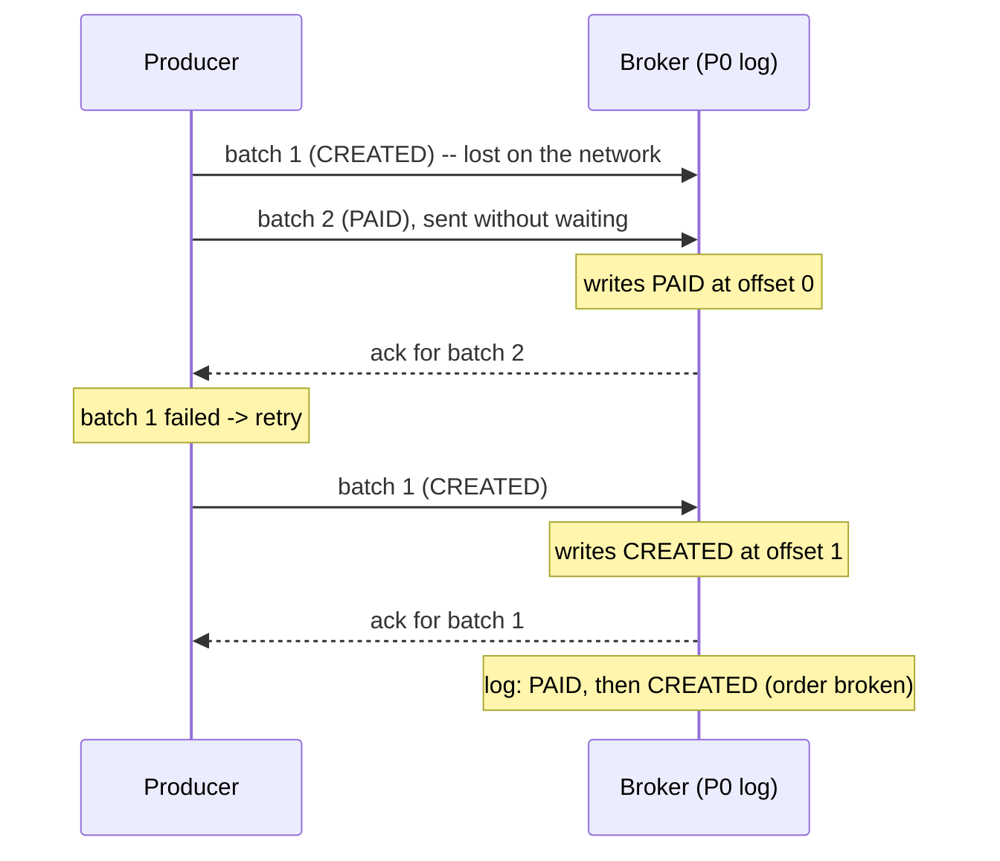

### How it works: PID + sequence numbers

- **<mark class="hl-yellow">PID (producer ID):</mark>** <mark class="hl-yellow">a unique number the producer gets from the cluster at startup.
  (There is also a producer epoch, 0 for a plain idempotent producer.)</mark>
- **<mark class="hl-yellow">Sequence number:</mark>** <mark class="hl-yellow">each record gets a number that increases by 1,</mark> **<mark class="hl-yellow">separately for each
  partition</mark>**<mark class="hl-yellow">. A batch carries its first and last sequence (</mark><mark class="hl-yellow">`baseSequence`</mark><mark class="hl-yellow">,</mark> <mark class="hl-yellow">`lastSequence`</mark><mark class="hl-yellow">).</mark>
  Batch for P0 = seq 0..2, so <mark class="hl-yellow">The next batch for Topic-A P0 starts at sequence</mark> **<mark class="hl-yellow">3</mark>**<mark class="hl-yellow">. Each partition counts on its own.</mark>

They are written in the batch header on disk (a non-idempotent batch shows `producerId: -1`).
The broker gets PIDs in blocks of 1000 from the controller and hands them out locally.

For every **(PID, topic, partition)** the leader remembers the last sequence (and the last 5
batches):

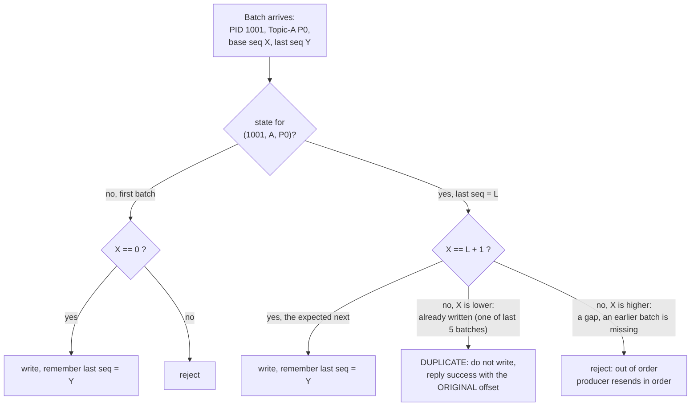

- **<mark class="hl-yellow">Duplicates:</mark>** <mark class="hl-yellow">the retried batch has the</mark> **<mark class="hl-yellow">same</mark>** <mark class="hl-yellow">PID and sequence, so the broker sees it
  already has it. It does not write it again, but still replies "success" with the original
  offset.</mark>
- **<mark class="hl-yellow">Reordering:</mark>** <mark class="hl-yellow">a batch that arrives with a gap is rejected. The producer resends the
  earlier batch first, then the later one.</mark>

Correction: <mark class="hl-yellow">this state is not only an in-memory map. PID and sequence are stored in each batch
header, which is replicated to followers. So a new leader after failover can rebuild the
state and keep deduplicating.</mark>

### Required configs, and the silent switch-off

On by default since 3.0. Set `enable.idempotence=true` **explicitly** anyway: then a bad config
fails at startup instead of quietly dropping the guarantee.

```
nothing set                      -> idempotent producer
acks=1, idempotence not set      -> "Idempotence will be disabled because acks is set to 1"  (silently OFF)
acks=1 + enable.idempotence=true -> ConfigException at startup
max.in.flight=6                  -> ConfigException: must be at most 5
```

**<mark class="hl-yellow">acks=all.</mark>** <mark class="hl-yellow">With</mark> <mark class="hl-yellow">`acks=1`</mark> <mark class="hl-yellow">the leader replies before followers copy the batch. If the leader
dies, the new leader may not have that batch, or its sequence state. The producer was already
told "success", so the record is simply lost, and the sequence numbers no longer line up.
Idempotence stops duplicates from retries. It cannot bring back data that was acknowledged
too early. So it needs every ISR replica to have the batch before success.</mark>

**<mark class="hl-yellow">retries = max.</mark>** <mark class="hl-yellow">With duplicates and reordering handled, retrying is safe. The total time
is limited by</mark> <mark class="hl-yellow">`delivery.timeout.ms`</mark> <mark class="hl-yellow">(2 min), not by the retry count.</mark>

**<mark class="hl-yellow">max.in.flight <= 5.</mark>** <mark class="hl-yellow">The broker keeps details of only the</mark> **<mark class="hl-yellow">last 5 batches</mark>** <mark class="hl-yellow">per
(PID, partition) to recognize duplicates. Correction: that is 5</mark> **<mark class="hl-yellow">batches</mark>**<mark class="hl-yellow">, not 5 sequence
numbers. With more than 5 batches in flight, a retried old batch might no longer be
recognized. So the client refuses to start with 6 (ConfigException in the real run).</mark>
Without idempotence the only safe ordering is `max.in.flight=1`, much slower.

### What it does NOT protect

- **A producer restart gets a new PID**, starting at sequence 0. Crash before the ack, restart,
  resend E1..E3: the broker cannot link PID 2001 to PID 1001, so they are written twice.
- The app calling `send()` twice for one event, all-or-nothing writes across partitions, and
  consumer-side duplicates are all out of scope.
- `transactional.id` (section 28) fixes the restart gap: same id -> same PID, epoch + 1, and the
  old zombie instance is fenced.

Say it like this: "<mark class="hl-yellow">Idempotence gives exactly-once writes per partition for one producer
session; it does not survive a producer restart, and it is not end-to-end exactly-once.</mark>"

---

# Part G: Spring Boot

## 23. Producer setup  [P1]

```java
@Bean
public NewTopic orderEventsTopic() {
    return TopicBuilder.name("order-events")
            .partitions(3).replicas(3)
            .config(TopicConfig.MIN_IN_SYNC_REPLICAS_CONFIG, "2")
            .build();                       // KafkaAdmin creates it at startup if missing
}
```

```properties
# more than one broker: if one is down, the producer bootstraps from the other
spring.kafka.bootstrap-servers=localhost:9092,localhost:9192
spring.kafka.producer.acks=all
spring.kafka.producer.key-serializer=org.apache.kafka.common.serialization.StringSerializer
spring.kafka.producer.value-serializer=org.springframework.kafka.support.serializer.JsonSerializer
spring.kafka.producer.properties.enable.idempotence=true
spring.kafka.producer.properties.linger.ms=20
spring.kafka.producer.properties.batch.size=32768
spring.kafka.producer.properties.compression.type=snappy
spring.kafka.producer.properties.delivery.timeout.ms=120000
```

```java
CompletableFuture<SendResult<String, Order>> f =
        kafkaTemplate.send("order-events", order.getOrderId(), order);
f.whenComplete((result, ex) -> {
    if (ex == null) log.info("p={} off={}", result.getRecordMetadata().partition(),
                                            result.getRecordMetadata().offset());
    else log.error("send failed", ex);   // keep it light: this runs on the sender thread
});
```

Asynchronous, so the controller answers `202 Accepted`. `f.get()` makes it synchronous: simple,
but one round trip per record and no batching benefit.

`application.properties` gives one default <mark class="hl-yellow">`KafkaTemplate`</mark>. For a different value serializer,
build a second template from `KafkaProperties.buildProducerProperties(null)` with that one setting
overridden, and inject it with `@Qualifier`. Each template has its own producer, buffer and sender thread.

---

## 24. Consumer setup and the listener container  [P0]

Terms used below:

- **<mark class="hl-yellow">Consumer group</mark>**<mark class="hl-yellow">: consumers sharing one</mark> <mark class="hl-yellow">`group.id`</mark><mark class="hl-yellow">. They split a topic's partitions; each
  partition is read by exactly one member of the group.</mark>
- **<mark class="hl-yellow">Group coordinator</mark>**<mark class="hl-yellow">: the broker that manages one group (members, assignment, commits).
  It is the leader of partition</mark> <mark class="hl-yellow">`abs(groupId.hashCode()) % 50`</mark> <mark class="hl-yellow">of</mark> <mark class="hl-yellow">`__consumer_offsets`</mark><mark class="hl-yellow">.</mark>
- **<mark class="hl-yellow">Committed offset</mark>**<mark class="hl-yellow">: per (group, topic, partition), the</mark> **<mark class="hl-yellow">next</mark>** <mark class="hl-yellow">offset to read.</mark>
- **<mark class="hl-yellow">Rebalance</mark>**<mark class="hl-yellow">: re-dividing partitions among members when a member joins, leaves or dies.</mark>

<mark class="hl-yellow">Spring Kafka writes all of that for you. You provide only two things:</mark> **<mark class="hl-yellow">properties</mark>** <mark class="hl-yellow">and</mark> **<mark class="hl-yellow">the
business method</mark>**<mark class="hl-yellow">.</mark> ("All of that" = the hand-written poll loop: create a KafkaConsumer,
subscribe, `while(true) poll()`, commit, `close()` in `finally`.)

- **<mark class="hl-yellow">ConsumerFactory</mark>** <mark class="hl-yellow">reads</mark> <mark class="hl-yellow">`spring.kafka.consumer.*`</mark> <mark class="hl-yellow">and creates</mark> <mark class="hl-yellow">`KafkaConsumer`</mark> <mark class="hl-yellow">objects.</mark>
- **<mark class="hl-yellow">Listener container</mark>** <mark class="hl-yellow">owns one</mark> <mark class="hl-yellow">`KafkaConsumer`</mark> <mark class="hl-yellow">and one thread. It runs the poll loop,
  calls your method once per record, commits offsets, and closes the consumer on shutdown.</mark>
- At startup one `ConcurrentMessageListenerContainer` per `@KafkaListener` creates `concurrency`
  children; each child = 1 KafkaConsumer + 1 thread (named like `orders-0-C-1`). They live in
  `KafkaListenerEndpointRegistry` (use it to stop/start a listener).
- Gotcha: `@KafkaListener(id = "orders")` uses `orders` as the **group.id** and ignores
  `spring.kafka.consumer.group-id`. Set `groupId` explicitly or `idIsGroup = false`.

```properties
spring.kafka.consumer.group-id=order-consumer-group
spring.kafka.consumer.key-deserializer=org.apache.kafka.common.serialization.StringDeserializer
spring.kafka.consumer.value-deserializer=org.springframework.kafka.support.serializer.ErrorHandlingDeserializer
spring.kafka.consumer.properties.spring.deserializer.value.delegate.class=org.springframework.kafka.support.serializer.JsonDeserializer
spring.kafka.consumer.properties.spring.json.use.type.headers=false
spring.kafka.consumer.properties.spring.json.value.default.type=com.eda.consumer.model.Order
spring.kafka.consumer.auto-offset-reset=earliest
```

```java
@Component
public class OrderEventListener {
    @KafkaListener(topics = "order-events", groupId = "order-consumer-group")
    public void consume(ConsumerRecord<String, Order> rec) {   // or just (Order order)
        process(rec.value());
    }
}
```

Say it like this: "<mark class="hl-yellow">@KafkaListener only marks the business method; a listener container built
from the ConsumerFactory owns the KafkaConsumer, runs the poll loop on its own thread, invokes
the method per record and commits offsets for me.</mark>"

### <mark class="hl-yellow">The consumer flow, step by step  [P0]</mark>

The first `poll()` does the whole read flow of section 15; every later poll just fetches.

- <mark class="hl-yellow">The consumer asks any broker "who coordinates my group?". The broker computes the</mark>
<mark class="hl-yellow">`__consumer_offsets`</mark> <mark class="hl-yellow">partition and answers with that partition's leader.</mark>
- <mark class="hl-yellow">The consumer learns which broker leads each partition of</mark> <mark class="hl-yellow">`order-events`</mark><mark class="hl-yellow">. Refreshed every</mark>
<mark class="hl-yellow">`metadata.max.age.ms`</mark> <mark class="hl-yellow">(default 5 min), or sooner on errors like "not leader".</mark>
- **<mark class="hl-yellow">JoinGroup:</mark>** <mark class="hl-yellow">every member tells the coordinator "I am in, these are my topics".</mark>
- **<mark class="hl-yellow">SyncGroup:</mark>** <mark class="hl-yellow">one member (the group leader) computes the split using the assignment strategy
  (section 26). The coordinator then hands each member its partitions.</mark>
- <mark class="hl-yellow">Correction, coordinator crash: the lecture says the group must rejoin and rebalance again. Real
run on a 3-broker cluster: the coordinator broker was killed. The consumer logged</mark>
<mark class="hl-yellow">`Discovered group coordinator localhost:9094`</mark> <mark class="hl-yellow">(the new one) and kept consuming. There was</mark> **<mark class="hl-yellow">no</mark>**
<mark class="hl-yellow">rejoin, and the generation stayed 1. The new coordinator loaded the group from</mark>
<mark class="hl-yellow">`__consumer_offsets`</mark><mark class="hl-yellow">.</mark>
- <mark class="hl-yellow">The coordinator looks up (group, topic, partition) and returns the committed offset. If it
  returns 100, the consumer reads</mark> **<mark class="hl-yellow">from 100</mark>**<mark class="hl-yellow">.</mark>
  The `latest` trap: orders 1..9 produced, then a brand-new group starts with the default
  `latest` and receives **nothing** from them. For a new service that must see existing data,
  use `earliest`.
- <mark class="hl-yellow">The consumer fetches from each partition's</mark> **<mark class="hl-yellow">leader</mark>** <mark class="hl-yellow">(not from the coordinator).</mark>
  <mark class="hl-yellow">Fetch limits are about</mark> **<mark class="hl-yellow">bytes over the network</mark>**<mark class="hl-yellow">.</mark> <mark class="hl-yellow">`max.poll.records`</mark> <mark class="hl-yellow">is about</mark> **<mark class="hl-yellow">how many
  records your code gets per poll</mark>**<mark class="hl-yellow">. Extra fetched records wait in the consumer's buffer for
  the next poll.</mark>
- **<mark class="hl-yellow">Many partitions: one by one, or in parallel?</mark>** <mark class="hl-yellow">The consumer sends</mark> **<mark class="hl-yellow">one fetch request per
leader broker</mark>**<mark class="hl-yellow">, covering all its partitions on that broker, and these go out</mark> **<mark class="hl-yellow">in parallel</mark>**<mark class="hl-yellow">.
The responses are buffered.</mark> <mark class="hl-yellow">`poll()`</mark> <mark class="hl-yellow">then returns records from several partitions. In Spring,
the container thread calls your method</mark> **<mark class="hl-yellow">one record at a time, sequentially</mark>**<mark class="hl-yellow">. Order is kept
within each partition. Partitions are interleaved.</mark>
- Liveness uses the three timers of section 19, with <mark class="hl-yellow">two different meanings</mark>: heartbeats
  prove alive, `max.poll.interval.ms` proves progress.
- <mark class="hl-yellow">Your method gets</mark> **<mark class="hl-yellow">one record</mark>** <mark class="hl-yellow">by default. Set</mark> <mark class="hl-yellow">`spring.kafka.listener.type=batch`</mark> <mark class="hl-yellow">and the
method can take</mark> <mark class="hl-yellow">`List<Order>`</mark><mark class="hl-yellow">, the whole poll result at once.</mark>
- Shutdown: `close()` sends LeaveGroup at once (2 instances, SIGTERM one: the other owned all 4
  partitions 3 s later). Correction: the 45 s wait is the crash case, not a clean close.

---

## 25. Offset commits in Spring: AckMode  [P0]

Correction: **Spring Kafka sets `enable.auto.commit=false`**. The **container** commits instead,
after your method has processed the records, according to `spring.kafka.listener.ack-mode`:

```
BATCH (default)    commit once ALL records returned by one poll() are processed
RECORD             commit after EACH record is processed
TIME / COUNT       every ack-time ms (5000) / every ack-count records
MANUAL             you call ack.acknowledge(); commits are batched and sent later
MANUAL_IMMEDIATE   you call ack.acknowledge(); commit is sent right away
```

5 records (0..4) in one poll, crash while processing 2:

```
BATCH:  committed offset = 0 -> restart reprocesses 0, 1, 2, 3, 4   (0 and 1 run twice)
RECORD: committed offset = 2 -> restart reprocesses 2, 3, 4          (only the crashed one again)
```

- <mark class="hl-yellow">BATCH: fewer commit requests, more duplicates after a crash (up to one whole poll, max 500).</mark>
- <mark class="hl-yellow">RECORD: one commit per record (more load on the coordinator), fewer duplicates.</mark>
- Both are **at-least-once**, neither loses data.

```java
@KafkaListener(topics = "order-events")
public void consume(Order order, Acknowledgment ack) {   // ack-mode=MANUAL_IMMEDIATE
    process(order);
    ack.acknowledge();      // only now is this offset marked done
}
```

<mark class="hl-yellow">Use it when "done" is decided by your code. Example: acknowledge only after the DB transaction
commits. If you never call</mark> <mark class="hl-yellow">`acknowledge()`</mark><mark class="hl-yellow">, nothing is committed and the records come back
after a restart or rebalance.</mark>

- <mark class="hl-yellow">`commitSync()`</mark><mark class="hl-yellow">: blocks until the broker confirms, and retries on retriable errors. Safe, but
  slower.</mark>
- <mark class="hl-yellow">`commitAsync()`</mark><mark class="hl-yellow">: does not block and</mark> **<mark class="hl-yellow">does not retry</mark>**<mark class="hl-yellow">. A callback reports failure. It is
  not "no guarantee": the commit is sent, but a failure is only reported, never retried. The
  reason: a retried old commit could overwrite a newer one.</mark>

Say it like this: "<mark class="hl-yellow">Spring disables Kafka's auto-commit and commits from the container after
processing; with the default BATCH mode a crash replays the whole last poll, RECORD replays
only the failed record, and MANUAL lets my code decide.</mark>"

---

## 26. Assignment, rebalancing and scaling  [P1]

`partition.assignment.strategy`, 2 consumers on topics t-a and t-b (3 partitions each):

```
Range      per topic, extras to the first consumer   C1: 4 partitions   C2: 2   (worse with more topics)
RoundRobin all partitions dealt one by one           C1: 3              C2: 3
Sticky     balanced, keeps owners on a rebalance
CooperativeSticky   sticky + incremental rebalancing
```

Recap: <mark class="hl-yellow">a</mark> **<mark class="hl-yellow">rebalance</mark>** <mark class="hl-yellow">re-divides partitions when a member joins, leaves or is considered
dead. With the default (eager) protocol,</mark> **<mark class="hl-yellow">all</mark>** <mark class="hl-yellow">members stop during it.</mark>

### <mark class="hl-yellow">Eager vs cooperative rebalancing (often asked)</mark>

- **<mark class="hl-yellow">Eager</mark>** <mark class="hl-yellow">(Range, RoundRobin, Sticky): on any rebalance,</mark> **<mark class="hl-yellow">every</mark>** <mark class="hl-yellow">member gives up</mark> **<mark class="hl-yellow">all</mark>**
  <mark class="hl-yellow">its partitions, then gets a new set. Everyone stops consuming during the rebalance
  ("stop the world").</mark>
- **<mark class="hl-yellow">Cooperative</mark>** <mark class="hl-yellow">(CooperativeSticky): members keep the partitions that are not moving. Only
  the moved ones are revoked and handed over.</mark>

A owns P0..P3, B joins: with Range, A revokes all four and gets 0, 1 back; with CooperativeSticky
A revokes only 2, 3 and keeps consuming 0, 1. The default list `[Range, CooperativeSticky]` means
Range is used; it exists for a two-step upgrade (roll out both, then only CooperativeSticky).

**Static membership** for rolling deploys: a 3-pod restart normally causes 6 rebalances.

```properties
spring.kafka.consumer.properties.group.instance.id=${HOSTNAME}     # unique per pod
spring.kafka.consumer.properties.session.timeout.ms=120000
```

- <mark class="hl-yellow">Restart within</mark> <mark class="hl-yellow">`session.timeout.ms`</mark><mark class="hl-yellow">: the member gets its partitions back, and the rest of the
  group never notices.</mark>
- Cost: if the pod really dies, its partitions sit unread until the timeout ends.
- **Commit on revoke:** processed-but-uncommitted records get reprocessed by the new owner;
  `onPartitionsRevoked` is the last chance to commit, and Spring's container does it for you.

**Scaling.** Max useful consumers = partitions. In Spring: `spring.kafka.listener.concurrency=3`
(or `@KafkaListener(concurrency = "3")`), or more pods with the same `group.id`. On 4
partitions, concurrency 3 gives 2+1+1; concurrency 5 leaves one thread idle.

- Same `group.id` = share the work; different `group.id` = each gets every event.
- Two unrelated listeners in one group still share one group, so one's rebalance pauses the
  other. Give each its own `groupId`.
- Each partition is still processed in order by one thread. Handing records to your own thread
  pool breaks order and makes commits unsafe: add partitions plus concurrency instead.

---

# Part H: Errors and retries

## 27. Poison pills, retries and the dead letter topic  [P0]

### One bad record can stop a whole partition

<mark class="hl-yellow">Kafka gives each partition to</mark> **<mark class="hl-yellow">one</mark>** <mark class="hl-yellow">consumer, which reads it</mark> **<mark class="hl-yellow">in order</mark>**<mark class="hl-yellow">. A record cannot
be "set aside" the way a queue can. If record 42 keeps failing, there are only four
possibilities:</mark>

```
1. retry forever         -> partition stuck at 42, lag grows forever ("poison pill")
2. skip it silently      -> data loss
3. stop the consumer     -> everything stops until a human acts
4. retry a few times, then move it somewhere safe (dead letter topic) and continue  <- normal
```

Say it like this: "<mark class="hl-yellow">Because a partition is consumed in order, one failing record blocks
everything behind it, so I retry transient failures a bounded number of times and then park the
record in a dead letter topic so the partition keeps moving.</mark>"

**The deserialization poison pill.** <mark class="hl-yellow">Spring's</mark> <mark class="hl-yellow">`JsonSerializer`</mark> <mark class="hl-yellow">on the producer adds a header</mark> <mark class="hl-yellow">`__TypeId__`</mark> <mark class="hl-yellow">with the</mark> **<mark class="hl-yellow">producer's</mark>**
<mark class="hl-yellow">class name, for example</mark> <mark class="hl-yellow">`com.eda.producer.model.Order`</mark><mark class="hl-yellow">. On the consumer,</mark> <mark class="hl-yellow">`JsonDeserializer`</mark>
**<mark class="hl-yellow">prefers that header</mark>** <mark class="hl-yellow">over</mark> <mark class="hl-yellow">`default.type`</mark><mark class="hl-yellow">. If the consumer has a different package, or the
class is not trusted, deserialization fails.</mark>
<mark class="hl-yellow">Then it got worse. The same record failed again on every poll:</mark> **<mark class="hl-yellow">108,669 errors in about 40
seconds</mark>**<mark class="hl-yellow">, a 594 MB log file, and the partition was</mark> **<mark class="hl-yellow">stuck</mark>**<mark class="hl-yellow">. Nothing after that record was
consumed. That is a</mark> **<mark class="hl-yellow">poison pill</mark>**<mark class="hl-yellow">: one bad record blocks its partition forever.</mark>
The failure is inside `poll()`, so the offset never advances.

Two fixes, both in the properties of section 24: `spring.json.use.type.headers=false` with a
`default.type` (same JSON, different packages), and **always** wrap in `ErrorHandlingDeserializer`,
which turns the failure into a normal failed record that the error handler skips or dead-letters
instead of throwing from poll().

Say it like this: "<mark class="hl-yellow">A record that can't be deserialized fails inside poll() and is retried
forever, blocking its partition; wrapping the deserializer in ErrorHandlingDeserializer turns it
into a normal failed record that the error handler can skip or dead-letter. With
JsonDeserializer, also watch the producer's type headers.</mark>"

### Would trying again ever help?

- **Transient** (DB down, timeout, 503, deadlock, rate limit): retry with a back-off.
- **Permanent** (bad JSON, missing field, broken business rule): send to the DLT at once.

<mark class="hl-yellow">Retrying a permanent error wastes time and blocks the partition. Spring already treats some
exceptions as</mark> **<mark class="hl-yellow">not retryable</mark>** <mark class="hl-yellow">(fatal) and sends them straight to recovery:</mark>
`DeserializationException`, `MessageConversionException`, `ClassCastException` and a few more.
Add your own: `errorHandler.addNotRetryableExceptions(ValidationException.class);`
Always throw a `RuntimeException`: an `Error` skips the handler and stops the consumer.

### Blocking retries: DefaultErrorHandler

<mark class="hl-yellow">"Blocking" means the retry happens on the</mark> **<mark class="hl-yellow">same partition, in place</mark>**<mark class="hl-yellow">. Nothing behind the
failed record is processed until it succeeds or is given up on.</mark>

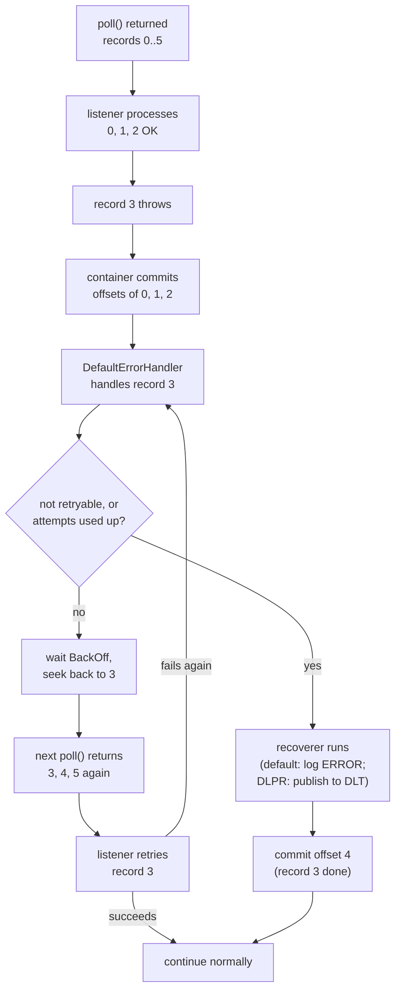

1. **<mark class="hl-yellow">Commit before handling:</mark>** <mark class="hl-yellow">offsets of records that already succeeded are committed first,
  so a retry never replays them.</mark>
2. **Seek, not loop:** the next `poll()` brings 3, 4, 5 again, so the consumer stays alive in the
   group while it retries.
3. <mark class="hl-yellow">After recovery, the failed record's offset is committed, and the partition moves on.</mark>

The defaults quietly lose data: `FixedBackOff(0, 9)` = 10 attempts, no delay, then log and skip.
Add a delay and a DLT:

```java
@Bean
public DefaultErrorHandler errorHandler(KafkaTemplate<Object, Object> template) {
    var recoverer = new DeadLetterPublishingRecoverer(template);          // send to DLT
    var handler = new DefaultErrorHandler(recoverer, new FixedBackOff(1000L, 2L));  // 2 retries = 3 attempts
    handler.addNotRetryableExceptions(IllegalArgumentException.class);    // straight to DLT
    return handler;
}
```

Expected behaviour on one partition: a bad record goes straight to the DLT; a "DB down" record
gets 3 attempts 1 s apart, then the DLT; the next record waits about 2.5 s behind it. That wait is
what "blocking" costs.

### The dead letter topic

<mark class="hl-yellow">A</mark> **<mark class="hl-yellow">DLT</mark>** <mark class="hl-yellow">is a normal Kafka topic where records that could not be processed are parked, so
the main partition can continue and nothing is silently lost.</mark>

- **Name:** `<topic>-dlt` (old default `.DLT`).
- **Partition:** the **same number** as the original. If `orders` has 6 partitions and
  `orders-dlt` has 1, a failure on P4 cannot be published: give the DLT as many partitions, or
  route to partition -1 (Kafka picks).
- **Key and value unchanged**; headers carry the why: `kafka_dlt-original-topic`, `-partition`,
  `-offset`, `kafka_dlt-exception-fqcn`, `kafka_dlt-exception-message`, `-stacktrace`.
- A DLT nobody reads is just data loss with extra steps: alert on any DLT traffic, inspect,
  fix, replay idempotently, keep retention long enough for humans.

Limits of blocking: the whole partition waits; a back-off near `max.poll.interval.ms` gets the
consumer kicked out (`ContainerPausingBackOffHandler` pauses instead of sleeping); batch listeners
must throw `BatchListenerFailedException(msg, ex, index)`.

### Non-blocking retries: @RetryableTopic

<mark class="hl-yellow">move the failing record to a separate</mark> **<mark class="hl-yellow">retry topic</mark>**<mark class="hl-yellow">, so the main topic keeps flowing.
A retry consumer processes it again after a delay, and after the last attempt it goes to the
DLT.</mark>

```java
@RetryableTopic(attempts = "4", backoff = @Backoff(delay = 1000, multiplier = 2))
@KafkaListener(topics = "payments")
public void onPayment(Payment p) { paymentService.charge(p); }

@DltHandler
public void onDlt(Payment p) { log.error("giving up on {}", p); }
```

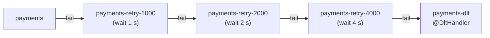

The retry consumer waits without sleeping: the record carries a due-time header, and if read too
early the partition is paused and resumed on time. Not for batch listeners.

**The price is ordering.** `order-1` CREATED fails and moves to the retry topic; `order-2` PAID for
the same order is processed now. PAID before CREATED: a bug for a state machine, fine for email.

- Blocking when <mark class="hl-yellow">order matters per key (order lifecycle events, account balance updates),</mark>
  and failures are short.
- Non-blocking when records are independent and outages can last minutes.
- Most teams combine them: a few quick blocking retries, then retry topics. Order matters **and**
  the outage is long? Pause the container, alert, resume after the fix.

Say it like this: "@RetryableTopic forwards a failed record to delayed retry topics and then
to a DLT, so the main partition never waits, but the retried record loses its order. I use
blocking retries when events for the same key depend on each other, and non-blocking when
records are independent and outages can be long."

### Lag, pause/resume, replay  [P1]

**<mark class="hl-yellow">Lag</mark>** <mark class="hl-yellow">= log end offset - committed offset, per partition. How far behind the group is.</mark>
Lag on every partition = consumers too slow; lag on one = a hot key or a stuck poison record.
`kafka-consumer-groups.sh --describe --group order-consumer-group` shows it.

- **Pause/resume:** `pause()` keeps `poll()` running but returns nothing, so the consumer stays in
  the group (sleeping would breach `max.poll.interval.ms`).
- **Replay:** data stays after reading, so after a bug fix `offsetsForTimes` + `seek`, or
  `--reset-offsets --to-datetime ... --execute` with the group stopped. Consumers must be idempotent.

---

# Part I: Exactly-once

## 28. Delivery semantics  [P0]

Recap of terms:
- **<mark class="hl-yellow">Committed offset:</mark>** <mark class="hl-yellow">stored in</mark> <mark class="hl-yellow">`__consumer_offsets`</mark><mark class="hl-yellow">. The next offset the group will read
  after a restart.</mark>
- **<mark class="hl-yellow">Idempotent producer:</mark>** <mark class="hl-yellow">each batch carries a producer ID (PID) and a per-partition sequence
  number, so the broker drops duplicates caused by the producer's</mark> **<mark class="hl-yellow">own retries</mark>**<mark class="hl-yellow">. It does not
  survive a producer restart (new PID) and works one partition at a time.</mark>

First, who holds what:
- <mark class="hl-yellow">The</mark> **<mark class="hl-yellow">Kafka brokers</mark>** <mark class="hl-yellow">store the log and the committed offsets (in the internal topic</mark>
  <mark class="hl-yellow">`__consumer_offsets`</mark><mark class="hl-yellow">). They survive your crash.</mark>
- <mark class="hl-yellow">The</mark> **<mark class="hl-yellow">consumer</mark>** <mark class="hl-yellow">is a client library running inside your app. Its in-memory position dies
  with the crash. After a restart it asks the brokers: "where did my group commit?"</mark>

```
at-most-once   commit 43, then process 42, crash in between  -> 42 never processed: LOST
at-least-once  process 42, then commit 43, crash in between  -> 42 processed again: DUPLICATE (the default)
exactly-once   the work and the commit as one atomic step
```

### Exactly-once: the <mark class="hl-yellow">work and the commit as one atomic step</mark>

**<mark class="hl-yellow">Kafka never calls a database or an API</mark>.** <mark class="hl-yellow">Your app holds two Kafka clients: a consumer to read, and a transactional producer
to write.</mark>

- **<mark class="hl-yellow">`__consumer_offsets`</mark>:** <mark class="hl-yellow">an internal topic on the brokers where each consumer group's committed
  offset is stored.</mark>
- **<mark class="hl-yellow">Transaction coordinator</mark>:** <mark class="hl-yellow">not a separate server. It is a job one of the brokers does for
  your producer.</mark> <mark class="hl-yellow">Your producer has a fixed</mark> <mark class="hl-yellow">`transactional.id`</mark> <mark class="hl-yellow">(for example</mark> <mark class="hl-yellow">`payment-svc-1`</mark><mark class="hl-yellow">), and
  that id is assigned to one broker. That broker records the state of the producer's current
  transaction (open, committing, committed, aborted) in another internal topic,</mark>
  <mark class="hl-yellow">`__transaction_state`</mark><mark class="hl-yellow">. When your app says "commit" or "abort", the coordinator makes it happen
  in every partition the transaction wrote to.</mark>
- **Pending record:** written to the log, tagged with a transaction that has not finished;
  `read_committed` readers skip it for now.
- **Commit / abort marker:** a control record the coordinator appends to every touched partition:
  commit makes the pending records visible, abort hides them for good.

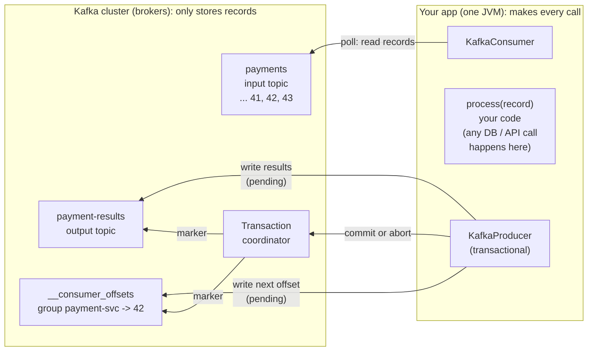

- <mark class="hl-yellow">Your app's consumer reads from</mark> <mark class="hl-yellow">`payments`</mark><mark class="hl-yellow">.</mark>
- <mark class="hl-yellow">Your code processes the record. If your code calls a DB or an API, that call happens here, from
  your app.</mark>
- <mark class="hl-yellow">Your app's producer writes the result and the next offset as</mark> **<mark class="hl-yellow">pending</mark>** <mark class="hl-yellow">records, then asks the
  coordinator to commit.</mark>
- <mark class="hl-yellow">The coordinator writes</mark> **<mark class="hl-yellow">markers</mark>** <mark class="hl-yellow">into both partitions, so the result and the offset become
  real at the same moment.</mark>

```
after process   R42 only in your app's memory           group still at 42
after sends     R42 PENDING in payment-results          offset 43 PENDING
after markers   R42 COMMITTED (visible)                 group -> 43
crash before commit: restart with the same transactional.id -> coordinator ABORTS the open
  transaction, R42 hidden forever, group still 42 -> 42 is processed again and committed once
```

**Where it breaks:** the app charges the bank Rs 500, writes R42 pending, crashes. The abort
undoes only what the cluster stores; the bank call happened outside it, so the retry charges again.
So what real systems build is: **<mark class="hl-yellow">at-least-once delivery + idempotent processing = exactly-once
effect.</mark>**

Say it like this: "Kafka's exactly-once covers Kafka-to-Kafka processing via transactions; when
the side effect is outside Kafka, I run at-least-once and make the consumer idempotent, so a
duplicate delivery has no extra effect."

---

## 29. Idempotent consumers  [P0]

Duplicates **will** happen: crash before commit, a rebalance, error-handler retries, a manual
replay, an upstream publisher sending twice (an outbox relay). Make them harmless with two rules.

**Rule 1: commit the offset only after the write is durable.** In Spring this is natural: the
container commits after your listener returns, so a `@Transactional` service commits the DB first.

- Crash before the DB commit: rollback, offset never moved, written once on redelivery.
- Crash after the DB commit, before the offset commit: <mark class="hl-yellow">the record comes back. The write
  must be a no-op the second time. That is Rule 2.</mark>
- Flip the order (offset first) and the crash window becomes data loss.

**Rule 2: make the write itself idempotent.**

**a) <mark class="hl-yellow">Natural idempotency.</mark>** `SET status = 'SHIPPED'` is safe to repeat; `balance = balance + 10`
is not.

**b) Upsert on a deterministic key** (the common one):

```sql
CREATE TABLE log_chunks (
  file_id UUID, window_start BIGINT, chunk_no INT, content TEXT,
  PRIMARY KEY (file_id, window_start, chunk_no)
);
INSERT INTO log_chunks (file_id, window_start, chunk_no, content)
VALUES (:fileId, :windowStart, :chunkNo, :content)
ON CONFLICT (file_id, window_start, chunk_no) DO NOTHING;
```

The key must be the **same on every redelivery**: derived from the data or assigned by the
producer, never `UUID.randomUUID()` in the consumer. For "latest state" rows use `DO UPDATE ...
WHERE orders.version < EXCLUDED.version` so an older event cannot overwrite a newer one.

**c) Dedup table (inbox)** when the effect cannot be an upsert:

```java
@Transactional
public void apply(Payment e) {
    int inserted = jdbc.update(
        "INSERT INTO processed_events VALUES (?, now()) ON CONFLICT DO NOTHING", e.getEventId());
    if (inserted == 0) return;                 // seen before -> skip
    accountRepo.addToBalance(e.getAccountId(), e.getAmount());
}   // dedup row and balance change commit together, or neither does
```

**d) <mark class="hl-yellow">Idempotency key for external APIs.</mark>** Pass the event id as e.g. Stripe's `Idempotency-Key`.

Follow-ups this design gets:

- "So is it exactly-once?" Delivery at-least-once, **effect** exactly-once. Do not call it Kafka
  EOS; that term means transactions.
- "Why not Kafka transactions?" They cover Kafka writes and offsets; Postgres is outside, and
  Kafka does not do XA with a database.
- "Why not (topic, partition, offset) as the key?" It misses the same event published twice (new
  offset). A data key or event id catches both.
- "Two consumers at once after a rebalance?" The unique constraint decides; the version guard
  stops an older `DO UPDATE` winning.
- "Batch crashed at 60 of 100?" All 100 return; 60 conflict, 40 insert; no cleanup code.
- "Expensive work like LLM calls repeats?" Check first and skip; the constraint stays the
  guarantee. Dedup tables are pruned past the topic's retention.

Say it like this: "I commit offsets only after the DB transaction commits, so delivery is
at-least-once, and every write is an upsert on a key derived from the source data, so a
redelivered record changes nothing. That gives an exactly-once effect without Kafka
transactions."

---

## 30. Kafka transactions  [P0]

What the idempotent producer cannot fix:

**<mark class="hl-yellow">Problem A: writes to several partitions.</mark>** <mark class="hl-yellow">An order service publishes</mark> <mark class="hl-yellow">`OrderPlaced`</mark> <mark class="hl-yellow">to</mark>
<mark class="hl-yellow">`orders`</mark> **<mark class="hl-yellow">and</mark>** <mark class="hl-yellow">`InventoryReserved`</mark> <mark class="hl-yellow">to</mark> <mark class="hl-yellow">`inventory`</mark><mark class="hl-yellow">. It crashes between the two sends. Now one
event exists without the other.</mark>
**Problem B: consume-process-produce:** write the result, crash before the input commit, write a
second result after restart.

```java
props.put("transactional.id", "order-service-1");   // stable per producer instance
producer.initTransactions();                          // once, at startup
producer.beginTransaction();
try {
    producer.send(new ProducerRecord<>("orders", key, orderPlaced));
    producer.send(new ProducerRecord<>("inventory", key, inventoryReserved));
    producer.commitTransaction();                     // both visible, or...
} catch (KafkaException e) {
    producer.abortTransaction();                      // ...neither
}
```

<mark class="hl-yellow">Setting</mark> <mark class="hl-yellow">`transactional.id`</mark> <mark class="hl-yellow">turns on idempotence automatically (</mark><mark class="hl-yellow">`acks=all`</mark><mark class="hl-yellow">, retries).</mark>

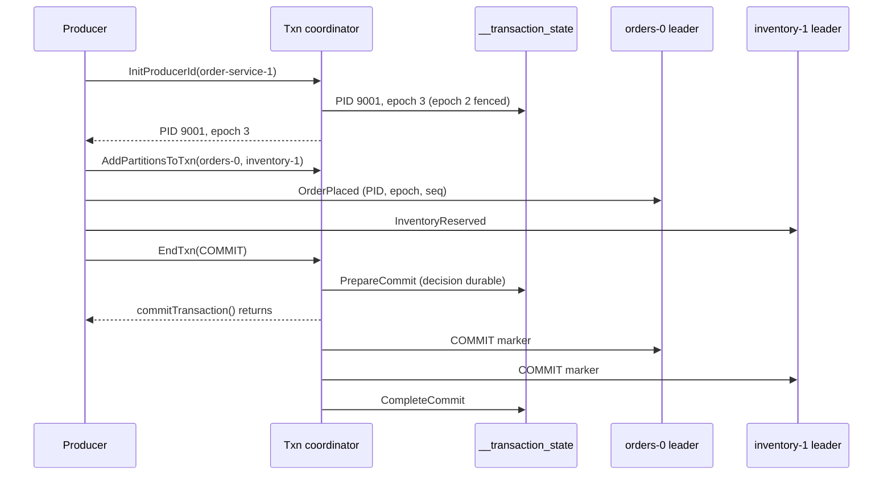

1. **Init:** the id maps to a `__transaction_state` partition whose leader is the coordinator.
   `InitProducerId` raises the epoch, so an old instance (epoch 2) is **fenced**, and any open
   transaction it left is finished or aborted.
2. **Register** the touched partitions, so the coordinator knows where to write markers.
3. **Write:** data lands in the logs immediately, marked transactional.
4. **Commit in two steps:** `PrepareCommit` to `__transaction_state` (from then the commit **will**
   happen, even if the coordinator dies), then COMMIT markers in every partition.

Aborted data stays in the log, and markers take offsets (so offsets have **gaps**):

```
0 A-committed | 1 COMMIT marker | 2 B-aborted | 3 ABORT marker | 4 C-committed
read_uncommitted (default) sees 0, 2, 4   <- aborted data!
read_committed             sees 0, 4
```

Correction: a transactional producer is not enough; every downstream consumer must set
`isolation.level=read_committed`. Its price: it reads only up to the **Last Stable Offset**, the
start of the oldest **open** transaction, so one stuck producer stalls every reader of that
partition until `transaction.timeout.ms` (60 s) aborts it. Keep transactions short and batched.

**Exactly-once consume-process-produce:** outputs **and** input offsets in one transaction.

```java
producer.beginTransaction();
try {
    for (var r : records)
        producer.send(new ProducerRecord<>("payment-results", r.key(), process(r.value())));
    producer.sendOffsetsToTransaction(nextOffsets(records), consumer.groupMetadata());
    producer.commitTransaction();          // outputs + input offsets, atomically
} catch (KafkaException e) {
    producer.abortTransaction();           // outputs hidden, offsets not moved
    rewindToLastCommitted(consumer);
}
```

`groupMetadata()` lets the broker reject a commit from a consumer that lost the partition in a
rebalance. Kafka Streams `exactly_once_v2` is this mechanism. Scope: **only Kafka state**.

**In Spring:** `spring.kafka.producer.transaction-id-prefix=order-svc-` plus
`spring.kafka.consumer.isolation-level=read_committed` (Boot does not set it). <mark class="hl-yellow">Inside a</mark> <mark class="hl-yellow">`@KafkaListener`</mark><mark class="hl-yellow">, the container starts the transaction, your</mark> <mark class="hl-yellow">`kafkaTemplate.send()`</mark>
<mark class="hl-yellow">joins it</mark>, and the container adds the offsets and commits when the method returns. A plain
`send()` outside a transaction now fails; use `executeInTransaction`. The trap: `@Transactional`
over a DB save **and** a Kafka send is still **two commits**; a crash between them disagrees.

**Fencing and ids:** `transactional.id` stable per instance, unique across live instances (two
sharing one keep fencing each other: `InvalidProducerEpochException`). Skip transactions when
at-least-once + idempotent consumers is enough, which is most microservice traffic.

Say it like this: "Kafka exactly-once is idempotent producers plus transactions plus
read_committed consumers: the producer writes outputs and the input offsets in one
transaction, the coordinator records PrepareCommit and writes commit markers into every
partition, and read_committed readers only see committed data."

---

## 31. Dual writes and the outbox pattern  [P0]

```java
@Transactional
public void placeOrder(Order o) {
    orderRepository.save(o);                          // write 1: DB
    kafkaTemplate.send("orders", o.getId(), event);   // write 2: Kafka
}
```

Two systems, no shared commit. Send inside the transaction and the DB rolls back after the event
is out: a **ghost event**. Send after the commit and a crash loses it. Retrying in a loop does
not help if the process dies. No ordering of two independent writes survives a crash.

**The fix: make it one write.** Insert the event into an **outbox table, in the same local
transaction** as the business row; a relay publishes it later.

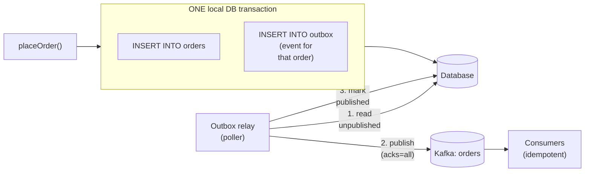

1. **<mark class="hl-yellow">One transaction:</mark>** <mark class="hl-yellow">the order row and the outbox row are saved together or not at all. No
   ghost events, no lost events.</mark>
2. **<mark class="hl-yellow">Poll:</mark>** <mark class="hl-yellow">every few hundred ms, the relay reads the oldest unpublished rows.</mark>
3. **<mark class="hl-yellow">Publish:</mark>** <mark class="hl-yellow">it sends each to Kafka and</mark> **<mark class="hl-yellow">waits for the ack</mark>**.
4. **<mark class="hl-yellow">Mark:</mark>** <mark class="hl-yellow">only after the ack, it marks the rows published (or deletes them).</mark>

```sql
CREATE TABLE outbox (
  id UUID PRIMARY KEY,                 -- event id: consumers dedupe on it
  aggregate_id VARCHAR(64) NOT NULL,   -- orderId -> Kafka key
  event_type VARCHAR(64) NOT NULL, payload JSONB NOT NULL,
  created_at TIMESTAMP NOT NULL, published_at TIMESTAMP NULL   -- NULL = not yet published
);
SELECT * FROM outbox WHERE published_at IS NULL
ORDER BY created_at LIMIT 100 FOR UPDATE SKIP LOCKED;   -- two relays never grab the same rows
```

```java
@Scheduled(fixedDelay = 500)
@Transactional
public void relay() {
    for (OutboxEvent e : outboxRepository.lockNextBatch(100)) {
        kafkaTemplate.send("orders", e.getAggregateId(), e.getPayload()).get();  // wait for ack
        e.setPublishedAt(now());
    }
}
```

The UUID is fine here: it is generated **once**, when the event is created, and every republish
carries it.

**It still duplicates, and that is fine.** Relay publishes row 17, gets the ack, crashes before
marking it; after restart it publishes 17 again. The outbox is **at-least-once publishing**: never
lost, sometimes duplicated, and the consumer dedupes on the event id. <mark class="hl-yellow">Outbox on the producer side + idempotent consumer on the other side is the standard
production answer to "exactly-once across services"</mark>.

Details interviewers push on:

- **Ack before mark.** Mark first and a failed send loses the event forever.
- **Ordering:** key by `aggregate_id`, publish in `created_at` order; several relays with
  `SKIP LOCKED` can still publish one order's events out of order. Fix: one active relay, split by
  `hash(aggregate_id)`, or version numbers.
- **Growth:** delete published rows on a schedule. **Relay down:** rows pile up, nothing lost;
  alert on the age of the oldest unpublished row.
- **Polling vs CDC:** Debezium reads the WAL/binlog instead of polling: lower latency, one more
  system to run, still at-least-once.

Say it like this: "Instead of writing to the DB and Kafka separately, the service inserts the
event into an outbox table in the same local transaction as the business change; a relay
publishes unpublished rows with acks=all and marks them only after the ack. That is
at-least-once with no lost or ghost events, and consumers dedupe on the event id."

---

**Before the next part:**
From memory, draw one 3-broker cluster for `order-events` (RF 3, min.insync 2) and trace one
event end to end on it: the producer's partition choice, the leader append at offset 101,
followers fetching, HW 102, the ack; then the consumer's coordinator lookup, committed offset
100, fetch, commit 501. Kill the leader's broker and say what happens to each piece.
