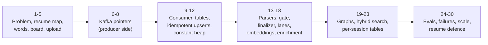

DeepLogLens, end to end: the architecture exactly as your resume states it, taught slowly. For every piece you get the problem it solves, the mechanism box by box (the real messages, tables and transactions), the one or two alternatives you rejected and the argument for your choice, and the follow-up questions to expect. These notes follow the lecture above topic by topic (1 to 30), and the pictures are the lecture's own frames.

**Your resume, the thread through everything below:**

> **DeepLogLens: Grounded RAG Log Intelligence Platform over an Async Kafka Pipeline** (Java, Spring Boot, Kafka, PostgreSQL (pgvector), LangGraph, Python)
> - Log intelligence over GB-scale archives: detects anomalies, writes grounded incident reports, and answers questions citing exact log lines. Deterministic parsers compute all metrics; LLM runs only on flagged windows, cutting LLM calls by 80%.
> - Constant-heap streaming ingest: archives split into window-aligned byte ranges, fanned out over Kafka and read in parallel; offsets commit after durable writes, and idempotent upserts turn at-least-once delivery into exactly-once effects.
> - Two LangGraph graphs: ingest-time with an LLM-as-judge groundedness loop; query-time corrective-RAG (retrieve -> grade -> rewrite -> re-retrieve) over hybrid vector + full-text search on per-session HNSW/GIN-indexed chunk tables.



How each topic is built:

1. **The problem** the piece solves. If you can't say why it exists, you can't defend it.
2. **The mechanism, box by box.** The actual message, table or transaction.
3. **The alternatives.** One or two real options for every big decision, and the argument for yours. This is what makes an interviewer believe the design is yours.
4. **A check.** Answer out loud before reading on.

## 1. The problem

It is 3 AM and checkout returns 503. You have a 2 GB log archive from a dozen services, and your manager wants three answers: **what broke, since when, and how many users were hit.**

Pasting the logs into a chat model fails four ways:

| Problem | Why |
|---|---|
| **Volume** | 2 GB is about 15 million lines. No context window holds that. |
| **Counting** | "How many 503s?" A language model estimates from what it sees; it does not count. |
| **Trust** | The answer has no line numbers, so nobody can check it. |
| **Cost** | You pay for every minute of logs to learn about the few minutes that matter. |

So DeepLogLens gives each job to the tool that is good at it: **code counts every line exactly, the LLM explains only the windows that look abnormal, and every claim points at stored evidence, down to the line numbers.**

The three constraints it was built under explain almost every box on the board:

| Constraint | Number |
|---|---|
| Bounded memory | the whole box is 512 MB (Render free tier), so a heap of ~256 MB |
| Rate limits | 30 requests and 6,000 tokens per minute per Groq key |
| Correctness | counts 100% exact, even after a crash and a redelivery |

**Q. Why does the LLM never answer "how many"?** A model estimates; it doesn't count. Every number comes from deterministic parsers that see every line.

## 2. Your resume, as a map

| Resume phrase | Topic | The number behind it |
|---|---|---|
| GB-scale archives | 12 | 2 GB, 15.5M lines under a 256 MB heap |
| detects anomalies | 14, 24 | F1 0.90, 36 of 36 injected incidents found |
| grounded incident reports | 18, 19 | evidence ids attached by code; judge loop, max 3 attempts |
| citing exact log lines | 10, 21 | every citation is a chunk fingerprint -> line_start..line_end |
| deterministic parsers compute all metrics | 13 | 8 parsers -> `log_metrics` |
| LLM only on flagged windows, 80% fewer calls | 14 | 42,205 calls instead of 220,657 on the 1 GB run (80.9%) |
| constant-heap streaming ingest | 12 | live set 70-92 MB from 100 MB to 2 GB |
| window-aligned byte ranges, fanned out over Kafka, read in parallel | 6-8 | ~5 MB parts, cut at minute boundaries; key `documentId:partIdx` |
| offsets commit after durable writes | 9 | manual ack after the transaction commits |
| idempotent upserts -> exactly-once effects | 10, 11 | SHA-256 content-fingerprint primary key; kill -9, replay, rebalance |
| LLM-as-judge groundedness loop | 19 | `ground_check`, `MAX_CORRELATE_ATTEMPTS = 3` |
| corrective RAG (retrieve -> grade -> rewrite -> re-retrieve) | 21 | `MAX_REWRITES = 2`, at most 6 LLM calls |
| hybrid vector + full-text search | 20 | RRF k = 60, recall@30 0.874 |
| per-session HNSW/GIN-indexed chunk tables | 22, 23 | recall 0.068 shared vs 1.00 own table |

## 3. The vocabulary

| Word | What it is | Example |
|---|---|---|
| Session | one investigation; **owns its own chunk table** | "checkout outage, 29 Sep" |
| Document | one uploaded file | `app.log`, 2 GB |
| Part | a **byte range** of a document, never copied, only pointed at | bytes 15,728,922 to 21,004,117 |
| Window (chunk) | 60 seconds of lines, one row, with its exact line range; **keyed by a content fingerprint** | 09:31, lines 3,401 to 4,610 |
| Metric | an exact count for one window and category | `API / api_5xx = 212` |
| Finding | the LLM's explanation of one flagged window; evidence attached by code | "payment DB pool exhausted" |
| Incident | related findings with a judged story | "DB outage 09:30-09:42" |
| Report | the session summary | markdown + JSON |

**Why the window is the centre:** metrics, anomaly flags, findings, search results and citations all share the same 60-second window, so a citation points at exactly the minute that was counted, flagged and explained.

**Q. A part and a chunk?** A part is a ~5 MB byte range of the file, the unit of parallel work on Kafka. A chunk is one 60 s window stored as a row. One part produces many chunks.

## 4. The whole system on one board

Two golden rules come first:

1. **The request path never does heavy work.** Upload returns in milliseconds; everything expensive happens asynchronously behind Kafka.
2. **Kafka moves facts, blob storage moves bytes, Postgres holds the truth.**


One file through it, with the 1 GB demo run's numbers:

| Step | What happens | Number |
|---|---|---|
| 1. Upload | browser -> blob store with a short-lived presigned URL; the API only checks it arrived | 1.0 GB |
| 2. Split | one streaming pass cuts ~5 MB parts at minute boundaries; a pointer per part goes on Kafka | 205 parts |
| 3. Parse | parallel consumers read only their slice; 8 parsers; one transaction per part | 3,019 windows, 65,456 metric rows |
| 4. Detect | each minute vs the rest of the log: median/MAD baselines, rare patterns, hard rules | 101 of 591 minutes flagged |
| 5. Explain | only flagged windows go to the LLM, one Kafka partition per API key | 42,205 calls, not 220,657 |
| 6. Root cause | Graph 1 groups findings into incidents; a judge checks each story | 6 incidents |
| 7. Ask | Graph 2: corrective RAG over hybrid search, citing exact lines | cited windows + line ranges |

| Piece | Where |
|---|---|
| React SPA | Vercel |
| `loglens-api`: Spring Boot API **and every Kafka worker** (a modular monolith) | Render, Docker |
| Blob store | Backblaze B2 (S3 API); MinIO locally |
| Kafka | Redpanda Cloud (SASL_SSL, SCRAM-SHA-256) |
| Postgres 16 + pgvector | system of record: rows, vectors, full text |
| Orchestrator: FastAPI + LangGraph | the two graphs |
| Models | Groq (chat), Gemini (embeddings) |

**Q. Why one Java deployable?** It fits the free tier, and consumer groups already let you run more copies. The first thing to split out would be the enrichment lane: slow, rate-limited, and scaling with anomalies rather than HTTP traffic.

## 5. The upload: presign, PUT, confirm


1. Browser -> API: presign (file name, size). A duplicate (same session, name, size) returns the existing document.
2. API -> browser: a **presigned PUT URL** for exactly one object, valid **15 minutes**, signed with the storage credentials (the browser never sees them).
3. Browser -> blob store: PUT the bytes directly.
4. Browser -> API: confirm.
5. API -> blob store: **stat the object** (real existence and size, not the client's word).
6. API: save the `documents` row (PENDING), publish **one pointer**, answer `202 Accepted`.

| Option | Problem | Verdict |
|---|---|---|
| Save to the server's disk | Render's disk is wiped on deploy; API and workers can't share it | rejected |
| Stream through the API | every byte passes through the JVM; a thread and buffers held for minutes on 512 MB | rejected |
| **Presigned PUT + confirm** | bytes never touch the API; confirm is one explicit event | shipped |

**The argument:** on a 512 MB box, the cheapest byte is the one the API never touches.

**Q. Why does confirm stat the object?** So size and existence in Postgres are real, and "upload finished" becomes one explicit event to publish.

**Q. Why delete the staged file after ingest?** The chunks in Postgres are the durable copy; blob storage is staging only.

## 6. Kafka, and the first pointer

| Word | Meaning |
|---|---|
| Topic | a named, append-only log; reading doesn't delete, so you can **replay** |
| Partition | an ordered slice of a topic; the record's **key is hashed** to pick it (murmur2 % partitions) |
| Offset | a record's position; **committing** it means "done up to here" |
| Consumer group | each partition has exactly **one owner thread**; parallelism = min(partitions, threads) |

### Pointer #1: `IngestRequest`, produced by confirm


| Envelope | Value |
|---|---|
| topic | `log.ingest.requests`, 6 partitions |
| key | `sessionId` |
| partition | murmur2(key) % 6 |

```json
{
  "sessionId":  "7f3a91c2-...",
  "userId":     "c41e...",
  "documentId": "2b9d...",
  "fileUrl":    "s3://staging/7f3a.../2b9d..."
}
```

| Field | Its job |
|---|---|
| `sessionId` | which investigation; names the chunk table `log_chunks_s_<sessionId>`; also the key |
| `userId` | who owns it; carried so every row a worker writes is attributable |
| `documentId` | which file; its `documents` row (PENDING) exists before the record is sent |
| `fileUrl` | where the bytes are: the **claim check**. The payload stays in the store built for bytes |

About **200 bytes** stands for a 2 GB file. Because the key is `sessionId`, one session's uploads queue in one partition, in order, handled by one splitter at a time.

| Option | Problem | Verdict |
|---|---|---|
| Put the bytes on Kafka | 1 MB default record limit (2,000+ records per 2 GB); the broker stores the file x replication; every replay re-ships it | rejected |
| A jobs table, polled (v1) | poll every 3 s, lock leases (`locked_until`); no replay, no consumer groups | rejected |
| **A pointer on Kafka** | ~200 bytes, replayable, consumer groups share the work | shipped |

**The argument:** the queue carries facts; the store built for bytes carries bytes.

## 7. The splitter: window-aligned byte ranges


The splitter (group `ingest-workers`, 1 thread) consumes the `IngestRequest` and **streams the object exactly once** with a 64 KB buffer, counting bytes exactly at each `\n`, so every offset is a true byte position. It holds one line (capped at 1 MB) and a few counters. gzip/zip are rejected by their magic bytes.

- A line is a **record start** if it begins with a timestamp (ISO-8601 or syslog). Stack-trace lines (`at ...`) have none, so they're never cut points.
- **The cut rule:** at least 5 MB since the last cut, AND this line starts a new minute, AND it has a timestamp. The part ends at this line's first byte. So minutes and stack traces stay whole: that is "window-aligned".
- Hard cap: 20 MB (4 x target), still only on a record start. No timestamps at all: every 5,000 lines.
- `total_parts` is saved on the `documents` row **before** part 0 is sent (topic 15 shows why).

```java
// IngestSplitter: the cut
boolean recordStart = (ts != null) || !anyTimestamp;
boolean windowBoundary = bucket != null && prevBucket != null && !bucket.equals(prevBucket);
if (linesSinceCut > 0 && recordStart) {
    boolean cut =
        (anyTimestamp && windowBoundary && bytesSinceCut >= partTargetBytes)
     || (!anyTimestamp && linesSinceCut >= fallbackLinesPerPart)
     || (bytesSinceCut >= partTargetBytes * 4L);
    if (cut) emit(partStart, offset, firstLine);   // [partStart, offset)
}
offset += lineBytes;                                // exact, at each '\n'
```

Ranges are **half-open** `[start, end)`: neighbouring parts touch exactly, with no gap and no overlap.

## 8. Pointer #2: the part message


| Envelope | Value |
|---|---|
| topic | `log.ingest.parts`, 6 partitions |
| key | `documentId + ":" + partIdx` |
| partition | murmur2(key) % 6 |

```json
{
  "sessionId":        "7f3a...",
  "userId":           "c41e...",
  "documentId":       "2b9d...",
  "fileUrl":          "s3://staging/7f3a.../2b9d...",
  "partIdx":          3,
  "totalParts":       205,
  "byteStart":        15728922,
  "byteEndExclusive": 21004117,
  "firstLineNumber":  121408
}
```

| Field | Its job |
|---|---|
| `sessionId` | names the chunk table to write; validated as a UUID before it is spliced into SQL |
| `userId` | keeps the writes attributable |
| `documentId` | which file; with `partIdx` forms the part's natural key `(document_id, part_idx)` |
| `fileUrl` | where to send the ranged GET |
| `partIdx` | position from 0; in the Kafka key and in the part marker |
| `totalParts` | the completion target, saved before part 0 is sent |
| `byteStart` | inclusive; always the first byte of a timestamped line in a new minute |
| `byteEndExclusive` | exclusive; the next part starts here. Ranged GET: `Range: bytes=15728922-21004116` |
| `firstLineNumber` | global number of the slice's first line: a worker in the middle of the file can't count earlier lines, so citations use original line numbers |

About **300 bytes** of JSON per 5 MB of log: a complete work order, and not one byte of the log.


**Choosing the key**

| Key | Effect | Verdict |
|---|---|---|
| `documentId` | every part of a file hashes to one partition = one owner thread: no parallelism | rejected |
| null | the producer spreads records, but placement isn't deterministic; a replay can land elsewhere | rejected |
| **`documentId:partIdx`** | one file spreads over all partitions; the same part always lands in the same place | shipped |

Ordering isn't needed: completion is a counter plus an atomic claim (topic 15).

**Splitting the file**

| Option | Problem | Verdict |
|---|---|---|
| One message per file | one consumer holds every window; memory grows with the file; one thread | rejected |
| Physical part files | writes the file a second time; N objects to clean up | rejected |
| **Virtual parts** | byte ranges, never copied, read with ranged GETs (Hadoop/Spark call them **input splits**) | shipped |

**The argument:** describe the slice, don't copy it.

## 9. The consumer, and offsets after durable writes

| Commit order | Semantics | Crash result |
|---|---|---|
| commit, then process | at-most-once | work lost |
| process, then commit | at-least-once | redelivered: possible duplicates |
| **at-least-once + idempotent write** | **exactly-once effects** | applying it twice changes nothing |

Never say "exactly-once delivery". A sender can't tell a lost message from a slow one, so it retries, and retries duplicate. Kafka's own exactly-once covers Kafka-to-Kafka inside a Kafka transaction; our effect is a Postgres write.

| Setting | Value | Why |
|---|---|---|
| `enable-auto-commit` / `ack-mode` | false / MANUAL | the offset moves only when the code acknowledges, after COMMIT |
| `max.poll.records` | 1 | a slow record can't hold 499 others hostage (the default 500 once caused a rebalance storm) |
| `max.poll.interval.ms` | 900,000 (15 min) | how long one record may take before the group gives the partition away |
| concurrency | 3 locally, 2 in production | threads in group `ingest-part-workers` over 6 partitions |


1. **Poll** one `IngestPartRequest` (part 3 of 205, offset 41 on partition 4).
2. **Fast path:** `SELECT` from `ingest_parts (document_id, part_idx)`; if present, skip everything (redeliveries and replays cost one query) but still call `tryFinalize`.
3. **Ranged GET**, outside any transaction: only this part's bytes. Lines capped at 64K characters; NUL bytes replaced (Postgres TEXT can't store 0x00).
4. **Chunk** into 60 s windows (at most 2,000 lines or 512 KB each), run the 8 parsers, apply the local hard rules, and **compute each chunk's SHA-256 fingerprint**.
5. **One short transaction**: the idempotent upserts (topic 11).
6. **Acknowledge** only after COMMIT returns: the offset commits. Then `tryFinalize()`.

**The rule behind the order:** slow I/O outside the transaction, one short transaction, then the ack. (Version 1 held a pool connection for minutes inside a transaction wrapped around a network job, and the pool ran dry.)

## 10. What lands in the tables

### The chunk table: one per session


```sql
CREATE TABLE log_chunks_s_7f3a91c2_... (
  chunk_id     CHAR(64) PRIMARY KEY,   -- SHA-256(document_id || line_start || content), hex
  document_id  UUID        NOT NULL,
  time_bucket  TIMESTAMPTZ NOT NULL,   -- the minute
  line_start   INTEGER,                -- original file numbering
  line_end     INTEGER,
  content      TEXT        NOT NULL,   -- <= 2,000 lines or 512 KB
  is_anomalous BOOLEAN DEFAULT FALSE,
  embedding    vector(768),            -- NULL at insert; filled by the enrichment lane
  content_tsv  tsvector GENERATED ALWAYS AS (to_tsvector('simple', content)) STORED,
  created_at   TIMESTAMPTZ DEFAULT NOW()
);
CREATE INDEX ... USING hnsw (embedding vector_cosine_ops) WITH (m = 16, ef_construction = 64);
CREATE INDEX ... USING gin (content_tsv);
CREATE INDEX ... (time_bucket);
```

| Column | Why |
|---|---|
| `chunk_id` | **the content fingerprint**: same bytes in, same key out. This is what makes the insert idempotent |
| `document_id` | a session can hold several files |
| `time_bucket` | the minute; B-tree for time ranges (0.03 ms for a 10-minute range) |
| `line_start`, `line_end` | slice line + `firstLineNumber` - 1: a citation resolves to exact lines |
| `content` | the raw lines; a busy minute becomes several chunks with the same bucket |
| `is_anomalous` | local hard rules at insert; session-wide statistical flags added by the finalizer |
| `embedding` | 768-d, NULL until the enrichment lane fills it (topic 17); HNSW, cosine |
| `content_tsv` | generated once at insert and stored; GIN. Computing it per query took over a second; stored, ~20 ms |

Three indexes per chunk table: **HNSW** on `embedding`, **GIN** on `content_tsv`, **B-tree** on `time_bucket`. That is the resume's "per-session HNSW/GIN-indexed chunk tables".

### `log_metrics`: the exact numbers


| Column | Note |
|---|---|
| `session_id`, `time_bucket`, `category`, `metric` | the composite **primary key** |
| `count` | additive on conflict (`count = count + EXCLUDED.count`) |
| `sum_ms`, `avg_ms` | latency totals, additive |
| `p95_ms` | keeps the larger value on a merge |

`count` is additive, so this upsert **on its own is not safe to repeat**. That is exactly why it only runs for chunks that are new (topic 11).

"How many 503s between 09:30 and 09:40?" is SQL here: an index scan in 0.18 ms, no LLM.

### The bookkeeping tables

| Table | Key | Job |
|---|---|---|
| `ingest_parts` | PK `(document_id, part_idx)` | one row per finished part; the fast path reads it before any I/O |
| `documents` | `total_parts`, `parsed_parts`, `processing_status` | `total_parts` saved before part 0; `parsed_parts += 1` only when the part row was new |

### The fingerprint

> `chunk_id = SHA-256( document_id || line_start || content )`

It is **deterministic**: any delivery of the same part, on any worker, after any restart, computes the same ids. A random UUID would mint new ids on every delivery, and the database couldn't tell a duplicate from a new row.


| Delivery | `INSERT ... ON CONFLICT (chunk_id) DO NOTHING RETURNING chunk_id` | Metrics |
|---|---|---|
| first | the row is new: RETURNING gives `['9f2c...e41a']` | its 212 x 5xx are added |
| redelivery | same bytes, same key: conflict, DO NOTHING, RETURNING `[]` | nothing added: still 212, not 424 |

**Same bytes -> same key -> same row -> counted once.**

| Chunk key | Effect | Verdict |
|---|---|---|
| Random UUID | a redelivery mints new ids; needs a separate dedupe table keyed on the delivery | rejected |
| Position `(document_id, line_start)` | deterministic and smaller, but the id says nothing about the bytes: different content at the same position (after a parser change) would look "already stored" | considered |
| **Content fingerprint** | deterministic, and binds the id to the exact evidence: citations are tamper-evident | shipped |

The technical similarity to name: **git's object ids**. The name of a thing is the hash of the thing (content addressing).

| Follow-up | Answer |
|---|---|
| Collisions? | SHA-256: a 1-in-2^128 birthday bound; you'd need ~2^128 chunks before one is likely |
| Isn't hashing slow? | ~500 MB/s per core: a 5 MB part hashes in ~10 ms, next to a ~2.5 s parse |
| Two identical windows? | every line carries its timestamp, so two minutes never match; `document_id` and `line_start` are in the hash anyway |
| Why 64 hex characters? | readable in logs and SQL; `BYTEA(32)` halves it if storage ever matters |

## 11. Idempotent upserts: exactly-once effects


```sql
-- fast path, before any I/O:
SELECT 1 FROM ingest_parts WHERE document_id = ? AND part_idx = ?;

BEGIN;
INSERT INTO log_chunks_s_7f3a (chunk_id, document_id, time_bucket,
                               line_start, line_end, content, is_anomalous)
VALUES (...), (...), (...)
ON CONFLICT (chunk_id) DO NOTHING
RETURNING chunk_id;                        -- only the chunks that are new

INSERT INTO log_metrics (...)               -- metrics of RETURNED chunks only
VALUES (...)
ON CONFLICT (session_id, time_bucket, category, metric) DO UPDATE
SET count  = log_metrics.count + EXCLUDED.count,
    p95_ms = GREATEST(log_metrics.p95_ms, EXCLUDED.p95_ms);

INSERT INTO ingest_parts (document_id, part_idx) VALUES (?, ?)
ON CONFLICT DO NOTHING;                     -- 1 row = first time

UPDATE documents SET parsed_parts = parsed_parts + 1
WHERE id = ?;                               -- only if that row was new
COMMIT;
-- only now: ack.acknowledge()  -> the offset commits
```

> **The one rule: insert-if-absent on a deterministic key; anything additive runs only for what was new.** The same rule is used three times: chunks (content fingerprint), embeddings and findings (the work id, topics 17 and 18).

**Two workers, the same part, at the same time** (possible for a moment after a rebalance): worker 1 inserts chunk `9f2c...` with its transaction open; worker 2's insert of the same key **waits** on the unique index; worker 1 commits; worker 2 takes the conflict path, does nothing, RETURNING is empty. No lock service: the unique index serialises the race.


| Crash | State | What the redelivery does |
|---|---|---|
| **A** before COMMIT | nothing written; offset not committed | runs as if for the first time |
| **B** after COMMIT, before ack | everything written; offset not committed | fast path finds the marker and skips; even without it every `chunk_id` conflicts, RETURNING is empty, no count moves |
| **C** after the ack | both committed | never redelivered |

Three crash points, one final database state.

**How it was proven**

| Test | Result |
|---|---|
| kill -9 the instant a part logs "committed" (after COMMIT, before the ack), x3 | counts equal a clean run |
| replay `log.ingest.parts` from offset 0 | no count moves, no session changes state |
| rebalance: kill one of two instances mid-run | equal counts |
| Testcontainers integration test in CI: every part and enrichment item delivered twice | identical database; the LLM called once per item |

| Option | Problem | Verdict |
|---|---|---|
| Kafka transactions (EOS) | atomic consume -> produce inside Kafka; a Postgres write can't join it | wrong boundary |
| Offsets stored in Postgres in the same tx, `seek()` on assignment | exactly-once too, a valid design; but tied to one group's partitions: a replay through a new group or a re-published part duplicates; custom rebalance code per consumer | considered |
| **Idempotent upserts on data keys** | holds for redelivery, replay, rebalance and manual re-runs; plain SQL | shipped |

**The argument:** idempotency is a property of the data, not of the delivery.

> **Model answer, "how do you get exactly-once processing?"** I don't claim exactly-once delivery: Kafka delivers at least once. Offsets commit only after the database transaction commits (manual ack). Every write is an idempotent upsert on a deterministic key: chunks by a SHA-256 content fingerprint, parts by (document, part index). Additive writes like metric counts only run for rows RETURNING reports as new. I proved it with kill -9 at the worst moment, a full replay, a rebalance, and a CI test that delivers everything twice.

**Q. Recovery time after a crash?** Until the group rebalances: ~30 s, bounded by the session timeout.

## 12. Constant-heap streaming ingest

| What is in memory | Size |
|---|---|
| the splitter | one line (<= 1 MB) + a 64 KB buffer + counters |
| each part thread | one part in flight: a 5 MB slice is 10-15 MB as Java strings, plus its windows and metric rows |
| total | **threads x one part + a fixed baseline** (Spring, Kafka clients, pool): nothing depends on file size |


Setup: the real jar, `-Xmx256m` (a leak would crash, not hide), SerialGC, files of 100 MB to 2 GB from a clean state, `jstat -gc` every 250 ms and the GC log.

| Input | Lines | Live set max / median MB | Peak heap MB |
|---|---|---|---|
| 100 MB | 783,064 | 76 / 69 | 186 |
| 500 MB | 3,891,710 | 91 / 75 | 228 |
| 1 GB | 7,776,324 | 92 / 76 | 227 |
| 2 GB | 15,502,276 | 81 / 70 | 204 |

**Peak heap** is the top of the GC sawtooth and follows collector timing. The **live set after a full GC** is what the program really holds: it stayed **70-92 MB while the input grew 20x**. 2 GB took 977 s.

| Part threads | Live set max MB | MB/s |
|---|---|---|
| 1 | 56 | 0.81 |
| 2 | 81 | 1.35 |
| 4 | 111 | 2.15 |
| 8 | 163 | 2.25 (+5% speed for +47% memory) |

The memory knob is threads (~15-25 MB each), never the file. Throughput stops at the core count: regex parsing is CPU-bound.

**Q. Constant for any input?** For any file size. Line size is bounded separately: 1 MB in the splitter, 64K characters stored.

## 13. Deterministic parsers compute all metrics

```text
2026-09-29 09:30:02 ERROR [db-proxy] - SQL timeout duration=12000ms

log_metrics (session, 09:30, ERRORS,   errors)          count  += 1
log_metrics (session, 09:30, DATABASE, sql_timeouts)    count  += 1
log_metrics (session, 09:30, DATABASE, sql_latency_ms)  sum_ms += 12000
```

| Parser | Counts |
|---|---|
| ApiCall | calls, 2xx / 4xx / 5xx, latency |
| Sql | queries, timeouts, deadlocks, pool waits |
| Error, Performance, Auth | ERROR/FATAL and exceptions; slow operations; 401 / 403 |
| Lifecycle, Traffic, Signature | restarts, health DOWN; request volume; normalised error templates |

| Option | Problem | Verdict |
|---|---|---|
| Ask an LLM to extract | not repeatable, costs tokens per line, still estimates | rejected |
| Template mining (e.g. Drain) | templates for unknown formats, but not domain metrics (pool exhausted, p95) | rejected |
| **Deterministic parsers** | exact, repeatable, free per line; the LLM gets them as authoritative facts | shipped |

## 14. The anomaly gate: cutting LLM calls by 80%

**LLM cost = flagged windows x their size, not file size.** The gate is the cost control.


Ten minutes of ERROR counts: `2, 3, 2, 4, 3, 2, 3, 250, 2, 3`.

| Statistic | Value | Note |
|---|---|---|
| mean | 27.4 | one bad minute dragged it up 10x and inflated sigma with it |
| median | 3 | barely moves until half the data is abnormal |
| MAD | 1 | x 1.4826 estimates a standard deviation |
| threshold | 3 + 3.5 x max(1.4826 x 1, 1) = **8.2** | and the count must be >= 3 |
| modified z of 250 | ~167 | textbook cut-off 3.5 (Iglewicz and Hoaglin): textbook, not tuned |

| Rule | Where it runs |
|---|---|
| Hard rules: FATAL, OOM, deadlock, pool EXHAUSTED, health DOWN | in the part thread, at insert |
| Count spikes (ERROR, WARN, exceptions, 5xx, 401, 403, SQL failures): >= 3 and > median + 3.5 x max(1.4826 MAD, 1) | finalizer, one SQL statement |
| Latency spikes: p95 > 2 x the median and a MAD outlier | finalizer |
| Rare signatures: an error template in <= 2% of windows | finalizer |

Two phases, like MapReduce: a part can't know the session's median, so part threads apply hard rules only and the finalizer runs the session-wide statistics once, in SQL (`percentile_cont`), ending in `UPDATE ... SET is_anomalous`.


| | Value |
|---|---|
| LLM calls without the gate (every 5,000-char segment of the 1 GB run) | 220,657 |
| LLM calls with the gate (571 of 3,019 chunks flagged) | 42,205 |
| **Fewer LLM calls** | **80.9%** |
| On incident-dense eval logs, 1 to 50 lines/s | at least 71% at every traffic level |

The saving depends on how much of the log is abnormal: always quote it with its dataset.

| Option | Problem | Verdict |
|---|---|---|
| Send every window | ~5x the calls; days of free-tier quota | rejected |
| Mean + 3 sigma | the spike inflates sigma and masks itself; with n = 10 no point can exceed (n-1)/sqrt(n) = 2.85 sigma | rejected |
| **Median + MAD + rules** | robust until half the data is bad; F1 0.90, 36 of 36 incidents | shipped |

## 15. The finalizer, and when embeddings start

```sql
-- every part calls tryFinalize() after its transaction (and on the fast path)
UPDATE documents
SET    processing_status = 'COMPLETED'
WHERE  id = :documentId
  AND  total_parts > 0
  AND  parsed_parts >= total_parts
  AND  processing_status = 'PROCESSING';
-- rows updated: 1 for exactly one caller, 0 for everyone else
```

The row lock picks exactly one winner: no coordinator, no lock service. **Every path calls `tryFinalize`**, because the last part may commit and then die before finalizing; its redelivery skips the writes but must still finalize.

The winner, in order:

1. Runs the session-wide gate rules in one SQL statement (flags are now final).
2. Counts the work items (one per flagged window + one per 80 chunks), saves the target, sets ENRICHING.
3. Publishes `ENRICH_WINDOW` items for flagged chunks and `EMBED_BATCH` items for **all** chunks.
4. Deletes the staged file: the chunks are the durable copy.

> **When are embeddings created?** After the finalizer's claim: once every part has committed, by `EMBED_BATCH` items on their own rate-limited lane. Never inside the ingest transaction, never at query time. Every chunk row already exists with `embedding` NULL.

Why then: network calls never sit inside the ingest transaction; the provider is rate-limited (100 RPM per Gemini key) and needs its own paced lane; enrichment needs the final flags and embeddings share its lane and completion counter; ingest runs at CPU speed and the lane drains at quota speed.

### Pointer #3: `EnrichRequest`


| Envelope | Value |
|---|---|
| topic | `llm.enrich.requests`, one partition per API key |
| partition | chosen by the producer: `floorMod(hash(workId), keySlots)` |

```json
{
  "workId":           "e7a0...",
  "sessionId":        "7f3a...",
  "kind":             "EMBED_BATCH",
  "chunkIds":         ["9f2c41d7...e41a", "..."],
  "attempt":          0,
  "notBeforeEpochMs": 0
}
```

| Field | Its job |
|---|---|
| `workId` | stable across redeliveries and retries: **the idempotency key of the lane**; its hash picks the partition |
| `sessionId` | which chunk table |
| `kind` | `ENRICH_WINDOW` (explain one flagged window) or `EMBED_BATCH` (up to 80 chunks) |
| `chunkIds` | content fingerprints of the chunks; the worker reads the text from Postgres |
| `attempt` | a 429 re-publishes with attempt + 1; rate-limited work retries ~24 h (1,440 attempts) before the DLQ |
| `notBeforeEpochMs` | now + 60 s after a 429; 0 the first time |

For the 1 GB run: 571 `ENRICH_WINDOW` items and 38 `EMBED_BATCH` items (3,019 / 80).

| Who declares the file done? | Problem | Verdict |
|---|---|---|
| A coordinator service | another service to deploy, keep alive and recover | rejected |
| A "last part" message | parts finish out of order: last sent isn't last finished | rejected |
| **A conditional UPDATE** | `parsed_parts >= total_parts`; the row lock picks one winner | shipped |

**The argument:** the database you already trust is the coordinator.

## 16. Lanes: one partition per API key

A consumer group gives each partition exactly one owner. **Pair partition p with API key p, and each key has a single owner: its rate limiter needs no lock.**


1. The finalizer picks each item's partition: `floorMod(hash(workId), keySlots)`.
2. Lane thread i owns partition i and key i (fewer keys than partitions: `partition % slots`); a single owner even across instances.
3. Each lane paces itself: one call per `60,000 / (30 x 0.8)` = **2,500 ms**, plus a sliding 60 s budget of `6,000 x 0.8` = **4,800 tokens**. The 0.8 leaves 20% headroom.
4. Results commit with the work marker (topics 17-18).
5. A 429 never sleeps a lane: the item goes to `llm.enrich.retry.60s` with `notBefore = now + 60 s`; one retry thread re-publishes it.
6. Non-retryable errors go to the DLQ and still count as done, so a session always finishes.

| Napkin | Calls per minute per key |
|---|---|
| by requests: 60,000 / 2,500 | 24 |
| tokens per call: 5,000 chars ~ 1,250 + prompt, metrics, output | ~1,600 tokens |
| by tokens: 4,800 / 1,600 | **~3**: the token budget binds |

| Option | Problem | Verdict |
|---|---|---|
| A shared limiter with a lock | works in one JVM, breaks across instances | rejected |
| A Redis token bucket | a network call before every LLM call; another system to fail | rejected |
| **Partition per key** | Kafka's assignment = single owner; no lock. Trade-off: partitions can't shrink, no borrowing between keys | shipped |

## 17. How embeddings are made


1. **Ledger check:** `workId` already in `enrich_work_done`? Skip before any API call (a replay costs 0 tokens).
2. Read the 80 chunks' text by `chunk_id`.
3. Cap each text at **8,000 characters** (the leading slice retrieves the chunk just as well; the full text stays in Postgres).
4. One `batchEmbedContents` call: **`gemini-embedding-001`**, up to 80 texts, `outputDimensionality = 768` (the default 3,072 wouldn't fit `vector(768)`).
5. Paced by `EmbeddingKeyPool`: per key, 75 of 100 requests and 24K of 30K tokens per sliding minute; a 429 benches the key 15 s and rotates.
6. One transaction, then ack:

```sql
BEGIN;
INSERT INTO enrich_work_done (work_id, session_id) VALUES (:workId, :sessionId)
ON CONFLICT DO NOTHING;                      -- 1 row = first time
-- only if that row was new:
UPDATE log_chunks_s_7f3a SET embedding = :vector WHERE chunk_id = :fingerprint;   -- x 80
UPDATE sessions SET enriched_windows = enriched_windows + 1 WHERE id = :sessionId;
COMMIT;
```

The embedding UPDATE is naturally idempotent (same vector twice, same row); the counter is additive, so everything sits behind the marker. The HNSW and GIN indexes are maintained by Postgres as rows change.

| Option | Problem | Verdict |
|---|---|---|
| Inside the part transaction | a network call inside a DB transaction; ingest at quota speed; v1's pool exhaustion | rejected |
| Lazily at query time | the first question waits for thousands of embeddings; unembedded chunks can't be found | rejected |
| **Once, async, every chunk** | off the request path and out of ingest; paced; idempotent | shipped |

Why every chunk, not only flagged ones: questions ask about the minutes around an incident too ("what was happening just before the 503s?").

## 18. How enrichment is done

1. **Ledger check** on `workId`.
2. Read the window and its exact metrics from `log_metrics`, labelled **"parser-extracted, authoritative"**.
3. Split windows over 5,000 characters on **record boundaries** (a stack trace is never cut across calls).
4. One Groq call per segment, paced by the lane, with a strict JSON contract.
5. **Code attaches the evidence:** `evidence_chunk_ids` = the chunk the call was about, never the model's output.
6. Fingerprint the finding, then one transaction.

```text
SYSTEM:
You are a production-log analyst. You receive one time window of application logs plus
the exact metrics a deterministic parser already extracted from it. Ground every statement
in the provided lines and metrics - never invent request ids, stack frames, or numbers.
Respond with STRICT JSON: one object, or an array of objects:
{ "category", "severity", "title", "explanation", "confidence" }
If the window is unremarkable, return [].

USER:
METRICS (parser-extracted, authoritative):
  API api_5xx count=212 . DATABASE pool_wait p95_ms=4100
LOG WINDOW:
  09:31:02 ERROR [pay] HTTP 503 /checkout ...
```


| Column | Note |
|---|---|
| `session_id`, `fingerprint` | unique key; fingerprint = SHA-256(category + normalised title: lower-cased, digits dropped, whitespace collapsed) |
| `category`, `severity` | clamped to allowed values |
| `title`, `explanation` | the model's words |
| `evidence_chunk_ids` | set by code; merged when the finding repeats |
| `occurrence_count` | additive: behind the work marker |
| `time_range_start`, `time_range_end` | widened as the finding recurs |

```sql
BEGIN;
INSERT INTO enrich_work_done (work_id, session_id) VALUES (?, ?)
ON CONFLICT DO NOTHING;                       -- new? continue. not new? stop.
INSERT INTO log_findings (session_id, fingerprint, category, severity, title,
       explanation, evidence_chunk_ids, time_range_start, ...)
VALUES (...)
ON CONFLICT (session_id, fingerprint) DO UPDATE
SET occurrence_count   = log_findings.occurrence_count + 1,
    evidence_chunk_ids = <union of old and new>,
    time_range_end     = GREATEST(log_findings.time_range_end, EXCLUDED.time_range_end);
COMMIT;
```

The evidence chain is built entirely by code: **report -> incident -> finding -> chunk_id -> line_start..line_end -> raw lines.** No id in it was written by a model.

| Option | Problem | Verdict |
|---|---|---|
| One call for the whole session | no context window fits; can't say which minute a claim is about | rejected |
| Explain every window | ~5x the calls, mostly "nothing happened" | rejected |
| **One flagged window per call** | the gate picks; each finding tied to one window by code; metrics as facts | shipped |

## 19. Graph 1: incidents, with an LLM-as-judge loop

How it starts: every committed work item bumps `enriched_windows`; when it reaches the total, one caller wins (same counter + claim pattern) and the session moves to CORRELATING; Java calls `POST /analyze/{session_id}`; Python answers 202 and runs the graph in the background; the graph writes incidents and the report and sets DONE (the UI watches over SSE).

| LangGraph word | In Graph 1 |
|---|---|
| State | `AnalyzeState`: session, findings, metrics, clusters, current cluster, attempt, incidents, report |
| Nodes | functions that read the state and return updates |
| Conditional edges | pick the next node from the state: this makes the loop |
| Recursion limit | sized as `12 + findings x 7` |


1. `load`: findings and top metrics from Postgres.
2. `cluster` (**plain Python, no LLM**): same category, time ranges within 300 s.
3. `correlate`: the LLM writes `{narrative, root_cause}` for one cluster (`llama-3.3-70b-versatile`).
4. `ground_check`: **the judge**, a second prompt, answers `{grounded, reason}` against that cluster's findings.
5. Not grounded and attempts left: back to `correlate`. **At most 3 attempts** (`MAX_CORRELATE_ATTEMPTS`); the last story is kept but stored `grounded = false` with the judge's reason, visible to the user.
6. `write_incidents`, `compose_report` (exact metrics table from SQL), `save_report`: DONE.

```python
verdict = llm.chat_json_object(prompts.GROUND_CHECK_SYSTEM,
                               prompts.ground_check_user(cluster, narrative, root_cause),
                               ("grounded",))
grounded = verdict.get("grounded") in (True, "true", "True")
last_attempt = attempt + 1 >= config.MAX_CORRELATE_ATTEMPTS     # 3
if grounded or last_attempt:
    incident = {..., "grounded": grounded, "judge_reason": reason}  # stored, visible
```

| Option | Problem | Verdict |
|---|---|---|
| No check | an unsupported cause ships as fact | rejected |
| Self-critique in the same prompt | the writer grades itself in one pass; no separate verdict | rejected |
| **A separate judge in a capped loop** | independent verdict + reason; up to 3 rewrites; stored and shown | shipped |

Say the limit yourself: a judge is another probabilistic model, a filter rather than a proof. Calibrate it against human labels (topic 26).

**Q. Worst-case LLM calls per cluster?** 3 writes + 3 judgements.

## 20. Hybrid search: vector + full text

| | Vector (embeddings) | Full text |
|---|---|---|
| Good at | meaning: "throttled" ~ "rate limited" | exact tokens: `ORA-01555`, `status=429` |
| Weak at | exact tokens | paraphrase |
| Index | HNSW, cosine | GIN on the stored `content_tsv`, `'simple'` config (no stemming, no stop words) |

Logs are full of exact tokens, so full text matters more here than in prose RAG.

```sql
-- vector leg
SELECT chunk_id, line_start, line_end FROM log_chunks_s_7f3a
ORDER BY embedding <=> :question_vector LIMIT 30;

-- full-text leg: terms ORed
SELECT chunk_id, line_start, line_end FROM log_chunks_s_7f3a
WHERE  content_tsv @@ to_tsquery('simple', 'upstream | provider | throttled | payment')
ORDER  BY ts_rank(content_tsv, query) DESC LIMIT 30;
```


**Reciprocal Rank Fusion:** `score = sum over lists of 1 / (60 + rank)`, ranks from 0, top 30 per leg. Ranks only: cosine distance and `ts_rank` are different units.

| Chunk | Ranks | Score |
|---|---|---|
| A | vector 0, full text 3 | 1/60 + 1/63 = **0.0325** |
| C | vector 1, full text 4 | 1/61 + 1/64 = **0.0320** |
| B | full text 0 only | 1/60 = **0.0167** |

Agreement between lists beats being top of one.

| Measured | Value |
|---|---|
| recall@10, hybrid (vector alone) | 0.757 (0.393) |
| recall@30, hybrid | 0.874 |
| latency | p50 36 ms, p95 45 ms |

| Option | Problem | Verdict |
|---|---|---|
| Vector only | misses exact error codes; long windows average away the one line | rejected |
| Weighted score sum | needs one unit; normalisation shifts per corpus; weights to tune | rejected |
| **Hybrid + RRF** | ranks only; one constant (k = 60) | shipped |

## 21. Graph 2: corrective RAG, citing exact lines

A router first:

| Question | Goes to |
|---|---|
| "How many / between when?" | SQL over `log_metrics`: exact, no LLM |
| "What's the summary?" | the stored report |
| "Why / what happened?" | Graph 2 |


1. `retrieve`: embed the question (full text only if embedding fails), hybrid top 30.
2. `grade`: one LLM call returns `{relevant_ids}`.
3. `rewrite`: nothing relevant and fewer than **2** rewrites (`MAX_REWRITES`): rewrite and retrieve again.
4. `generate`: JSON `{answer, citations}`; `best_docs` keeps the first non-empty retrieval.
5. Citations are filtered to ids actually retrieved: **made-up ids are 0 by construction.**

```python
def _after_grade(state: DrilldownState) -> str:
    if state.get("graded"):
        return "generate"
    if state.get("rewrites", 0) < config.MAX_REWRITES:   # 2
        return "rewrite"
    return "generate"   # budget spent: answer from what we have

citations = [str(c) for c in data.get("citations", []) if str(c) in valid_ids]
```

**From a citation to exact lines:** the answer cites chunk fingerprints -> `GET /sessions/{id}/evidence?chunkIds=...` -> `line_start 3,401 .. line_end 4,610` -> the UI shows those lines, numbered in the original file (thanks to `firstLineNumber`).

| Option | Problem | Verdict |
|---|---|---|
| Plain RAG | one call, but nothing checks the retrieval | rejected |
| A free agent with tools | unpredictable cost and latency; hard to evaluate | rejected |
| **Corrective RAG on a budget** | self-checking; 2 calls normally, at most 6 (3 grades, 2 rewrites, 1 answer) | shipped |

> **Model answer, "how do you stop hallucinated citations?"** Evidence ids are never written by a model: code attaches them at enrichment. At query time a cited id survives only if it was actually retrieved. Each id is a content fingerprint that resolves to exact line numbers. And the judge loop marks any incident story it couldn't verify.

## 22. Why a new table for every session

Start from the query: **every search is "nearest chunks, within this one session"**: a vector search with a very selective filter.

How HNSW searches: a layered graph (few nodes with long links on top, every node with short links at the bottom, ~m = 16 links each); a greedy walk from the top towards the query, dropping a layer at a time; it keeps the best **`ef_search`** candidates (40 by default). It is approximate, and **it knows nothing about your WHERE clause**: the filter runs after the walk (**post-filtering**).


One shared table, 120,000 vectors from 101 sessions; small session s050 owns under 1% of the rows. The walk keeps its 40 best candidates, almost all from other sessions; after the filter, **0.68 rows of the 10 asked for: recall 0.068.** Its own table: **recall 1.0 in 0.24 ms.**


| ef_search | own table | shared + iterative scan | shared, walk then filter |
|---|---|---|---|
| 40 | 1.00 | 0.256 | 0.068 |
| 100 | 1.00 | 0.256 | 0.134 |
| 200 | 1.00 | 0.256 | 0.208 |
| 400 | 1.00 | 0.256 | 0.244 |

10x more candidates only moved the shared index from ~0.7 to ~2.4 rows of 10: the extra candidates are spent on other sessions.

> **What breaks filtered vector search is selectivity, not table size.** And a quick test hides it: when the filter matches ~1,000 rows the planner skips HNSW and scans exactly; two same-size sessions measured 65% and 7% depending on the plan.

## 23. Every alternative, and how to defend the choice


| Layout (s050, 120k vectors, 101 sessions) | recall@10 | p50 | Why not / why |
|---|---|---|---|
| shared HNSW + WHERE | 0.068 | 0.36 ms | fast and wrong: post-filtering |
| shared + iterative scan (pgvector 0.8) | 0.256 | 0.48 ms | keeps walking, stops at `max_scan_tuples` (20,000) |
| shared, exact (B-tree + sort) | 1.00 | 0.55 ms | correct, but cost grows linearly with the session |
| partial HNSW index per session | 1.00 | 0.29 ms | still DDL per session; the predicate must match exactly; deletes leave dead rows in the shared heap |
| LIST partition per session | 1.00 | 0.40 ms | the closest alternative: same isolation, pruning, same catalog cost; the scale-out path |
| separate vector DB (namespaces) | native filter | - | a second store: two writes that can drift, no joins, no shared transaction: the idempotent single-transaction write is gone |
| **own table per session** | **1.00** | **0.24 ms** | shipped: the graph contains only its own session's vectors |

| Buys | Costs |
|---|---|
| recall 1.00 in 0.24-0.60 ms | tables created at runtime (name only from a validated UUID: no injection) |
| each HNSW graph holds only its own rows | raw JDBC: JPA can't map a dynamic table |
| delete = `DROP TABLE`: instant, no dead rows, no vacuum | catalog growth: tens of thousands of tables slow planning |
| small builds: 3 per-session tables in 3.3 s vs one shared index in 15.4 s | migrations loop over every table |

**The way out at scale:** LIST/HASH partitions by tenant, then day. Only the name resolution changes; the queries stay the same.

The table's life: **created** with the session (if that fails, the session row is removed); **written** by ingest and updated once per chunk for the embedding (one dead tuple each, autovacuum cleans it); **deleted** with `DROP TABLE`.

| How to choose, in general | Layout |
|---|---|
| the filter matches most rows | shared HNSW + WHERE |
| a few percent or less, up to thousands of tenants | own table or partial index (DeepLogLens) |
| many thousands of tenants | LIST or HASH partitions |
| can't isolate at all | iterative scan; tune `max_scan_tuples`, watch latency |

> **Model answer, "why a new table for each session? Isn't that an anti-pattern?"** Every query is a vector search filtered to one session, and that filter is very selective. A shared HNSW index post-filters: for a small session I measured recall 0.068. Raising ef_search 10x only reached 0.24, and the iterative scan 0.26. A table per session gives recall 1.0 at 0.24 ms, and deleting a session is a DROP TABLE. The cost is runtime DDL and catalog growth; at thousands of tenants I'd move to LIST partitions, and only the name resolution would change.

**Q. Why not a dedicated vector database?** It's a second store: two writes per chunk that can drift, no shared transaction (the idempotent write breaks), and no joins with metrics, findings and line ranges. And the measured bottlenecks were parsing and writes, never vector search.

**Q. Is the HNSW index always used?** No: on a 360-row session the planner did a seq scan + top-N sort (2.06 ms, exact); forced HNSW took 0.84 ms.

## 24. Evals I: scoring the anomaly gate

| Dataset | Size | Labels |
|---|---|---|
| seeded generator (`eval_{low,medium,high}noise`) | 6 h, 2 lines/s, ~43.7k lines, 360 windows | 12 injected incidents each, gold timelines and gold line numbers |
| held-out seeds 101, 202, 303 | 6 h each | never tuned on |
| Loghub BGL, Thunderbird, HDFS, Spark, Apache | 2,000 lines each | BGL: real alert labels |
| the owner's demo log | 10k lines | none |

The eval runs the **production** chunker, parsers and gate (no copy, no LLM): $0 and deterministic. A Testcontainers test checks the SQL rules flag exactly the windows the Java rules do.


Worked on 30 windows: 10 gold, 9 flagged.

| Metric | Formula | Value |
|---|---|---|
| TP / FP / FN / TN | flagged & real / flagged & not / real & missed / quiet | 7 / 2 / 3 / 18 |
| Precision | TP / (TP + FP) | 7 / 9 = 0.78 |
| Recall | TP / (TP + FN) | 7 / 10 = 0.70 |
| F1 | 2PR / (P + R) | 0.74 |
| Incident recall | incidents with >= 1 flagged window | 3 / 3 = 1.0 |
| Call reduction | 1 - calls with gate / calls without | 9 of 30 windows -> 70% fewer |
| False alarms per hour | FP / hours of log | what on-call feels |
| Detection delay | first flagged window - incident start | seconds |

Calls are counted as 5,000-character segments (split on record boundaries), so big windows count for more.

| Measured | Value |
|---|---|
| F1, medium noise | **0.90** (precision 0.88, recall 0.92) |
| incidents found | **36 / 36** |
| false alarms per hour | **1.5** |
| F1 on held-out seeds | **0.92-0.95** |
| call reduction, 1 to 50 lines/s | at least 71% |

## 25. Evals II: scoring retrieval

`golden_qa.json`: **65 questions** over the medium-noise log, **21.5% unanswerable** on purpose; gold answers and gold line numbers **computed by code** from the incident labels. A **gold chunk** is a chunk whose line range contains a gold line.

| Metric | Formula | Example |
|---|---|---|
| recall@k | gold chunks in the top k / all gold chunks (averaged over questions) | 2 gold, 1 in the top 10 -> 0.5 |
| MRR | mean of 1 / rank of the first gold chunk | first gold at rank 3 -> 1/3 |

k = 5, 10 and 30: 30 is exactly what the grader reads.


| Retriever | recall@10 | recall@30 |
|---|---|---|
| vector only | 0.393 | 0.441 |
| full text only | 0.779 | 0.852 |
| **hybrid (RRF)** | 0.757 | **0.874** |

Hybrid wins at depth 30, the depth the grader reads; in logs the full-text leg carries a lot of the weight because of exact tokens. Say that nuance yourself.

**The bug the ablation found** (your best eval story): hybrid first scored *exactly* like vector-only. The full-text leg used `websearch_to_tsquery`, which ANDs every word; with `'simple'`, "which" and "the" became required, so it matched 0 rows for natural questions, and RRF fused a single list. Fix: OR the meaningful terms, and a stored generated `content_tsv` with a GIN index. **recall@10 0.393 -> 0.757; the full-text leg 1,374 ms -> 19 ms.**


## 26. Evals III: answers, the judge, and CI

| Metric | How | Example |
|---|---|---|
| Correctness | **code** compares numbers, times, entities with the gold answer | - |
| Abstention | unanswerable: said "not in the logs"? answerable: refused wrongly? | - |
| Citation validity | cited ids were retrieved | - |
| Citation precision | cited chunks with a gold line / cited chunks | 3 of 4 -> 0.75 |
| Citation recall | at least one cited chunk has a gold line | 1 |
| Faithfulness | **LLM judge**: supported claims / claims | 4 of 5 -> 0.8 |

Check by code first; use a judge only for what code can't check.

| Judge bias | Mitigation |
|---|---|
| self-preference (favours its own family) | judge with a different model family |
| position, length | fixed formats, temperature 0 |
| unknown agreement with humans | ~40 human labels, **Cohen's kappa** = (p_o - p_e) / (1 - p_e); trust totals at >= 0.6 |

Kappa worked: agree on 34 of 40 -> p_o = 0.85; chance agreement p_e = 0.60 -> kappa = 0.25 / 0.40 = **0.625**.

Every eval LLM call is cached by hash(prompt, model, params, endpoint), with a hard stop at $5.

```json
{
  "_why": "Set from the first robust-mode run (eval_mediumnoise: F1 0.901, incident recall 1.0, call reduction 77.8%). The eval is deterministic, so any drop is a real behaviour change, not noise.",
  "anomaly_gating": {
    "eval_mediumnoise": {"window.f1": 0.88, "incident_recall": 1.0, "gating.call_reduction": 0.75}
  }
}
```

CI runs the unit tests, the Testcontainers tests and the fast seeded eval (~1 minute, $0) and fails below `evals/thresholds.json`.

**Quote numbers honestly:** gate and retrieval numbers are deterministic, so quote them. Answer-quality numbers (faithfulness, kappa) need a real model and an API key: quote them only from a run you've done, with its date and commit (the harness writes both into every report).

**Q. "95% faithfulness, so 5% hallucination?"** Only if the judge agrees with humans: show its kappa first.

## 27. Failures: retries, poison, and the DLQ

| Word | Meaning |
|---|---|
| Retry | fixes transient errors: timeouts, rate limits |
| Poison message | fails every time; retried forever it blocks its partition (**head-of-line blocking**) |
| Dead-letter queue | parks the poison so the partition moves on |


- **Happy path:** process, commit, acknowledge.
- **429:** to `retry.60s` with `notBefore`; the retry thread re-publishes; ~24 h of attempts; nothing dropped.
- **Anything else:** `DefaultErrorHandler` with `FixedBackOff(2000 ms, 2)`: 3 attempts.
- **Then loudly:** the session is FAILED with a readable reason; the record goes to the DLQ with size-capped headers. Every upload ends parsed, or failed with a reason: never stuck.

| Bad input | What happened | Fix |
|---|---|---|
| one NUL byte | Postgres TEXT can't store 0x00; the error handler quoted the row, NUL included, and failed too: stuck in PARSING | replace NUL at the edge, NUL-safe reasons, reject gzip by magic bytes |
| one 100 MB line | OOM stops a Kafka listener while HTTP stays healthy (a zombie) | bound every buffer + `-XX:+ExitOnOutOfMemoryError` |
| a 42 MB DLQ record | Spring copied the full exception into headers; Kafka's limit is 1 MB | capped headers: 42,010,200 -> 9,681 bytes |

## 28. Scaling it: 1,000 tenants, 1 TB a day

| Napkin | Value |
|---|---|
| 1 TB / 86,400 s | **11.6 MB/s**, ~75k lines/s |
| windows | 1,000 tenants x 1,440 min = **1.44M a day** |
| LLM calls | 10% flagged x ~4 segments = 576k a day = **6.7/s** |
| ingest machines | 11.6 / ~2 MB/s per 4-vCPU box = **at least 6** |
| vectors | 1.44M x 768 x 4 B = **~4.4 GB a day** |


| Change | Why |
|---|---|
| keep presigned uploads and ranged reads | bytes still bypass the API |
| transactional outbox (row + event in one tx, a relay publishes) | no event lost between the DB and Kafka; consumers are idempotent, so duplicates are harmless |
| ingest fleet: 64+ partitions, autoscale on lag, per-tenant quotas, COPY | parsing CPU, then Postgres writes, bind first |
| chunks in partitions by tenant, then day | replaces per-session tables at this scale; retention = drop a partition |
| enrich fleet: cheap model for windows, strong one for incidents | cost |
| a query service that routes: SQL, report, RAG only for "why" | cost and correctness |

## 29. Defending the resume, line by line

**Bullet 1** - "Log intelligence over GB-scale archives ... cutting LLM calls by 80%."

- GB-scale: a 2 GB, 15.5M-line archive under a 256 MB heap.
- Anomalies: a median/MAD gate, F1 0.90, 36 of 36 injected incidents found.
- Grounded reports: evidence ids attached by code; a judge checks every incident story.
- Exact lines: every citation is a content fingerprint that resolves to `line_start..line_end`.
- 80%: parsers compute every metric; the LLM only sees flagged windows: 42,205 calls instead of 220,657 (80.9%).

**Bullet 2** - "Constant-heap streaming ingest ... exactly-once effects."

- One streaming pass emits window-aligned byte ranges: cut only on a timestamped line, at a new minute, after 5 MB.
- Each range is a ~300-byte pointer, keyed `documentId:partIdx` so one file spreads over every partition.
- Parallel ranged GETs; the live set stayed 70-92 MB from 100 MB to 2 GB.
- Offsets commit only after the transaction commits.
- Idempotent upserts: chunks keyed by a SHA-256 content fingerprint; counts added only for rows RETURNING reports as new. Proven with kill -9, replay and rebalance.

**Bullet 3** - "Two LangGraph graphs ... per-session HNSW/GIN-indexed chunk tables."

- Ingest-time: clustering in code, an LLM writes each story, a separate judge loops it up to 3 times; unverified stories stored `grounded = false`.
- Query-time: corrective RAG, top 30, grade, up to 2 rewrites, re-retrieve; citations filtered to retrieved ids.
- Hybrid: HNSW cosine + GIN full text, RRF k = 60, recall@30 0.874.
- Per-session tables: shared HNSW post-filters to recall 0.068 for a small session; its own table 1.0 at 0.24 ms.

**When any claim is challenged:** the number and its dataset -> the mechanism -> the alternative you rejected -> the known limit. Never argue from adjectives.

## 30. Rapid fire, the pitch, and the final check

| Question | Answer |
|---|---|
| What's inside a part message? | sessionId, userId, documentId, fileUrl, partIdx, totalParts, byteStart, byteEndExclusive, firstLineNumber |
| The parts topic's key? | `documentId:partIdx`: spreads one file over all partitions |
| When does the splitter cut? | >= 5 MB since the last cut, a new minute, a timestamped line; hard cap 20 MB |
| The chunk table's primary key? | SHA-256(document_id \|\| line_start \|\| content); `INSERT ... ON CONFLICT DO NOTHING RETURNING` |
| Why gate the metrics upsert? | it adds counts: it only runs for chunks RETURNING reports as new |
| When are embeddings created? | after the finalizer's claim, by EMBED_BATCH items (80 chunks) on the enrichment lane |
| Embedding model and size? | `gemini-embedding-001`, 768 dims, first 8,000 chars |
| Who attaches a finding's evidence ids? | code, never the model |
| Groq lane pacing? | 2,500 ms per call + 4,800 tokens per sliding minute |
| Graph 1's loop cap? | 3 attempts per cluster, then `grounded = false` with the reason |
| Graph 2's worst case? | 6 LLM calls: 3 grades, 2 rewrites, 1 answer |
| RRF constant? | k = 60, ranks from 0, top 30 per leg |
| Shared index vs own table, small session? | recall 0.068 vs 1.00 (0.24 ms) |
| What does CI fail on? | window F1 < 0.88, incident recall < 1.0, call reduction < 75% |
| Live set on 2 GB at `-Xmx256m`? | 81 MB max, 70 median, after full GC |

> **The 30-second pitch.** DeepLogLens turns a GB-scale log archive into a grounded incident report and a Q&A chat that cites exact lines. Deterministic parsers compute every metric, and a robust statistical gate sends only abnormal windows to the LLM: 80% fewer calls. Ingest streams byte ranges over Kafka with a constant heap, and idempotent upserts on content fingerprints give exactly-once effects. Two LangGraph graphs: a judge loop for incident stories, and corrective RAG over hybrid search on per-session indexed tables. Java, Spring Boot and Kafka for ingest, Postgres with pgvector for everything stored, Python LangGraph for the graphs, and evals in CI.

**Final check, out loud:** walk one redelivered part through the whole system. Kafka redelivers (the offset never committed); the fast path finds the part marker and skips the read; even without it every chunk_id conflicts, RETURNING is empty, no metric moves and `parsed_parts` isn't bumped; `tryFinalize` still runs and its claim returns 0 if already finalized. Nothing changes: exactly-once effects.

**Homework:** close this page and draw the board from memory. Then walk one part through it, out loud: the message and its nine fields, the transaction statement by statement, and a crash at point B. If you can draw the part message and the chunk table without looking, you can defend every line of the resume.
