LogLens, end to end: the architecture, every decision behind it, how each number was measured, and the follow-up questions an AI engineering interview will ask. These notes follow the lecture above section by section, and the pictures are the lecture's own frames. Everything here was checked against the repository (`C:/PROJECTS/LogLens`, branch `fix-ui`), not only the design doc.

By the end you should be able to defend five things:

1. The whole system, box by box: which service calls which, and why.
2. Every number: where it came from, and how to work it out again on a whiteboard.
3. Every decision: the options, what was tried first, what shipped.
4. The bugs your own tests found, each with a before and an after.
5. The follow-ups, including the gaps to admit before anyone asks.

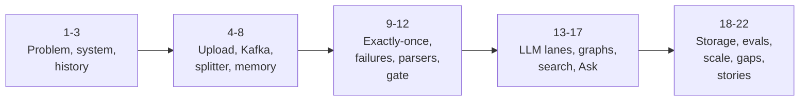

## 1. The problem

It is 3 AM and checkout returns 503. You have a 2 GB log archive from 12 services, and your manager wants three answers: what broke, since when, and how many users were hit.

Pasting the logs into a chat model fails in four separate ways:

| Problem | Why |
|---|---|
| **Volume** | 2 GB is about 15 million lines. No context window holds that. |
| **Counting** | "How many 503s?" A language model estimates from what it sees; it does not count. |
| **Trust** | The answer has no line numbers, so nobody can check it. |
| **Cost** | You pay for every minute of logs to learn about the few minutes that matter. |


So LogLens gives each job to the tool that is good at it. **Code counts every line exactly. The model only explains the minutes that look abnormal. Every claim points at stored evidence.**

### The 30-second pitch

> LogLens turns a large log archive into a cited incident report and a Q&A chat. Parsers compute exact per-minute metrics on every line, and a statistical gate picks the few abnormal minutes. Only those go to an LLM, which explains them; a LangGraph pipeline groups them into incidents, with a judge checking each story. Questions are answered by corrective RAG over hybrid search, citing the exact log windows used. It's Java, Spring Boot and Kafka for ingest, Postgres with pgvector for everything stored, and Python LangGraph for the two graphs. And I built evals and fault-injection tests that found real bugs, each fixed with a before-and-after number.

### Requirements

| Functional | Non-functional | Out of scope |
|---|---|---|
| Upload an archive of several GB | 512 MB box, heap about 256 MB | Live streaming from log agents |
| Watch progress live | Free-tier LLM rate limits | Alerting, long retention |
| Exact per-minute metrics | Counts 100% exact, even after crashes | gzip/zip uploads (rejected with a clear message) |
| A report: incidents with causes and evidence | Every claim traceable to log lines | Timestamp formats beyond ISO-8601 and syslog |
| Ask questions, get cited answers | Cost grows with anomalies, not bytes | |


Name the three hardest constraints early: **bounded memory, provider rate limits, and exactly-once effects under crashes.** They explain byte-range parts, Kafka lanes and marker rows before anyone asks.

Avoid the phrase "real-time". It doesn't need to be: the upload returns at once and a report within minutes is fine. Saying real-time pulls the interview towards a streaming design you didn't build.

### The constraints in numbers

| Constraint | Number |
|---|---|
| Render free box | 512 MB RAM; the JVM uses 50%, so a heap of about 256 MB |
| Groq, per key | 30 requests and 6,000 tokens per minute |
| Gemini embeddings, per key | 100 requests and 30,000 tokens per minute |
| Counts | 100% exact |


### Core entities

| Entity | What it is | Example |
|---|---|---|
| Session | one investigation | "checkout outage, Sep 29" |
| Document | one uploaded file | `app.log`, 2 GB |
| Part | a **byte range** of a document, never copied | bytes 0 to 5 MB |
| **Window (chunk)** | 60 seconds of lines, one row, with its exact line range | 09:31, lines 3,401 to 4,610 |
| Metric | an exact count for one window and category | `API / api_5xx = 212` |
| Finding | the LLM's explanation of one window; chunk ids attached by code | "payment DB pool exhausted" |
| Incident | related findings, a narrative, the judge's verdict | "DB outage 09:30-09:42" |
| Report | the session summary | markdown + JSON |

**Why is the window the centre?** Metrics, anomaly flags, findings, search results and citations all share it, so a citation points at exactly the minute that was counted, flagged and explained.

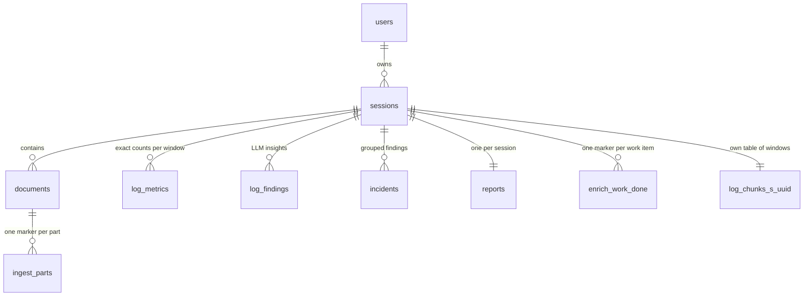

### The API, in the order a file moves

```http
POST /api/v1/sessions                          create session + its chunk table
POST /sessions/{id}/documents/presign          15-min upload URL, or "duplicate"
PUT  <presigned URL>                           browser -> blob store, directly
POST /sessions/{id}/documents/{doc}/confirm    stat object, save row, Kafka pointer
GET  /sessions/{id}/progress                   SSE: status changes
GET  /sessions/{id}/metrics|findings|incidents|report
POST /sessions/{id}/drilldown                  ask a question
GET  /sessions/{id}/evidence?chunkIds=...      cited windows + line ranges
--- Java -> Python (internal) ---
POST /analyze/{session_id}   -> 202, runs in the background
POST /drilldown
```


Auth: `POST /auth/register`, `/login`, and `/guest` (a guest lands on the demo session).

## 2. The whole system on one board

This is the same diagram the LogLens site shows: the client, the blob store, the application server (API and workers in one app), Kafka, the LLM providers, Postgres for data and vectors, LangGraph for root cause and questions, and Redis for chat history.


Follow one file through it in seven steps (numbers from the 1 GB demo run):

| Step | What happens | Number |
|---|---|---|
| 1. Upload | Browser sends the file straight to the blob store with a short-lived link; the API only checks it arrived | 1.0 GB |
| 2. Split | A splitter reads the file once and cuts ~5 MB pieces at minute boundaries; a pointer per piece goes on Kafka | 205 pieces |
| 3. Parse | Workers read only their slice; eight parsers count errors, 5xx, latency, SQL failures per minute; one transaction per piece | 3,019 windows, 65,456 metric rows |
| 4. Detect | Each minute is compared with the rest of the same log: median baselines, rare patterns, hard rules | 101 of 591 minutes flagged |
| 5. Explain | Only flagged minutes go to the LLM; each API key has its own partition and worker | 42,205 calls of 220,657 possible |
| 6. Root cause | LangGraph groups findings into incidents; a judge checks each story | 6 incidents |
| 7. Ask | A decision graph reads the chat from Redis, resolves follow-ups, picks a route | answers cite exact lines |


> **One sentence explains most of the board: Kafka moves facts. Blob storage moves bytes. Postgres holds the truth.**

### Where each piece runs, and who calls whom


| Piece | Where | Detail |
|---|---|---|
| React SPA + `/api/ask`, `/api/log` | Vercel | the Ask chat runs here as serverless functions |
| `loglens-api` | Render free tier, Docker | one Spring Boot jar: the API **and every Kafka worker** (a modular monolith) |
| Blob store | Backblaze B2 (S3 API); MinIO locally | staging only, deleted after ingest |
| Kafka | Redpanda Cloud | `SASL_SSL`, `SCRAM-SHA-256`; messages are pointers, never file content |
| Postgres 16 + pgvector | Render | Hikari pool **5 in production, 30 locally** (the free DB allows few connections) |
| Orchestrator | Render free tier, FastAPI + LangGraph | Java calls it over **public HTTPS** (free Render services can't use a private network) |
| Models | Groq (chat), Gemini (embeddings) | split because Groq serves no embedding models |
| Live demo | Vercel + Neon pgvector + Redis | replays a **precomputed** 1 GB run; its Ask is live (`openai/gpt-oss-120b`) |

Say the last row before an interviewer finds it: the public demo is a replay of a run made by the same Java parsers and gate.

### Upload to report, end to end


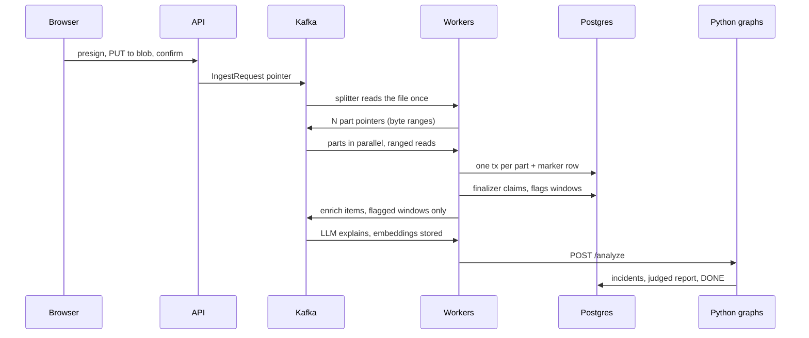

### The session status machine

One column, `sessions.analysis_status`, drives the whole UI. A scheduled check runs every **1.5 s** and pushes an SSE event when a subscribed session's status changes.


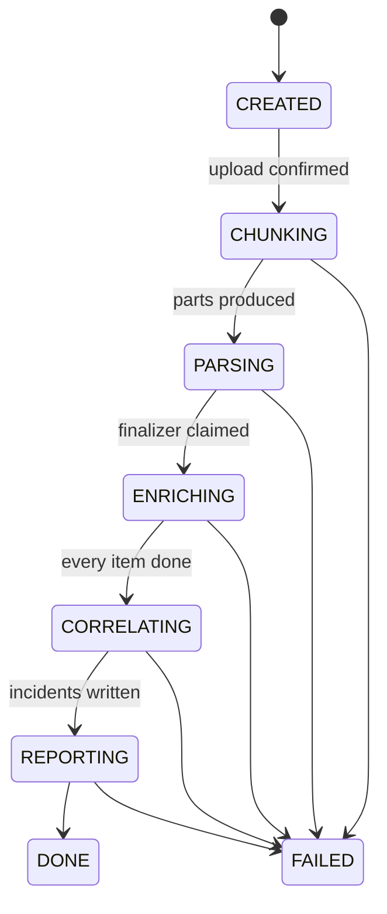

**Gap found in the code:** Java's call to Python is best-effort (three attempts) and Graph 1 runs as a FastAPI `BackgroundTask`. If the Python service is cold or restarts mid-run, a session waits in CORRELATING. The fix is a small job that re-triggers stuck sessions. Mention it yourself.

**Q. Why does the browser upload straight to blob storage?**
So a 2 GB upload costs the 512 MB API no memory and no threads. The API answers in milliseconds.

**Q. What travels on Kafka: bytes or pointers?**
Pointers: an ingest request, then byte ranges. The file only ever lives in blob storage.

**Q. Why one Java deployable instead of microservices?**
One deployable fits the free tier, and consumer groups already let you run more copies. If you had to split something out, it would be the enrichment lane: slow, rate-limited, and scaling differently from HTTP.

**Q. Is the public demo running the whole pipeline live?**
No. It replays a precomputed 1 GB run made by the same Java parsers and gate. Its question answering is live.

## 3. How it got here

Every piece of the design was forced by something that broke.

### Version 1 (2025): three failures that shaped everything

LogLens began as a document Q&A app (ExamPrep, DeepDocAI, ChunkAI; renamed LogLens on July 15, 2026). Jobs sat in a Postgres table polled every 3 seconds, with `locked_by` and `locked_until = now + 5 min`.

| What broke | Root cause | What changed |
|---|---|---|
| Same document processed twice | `CompletableFuture.allOf()` called **without `.join()`**: the scheduler returned, its transaction committed, and job locks were released while jobs still ran | join first; later, Kafka |
| Hikari pool exhausted | `@Transactional` wrapped a 2-5 minute embedding job, holding one connection the whole time | the rule: **short tx, slow I/O outside, short tx** |
| Out of memory on 512 MB | whole files and big batches in memory | SerialGC, heap at 50% of RAM, smaller batches |


### Then the pivot, and the walls

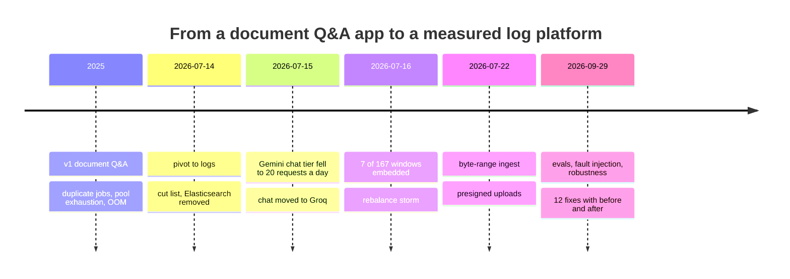

The July 14 design doc had a **cut list**: Elasticsearch was cut, because evidence lookup is by ID and exact-token search only runs inside one session, which a Postgres GIN index covers. Naming what you removed, and why, is a strong signal.

### What the measurement pass found

The project had **no tests** before September 29. Evals, benchmarks and fault injection found:

| Found by | Bug | Before -> after |
|---|---|---|
| kill -9 fault injection | enrichment lane double-counted after a crash | +5.8% -> exact |
| replay from offset 0 | enrichment replay redid 8,820 LLM calls, doubled counts | -> skipped by markers |
| replay from offset 0 | part replay turned finished sessions FAILED | -> no effect |
| gate eval at 1-50 lines/s | LLM savings fell to 0% on busy logs | F1 0.576 -> 0.901 |
| retrieval ablation | hybrid search was vector-only | recall@10 0.393 -> 0.757 |
| prompt visibility check | model saw 10.7% of the evidence | -> 44.1% |
| robustness tests | NUL/gzip hangs, 100 MB line OOM, 42 MB DLQ record | 8 of 8 inputs end cleanly |


The common thread: every fix started with a measurement that disagreed with what I expected, and twice the measurement proved my first theory wrong.

**Q. What would you do differently?**
Write the evals before the features. Two real bugs (a non-exactly-once enrichment lane and a dead full-text leg) hid for months behind a UI that looked fine. And at demo scale, fewer moving parts: an in-JVM queue and a Java state machine would do; Kafka and Python are there for the scaled shape.

**Q. Did Kafka fix the duplicate-processing bug?**
No. That bug was a missing `join`. Kafka replaced DB polling later, for replay and per-key partitions. Kafka still redelivers, which is why marker rows exist.

## 4. The upload path

| Option | Status | Problem |
|---|---|---|
| Save to the server's disk | tried (v1) | Render's disk is wiped on deploy; API and workers can't share it |
| Stream through the API into blob storage | the endpoint still exists | bytes pass through the JVM; a request thread is held for minutes |
| **Presigned PUT + confirm** | shipped July 22 | none for memory: the API never holds the file |


A **presigned URL** is a time-limited URL for one object, signed on the server with the storage credentials. Whoever holds it can upload to that one object without ever seeing the credentials.


```java
// DocumentController.presign (shortened)
Optional<Document> existing = documentRepository
    .findBySessionIdAndOriginalFileNameAndFileSizeBytes(sessionId, fileName, sizeHint);
if (existing.isPresent()) {
    return ResponseEntity.ok(PresignResponse.duplicate(existing.get()));
}
UUID documentId = UUID.randomUUID();
String uploadUrl = fileStorageService.presignPut(sessionId, documentId, PRESIGN_EXPIRY_SECONDS);
return ResponseEntity.ok(PresignResponse.fresh(documentId, uploadUrl));
```

On **confirm** the server stats the object (real existence and size, not the client's word), saves the `documents` row, and sends an `IngestRequest`. The staged object is deleted after ingest: the chunks in Postgres are the durable copy.

A detail from `MinioStorageService`: inside Docker the API reaches MinIO as `minio:9000`, but the browser needs a public host. Presigned URLs are signed with a **second client configured with the public endpoint**, because the host is part of the signature.

### The dual write (a gap to raise yourself)

`kafkaTemplate.send` is **not awaited** after the database commit in confirm, and the same pattern appears in the splitter and the retry re-publish. If Kafka is down right after the commit, the row exists and the event is lost.

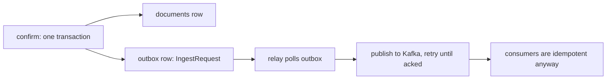

The standard fix is a **transactional outbox**: write the event into an outbox table in the same transaction as the row, and let a relay publish it. Duplicates are harmless because consumers are already idempotent.

**Q. Why a confirm step instead of trusting the client?**
The server checks the object itself, so size and existence in the DB are real, and "upload finished" becomes one explicit event to publish.

**Q. Why delete the staged file?**
The chunks in Postgres are the durable copy; blob storage is staging only.

## 5. Kafka, and why it's here

| Term | Meaning |
|---|---|
| Topic | a named, append-only log; reading doesn't delete, so **replay** works |
| Partition | an ordered slice of a topic, records numbered by offset; the key hash picks the partition |
| Consumer group | each partition has **one owner** in the group; parallelism = min(partitions, threads) |
| Offset commit | "done up to here"; after a crash, the new owner starts from the last commit |

| Commit order | Semantics | Crash result |
|---|---|---|
| commit, then process | at-most-once | work lost |
| process, then commit | at-least-once | redelivered, duplicates |
| at-least-once + idempotent write | **exactly-once effect** | harmless |


### The six topics

| Topic | Partitions | Key | Group, threads |
|---|---|---|---|
| `log.ingest.requests` | 6 | sessionId | `ingest-workers`, 1 |
| `log.ingest.parts` | 6 | `documentId:partIdx` | `ingest-part-workers`, 3 local / 2 prod |
| `log.ingest.dlq` | 1 | - | parked |
| `llm.enrich.requests` | 1 per chat key | chosen explicitly | `llm-workers`, 1 per key |
| `llm.enrich.retry.60s` | 1 per key | sessionId | `llm-retry`, 1 |
| `llm.enrich.dlq` | 1 | sessionId | parked |

Consumer settings: `enable-auto-commit=false`, `ack-mode=MANUAL`, `max.poll.records=1`, `max.poll.interval.ms=900000`, `auto-offset-reset=earliest`.


**Why is the parts topic keyed by `documentId:partIdx`?** The key picks the partition. A document-only key sends every part of one file to one partition, owned by one thread: no parallelism. The composite key spreads one file's parts across all six.

### July 16: the rebalance storm

`max.poll.records` was the default 500. Enrichment records could block for about 90 seconds on rate limits, and Spring processes every record of a poll before polling again. 500 slow records blew past the 15-minute `max.poll.interval.ms`; the coordinator removed the consumer, it rejoined, got the same uncommitted records, and the cycle repeated. Offsets never committed, so embeddings were never saved. **Fix: `max.poll.records=1`** (commit `aff1bcb`).


**Q. Why Kafka, and not RabbitMQ or a database table?**
Replay (for rebuilding and testing), partitions as per-key lanes for rate limiting, and consumer groups for parallelism. RabbitMQ deletes on ack and has no partition-level ordering; the DB table was v1 (3 s polling, lock leases).

**Q. Doesn't Kafka's exactly-once mean no duplicates?**
It covers Kafka-to-Kafka inside a Kafka transaction. Consumers still see redeliveries after a crash, and my effects are in Postgres.

**Q. Isn't Kafka overkill for a small app?**
At demo scale, yes; an in-JVM queue would work. The design targets the scaled shape, the rate limiting depends on partitions, and the crash tests depend on replay.

**Q. Does processing need ordering?**
No. Completion is a counter plus an atomic claim, so parts can finish in any order.

## 6. The splitter: virtual parts

| Option | Status | Problem |
|---|---|---|
| One message per file | tried July 15 | one consumer kept every window in a list: memory grew with the file, one thread |
| Physical part files | considered July 17 | writes the file a second time; N objects to clean up |
| **Virtual parts** | shipped July 22 | byte ranges cut at minute boundaries; workers do ranged GETs; no copy ever written |

Hadoop and Spark call these **input splits**. LogLens adds one rule: never cut inside a log record or inside a minute.

The splitter streams the object once with a **64 KB buffer**, counting bytes exactly at each `\n`, so every offset is a true byte position. A line is a **record start** if it begins with a timestamp (ISO-8601 or syslog). Stack-trace lines (`at ...`) have none, so they are never record starts.


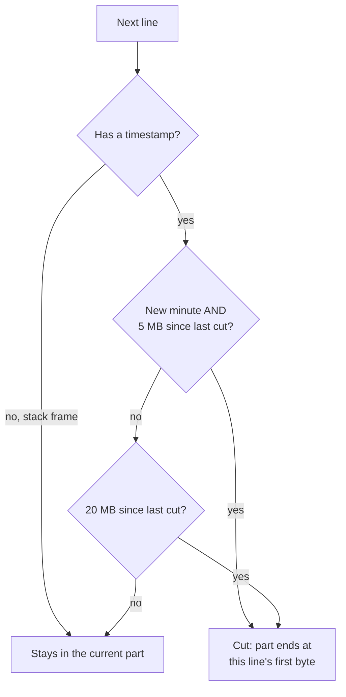

```java
// IngestSplitter.computeParts: the cut
boolean recordStart = (ts != null) || !anyTimestamp;
boolean windowBoundary = bucket != null && prevBucket != null
                         && !bucket.equals(prevBucket);
if (linesSinceCut > 0 && recordStart) {
    boolean cut =
        (anyTimestamp && windowBoundary && bytesSinceCut >= partTargetBytes)
        || (!anyTimestamp && linesSinceCut >= fallbackLinesPerPart)
        || (bytesSinceCut >= partTargetBytes * 4L);
    if (cut) emit(partStart, offset, firstLine);
}
```

| Setting | Value | Why |
|---|---|---|
| target | 5 MB (`part-target-bytes=5242880`) | cut only at a new minute, on a timestamped line |
| hard cap | 20 MB (4 x target) | one runaway minute can't make a giant part; still only on a record start |
| no timestamps | 5,000 lines per part | windows of 500 lines, bucketed by **global** line number |
| line buffer | 1 MB max | added after the 100 MB-line OOM |
| gzip/zip | rejected by magic bytes | "Compressed archive (gzip/zip) is not supported" |

Each part becomes a tiny message on `log.ingest.parts`:

```text
{ partIdx: 3, totalParts: 410, byteStart: 15_728_922,
  byteEndExclusive: 21_004_117, firstLineNumber: 121_408 }
```

`firstLineNumber` keeps citations in **original** line numbers, and `total_parts` is saved **before** the first part is sent, so the finalizer can never run early.


### Napkin: re-derive your own numbers

| Number | How |
|---|---|
| ~129 bytes per line | 2,000 MB / 15.5M lines |
| ~400 parts in 2 GB | 2 GB / a bit over 5 MB |
| 12,920 windows in the bench file | 15.5M lines / 20 lines per s / 60 = ~12,900 minutes: one chunk per minute |
| 205 parts in the 1 GB demo | 1 GB over 591 min = ~1.8 MB per minute, so ~3 minutes per part |
| 3,019 chunks for 591 minutes | ~9,000 lines per minute / 2,000-line chunk cap = ~5 chunks per minute |


**Q. Don't ranged reads need the whole object first?** No. S3 and MinIO serve `Range: bytes=a-b` directly.

**Q. How much memory does the splitter use?** One line (max 1 MB) plus counters. Never say it "loads" the file.

## 7. Part workers and the finalizer


A part is processed in four moves:

1. **Check the marker first** with a cheap SELECT; if done, skip all I/O (but still call `tryFinalize`).
2. **Slow work outside any transaction:** ranged read, chunk into 60 s windows, 8 parsers, local hard rules.
3. **One short transaction:** insert the marker, the chunks, the metrics, and increment `parsed_parts`.
4. **Always** call `tryFinalize`.

```java
// PartConsumer.process (shortened)
if (partRepository.isProcessed(documentId, part.partIdx())) {
    finalizer.tryFinalize(sessionId, documentId, part.fileUrl()); // redelivery
    return;                                                        // no read at all
}
List<String> lines = readSlice(part.fileUrl(), part.byteStart(), length);
// chunk into 60 s windows, run the 8 parsers, apply the local hard rules
Boolean processed = txTemplate.execute(status -> {
    if (!partRepository.claimPart(documentId, part.partIdx()))
        return Boolean.FALSE;                          // someone already did it
    chunkRepository.insertBatch(sessionId, chunkRows);
    metricsWriter.upsert(sessionId, metricRows);
    documentRepository.incrementParsedParts(documentId);
    return Boolean.TRUE;
});
finalizer.tryFinalize(sessionId, documentId, part.fileUrl());
```

`claimPart` is `INSERT INTO ingest_parts (document_id, part_idx) VALUES (?, ?) ON CONFLICT DO NOTHING`: one row inserted means "mine", zero means "already done".


### The atomic finalize claim: no coordinator

```java
@Query("update Document d set d.processingStatus = COMPLETED "
     + "where d.id = :id and d.totalParts > 0 "
     + "and d.parsedParts >= d.totalParts "
     + "and d.processingStatus = PROCESSING")
int claimFinalize(@Param("id") UUID id);  // 1 for the winner, 0 for the rest
```

Row locking lets exactly one caller get one row back. No lock service, no leader election. The winner runs the session-wide statistics, counts the enrichment work, sets ENRICHING, publishes enrichment items (flagged windows) and embedding batches (all chunks), and deletes the staged file.

**Why does every path call `tryFinalize`?** The last part commits, then the JVM dies before `tryFinalize`. On redelivery the marker skips the writes, but the finalizer still has to run. Calling it on every path, guarded by the claim, covers that window.

**Gap found in the code:** the claim commits **first**; the outlier SQL, the enrichment publishes and the file delete run after it, outside that transaction. A crash right after the claim leaves a session no one can re-claim. Fix: a FINALIZING state with a sweeper that resumes it, or make the follow-up idempotent and re-runnable.

## 8. Bounded memory, measured

| Term | Meaning | Proves bounded memory? |
|---|---|---|
| Process RSS | heap + metaspace + thread stacks + JIT code | no |
| Peak heap used (`jstat`) | top of the sawtooth, just before a GC; follows GC timing and `-Xmx` | no |
| **Live set after full GC** | bottom of the sawtooth: what the program really holds | **yes** |

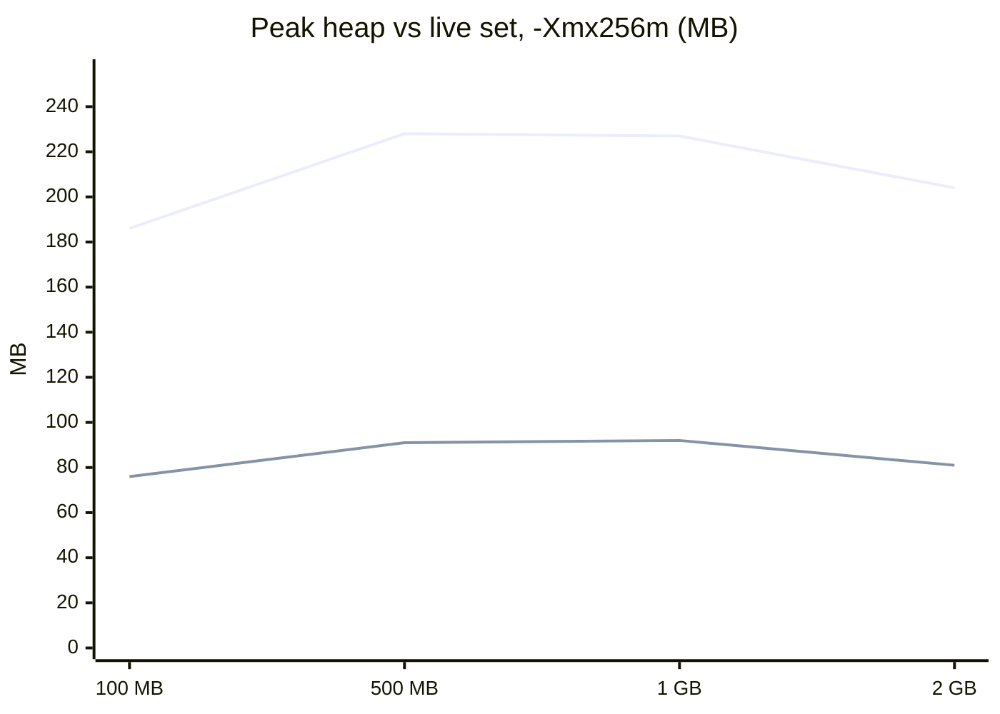

Setup: the real jar, `-Xmx256m` (a leak would crash instead of hiding), SerialGC, 3 part threads, embeddings off, stub LLM, seeded files of 100 MB to 2 GB from a clean state; `jstat -gc` every 250 ms and the GC log (`Pause Full ... 180M->70M`) for the live set.

**The first measurement misled me:** peak heap rose 186 -> 228 MB and looked like a leak. It was the top of the sawtooth. The live set stayed **70-92 MB** while input grew 20x, and the 2 GB run even peaked lower than the 1 GB one.


| Input | Lines | Ingest s | MB/s | Live set max / median MB | Peak heap MB | GC share | Peak RSS MB |
|---|---|---|---|---|---|---|---|
| 100 MB | 783,064 | 61.2 | 1.63 | 76 / 69 | 186.0 | 3.5% | 554 |
| 500 MB | 3,891,710 | 278.8 | 1.79 | 91 / 75 | 227.8 | 3.0% | 580 |
| 1 GB | 7,776,324 | 494.1 | 2.02 | 92 / 76 | 226.8 | 3.4% | 633 |
| 2 GB | 15,502,276 | 976.8 | 2.05 | 81 / 70 | 203.6 | 3.5% | 562 |

2 GB: 977 s, 2.05 MB/s (= 2,000 / 977), 15,870 lines/s, 5,904 GC pauses, max 196 ms. The splitter reached the end of the file after 137 s (~14.6 MB/s); the rest was CPU-bound parsing.

**What grows with the file:** time, messages, rows, GC count. **Not memory.**

### The memory knob is threads


| Part threads | Live set max MB | MB/s | Speed-up |
|---|---|---|---|
| 1 | 56 | 0.81 | 1.00x |
| 2 | 81 | 1.35 | 1.67x |
| 4 | 111 | 2.15 | 2.65x |
| 8 | 163 | 2.25 | 2.78x |

Live set ~ threads x one part in flight (a 5 MB slice as Java strings is 10-15 MB) + a baseline (Spring, Kafka clients, pool). Throughput is close to linear up to the 4 cores, then flat: 8 threads bought 5% more throughput for 47% more live memory.


> **Model answer, "prove memory is constant":** I ran the real jar with `-Xmx256m` on seeded files from 100 MB to 2 GB, from a clean state each time. The live set after full GC stayed between 70 and 92 MB, with no OutOfMemoryError. I used the live set from GC logs, not peak heap, because the peak follows collector timing. What grows is time, messages, rows and GC count, and GC stayed at 3-3.5% of the run. The knob is concurrency: ~15-25 MB of live set per part thread.

**Q. Is memory constant for any input?** For any file size. Not for any line size: one 100 MB line caused an OOM. Lines are now capped at 1 MB in the splitter and 64K characters stored.

**Q. Why SerialGC?** Lowest overhead on a small heap with one or two cores; G1's per-region bookkeeping costs memory the free tier doesn't have. Nuance: benchmarks ran on JDK 21; the production image is Temurin 17, same collector and flags.

**Q. Where does throughput stop scaling?** At the core count: regex parsing is CPU-bound and shares 4 vCPUs with Postgres and Kafka. The splitter reads each file once, a serial part (Amdahl's law); several files in parallel don't share that cap.

## 9. Exactly-once effects

Never say "exactly-once delivery". Over a network it is impossible: a sender can't tell a lost message from a slow one, so it retries, and retries duplicate. **Exactly-once effect** is achievable: at-least-once delivery plus a write that is safe to apply twice.

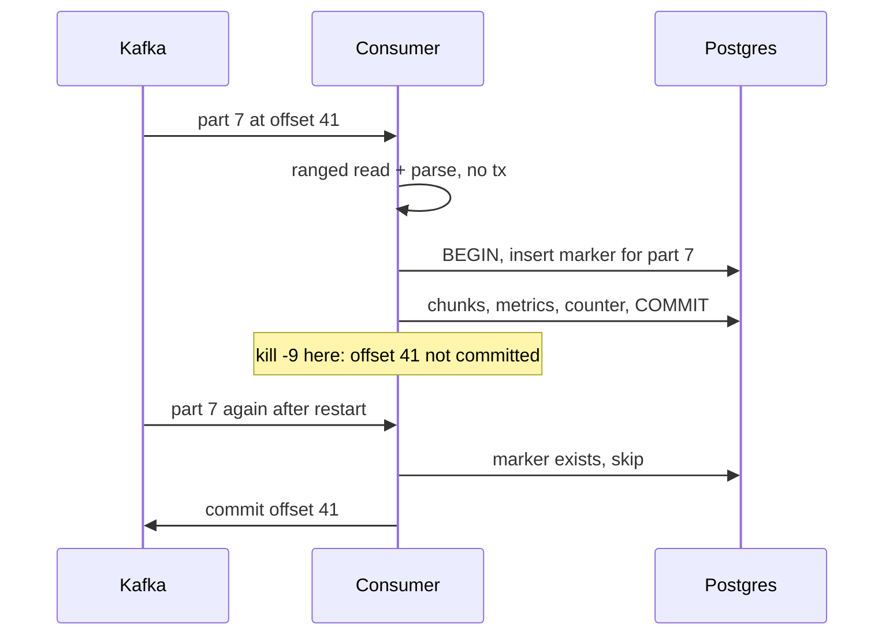


**Why the same transaction?** A transaction is all-or-nothing, so the DB can never hold the data without the marker or the marker without the data. A marker in a separate transaction reopens the gap: a crash between the two leaves data with no marker, and the redelivery writes it again.

| Approach | Status | Problem |
|---|---|---|
| Auto-committed offsets | considered | committed on a timer: a crash loses or duplicates, by luck |
| "Idempotent upserts" | what the resume claimed | metrics `count = count + new`, findings `occurrence_count + 1`: **additive**, so a redelivery doubles them |
| **Marker row, same tx** | shipped | `ingest_parts (document_id, part_idx)` and `enrich_work_done (work_id)` |

Never say "idempotent upserts" when your upserts add.

```java
// EnrichConsumer: LLM work outside, effects inside
if (ledger.isDone(request.workId())) return;   // before the LLM: replay costs 0 tokens
Outcome outcome = callLlmAndEmbed(request);     // slow, no transaction
Boolean won = txTemplate.execute(status -> {
    if (!ledger.claim(request.workId(), request.sessionId()))
        return Boolean.FALSE;                   // another delivery already committed
    for (FindingsWriter.Finding f : outcome.findings())
        findingsWriter.upsert(f);
    if (!outcome.embeddings().isEmpty())
        chunkRepository.updateEmbeddings(request.sessionId(), outcome.embeddings());
    sessionRepository.incrementEnrichedWindows(request.sessionId());
    return Boolean.TRUE;
});
```

### How it was proven (`bench/chaos.py`)

The harness runs the real jar and watches its log. As soon as a unit of work logs "committed" (after the DB commit, before the offset commit: the worst moment) it sends `kill -9`, restarts, repeats three times, and compares every count with a clean run.

| Scenario | Before the fixes | After |
|---|---|---|
| kill -9 after a part commit, x3 | equal (ingest markers existed) | equal |
| kill -9 after an enrichment commit, x3 | occurrences **657 vs 621 (+5.8%)** | **315 = 315** |
| replay `llm.enrich.requests` from 0 | **8,820 LLM calls redone**, 382 of 191 windows | 2,379 items skipped by marker |
| replay `log.ingest.parts` from 0 | **4 finished sessions FAILED** | no effect |
| rebalance (one of two instances killed) | equal | equal |


Plus `ExactlyOnceIT` (Testcontainers, in CI): every part and every enrichment item delivered twice gives an identical database, and the LLM is called once.

### The replay bug

Replaying the parts topic turned four finished sessions FAILED. The data was correct; only the status was wrong. The consumer did the slow ranged read **before** checking its marker, and the staged file was already deleted; every replayed part threw, retried, went to the DLQ, and the failure handler marked the session FAILED. Fix: check the marker first, and never let a late failure fail a completed document. Lesson: exactly-once also means a redelivery mustn't trip over a precondition that has since changed.

**Q. Why not Kafka transactions?** They make consume-and-produce atomic within Kafka. My effect is a Postgres write, which can't join a Kafka transaction.

**Q. An alternative to a marker table?** Store the consumed offset in Postgres in the same transaction, and `seek()` to it on assignment. Also exactly-once, saves a table, more custom code per consumer.

**Q. Anything to watch when deploying it?** Work done by the old code has no marker, so replaying across the deploy re-runs it (~1,080 items measured). Backfill markers or don't rewind past the deploy; run the migration before the new code. (On `fix-ui` the `enrich_work_done` table is in `schema-v2.sql` with the ALTERs for old databases commented; the standalone migration file lives on another branch.)

**Q. Recovery time after a crash?** Until the group rebalances: ~30 s measured, bounded by the session timeout.

## 10. Failures, poison and robustness

| Idea | Meaning |
|---|---|
| Retry | fixes transient errors: timeouts, rate limits |
| Poison message | fails every time; retried forever it blocks its partition (**head-of-line blocking**) |
| Dead-letter queue | parks the poison so the partition moves on |


```java
// KafkaConsumerConfig (shortened)
DeadLetterPublishingRecoverer dlqPublisher = new DeadLetterPublishingRecoverer(
    kafkaTemplate, (record, ex) -> new TopicPartition(dlqTopicFor(record.topic()), 0));
dlqPublisher.setExceptionHeadersCreator(new BoundedExceptionHeaders());
DefaultErrorHandler handler = new DefaultErrorHandler(
    (record, ex) -> {
        failureMarker.mark(record, ex);      // session FAILED with a reason
        dlqPublisher.accept(record, ex);     // park the record
    },
    new FixedBackOff(2000L, 2L));            // 3 delivery attempts in total
handler.setCommitRecovered(true);
```

- **Ingest:** after three attempts the session is FAILED with a readable reason, and the record goes to the DLQ.
- **Enrichment:** a 429 sends the item to `llm.enrich.retry.60s` with `notBefore = now + 60 s`; one retry thread waits and re-publishes, so lanes never sleep. Up to 1,440 attempts (~24 h); nothing is dropped. Other errors go to the DLQ and still **count as done**, so one bad item can't block a session.

### 8 bad inputs, 256 MB heap

The rule: every upload ends parsed, or FAILED with a reason. **Never stuck.**

| Input | Before (`c5ea7d9`) | After |
|---|---|---|
| malformed lines | parsed, 686 lines | same |
| invalid UTF-8 | parsed, 601 lines | DONE |
| one NUL byte | **stuck in PARSING** | DONE in 0.6 s, 601 lines |
| empty file | DONE | same |
| gzip archive | **stuck in PARSING** | FAILED in 0.6 s, readable reason |
| one 100 MB line | **OOM; split consumer stopped** | DONE in 7.7 s |
| 120,000 lines in one minute | FAILED, then **its partition blocked** | DONE in 17.5 s, 60 chunks |
| message that isn't JSON | DLQ; next upload works | same |


**Case 1, one byte that froze a session.** A NUL byte is legal in Java strings but not in Postgres `text`, so the chunk insert failed. After three attempts the failure handler saved the error on the session, but the message **quoted the failing row, NUL included**, so the handler's own UPDATE failed too, and the session sat in PARSING forever. gzip hit the same path (compressed bytes are full of NULs). Fix: strip NUL at the edge, NUL-safe reasons, reject compressed files by magic bytes. Lesson: test the error path with the same bad input.

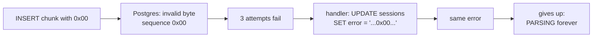

**Case 2, the zombie consumer.** A 100 MB line with no newline was buffered whole; the splitter hit OOM and Spring Kafka **stopped that listener container**. HTTP kept answering (health checks pass) while every later upload stayed CREATED. Fix: bound every buffer (1 MB per line, 64K characters stored, 2,000 lines per chunk) plus `-XX:+ExitOnOutOfMemoryError`, so the platform restarts the process and Kafka redelivers. Trade-off: a record that always OOMs would crash-loop; the bounds prevent that, and a restart-count alert would catch it.

**Case 3, the DLQ that couldn't accept the message.** The busy-minute JDBC error quoted the 14 MB chunk several times; Spring copied the full exception into DLQ headers; the record was **42 MB**; Kafka's limit is 1 MB (`RecordTooLargeException`). A record that can't be dead-lettered is never recovered, so it was retried forever and blocked its partition. `BoundedExceptionHeaders` took headers from **42,010,200 to 9,681 bytes**. The last line of defence needs a size limit too.


**Q. Why not retry forever?** Only self-clearing errors (rate limits) retry for ~24 h, on a separate topic. Bugs and bad data would block a partition.

**Q. Doesn't an OOM just kill one request?** Not in a Kafka listener: an `Error` stops the container while the process looks healthy.

**Q. What's still missing?** A DLQ replay tool, alerts on DLQ growth, and a job that re-triggers sessions stuck in CORRELATING.

## 11. Layer 1: deterministic parsers

One line becomes exact metric rows, with no model involved:

```text
2026-07-15 09:30:02 ERROR [db-proxy] - SQL timeout duration=12000ms

log_metrics (session, 09:30, ERRORS,   errors)         count  += 1
log_metrics (session, 09:30, DATABASE, sql_timeouts)   count  += 1
log_metrics (session, 09:30, DATABASE, sql_latency_ms) sum_ms += 12000
```

"How many 503s between 10:00 and 10:10?" is a SQL query, not an LLM call.


| Piece | Detail |
|---|---|
| `TimeWindowChunker` | 60-second buckets; a line with no timestamp inherits the previous one, so a stack trace stays in its minute |
| caps | at most 2,000 lines or 512 KB per chunk; a busy minute becomes several chunks with the same bucket |
| 8 parsers | ApiCall, Sql, Error, Performance, Auth, Lifecycle, Traffic, Signature (WARN counts, normalised error templates) |
| upsert | key `(session_id, time_bucket, category, metric)`; `count` and `sum_ms` add; `p95` keeps the larger value |

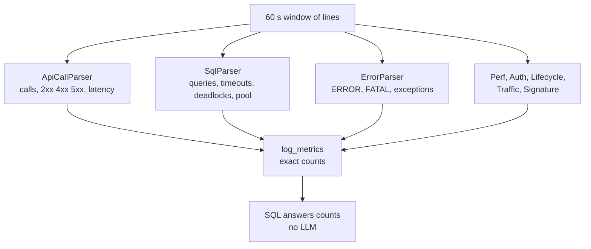

**Precision trap:** counts are exact **per window**. When two parts write the same minute, the upsert keeps the larger p95: an **upper bound**, not the true p95. An exact merge needs the raw samples or a sketch such as t-digest.

**Q. Why regex, not an LLM, for extraction?** Counting must be exact and repeatable; regexes run on every line for free. The LLM later gets these numbers as authoritative context and is told not to compute its own.

**Q. Why not template mining like Drain?** Good for unknown formats, but it gives templates, not domain metrics like "connection pool exhausted".

**Q. A real parser bug?** `(?i)\bERROR\b` counted "parity error corrected", an INFO line in Loghub BGL. Levels are matched case-sensitively now; the old rule survives only in legacy mode.

**Q. Unknown timestamp formats?** An honest gap: only ISO-8601 and syslog; native recognition was 0% on five Loghub formats. Fix: configurable formats.

## 12. The anomaly gate

The gate decides which minutes the LLM ever sees, so it decides the cost.

### Why the original gate failed

The legacy rules were absolute: any ERROR or exception line, five or more WARNs, or latency above 3x the session's p95. Same generator, only the line rate changed:

| Lines/s | Windows flagged | LLM-call reduction | Precision |
|---|---|---|---|
| 1 | 20.8% | 77.2% | 0.64 |
| 2 | 33.3% | 64.9% | 0.375 |
| 5 | 82.5% | 17.2% | 0.232 |
| 20 | 100% | **0%** | 0.25 |
| 50 | 99.6% | **0.3%** | 0.25 |


At 20 lines/s every minute contains a harmless ERROR (an email retry, a client disconnecting), so the gate saved nothing. And the p95 rule **masked itself**: once an incident covers more than 5% of windows, the incident *is* the p95; a payment-latency incident covering 6.7% of a 2-hour log was invisible.

### Median and MAD

Ten minutes of ERROR counts: `2, 3, 2, 4, 3, 2, 3, 250, 2, 3`.

| Statistic | Value | Note |
|---|---|---|
| mean | 27.4 | one bad minute dragged it up 10x |
| median | 3 | ignores the outlier until half the data is bad |
| MAD = median of abs(x - median) | 1 | x 1.4826 estimates a standard deviation |
| threshold | 3 + 3.5 x max(1.4826 x 1, 1) = **8.2** | and the count must be at least 3 |
| modified z for 250 | (250 - 3) / 1.48 = **~167** | the textbook cut-off is 3.5 (Iglewicz and Hoaglin) |


```java
// RobustAnomalyRules.flag: the count-spike rule
double med = median(xs);
double scale = Math.max(MAD_SCALE * mad(xs, med), 1.0);   // MAD_SCALE = 1.4826
for (Instant b : buckets) {
    long c = a == null ? 0 : a.count();
    if (c >= MIN_COUNT && c > med + Z * scale) {           // MIN_COUNT = 3, Z = 3.5
        out.computeIfAbsent(b, k -> new ArrayList<>()).add("SPIKE:" + key);
    }
}
```

### The robust gate: four rules, behind `loglens.anomaly.mode` (default `robust`)

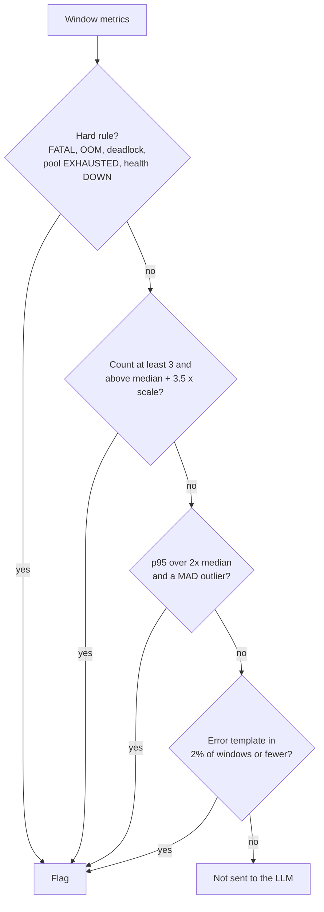

Count spikes cover ERROR, WARN, exceptions, 5xx, 401, 403 and SQL failures, with zero-count minutes counted as zero. Rare signatures catch a single `SSLHandshakeException` but ignore an email-retry error that appears all day.

### Two phases, like MapReduce

A part thread can't know the session's median, so part threads apply **hard rules only** and write counts; the finalizer runs the session-wide statistics **once**, as one SQL statement (`percentile_cont` for medians) ending in `UPDATE ... SET is_anomalous`. A Testcontainers test checks the SQL flags equal the Java flags the eval uses, and the real pipeline with a stub LLM flagged 77 windows and made 315 calls, the same as the eval.

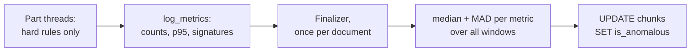

### Results (same build, flag switched)

| Metric | Legacy -> Robust |
|---|---|
| F1, 6 h medium-noise log | **0.576 -> 0.901** |
| Precision | 0.426 -> 0.883 |
| Recall | 0.892 -> 0.919 |
| False alarms per hour | **14.8 -> 1.5** |
| Incident recall (12 incidents) | 1.0 -> 1.0 |
| LLM-call reduction at 50 lines/s | **0.3% -> 74.3%** |
| F1 on held-out seeds | 0.924 / 0.932 / 0.950 |
| F1 on Loghub BGL (real labels) | 0.501 -> 0.581 |


A "silent" credential-stuffing incident, logged only at INFO as `status=401`, was invisible to the legacy rules; the robust gate catches it through the 401 spike.

**Q. MAD is 0 for sparse counts?** The scale is floored at 1 and at least 3 events are required.

**Q. The resume said 90%; now 75%?** Different data: 87.5% on the demo log; the eval corpus is deliberately incident-dense. Savings depend on the share of abnormal windows.

**Q. You wrote the generator and the rules: overfitting?** Held-out seeds, real Loghub BGL labels, the owner's real log, and textbook thresholds, not tuned ones.

**Q. What does the gate miss?** Slow drifts over hours; changes in *what* is logged without volume change; a session abnormal from start to finish (the median moves with it). Next: per-hour-of-day baselines, or a known healthy session.

**Q. Why a feature flag?** Measure both rule sets on one build and dataset, and roll back without a deploy (`LOGLENS_ANOMALY_MODE=legacy`).

## 13. LLM lanes under rate limits

| Limiter | How | Note |
|---|---|---|
| Fixed interval | minimum gap between calls (60,000 ms / 30 = 2 s) | simplest |
| Sliding window | remember the last minute's calls and tokens | handles TPM |
| Token bucket | refills steadily, each call takes tokens | bursts |

All easy on **one** thread; across many threads or instances a shared limiter needs a lock or a coordinator.

> **The Kafka trick:** a consumer group gives each partition to exactly one thread. Pair partition p with API key p, and each key has a **single owner**. A limiter with a single owner needs no lock.


1. The finalizer publishes one `ENRICH_WINDOW` item per flagged window, and `EMBED_BATCH` items for all chunks, choosing the partition itself: `floorMod(workId.hashCode, slots)`.
2. Lane thread i owns partition i and key i; with fewer keys than partitions, lanes share (`partition % slots`). Kafka's assignment keeps a single owner even across instances.
3. Each lane paces itself: one call per `60,000 / (30 x 0.8)` = **2,500 ms**, plus a sliding 60 s budget of `6,000 x 0.8` = **4,800 tokens**. The 0.8 leaves 20% headroom.
4. Windows over 5,000 characters are split on **record boundaries** (`RecordAwareSplitter`), so a stack trace is never cut across calls.
5. Results commit with the `enrich_work_done` marker.
6. A 429 goes to `retry.60s` with `notBefore`; one retry thread waits and re-publishes. Other errors go to the DLQ, counted as done.

```java
/** Blocks until the rate-limit window allows the next call.
 *  Safe from a single owner thread only: no lock needed. */
public void enforceRateLimit() {
    long now = System.currentTimeMillis();
    long waitMs = minIntervalMs - (now - lastCallTimeMs.get());
    if (waitMs > 0) Thread.sleep(waitMs);
}
```

(The `ApiKeySlot` javadoc still mentions a 7,500 ms Gemini interval; the configured Groq interval is 2,500 ms.)

### Napkin: which limit binds?

| | Calls per minute per key |
|---|---|
| by RPM: 60,000 / 2,500 | 24 |
| tokens per call: 5,000 chars ~ 1,250 + prompt, metrics, output | ~1,600 |
| by TPM: 4,800 / 1,600 | **~3** |

For large windows **the token budget binds**, 8x lower than the request budget. Always compute both.


### July 16: 7 of 167 windows embedded

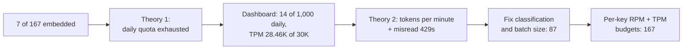

Batches of 10 large windows were ~16K tokens (about one call a minute per key), and the client read per-minute 429s as "daily quota exhausted" and dropped healthy keys.


### Two limiter designs

| | Chat: `ApiKeySlot` | Embeddings: `EmbeddingKeyPool` |
|---|---|---|
| Owner | one thread per key | shared by all lane threads |
| Locking | none | monitor, `wait/notifyAll` |
| Budget | 2,500 ms + 4,800 TPM | 75 of 100 RPM, 24K of 30K TPM per key |
| On 429 | retry topic | bench the key 15 s, rotate |

Why both? Embedding batches come from every lane, so they can't have a single owner; the lock is the price of sharing.

**Q. Trade-offs of partition-per-key?** Kafka can't shrink partitions, so fewer keys later means lanes share; a busy key can't borrow an idle key's capacity.

**Q. "I added retries" - what's wrong with it?** Retries without pacing just reach the limit faster. Pace first, then retry through a separate topic.

**Q. Why not sleep the lane 60 s on a 429?** It stalls its partition and risks `max.poll.interval.ms`: the rebalance storm again.

## 14. Graph 1: incidents and the judge

| LangGraph concept | In Graph 1 |
|---|---|
| State | `AnalyzeState`: session, findings, metrics, clusters, current cluster, attempt, incidents, report |
| Nodes | functions that read state and return updates |
| Conditional edges | pick the next node from the state: this is what makes loops |
| Recursion limit | 25 by default; LogLens sizes it as `12 + findings x 7` |


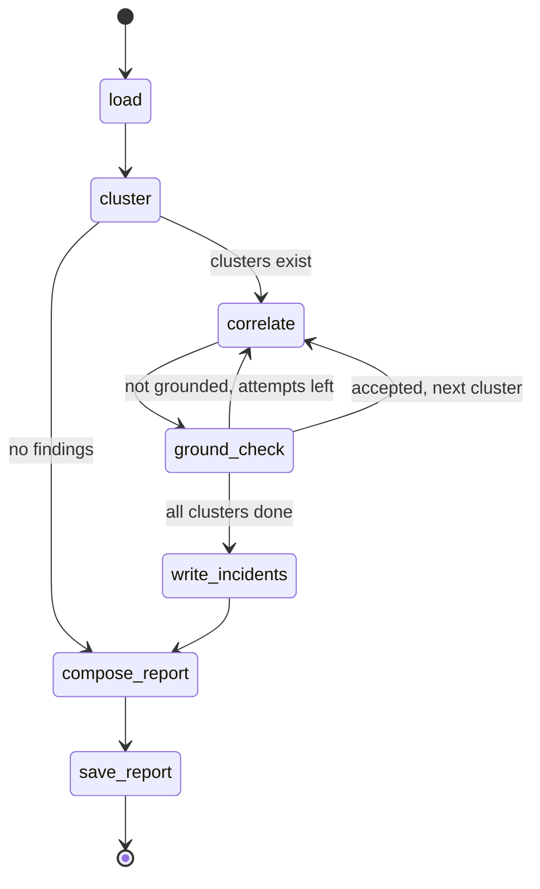

1. `load`: findings and top metrics from Postgres.
2. `cluster` (**plain Python, no LLM**): same category, time ranges within 300 s.
3. `correlate`: the LLM (`llama-3.3-70b-versatile`) writes `{narrative, root_cause}` for one cluster.
4. `ground_check`: a judge answers `{grounded, reason}` against that cluster's findings.
5. Not grounded and attempts left: correlate again. At most `MAX_CORRELATE_ATTEMPTS = 3`; the last story is accepted but stored with `grounded = false` and the judge's reason.
6. `write_incidents`, `compose_report` (exact metrics table from SQL), `save_report`: DONE.

```python
verdict = llm.chat_json_object(prompts.GROUND_CHECK_SYSTEM,
                               prompts.ground_check_user(cluster, narrative, root_cause),
                               ("grounded",))
grounded = verdict.get("grounded") in (True, "true", "True")
last_attempt = attempt + 1 >= config.MAX_CORRELATE_ATTEMPTS
if grounded or last_attempt:
    incident = {..., "grounded": grounded, "judge_reason": reason}   # stored, visible
```

| Real bug | Fix |
|---|---|
| "Recursion limit 25 reached": Llama's judge rejected more, the loop ran longer | limit `12 + findings x (3 x 2 + 1)` |
| A JSON list crashed a session (`data.get` on `[...]`) | object contract; a one-element list accepted; **one** repair call restating the contract; then a clear error (`7d139bc`) |
| Force-accepted stories were only a log line | `incidents.grounded` and `judge_reason` stored |

**Trap:** "the judge proves the story is grounded." No: it is another probabilistic model from the same family as the writer, so they share blind spots. It is a filter, not a proof. Its agreement with humans (Cohen's kappa) is **UNVERIFIED**; it needs ~40 human labels and ideally a judge from another family.

### The evidence chain: no id written by a model

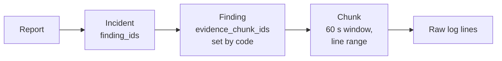

A finding's `evidence_chunk_ids` is the chunk the enrichment call was **about**, attached by code; the model's JSON has no id field. The fingerprint is SHA-256 of category + normalised title, so repeats merge into `occurrence_count`.

### Napkin: what the LLM costs

| | Value |
|---|---|
| 10k-line demo log | 16 of 167 windows flagged: **43 vs 345 chat calls (87.5% fewer)**; tokens 73,720 vs 658,180 (88.8%) |
| 1 GB demo, every byte to the model | 1,073,744,655 / 5,000 = ~215k segments (220,657 with record-boundary splits) |
| 1 GB demo, gated | 571 of 3,019 chunks: **42,205 calls (80.9% fewer)** |
| one full 512 KB chunk | ~100 calls by itself |

Cost is **flagged windows x their size**, not file size. The fix for huge windows is a cap on segments per window.


**Could the live demo run that live on free keys?** 42,205 calls at ~3 per minute per key is days. So the 1 GB demo is precomputed: clusters, counts and evidence lines come from code (`build-dataset.mjs`), and `enrich-incidents.mjs` made **6** `gpt-oss-120b` calls, one per incident, dropping any cause that cites lines outside the evidence.

**Q. Why group findings in code?** Time overlap and category are facts; asking a model to group 50 findings costs tokens and can invent connections.

**Q. Worst-case cost per cluster?** Up to 3 writing calls and 3 judge calls, plus one report call per session.

## 15. RAG for logs: chunks and hybrid search

| | Embeddings | Full-text search |
|---|---|---|
| Good at | meaning: "throttled" ~ "rate limited" | exact tokens: `ORA-01555`, `status=429` |
| Weak at | exact tokens | paraphrase |
| In LogLens | `gemini-embedding-001`, 768-d, reads the first 8,000 chars | `to_tsvector('simple')`: no stemming, no stop words |

Logs are full of exact tokens, so full text matters more here than in prose RAG.

**Why is a chunk one 60-second window?** The minute is what metrics, flags and findings share, so a citation points at exactly the window that was counted and explained. The cost: a minute at 2 lines/s is ~120 lines (~16 KB, the eval averages 15,765 chars); the embedding sees only its start and one vector averages away the line you need. Vector-only recall@10: **0.393**. Embedding a digest of each window's distinct templates raised it to 0.488 offline (not shipped).

### Reciprocal Rank Fusion

Cosine distance and `ts_rank` are different units, so adding scores needs a corpus-dependent normalisation. RRF uses only ranks: **score = sum over lists of 1 / (k + rank)**, k = 60, ranks from 0, top 30 per leg.

```python
_RRF_K = 60
for ranked in ranked_lists:                 # vector top 30, full-text top 30
    for rank, row in enumerate(ranked):     # rank starts at 0
        cid = row["chunk_id"]
        scores[cid] = scores.get(cid, 0.0) + 1.0 / (_RRF_K + rank)
        fused.setdefault(cid, row)
ordered = sorted(fused.values(), key=lambda r: scores[r["chunk_id"]], reverse=True)
```

Worked example: chunk A is 1st in vector and 4th in full text: 1/60 + 1/63 = **0.0325**. Chunk B is 1st in full text only: 1/60 = **0.0167**. A wins: agreement between lists beats being top of one.


### The bug: hybrid scored exactly like vector-only

The full-text leg used `websearch_to_tsquery`, which **ANDs every word**. With `simple`, "which", "did" and "the" became required, so it matched **0 rows** for natural questions, and RRF fused a single list. The OR fallback only ran when *both* legs were empty, which never happens when an embedding exists. It was also slow: ranking recomputed the tsvector of every matching 16 KB row (median **1,374 ms**).

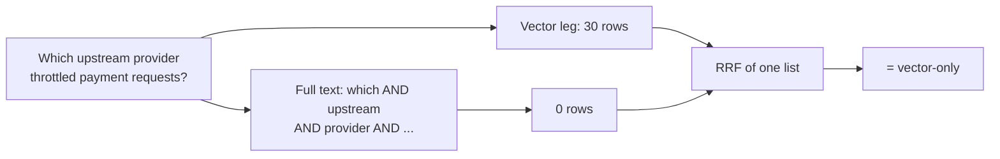

Fix: OR the meaningful terms (stop words removed), always fuse both legs (`42bdb4a`), and a stored generated `content_tsv` column with a GIN index (`aa4eec9`): **19.3 ms**.


| Retriever (51 answerable questions) | R@5 | R@10 | R@30 | MRR | p50 ms |
|---|---|---|---|---|---|
| Vector only (= hybrid before) | 0.340 | 0.393 | 0.441 | 0.280 | 17.3 |
| Full text only (OR) | 0.675 | 0.779 | 0.852 | 0.614 | 19.3 |
| **Hybrid after** | 0.547 | **0.757** | **0.874** | 0.449 | 36.0 |


Say the nuance: full text alone wins at the top (MRR 0.614 vs 0.449) because the weak vector leg's noise rises with equal weights; hybrid wins recall@30, which is what the grader reads. Never claim hybrid is always better.

**Q. Doesn't the GIN index make ranking fast?** It makes **matching** fast; ranking needs each row's tsvector, hence the stored column.

**Q. Why did time-range questions score 0.167?** "Between when?" needs the first and last lines, in two distant windows; that is SQL over `log_metrics`, not RAG.

**Q. GIN or B-tree?** B-tree keeps values sorted (time ranges); GIN maps each word to its rows ("which rows contain stripe").

**Q. Change the embedding model?** Vectors aren't comparable across models: re-embed everything. Gemini is asked for 768 dimensions because its default 3,072 broke the `vector(768)` column.

## 16. Graph 2: corrective RAG


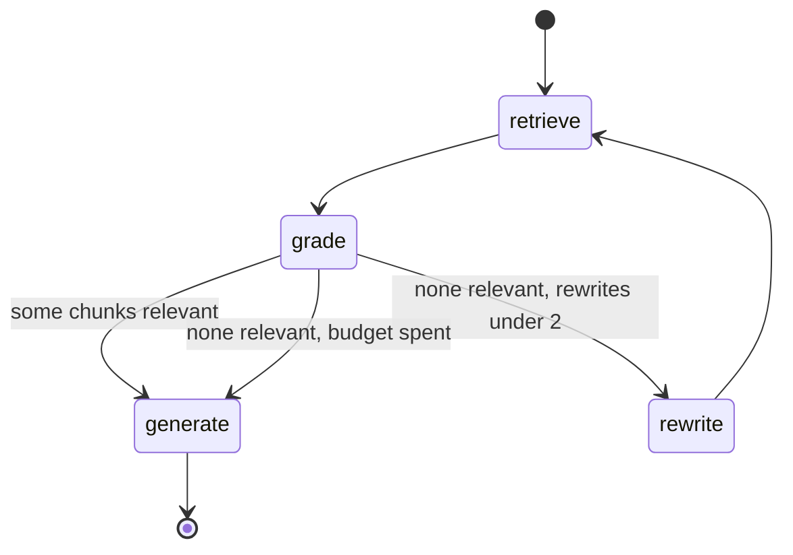

- `retrieve`: embed the question (full-text only if embedding fails), hybrid top 30.
- `grade`: one LLM call returns `{relevant_ids}`.
- `rewrite`: while fewer than `MAX_REWRITES = 2`.
- `generate`: JSON `{answer, citations}`; `best_docs` keeps the first non-empty retrieval (`8b2950b`).
- Citations are filtered to ids actually retrieved: made-up ids are **0 by construction**.

```python
def _after_grade(state: DrilldownState) -> str:
    if state.get("graded"):
        return "generate"
    if state.get("rewrites", 0) < config.MAX_REWRITES:
        return "rewrite"
    return "generate"  # give up rewriting; answer from whatever we have

citations = [str(c) for c in data.get("citations", []) if str(c) in valid_ids]
```

### What the model could actually see

Prompts sent the first 800 characters of each chunk to the generator and 500 to the grader: ~5% of a 16 KB window. Gold lines present in the exact prompt text: **10.7%** (generator) and **6.9%** (grader). The model was asked to cite lines it couldn't see. `focus_snippet()` spends the same budget on lines matching the question's terms, boosts WARN/ERROR/exception lines, and keeps log order: **44.1%** and **37.6%**.


**Q. Does the loop guarantee a correct answer?** It guarantees a bounded attempt. If the evidence isn't in the logs, "not found" is right, measured as abstention.

**Q. Do valid citations mean the answer is faithful?** No: a valid id proves the chunk was retrieved, not that it supports the claim.

**Q. Cost per question?** Two calls normally, at most six (three grades, two rewrites, one answer).

**Q. Would you make it agentic?** As a router: counts and time ranges to SQL, "why" to RAG. The live Ask is exactly that.

## 17. The live Ask: a LangGraph.js decision graph

The Ask panel on the public site runs in a Vercel function (`api/ask.js` -> `api/_lib/graph.js`), not in the Python service.


| Node | What it does |
|---|---|
| `load_memory` | last 4 turns from Redis (`ask:chat:<conversationId>`) |
| `understand` | one LLM call: route, follow-up (rewritten as a standalone question), language |
| `chat`, `general` | small talk, or general knowledge not about this log |
| `web` | Groq's built-in `browser_search` tool; falls back to `general` if it fails |
| `system` -> `nearest` | services, tenants, dependencies from `log-profile.json`; not covered: the closest facts it has |
| `retrieve` | failure types by pgvector and full text, **RRF (k = 60)**, plus matching lines within any named time window |
| `grade` | weak = no lexical hit AND best similarity < 0.55 AND no time window |
| `rewrite` | LLM proposes log keywords, **once** |
| `generate` + verify | drops citations not in the context; numbers absent from the context force confidence to **low** |
| abstain | no supported point -> `system` -> `nearest` |
| `save_memory` | Redis list, keep 20 turns, 24 h TTL |

| Guard (`api/ask.js`) | Value |
|---|---|
| question length | 300 characters |
| per visitor | 25 per day (visitor = SHA-256(salt + IP), never the raw IP) |
| global | 1,500 per day |
| cache | opening questions only, Postgres, key `v2:` + normalised question |
| streaming | NDJSON, one line per step |
| keys | rotate from a random start; move on after 401/403/429/5xx; a bad request doesn't retry |
| memory fallback | Redis down -> Postgres `ask_turns` table |
| model | `openai/gpt-oss-120b`, `reasoning_effort: low` (reasoning tokens count against max_tokens) |

> **Model answer, follow-ups and hallucinations:** Every turn goes to Redis and the graph reads the last four before deciding anything. An understand step rewrites a follow-up as a standalone question, so retrieval never sees "what about it?". Answers about the log come from hybrid retrieval with one bounded rewrite. Then code verifies: citations not in the context are dropped and unsupported numbers force low confidence. If nothing is supported it abstains and falls back to the log profile instead of guessing.

## 18. Postgres as the single source of truth

| Option | Status | Problem |
|---|---|---|
| Elasticsearch + Postgres | v2 draft, cut July 14 | lookup is by id, search is one session (GIN covers it); another cluster to run and sync |
| Vector DB + Postgres | considered | two writes per chunk that can drift; no joins, no shared tx |
| **Postgres 16 + pgvector** | shipped | rows, vectors, full text, findings in one transaction |


| Table | Key | Why |
|---|---|---|
| `sessions` | id | status, window counters |
| `documents` | unique (session, file name, size) | `total_parts`, `parsed_parts`; duplicate upload returns the row |
| `ingest_parts` | PK (document_id, part_idx) | ingest marker |
| `enrich_work_done` | PK (work_id) | enrich marker |
| `log_metrics` | PK (session, time_bucket, category, metric) | exact numbers, additive upsert |
| `log_findings` | unique (session, fingerprint) | repeats merge into `occurrence_count` |
| `incidents` | id | narrative, `grounded`, `judge_reason` |
| `reports` | PK (session) | one per session |
| `log_chunks_s_<uuid>` | PK (chunk_id) | **one table per session**: text, `vector(768)`, stored `content_tsv`, bucket, flag |

Indexes per chunk table: HNSW (`vector_cosine_ops`, m = 16, ef_construction = 64), GIN (`content_tsv`), B-tree (`time_bucket`). Table names come only from a parsed UUID (Java and Python), so injection through them is impossible; if creating the table fails, the session row is removed.

### Why one table per session: post-filtering

A shared HNSW index keeps its best `ef_search = 40` candidates **without knowing about the filter**; the `WHERE session_id = ?` runs after. For a session owning 0.83% of the rows, almost nothing survives.


| Layout (120k vectors, 101 sessions) | Small session s050: recall@10 | Rows of 10 | p50 |
|---|---|---|---|
| shared HNSW, then filter | 0.068 | 0.68 | 0.36 ms |
| shared + iterative scan (pgvector 0.8) | 0.256 | 2.6 | 0.48 ms |
| shared, exact (B-tree + sort) | 1.00 | 10 | 0.55 ms |
| partial HNSW per session | 1.00 | 10 | 0.29 ms |
| LIST partition per session | 1.00 | 10 | 0.40 ms |
| **own table per session** | **1.00** | **10** | **0.24 ms** |


Raising `ef_search` 10x moved the shared index from 0.7 to 2.5 rows of 10: the extra candidates are spent on other sessions. The iterative scan stops at its 20,000-tuple cap. And a quick test passes, because for a 1,000-row match the planner skips HNSW and does an exact scan; two same-size sessions got 65% and 7%. **What breaks filtered vector search is selectivity, not table size.**

| Buys | Costs |
|---|---|
| recall 1.00 in 0.24-0.60 ms | tables created at runtime |
| graph holds only its own rows | raw JDBC (JPA can't map dynamic tables) |
| delete = `DROP TABLE`: no dead rows, no vacuum | catalog growth: tens of thousands of tables slow planning |
| | way out: LIST/HASH partitions (only the name resolution changes) |

**Q. Is the HNSW index always used?** No: on a 360-row session the planner does a seq scan + top-N sort (2.06 ms, exact); forced HNSW 0.84 ms.

**Q. Why a composite index `(session_id, category, time_bucket)`?** Leftmost-prefix rule: one index serves session; session + category; session + category + time range (0.18 ms).

**Q. m, ef_construction, ef_search?** m (links per node: memory, recall ceiling) and ef_construction (build care) are fixed at build; ef_search is query time, recall vs latency (40 -> 400 was 2.1x slower with no gain on isolated tables).

**Q. Insert, then UPDATE the embedding: a problem?** One dead tuple per chunk for autovacuum; at scale, embed first and insert once, or `fillfactor < 100` for HOT updates.

**Q. Wouldn't a vector DB help at 100x?** The measured bottlenecks are parsing CPU, Postgres writes and catalog size. None is vector search.

## 19. Evals, benchmarks and CI

| Metric | Worked once |
|---|---|
| Precision | 15 real of 18 flagged = 0.83 |
| Recall | 15 of 20 incident windows = 0.75 |
| F1 | 2PR / (P + R) = 0.79 |
| MRR | gold chunk at rank 3 -> 1/3 |
| Evidence visibility | gold lines present in the exact prompt text |
| Citation precision, faithfulness, abstention | cited chunks with gold lines; judged; "not in the logs" on unanswerables |


| Dataset | Size | Labels |
|---|---|---|
| `eval_{low,medium,high}noise` (seeded) | 6 h, ~43.7k lines, 360 windows | 12 injected incidents with gold lines |
| held-out seeds 101, 202, 303 | 6 h each | never tuned on |
| Loghub BGL, Thunderbird, HDFS, Spark, Apache | 2,000 lines each | BGL: 143 labelled alert lines |
| owner's demo log | 10k lines, 167 windows | none |
| `golden_qa.json` | 65 questions, 21.5% unanswerable | gold answers and lines **computed by code** |

Why trust them: `WindowEvalCli` runs the **production** chunker, parsers, gate and splitter (no LLM); SQL rules = Java rules (Testcontainers); the real pipeline with a stub LLM agrees (77 windows, 315 calls); LLM evals cache every call by hash(prompt, model, params, endpoint) and stop before $5.

### The CI gate

```json
{
  "_why": "Set from the first robust-mode run (2026-09-29, eval_mediumnoise: F1 0.901, incident recall 1.0, call reduction 77.8%). The eval is deterministic, so any drop is a real behaviour change, not noise.",
  "anomaly_gating": {
    "eval_mediumnoise": {"window.f1": 0.88, "incident_recall": 1.0, "gating.call_reduction": 0.75}
  }
}
```

CI runs unit tests, Testcontainers tests, and the fast seeded eval (~1 minute, $0), and fails below `evals/thresholds.json`. An intentional change updates the file in the same PR; `PROMPT_VERSION` is written into every eval report.


### Six times the benchmark was wrong, not the system

| Symptom | Real cause | Fix |
|---|---|---|
| "the heap is growing" | peak follows GC timing | report the live set |
| no heap data | `jstat` printed `-` | parse leniently; GC log as second source |
| throughput too low | old parts left in Kafka | reset groups, drop sessions every run |
| ClassNotFoundException mid-run | jar rebuilt under a running JVM | each launch copies its jar |
| "could not resize shared memory" | parallel HNSW builds need `/dev/shm` (64 MB in a container) | build single-threaded |
| "exact search has 40% recall" | ~133 rows tie with the 10th best | tie-aware recall |

Plus: the replay test once reported another run's numbers (fixed 40 s wait, appended log); now it waits for lag 0 and counts the stub's calls. A benchmark is an experiment: suspect the measurement first.

**Q. Synthetic eval set: meaningless?** Synthetic on purpose, for exact ground truth; overfitting guarded with held-out seeds, Loghub BGL and the owner's real log. Absolute numbers on customer logs would differ.

**Q. Why a stub LLM in benchmarks?** With a real provider you measure their rate limits. The stub answers instantly, so any slowness is yours.

**Q. One small VM: do the numbers mean anything?** The **shape** holds (flat live set, CPU-bound parsing); never quote 2 MB/s as a service level.

**Q. What's UNVERIFIED?** Answer faithfulness, citation precision/recall and abstention with a real model, and the judge's kappa. The harness is wired against the stub; it needs an API key.

## 20. Scaling to 1,000 tenants and 1 TB a day

| Napkin | Value |
|---|---|
| 1 TB / 86,400 s | **11.6 MB/s**, ~75k lines/s at ~150 B per line (~1 GB/day per tenant) |
| windows | 1,000 tenants x 1,440 min = **1.44M a day** |
| chat calls | 10% flagged x ~4 segments = 576k a day = **6.7 per second** |
| ingest machines | 11.6 / ~2 MB/s per 4-vCPU box = **at least 6**, before headroom |
| vectors | 1.44M x 768 x 4 B = **~4.4 GB a day**, before the index |


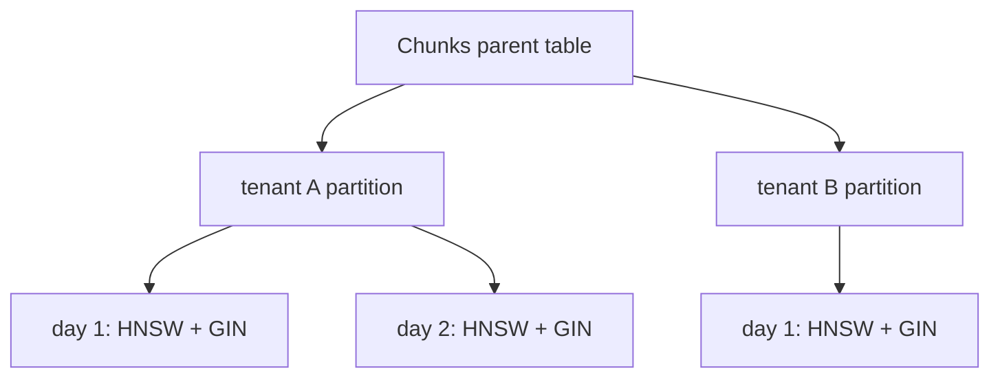

| Change | Why |
|---|---|
| keep presigned uploads and ranged reads | bytes still bypass the API |
| transactional outbox | fixes today's unawaited send |
| separate ingest fleet, 64+ partitions, autoscale on lag, per-tenant quotas, COPY inserts | CPU, then Postgres writes, are the bottlenecks |
| partitions by tenant then day; retention = drop day partitions | replaces per-session tables (catalog limits) |
| separate enrich fleet; cheap model for windows, strong one for reports | cost |
| query service that routes: SQL for counts and ranges, RAG only for "why" | cost and correctness |

Trade-offs to name: partitions vs per-tenant tables; recall vs latency (`ef_search`, iterative scan cap); shared vs per-tenant baselines (one noisy tenant skewing the median); what breaks first (10x: parsing CPU, then PG writes; 100x: catalog, GIN write cost, metrics table size).

## 21. Gaps, security and operations

### Gaps to raise yourself (found reading the code)

| Gap | Fix |
|---|---|
| `kafkaTemplate.send` not awaited after the DB commit (confirm, splitter, retry re-publish): a dual write | transactional outbox |
| finalizer claim commits before its follow-up work: a crash strands the session | FINALIZING state + sweeper, or re-runnable follow-up |
| Graph 1 as a FastAPI `BackgroundTask`; trigger best-effort x3: a restart leaves CORRELATING | re-trigger job, or `analyze` on Kafka |
| Python opens a psycopg connection per query, no pool | `psycopg_pool` sized to the free DB's limit |
| judge from the same model family; kappa not measured | another family, 40 human labels |

Also honest: weak vector leg on long windows; only ISO/syslog timestamps; no metrics dashboard; answer-quality metrics need a real-model run.

### Security and operations

| Area | Detail |
|---|---|
| Auth | stateless JWT, HMAC-signed, 24 h; production requires `JWT_SECRET` (Render generates it); guest login opens one demo session |
| Access | `SessionAccess`: 404 if missing, 403 if not yours; it **returns** the status instead of throwing, because the catch-all handler would turn a thrown 403 into a 500 |
| Secrets | environment variables only |
| Deploy | migration first, then code; `-XX:+ExitOnOutOfMemoryError`; `LOGLENS_ANOMALY_MODE=legacy` rolls back; don't rewind enrich offsets past a deploy |
| Free tier | keep-alive ping every 840,000 ms (14 min) against Render's spin-down; a cold start is ~50 s |

### The first dashboard (proposed, not built)

| Signal | Alert when |
|---|---|
| consumer lag per topic | grows for 10 minutes |
| share of windows flagged | above 40% (gate drift) |
| LLM calls, tokens, cost per session | 2x the weekly median |
| 429 rate per key, DLQ size | any DLQ growth |
| lines with a recognised timestamp | below 90% (new format) |
| "no evidence" rate | jumps week over week |

These would have shown every production incident in the project's history: the rate-limit wall, the rebalance storm, and the gate collapse.

## 22. Stories, and a final drill

**Story A, a hard bug (the rate-limit wall).** A production session had 167 windows and only 7 got embeddings. My first theory was an exhausted daily quota; the dashboard said 14 of 1,000 daily requests but TPM at 28.46K of 30K. Causes: ~16K-token batches (one call a minute per key) and a client misreading per-minute 429s as "daily quota" and dropping healthy keys. Fixing classification and batch size gave 87; per-key RPM and TPM budgets with a retry topic gave 167. Lesson: let the evidence overrule the first theory.

**Story B, a decision under constraints (partition-per-key).** Several free keys, strict per-key limits, bursty work, many threads. One Kafka partition per key gives each key a single owner that paces itself without shared state: 2.5 s between calls plus a rolling token budget, and 429s go to a 60 s retry topic so lanes never sleep. Trade-off: Kafka can't shrink partitions, and a busy key can't borrow from an idle one.

**Story C, checking your own claims.** The resume claimed exactly-once effects and the project had no tests. kill -9 right after a commit, three times, plus a replay from offset 0: ingest held; enrichment was +5.8% after crashes and a replay redid 8,820 LLM calls. A marker in the same transaction, checked before the LLM call, made counts exact. Same habit on retrieval: an ablation showed hybrid = vector-only to three decimals; the AND bug; recall@10 0.39 -> 0.76.

**Story D (backup), one bad file stopped ingest for everyone.** The NUL hang, the zombie consumer, the 42 MB DLQ record (Section 10).

### Rapid fire

| Question | Answer |
|---|---|
| How big is a part? | ~5 MB, cut at a minute boundary on a timestamped line; hard cap 20 MB |
| Why `max.poll.records=1`? | records block ~90 s; 500 per poll blew the 15-min interval: rebalance storm |
| What makes ingest exactly-once? | `ingest_parts` marker in the same tx as chunks, metrics and counter; ack after commit |
| Live set on 2 GB at `-Xmx256m`? | 81 MB max, 70 median, after full GC; never quote peak occupancy |
| The gate's threshold? | count >= 3 and > median + 3.5 x max(1.4826 x MAD, 1) |
| Groq lane pacing? | 60,000 / (30 x 0.8) = 2,500 ms, plus 4,800 tokens per sliding minute |
| RRF constant? | k = 60, ranks from 0, top 30 per leg |
| Per-session vs shared, small session? | recall 1.00 vs 0.068 (0.68 rows of 10) |
| Graph 1's loop limit? | 3 attempts per cluster, then stored `grounded = false` with the reason |
| What does CI check? | seeded eval: F1 >= 0.88, incident recall 1.0, call reduction >= 75% |
| Hybrid query latency? | p50 36 ms, p95 45 ms |
| Upload to DONE, 10k-line log? | 21.2 s (stub LLM); parsed in 2.1 s |

### The one rule for every challenge

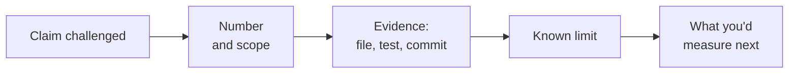

Never argue from adjectives. Use the precise words: **exactly-once effects**, **cited windows with exact line ranges**, **87.5% on the demo corpus**, and **UNVERIFIED** wherever it is.
